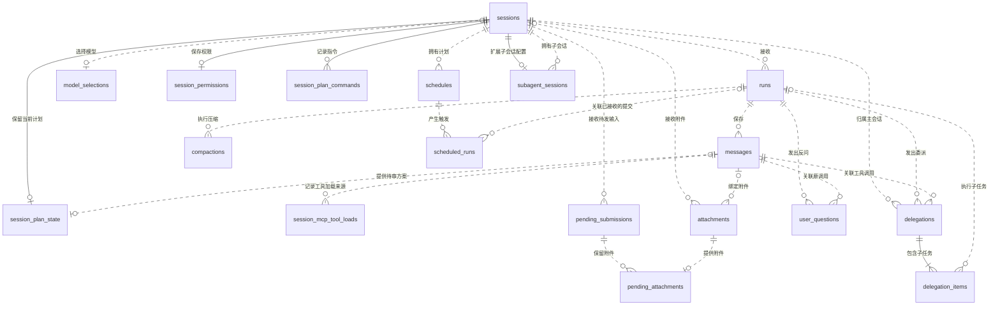

# 数据库总览

应用使用一个本地 SQLite 数据库，共 **18 张业务表**，默认文件为 `~/.agent-learning/sessions.sqlite`。会话是聊天数据的入口。一段会话可以接收多次运行，每次运行记录它产生的消息或上下文压缩。定时任务到点时先记下一次触发，服务接收后再把这次触发关联到实际运行。

## 存储范围

| 项目 | 当前实现 |
| --- | --- |
| 打开数据库 | Server 启动时调用 Coding Agent 的 `SessionStore.open`。定时任务的 `ScheduleStore` 使用同一个数据库连接。 |
| 建表与版本 | 初始化时创建缺失的表。18 张表均为 `STRICT` 表，数据库会检查列类型。初始化也会把 `PRAGMA user_version` 从 `0` 更新到 `1`，并处理旧版默认会话标题。 |
| 写入边界 | 一批需要同时保存的记录放在同一个事务里。例如，服务接收定时提交时，会一并保存运行、首条用户消息和触发记录的关联。 |
| 库外数据 | 工作区登记保存在 `~/.agent-learning/workspaces.json`。附件原文件保存在 `<数据库路径>.files/attachments/`。凭据、MCP 配置和长期记忆也由各自的文件存储管理。 |

[Server 启动入口](../../packages/server/src/webserver/index.ts) · [会话建表和写入代码](../../packages/coding-agent/src/session-store.ts#L89) · [定时任务建表代码](../../packages/coding-agent/src/schedule-store.ts#L47)

## 数据表

| 用途 | 表 | 一行代表什么 |
| --- | --- | --- |
| 会话历史 | [`sessions`](sessions.md) | 一段已持久化的会话 |
| 会话历史 | [`runs`](runs.md) | 一次已接收的聊天任务或手动压缩 |
| 会话历史 | [`messages`](messages.md) | 一条用户消息、助手消息或工具结果 |
| 会话历史 | [`compactions`](compactions.md) | 一次上下文压缩及其进度或结果 |
| 会话设置 | [`model_selections`](model_selections.md) | 一个会话的模型选择，或应用的默认选择 |
| 会话设置 | [`session_permissions`](session_permissions.md) | 一个会话的工具权限模式 |
| 计划模式 | [`session_plan_state`](session_plan_state.md) | 一个会话正在规划或等待确认的状态 |
| 计划模式 | [`session_plan_commands`](session_plan_commands.md) | 一次由应用直接处理的计划模式指令提交 |
| 工具与附件 | [`session_mcp_tool_loads`](session_mcp_tool_loads.md) | 一个会话通过工具搜索加载的一项 MCP 工具 |
| 工具与附件 | [`attachments`](attachments.md) | 一个已上传附件的元数据及归属 |
| 定时任务 | [`schedules`](schedules.md) | 一条定时任务计划 |
| 定时任务 | [`scheduled_runs`](scheduled_runs.md) | 某条计划在一个预定时间的触发记录 |
| 人机协同 | [`pending_submissions`](../../packages/coding-agent/src/session-store.ts#L141) | 一条已接收的会话输入，包含待发消息、插话或后台报告。 |
| 人机协同 | [`pending_attachments`](../../packages/coding-agent/src/session-store.ts#L145) | 一份仍归待发输入保留的附件。 |
| 人机协同 | [`user_questions`](../../packages/coding-agent/src/session-store.ts#L149) | 一次反问及其答复状态。 |
| Multi-Agent | [`subagent_sessions`](subagent_delegations.md#subagent_sessions) | 一段子会话的归属和角色配置。 |
| Multi-Agent | [`delegations`](subagent_delegations.md#delegations) | 一次工具委派及其报告投递状态。 |
| Multi-Agent | [`delegation_items`](subagent_delegations.md#delegation_items) | 一次委派中的单项任务和结果。 |

## 功能来源

| 新增表 | 功能 | 对应设计 |
| --- | --- | --- |
| `pending_submissions`、`pending_attachments`、`user_questions` | 里程碑 2 Feature 10 人机协同 | [Feature 10 技术设计](../../planning/里程碑2/feature10/feature10-人机协同技术设计.md) |
| `subagent_sessions`、`delegations`、`delegation_items` | 里程碑 2 Feature 12 Multi-Agent | [Feature 12 技术设计 §3.2](../../planning/里程碑2/feature12/feature12-Multi-Agent技术设计.md#32-委派子-agent-任务) |

## ER 图

每个框是一张表，连线表示数据库外键。线端的圆圈表示可为零，双竖线表示恰好一条，三叉表示可以有多条。例如，一段会话可以有零到多次运行，每次运行必须属于一个会话。

- `model_selections` 的默认选择单独占一行，`session_id` 为空。
- 会话可以保留多条定时计划的历史记录，当前未删除的计划最多一条。定时触发在状态变为 `accepted` 时才会关联运行。
- 工作区 ID、创建定时计划的运行 ID、压缩摘要引用的消息 ID 都由应用维护。相关字段和校验见逐表说明。

## 字段说明约定

- `PK` 是主键，用来标识一行。`FK` 是外键，用来指向另一张表的记录。`UNIQUE` 表示值或字段组合不可重复。
- 可空列允许 SQL `NULL`。数据库对 JSON 列检查文本是否合法，内容的业务含义及额外校验见字段说明。
- 时间字段会标明单位。Unix 毫秒是距 1970 年 1 月 1 日 UTC 零点的毫秒数。
- 修改表结构、外键或字段业务规则时，同步更新逐表说明和受影响的总览内容。
