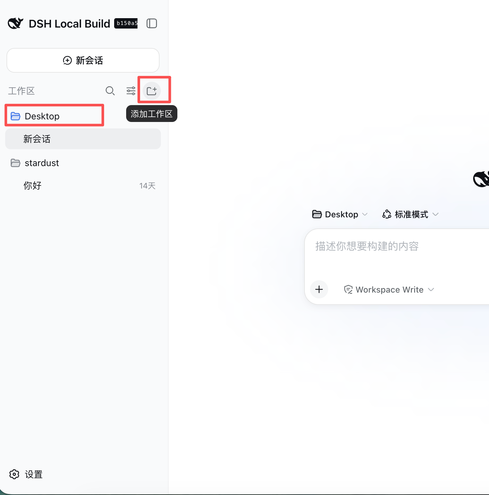
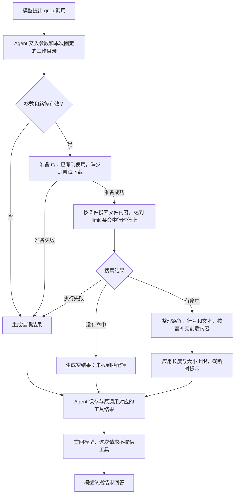
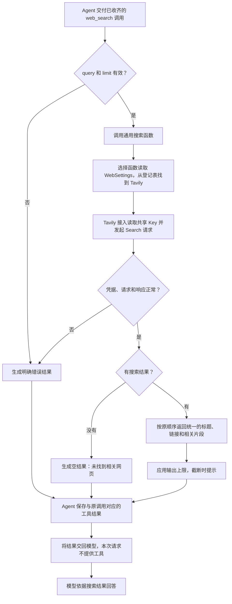
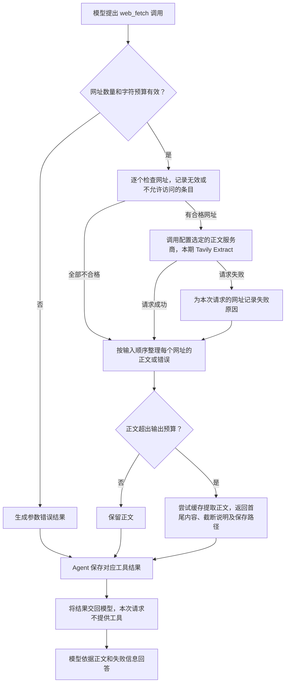
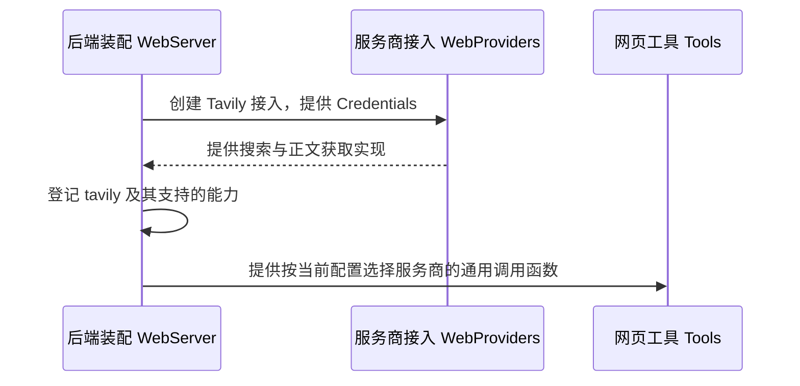
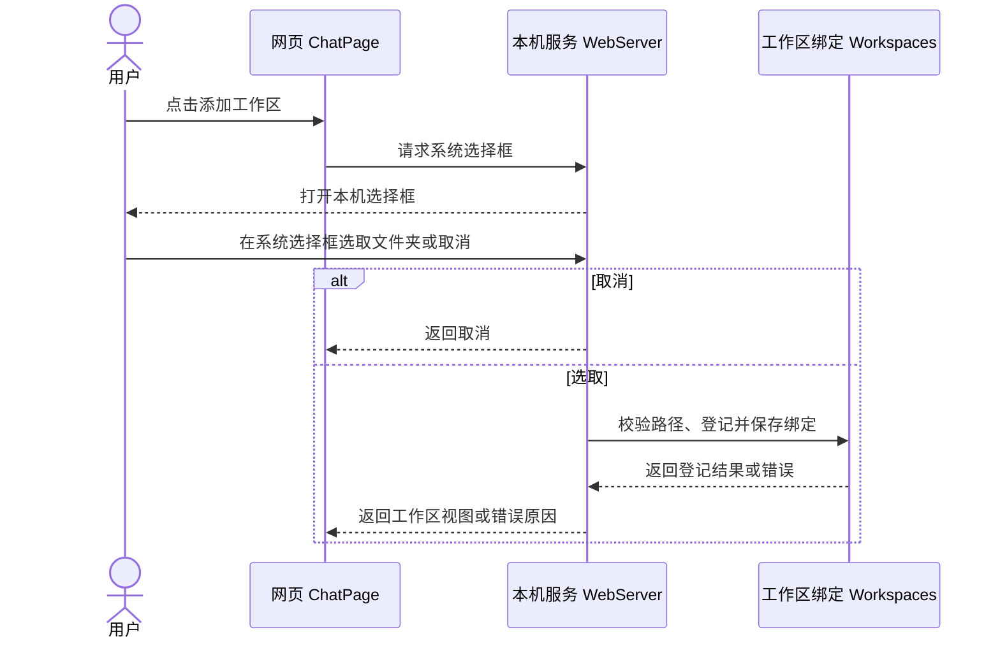
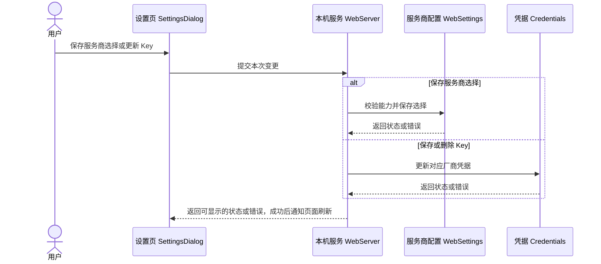
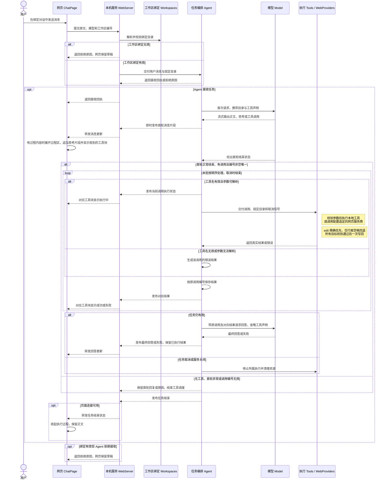
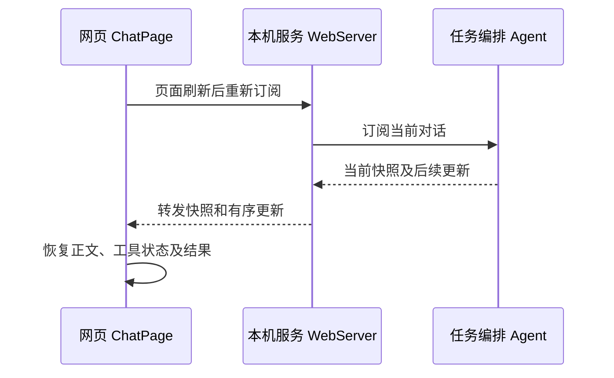

# Feature4：工作区选择与工具执行

状态：已通过

## 1. 总结

**需求理解**　用户先通过侧栏的「添加工作区」选取一个本机文件夹，再进入该文件夹下的当前对话发送消息。前端开放一个文件夹名额，服务重启时恢复登记与绑定，对话从空历史开始。每次提交以绑定目录为本地工具的执行起点，处理一批工具调用并请模型根据真实结果回答。网页实时展示思考和工具进度，任务结束时收起执行过程并保留正文。本期分别验收 read、bash、edit、write、find、grep、web_search、web_fetch 的正常调用，本地验收使用临时目录。两个网页工具共用一个 Tavily Key，后续可以按能力接入其他服务商。

**技术方案**　WebServer 校验工作区绑定并交给 Agent 固定目录。Agent 沿用模型流式事件，等首轮完整结束后调度 Tools，按原调用编号保存结果并发起一次仅用于回答的模型请求。网页订阅 Agent 的状态和结果。网页工具通过 WebProviders 调用配置选定的服务商，服务商选择和凭据分别保存。

用户提供的 DSH 截图标出了侧栏入口和工作区行的位置。

## 2. 系统变化说明

**Before**　当前网页已支持唯一对话、模型配置和流式回复。Server 提供四工具声明，Model 可以接收声明及工具调用，但生产 Agent 请求尚未提供工具，没有执行器，也不产生执行结果。网页没有工作区列表，工具结果消息尚未显示。

**After**　用户添加本机文件夹并进入其下的当前对话后，可以发送消息。重启恢复工作区与绑定，显示空的当前对话。模型和本地工具共用本次任务固定的工作目录。网页显示调用、执行状态、真实结果和最终回答。设置页可管理网页服务商选择及共用的 Tavily Key。

## 3. 系统设计

### 3.1 模块变化

#### 工具执行 Tools

**职责**　执行本地及网页工具，将真实结果交回 Agent。

**共用规则**　本地路径以任务目录解析相对路径，并支持绝对路径和 `~/…`。工具沿用任务取消信号。网页请求失败时返回对应错误，无自动重试或厂商切换。每个工具只执行当前调用。

**接口：新增 8 项，修改 0 项。**

##### 【新增】`read.execute`（进程内调用，拟新增）

**用途**　Agent 将已收齐的 read 调用交给 Tools，Tools 根据本次任务固定的工作目录读取文本，将内容或明确错误返回给 Agent。Agent 关联原调用编号后保存、展示并回填模型。

**主要流程**　Tools 校验路径和行数参数后，以任务目录为相对路径起点打开文件，按起始行和行数截取 UTF-8 内容，再把文本、截断提示或读取错误交回 Agent。

##### 【新增】`bash.execute`（进程内调用，拟新增）

**用途**　Agent 将已收齐的 bash 调用交给 Tools，Tools 在固定工作目录启动 Bash，返回真实输出、退出状态或明确的失败原因。Agent 保存、展示并回填对应结果。

**主要流程**　Tools 校验命令与超时后，在任务目录启动独立的非交互 Bash，收集标准输出、错误输出及退出码，遇到超时或取消时终止所属进程组，并将已收集的输出和结束原因交回 Agent。

##### 【新增】`edit.execute`（进程内调用，拟新增）

**用途**　Agent 将已收齐的 edit 调用交给 Tools，Tools 在同一份原文件中核对指定替换，全部通过后一次写回，将实际替换数量或明确错误返回给 Agent。

**主要流程**　Tools 在同一份原文中逐项精确查找，未命中才忽略行尾普通空格重试，确认每项命中唯一且范围互不重叠后一次写回，再向 Agent 返回替换数量或错误。

##### 【新增】`write.execute`（进程内调用，拟新增）

**用途**　Agent 将已收齐的 write 调用交给 Tools，Tools 以给定字符串创建或完整覆盖目标文件，写入完成后返回实际目标路径，供 Agent 保存、展示并回填结果。

**主要流程**　Tools 校验路径和内容后，在任务目录下解析相对路径并创建缺失的父目录，再按给定 UTF-8 内容创建或覆盖目标文件，将写入路径或错误交回 Agent。

##### 【新增】`find.execute`（进程内调用，拟新增）

**用途**　Agent 将已收齐的 find 调用交给 Tools，Tools 从指定目录按名称或路径规则查找，将路径列表或明确错误返回给 Agent，供其保存、展示并回填模型。

**主要流程**　Tools 校验通配规则和搜索目录后运行 fd，按搜索起点输出匹配的相对路径，并在达到条数或大小上限时提示截断，执行失败时向 Agent 返回错误及已有的部分结果。

##### 【新增】`grep.execute`（进程内调用，拟新增）

**用途**　Agent 将已收齐的 grep 调用交给 Tools，Tools 在指定文件或目录中搜索文本，将文件路径、行号、命中文本和按需补充的上下文返回给 Agent，供其保存、展示并回填模型。

**主要流程**　Tools 解析搜索路径和匹配选项后用 rg 搜索文件内容，按命中行补取所需上下文，再把文件名、行号和文本交回 Agent，分别标明无匹配或执行失败。

这张图说明 `grep` 怎样查找命中文本并把结果交回模型。

##### 【新增】`web_search.execute`（进程内调用，拟新增）

**用途**　Agent 将已收齐的 web_search 调用交给 Tools，Tools 通过配置选定的搜索服务商获取标题、链接与相关片段，将统一结果或错误返回给 Agent，供其保存、展示并回填模型。

**主要流程**　Tools 校验搜索词和条数后调用通用搜索函数，由选择函数读取 WebSettings 并找到对应厂商的搜索实现，Tools 收到统一结果后按输出上限整理，再把标题、链接、片段或错误交回 Agent。

**执行一次网页搜索**

这张图说明 `web_search` 怎样用当前配置选中 Tavily、执行搜索并把结果交回模型。

##### 【新增】`web_fetch.execute`（进程内调用，拟新增）

**用途**　Agent 将已收齐的 web_fetch 调用交给 Tools，Tools 校验网址并通过配置选定的正文服务商获取内容，按输入顺序返回各网址的正文或失败原因，并控制正文输出大小。

**主要流程**　Tools 逐个检查网址并记录无效项，把合格网址交给配置选定的正文服务商，再按输入顺序合并各页正文和错误，应用正文预算后将结果交回 Agent。

这张图说明 `web_fetch` 怎样获取指定网址的正文并处理部分成功和正文超量。

**数据：新增 4 项，修改 1 项。**

- **【新增】`FindParams`（拟新增）：** 表达名称或路径查找请求。Tools 读取 pattern 确定匹配规则，读取 path 确定搜索起点，读取 limit 限制结果条数。
- **【新增】`GrepParams`（拟新增）：** 表达文件内容搜索请求。Tools 读取 pattern、path、glob 确定搜索条件，读取 ignoreCase、literal 确定匹配方式，读取 context、limit 控制返回内容。
- **【新增】`WebSearchParams`（拟新增）：** 表达与厂商无关的网页搜索请求。Tools 读取 query 和可选的 limit，经检查和补齐默认值后交给搜索服务商。
- **【新增】`WebFetchParams`（拟新增）：** 表达与厂商无关的正文获取请求。Tools 读取 urls 确定待获取的网址，以 char_limit 控制每页正文预算。字符预算由通用工具应用，不依赖 Tavily 专有字段。
- **【修改】`EditParams`**　沿用 path 和 edits 数组，更新模型看到的匹配说明。oldText 先按原文精确查找，未命中时仅忽略行尾普通空格，命中须唯一。

本模块继续使用既有 `ReadParams`、`BashParams`、`WriteParams` 及文本内容结构。Agent 通过 `ToolResultMessage` 关联调用和结果。

#### 网页服务接入 WebProviders

**职责**　将通用搜索或正文获取请求转换为厂商 API，并将厂商响应转换为统一结果。应用装配按配置选择支持相应能力的服务商并注入 Tools。本期仅实现 Tavily，不复制 Hermes 的动态插件发现或多厂商自动兜底。

**启动时登记服务商**

这张图说明 WebServer 启动时怎样登记 Tavily 接入，并把通用网页调用函数交给工具。

**接口：新增 2 项，修改 0 项。**

##### 【新增】`WebSearchProvider.search`（进程内调用，拟新增）

**用途**　Tools 向配置选定的搜索服务商提交已校验的 query、已补齐的 limit 和取消信号，取得统一的 `WebSearchHit[]`，无需识别 Tavily 的请求字段或鉴权方式。

**主要流程**　Tavily 接入从 Credentials 取 Key，将搜索词和条数映射到 Search API 的请求字段并发送 HTTP 请求，再把响应中的标题、链接和片段转换成统一搜索结果交回 Tools，失败时返回明确错误。

##### 【新增】`WebFetchProvider.fetch`（进程内调用，拟新增）

**用途**　Tools 向配置选定且支持正文获取的服务商提交合格网址与取消信号，取得逐网址的统一正文结果，无需识别 Tavily 的认证或正文请求字段。

**主要流程**　Tavily 接入用与搜索共用的 Key 向 Extract API 请求正文，再按原请求网址匹配返回的正文与状态，把各页内容或失败原因交回 Tools。

**数据：新增 2 项，修改 0 项。**

- **【新增】`WebSearchHit`（拟新增）：** 表达单条搜索结果，包含 title、url 和 description。WebProviders 负责归一化，Tools 读取后生成有序的工具结果。厂商专有响应不向 Agent 透传。
- **【新增】`WebFetchPage`（拟新增）：** 表达单个请求网址的正文结果，包含 url、title、content 和 error。WebProviders 完成网址对应与状态归一化，Tools 读取后应用预算并按输入顺序返回。缓存信息由 Tools 追加到工具结果。

#### 工作区 Workspaces

**职责**　登记真实目录，持久保存当前对话的工作区绑定，为每次消息提交解析可用的执行目录。

**接口：新增 3 项，修改 0 项。**

- **【新增】`GET /api/workspaces`（HTTP）**　ChatPage 读取已登记工作区、当前绑定及目录可用状态，用于侧栏、输入区目录和发送门禁。
- **【新增】`POST /api/workspaces/pick`（HTTP）**　ChatPage 发起无请求体的选择操作，取得工作区视图或取消结果。

  **主要流程**　WebServer 校验授权后打开系统选择框，用户取消时返回取消状态，用户选中时按真实路径校验并去重，首次登记同时保存会话绑定，再把工作区视图或失败原因交给 ChatPage。

- **【新增】`Workspaces.resolveBoundDirectory(workspaceId)`（进程内调用）**　WebServer 在提交前核对编号与当前绑定，检查记录对应的真实目录仍可用，交回本次任务的绝对路径。路径不可用时拒绝提交并提示原因，保留登记。

**数据：新增 2 项，修改 0 项。**

- **【新增】`WorkspaceFile`**　Workspaces 在 `~/.agent-learning/workspaces.json` 保存登记集合及当前绑定。首次登记建立绑定，后续登记保留已有绑定。服务重启时加载它，当前对话从空历史开始。
- **【新增】`WorkspaceView`**　Workspaces 提供给 ChatPage 的目录名称、绝对路径、可用状态及绑定。目录名称从路径计算。

构造示例为 `{"workspaces":[{"id":"ws-01","path":"/Users/stardust/Downloads"}],"boundWorkspaceId":"ws-01"}`。这是 `WorkspaceFile` 的内容，页面视图额外提供名称和可用状态。

#### 服务商设置与凭据 WebSettings、Credentials

**职责**　WebSettings 保存两个能力各自的服务商选择，向页面提供可选厂商与状态。Credentials 按厂商管理本机凭据。

**接口：新增 4 项，修改 4 项。**

- **【新增】`GET /api/web/settings`（HTTP）**　设置页取得厂商标识、名称、支持能力、当前选择与凭据状态。
- **【新增】`PUT /api/web/settings`（HTTP）**　校验搜索与正文获取对应的厂商能力，保存所选厂商。读取 `searchProvider` 和 `fetchProvider`。成功返回最新视图并通知其他页面刷新。
- **【新增】`DELETE /api/web/providers/:providerId`（HTTP）**　删除对应 Key 并返回最新状态。已保存的服务商选择继续指向该厂商，后续调用可明确提示未配置。
- **【修改】`Credentials.readStatus(providerId)`（进程内调用）**　按指定厂商报告未配置、已配置或错误。页面接口只取得此状态。
- **【修改】`Credentials.readApiKey(providerId)`（进程内调用）**　模型与网页服务商在发起各自请求前取得对应 Key。一次请求持有读取到的值，后续请求读取更新后的值。
- **【修改】`Credentials.saveApiKey(providerId, key)`（进程内调用）**　检查输入，在锁内读取并更新对应项，通过临时文件替换提交，保留其他厂商数据。损坏的 JSON、待操作凭据项或权限异常时报告错误。
- **【修改】`Credentials.deleteApiKey(providerId)`（进程内调用）**　在同样的文件保护下移除指定项。Key 更新或删除成功后，网页设置收到状态变化通知。

##### 【新增】`PUT /api/web/providers/:providerId`（HTTP）

**用途**　设置页保存指定网页服务商的本机凭据。

**主要流程**　WebServer 校验授权、厂商标识和 `apiKey` 格式后，调用 Credentials 写入对应厂商条目，再把配置状态或脱敏错误送回设置页，保存成功时页面清空输入。

**数据：新增 2 项，修改 1 项。**

- **【新增】`WebSettingsFile`**　WebSettings 将两个服务商标识写入 `~/.agent-learning/settings.json` 的 `web` 部分。本期缺少配置时，按唯一支持对应能力的厂商初始化两项默认值。
- **【新增】`WebSettingsView`**　设置页用返回的厂商目录渲染选项和状态。装配按能力及配置解析具体执行实现。
- **【修改】`AuthFile`**　现有 `~/.agent-learning/auth.json` 以厂商标识保存 Key。DeepSeek 请求使用 `deepseek` 项，Tavily Search 与 Extract 使用同一个 `tavily` 项。读取状态或更新时按目标厂商校验，保留其他条目。

#### 模型适配 Model

**职责**　将 Agent 提供的消息和工具声明转换为 DeepSeek 请求，将模型的流式回复转为项目已有事件。

**接口：新增 0 项，修改 2 项。**

- **【修改】`discoverModels`（进程内调用）**　显式查询 `deepseek` 凭据状态并返回可选模型。网页工具配置通过独立的设置接口读取。

##### 【修改】`createModelStream`（进程内流）

**用途**　Agent 使用它发起首轮及结果回填后的模型请求。

**主要流程**　Model 读取 DeepSeek 凭据后，将 Agent 提供的历史、思考和工具数据转成请求，按本次调用附上或省略工具声明，再把 DeepSeek 的流式内容和结束状态交回 Agent。

**数据：新增 0 项，修改 0 项。**　继续使用 `ModelContext`、助手内容块和文本 `ToolResultMessage`。

#### Agent 调度

**职责**　持有唯一对话的消息和任务状态，组装两次模型请求，按顺序完成一批工具调用，并通过现有订阅向页面发布结果。

**接口：新增 0 项，修改 2 项。**

- **【修改】`Agent.subscribe`（进程内订阅）**　首次快照含任务阶段及历史工具结果。后续按序号发布模型消息和任务变化。结束单个订阅只清理该订阅，已接收的任务仍由 Agent 持有。

##### 【修改】`Agent.submit`（进程内调用）

**用途**　接收 WebServer 已解析工作目录的用户消息，返回原有接收回执，并驱动整个任务。

**主要流程**　Agent 接收消息后固定工作目录并发起首轮请求，流式转发思考与工具调用，等首轮正常结束且整批编号有效后再顺序处理工具，按原编号保存结果并回填模型生成最终回答，在整次任务结束时解除忙碌。

**数据：新增 1 项，修改 3 项。**

- **【新增】`ExecutableTool`**　Agent 定义在现有 `Tool` 声明上附加执行方法的契约。应用装配提供声明与执行方法。Agent 向模型发送声明，向执行方法传入参数、固定工作目录和取消信号。执行方法交回文本结果或错误，Agent 负责生成带原调用编号的 `ToolResultMessage`。

- **【修改】`RunningState`**　记录模型请求、工具执行或最终回答阶段，以及正在执行的调用位置。切换至最终回答时更新当前回答编号。空值表示整次任务结束。
- **【修改】`ConversationMessage`**　工具结果记录所属首轮消息和调用位置，供网页关联。结果未配齐的助手工具消息与其已有结果一并排除出后续模型历史，网页保留已收到的内容和原因。模型协议仍使用原工具调用编号。
- **【修改】`ConversationUpdate`**　增加任务更新，携带新的运行状态及需要追加或更新的消息条目。模型 `done` 只完成对应模型消息，任务更新才解除发送门禁。

构造示例为 `{"userMessageId":"msg-u1","assistantMessageId":"msg-a1","phase":"tools","activeTool":{"assistantMessageId":"msg-a1","contentIndex":0}}`。这是 `RunningState` 的执行阶段。ChatPage 继续禁止发送，MessageList 根据调用位置展示执行中状态。

#### 消息接收与订阅 WebServer

**职责**　通过现有本机授权接收提交、解析绑定工作目录、装配后端能力并转发进度。

**接口：新增 0 项，修改 2 项。**

##### 【修改】`POST /api/messages`（HTTP）

**用途**　接收 ChatPage 在已绑定工作区提交的原文，并返回消息接收回执。

**主要流程**　WebServer 校验授权和提交内容，用工作区编号解析可用的绑定目录，再把原文和固定目录交给 Agent，接收成功时返回 HTTP 202，拒绝时返回原因并由网页保留草稿。

##### 【修改】`/api/events`（WebSocket 订阅）

**用途**　将 Agent 的权威对话状态送回 ChatPage。

**主要流程**　连接授权后，WebServer 按订阅编号先发送 Agent 的当前快照，再转发有序更新和配置通知，页面刷新后用新快照恢复结果，关闭或替换订阅只释放对应订阅。

**数据：新增 0 项，修改 3 项。**

- **【修改】`SubmitMessageRequest`**　ChatPage 加入当前对话的 `workspaceId`，WebServer 通过后端绑定解析执行路径。
- **【修改】`ServerFrame`**　增加无秘密内容的工作区与网页工具设置刷新通知。现有对话快照与增量帧承载 Agent 的任务状态。
- **【修改】`WebServerOptions`**　允许验收使用临时的工作区与设置文件位置及可控的目录选择器。正常启动使用约定的本机配置和原生面板。

#### 网页交互 ChatPage、MessageList、AssistantMessage、SettingsDialog

**职责**　展示工作区入口、配置状态、工具执行及最终回答，使用后端状态判断是否可以发送。

**接口：新增 0 项，修改 4 项。**

- **【修改】`ChatPage`（组件）**　加载工作区及绑定，在工作区下展示当前对话，输入区显示目录。选择或登记期间禁用重复操作，已有登记后禁用添加。进入有效绑定的对话且任务结束时才开放发送，草稿始终可编辑。
- **【修改】`MessageList`（组件）**　按出现顺序将连续的思考与工具块呈现为「执行过程」。正文保持原位置，隔开相邻过程段。工具结果按所属消息和调用位置交给对应块。运行时默认展开外层过程区，任务结束后默认收起，用户可重新展开。刷新或重订阅后以快照重建。
- **【修改】`AssistantMessage`（组件）**　在过程区内独立呈现可展开的思考块和工具块。思考片段实时追加到同一块。收到工具调用的起始事件时即显示工具块，调用收齐后可显示「等待执行」，实际执行时显示「执行中」，结果返回后更新为「成功」或「失败」。收起时显示一行摘要。思考摘要取自已有思考文本，工具摘要使用已收到的动作及参数目标，例如「读取 · note.txt」。展开思考块查看思考文本，展开工具块查看参数、实际结果及截断提示。正文沿用独立的流式 Markdown 展示。
- **【修改】`SettingsDialog`（组件）**　新增网页工具设置，按后端目录展示服务商与凭据状态。新 Key 仅存于当前编辑输入，保存成功或关闭编辑时清空。页面显示本机保存成功及远端有效性尚未验证的提示。

**数据：新增 0 项，修改 0 项。**　页面复用后端视图、对话快照和增量，不维护另一份工具执行结果。

### 3.2 数据交互流程

#### 3.2.1 添加工作区

这张图说明用户怎样通过系统选择框登记目录并建立当前对话的绑定。

#### 3.2.2 保存网页工具设置

这张图说明设置页怎样提交服务商选择或 Key，并取得可显示的配置状态。

#### 3.2.3 发送消息并执行工具

这张图说明一条消息怎样通过绑定校验、触发一批工具执行，再把结果交回模型并展示回答。

#### 3.2.4 刷新页面并恢复对话

这张图说明页面怎样在任务执行中或结束后重新订阅，恢复已有工具状态、结果和正文。

工作区、服务商选择和 Key 分别写入各自的本机配置文件。对话消息与运行状态由 Agent 保存在内存中。Bash 超量输出与网页正文缓存放在服务专用临时目录，可供后续对话读取。正常关闭时，先结束任务，再清理该服务创建的临时文件。

## 4. 技术决策

### 4.1 【功能决策｜Tools、Agent、网页】八工具分别验收正常调用

**做法**　八种工具分别用独立任务验收。每项检查真实执行、结果回填和回答。用 Bash 执行 `ls` 验证启动目录。连续工具决策留到第六步，网络波动恢复和上下文超限沿用已有边界。

### 4.2 【功能决策｜工作区、Agent、网页】先添加文件夹，进入其下的唯一会话后才能发送

**做法**　按参考图提供侧栏添加按钮、文件夹行和选中标识，并在输入区附近显示绑定目录。添加成功后，文件夹下自动显示唯一的当前会话。进入该会话后才开放发送。未添加文件夹时引导用户添加，后端也拒绝没有有效目录绑定的提交。模型与本地工具使用同一绑定目录，每次任务开始后保持不变。后端仍沿用唯一当前对话，不增加多会话隔离。

界面参考 DSH 的文件夹下展示会话。系统选择也沿用 DSH 的链路，由网页发起请求，本机服务打开目录选择框并取得真实路径。 [DSH 选择入口](../../../deepseek-harness/packages/api/workspace-controller/src/directory-picker.ts) · [DSH 原生选择器](../../../deepseek-harness/packages/host/directory-picker-native/src/native-picker.ts)

### 4.3 【功能决策｜Agent、Tools】处理一轮工具请求，回填后只请求模型回答

**做法**　Agent 等第一次模型回复正常完整结束后，顺序执行其中的一批调用。回填后再调用一次模型，仅用于根据结果回答。首轮没有工具调用时直接结束。

**代价**　模型若先请求 read，读完后本步不会自动接着调用 edit，不能声称已完成修改。先搜索也不会自动再获取找到的文件或网页正文。独立验收提供执行所需的明确参数，并核对实际请求的工具、真实执行结果及回答。连续工具决策仍留第六步，不把完整循环提前加入本步。

Pi 的 [Agent 循环](../../../pi/packages/agent/src/agent-loop.ts)会在回填结果后继续处理新的工具调用。本步按已确认范围作上述阶段性简化。Feature3 [真实验收记录](../feature3/feature3-验收记录.md)中已记录模型先请求 read 而非直接 edit 的实际情况。

### 4.4 【功能决策｜网页、工作区】只在前端限制一个文件夹名额

**做法**　网页在没有已添加文件夹时提供添加入口，选择或登记期间防止重复提交。已有文件夹后禁用添加按钮并说明当前仅开放一个工作区。后端仍校验路径有效、确实为目录及会话绑定，不增加工作区数量上限。本期仍只有唯一当前会话，不因这一限制引入多会话结构。

用户明确选择将名额限制放在前端，便于后续调整。这是一项界面范围限制，不作为后端权限或目录隔离机制。

### 4.5 【功能决策｜网页工具、凭据】Tavily Search 与 Extract 共用一个 Key

**做法**　本期由 Tavily Search 支持 web_search，Tavily Extract 支持 web_fetch。后端以厂商标识管理两者共用的 Tavily Key。配置规则见 §4.10。

参考 Hermes 的 Tavily 接入，Search 和 Extract 都用 Bearer 认证。本项目由用户在设置页配置一个 Tavily Key，两种能力共用。 [Hermes Tavily 接入](../../../hermes/plugins/web/tavily/provider.py)

### 4.6 【功能决策｜Tools】以 Pi 的 grep、find 替换 search_files

**做法**　采用 Pi 的职责拆分。grep 使用 rg 搜索文件内容，find 使用 fd 查找名称或路径。 [Pi grep](../../../pi/packages/coding-agent/src/core/tools/grep.ts) · [Pi find](../../../pi/packages/coding-agent/src/core/tools/find.ts)

### 4.7 【功能决策｜工作区、网页】登记与绑定跨重启恢复

工作区编号、真实路径与当前绑定写入 `workspaces.json`。刷新读取当前对话快照，重启恢复登记及绑定，并显示空的当前对话。目录不可用时保留登记并暂停发送。系统选择及路径去重参考 [DSH 原生目录选择](../../../deepseek-harness/packages/host/directory-picker-native/src/native-picker.ts) 和 [WorkspaceRegistry](../../../deepseek-harness/packages/workspace/workspace/src/index.ts)。本项目以 JSON 保存少量工作区元数据，目录选择由用户发起。

### 4.8 【工程决策｜Tools】沿用 Pi 的本机执行方式，使用临时目录验收

**做法**　工具按后端进程的本机权限执行。工作目录仅决定相对路径的计算起点和 Bash 的启动位置，不限制工具只能访问该目录。验收用临时目录准备文件并核对真实结果，不在用户实际项目内验证写入或编辑。

用户已明确接受该权限边界。来源见 [Pi 路径处理](../../../pi/packages/coding-agent/src/core/tools/path-utils.ts) 和 [Pi Bash 进程创建](../../../pi/packages/coding-agent/src/core/tools/bash.ts)。

### 4.9 【工程决策｜Tools、WebProviders、应用装配、凭据】网页工具通过通用接口调用服务商

模型和通用工具使用与厂商无关的输入输出。应用装配依据后端配置选择服务商，各厂商的 URL、鉴权、请求字段及响应转换集中在其接入实现中。Credentials 将现有 DeepSeek 专用读写接口扩展为按厂商管理密钥。本期实现 Tavily，后续接入新厂商需提供对应能力的实现并加入后端目录。 [Hermes WebSearchProvider](../../../hermes/agent/web_search_provider.py) · [服务商选择](../../../hermes/agent/web_search_registry.py) · [Tavily 接入](../../../hermes/plugins/web/tavily/provider.py)

### 4.10 【工程决策｜设置页、应用装配、凭据】服务商选择与 Key 分开管理

用户已明确确认以下行为和存储方案。设置页新增“网页工具”，从后端取得服务商标识、显示名称、支持能力、当前选择与凭据状态。本期只有 Tavily，搜索和正文获取默认均使用它。未有配置时按唯一可选服务商初始化默认项。未来两项可以分别选择不同厂商，后端校验所选厂商支持对应能力。不将服务商名称和能力列表散落硬编码在页面或通用工具中。

默认选择保存到拟新增的 `~/.agent-learning/settings.json`，分别记录搜索和正文获取的服务商标识。Key 继续保存到 `~/.agent-learning/auth.json`，按 deepseek、tavily 等厂商标识各存一份。两个 Tavily 工具共用 tavily 项。Key 与选择分别保存，互不连带修改。替换或删除 Tavily 项保留 DeepSeek 及其他数据，删除后仍保留默认服务商选择并显示未配置，不自动切换厂商。已有设置选中旧的 `exa` 时，读取后按 `tavily` 展示，主动保存设置后写入新标识。两家凭据独立，使用 Tavily 需要保存对应的 Key。

新增或替换 Key 只作本地非空与认证头格式校验，不触发 Tavily 请求。保存成功提示“已保存在本机，尚未验证远端有效性”，真正有效性由工具请求判断。后端状态接口只返回未配置、已配置或配置错误，不返回已保存的 Key。新输入只临时留在编辑表单，保存成功或关闭编辑时清空，不写入浏览器持久存储。失败显示原因，不自动重试。

每次工具调用开始时确定对应服务商并读取该厂商的 Key，本次调用内保持不变。配置更新从之后开始的调用生效，已经发出的请求不重启。修改成功返回最新状态，并通知其他已打开页面刷新。凭据文件继续使用已有文件锁、临时文件替换和仅所有者可访问的权限。JSON、待操作凭据项或权限错误明确反馈，不自动覆盖坏数据。仍使用受本机文件权限保护的明文存储，不在本期引入系统钥匙串。

能力选择沿用 Hermes 的分工，设置与凭据分离参考 Pi。现有 Credentials 的读写方法扩展为接收厂商标识，沿用文件保护及表单状态语义。具体接口见 §3.1。[Hermes registry](../../../hermes/agent/web_search_registry.py) · [Pi AuthStorage](../../../pi/packages/coding-agent/src/core/auth-storage.ts) · [Pi SettingsManager](../../../pi/packages/coding-agent/src/core/settings-manager.ts) · [本机凭据文件读写](../../../packages/credentials/src/credential-file.ts) · [现有设置表单](../../../web/src/components/SettingsDialog.tsx)

### 4.11 【工程决策｜Agent、Tools、网页】整次任务覆盖模型请求、顺序执行与最终回答

用户已明确确认以下 Agent 调度流程。接收用户消息后固定本次工作目录并进入运行状态。首次模型请求提供八工具声明和目录信息。只有首轮正常完整结束后才处理工具调用，流式参数尚未收齐时不执行。首轮失败、取消或截断时保留已有内容并说明原因，不执行待处理工具。没有工具调用时沿普通回答结束。

执行前检查本批次调用编号齐全且互不重复。编号缺失或冲突时整批不执行并报错，异常消息保留展示，不进入下一轮有效工具历史。调用编号有效时按模型给出的顺序逐项处理：工具名或参数无效时生成对应错误结果，合法时真实执行并记录成功或失败。普通工具错误作为结果保留后继续本批次，不自动重试。任务取消与服务关闭仍终止后续处理。

首轮模型消息、每条工具结果和最后回答分别保存，结果通过原调用编号关联，不用最终回答覆盖前面的过程。全部结果回填后再请求一次模型，第二次不提供工具声明。网页流式展示最终回答，失败则保留工具结果并说明原因。模型最后回答失败不撤销文件修改，也不重跑工具。

整次任务结束时才解除忙碌并恢复发送，工具执行期间仍允许编辑草稿。现有 Agent 在单次模型 done/error 时清空 running，需改由整次任务统一结束。首轮 done 仅完成首轮消息记录，最终模型消息使用独立编号。编排失败的历史排除由 Agent 维护，不篡改模型返回的原始调用编号来修复请求。

顺序执行和工具错误结果参考 [Pi executeToolCallsSequential / runToolCall](../../../pi/packages/agent/src/agent-loop.ts)。本项目增加整批调用编号校验，避免已经发生文件修改后才发现结果无法可靠关联。该差异及整批拒绝行为已在 Agent 流程核对中展示并获用户确认。当前行为依据见 [Agent](../../../packages/agent/src/agent.ts)。本步只处理一批调用的范围沿用 §4.3，不复制 Pi 的连续工具决策循环。

### 4.12 Tools / read：已确认的采用依据与差异

读取文本、按行选取、保留完整行、2000 行或 50 KiB 输出上限及截断提示沿用 Pi。本期 `read` 交付文本能力，图片支持的范围取舍记录在设计妥协中。[Pi read](../../../pi/packages/coding-agent/src/core/tools/read.ts) · [截断实现](../../../pi/packages/coding-agent/src/core/tools/truncate.ts) · [设计妥协记录](../../设计妥协记录.md)

执行阶段对 offset、limit 使用正整数校验。Pi 的具体实现会对部分值作默认、裁剪或数组切片处理，本项目不沿用这种隐式修正。这一执行约束已展示并由用户明确认可，声明层继续保留 Feature3 的 number 契约。

当前沿用 Pi 先读取整个文件、再截取模型输出的方式，相关限制见 §5 风险 1。

### 4.13 Tools / bash：已确认的采用依据与范围

参数沿用现有 `BashParams`。正数秒数、可选且无默认的超时、指定 cwd 的非交互 Bash 子进程、输出收集与退出码处理参考 [Pi bash](../../../pi/packages/coding-agent/src/core/tools/bash.ts)。每次新建进程及环境继承参考 [shell](../../../pi/packages/coding-agent/src/utils/shell.ts)。本项目当前 macOS 直接使用 `/bin/bash -c`，不复制 Pi 的跨平台探测或专属环境路径注入。

输出保留末尾、2000 行或 50 KiB 上限及超量输出临时文件参考 [OutputAccumulator](../../../pi/packages/coding-agent/src/core/tools/output-accumulator.ts)。本步只展示执行中与最终结果，不建设交互终端或后台任务。以上行为已由用户在逐工具讨论中确认。

### 4.14 Tools / edit：已确认的采用依据与差异

字段沿用现有 `EditParams`。针对同一原文件计算全部替换、唯一匹配、不重叠、检查完再写回及无变化时报错，参考 [Pi edit](../../../pi/packages/coding-agent/src/core/tools/edit.ts) 和 [applyEditsToNormalizedContent](../../../pi/packages/coding-agent/src/core/tools/edit-diff.ts)。返回文件与替换数量的摘要，不增加专用 diff 或整文件返回格式。

用户已确认采用 Pi 的精确优先流程，将回退限于行尾普通空格。Pi 的回退还会归一化 Unicode、引号和连字符，并用归一化文本检查重复。本项目按本次所用的匹配方式检查唯一性。保留 UTF-8 校验、混合换行拒绝和 BOM 保护，避免改动目标范围外的内容。[Pi 匹配与唯一性](../../../pi/packages/coding-agent/src/core/tools/edit-diff.ts) · [Pi 写回](../../../pi/packages/coding-agent/src/core/tools/edit.ts)

### 4.15 Tools / write：已确认的采用依据与范围

字段沿用现有 `WriteParams`，空字符串内容保持有效。创建或覆盖文件、递归创建父目录以及 UTF-8 写入，参考 [Pi write](../../../pi/packages/coding-agent/src/core/tools/write.ts)。本工具只做完整写入，局部替换由 edit 承担，不增加追加模式、旧内容合并、自动格式化或事务回滚。

用户已在逐工具讨论中确认参数、真实写入后的成功回执、失败时可能保留已创建目录，以及普通写入不保证回滚的边界。

### 4.16 Tools / find：已确认的采用依据与差异

三个参数、默认 1000 条、相对搜索起点的路径、包含隐藏项、忽略规则及 50 KiB 正文上限参考 [Pi find](../../../pi/packages/coding-agent/src/core/tools/find.ts)。fd 的现有程序优先与缺失时下载参考 [ensureTool](../../../pi/packages/coding-agent/src/utils/tools-manager.ts)，准备失败明确报错。此行为已随 find 讲解并获用户确认。

本项目在执行前明确检查非空 pattern、正整数 limit 和目录类型。fd 中途出错但已有输出时保留结果并标注不完整，不复制 Pi find 此分支直接返回输出而省略诊断的行为。上述行为已在 find 逐项核对时展示并获确认。已有参考测试包括 [路径规则回归](../../../pi/packages/coding-agent/test/suite/regressions/3302-find-path-glob.test.ts)、[嵌套忽略规则回归](../../../pi/packages/coding-agent/test/suite/regressions/3303-find-nested-gitignore.test.ts) 及 [工具测试](../../../pi/packages/coding-agent/test/tools.test.ts)。本次仅阅读，未运行，不作为本项目实现的验收证据。

### 4.17 Tools / grep：已确认的采用依据与差异

七个参数、默认 100 条命中、命中行与上下文分开标记、按需读取上下文以及直接启动 rg，参考 [Pi grep](../../../pi/packages/coding-agent/src/core/tools/grep.ts)。500 字符行正文与 50 KiB 整体结果正文上限参考 [Pi truncate](../../../pi/packages/coding-agent/src/core/tools/truncate.ts)。rg 的准备沿用 find 已确认的现有程序优先与缺失时下载做法。

执行时明确要求非空 pattern、非负整数 context 和正整数 limit，不复制 Pi 对部分无效数字的默认或裁剪处理。这些约束及 glob 可能覆盖忽略规则的行为已展示并获用户确认。[Pi 工具测试](../../../pi/packages/coding-agent/test/tools.test.ts) 已包含单文件名、全局 limit 与上下文、以连字符开头的搜索文本等参考案例。本次仅阅读，未运行。补取上下文的整文件内存边界见 §5 风险 5。

### 4.18 Tools / web_search：已确认的采用依据与差异

query 与 limit 两个参数、默认五条以及标题、链接、相关片段输出参考 [Hermes web_search](../../../hermes/tools/web_tools.py)。Tavily 字段转换参考 [Tavily 接入](../../../hermes/plugins/web/tavily/provider.py) 和 [Tavily Search 官方接口](https://docs.tavily.com/documentation/api-reference/endpoint/search)。通用工具拒绝非正整数 limit。Tavily 单次最多返回 20 条，接入层用较小值构造 `max_results`，使用基本搜索。30 秒单次请求时限、50 KiB 正文上限、无自动重试和可替换厂商的边界均已展示并获用户确认。接入层用 `title`、`url`、`content` 整理搜索结果，通用工具继续使用原有参数。

### 4.19 Tools / web_fetch：已确认的采用依据与差异

urls 与 char_limit 参数、默认每页 15000 字符、执行范围 2000～500000 字符、每次最多五个网址，以及首尾截断和每页最多保存 2000000 字符，参考 [Hermes 正文工具](../../../hermes/tools/web_tools.py) 与 [正文预算处理](../../../hermes/tools/web_tools_truncate.py)。逐网址错误与 120 秒正文请求时限参考 [提取流程](../../../hermes/tools/web_tools_extract.py)。公网网址检查参考 [URL 校验](../../../hermes/tools/url_safety.py)。本项目拒绝无效数量或预算，不复制隐式裁剪。整次模型返回上限明确为 100000 字符，保留每个网址的状态。上述范围、失败与预算规则已随 web_fetch 流程图展示并获用户确认。

Tavily Extract 使用基本提取，远端等待上限为 60 秒，通用工具的 120 秒上限覆盖本机校验和请求。接入层按请求 URL 匹配 `results[].raw_content` 和 `failed_results`，按输入顺序交回正文或失败。正文缓存使用本机临时文件，生命周期见 §3.2。参考测试只作为设计依据，本期验收见 §6。[Hermes provider](../../../hermes/plugins/web/tavily/provider.py) · [Tavily Extract 官方接口](https://docs.tavily.com/documentation/api-reference/endpoint/extract) · [正文预算与缓存](../../../hermes/tests/tools/test_web_tools_truncate.py) · [正文鲁棒性](../../../hermes/tests/tools/test_web_extract_robustness.py) · [请求超时](../../../hermes/tests/tools/test_web_extract_timeout.py)

### 4.20 网页交互与运行资源的采用依据

网页的两层折叠参考 DSH。用户确认运行时展开外层并显示每个块的摘要，任务结束后收起外层。思考和工具沿原顺序呈现，各自独立展开，正文在过程区外。用户提供的三张截图用于核对摘要行、Bash 展开结果及思考展开后的层次。工具状态与结果关联沿用现有任务快照和调用位置。[DSH 过程展示策略](../../../deepseek-harness/packages/client/ui-chat/src/client/presentation-policy.ts) · [DSH 独立折叠状态](../../../deepseek-harness/packages/client/ui-chat/src/client/chat/use-disclosure.ts) · [Pi 工具执行事件](../../../pi/packages/coding-agent/src/modes/interactive/interactive-mode.ts)

工具临时文件由服务持有，供同一服务运行期间的后续调用读取。服务正常关闭时清理这些文件。

### 4.21 模型适配 Model / DeepSeek 思考内容回填

现有适配器在助手消息携带工具调用时保留 `reasoning_content`。DeepSeek 要求启用工具时，后续请求也保留此前普通助手回答的思考内容。适配器将既有的序列化逻辑扩展到所有纳入请求的助手消息，以支持在同一对话中继续发送。Agent 仍按一批工具加一次最终回答调度。 [现有适配器](../../../packages/model/src/deepseek.ts) · [DeepSeek 思考模式](https://api-docs.deepseek.com/guides/thinking_mode/#tool-calls)

## 5. 风险与边界

### 风险 1：read 的输出上限不限制整文件读取内存

- **案例**　读取超大文本时，虽然交给模型的内容不超过输出上限，整文件仍先进入内存，可能占用较多内存。
- **解决方案**　本步沿用 Pi 的读取方式，并已向用户说明这一限制。当实际大文件读取成为使用需求时评估分块读取，不宣称已有读取内存上限。

### 风险 2：未提供 timeout 的 Bash 命令可能持续占用任务

- **案例**　命令一直不退出且没有 timeout，网页会持续等待，不能将它当作已经完成的后台任务。
- **解决方案**　本步明确沿用 Pi 的无默认超时规则。有执行时长要求时传入 timeout。服务关闭清理所属进程组。网页停止操作按第五步推进。

### 风险 3：Bash 超时不会撤销已发生的修改

- **案例**　命令先修改文件，再在后续处理时超时。即使工具返回超时，先前的文件修改仍已发生。
- **解决方案**　保留已收集的输出并明确标记超时。用专门的临时目录验收本地工具，实际文件改动由执行结果确认。

### 风险 4：edit/write 的写前检查通过不等于磁盘写入事务

- **案例**　参数或匹配检查通过，但实际写入发生磁盘错误。工具可以报告失败，不能保证磁盘内容已恢复成原文。write 已创建的父目录也可能保留。
- **解决方案**　参数检查失败不开始文件操作。edit 的匹配检查失败时尚未写入。实际写入沿用 Pi 的普通文件操作，不增加备份或事务回滚，不自动重试、不声称失败必然未改文件，也不自动删除已创建目录。该边界已在 edit、write 讨论中分别说明并获确认。

### 风险 5：grep 补取上下文可能整文件读入内存

- **案例**　context 大于 0 时，命中的文件较大，补取前后内容会读取整份文件。即使最终正文有输出上限，读取时仍可能占用较多内存。
- **解决方案**　本步沿用 Pi 的补取方式，默认 context 为 0，不宣称输出上限能限制文件读取内存。用户已在 grep 讨论中获知该边界并确认设计。实际大文件需求出现时再评估按行或分块读取。

### 风险 6：工具成功后，最终模型请求仍可能失败

- **案例**　write 已写入文件，随后模型未能给出最终回答。
- **解决方案**　网页保留写入结果，单独展示回答失败。任务结束后恢复发送，已经发生的修改继续保留。

## 6. 验收标准

复用 Feature3 已有的工具声明、参数接收及完整调用门禁测试，以及现有的授权、凭据保护、消息接收和订阅测试。组件测试覆盖网页状态，集成测试覆盖模块协作和实际执行，T1 通过浏览器端到端验证完整入口。 [Feature3 验收](../feature3/feature3-验收记录.md) · [工具声明测试](../../../packages/server/test/tools.test.ts) · [模型工具集成测试](../../../packages/server/test/model-tools.test.ts) · [凭据测试](../../../packages/credentials/test/credentials.test.ts) · [WebServer 测试](../../../packages/server/test/webserver.test.ts)

审阅前已复跑现有基线，`npm run test:packages` 通过 163 项，`npm --prefix web run test:unit` 通过 81 项。实施结果见 Feature4 验收记录。

### 模型适配 Model

#### M1 连续发送时保留已有思考

- **类型**　集成测试，使用可控模型响应。
- **目的**　用户在同一对话继续发送时，模型收到符合 DeepSeek 要求的助手历史。
- **怎么测**　先给出带思考内容的工具调用和工具结果，再给出带思考内容的最终回答。检查回填请求中的首轮思考及工具结果对应关系，并在用户继续发送后检查新的首轮请求仍包含上次回答的思考内容。

### 工作区 Workspaces

#### W1 登记、取消与恢复

- **类型**　集成测试。
- **目的**　选中的真实目录能成为当前工作区并跨重启恢复。
- **怎么测**　用可控选择器依次返回取消、临时目录和同目录的别名。检查取消无写入、同目录复用编号。发送一条消息后重启，确认工作区仍可用且当前对话为空。

#### W2 发送绑定校验

- **类型**　集成测试。
- **目的**　无有效绑定时，用户消息不会触发模型或工具。
- **怎么测**　提交未绑定、编号不匹配或目录失效的消息，确认返回具体错误且未接收。用有效临时目录提交，确认模型目录信息和执行目录来自同一绑定。

本机 macOS 另核验真实系统选择框能选取目录并取消。接口测试的可控选择器用于验证登记链路，真实面板由实际运行证据确认。

### 服务商设置与凭据 WebSettings、Credentials

#### P1 网页服务商配置

- **类型**　集成测试。
- **目的**　默认选择和凭据能分别保存，两个 Tavily 能力共用一项 Key。
- **怎么测**　在临时配置目录保存选择，添加、替换、删除 Tavily Key，核对两个工具读取相同条目、DeepSeek 条目保留、选中厂商保持、页面响应和通知只包含状态。复用现有凭据测试的并发写入和坏文件保护检查。

#### P2 可替换厂商

- **类型**　集成测试。
- **目的**　通用工具可调用装配选定的实现。
- **怎么测**　注入只支持一种能力的测试实现，验证能力选择与统一结果，确认通用工具参数无需厂商字段。

### Agent 调度、消息接收与订阅 WebServer

#### A1 单批任务及状态

- **类型**　集成测试。
- **目的**　工具结果完整交回模型，忙碌状态覆盖到最终回答。
- **怎么测**　通过可控模型流分段给出工具调用，检查完整结束前没有执行。检查调用、结果及回答各自入历史，第二次模型请求没有工具声明。工具返回后、最终回答结束前重新订阅，确认快照恢复同一条结果、工具执行次数不变且仍不可发送，最终回答结束后恢复发送。

#### A2 调用关联

- **类型**　集成测试。
- **目的**　结果能与原调用对应，异常批次不执行。
- **怎么测**　用两条有效调用验证结果按顺序及编号保存，再用重复或空编号验证整批拒绝。复用 Feature3 的无效参数与不完整调用案例，补上执行前实际门禁的断言。

### 工具执行 Tools、网页服务接入 WebProviders

八种工具各自使用独立的验收任务，从 Feature4 的正式链路执行。每项核对真实工具执行、第二次模型请求中的原调用及对应结果，以及依据结果给出的最终回答。本地工具在临时工作区执行。T1 经 Chromium 使用实际网页入口，其余七项经实际 HTTP 和 WebSocket 接口走同一套 WebServer、Agent、Model 与工具执行器。测试凭据经设置接口保存到临时目录，网页工具使用显式提供的 Tavily 测试凭据。Feature3 原先只接收调用的四个真实案例由此替代，保留声明、参数接收和执行门禁的底层回归。

#### T1 read

- **类型**　端到端测试。
- **目的**　用户在网页中看到真实读取和依据正文的回答。
- **怎么测**　通过已授权网页进入临时工作区，读取包含“项目名称：青禾”的 `note.txt`。核对网页调用、结果、最终答案。换成另一个项目名后重复，确认回答随文件变化。更低层的检查不能同时证明实际网页入口、后端执行及用户可见结果衔接正确。

#### T2 bash

- **类型**　集成测试。
- **目的**　模型请求的本机命令从绑定目录运行。
- **怎么测**　创建 `note.txt` 和 `draft.txt`，请求 `ls`。核对真实目录输出、成功退出状态及回填结果。

#### T3 edit

- **类型**　集成测试。
- **目的**　模型能请求原文的局部替换。
- **怎么测**　在临时文件中将唯一的“状态：开发中”改为“状态：测试中”，核对磁盘正文和工具回执。

#### T4 write

- **类型**　集成测试。
- **目的**　模型能请求完整写入。
- **怎么测**　写入 `notes/note.txt` 的确定内容，核对父目录、文件字节和真实结果。

#### T5 find

- **类型**　集成测试。
- **目的**　模型能按名称找到本机文件。
- **怎么测**　准备匹配与不匹配的文件，指定 `*.txt` 和子目录，核对真实路径列表。

#### T6 grep

- **类型**　集成测试。
- **目的**　模型能搜索本机文本并定位命中。
- **怎么测**　准备内容已知的 `note.txt`，搜索“开发中”，核对实际文件、行号、文本及所请求的上下文。

#### T7 web_search

- **类型**　集成测试。
- **目的**　模型能用已配置的服务搜索网页。
- **怎么测**　提交明确的搜索词，核对 Tavily Search 返回的标题、链接和片段进入模型请求。

#### T8 web_fetch

- **类型**　集成测试。
- **目的**　模型能获取指定网页的正文。
- **怎么测**　给出稳定的公网测试页面，核对 Tavily Extract 实际提取的正文及原网址进入模型请求。

#### E1 edit 行尾空格回退

- **类型**　集成测试。
- **目的**　文本只有行尾空格差异时能够定位，并保留其他内容。
- **怎么测**　准备临时文件，使目标块首行有行尾空格，oldText 跨两行且首行省略这些空格。核对实际写回及未修改行的原始字节。另放置精确候选和仅回退可匹配的候选，核对精确优先。

#### E2 edit 写前拒绝

- **类型**　集成测试。
- **目的**　目标不唯一或差异超出回退范围时保护原文件。
- **怎么测**　构造行尾空格回退后有两个命中，以及只因引号不同无法命中的输入。检查错误与磁盘原始字节。复用已有的重叠及换行保护验收边界。

### 网页交互 ChatPage、MessageList、AssistantMessage、SettingsDialog

#### UI1 工作区与发送门禁

- **类型**　组件测试。
- **目的**　用户知道当前目录，能在有效工作区对话发送。
- **怎么测**　从空登记进入，选择成功后显示工作区及当前对话。进入后核对目录和可发送状态。提供失效视图，核对发送暂停。

#### UI2 工具过程与结果

- **类型**　组件测试。
- **目的**　用户可分辨等待、执行、成功、失败和最终回答。
- **怎么测**　首轮结束前提供工具调用片段，核对工具块已出现。依次提供完整调用、执行状态、成功或失败结果及最终回复，核对同一块的状态与可展开内容。提供同调用编号、不同所属消息的两条记录，确认结果各自关联。

#### UI3 服务商设置

- **类型**　组件测试。
- **目的**　用户能配置一个共用 Key 并看到真实状态。
- **怎么测**　用后端目录及状态挂载设置页，输入示例 Key 后保存，确认显示本机保存提示并清空输入。重新打开编辑时旧 Key 不回填。

#### UI4 执行过程折叠

- **类型**　组件测试。
- **目的**　用户运行时能看到有序摘要，结束后可以直接读正文。
- **怎么测**　分段提供思考，再提供工具、正文及后续思考，核对片段即时追加到同一块、运行时外层展开、内层默认展示摘要、各块保持顺序且正文分隔过程段。分别展开思考与工具，核对其他块保持各自状态。发布任务结束后核对外层收起、正文可见，重新展开仍能看到对应结果。

## 7. 文件变更

以下是拟议文件清单。现有测试随对应模块扩展。

### 工具执行 Tools

| 文件 | 类型 | 用途 | 变更 |
| --- | --- | --- | --- |
| `packages/server/src/tools.ts` | 修改 | 工具声明与装配 | 四工具声明 → 八工具声明和执行入口装配 |
| `packages/server/src/local-tools.ts` | 新增 | 六个本地工具 | 使用固定工作目录完成本机文件、命令和搜索操作 |
| `packages/server/src/web-tools.ts` | 新增 | 两个通用网页工具 | 校验输入、请求选定服务商、整理结果及正文缓存 |
| `packages/server/src/tool-runtime.ts` | 新增 | 本机工具运行资源 | 准备 rg、fd，管理进程停止与服务临时文件 |
| `packages/server/test/tools.test.ts`、`packages/server/test/model-tools.test.ts` | 修改 | 已有工具约定回归 | 四项声明与接收 → 补充八项声明和执行前门禁 |
| `packages/server/test/tool-execution.test.ts` | 新增 | 本机执行及结果回传验证 | 用临时目录核对实际结果和磁盘变化 |
| `packages/server/test/tool-execution.live.ts` | 新增 | 七种工具的真实集成验收 | 通过本机服务核对实际调用、执行、结果回填和模型回答 |
| `packages/server/vitest.tools-live.config.ts` | 修改 | 显式运行的真实工具验收入口 | 仅运行 Feature4 的 T2–T8，T1 由浏览器端到端测试运行 |
| `packages/server/test/model-tools.live.ts` | 删除 | Feature3 独立调用接收验收 | 真实验收由 T1–T8 接替 |

### 网页服务接入 WebProviders

| 文件 | 类型 | 用途 | 变更 |
| --- | --- | --- | --- |
| `packages/server/src/web-providers.ts` | 新增 | 通用网页能力及 Tavily 实现 | 转换请求和响应、关联逐网址结果、读取共享凭据 |
| `packages/server/test/web-providers.test.ts` | 新增 | 厂商接口验证 | 核对通用接口适配、能力选择与失败结果 |

### 工作区 Workspaces

| 文件 | 类型 | 用途 | 变更 |
| --- | --- | --- | --- |
| `packages/server/src/workspaces.ts` | 新增 | 本机工作区登记 | 校验路径、去重、保存绑定、读取可用状态 |
| `packages/server/src/directory-picker.ts` | 新增 | 原生文件夹选择 | 打开 macOS 选择框并反馈选取或取消 |
| `packages/server/test/workspaces.test.ts` | 新增 | 工作区契约验证 | 核对登记、恢复和有效绑定解析 |

### 服务商设置与凭据 WebSettings、Credentials

| 文件 | 类型 | 用途 | 变更 |
| --- | --- | --- | --- |
| `packages/server/src/web-settings.ts` | 新增 | 网页服务商选择 | 保存两种能力的配置及生成页面状态 |
| `packages/credentials/src/credentials.ts`、`packages/credentials/src/types.ts` | 修改 | 本机凭据 | DeepSeek 专用操作 → 按厂商读取、保存及删除 |
| `packages/credentials/test/credentials.test.ts` | 修改 | 凭据回归 | 按厂商调用并验证其他条目保留 |
| `packages/credentials/README.md` | 修改 | 凭据接口说明 | DeepSeek 专用调用 → 按厂商管理的调用 |

### 模型适配 Model

| 文件 | 类型 | 用途 | 变更 |
| --- | --- | --- | --- |
| `packages/model/src/deepseek.ts` | 修改 | DeepSeek 请求转换 | 仅保留工具调用消息的思考 → 保留已纳入请求的助手思考并显式读取 DeepSeek 凭据 |
| `packages/model/test/model-stream.test.ts`、`packages/model/test/model-discovery.test.ts` | 修改 | 模型协议及凭据验证 | 原模型请求检查 → 核对连续发送时的思考回填与 DeepSeek 凭据 |
| `packages/model/README.md` | 修改 | 模型发现与请求说明 | 默认凭据检查 → 指定 DeepSeek 凭据并说明思考内容回填 |

### Agent 调度

| 文件 | 类型 | 用途 | 变更 |
| --- | --- | --- | --- |
| `packages/agent/src/agent.ts`、`packages/agent/src/types.ts`、`packages/agent/src/index.ts` | 修改 | 对话与任务调度 | 单次模型请求 → 一批工具调用、结果回填和最终回答 |
| `packages/agent/test/agent.test.ts` | 修改 | 状态及模型请求验证 | 单次结束与订阅 → 整次任务结束、调用关联与工具回填 |

### 消息接收与订阅 WebServer

| 文件 | 类型 | 用途 | 变更 |
| --- | --- | --- | --- |
| `packages/server/src/webserver/index.ts`、`packages/server/src/webserver/protocol.ts` | 修改 | 本机服务和协议 | 单对话模型流 → 装配工作区与网页服务、校验绑定、传递工具过程及配置通知 |
| `packages/server/test/webserver.test.ts` | 修改 | 授权及服务集成回归 | 模型与消息接口 → 扩展工作区、网页设置及任务事件验证 |

### 网页交互 ChatPage、MessageList、AssistantMessage、SettingsDialog

| 文件 | 类型 | 用途 | 变更 |
| --- | --- | --- | --- |
| `web/src/pages/ChatPage.tsx`、`web/src/styles.css` | 修改 | 聊天页和侧栏 | 单聊天入口 → 工作区下的当前对话、目录提示及发送门禁 |
| `web/src/components/MessageList.tsx`、`web/src/components/AssistantMessage.tsx` | 修改 | 消息及工具块 | 展示调用请求 → 展示执行状态、对应结果及回答 |
| `web/src/components/SettingsDialog.tsx` | 修改 | 网页配置界面 | 模型设置 → 增加网页服务商及 Key 管理 |
| `web/src/chat/client.ts`、`web/src/chat/state.ts` | 修改 | 页面请求和状态恢复 | 模型进度与状态 → 工作区、网页设置及任务结果同步 |
| `web/src/chat/client.test.ts`、`web/src/chat/state.test.ts`、`web/src/pages/ChatPage.test.tsx`、`web/src/components/AssistantMessage.test.tsx`、`web/src/components/SettingsDialog.test.tsx` | 修改 | 页面回归 | 覆盖新绑定门禁、结果关联及配置状态 |

### 其他

| 文件 | 类型 | 用途 | 变更 |
| --- | --- | --- | --- |
| `web/tests/e2e/chat.spec.ts`、`web/tests/e2e/deepseek-live.spec.ts`、`web/tests/e2e/test-utils.ts`、`web/tests/e2e/server-fixture.mjs` | 修改 | 完整浏览器验收 | 现有聊天验收适配工作区绑定，补齐真实 read 闭环 |
| `README.md` | 修改 | 本机使用说明 | 增加工作区入口、网页服务配置和工具验收说明 |
| `planning/里程碑1/README.md`、`docs/设计妥协记录.md` | 修改 | 阶段范围和已接受的简化 | 同步八工具验收范围及后续完整循环的边界 |
