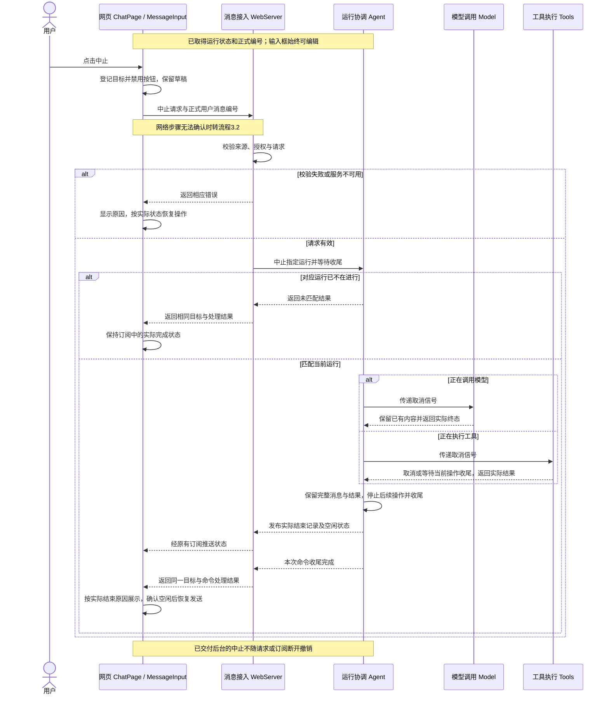
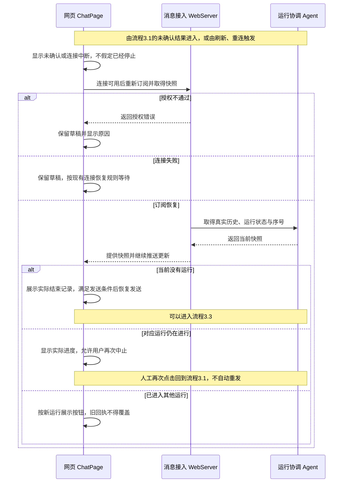
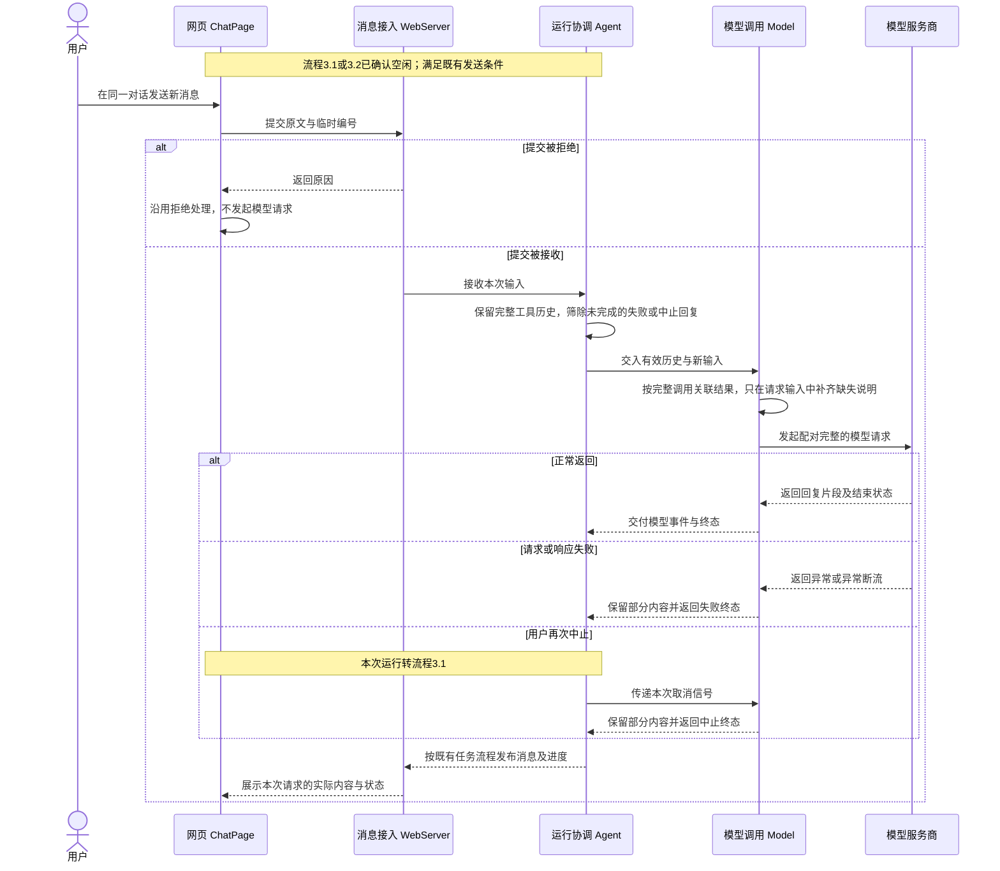

# Feature5：支持用户停止当前调用

状态：**已实现，验收结果见[验收记录](./feature5-验收记录.md)**。需求及模块行为已逐项确认，2026-11-07 用户要求继续实现并完成全部校验，按本稿执行。

源码核对基线：2026-11-07，当前 `main`（`f360e2e`）。

## 1. 总结

**需求理解：** 用户可以在网页停止本次发送触发的整次运行，包括模型生成和工具执行。发送后主按钮切换为中止，提交尚未确认时暂不可点，收到后台运行状态后启用；点击后显示正在中止并禁用按钮。后台按 Pi 的取消方式停止当前运行，不再启动后续工具或模型请求，保留已生成内容和已有工具结果，显示用户中止。当前操作收尾完成、网页确认空闲后恢复发送，输入框在运行和中止期间始终可编辑，草稿与撤销记录保留。中止不保证瞬间结束，也不撤销已发生的文件修改；刷新、关闭网页和连接断开仍不自动取消后台运行。本步只增加主动中止能力，超时与循环结束规则随相应功能核对参考源码，不预设新增时限或调用轮数限制。

**技术方案：** 网页按 dsh 的后台运行状态判断中止是否可用，通过新增 HTTP 接口将当前用户消息的正式编号交给 Agent。Agent 复用已有取消信号和任务 Promise，定位本次运行、请求取消并等待收尾；最终消息及空闲状态继续经现有 WebSocket 订阅提供。六个本地工具按 Pi 的取消设计核对，补齐文件操作后的取消检查；两个网页工具沿用现有机制。Model 在下一次请求前按 Pi 补齐缺失的工具结果说明，不修改真实历史。

## 2. 系统变化说明

**Before：** 当前 Agent 处理一批工具并请求一次最终回答。Model、工具执行器已有取消信号，服务关闭会取消任务，但 `Agent.close()` 同时永久停止接收，不能作为网页中止操作。网页忙碌时只能编辑草稿，不能主动停止。工具阶段取消会覆盖前面完整的模型消息，下一次请求因失败消息筛选而丢失对应工具历史；Model 也没有补齐缺失工具结果的转换。

**After：** 网页可以中止本次运行，并在收尾后继续同一对话。已完成的模型消息与工具结果保持原状，未完成回复保留部分内容并标记中止。下一次请求保留有效工具历史，对完整调用中缺少的结果补充错误说明。运行中仍不排队发送；现有超时、凭据、工作区和订阅规则继续沿用。

## 3. 系统设计

功能1“用户停止当前调用”按下列三个流程展开，接口和数据在首次定义处统计，其他流程只说明本流程用途并引用，共用定义不重复展开。

### 3.1 中止当前运行

网页取得含正式编号的后台运行状态并启用中止按钮后，由用户点击触发，完成指定运行的取消、收尾与结果展示。



HTTP 回执和订阅更新可以交错到达，网页按目标编号和实际状态衔接；提交尚未确认时不进入此流程，中止按钮保持禁用直到取得后台运行状态。

<a id="abort-page"></a>

#### ChatPage / MessageInput（协调中止按钮与请求，保持编辑器和草稿）

**接口：新增 2 项，修改 2 项。**

##### 【新增】`abortMessage`（网页网络调用，拟新增）

**用途：** 接收 ChatPage 准备的 `AbortRequest`，调用中止接口并校验 `AbortResult`。

**主要流程：** ChatPage 提供已确认的目标后，abortMessage 使用现有同源 Cookie 和 JSON 方式发送请求、核对响应状态与返回编号及 handled 布尔值，合法回执交回 ChatPage 等待订阅校准，授权或明确拒绝交回具体错误，网络、服务异常或无效回执以错误交给 ChatPage 保持本次中止未确认并重新同步，网页请求关闭本身不作为后台已取消的证明。

- **【新增】`onAbort()`（页面回调）：** MessageInput 点击中止后调用绑定页面所展示运行编号的回调，ChatPage 发送前再次比对当前目标，匹配时发起中止，不匹配时保持新运行而不将旧点击改为取消新目标。
- **【修改】`MessageInput`（页面组件调用）：** ChatPage 提供 action、onAbort 及现有发送门禁后，MessageInput 在 send、abort、aborting 三种动作间同步切换图标、可访问名称和禁用状态，未提供 action 时保持发送模式，中止不受空草稿限制但未取得目标或正在处理中时禁用，点击中止不进入发送或清空逻辑，编辑器始终可编辑且不重挂载，Enter 仍只遵守发送门禁。

##### 【修改】`ChatPage`（页面组件调用）

**用途：** 根据后台状态协调中止按钮、网络请求与恢复，保留草稿并隔离不同运行的回执。

**主要流程：** 用户发送后 ChatPage 先显示禁用的中止按钮，收到同时带正式编号的后台运行状态后启用且不因空草稿、配置变化或目录失效隐藏入口，点击时先同步登记目标与 pending 状态再调用注入的 abortMessage 以拦截重复点击，在模型终态已到但仍收尾或 HTTP 回执先于订阅时继续禁用直至确认空闲，收到 handled 为 false 时保留实际完成结果，失败或未确认时进入流程3.2恢复，回调仍按绑定目标隔离，最终恢复发送需满足连接、模型、工作区、接收确认及草稿等既有条件，整个过程不重置草稿、撤销或编辑器。

**数据：新增 1 项，修改 2 项。**

- **【新增】`AbortState`：** 仅由 ChatPage 保存在本页内存，记录目标、pending / unconfirmed 状态及必要的错误说明；点击时登记，回调和订阅按目标核对，确认目标结束时清理，刷新后不恢复这一网络等待状态而按后台快照重建按钮。

**构造示例：**

```typescript
const abortState: AbortState = {
  userMessageId: 'user-message-001',
  status: 'pending',
}
```

- **【修改】`MessageInputProps`：** 增加按钮动作和中止回调，sendDisabled 继续单独保护 Enter 提交，输入框保持可编辑。
- **【修改】ChatPage 的 `Props`：** 增加可注入的 abortMessage，生产使用 chat client，组件测试注入受控回执，不增加全局会话状态。

<a id="abort-server"></a>

#### WebServer（校验中止请求并等待 Agent 返回处理结果）

**接口：新增 1 项，修改 1 项。**

##### 【新增】`POST /api/abort`（HTTP 接口，拟新增）

**用途：** 接收 ChatPage 的 `AbortRequest`，等待 Agent 对应运行收尾后返回 `AbortResult`。

**主要流程：** ChatPage 提交中止请求后，WebServer 按来源、Cookie、媒体类型、请求大小和 JSON 内容进行校验，失败时分别按既有 403、401、415、413、400 规则拒绝且不调用 Agent，校验通过后以正式编号调用 `Agent.abort` 而不重新检查模型密钥或工作区目录，未装配中止能力时返回 503、内部异常返回脱敏错误，正常收尾后以 HTTP 200 返回同一编号及 handled 布尔值，目标已不在运行时 handled 为 false 且保留实际结束结果，已交付 Agent 的中止不随 HTTP 断开撤销，ChatPage 则继续按订阅确认空闲后恢复发送。

- **【修改】`new WebServer(options)`（进程内装配）：** 启动装配提供实际或受控 Agent 时，WebServer 接收新增的可选 abort 能力供中止接口调用，旧的只读订阅替身仍可启动但调用未装配的中止接口会返回服务不可用。

**数据：新增 2 项，修改 1 项。** 请求与回执的协议归本模块，真实历史和忙碌状态仍归 Agent，WebServer 不另生成中止消息。

- **【新增】`AbortRequest`：** ChatPage 从后台运行状态取得正式用户消息编号，WebServer 检查只包含一个非空字符串字段，长度不超过既有编号校验的 128 字符上限，再交给 Agent 定位目标。

**构造示例：**

```typescript
const request: AbortRequest = { userMessageId: 'user-message-001' }
```

- **【新增】`AbortResult`：** WebServer 返回同一目标和命令处理结果，网页网络函数核对编号与布尔值，ChatPage 再结合订阅处理；handled 为 true 表示匹配、请求取消并完成收尾，不强制把自然完成改成中止，回执也不覆盖更新的运行状态。

**构造示例：**

```typescript
const result: AbortResult = {
  userMessageId: 'user-message-001',
  handled: true,
}
```

- **【修改】`WebServerOptions`：** agent 的可选能力增加 abort，正式装配使用实际 Agent，受控测试可单独控制其中止与收尾。

<a id="abort-agent"></a>

#### Agent（定位并中止指定运行，保留真实记录并等待收尾）

**接口：新增 1 项，修改 1 项。**

##### 【新增】`Agent.abort`（进程内异步调用，拟新增）

**用途：** 接收 WebServer 指定的正式用户消息编号，中止对应运行并等待收尾，使 Agent 随后仍可接收提交。

**主要流程：** WebServer 提交目标编号后，Agent 比对 `running.userMessageId`，不匹配时返回 `false` 且不取消其他运行，匹配时保存该次 controller 和 task 引用、发出取消信号、停止启动后续工具或模型请求并等待这一个 task 收尾，期间保留实际回复与工具结果，重复请求等待同次收尾且不重复记录中止，待已等待的模型流和工具调用结束后清除该次 controller、发布实际结束记录及 `running: null` 并返回 `true`，其中旧回调不能清理新运行，返回 true 也不强制把竞态中的自然完成改为中止。

- **【修改】`Agent.close()`（进程内异步调用）：** WebServer 关闭服务时调用，Agent 永久停止接收并按相同取消与消息保留规则等待当前任务收尾，WebServer 随后继续清理服务资源。

**数据：新增 0 项，修改 0 项。** 历史仍归 Agent；修正 `runTask / fail` 后，完整的 `toolUse` 消息及真实结果保持原状，工具阶段中止另用独立编号追加现有 `AssistantMessage` 格式的说明，生成中的回复保留部分内容并标记中止，尚未开始生成时可追加空内容说明，自然完成且没有后续操作的回答保持正常完成；有效历史筛选见流程3.3的 Agent 说明。

#### Model（接收取消信号并交付本次模型调用的实际终态）

**接口：** 由 [Agent.abort](#abort-agent) 将取消信号交给现有模型事件流，Model 保留已有内容并交付实际终态；本次 `stream` 与 `createModelStream` 的增量定义见[流程3.3](#model-input)。

**数据：** 本流程使用现有模型消息的部分内容和终态，由 Agent 保存，格式不变。

<a id="abort-tools"></a>

#### Tools（按取消信号结束执行或等待当前文件操作收尾）

**接口：新增 0 项，修改 3 项。**

- **【修改】`read.execute`（进程内调用）：** Agent 提交路径和取消信号后，read 按 Pi 的只读取消方式在准备及读取阶段结束工具等待并忽略迟到的只读结果，将读取内容或取消错误交回 Agent，已有读取大小、UTF-8 与路径规则保留。
- **【修改】`edit.execute`（进程内调用）：** Agent 提交替换内容和信号后，edit 在文件操作前及异步步骤返回后检查取消，已开始的磁盘操作先收尾再返回取消，Agent 保存实际结果后继续结束本次运行，避免提前放行下一次任务。
- **【修改】`write.execute`（进程内调用）：** Agent 提交目标内容和信号后，write 在创建目录、写入前后检查取消，已开始的目录创建或写入先收尾再交回结果或取消错误，Agent 据此保存真实记录，取消错误不表示文件未修改。

**数据：新增 0 项，修改 0 项。** 工具参数与结果格式不变，已正式交付的工具结果仍由 Agent 保存。

### 3.2 恢复中止状态

中止结果未确认、订阅连接恢复或页面刷新时触发，重新取得当前对话，恢复实际消息、运行状态和可用操作。



订阅断开不自动中止后台任务，已有目标仍可通过独立 HTTP 中止，恢复发送则需订阅就绪且确认空闲；刷新不恢复本页的 AbortState，按钮按快照重建，后台重启仍按现有规则清空当前对话，不能把空历史解释为旧任务成功中止。

#### ChatPage（重新取得真实状态并恢复按钮操作）

**接口：** 引用[流程3.1的 ChatPage](#abort-page)：中止失败或未确认时显示原因并按需重取快照，确认目标仍运行后允许人工再次中止而不自动重发，目标结束时恢复发送，已进入其他运行时不让旧回调或错误覆盖新按钮。

**数据：** 引用 [AbortState](#abort-page) 保存 unconfirmed 状态、目标编号及错误说明；刷新没有本页等待状态时，按后台快照重建按钮。

#### WebServer（从 Agent 取得当前快照并持续分发更新）

**接口：** 使用现有 WebSocket 订阅接入重新提供快照及更新；[流程3.1的中止接口](#abort-server)已交付 Agent 的操作继续处理，不随订阅断开撤销。

**数据：** 从 Agent 转发真实历史、运行状态和序号，接入层不保存另一份对话。

#### Agent（提供当前真实历史、运行状态和连续更新）

**接口：** 通过现有订阅提供快照与更新，其中的结束记录来自[流程3.1的中止及收尾](#abort-agent)，不因重新订阅重跑任务。

**数据：** 当前对话快照与运行状态继续保存在 Agent 内存，后台重启仍按既有规则清空。

### 3.3 继续对话时整理模型输入

中止收尾并确认空闲后，用户再次发送消息时触发，保留有效历史、补齐缺少的工具结果说明并交付下一次模型请求的输出。



补充说明只属于 Model 的待发送输入，不写回真实执行历史，也不补跑旧工具；下一次模型若提出新的工具调用，继续进入既有单批任务流程。聊天和运行状态在 Agent 内存中，网页只保存草稿及本页中止请求状态。

#### ChatPage（确认可发送后提交新输入并显示实际回复）

**接口：** 引用[流程3.1的 ChatPage / MessageInput](#abort-page)：确认空闲且满足现有门禁后通过原发送回调提交草稿，随后按订阅展示本次实际回复和进度。

**数据：** 草稿及提交确认状态仍由页面保存，真实消息和运行状态以后台订阅为准。

#### WebServer（将新提交交给 Agent 并推送后续进度）

**接口：** 使用既有消息提交与订阅接入，校验通过后将新输入交给 Agent，拒绝时返回原因且不启动模型；本模块中止相关的增量定义见[流程3.1](#abort-server)。

**数据：** 使用现有提交请求及接收回执，维持临时编号、正式编号与订阅进度的关联。

#### Agent（保存新输入并向 Model 提供保留的有效历史）

**接口：** 接收新任务后由 `modelHistory()` 整理历史并交给 Model，取消时完整消息与真实结果的保留规则见[流程3.1](#abort-agent)。

**数据：** 保留完整工具调用及真实结果，筛除失败或中止的未完成模型回复，向 Model 提供本次有效上下文。

<a id="model-input"></a>

#### Model（为下一次模型请求配齐工具调用与结果）

**接口：新增 0 项，修改 2 项。**

##### 【修改】`stream`（进程内调用）

**用途：** 接收 Agent 的模型、上下文和取消信号，整理下一次请求的工具结果配对并返回同次事件流，签名不变。

**主要流程：** Agent 再次请求模型时提供已筛除失败或中止未完成回复的历史，Model 按每条完整工具调用消息关联真实结果，在进入下一条助手或用户消息及历史结束前为仍缺少结果的调用补充 `No result provided` 错误说明，透明处理穿插的系统消息并分别处理不同批次的相同编号，只整理待发送输入而不修改原始历史、替换真实结果或补跑工具，随后发起模型请求并把同次片段及终态交给 Agent 消费，在请求准备或流式读取中收到取消时保留部分内容、移除监听与计时器并发出单次 aborted 终态结束该流。

- **【修改】`createModelStream()`（进程内装配）：** WebServer 注入共享凭据与测试网络边界后取得调用函数，该函数采用同一历史整理行为并返回同次模型事件流，签名不变。

**数据：新增 0 项，修改 0 项。** 补充的错误说明使用现有工具结果格式，只存在于待发送输入，保留原调用编号且不进入网页真实执行历史，也不能据此推断文件未修改。

## 4. 技术决策

### 【功能决策｜五个模块】第五步只支持用户主动中止

用户已确认取消独立的执行超时保护和模型轮数限制要求。已有失败、超时和单批工具流程继续沿用；后续循环以 Pi 的具体设计为依据。用户中止不关闭服务，不自动重试或回滚；网页断线仍与任务生命周期分开。

### 【功能决策｜网页交互 ChatPage / MessageInput】保留草稿，按后台运行状态启用中止

用户已确认按钮切换、中止处理中禁用和输入框始终可编辑。按用户指定补查 dsh 后确认：以后台运行状态判断可中止，提交尚未确认时先禁用。dsh 的 [InputBar](../../../deepseek-harness/packages/client/ui-conversation/src/client/skeleton/InputBar.tsx:323) 依运行状态和草稿条件提供停止，[Session.handleRunning](../../../deepseek-harness/packages/api/session-controller/src/client/sessions/session.ts:526) 从后台更新运行状态，其 [cancel](../../../deepseek-harness/packages/api/session-controller/src/client/sessions/session.ts:347) 按会话定位。

本项目没有多会话列表，使用同一订阅中已经提供的正式用户消息编号定位本次运行，不复制 dsh 的完整会话协议。保留用户已确认的差异：运行中不排队发送，有新草稿时仍提供中止；中止处理中禁用按钮。dsh 的会话取消回执只确认接收，本项目的 HTTP 接口仍按已确认的 Pi 收尾方式等待当前运行结束。

### 运行协调 Agent、消息接入 WebServer：采用 Pi 的取消与等待收尾

Pi 的 [Agent.abort / waitForIdle](../../../pi/packages/agent/src/agent.ts:341) 分开发出取消与等待空闲，[AgentSession.abort](../../../pi/packages/coding-agent/src/core/agent-session.ts:2464) 将两者组合，[RPC abort](../../../pi/packages/coding-agent/src/modes/rpc/rpc-mode.ts:426) 等待后返回。本项目按已有职责约定将协调保留在 Agent，不另加 Session 层；HTTP 沿用当前应用接入，订阅保持独立。

Pi 的 [运行失败处理](../../../pi/packages/agent/src/agent.ts:532) 会新增中止消息，未把先前完整消息改为取消。本项目修正 `runTask / fail` 的覆盖行为，保留真实工具历史。目标编号检查是网页异步请求所需的适配，用来避免旧命令作用于新运行；不改变模型工具调用编号。

### 工具执行 Tools：六个本地工具采用 Pi 的协作取消，网页工具保留现状

Pi 的 [read](../../../pi/packages/coding-agent/src/core/tools/read.ts:110) 在取消时结束工具等待，迟到的只读工作不再交付结果；[write](../../../pi/packages/coding-agent/src/core/tools/write.ts:68) 和 [edit](../../../pi/packages/coding-agent/src/core/tools/edit.ts:164) 则明确等待当前文件操作返回后再检查取消，避免过早放行下一次修改。本项目补齐这些检查，不引入文件事务、图片读取或扩展钩子。

[Bash](../../../pi/packages/coding-agent/src/core/tools/bash.ts:126)、[find](../../../pi/packages/coding-agent/src/core/tools/find.ts:103)、[grep](../../../pi/packages/coding-agent/src/core/tools/grep.ts:188) 的主流程都是取消时主动停止所属进程，现有 ToolRuntime 已集中处理终止和退出收尾，继续复用：Bash 收集可取得的已有输出，find 保留部分路径与错误，grep 补读上下文时也使用读取取消信号，但不承诺返回内部尚未交付的命中片段；临时文件仍按现有服务生命周期管理。Pi 的 find 可在请求停止后先返回取消，本项目保留现有的进程退出等待及部分输出收集，以满足已确认的收尾约定；取消检查的具体时点按工具操作划分，不承诺所有底层 I/O 瞬间消失。

两个网页工具按用户明确选择保留 [现有信号传递](../../../packages/server/src/web-tools.ts:64)及 [Tavily 请求](../../../packages/server/src/web-providers.ts:28)：web_search 取消本机 HTTP 请求及响应读取，设置与凭据读取仍有各自的异步收尾边界；web_fetch 取消网址校验的等待与 HTTP 请求，已开始的正文缓存写入没有绑定任务取消信号，需要等待该次写入收尾。

### 模型调用 Model：按 Pi 补齐缺失工具结果，只整理请求输入

Pi 的 [OpenAI 请求转换](../../../pi/packages/ai/src/api/openai-completions.ts:1230) 先调用 [transformMessages](../../../pi/packages/ai/src/api/transform-messages.ts:179)，为缺少结果的调用生成错误说明，保持请求中的调用和结果对应。本项目采用这一相关逻辑，不引入其他模型提供方兼容、调用编号重写或整套消息转换框架。原有失败回复筛选继续归 Agent；Model 在现有 `convertMessages` 附近处理缺失结果，保留思考回填与现有转换行为。

## 5. 风险与边界

### 风险1：中止返回错误，文件仍然可能已经修改

- **案例：** 用户在 write 已开始写入时中止，文件操作结束后取消检查报错，但文件可能已经完整或部分修改，已创建目录也可能保留。
- **解决方案：** 按 Pi 等当前修改收尾，不让新任务过早开始；保留实际记录并说明取消不回滚。用临时目录和可控文件操作验证，不把取消错误当作未执行证明。

### 风险2：收到模型中止终态时，整次任务可能还在收尾

- **案例：** 页面已经看到已中止，但当前调用或资源清理仍未完成；若仅凭模型终态开放发送，会和收尾重叠。
- **解决方案：** Agent 统一完成运行收尾后才恢复空闲，网页按任务状态恢复发送。只读 I/O 的底层工作及远端服务处理不保证物理上立即停止，迟到结果不得重新写入本次历史。

### 风险3：提交尚未确认时无法立即发出中止命令

- **案例：** 提交回执及订阅更新尚未到达，网页没有已确认的目标编号，按钮显示中止但暂不可点击。
- **解决方案：** 采用已确认的 dsh 式后台状态门禁并显示正在确认接收，不假装已停止。任意时长的接收等待都不自动视为任务不存在；未来确需中止尚未确认的提交时再评估身份与取消契约，见[设计妥协记录](../../设计妥协记录.md#提交尚未确认时暂不可中止)。

### 风险4：回执丢失或旧请求迟到，界面可能对应错误运行

- **案例：** 中止已交给后台但 HTTP 回执丢失，或上一轮回执在下一轮开始后才到达。
- **解决方案：** 后台按正式用户消息编号匹配，网页回调同样按目标隔离；显示未确认并通过现有订阅核对，不自动重发、不由旧回执覆盖新运行。

### 风险5：取消本机网页请求不代表远端也已停止处理

- **案例：** 本机已取消 Tavily 请求，但没有远端任务停止回执；或正文已返回，工具正在写缓存。
- **解决方案：** 只陈述本机取消与已确认结果；缓存写入等当前操作收尾。沿用现有机制，不新增远端取消接口或默认时限。

## 6. 验收标准

以下为实施依据，新增案例已落入测试；实际执行命令、通过数和未实测边界见[验收记录](./feature5-验收记录.md)。已有测试按实际目标复用，不把其通过视为新功能已完成。工具在临时目录验证，网络边界用受控响应，组件测试优先覆盖按钮和草稿；仅实际页面与完整服务的接线验证采用 E2E。

### 运行协调 Agent

#### A1：中止后仍能接收下一次任务

- **类型：** 单元测试。
- **目的：** 确保中止当前运行不会像关闭服务一样永久禁用 Agent。
- **怎么测：** 复用现有受控流，生成部分文字后调用 abort，检查仅有一次中止终态、内容保留、收尾期间仍忙碌；释放收尾后再次 submit 成功。已有 `关闭 Agent 主动取消当前生成并等候收尾，之后不再接收` 和 `等待模型流清理再解除发送门禁` 保留为关闭及收尾回归。

#### A2：工具阶段中止保留完整工具历史

- **类型：** 单元测试。
- **目的：** 第一项已完成、第二项中止时，后续对话仍能使用已完成操作的信息。
- **怎么测：** 构造三项调用，完成第一项、在第二项等待时中止；检查第一条完整模型消息保持 toolUse，已取得结果保留，后续工具及最终回答未启动，另有中止说明；下一次提交仍包含有效历史。修改现有 `关闭期间保留工具已有部分结果并停止后续调用` 中覆盖完整消息的旧断言。

#### A3：迟到与重复中止只作用于对应运行

- **类型：** 单元测试。
- **目的：** 防止旧中止影响新任务或把正常完成改成失败。
- **怎么测：** 对已结束编号中止返回 false，新任务信号不变；对同一正在收尾的运行重复调用，共享收尾且只记录一次中止；最后回复已完成的竞态保持实际结果。

### 工具执行 Tools

#### T1：文件操作按阶段响应取消

- **类型：** 单元测试。
- **目的：** 确保 read 能结束取消等待，edit、write 不在文件操作尚未返回时提前放行。
- **怎么测：** 复用真实工具调用及可控文件操作，将取消分别放在准备、读取、创建目录和写入期间；检查取消后不启动后续步骤，已开始的写操作释放前工具不结束，返回后重新检查取消。检查实际文件变化，不断言取消必然未写。复用现有预取消 write 拒绝、读写正常行为和 edit 写前拒绝覆盖。

#### T2：本地命令与搜索实际停止

- **类型：** 集成测试。
- **目的：** 确保 bash、find、grep 中止后不会继续搜索或产生计划中的后续修改。
- **怎么测：** 使用受控的 Bash、fd、rg 子进程，确认进入执行后取消任务信号，检查进程被停止、所属收尾结束，延迟标记文件未产生；分别核对工具真实取消错误及既有输出规则。复用 Bash 超时和服务关闭的进程组案例，不把两者当作已覆盖用户取消。

#### T3：两个网页工具沿用信号与缓存收尾

- **类型：** 集成测试。
- **目的：** 确保中止传到网络请求，同时不提前结束已开始的缓存写入。
- **怎么测：** 在受控 Tavily HTTP 响应与网址校验等待中取消，检查本机请求结束且取消没有变成成功；让 web_fetch 在缓存写入处等待，取消后释放写入并核对当前步骤收尾，无后续工具启动。不访问真实用户配置，也不推断远端处理状态。

### 模型调用 Model

#### M1：复用已有模型取消覆盖

- **类型：** 单元测试。
- **目的：** 保持请求开始前及生成中的取消、部分内容和单一终态契约。
- **怎么测：** 复跑现有 `aborts before request preparation and during generation with a single aborted result`、协议失败释放响应及相关流测试，不为相同目标重复建立测试。

#### M2：缺少工具结果时仍可继续请求

- **类型：** 单元测试。
- **目的：** 确保下一次请求中的工具调用及结果对应，真实历史不被补充说明污染。
- **怎么测：** 构造 read 已成功、bash 已取消、write 缺少结果的历史，捕获真实 SDK 待发送请求；只为缺失项补错误说明、保留真实结果及思考。不提供后续消息和提供新用户消息分别检查；重复准备、系统消息穿插和不同批次复用编号时不误配、不重复补齐，传入原历史保持不变。

### 消息接入 WebServer

#### W1：中止入口沿用接入校验

- **类型：** 集成测试。
- **目的：** 无效或未授权请求不能取消任务。
- **怎么测：** 复用已有 HTTP 工具及受控 Agent，向新入口提交无授权、错误来源和非法 JSON / 编号，检查相应拒绝且 abort 未调用；沿用已有 Host、Origin、Cookie 与请求大小覆盖方式。

#### W2：命令回执等待对应运行收尾

- **类型：** 集成测试。
- **目的：** 避免把已接收取消请求误报为已完成收尾。
- **怎么测：** 受控 Agent.abort 等待可释放的 Promise，检查 HTTP 尚未返回；释放后返回 200、同一编号及 handled。回执与订阅更新先后顺序分别验证。

#### W3：目标已结束仍返回明确结果

- **类型：** 集成测试。
- **目的：** 迟到中止不影响当前另一轮运行。
- **怎么测：** Agent 对旧编号返回 false，检查 HTTP 200 和 handled 为 false，编号原样交付，不调用 close，也不生成消息或覆盖运行状态。

#### W4：中止不绑定请求或订阅连接

- **类型：** 集成测试。
- **目的：** 用户刷新或网络中断后仍能恢复已交付的中止结果。
- **怎么测：** 在 Agent 已收到中止但尚未收尾时关闭 HTTP 客户端或 WebSocket，释放收尾后重新订阅取得实际结果；没有主动中止的断线沿用现有 `真实 SDK 流跨断线继续，重订阅恢复同一进度` 覆盖。

### 网页交互 ChatPage / MessageInput

#### U1：按钮严格跟随接收、运行与收尾

- **类型：** 组件测试。
- **目的：** 用户能区分尚未确认、可以中止和正在中止，空草稿也能停止。
- **怎么测：** 使用现有受控订阅及回执，依次提供本地发送、HTTP 确认但旧空闲状态、正式运行状态、中止等待和实际空闲；检查按钮名称、图标与禁用状态，运行中 Enter 不提交，连续点击只调用一次。配置或目录变化不阻止已知运行中止。

#### U2：按钮切换保留实际编辑器与草稿

- **类型：** 组件测试（Chromium）。
- **目的：** 用户在运行和中止时编辑下一条，内容与撤销不丢失。
- **怎么测：** 复用 `外部门禁切换保留编辑器、原文、焦点与撤销` 和页面草稿覆盖，增加中止切换；核对同一编辑器实例、草稿原文、撤销和状态更新不抢焦点。按钮点击本身按正常焦点行为处理，不用重挂载或清空实现模式切换。

#### U3：未确认中止能通过实际状态恢复

- **类型：** 组件测试。
- **目的：** HTTP 失败不能把仍运行的任务显示为已停止。
- **怎么测：** 模拟拒绝、无效回执和网络失败，检查原因或未确认提示及重取快照；恢复后目标仍在运行可人工再中止，目标已结束按真实记录恢复，不自动重发。HTTP 成功而订阅尚未追上时仍不开放发送。

#### U4：旧回执不影响下一轮按钮

- **类型：** 组件测试。
- **目的：** 防止上一轮迟到回执改变下一轮的按钮及草稿。
- **怎么测：** 先让订阅结束旧运行并开始新运行，再交付旧中止成功或错误；检查新运行、中止入口与新草稿不变，回调只处理其绑定目标。

### 功能1完整链路

#### E1：真实页面可以中止并继续发送

- **类型：** 端到端测试（E2E，Chromium）。
- **目的：** 证明实际按钮连接到正式 HTTP、Agent 和 SDK 取消逻辑。
- **怎么测：** 复用现有 Node / Vite 实际入口、临时凭据及受控模型服务，发送并取得部分回复，编辑新草稿后点击中止；确认服务商边界的本机连接关闭、网页保留内容且恢复发送，再发下一条并得到新回复。单独组件和 HTTP 测试不能证明真实页面接线，因此保留这一完整链路案例；工具各自取消与文件副作用由低成本测试覆盖，不重复安排八项 E2E。

### 已执行的基线检查

本次讨论期间，未修改实现代码，已有以下运行证据：

- 后端包构建通过；Agent 测试 28 项通过。
- `model-stream.test.ts` 48 项通过，包含开始前与生成中取消。
- `webserver.test.ts` 29 项通过；此前与 `tool-execution.test.ts` 合跑为 50 项通过、1 项因缺少 fd / fdfind 跳过。跳过的是真实 fd 的正常搜索用例，不是新功能通过证据。
- ChatPage、MessageInput、chat client、state、submission 五个单元测试文件合计 71 项通过。
- Chromium 组件案例 `外部门禁切换保留编辑器、原文、焦点与撤销，恢复后可提交原草稿` 1 项通过。

实施后的命令复用 `npm test`、`npm --prefix web run test:browser` 和现有包测试，不新增测试运行框架。此段仅记录设计讨论期间的历史基线，不代表实施后的结果；新增中止 E2E、真实调用及未实测范围见本功能验收记录。已有真实工具正常调用证据仅引用 [Feature4 验收记录](../feature4/feature4-验收记录.md)，不作为本功能取消行为已通过的证明。

## 7. 文件变更

以下是设计时的变更清单。实现另新增两个工具取消测试文件和独立中止 E2E，详见验收记录；沿用而无需修改的文件不列入表格。

### 运行协调 Agent

| 文件 | 类型 | 用途 | 变更 |
| --- | --- | --- | --- |
| `packages/agent/src/agent.ts` | 修改 | 当前对话与运行协调 | 仅关闭时可取消 → 可中止指定运行并继续接收，保留完整消息与真实结果 |
| `packages/agent/test/agent.test.ts` | 修改 | 运行生命周期验证 | 关闭与单批执行覆盖 → 补充中止、继续提交、目标隔离和完整历史保留 |
| `packages/agent/README.md` | 修改 | Agent 使用约定 | 增加独立中止接口及其与关闭服务的关系 |

### 工具执行 Tools

| 文件 | 类型 | 用途 | 变更 |
| --- | --- | --- | --- |
| `packages/server/src/local-tools.ts` | 修改 | 六个本地工具 | 补齐只读取消等待与 edit / write 异步操作后的检查，复用已有进程取消 |
| `packages/server/test/tool-execution.test.ts` | 修改 | 本地工具真实效果验证 | 增加任务取消及文件操作收尾覆盖，保留已有正常与超时断言 |
| `packages/server/test/web-providers.test.ts` | 修改 | 网页工具与厂商接入验证 | 补充现有信号传递和正文缓存收尾边界验证 |

### 模型调用 Model

| 文件 | 类型 | 用途 | 变更 |
| --- | --- | --- | --- |
| `packages/model/src/deepseek.ts` | 修改 | 模型请求与历史转换 | 直接转换有效历史 → 发送前补齐缺失工具结果说明，保留现有取消机制 |
| `packages/model/test/model-stream.test.ts` | 修改 | 模型流与请求验证 | 保留取消测试，补充缺失结果配对、重复编号和原始历史保护 |
| `packages/model/README.md` | 修改 | 模型调用约定 | 说明工具结果补齐的用途与仅修改请求输入的边界 |

### 消息接入 WebServer

| 文件 | 类型 | 用途 | 变更 |
| --- | --- | --- | --- |
| `packages/server/src/webserver/index.ts` | 修改 | HTTP 命令与订阅接入 | 增加中止命令并等待 Agent 收尾，沿用授权与网络订阅 |
| `packages/server/src/webserver/protocol.ts` | 修改 | 网页共享协议 | 增加中止请求与结果类型，现有 WebSocket 帧不变 |
| `packages/server/test/webserver.test.ts` | 修改 | 实际 HTTP / WebSocket 验证 | 补充中止接入、收尾回执、目标不匹配与断线恢复 |
| `packages/server/README.md` | 修改 | 本地服务使用约定 | 补充中止入口及其与断线、关闭服务的区别 |

### 网页交互 ChatPage / MessageInput

| 文件 | 类型 | 用途 | 变更 |
| --- | --- | --- | --- |
| `web/src/pages/ChatPage.tsx` | 修改 | 任务输入与页面协调 | 忙碌仅禁发 → 协调中止按钮、请求与订阅恢复，保留草稿 |
| `web/src/components/MessageInput.tsx` | 修改 | 编辑器与主按钮 | 单一发送动作 → 发送、中止和正在中止，编辑器不重挂载 |
| `web/src/chat/client.ts` | 修改 | 网页请求服务 | 增加中止请求与回执校验，沿用网络错误处理方式 |
| `web/src/chat/client.test.ts` | 修改 | 网络调用验证 | 补充中止目标、状态及异常回执检查 |
| `web/src/pages/ChatPage.test.tsx` | 修改 | 页面协调验证 | 更新原忙碌按钮断言，补充中止门禁、失败与旧回执隔离 |
| `web/src/components/MessageInput.test.tsx` | 修改 | 输入与按钮验证 | 保留输入规则，补充空草稿中止和中止不触发发送 |
| `web/src/test/MessageInputHarness.tsx` | 修改 | 浏览器组件挂载 | 支持测试中切换中止状态并观察回调 |
| `web/src/components/MessageInput.browser.test.tsx` | 修改 | 实际编辑器行为 | 增加中止切换时的实例、草稿与撤销保护 |
| `web/src/pages/ChatPage.browser.test.tsx` | 修改 | 实际页面组件行为 | 更新按钮名称断言，核对草稿、阅读位置与异步回执 |
| `web/tests/e2e/chat.spec.ts` | 修改 | 完整页面接线 | 更新忙碌按钮断言，补充实际中止后继续发送 |
| `web/tests/e2e/model-server.ts` | 修改 | 受控服务商边界 | 提供本机模型连接关闭的可核对证据 |
| `web/README.md` | 修改 | 网页交互与验收说明 | 增加中止按钮状态及实际取消案例 |

### 其他

| 文件 | 类型 | 用途 | 变更 |
| --- | --- | --- | --- |
| `README.md` | 修改 | 项目使用入口 | 增加用户中止及草稿保留说明 |
| `planning/README.md` | 修改 | 设计索引 | 登记本设计及待整体批准状态 |
| `planning/里程碑1/README.md` | 修改 | 里程碑范围与确认记录 | 收窄第五步并登记已确认需求、模块和本设计 |
| `docs/设计妥协记录.md` | 修改 | 实际简化与重评时机 | 记录接收未确认期间暂不可中止的已确认边界 |
| `docs/里程碑1/feature4/feature4-工作区选择与四工具执行.md` | 修改 | 前置设计的推进边界 | 删除第五步必须增加默认保护的旧表述，保留网页停止的推进关系 |
| `docs/里程碑1/feature5/feature5-用户停止当前调用技术设计.md` | 新增 | 本次整体技术设计 | 汇总已确认流程、职责、差异和验收，等待整稿批准 |
