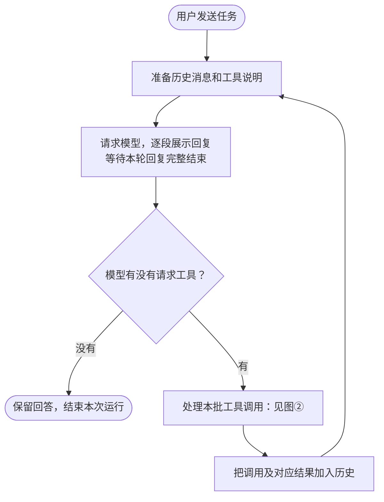
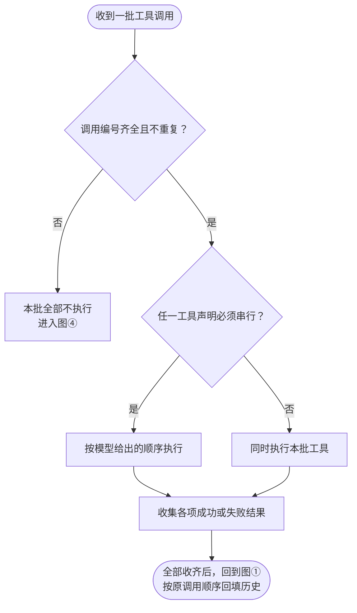
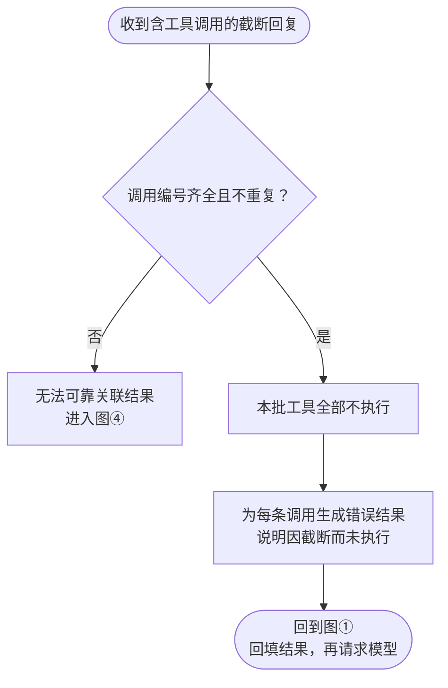
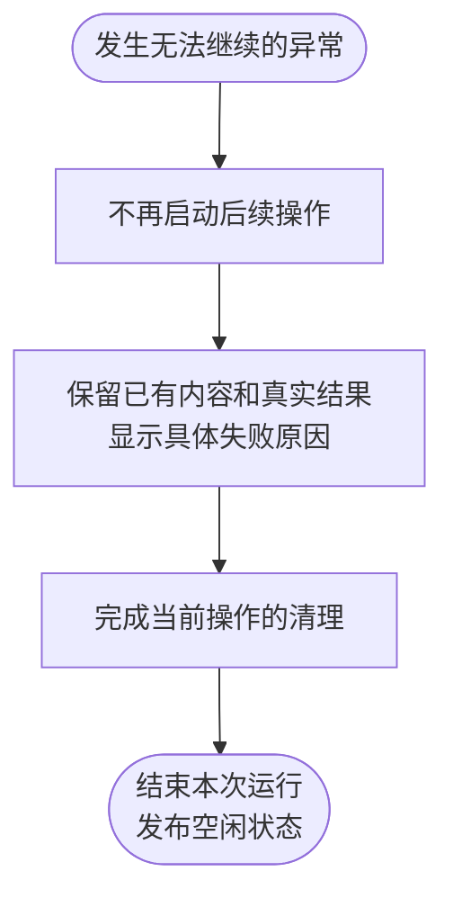
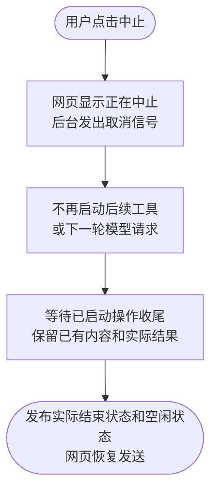

# Feature6：ReAct 循环技术设计

状态：**已合并 main，主目录复验全部通过**。日期：2026-11-08。

用户于本日要求在当前目录创建 worktree、继续实现 Feature6 并完成全部校验。实现提交 `815df0e` 已合并 main，主目录复验全部通过，worktree 与分支已清理；实际结果另见[验收记录](./feature6-验收记录.md)。

本文说明一次任务怎样连续使用工具、各部分如何配合，以及异常时用户会看到什么。相关需求和设计选择已逐项讨论，见[讨论记录](./feature6-设计讨论记录.md)。

## 1. 总结

**需求理解：** 用户在选定的工作区提交一次任务后，系统能够根据中间结果继续行动，无须用户一步步接着下指令。例如，先读取 index.txt，发现下一条线索在 note.txt，再读取 note.txt，最后回答其中的项目名称。同一批互不依赖的工具可以同时执行，需要前一步结果的操作分轮完成；网页展示完整过程，用户可以中止，也可以在等待时编辑下一条消息。回复截断、工具失败和中止各有明确处理规则，避免执行不完整的指令或让用户误判结果。本步沿用现有八种工具，暂不加入上下文压缩、任务排队和服务重启后的聊天恢复。

**技术方案：** 由现有 Agent 负责安排整次任务：请模型判断下一步，交给工具执行，把实际结果交回模型，再决定继续还是回答。Model 负责与模型通信，Tools 负责具体操作，网页负责展示进度和结果。任务进度由后台统一保存，网页刷新后继续显示同一任务；一轮模型回复结束不会提前结束整次任务。

## 2. 系统变化说明

**目前：** 系统只能执行一批工具，再请模型给出回答。如果读完文件后还需要继续找线索，用户必须再发一条消息。工具按顺序逐个执行，含有工具请求的回复一旦截断，任务就结束。

**完成后：** 一次提交可以连续完成多轮工具操作，模型每轮都可以继续使用现有工具。同批工具默认同时执行；如果其中一个工具要求按顺序执行，则整批依次执行。先完成的结果先展示，工具卡片仍按模型提出请求的顺序排列。截断时可以把未执行原因交回模型，给它重新决定的机会；用户中止后，系统等已开始的操作结束，再允许发送新任务。

对话仍暂存在后台内存中：刷新页面可以恢复，重启服务会清空；上下文压缩安排在功能七，聊天保存与重启恢复安排在功能八。

## 3. 系统设计

### 3.1 模块变化

本次涉及任务协调、工具执行和网页展示三个部分。下文的“接口”指模块向其他部分提供的能力，括号内保留代码名称，方便与项目对应。

#### 3.1.1 Agent：安排下一步，并保存整次任务的过程

Agent 负责回答三个问题：现在该请模型判断，还是该执行工具；这一批操作是否都已结束；整次任务是否可以结束。它保存对话内容和任务进度，Model 和 Tools 分别向它提供模型回复与实际执行结果。

每轮都等模型把回复完整给出后，再处理其中的工具请求，避免一边接收尚未写完的指令、一边修改文件。同批工具默认同时执行；若任何一项要求顺序执行，则整批按原顺序执行。工具不存在、操作内容不符合要求或执行报错，都作为该项失败交给模型，其他工具仍继续，模型看到成功和失败的结果后再判断下一步。

整个任务使用提交时选定的模型和工作区。各轮回复分别保留，工具结果也各自对应到原请求，避免把后一轮的结果放到前一轮。每批请求必须有能区分各项调用的编号；编号缺失或同批重复时，整批不执行并说明原因，不把这批无效请求交给后续模型继续使用，不同轮重复编号则可以正常处理。

中止、模型失败或其他异常出现后，Agent 不再安排新操作；已经开始的操作全部收尾后，用户才能发送下一条消息，即使其中一项先报错，也不能提前恢复发送。

**接口：新增 0 项，修改 5 项。**

##### 【修改】准备可用能力（`new Agent({ stream, tools })`）

**用途：** 服务启动时，让 Agent 知道可以使用哪个模型调用能力、有哪些工具，以及工具是否要求顺序执行。

**主要流程：** Server 提供现有模型和工具后，Agent 在每轮向模型介绍可用工具，并在实际执行时遵守工具的顺序要求，模型只需提出操作请求，无须了解本地如何安排执行。

##### 【修改】接收任务（`submit(input)`）

**用途：** 接收用户的一次提交，并从接收到结束持续负责这项任务。

**主要流程：** 用户发送消息后，Agent 检查内容和所选模型是否有效、当前是否空闲，有问题则明确拒绝，通过后确认接收并开始连续决策，直到正常回答、失败或中止且所有已开始操作都结束，才恢复可发送状态。

##### 【修改】持续提供进度（`subscribe(signal)`）

**用途：** 让网页在首次打开、刷新及任务运行期间，都能看到后台保存的内容和最新进度。

**主要流程：** 网页通过 WebServer 连接后，Agent 先提供当前完整记录，再持续提供后续变化，网页离开或断线时结束该连接的通知，后台任务和其他页面继续运行。

##### 【修改】中止当前任务（`abort(userMessageId)`）

**用途：** 停止继续推进用户指定的任务，并保留已经发生的操作和结果。

**主要流程：** 用户点击中止后，Agent 核对是否仍是这项任务，再通知模型和工具停止、等待已开始操作收尾并保留实际结果后恢复发送，过期的中止请求不会影响新任务，恰好已经完成的任务也不会被改成中止。

##### 【修改】关闭任务服务（`close()`）

**用途：** 服务关闭时结束当前工作，避免仍有工具在后台运行。

**主要流程：** Server 开始关闭时，Agent 先停止接收新任务，再中止并等候当前模型与工具结束，之后 Server 才关闭工具运行环境。

**数据：新增 0 项，修改 4 项，均由 Agent 管理。**

- **【修改】工具说明（`ExecutableTool`）：** 补充“可以同时执行”或“需要顺序执行”的要求，未指定时默认可以同时执行；这是 Agent 安排工具的依据，不交给模型处理，现有写文件工具本次也不额外改为顺序执行。
- **【修改】任务进度（`RunningState`）：** 除了区分“正在请求模型”和“正在执行工具”，还要能记录多个同时运行的工具；不再预设第二次回复一定是最终回答，刚进入一轮模型请求、尚未收到回复时也是合法进度。
- **【修改】对话记录（`ConversationMessage`）：** 在工具结果旁记录明确的结束原因，帮助网页区分失败与已停止；这项说明不改变交给模型的工具结果格式，已经成功或失败的结果不会被后来的中止改写，尚未启动便被取消的调用也不会凭空出现一条执行结果。
- **【修改】进度通知（`ConversationUpdate`）：** 补充结果应放在对话中的位置，让网页显示与后台记录保持一致；例如先请求 A、再请求 B，而 B 先完成，就先显示 B 的结果，A 完成后再放回它原来对应的位置，下一轮模型看到的仍是 A、B 的顺序。

<details>
<summary>技术对照：任务进度、结束原因与结果位置</summary>

`ExecutableTool.executionMode` 可选 parallel 或 sequential，不填视为 parallel。`RunningState.phase` 保留 model、tools，`activeTools` 替代原来的单个 activeTool，模型阶段为空数组；一次任务沿用 userMessageId，每轮模型回复使用新的 assistantMessageId，工具用助手消息编号与内容下标关联。

以下是构造示例，用于说明数据关系，不是实际运行记录：

```typescript
const running: RunningState = {
  userMessageId: 'user-1',
  assistantMessageId: 'assistant-1',
  phase: 'tools',
  activeTools: [
    { assistantMessageId: 'assistant-1', contentIndex: 0 },
    { assistantMessageId: 'assistant-1', contentIndex: 1 },
  ],
};

const resultEntry: ConversationMessage = {
  id: 'result-1',
  toolCall: { assistantMessageId: 'assistant-1', contentIndex: 0 },
  toolErrorCode: 'interrupted',
  message: {
    role: 'toolResult',
    toolCallId: 'call-1',
    toolName: 'bash',
    isError: true,
    content: [{ type: 'text', text: '已有输出\n任务已取消' }],
    timestamp: 1794100000000,
  },
};

const update: ConversationUpdate = {
  seq: 12,
  change: {
    type: 'task',
    running: { ...running, activeTools: running.activeTools.slice(1) },
    message: resultEntry,
    messageIndex: 2,
  },
};
```

明确取消的错误码是 interrupted，成功结果没有错误码，其他错误码仍按失败处理；错误码只在对话记录外层保存，不加入模型输入。通知中若有结果消息，必须同时给出从 0 开始的位置 messageIndex；只更新进度时两者都省略，后台保存与对外通知保持一致。

</details>

#### 3.1.2 Tools：执行具体操作，并说明实际结果

Tools 继续负责现有八种工具的执行。此次重点是准确说明每项操作为什么结束，特别是区分“执行失败”和“用户中止”，同时保留已经读到的内容、产生的输出和发生的修改。

例如，命令运行超时后，用户才点击中止，这项命令仍应显示失败及超时原因；不能因为后来收到中止请求，就把所有工具都改为已停止。

**接口：新增 0 项，修改 1 项。**

##### 【修改】执行工具（`ExecutableTool.execute(arguments, context)`）

**用途：** 按模型请求执行操作，并向 Agent 提供实际结果或明确的结束原因。

**主要流程：** Agent 交来操作内容、工作目录和中止通知后，Tools 检查请求是否可执行，再完成操作并返回结果，失败时保留原因和已有输出，其中明确由中止导致的结束会单独标记，Agent 再据此保存记录并决定继续还是结束。

**数据：新增 0 项，修改 1 项。**

- **【修改】命令结束记录（`ChildResult`）：** 供 Tools 内部记录命令因何结束，增加是否由中止造成的说明；在原因确定时记录，不能被后来发生的中止覆盖，退出情况、错误信息和已有输出继续保留，这份内部记录不直接发给网页或模型。

这里保留两个判断原则：只有能够确认是中止造成的结束，才显示已停止；工具自己的超时、网络失败和其他执行错误仍是失败。结束原因应由实际执行操作的环节提供，不能仅凭错误文字或整次任务后来是否中止来猜测。

<details>
<summary>技术对照：取消原因的记录</summary>

ChildResult 增加内部 aborted 标记，首次确定停止原因时记录；Tools 明确报告的取消错误使用 code: interrupted。文件和网络请求的取消也要核对错误是否确实来自任务的中止通知，普通错误保留原文和已有输出，正常返回的结果不因之后的取消被改写。该内部标记是对已确认结束原因规则的设计细化。

</details>

#### 3.1.3 网页：让用户看懂进展、结果和结束原因

网页展示同一任务下的各轮回复、工具请求和实际结果。多个工具同时运行时，每项各自显示状态；任务还在继续时，“执行过程”保持展开，整次任务结束后才自动收起，用户仍可手动展开查看。

后台统一保存任务进度，网页据此展示，不另存一套互相独立的工具状态。刷新或重新连接时，网页获取当前完整记录，不重新提交任务或再次执行工具。

**接口：新增 0 项，修改 3 项。**

##### 【修改】同步页面内容（`applyFrame`）

**用途：** 将后台提供的内容和进度准确显示出来，并在连接中断后恢复。

**主要流程：** 网页接收后台通知后，检查是否属于当前连接、内容是否连续且能对应到正确位置，可靠时更新显示，发现遗漏或内容无法对应时先保留已有内容、重新获取完整记录，恢复前暂停发送，旧连接的通知不再影响当前页面。

##### 【修改】组织任务记录（`MessageList`）

**用途：** 将用户消息、各轮回复和工具结果放到正确位置，避免多轮或并行执行时混淆。

**主要流程：** 页面收到对话记录后，MessageList 将同一任务的各轮回复组织在一起，把每项工具的完整结果交给对应工具卡片，并按原请求顺序展示，即使不同轮使用了相同调用编号也不会混淆。

##### 【修改】展示执行过程（`AssistantMessage`）

**用途：** 让用户看清正在做什么、哪些已完成，以及失败或停止的原因。

**主要流程：** 收到任务内容和进度后，AssistantMessage 优先按实际结果确定工具状态，没有结果时再结合是否已开始和任务结束原因判断，并展示参数、结果与原因，整次任务结束时自动收起过程，同时保留原有手动展开能力。

**数据：新增 1 项，修改 1 项，均用于网页展示。**

- **【新增】工具展示状态（`ToolState`）：** 使用准备中、运行中、成功、失败、已停止五种状态，从后台已有信息判断，不另外保存一套进度。
- **【修改】工具结果关联（`ToolResults`）：** 除结果正文外，也将结束原因传给对应卡片，确保同一工具的结果与说明一起展示，不在页面传递过程中丢掉中止原因。

<details>
<summary>技术对照：网页接收完整工具结果</summary>

ToolState 对应 preparing、running、ok、error、stopped；ToolResults 仍按助手消息编号、内容下标关联，值改为完整 ConversationMessage。构造示例复用前文结果条目：

```typescript
const toolResults: ToolResults = new Map([
  ['assistant-1', new Map([[0, resultEntry]])],
]);
```

</details>

五种状态分别表达：

- **准备中：** 模型正在给出操作内容，或工具正在等待执行。
- **运行中：** 工具已经开始，尚未取得结果。
- **成功：** 已取得成功结果。
- **失败：** 本项请求未成功完成，详情说明是执行报错、参数有误，还是因本轮回复截断而根本没有执行。
- **已停止：** 明确因中止而结束，详情说明是在启动前取消，还是执行中停止。

已经取得的结果优先于整次任务的状态：用户中止时，此前成功的工具仍显示成功，失败的工具仍显示原来的失败原因。任务结束后，没有执行的工具也要说明原因，不能一直显示准备中；没有结果时，也不能断言文件一定没有被修改。

含工具请求的回复被截断时，相关卡片显示失败，注明“本批未执行：本轮回复截断”，但整次任务仍可以继续。若只是工具输出内容太长而被截短，则保留该工具实际的成功或失败状态，在详情中提示内容截短。

### 3.2 数据交互流程

#### 图①：正常循环

用户发送一次任务后，模型根据工具结果连续决策，直到没有后续工具调用而结束。



此图只展示正常回复路径；回复截断、异常与中止分别按图③—⑤处理。一次模型回复结束不代表整次任务结束。

#### 图②：工具执行

收到没有被截断的一批工具请求时，先校验批次编号，再按已确认规则串行或并行执行。



每项工具完成后即可展示结果。某个工具普通报错不取消其他工具，错误同样交给模型判断；后台保存结果和进度，再持续通知网页。

#### 图③：带工具调用的回复截断

收到包含工具调用的截断回复时，按方案 A 回填未执行原因，再让模型决定下一步。



此处不进行上下文压缩。下一次请求若因对话过长而失败，进入图④。纯文字回复被截断则沿用现有的不完整提示并结束。

#### 图④：无法继续的异常

模型请求失败、调用编号缺失或重复、模型声明使用工具却没有提供调用等情况，结束本次运行。



普通工具执行错误仍按图②处理，不直接进入本图。

#### 图⑤：用户中止

用户在模型生成或工具执行期间点击中止后，等待已启动操作收尾，再交回控制权。



中止不会撤销已经发生的文件修改。用户点击时任务恰好已完成，则保留完成结果；刷新或断线不会触发中止。

## 4. 技术决策

### 4.1 【功能决策｜Agent、Tools】沿用 Pi：看完结果，再决定下一步

**做法：** 每轮先让模型给出完整回复，再执行其中的工具请求；一批结果全部收齐后，才让模型继续判断。正常回复没有后续工具请求时，整次任务结束。

这样可以让后续行动依据实际结果发生，也能避免执行尚未完整生成的指令。同批默认同时执行，任一工具要求顺序执行则整批依次执行，均已确认沿用 Pi。模型通过正式的工具请求提出操作，系统不从普通回复文字中猜测执行指令。

主要依据：[Pi 的循环](../../../pi/packages/agent/src/agent-loop.ts:183)、[整批执行方式](../../../pi/packages/agent/src/agent-loop.ts:515)和[结果顺序](../../../pi/packages/agent/src/agent-loop.ts:596)。现有 Agent、Model、Tools 已分别承担协调、通信和执行职责，可以在原有分工上完成本次变化。

### 4.2 【功能决策｜Agent】截断后先说明未执行，再给模型重新决定的机会

**做法：** 含工具请求的回复被截断时，只要各项请求能够可靠区分，本批工具就全部不执行，系统为每项记录“因截断未执行”，再连同前文交回模型，采用已确认的方案 A。

这是给模型一次重新组织操作的机会，不保证一定恢复成功。“这次回复写满了”和“整段对话已经装不下了”是两种问题；如果后续请求因对话过长失败，仍需明确结束。本步不提前加入上下文压缩，纯文字回复被截断也仍按现有规则提示不完整并结束。

主要依据：[Pi 的截断处理](../../../pi/packages/agent/src/agent-loop.ts:264)及[未执行原因](../../../pi/packages/agent/src/agent-loop.ts:478)。Pi 也由另一部分[单独协调压缩](../../../pi/packages/coding-agent/src/core/agent-session.ts:899)，因此本项目仍将压缩留到功能七。

### 4.3 【功能决策｜网页、Agent、Tools】用五种状态说明进展，用详情说明原因

**做法：** 沿用 dsh 的准备中、运行中、成功、失败、已停止。用户先通过状态了解进展，需要进一步判断时，再展开查看原因、参数和结果，不为每一种异常增加一种状态。

例如，“参数不正确”和“因回复截断而未执行”都可以显示失败，但原因必须写清楚；“执行超时”和“用户中止”则必须分别显示失败、已停止，不能混用。

参考 dsh 的[五状态与停止原因](../../../deepseek-harness/packages/client/ui-tool/src/client/tool/models/tool-call-model.ts:302)。与它的差异是：dsh [遇到回复截断便结束当前步骤](../../../deepseek-harness/packages/core/agent-loop/src/agent.ts:547)，并[隐藏未执行的准备项](../../../deepseek-harness/packages/client/ui-chat/src/client/conversation-nodes/tool.ts:338)；本项目已选择继续尝试的 A，因此保留这批工具卡片及未执行原因，让用户看见发生了什么。

### 4.4 先完成的结果立即可见，顺序始终能与原请求对应

**做法：** 后台每取得一项结果就保存并通知网页，同时说明它在对话中的位置，网页据此放到对应工具下，不必等整批结束才能看到。

例如，模型先提出 A、再提出 B，B 先完成时用户就能看到 B 的结果；A 完成后，它的结果仍归 A，卡片顺序始终是 A、B。刷新前后展示相同，下一轮模型得到的结果也保持原请求顺序。

Pi 同样[及时报告逐项结果、最终按原顺序整理](../../../pi/packages/agent/src/agent-loop.ts:596)。本项目已有页面同步能力，本次在原有通知中补充结果位置即可；网页和后台需要同时更新，发布后旧页面需刷新，避免双方理解不同。

### 4.5 沿用已有中止规则，保持清楚的任务边界

**做法：** 沿用 [Feature5](../feature5/feature5-用户停止当前调用技术设计.md) 的中止规则：停止安排后续操作，等待已开始的操作结束，保留实际结果；网页断线不会中止后台任务。沿用 [Feature4](../feature4/feature4-工作区选择与四工具执行.md) 的工具检查和错误处理，一项普通失败交给模型判断，不由系统直接重复执行。

连续多轮和同批并行不会改变这些规则。系统也不额外增加固定轮数限制、整任务时限或网络自动重试，现有模型和工具各自的超时规则继续保留。一次任务在尚未取得完整工具结果便中止时，原始记录如实保留缺失情况，后续给模型的内容仍需遵守已有的请求与结果对应规则。

上述取舍及模块职责已逐项确认；工具内部如何记录结束原因，是对这些规则的设计细化，包含在本次整稿审阅范围内。

<details>
<summary>源码核对范围</summary>

Pi 版本为 1402973a9dbe8c627341e04c9744c54953e285ca，dsh 版本为 687f282e8625c6b8d11ff58211a90524be2e4317。依据来自本地源码与已有测试的阅读，未启动参考产品验证界面。

</details>

## 5. 风险与边界

### 5.1 同时修改同一文件，结果可能相互覆盖

- **案例：** 模型在同一批里要求两次修改同一个文件，两项操作同时开始，最终内容可能取决于谁后写入。
- **解决方案：** 有先后依赖的操作分轮完成；工具确有顺序要求时声明顺序执行。本步沿用已确认的 Pi 规则，不自动分析文件之间的依赖，也不提供修改回滚。

### 5.2 截断后继续尝试，仍可能失败或增加费用

- **案例：** 模型重新请求后仍写不完，或对话已经太长，下一次请求直接失败，用户等待更久却没有取得新结果。
- **解决方案：** 每轮说明哪些操作没有执行，用户随时可以中止；模型请求失败时结束任务并保留历史。上下文压缩留到功能七，本步不承诺一定恢复，也不新增固定尝试次数。

### 5.3 点击中止时，文件可能已经改过

- **案例：** 一项写入刚完成，用户点击中止；与此同时，另一项操作仍在结束过程中。如果马上允许发送新任务，新旧操作可能交错。
- **解决方案：** 等全部已开始的操作结束后再恢复发送，保留实际结果和已有输出；中止不会撤销已经发生的修改，缺少结果时也不承诺文件没有变化。

### 5.4 把超时误写成已停止，会让用户找错原因

- **案例：** 命令先因超时失败，用户随后点击中止，页面如果把它也改成已停止，用户就看不到真正的问题。
- **解决方案：** 以工具实际结束时确定的原因为准，后来的中止不改写已完成结果；分别验证先失败再中止、先成功再中止等情况。

### 5.5 结果和请求对应错了，刷新前后可能看到不同内容

- **案例：** B 比 A 先完成，页面只按完成顺序堆放结果，刷新后又换了顺序，甚至把 B 的结果显示在 A 下。
- **解决方案：** 每项结果始终对应原请求，后台同时告诉网页它应放在哪里；发现通知遗漏或无法对应时重新获取完整记录，恢复之前暂停发送，网页与后台随本次一起更新。

### 5.6 不再调用工具，不代表答案一定正确

- **案例：** 模型决定直接回答，但答案并不准确；另一个限制是服务重启后，当前对话无法从内存恢复。
- **解决方案：** 本步保证工具实际执行、结果真实回到模型，并用文件线索场景检验连续操作的能力，不额外增加独立的答案核验功能；聊天保存与重启恢复由功能八解决。

## 6. 验收标准

以下每个编号是一项独立案例，写清测试材料、操作经过和预期结果。文件内容、命令输出及错误信息是验收用样例，不表示已经实测；单元测试中的模型回复和工具结束时间由测试控制，完整应用案例另行注明是否使用真实模型。

本次将原有检查范围拆成具体案例，没有增加功能要求。已有自动化检查继续复用，新功能的实际执行结果见验收记录。

### 6.1 任务协调：Agent

#### A1：一次提交，先读线索，再读项目名称

- **类型：** 单元测试。
- **目的：** 用户只需说明目标，Agent 就能根据中间结果继续行动。
- **怎么测：** 准备两份内容：index.txt 写“下一条线索在 note.txt”，note.txt 写“项目名称：青禾”。提交“请找到文件中的项目名称”，让模型先请求读取 index.txt，收到结果后再请求读取 note.txt，最后回答“青禾”。检查三次模型请求都允许继续使用工具，第二次包含第一份文件的结果，第三次包含第二份文件的结果；记录中只有一条用户任务、三轮不同编号的助手回复，任务结束前新提交会被拒绝。

#### A2：后提出的读取先完成，也不放错结果

- **类型：** 单元测试。
- **目的：** 先完成的工具结果及时可见，整批结束前不会进入下一轮。
- **怎么测：** 准备 note.txt 的内容为“项目名称：青禾”，status.txt 的内容为“状态：测试中”。让模型在同一批先请求读取 note.txt、再读取 status.txt，确认两项都已开始，再先返回 status.txt 的内容，暂不返回 note.txt。此时记录中已能看到“状态：测试中”，但下一轮模型尚未开始；返回 note.txt 后，结果按 note.txt、status.txt 的原顺序保存，下一轮模型才开始。

#### A3：一项工具要求顺序执行，另一项就要等待

- **类型：** 单元测试。
- **目的：** 整批遵守工具的顺序要求。
- **怎么测：** 仅在本案例的工具配置中，将 write 声明为需要顺序执行，read 保持默认可并行。让模型同批先请求把“项目名称：青禾”写入 note.txt、再请求读取 note.txt，先暂不返回写入结果，确认读取没有开始。写入成功后，读取才开始并返回“项目名称：青禾”，随后两项结果按原序交给模型；这项测试设置不改变产品默认规则。

#### A3.1：读不到一份文件，不妨碍另一份文件完成

- **类型：** 单元测试。
- **目的：** 一项普通失败不会使整批停止，模型能看到成功和失败的实际情况。
- **怎么测：** 工作区有 note.txt，内容为“项目名称：青禾”，没有 missing.txt。让模型同批请求读取 missing.txt 和 note.txt，前者返回文件不存在的错误，后者返回项目名称。检查两项都有各自的结果，下一轮模型同时收到“missing.txt 不存在”和“项目名称：青禾”，系统没有自行重读 missing.txt。

#### A4：一批读取请求被截断，先全部跳过，再重新决策

- **类型：** 单元测试。
- **目的：** 不完整回复里的工具请求不会被执行，模型有机会重新组织操作。
- **怎么测：** 让模型在一条被截断的回复中请求读取 note.txt 和 status.txt，两项调用编号均完整且不同。检查 read 一次也没有执行，两项记录都说明“因本轮回复截断而未执行”，下一次模型请求包含原请求及这两项说明。再让模型完整地请求读取 note.txt，返回“项目名称：青禾”后给出回答，检查只有这次新提出的读取真正执行。

#### A4.1：只有文字的回复被截断，保留文字并结束

- **类型：** 单元测试。
- **目的：** 用户能看到已生成内容，同时知道回答还不完整。
- **怎么测：** 让模型只返回文字“项目名称是青”，然后报告回复因长度限制而结束，不提出任何工具请求。检查这段文字被保留，任务提示回答不完整并结束，系统没有执行工具，也没有自动发起下一次模型请求。

#### A5：同批两项使用相同编号，整批不执行

- **类型：** 单元测试。
- **目的：** 无法可靠对应结果的请求不会被执行，也不会干扰下一条任务。
- **怎么测：** 让模型同批请求读取 note.txt 和 status.txt，两项都使用调用编号 read-1。检查两次读取都没有发生，任务明确说明调用编号重复后结束。再提交“请重新读取 note.txt”，检查交给模型的历史中没有上一批无效助手请求，新的读取可以正常进行。

#### A5.1：一项没有编号，另一项也不能先执行

- **类型：** 单元测试。
- **目的：** 整批检查通过前，不因部分请求看起来有效就提前行动。
- **怎么测：** 让模型同批请求读取 note.txt 和 status.txt，前一项编号为 read-1，后一项编号为空。检查两份文件都没有被读取，任务说明调用编号缺失后结束；不能只执行编号完整的前一项。

#### A5.2：模型说要用工具，却没给出操作

- **类型：** 单元测试。
- **目的：** 空的工具请求不会让任务一直等待。
- **怎么测：** 让模型以“需要使用工具”的结束类型返回，但回复中只有“我先读取文件”，没有任何实际工具请求。检查 Agent 没有调用工具，也没有继续询问模型，而是记录“没有可处理的工具调用”这一原因并结束任务。

#### A5.3：两轮都使用 read-1，仍能区分各自结果

- **类型：** 单元测试。
- **目的：** 不同轮重复调用编号，不会导致结果错配。
- **怎么测：** 第一轮用编号 read-1 读取 index.txt，得到“下一条线索在 note.txt”；第二轮仍用 read-1 读取 note.txt，得到“项目名称：青禾”。检查两轮分别保留自己的回复和结果，第二轮模型能看到第一轮线索，最终模型能看到项目名称，不会因跨轮编号相同而拒绝或覆盖记录。

#### A6：两项命令中止后，较慢的一项未结束就不能发送

- **类型：** 单元测试。
- **目的：** 中止会阻止后续行动，并等待全部已开始的操作收尾。
- **怎么测：** 让模型同批启动两项等待命令，一项已输出“甲已开始”，另一项已输出“乙已开始”。发出中止后，先让甲结束，暂不让乙完成收尾；检查此时新任务仍被拒绝，也没有下一轮模型请求。等乙结束后，任务才恢复空闲，甲乙各自已有的输出保留，再提交“读取 note.txt”能够被接收。

#### A6.1：关闭服务时，未结束的命令也要等完

- **类型：** 单元测试。
- **目的：** 关闭服务不会留下旧任务继续执行，也不会再接收任务。
- **怎么测：** 在同一任务中启动两项等待命令，随后关闭 Agent。让第一项完成收尾、第二项仍等待，检查关闭操作尚未返回，新提交被明确拒绝；第二项收尾后，关闭才完成，两项已产生的内容仍在记录中，之后再提交任务仍被拒绝。

#### A7：已经读到线索，下一次模型请求却失败

- **类型：** 单元测试。
- **目的：** 失败后仍能看见任务做到了哪一步。
- **怎么测：** 让模型读取 index.txt，工具返回“下一条线索在 note.txt”；在下一次请求模型时，返回“当前对话超过模型容量”的错误。检查 index.txt 的请求和真实结果仍保留，错误原因可见，note.txt 没有被读取，系统没有自动重试；任务收尾后重新提交消息可以被接收。

### 6.2 工具执行：Tools

#### T1：命令打印一行后被中止，保留这一行

- **类型：** 集成测试。
- **目的：** 用户能看到工具因中止结束，而不是普通执行失败。
- **怎么测：** 让 bash 执行一条先输出“准备完成”、再等待 30 秒的命令。收到“准备完成”后中止任务，检查命令已结束、返回的原因明确属于中止，已有输出仍包含“准备完成”，没有被替换成只有一句“执行失败”的结果。

#### T1.1：读取文件尚未返回时中止

- **类型：** 集成测试。
- **目的：** 文件读取的中止原因可以正确传回 Agent。
- **怎么测：** 准备 note.txt，内容为“项目名称：青禾”，让本次读取暂时停在等待文件内容返回的阶段。在此时中止任务，检查工具返回明确的中止原因；之后即使文件读取才返回“项目名称：青禾”，也不能把已经中止的这次读取改记成成功。

#### T1.2：搜索已有部分结果时中止

- **类型：** 集成测试。
- **目的：** 本地搜索能保留已有内容，并明确说明因中止而结束。
- **怎么测：** 在测试目录中准备 src/note.txt，发起查找 *.txt 文件的请求，让搜索先产生 src/note.txt 这一条结果、随后继续等待。在搜索结束前中止，检查工具报告中止，结果说明中仍保留已找到的 src/note.txt，没有把本次搜索写成正常完成或普通报错。

#### T1.3：网页请求迟迟未返回时中止

- **类型：** 集成测试。
- **目的：** 网页工具的用户中止可以与网络失败区分。
- **怎么测：** 让 web_search 搜索“青禾项目”，测试中的网页服务收到请求后保持等待、不返回内容。此时中止任务，检查等待中的请求被取消、工具向 Agent 报告明确的中止原因；网页服务后来才返回的内容不能成为本次调用的成功结果。

#### T1.4：网页正文已经开始保存，中止后等保存结束

- **类型：** 集成测试。
- **目的：** 不在调用返回后继续留下尚未完成的文件写入。
- **怎么测：** 让测试网页返回一篇正文：将“项目资料”重复5000次，末尾追加“青禾正文结束”，web_fetch 使用默认展示长度读取它。在工具开始保存完整正文、尚未保存完时中止，检查调用没有立刻返回；允许保存结束后，检查保存文件包含“青禾正文结束”，调用已完成且不再继续写入，若工具实际返回成功，也不能只因先前点过中止就改写成失败。

#### T2：命令先超时，随后中止也仍然是超时

- **类型：** 集成测试。
- **目的：** 后来发生的中止不会掩盖真正的失败原因。
- **怎么测：** 让 bash 执行一条先输出“开始处理”、再等待 30 秒的命令，并把本次命令超时设为 1 秒。超时原因已经确定后、工具尚在收尾时发出中止，检查最终仍是超时失败，已有输出包含“开始处理”，原因不会改为用户中止。

#### T2.1：读取已成功，随后中止另一项操作

- **类型：** 集成测试。
- **目的：** 已经成功的结果不会被整任务的中止改写。
- **怎么测：** 在同一任务中先取得 note.txt 的读取结果“项目名称：青禾”，另一项等待命令仍在运行。此时中止任务，检查等待命令按中止收尾，note.txt 的结果仍是成功且正文不变，不能把两项都记成已停止。

#### T2.2：命令先报错，随后中止也仍然是原错误

- **类型：** 集成测试。
- **目的：** 已经发生的普通执行失败不会被中止原因覆盖。
- **怎么测：** 让一项 bash 命令输出“配置文件不存在”并以退出码 1 结束，另一项命令继续等待。随后中止任务，检查前一项仍保留退出失败及“配置文件不存在”的说明，只有后一项因中止结束。

#### T2.3：命令成功输出 2100 行，展示只保留部分

- **类型：** 集成测试。
- **目的：** 输出被截短与工具执行失败是两回事。
- **怎么测：** 让 bash 连续输出“第1行”到“第2100行”，然后正常退出。检查工具正常返回，展示内容保留末尾“第2100行”并说明输出已截短，结果提供的完整输出文件中仍能读到“第1行”；不能因展示长度限制把命令判为执行失败。

### 6.3 网页展示

#### W1：一项成功、一项失败、一项中止，页面各自显示

- **类型：** 组件测试。
- **目的：** 五种状态能反映同一次任务中每项操作的实际进展。
- **怎么测：** 在聊天记录中放入任务“读取 note.txt 和 missing.txt，并运行一条等待命令”。模型正在给出操作内容、工具尚未启动时，卡片显示准备中；三项开始后显示运行中。随后 note.txt 返回“项目名称：青禾”，missing.txt 返回文件不存在，等待命令被用户中止，检查三张卡片最终对应成功、失败、已停止，展开后各自的正文与原因正确，前两项不被最后的中止改写。

#### W1.1：卡片已经出现，但工具还没开始就中止

- **类型：** 组件测试。
- **目的：** 用户能知道这项操作没有启动，页面不编造执行结果。
- **怎么测：** 模型还在生成回复时，页面已经出现“读取 note.txt”的卡片，但后台尚未启动读取。此时结束任务并给出明确中止记录，检查卡片从准备中变为已停止，详情说明启动前取消，不显示虚构的文件内容，也不留下一个永远准备中的卡片。

#### W1.2：陌生错误码不能被当作用户中止

- **类型：** 组件测试。
- **目的：** 没有可靠中止依据时，普通错误仍显示失败。
- **怎么测：** 给“读取 note.txt”提供一条错误结果，正文为“文件暂时不可用”，结束原因使用页面不认识的代码 file_locked。检查卡片显示失败，展开后仍可看见“文件暂时不可用”，不能只因存在错误码就显示已停止。

#### W1.3：结果内容截短，卡片仍显示成功

- **类型：** 组件测试。
- **目的：** 用户不会把展示内容太长误认为工具执行失败。
- **怎么测：** 展示一条正常完成的 bash 结果，正文说明输出超过展示限制，保留最后一行“第2100行”及完整输出的文件位置。检查卡片仍显示成功，展开后能看见截短说明、最后一行和完整输出位置，没有另造“已截断”这一工具状态。

#### W2：先收到 status.txt，刷新后结果也不换位置

- **类型：** 单元测试。
- **目的：** 持续收到的页面内容与重新获取的完整记录一致。
- **怎么测：** 页面已有同一批两项请求，顺序是读取 note.txt、读取 status.txt。先收到 status.txt 的“状态：测试中”，再收到 note.txt 的“项目名称：青禾”，每次都按后台给的位置放入记录；分别在两项完成时与当时的完整记录比较，内容和顺序应一致，两个结果始终归各自工具，不按完成先后交换卡片。

#### W2.1：下一轮模型已开始，回复尚未出现也能恢复

- **类型：** 单元测试。
- **目的：** 正常等待模型的页面不会被误判为进度损坏。
- **怎么测：** 第一轮已经读完 index.txt，后台开始下一轮请求模型，但还没有收到新回复。此时让页面取得完整记录，其中当前任务指向新的助手回复编号，消息列表里还没有这条回复；检查页面接受这个进度、继续等待并禁止发送，不把它当成异常反复重新连接。

#### W3：漏掉一条进度通知，先恢复记录再允许发送

- **类型：** 客户端集成测试。
- **目的：** 页面不知道最新进度时，不会继续展示过期结论或开放发送。
- **怎么测：** 页面已经收到第12条通知，正在显示“读取 note.txt：运行中”。让第13条成功结果没有送达，直接收到第14条任务结束通知，检查页面保留已有内容并重新获取完整记录，在恢复前不能发送；完整记录到达后显示“项目名称：青禾”和成功状态，确认任务结束后才允许发送。

#### W3.1：结果有正文却没有位置，不能直接追加

- **类型：** 单元测试。
- **目的：** 无法放到正确位置的结果不会被随意插入对话。
- **怎么测：** 页面正在等待 note.txt 的结果，收到正文“项目名称：青禾”的通知，但通知没有说明这条结果应放在哪里。检查页面不把正文追加到任意位置，保留原内容并要求重新获取完整记录。

#### W3.1.1：通知只给了结果位置，却没有结果内容

- **类型：** 单元测试。
- **目的：** 不完整通知不能在记录中创建空结果。
- **怎么测：** 页面正在等待 note.txt 的结果，收到通知要求在工具请求后放入一条结果，却没有附上这条结果本身。检查页面没有创建空白工具结果，原内容保持不变，并要求重新获取完整记录。

#### W3.2：结果要求放到不存在的位置，重新获取记录

- **类型：** 单元测试。
- **目的：** 错误的位置不会导致页面漏放、错放或补出空白记录。
- **怎么测：** 当前对话只有用户消息和模型工具请求两条记录，新收到的 note.txt 结果却被标为放在第100条记录的位置。检查原有两条内容保持不变，没有新建中间的空白记录，页面转入等待完整记录恢复的状态。

#### W3.3：成功结果却带中止原因，不能直接相信

- **类型：** 单元测试。
- **目的：** 相互矛盾的通知不会使页面展示错误的成功或停止结论。
- **怎么测：** 给“读取 note.txt”发送一条标为成功、正文为“项目名称：青禾”的结果，同时又附上 interrupted 中止原因。检查页面没有自行选择成功或已停止，而是保留原内容并要求重新获取完整记录，等待后台给出一致的信息。

#### W3.4：进度指向没有出现过的工具，不能显示成运行中

- **类型：** 单元测试。
- **目的：** 运行中的工具必须能对应到实际请求。
- **怎么测：** 页面现有一条助手回复，其中只有一个“读取 note.txt”的工具请求；随后通知却说这条回复的第六个内容块正在执行工具，而该内容块并不存在。检查页面不凭空新增工具卡片，保留现有记录并重新获取完整进度。

#### W3.5：重新连接后，旧连接不能把结果改回去

- **类型：** 客户端集成测试。
- **目的：** 页面以新连接取得的记录为准，离开后也停止接收原连接通知。
- **怎么测：** 让旧连接断开，再通过新连接取得“读取 note.txt 已成功，内容为项目名称：青禾”的完整记录。随后旧连接迟到一条“note.txt 运行中”的通知，检查页面仍保持成功；结束新连接后再送来一条通知，检查它也不再改变页面或唤起已经结束的等待。

#### W4：第一轮读线索后继续读文件，过程不提前收起

- **类型：** 组件集成测试（真实 Chromium 浏览器）。
- **目的：** 用户可以连贯查看各轮操作，结果始终与原操作对应。
- **怎么测：** 展示一次“找出项目名称”的任务：第一轮用 read-1 读取 index.txt，结果为“下一条线索在 note.txt”；第二轮仍用 read-1 读取 note.txt，结果为“项目名称：青禾”。第一轮模型回复结束、第二轮仍在进行时，“执行过程”应保持展开；最终回答“青禾”并结束任务后才自动收起，手动展开后两份文件各自的请求与结果仍正确，用户再次手动收起和展开也能正常使用。

### 6.4 完整应用

#### E1：一次提交，读线索、并行读资料，刷新后中止等待命令

- **类型：** 端到端测试（真实浏览器，模型回复由测试控制）。
- **目的：** 实际页面、后台和工具能共同完成连续任务，刷新不重做，中止后不再行动。
- **怎么测：** 在工作区准备 index.txt（“详情在 note.txt 和 status.txt”）、note.txt（“项目名称：青禾”）和 status.txt（“状态：测试中”）。从网页发送“找到项目名称和状态，然后运行一条等待命令”，让模型先读 index.txt，再同批读取另两份文件，第三轮启动等待命令；工具都真实执行。命令运行时刷新页面，检查两份读取结果和当前运行命令恢复显示，后台没有重复读取或重新启动命令；再点击中止，检查前面的读取结果仍成功、命令结束、没有第四轮模型请求，随后可以发送新任务。这里需经过实际入口，才能证明页面发送、网络连接、工具执行与刷新恢复共同成立。

#### E2：真实模型从 index.txt 找到 note.txt，回答“青禾”

- **类型：** 端到端测试（真实浏览器、真实 DeepSeek）。
- **目的：** 证明第二轮操作由真实模型根据第一轮结果决定。
- **怎么测：** 新建一个测试工作区，index.txt 只写“下一条线索在 note.txt”，note.txt 写“项目名称：青禾”，并在页面选用已配置的 DeepSeek。用户只发送“请根据 index.txt 的线索找到项目名称”，不把 note.txt 的内容放进消息。检查真实模型先请求读取 index.txt，收到线索后再在下一轮请求读取 note.txt，最后回答“青禾”；同时核对两次真实读取结果确实进入各自后续模型请求，不能只看最终答对了，验收记录不包含 API Key。

#### E3：原来一次写文件的任务仍然只需一次操作

- **类型：** 集成测试（真实 DeepSeek、真实文件工具）。
- **目的：** 连续调用能力不会破坏原有简单任务。
- **怎么测：** 测试工作区中还没有 note.txt，向服务提交“请用 write 把‘项目名称：青禾’写入 note.txt，只写一次，然后直接回答已保存”。检查 write 实际执行一次，打开文件可见“项目名称：青禾”，模型收到写入成功结果后回答；这次后续模型请求仍带有八种可用工具，而不是通过隐藏工具强迫模型停止。

### 6.5 当前验证情况与已有回归

设计阶段此前已检查原有功能：Agent 的 32 项测试、网页状态和展示相关的 46 项测试，以及真实浏览器中的 5 项组件测试通过，执行记录见[讨论记录](./feature6-设计讨论记录.md)。它们证明现有功能可以作为起点，不代表本次连续多轮、并行和截断恢复已经实现。

原有的重复中止、旧任务中止不影响新任务、任务恰好完成时保留完成结果、单个页面断开不停止后台工作等检查继续保留。八种工具原有的实际效果、错误与超时回归也不减少，E3 仅给出其中一个具体案例；需要真实网页服务授权的检查，缺少条件时记为未执行，不算通过。

实施后先验证本节新增行为，再检查原有聊天、工具和中止能力是否受影响，并确认网页与后台可以一起构建运行；真实模型和网页服务的验收单独记录执行条件与结果。上述为设计阶段基线；实施后的测试与执行证据见验收记录，未启动 Pi 或 dsh 产品验证其界面。

## 7. 文件变更

本节用于查阅设计涉及哪些文件，正文中的职责和行为分别落在哪里。下表保留设计时的拟变更清单，实际实施范围及执行证据见验收记录。

### Agent：任务协调

| 文件 | 类型 | 用途 | 变更 |
| --- | --- | --- | --- |
| `packages/agent/src/agent.ts` | 拟修改 | 安排整次任务 | 连续决策、并行与顺序执行、截断恢复和中止收尾 |
| `packages/agent/src/types.ts` | 拟修改 | 任务与对话的数据约定 | 记录多个运行工具、结果位置及结束原因 |
| `packages/agent/test/agent.test.ts` | 拟修改 | 验证任务协调规则 | 对应 A1—A7，复用已有检查并补齐新场景 |
| `packages/agent/README.md` | 拟修改 | 说明 Agent 的行为 | 更新连续行动、并行和中止规则 |

### Tools：工具执行

| 文件 | 类型 | 用途 | 变更 |
| --- | --- | --- | --- |
| `packages/server/src/tools.ts` | 拟修改 | 统一接收工具执行请求 | 准确区分中止与普通失败，保留原始说明 |
| `packages/server/src/tool-runtime.ts` | 拟修改 | 运行本地命令 | 记录实际结束原因，保留已有输出并完成收尾 |
| `packages/server/src/local-tools.ts` | 拟修改 | 执行本地文件与搜索操作 | 本地搜索准确报告中止原因 |
| `packages/server/test/tool-execution.test.ts` | 拟修改 | 验证实际工具行为 | 对应 T1、T2 |
| `packages/server/test/tool-execution.live.ts` | 拟修改 | 检查真实服务下的原有工具能力 | 保留实际效果检查，适应每轮都可使用工具 |

### 网页：进度与结果展示

| 文件 | 类型 | 用途 | 变更 |
| --- | --- | --- | --- |
| `web/src/chat/state.ts` | 拟修改 | 同步页面内容 | 支持多个运行工具、正确放置结果及异常恢复 |
| `web/src/components/MessageList.tsx` | 拟修改 | 组织任务记录 | 各轮回复和工具结果正确对应，传递完整结束原因 |
| `web/src/components/AssistantMessage.tsx` | 拟修改 | 展示执行过程 | 五种状态、原因说明及整任务的展开收起 |
| `web/src/chat/state.test.ts` | 拟修改 | 检查页面记录是否一致 | 对应 W2 及 W3 的内容检查 |
| `web/src/chat/client.test.ts` | 拟修改 | 检查断线和异常恢复 | 对应 W3，保留原有连接检查 |
| `web/src/components/AssistantMessage.test.tsx` | 拟修改 | 检查状态和原因展示 | 对应 W1 |
| `web/src/components/AssistantMessage.browser.test.tsx` | 拟修改 | 检查实际浏览器中的组件表现 | 配合新的任务进度，保留原有检查 |
| `web/src/components/MessageList.browser.test.tsx` | 拟修改 | 检查多轮过程的展示 | 对应 W4 |
| `web/src/pages/ChatPage.test.tsx` | 拟修改 | 检查聊天页行为 | 配合新的任务进度，保留发送和中止检查 |
| `web/src/pages/ChatPage.browser.test.tsx` | 拟修改 | 检查浏览器中的聊天操作 | 配合新的任务进度，保留原有编辑行为检查 |

### 跨模块验收

| 文件 | 类型 | 用途 | 变更 |
| --- | --- | --- | --- |
| `packages/server/test/webserver.test.ts` | 拟修改 | 检查后台各部分配合 | 保留接收任务、传递进度和中止检查 |
| `web/tests/e2e/model-server.ts` | 拟修改 | 模拟模型回复 | 支持工具请求和回复截断场景 |
| `web/tests/e2e/react-loop.spec.ts` | 拟新增 | 从实际页面验证完整任务 | 对应 E1 |
| `web/tests/e2e/deepseek-live.spec.ts` | 拟修改 | 验证真实模型连续行动 | 对应 E2，并保留原有工具场景 |

### 文档与规划

| 文件 | 类型 | 用途 | 变更 |
| --- | --- | --- | --- |
| `README.md` | 拟修改 | 实际使用说明 | 实施后说明一次提交如何连续行动及并行限制 |
| `docs/里程碑1/feature6/feature6-ReAct循环技术设计.md` | 本次新增并修订 | 完整技术设计 | 面向人工审阅说明需求、分工和取舍，已据本次用户指令实施并验收 |
| `docs/里程碑1/feature6/feature6-设计讨论记录.md` | 本次新增并维护 | 设计讨论依据 | 保留已确认结论，记录本次表达调整 |
| `planning/README.md` | 已登记 | 设计索引 | Feature6 的文档入口与当前状态 |
| `planning/里程碑1/README.md` | 已登记 | 里程碑进度 | 链接设计，第六步继续保持未完成 |
| `docs/设计妥协记录.md` | 已登记 | 历史限制与改进方向 | 一批工具后结束的限制已重新评估，尚未通过实施解除 |
