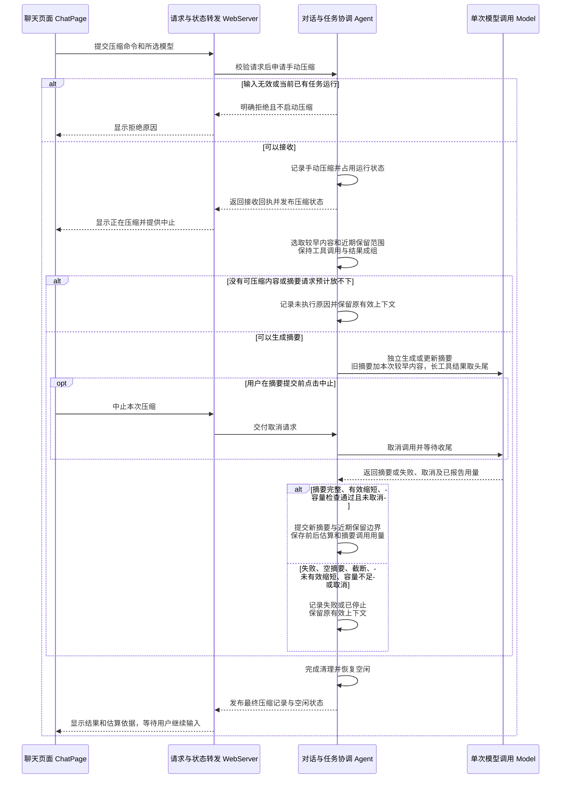
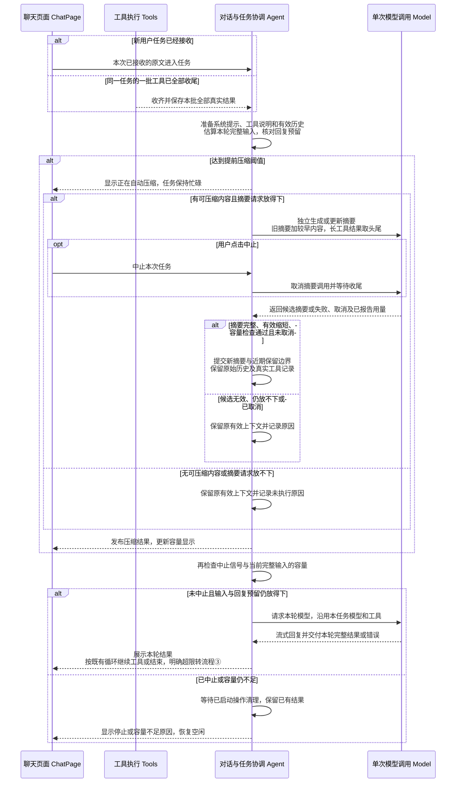
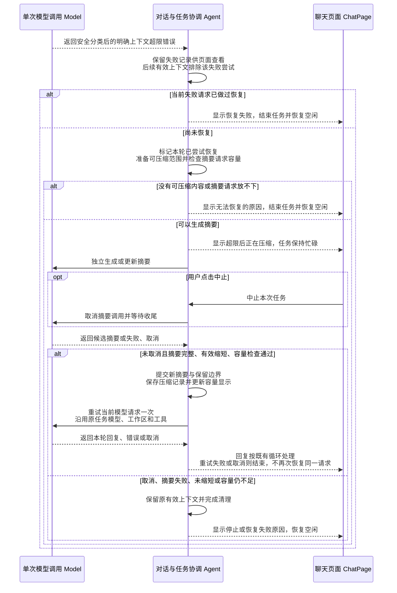
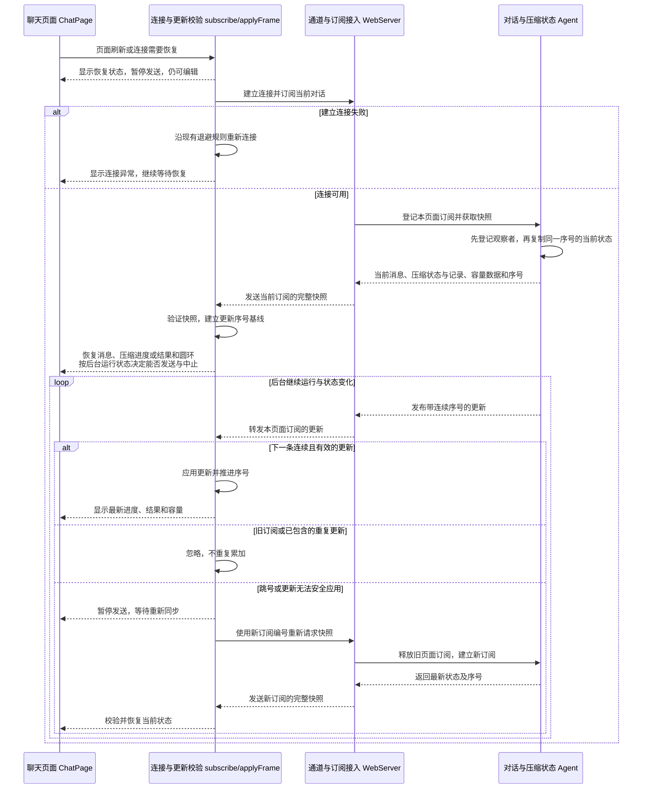
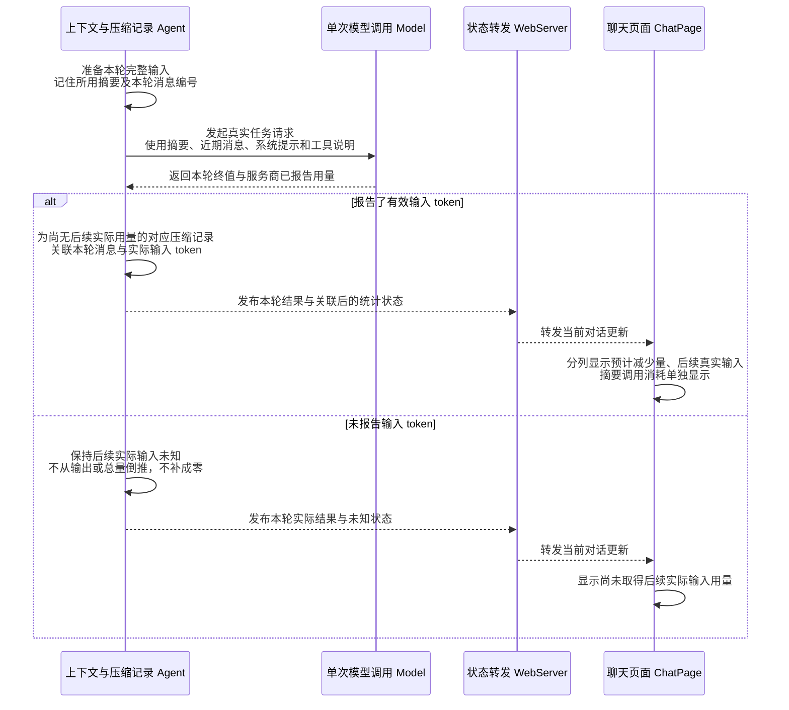
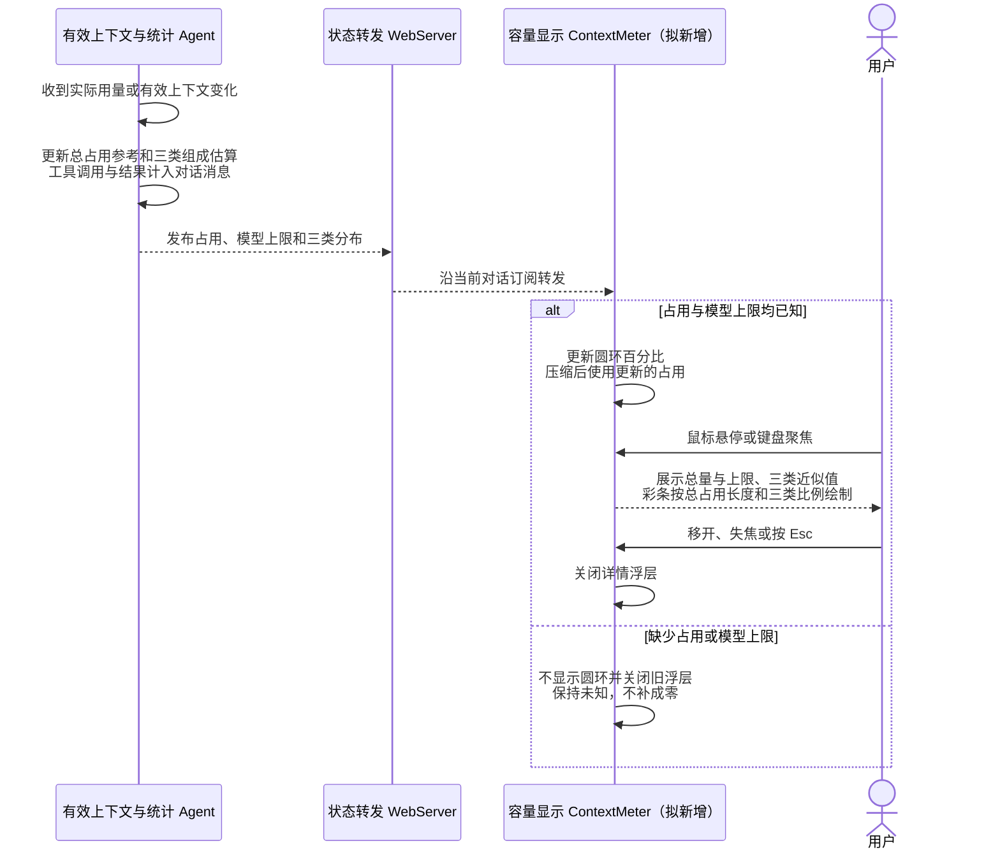
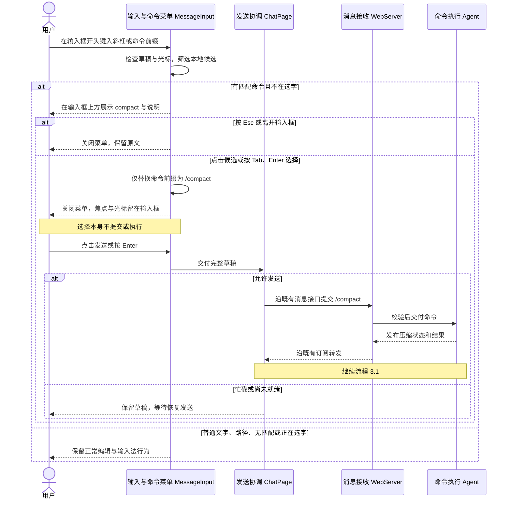

# Feature7：基础上下文压缩技术设计

状态：**已按用户本轮实施指令实现**。设计日期：2026-11-08，实施日期：2026-11-09。实施阶段的历史结果见[验收记录](./feature7-验收记录.md)。

排期更新（2026-11-09）：第八步新增基础 Session 机制，第九步新增项目说明加载与启动上下文，原本地存储与历史回看顺延为 Feature10；本文只同步后续步骤编号，不改变 Feature7 的已确认范围。

原有需求、关键取舍与六条流程已确认，见[讨论记录](./feature7-设计讨论记录.md)。用户新增斜杠命令菜单，并要求验证压缩不改变正常任务的 system prompt；新增交互与检查已补入本稿并随本轮实施。辅助统计、同步与接口细节由 Agent 核对，不再逐项提问。本轮用户要求新建 worktree 并继续实现，已按此方案落地，保留未验证边界。

核心功能见 §1、§2、§3.1—3.3，命令菜单见 §3.7；其余内容作为实施和验收依据。

## 1. 总结

**需求理解：** 当前对话变长后，用户可以提交 `/compact` 主动整理较早内容，系统也会在下一次模型请求接近容量上限时自动整理；真实模型更新一份摘要，后续请求使用“摘要＋近期原文”，继续完成原任务，原始聊天和真实工具记录仍可查看。同一会话支持重复压缩；第二次更新上次摘要并纳入新事实与更正，工具调用和结果保持配对。页面显示压缩状态、前后估算和对应真实请求输入用量，并提供按 dsh 设计的容量圆环及悬浮分布。失败、中止或未有效缩短时保护原有效上下文；刷新、重连恢复同一后端进程中的进度与结果。重启恢复和磁盘保存留到 Feature10。

**技术方案：** 既有 Agent 继续持有当前对话、协调模型和工具，并管理压缩记录与取消信号；新增压缩准备模块负责有效历史、切分与摘要输入，Model 继续只执行一次模型请求。成功后一次性切换摘要和近期保留边界，网页通过既有 HTTP/WS 获得结果。压缩核心参考 Pi，容量展示参考 dsh；不引入会话树、插件钩子、排队发送、额外服务商或统计服务。

输入框键入 `/` 时提供命令候选，目前仅 `/compact`；鼠标点击或 Tab 选择后先填入输入框，用户再发送执行。压缩只改后续请求的消息历史 `messages`，正常任务的系统提示词 `systemPrompt` 与工具定义独立保留；摘要调用的整理指令不覆盖它们。

## 2. 系统变化说明

**Before：** Agent 每轮发送全部有效历史，长对话持续增长；没有压缩命令、摘要、压缩记录或容量圆环，模型失败后直接结束当前任务。

**After：** 手动命令或请求前容量检查可进入独立摘要调用；校验成功后，下一轮改用最新摘要与保留原文。明确超限可压缩后重试当前请求一次；自动阈值压缩失败但仍预计放得下时继续原任务。摘要调用不执行工具，也不形成普通聊天回复。

原始 `ConversationMessage[]` 继续保留；摘要、保留边界、运行状态与页面统计同属 Agent 的内存状态。普通消息、工具执行与模型五种结束原因继续沿用 Feature5/Feature6；本次需要前后端协议一起更新。

## 3. 系统设计

### 3.1 手动压缩

用户在空闲时提交 `/compact`，完成独立压缩并恢复输入；图中正常、失败、无候选与中止均使用同一次操作记录。



#### 对话与任务协调 Agent

**职责：** 识别命令，持有原始历史及压缩记录，组织摘要调用并提交有效结果；运行中继续拒绝并发提交。

**接口：新增 0 项，修改 4 项。**

##### 【修改】`new Agent(options)`（进程内装配）

沿用已有 `stream`、`tools` 装配；增加可选 `compaction: { triggerTokens, keepRecentTokens }`，只供可信后端装配和受控验收降低预算，未传时采用 §3.2 默认值。验证正数、整数及保留预算小于触发预算等条件；不提供网页设置或正式启动环境变量。

##### 【修改】`submit(input)`（进程内调用）

**用途：** 接收网页原文，原子接收普通任务或手动压缩操作。

**主要流程：** WebServer 校验请求与工作区后交给 Agent；Agent 校验所选模型、非空原文和临时编号，并检查关闭与忙碌状态。原文去除首尾空白后恰为 `/compact` 时，创建压缩记录及独立运行编号，不追加普通用户消息；其余原文完整保留为用户消息。Agent 写入状态并发布更新后立即返回分类回执，后台执行摘要或普通任务。摘要校验与容量检查通过且尚未中止才提交新摘要；无候选、失败、截断、空摘要、工具调用或未缩短均保留原有效上下文。所有已启动操作收尾后再恢复空闲；手动压缩不会自动继续原任务。

##### 【修改】`abort(runId)`（进程内调用）

**用途：** 使用后台运行编号中止普通任务或独立压缩。

**主要流程：** WebServer 提交当前运行编号，Agent 仅匹配对应运行，发出取消并等待同次任务收尾；重复中止等待同一收尾过程，旧编号返回未处理。提交摘要前检查取消信号，取消生效则丢弃候选；已经提交的成功摘要和先前真实工具结果保留。恢复空闲后才允许新提交，中止不回滚文件修改。

##### 【修改】`close()`（进程内调用）

停止接收，取消并等待当前模型、工具或摘要调用；页面订阅结束继续只释放观察者，不调用本接口。

**数据：新增 2 项，修改 1 项。**

- 【新增】`SubmissionAccepted`：供接收方确认普通消息或压缩已接收；网络公开名称 `SubmitMessageAccepted` 引用同一数据。普通回执保留 `userMessageId`，压缩回执提供 `compactionId`，两者通过 `kind` 区分，不为压缩制造虚假的聊天消息。

**构造示例：**

```typescript
const accepted: SubmissionAccepted = {
  kind: 'compaction', clientMessageId: 'draft-02',
  compactionId: 'compact-01', acceptedSeq: 12,
}
```

- 【修改】`RunningState`：增加普通任务和独立压缩的明确分支，并统一使用 `runId` 供中止定位。普通任务复用触发它的正式用户消息编号作为 `runId`，保留助手编号、工具状态，阶段增加 `compaction`；独立压缩使用压缩记录编号，只有压缩阶段，不要求对应用户消息。网页消息分组只接收普通任务分支。

**构造示例：**

```typescript
const manual: RunningState = {
  kind: 'compaction', runId: 'compact-01', phase: 'compaction',
}
const automatic: RunningState = {
  kind: 'task', runId: 'user-03', assistantMessageId: 'assistant-07',
  phase: 'compaction', activeTools: [],
}
```

- 【新增】`CompactionRecord`：Agent 保存每次压缩的触发方式、状态、时间和安全原因；成功记录额外保存摘要、近期起点及准备时最后一条有效消息编号、同口径的前后估算、摘要自身用量和可选的后续请求引用。状态区分 `running`、`success`、`failed`、`aborted`、`skipped`；成功所需字段在成功分支必填。预计减少量由前后估算求差，实际输入从引用的原始助手消息读取，不重复保存两份用量事实。最新成功记录确定当前模型输入，较早记录只供回看。

**构造示例：**

```typescript
const record: CompactionRecord = {
  id: 'compact-01', trigger: 'manual', status: 'success',
  clientMessageId: 'draft-02', startedAt: 1794103200000,
  finishedAt: 1794103204200,
  summary: '目标：查明项目名称；约束：不改 note.txt；下一步：读取 note.txt。',
  firstKeptMessageId: 'message-081', contextLastMessageId: 'message-109',
  estimatedBefore: 62000, estimatedAfter: 23000,
  summaryUsage: { input: 42000, output: 1800, total: 43800 },
  followupMessageId: 'assistant-110',
}
```

以上为构造值，不是实测结果；`summaryUsage.input` 不进入压缩前后对比。

#### 压缩准备 Compaction

**职责：** 从原始记录构造有效输入、确定可整理范围，并准备独立摘要任务；不持有网络连接，不执行工具。

**接口：新增 3 项，修改 0 项。**

- 【新增】`buildModelHistory(entries, latest)`（模块间调用）：Agent 交入原始记录与最新成功压缩；排除失败、已中止和未完成助手及关联无效结果，按最新摘要和保留起点构造模型消息。摘要转换为带固定上下文说明的用户角色消息，不改原始数组。
- 【新增】`prepareCompaction(entries, latest, keepRecentTokens, includeThinking)`（模块间调用）：从最新有效原文往前累计估算，在用户或助手消息处选择合法边界，工具调用及结果成组；刚压缩完且没有新有效内容，或边界之前没有可整理内容时，返回明确未执行原因，不调用模型。重复压缩只处理上次保留边界之后的原文，并携带旧摘要更新。
- 【新增】`createSummaryContext(preparation)`（模块间调用）：把旧摘要和新选中的较早内容作为数据交给独立摘要任务，省略历史思考，保留用户/助手正文、工具调用与结果；长工具结果取前 1,500、后 500 个字符并添加截断提示，不超过 2,000 时原样保留。用户和助手正文不做同样截取；不提供工具声明。

**数据：新增 1 项，修改 0 项。**

- 【新增】`CompactionPreparation`：供 Agent 判断是否需要调用摘要模型；可执行分支包含旧摘要、待整理消息及近期起点和当前尾部编号，跳过分支包含 `already_compacted` 或 `nothing_to_compact`。运行状态、刷新和圆环更新不算新有效内容。选择边界时先按完整原文估算，之后才裁剪摘要请求中的工具结果。

摘要统一整理为目标、约束、关键事实、已确认及更正的决定、完成/未完成工作、关键路径与工具结论、下一步。长任务内部切分时明确保留本次用户原请求及当前进展。旧摘要和本次较早内容一次合并更新，避免简单堆叠历次摘要。

**系统提示词保护：** 压缩范围仅为 `ModelContext.messages`。正常任务的 `systemPrompt` 和工具定义由 Agent 按原有模型、工作区与工具配置构造，不进入待替代消息范围，成功提交只更新摘要与消息边界。摘要请求使用独立的整理指令，不回写普通任务配置。在模型、工作区与工具配置相同的条件下，手动、自动及重复压缩后的正常请求都应保留逐字相同的系统提示词；真实输入对照同时检查这一点。见[专门验收](../../../planning/里程碑1/feature7/feature7-验收标准.md#case-08)。

#### 单次模型调用 Model

**职责：** 使用既有流式入口完成摘要请求，提供可取消的结果和服务商用量；不决定压缩范围或改变 Agent 历史。

**接口：新增 0 项，修改 2 项。**

- 【修改】`stream(model, context, options)`：签名不增加压缩专用参数；按照模型目录的 `maxTokens` 显式发送输出预算，并在明确超限时交付安全分类。摘要与普通任务都继续使用当前 DeepSeek、high 思考、无 SDK 重试和五分钟数据空闲超时。
- 【修改】`createModelStream(credentials, configuration)`：返回具有上述行为的单次调用函数；可信测试注入与凭据读写规则沿用现状。

**数据：新增 0 项，修改 1 项。**

- 【修改】`AssistantMessage`：增加可选 `errorCode: 'context_overflow'`；仅有可信的服务商明确错误特征时设置，原始错误正文仍不返回页面。已有 `usage`、来源和时间字段沿用。

#### 请求接入 WebServer

**接口：新增 0 项，修改 3 项。**

- 【修改】`new WebServer(options)`（进程内装配）：把可选的可信 `compaction` 测试预算传入默认 Agent，继续装配正式八种工具；正式入口不提供该预算的网页设置或环境变量。已有 `modelOptions` 测试注入沿用。

##### 【修改】`POST /api/messages`（HTTP 接口）

**用途：** 沿原输入链路接收普通消息和 `/compact`，避免额外增加一套提交与确认机制。

**主要流程：** 沿用来源、Cookie、JSON、64 KiB、模型与绑定工作区检查，交给 Agent 识别命令；无效或忙碌仍明确拒绝且不写入操作，正常接收用 `202` 返回 `SubmissionAccepted`，不等待摘要生成。即使直接调用 HTTP，`/compact` 也不会成为普通模型问题。默认只识别完整命令，不新增自定义压缩指令语法。

##### 【修改】`POST /api/abort`（HTTP 接口）

**用途：** 中止普通任务或独立压缩。

**主要流程：** 请求改为 `{runId}`，校验非空且最多 128 字符后交给 Agent，等待对应运行收尾，再返回 `{runId, handled}`；旧运行编号不影响新任务。授权、大小限制及断开 HTTP 不撤销已交付中止的规则沿用。

**数据：新增 0 项，修改 4 项。** `SubmitMessageAccepted` 引用 Agent 的分类回执；`AbortRequest`、`AbortResult` 的定位字段改为 `runId`；`WebServerOptions` 增加可信进程内 `compaction` 预算。`SubmitMessageRequest` 四个字段沿用，不新增请求数据类型。

#### 页面协调 ChatPage 与压缩展示 CompactionRecords

**接口：新增 1 项，修改 1 项。**

- 【修改】`ChatPage.send(text, restoreDraft)`：仍提交原文并立即清空本次草稿；仅为本地展示识别命令类型，正式识别归 Agent。复用十秒未确认、快照核对及明确拒绝恢复草稿的规则；用正式消息或压缩记录的 `clientMessageId` 证明已接收。命令进入操作记录，不形成普通聊天气泡。
- 【新增】`CompactionRecords({records, messages, pending})`（页面组件）：输入区上方紧凑显示当前压缩和最近结果，历史记录可展开，展示触发方式、状态、摘要及统计依据；原始消息继续由 MessageList 显示。已有 MarkdownText 和原生折叠控件负责正文与展开，不增加依赖。

**数据：新增 0 项，修改 1 项。** `LocalSubmission` 增加提交种类和分类回执，普通消息与压缩的临时展示分开处理；正式数据仍由 Agent 持有。

### 3.2 请求前自动压缩

新用户输入已接收或本批工具全部收尾后，检查下一次完整请求，必要时压缩并继续同一任务。



#### 请求容量与估算 Model

**接口：新增 2 项，修改 2 项。**

- 【新增】`estimateMessageTokens(message, includeThinking)`（模块间调用）：供压缩准备按完整消息选择近期边界，计正文、适用思考、调用参数、结果及结构开销。
- 【新增】`estimateContextTokens(context)`（模块间调用）：供 Agent 检查完整输入及构造分布；按实际请求组成处理系统提示、工具声明和有效消息，不计算页面原始历史中已被替代的内容、外层编号、时间或未发送草稿。
- 【修改】`findModel(modelId)`：本地目录返回容量与本项目输出预算；仍不访问网络。
- 【修改】`discoverModels(credentials)`：在原可用模型数据中返回相同限制；仍只检查本地凭据，不额外访问服务商。

**数据：新增 1 项，修改 1 项。**

- 【新增】`ContextEstimate`：固定口径的消息组成估算，包含 `systemTokens`、`toolsTokens`、`messageTokens`；工具一项仅计声明，调用与结果归消息。保留 Pi/dsh 的每 4 字符约 1 token 思路并计结构开销；带工具时包括历史思考，不带工具时不把服务商忽略的历史思考当成有效输入。估算始终明确标注，不能替代实际用量。
- 【修改】`ModelInfo`：增加 `contextWindow` 和 `maxTokens`，后者指本项目一次请求的输出预算，不冒称服务商最大能力。

**构造示例：**

```typescript
const model: ModelInfo = {
  id: 'deepseek-flash', name: 'DeepSeek Flash',
  provider: 'deepseek', api: 'openai-completions',
  contextWindow: 1_048_576, maxTokens: 65_536,
}
```

#### 请求协调 Agent

本流程沿用 §3.1 修改后的提交、停止和压缩记录接口，不重复计数。每轮构造请求后再检查，不在本批工具仍执行时压缩；工具继续使用 Feature6 的整批校验与调度。

正式默认值：近期目标 `20_000`；回复预算 `65_536`；额外整理余量 `16_384`。因此预计完整输入达到 `966_656 = 1_048_576 - 65_536 - 16_384` 时触发自动压缩；输入与回复预算合计超过模型容量时不放行。

检查优先使用同模型、同系统/工具配置且仍对应当前有效前缀的实际输入样本，加上之后内容的估算；压缩或配置变化使这个样本失效时重新估算完整请求。实际样本缺失不填零。前后预计减少量始终用同一种完整请求估算口径，不将实际前值和估算后值相减。

同一份输入只尝试一次阈值压缩。失败后原输入仍预计放得下则继续，否则停止；用户中止始终停止。候选摘要必须完整、无工具调用、非空、预计有效缩短且容量通过，才提交摘要、边界及成功记录；不通过时旧摘要和原文均保留。

### 3.3 明确超限后恢复一次

服务商明确拒绝当前输入时，压缩后只重试当前失败请求一次；不存在可压缩内容就结束恢复。



#### 错误识别 Model 与恢复协调 Agent

沿用 §3.1 的错误分类和停止接口，不增加通用重试机制。Model 在脱敏前检查服务商错误码或明确上下文超限特征，输出安全 `context_overflow` 分类；认证、限流、网络和未能明确识别的参数错误继续按已有失败处理，不凭 HTTP 400 推断超限。

Agent 在摘要请求之前设置本轮恢复标记，失败的助手回复仍供页面查看但不进入有效输入；摘要失败或重试失败结束，不递归恢复摘要调用。一次限制针对当前连续失败请求，获得成功回复后后续工具轮次仍是新请求。纯文字 `length`、带调用 `length` 均保留 Feature6 的已确认处理，不扩展 Pi 的 length 恢复范围。

### 3.4 刷新与断线恢复

页面通过现有订阅恢复同一进程中的消息、压缩进度、结果与容量显示，后台任务不因页面断开而取消。



#### 状态归属与订阅 Agent

**接口：新增 0 项，修改 1 项。** `subscribe(signal)` 增加压缩与容量数据，仍先登记观察者再复制快照；同一序号对应同一状态，随后只发送切点后的更新。取消、迭代退出和连接清理仅释放该观察者。

**数据：新增 0 项，修改 3 项。**

- 【修改】`ConversationSnapshot`：增加 `compactions`、`contextUsage`，原始 `messages` 与正在生成内容继续保留；运行信息使用 §3.1 的分类状态。
- 【修改】`ConversationUpdate`：增加压缩记录更新种类，包含需要一起变化的运行状态；容量数据作为相应更新的可选元数据传递，避免单独建立统计通道。旧更新序号忽略，跳号或无法安全应用时重新订阅。
- 【修改】`AgentSubscriptionEvent`：继续只包含 snapshot/update 两种包络，载荷采用本次更新的数据；不引入第二套事件序号。

摘要、保留边界与成功记录在一个无异步空隙的提交中改变，之后再发布；失败或取消不暴露半提交上下文。快照使用独立副本，不读取 Model 可能领先的共享 partial。

#### 通道接入 WebServer 与页面同步 ChatClient

**接口：新增 0 项，修改 2 项。**

- 【修改】WS 当前对话订阅（持续网络订阅）：转发新增状态，清理仍按连接所属订阅处理；不调用 Agent.abort。大快照及其后续更新必须通过[大历史快照与增量衔接验收](../../../planning/里程碑1/feature7/feature7-验收标准.md#case-38)，保留慢连接保护；若现有发送等待方式造成恢复循环，调整发送完成与保护的协作后再验收，不预先引入新的同步框架。
- 【修改】`subscribe(onState, ...)`（页面持续订阅）：校验新增快照/更新及运行分支，沿现有重连和新订阅编号逻辑恢复；收到有效快照前暂停发送，快照仍忙碌时继续等待或中止。网页不自动重发命令、消息或工具。

**数据：新增 0 项，修改 1 项。** `ServerFrame` 继续引用 Agent 的快照与更新，载荷变化随协议一起更新。模型目录响应的新增数字同时更新既有校验。

刷新不新增草稿持久化。服务重启后内存记录清空，Feature10 再处理磁盘和重启恢复。

### 3.5 后续真实用量关联

真实任务请求结束时，把实际使用某条摘要的首次有效输入用量关联到对应压缩记录；缺失字段保持未知。



#### 用量来源 Model 与压缩记录 Agent

本流程不新增对外接口或数据类型，复用 `AssistantMessage.usage.input` 和 `CompactionRecord.followupMessageId`。发起请求时捕获所用摘要与助手消息编号；服务商提供有效输入字段后，为尚无引用的对应记录关联该消息。已有关联不被之后更长的请求覆盖，使用新摘要的请求不串写旧记录。

摘要自身用量单独记入 `summaryUsage`。实际请求失败或取消但已报告用量时保留真实事实，同时保留失败状态；没有报告输入时不从输出或总量倒推。页面将预计减少量、后续实际输入与摘要消耗分列；没有同输入实测前值就不显示真实减少量。

严格前后对照只在受控验收中执行，额外对照回复不进入任务历史，不执行其中的工具；原始历史和标准答案不混回压缩后的问答或续做。

### 3.6 容量圆环与悬浮分布

有效内容或实际用量变化后更新圆环，用户悬停或聚焦查看三类近似分布；统计口径按已确认的 dsh 参考。



#### 容量状态 Agent

**数据：新增 1 项，修改 0 项。** `ContextUsage` 供页面绘制圆环：包含可选的当前占用 `tokens`、当前模型 `contextWindow` 和三类估算。总占用以最近实际输入为基准加有效内容增减的估算，三类单独估算，合计不必等于总占用。完整用户消息、模型终值、完整工具结果及摘要提交等有效内容变化时更新，不逐个 token 重扫全部原始历史；流式未完成助手不当成已完成的下一轮有效输入。

**构造示例：**

```typescript
const usage: ContextUsage = {
  tokens: 27300, contextWindow: 1_048_576,
  breakdown: { systemTokens: 1600, toolsTokens: 6500, messageTokens: 13400 },
}
```

该构造示例特意保留近似总量与分类和的差异，三类不是服务商实测拆分。圆环只用于显示；§3.2 的请求放行检查使用实际本轮上下文与有效样本，不直接信任圆环读数。

#### 容量显示 ContextMeter 与输入 MessageInput

**接口：新增 1 项，修改 1 项。**

- 【新增】`ContextMeter({usage})`（页面组件）：发送/中止按钮左侧显示紧凑 SVG 圆环与占用百分比；上方浮层按参考图显示总量/上限、颜色条与系统提示词/工具定义/对话消息。hover 或键盘聚焦打开，离开圆环与浮层、失焦或 Esc 关闭；不抢编辑焦点。无有效占用或上限时隐藏并关闭旧浮层，真实零值不绘制已用色段；圆环最多显示 100%，数值仍保留实际参考值。
- 【修改】`MessageInput(props)`（页面组件）：增加用于放置容量组件的展示插槽，并接入 §3.7 命令菜单；保留既有编辑、撤销、中文选字和发送门禁。发送/中止仍由 ChatPage 协调，普通助手展示只收到任务分支，独立压缩不伪装成助手或工具。

SVG、原生交互与已有样式足够完成控件，不安装 Tooltip 或图表依赖。总占用与分项明确使用近似标记，颜色条整体长度按总占用绘制，内部颜色按三类估算比例拆分；窗口边缘及小屏不遮住发送按钮。

### 3.7 斜杠命令菜单与补全

用户在输入框开头键入 `/`，从菜单选中 `/compact` 填入草稿，再发送执行；参考[用户提供的命令菜单截图](./asset/feature7-命令菜单参考.png)。



#### 输入与命令菜单 MessageInput

**职责：** 在当前 Lexical 编辑器内完成候选展示与命令补全，填入普通可编辑文本；执行仍归既有发送链路与 Agent。

**接口：新增 0 项，修改数量已计入 §3.6。** `MessageInput(props)` 继续接收原有发送回调与门禁。菜单选择不调用 `onSend`、不请求后端、也不操作系统剪贴板；用户发送后仍按 §3.1 精确识别 `/compact`。菜单状态与选择处理保持在输入组件内部，不新增命令列表 API 或可扩展命令服务。

**数据：新增 2 项，修改 0 项。**

- 【新增】本地候选：只有 `/compact` 和中文说明“压缩较早的对话内容”，随页面构建提供；不展示截图中的其他命令，不支持命令参数。
- 【新增】菜单交互状态：归当前输入组件，记录候选是否可见及当前选择；草稿与光标仍由 Lexical 持有，不另建一份草稿，不进入 Agent 快照。

菜单显示在输入框上方，只有一项时默认高亮；草稿仅包含可选前导空格与 `/` 或 `/compact` 的匹配前缀、光标折叠在末尾时才提供候选，普通正文、URL 和路径不转换成命令。选中后只替换命令前缀，保留编辑器及撤销历史，光标落到末尾，菜单关闭且不会因普通重渲染立即重开。

按用户授权由 Agent 处理的键盘适配：菜单打开时，Tab 补全并留在输入框，Enter 同样先补全，再按 Enter 才发送；菜单关闭或没有候选时，Tab 沿既有顺序移焦。Esc、Shift+Tab 或失焦关闭菜单且不改草稿，Shift+Tab 保留反向移焦。中文选字及刚结束选字时先走既有保护，不补全或误发送；忙碌期间仍可编辑与补全，但不能绕过发送门禁。鼠标选中处理避免失焦先关闭菜单，菜单提供列表与当前候选的可访问性说明。

#### 发送协调 ChatPage、消息接收 WebServer、命令执行 Agent

本流程不新增接口或共享数据。发送只提交当前草稿；服务端继续决定命令类型、忙碌拒绝和实际压缩结果，选择命令不会提前创建压缩记录。手动直接输入 `/compact` 的原有路径继续有效。

## 4. 技术决策

### 已确认的功能选择

- 【功能决策｜Agent、网页】自动阈值压缩失败，原输入与回复预留仍可容纳时继续，否则停止；用户中止始终停止。
- 【功能决策｜Agent、Model】明确超限时压缩并重试当前失败请求一次，失败或无候选就结束；程序不重跑先前工具，普通错误和 Feature6 截断规则沿用。
- 【功能决策｜Agent、Model、网页】日常展示估算及后续真实输入，不为逐次证明下降额外请求模型；两次真实同输入对照验收保留。
- 【工程决策｜Compaction】采用用户调整的工具结果预算：前 1,500、后 500 字符，中间标截断；中间独有事实可能丢失，原始记录与近期原文不改。

### 参考采用与具体适配

- Pi 的[准备入口](../../../pi/packages/coding-agent/src/core/compaction/compaction.ts:859)、[切分](../../../pi/packages/coding-agent/src/core/compaction/compaction.ts:789)、[摘要转换](../../../pi/packages/coding-agent/src/core/messages.ts:176)决定有效投影、原文保留与用户角色摘要的做法；[生成与更新](../../../pi/packages/coding-agent/src/core/compaction/compaction.ts:696)提供旧摘要迭代思路。本项目统一更新一份摘要，长任务早期部分与旧摘要一并整理；Pi 的分段生成与拼接、会话树和扩展钩子不直接复制。结构化摘要明确保留当前请求、路径与工具结论，并通过真实续做验证质量。
- 文件清单沿用 [Pi 的仅读与已改分类](../../../pi/packages/coding-agent/src/core/compaction/utils.ts:67)。`read` 成功和 `write`、`edit` 确认写入完成时，工具把解析后的路径交给 Agent，写入完成后收到中止也保留事实。每次按新分界线统计之前的原始工具记录，按路径去重，改过的路径只列在已改。成功记录分别保存摘要正文和清单，正常模型请求把清单附在正文后并一起估算 token，「查看摘要」显示同一清单。后续摘要调用只用旧正文和新选中的原文更新正文。
- dsh 的[分类](../../../deepseek-harness/packages/llm/token-meter/src/projection.ts:59)、[占用投影](../../../deepseek-harness/packages/llm/token-meter/src/usage-projection.ts:173)和[圆环](../../../deepseek-harness/packages/client/ui-conversation/src/client/skeleton/ContextMeter.tsx:100)提供展示依据；工具仅指工具定义，调用与结果归对话，总量与分项分开。用户要求的 hover 详情替代 dsh 的点击详情；本项目使用现有 Agent/WS，不复制完整服务、持久事件投影与多模型路由体系。
- 截至 2026-11-08，[官方模型目录示例](https://api-docs.deepseek.com/api/list-models/)给出 `deepseek-flash` 容量 1,048,576，服务商最大输出 393,216；[Chat Completions](https://api-docs.deepseek.com/api/create-chat-completion/)的 high 思考默认输出为 64K。本项目显式请求 65,536 并据此预留，容量元数据保留在本地目录，模型发现继续不发网络请求；未将 16,384 直接当作全部回复预留。
- [DeepSeek 思考规则](https://api-docs.deepseek.com/guides/thinking_mode/)要求带工具时保留历史思考；估算与近期原文遵守这一规则。摘要序列化省略历史思考，沿用 Pi 的独立摘要任务做法；服务商只报告的用量字段保持其原义，不重复累加缓存或思考。
- 新增运行种类后，以 `runId` 统一中止，普通任务仍复用原正式用户编号。`/compact` 在现有消息接收入口由 Agent 识别，复用接收、未确认和订阅证明机制；不添加提交去重或单独命令通道。
- 命令菜单参考 dsh 的[候选与选择](../../../deepseek-harness/packages/client/ui-commands/src/client/service.ts:224)、[键盘处理](../../../deepseek-harness/packages/client/ui-input-trigger/src/client/controller.ts:262)及[鼠标保持编辑焦点](../../../deepseek-harness/packages/client/ui-input-trigger/src/client/MenuView.tsx:165)。dsh 根据命令种类可能在选中后立即执行；本项目按用户要求统一先填入再发送，只支持开头命令前缀，复用当前 Lexical 编辑器，不复制它的动态目录、插件服务和命令胶囊。
- Pi 的 [Tab 补全](../../../pi/packages/tui/src/components/editor.ts:768)保留撤销并修改输入，符合本次选择后可编辑的要求；Pi 的斜杠候选按 Enter 可直接提交，本项目菜单中的 Enter 只补全，发送是后续单独动作。当前输入框已用高优先级处理 Enter 与 Tab，实施时协调菜单分支和输入法保护，不直接套用低优先级补全插件而让旧发送逻辑抢先执行。
- 当前 [Agent 请求装配](../../../packages/agent/src/agent.ts:62)独立生成系统提示词、工具定义和消息历史，[Model 转换](../../../packages/model/src/deepseek.ts:28)再将系统提示词转为协议的 system 消息。压缩只替代业务消息历史，不修改这两处系统提示词归属；摘要请求的独立指令不能写回普通任务。

以上具体默认值、接口组织和参考适配由 Agent 基于已确认行为提出，随整稿批准；没有将未展示过的字段或实现选项记为逐项批准。

## 5. 风险与边界

### 风险 1：摘要遗漏关键事实，后续任务答错

- **案例：** 一个事实只出现在工具结果被省略的中间部分，或模型在更新摘要时遗漏早期约束；后续任务无法依靠保留的近期原文找回。
- **解决方案：** 明示头尾截取和摘要有损边界，保留原始记录；用同会话两次压缩、早期事实、更正与真实工具续做验收。模型自评或摘要看起来完整不算通过；若实际任务频繁在结果中部丢失必要事实，重新评估预算或分段摘要。

### 风险 2：预计放得下，服务商仍报告超限

- **案例：** 中文、JSON 或一次很大的新增输入使固定密度估算偏低；或别名模型的实际限制发生变化。
- **解决方案：** 使用有效实际输入样本修正后续估算，预留回复与整理空间，并只对明确超限做一次恢复。未知错误安全结束。单条不能拆分的输入或必须成组保留的近期结果自身过大时，明确停止，不无限压缩。

### 风险 3：服务商超限格式未被识别

- **案例：** 当前 Model 脱敏后只剩通用 HTTP 说明，DeepSeek 又未提供稳定的专用超限错误码，错误可能不能可靠归类。
- **解决方案：** 在 Model 内识别可信错误特征，再返回安全分类；受控 SDK 测试覆盖正反例，实施时核对真实响应格式。未实测前不声称覆盖所有远端超限形式，也不把任意 400 当成超限。

### 风险 4：原始历史很大，刷新恢复变慢

- **案例：** 模型输入已压缩，页面仍恢复数 MiB 原始聊天；大快照与连续更新可能触发已有慢连接保护。
- **解决方案：** 验收真实 HTTP/WS 的大快照及紧随更新；若出现恢复循环，修正发送完成与保护的协作后再交付。保持连接清理不影响后台任务，不用小快照测试代替此项；本期不提前增加分页存储。

### 风险 5：旧页面使用旧协议，发送或中止失败

- **案例：** 后台新增分类回执及运行编号，旧前端仍按用户消息编号解析独立压缩。
- **解决方案：** 后台、网页、相关测试与构造夹具一起更新并重新构建，更新后刷新页面；请求校验继续拒绝无效编号，避免误停其他运行。不修改凭据与工作区存储格式。

### 风险 6：服务重启后记录消失

- **案例：** 后端进程退出后重新启动，内存中的原文、摘要和运行状态均丢失。
- **解决方案：** 本期只保证同一进程的刷新与重连；原始历史、压缩记录和重启后的恢复一起在 Feature10 落盘，不让页面缓存冒充保存成功。

### 风险 7：选择候选时误发送，或输入法与 Tab 导航被破坏

- **案例：** 原有 Enter 发送比菜单先执行，用户想选命令却提交了前缀；或菜单把选字按键、普通 Tab 移焦当成补全。
- **解决方案：** 先保留选字保护，再按菜单是否有效分配按键；菜单选中仅写入草稿，关闭后才走原有发送和移焦。用真实 Chromium 验证点击、Tab、Enter、关闭与撤销，复用既有输入法合成事件回归；合成事件不能代替真实中文输入法证据。

### 风险 8：摘要整理指令覆盖正常任务的系统提示词

- **案例：** 摘要请求与任务请求共用并改写同一个上下文对象，压缩后模型继续执行整理指令，原有工作区和工具约束消失。
- **解决方案：** 摘要使用独立请求上下文，压缩结果只切换消息投影；对正常任务 systemPrompt 作逐字比较，并在真实两次压缩中检查系统提示词与工具定义保持原样，不以 token 总数相近代替内容检查。

## 6. 验收标准

验收标准已独立为 [Feature7：验收标准](../../../planning/里程碑1/feature7/feature7-验收标准.md)。共 68 个案例，按 7 个功能主题组织；文档顶部提供各组目标和每个案例的跳转链接，案例保留测试类型、目的与操作步骤。新增覆盖[系统提示词保持原样](../../../planning/里程碑1/feature7/feature7-验收标准.md#case-08)及[命令菜单与补全](../../../planning/里程碑1/feature7/feature7-验收标准.md#command-menu)，真实完整任务也同时核对系统提示词。

验收案例已按对应层级实施；实际执行方式、真实模型证据及未验证边界以验收记录为准。

## 7. 文件变更

下列为拟议文件范围；测试夹具随契约同步，实施中若发现额外调用方，按同一行为补齐并更新记录，不顺手修改其他脏文件。

### Model

| 文件 | 类型 | 用途 | 变更 |
| --- | --- | --- | --- |
| `packages/model/src/context.ts` | 新增 | 统一模型输入转换与估算 | 复用原消息转换，补逐消息和完整请求估算 |
| `packages/model/src/deepseek.ts` | 修改 | 单次模型请求 | 内联转换移到共用输入处理，显式输出预算，补安全超限分类 |
| `packages/model/src/types.ts` | 修改 | 模型与用量契约 | 增加模型限制、估算结构及明确超限分类 |
| `packages/model/src/index.ts` | 修改 | 公开模型能力 | 导出实际被 Agent 使用的估算与类型 |
| `packages/model/test/context-estimate.test.ts` | 新增 | 验证输入组成 | 检查系统、工具、消息、思考与结构开销 |
| `packages/model/test/model-stream.test.ts` | 修改 | 单次调用回归 | 覆盖输出预算、分类、原有配对/脱敏/用量 |
| `packages/model/test/model-discovery.test.ts` | 修改 | 本地目录回归 | 模型字段增加限制，仍不联网 |
| `packages/model/README.md` | 修改 | 调用说明 | 说明估算、限制和错误分类 |

### Agent、Compaction

| 文件 | 类型 | 用途 | 变更 |
| --- | --- | --- | --- |
| `packages/agent/src/compaction.ts` | 新增 | 准备摘要与有效输入 | 切分、序列化、提示词和历史重建 |
| `packages/agent/src/agent.ts` | 修改 | 当前对话运行 | 识别命令、自动检查、摘要提交、中止、恢复和统计 |
| `packages/agent/src/types.ts` | 修改 | 状态数据 | 分类回执、运行、压缩记录、快照与容量数据 |
| `packages/agent/src/index.ts` | 修改 | 公开契约 | 导出需要跨模块使用的数据 |
| `packages/agent/test/compaction.test.ts` | 新增 | 压缩准备测试 | 边界、配对、头尾、重复摘要和原文保护 |
| `packages/agent/test/agent.test.ts` | 修改 | 调度回归 | 覆盖手动、自动、取消、恢复及用量引用 |
| `packages/agent/README.md` | 修改 | 运行说明 | 补压缩生命周期、状态与内存边界 |

### WebServer、ChatClient

| 文件 | 类型 | 用途 | 变更 |
| --- | --- | --- | --- |
| `packages/server/src/webserver/index.ts` | 修改 | 正式接入 | 分类回执、runId 中止、可信测试预算装配；按验收结果处理大快照发送协作 |
| `packages/server/src/webserver/protocol.ts` | 修改 | 网络契约 | 更新回执与中止定位，引用新状态 |
| `packages/server/test/webserver.test.ts` | 修改 | 接入与恢复检查 | 命令、停止、快照、序号及大历史 |
| `packages/server/README.md` | 修改 | 服务契约说明 | 同步新载荷与前后端一起更新要求 |
| `web/src/chat/client.ts` | 修改 | 网络调用 | 校验新模型字段、分类回执与 runId |
| `web/src/chat/state.ts` | 修改 | 订阅状态 | 新增数据验证与应用，区分命令及消息临时状态 |
| `web/src/types.ts` | 修改 | 本地提交数据 | 支持操作记录及分类回执 |
| `web/src/chat/client.test.ts` | 修改 | 网络解析回归 | 新字段及原重连门禁 |
| `web/src/chat/state.test.ts` | 修改 | 状态应用回归 | 新快照/更新、运行分支与关联 |
| `web/src/chat/submission.test.ts` | 修改 | 接收证据回归 | 普通消息和压缩记录均可确认接收 |

### 网页展示

| 文件 | 类型 | 用途 | 变更 |
| --- | --- | --- | --- |
| `web/src/pages/ChatPage.tsx` | 修改 | 页面协调 | 接入操作记录、容量和统一中止 |
| `web/src/components/CompactionRecords.tsx` | 新增 | 查看压缩进度与记录 | 紧凑状态、历史折叠及统计依据 |
| `web/src/components/ContextMeter.tsx` | 新增 | 查看容量分布 | 圆环、hover/聚焦浮层及近似标注 |
| `web/src/components/MessageInput.tsx` | 修改 | 输入与命令选择 | 增加容量控件插槽及斜杠菜单，补全后再发送，保护编辑与选字 |
| `web/src/components/MessageInput.test.tsx`、`web/src/components/MessageInput.browser.test.tsx` | 修改 | 命令输入与编辑验证 | 检查菜单、选择、发送衔接、关闭、撤销、选字和原有移焦 |
| `web/src/components/MessageList.tsx` | 修改 | 普通消息分组 | 适配任务运行分支与 runId，压缩不作为普通消息 |
| `web/src/styles.css` | 修改 | 实际样式 | 沿现有风格补圆环、浮层和记录样式 |
| `web/src/components/ContextMeter.browser.test.tsx` | 新增 | 容量组件验证 | hover、键盘、边界和窄窗口 |
| `web/src/components/CompactionRecords.test.tsx` | 新增 | 压缩展示验证 | 状态、摘要与用量来源 |
| `web/src/pages/ChatPage.test.tsx`、`web/src/pages/ChatPage.browser.test.tsx` | 修改 | 页面集成回归 | 提交、恢复、草稿、中止和新组件 |
| `web/src/components/AssistantMessage.test.tsx`、`web/src/components/AssistantMessage.browser.test.tsx`、`web/src/components/MessageList.browser.test.tsx` | 修改 | 既有显示夹具 | 更新运行分支，保留旧工具与滚动覆盖 |
| `web/src/components/SettingsDialog.test.tsx`、`web/src/test/ChatPageHarness.tsx` | 修改 | 模型目录夹具 | 补齐新增模型限制 |
| `web/tests/e2e/compaction.live.spec.ts` | 新增 | 真实完整验收 | 同会话两次压缩与任务续做 |
| `web/tests/e2e/server-fixture.mjs`、`web/tests/e2e/test-utils.ts` | 修改 | 测试服务装配 | 隔离预算与契约更新，不伪造真实用量 |
| `web/README.md` | 修改 | 网页验收说明 | 新用例、条件及未验证边界 |

### 其他

| 文件 | 类型 | 用途 | 变更 |
| --- | --- | --- | --- |
| `README.md` | 修改 | 运行说明 | 实施验收后说明压缩、圆环与限制 |
| `planning/README.md`、`planning/里程碑1/README.md` | 修改 | 规划索引 | 登记本设计，完成前保持未实现/未验收 |
| `docs/设计妥协记录.md` | 修改 | 已接受限制 | 记录头尾摘要预算、近似统计及重评时机 |
| 本文、`feature7-设计讨论记录.md` | 新增 | 设计依据 | 保存最终稿、批准范围和用户要求 |
| `planning/里程碑1/feature7/feature7-验收标准.md` | 新增 | 独立验收方案 | 按功能主题展示总览，逐个链接到 68 个案例，保存执行条件及现状 |
| `asset/feature7-对话容量圆环参考.png` | 新增 | 用户参考 | 保存原始参考图 |
| `asset/feature7-命令菜单参考.png` | 新增 | 用户参考 | 保存斜杠菜单原始参考图 |

不增加生产依赖，不改变参考仓库、凭据文件、工具权限或工作区配置，不提前实现 Feature8 的 Session 机制、Feature9 的项目说明加载或 Feature10 的本地存储。
