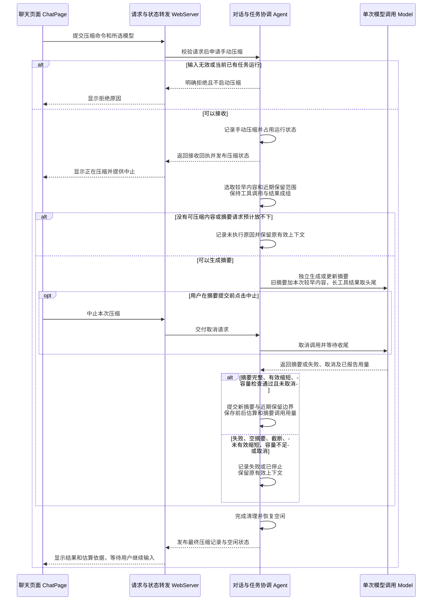
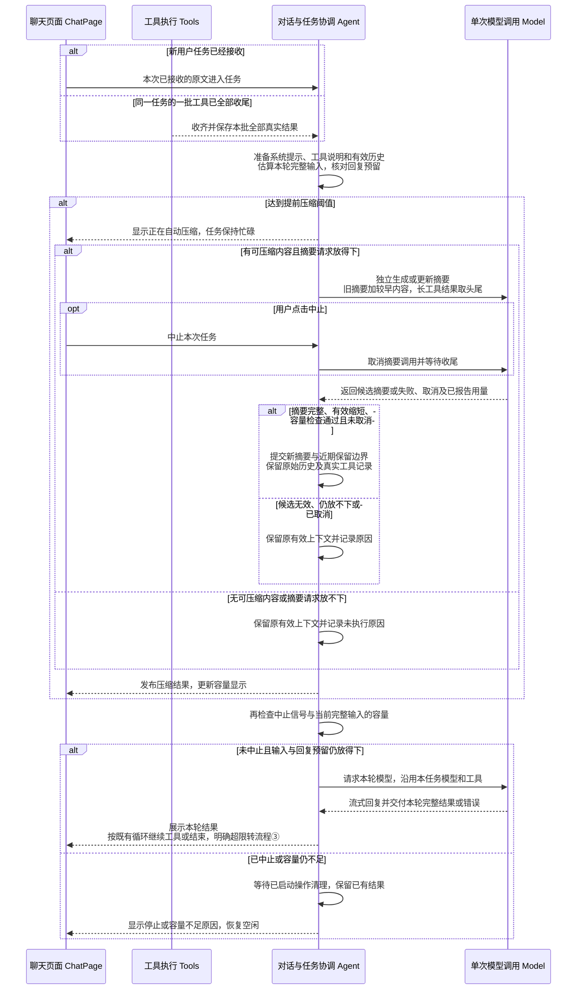
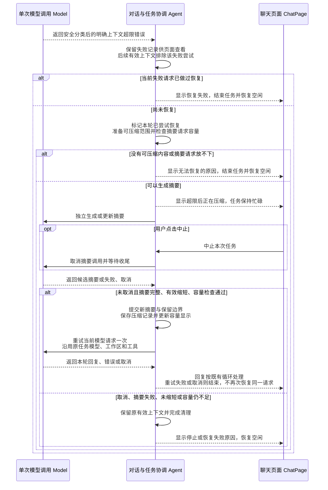
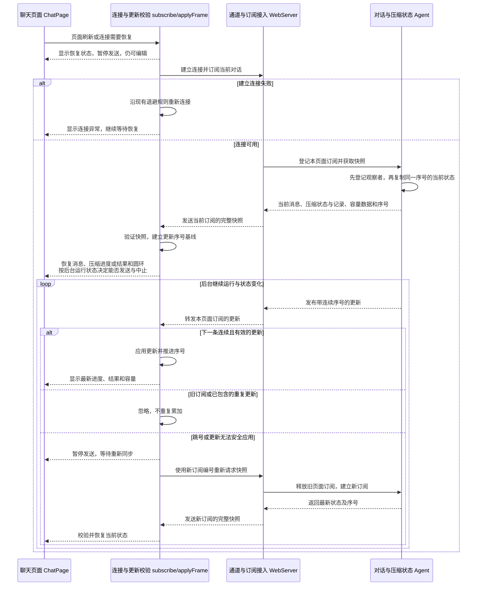
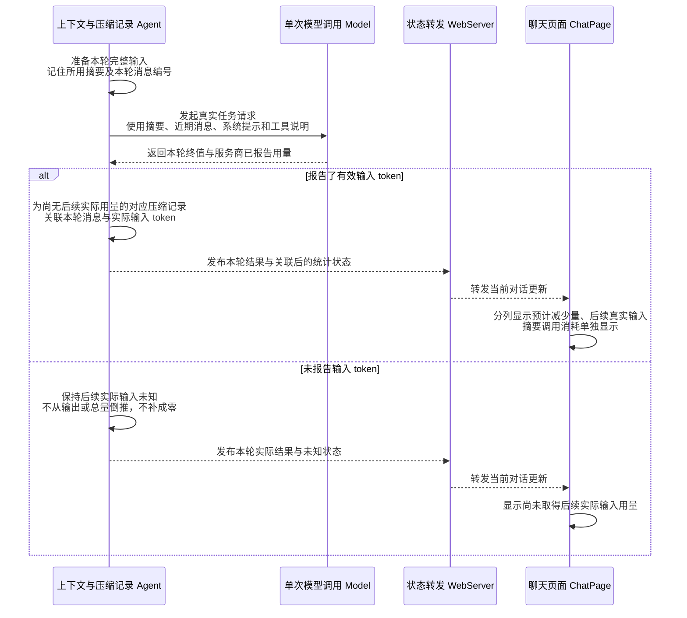
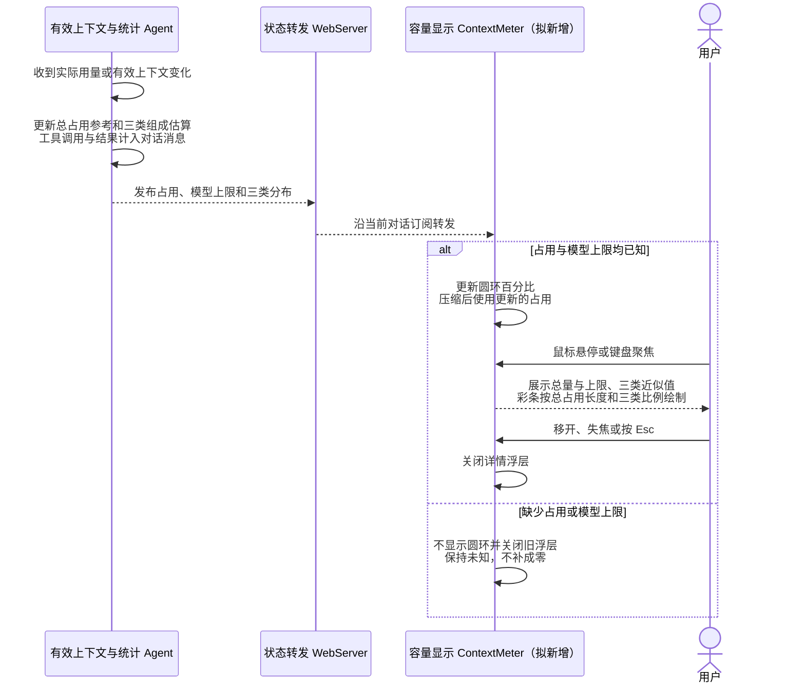

# Feature7：基础上下文压缩设计讨论记录

日期：2026-11-08。

排期更新（2026-11-09）：第八步新增基础 Session 机制，第九步新增项目说明加载与启动上下文，磁盘保存和重启恢复顺延至 Feature10；下文相关编号同步调整，原讨论决策不变。

实施更新（2026-11-09）：用户要求在当前目录新建 worktree 并继续实现，本轮已按完整方案落地。以下保留设计讨论阶段的状态与决策来源；实际校验结果见[验收记录](./feature7-验收记录.md)。

设计讨论阶段状态：原有需求、关键取舍和六条流程已确认；用户新增斜杠命令菜单及 system prompt 保护验收，已补入[完整技术设计稿](./feature7-基础上下文压缩技术设计.md)，具体适配随整稿审阅，未实施。辅助接口与小功能细节由 Agent 核对，不再逐项提问。

## 已确认：需求范围

用户在本次对话中回复“可以”，认可依据[里程碑1第七步](../../../planning/里程碑1/README.md#第七步基础上下文压缩)展示的需求理解：在同一个当前对话中，用户通过 `/compact` 主动压缩，系统也在下一次请求接近模型上下文上限时自动压缩；由真实模型整理早期内容，后续请求使用摘要与近期消息，再次压缩时更新已有摘要，工具调用与对应结果不能拆散。摘要应保留继续任务所需的目标、约束、事实、决定、工作进度、路径和工具结论。

网页显示压缩进度、结果和前后 token，区分估算与实际用量。失败、取消或未有效缩短时保留原有效上下文。原始聊天与工具记录仍留在后端内存供网页查看，刷新与重连可恢复压缩进度和结果；磁盘保存和重启恢复留到 Feature10。摘要不承诺任意任务无损。

验收沿用规划：同一真实网页会话先手动、再自动完成至少两次压缩，每次均核对可比的真实输入 token 下降，再通过问答和新工具操作继续原任务；第二次覆盖仅在第一次摘要中的早期事实与之后的新事实、更正和工具结论。具体检查点以里程碑规划为准。

## 用户新增：当前对话容量圆环

用户确认上一轮完整展示的手动压缩流程后，明确要求页面出现当前对话容量圆环，显示当前 token 占模型容量的比例，鼠标悬停可以查看“系统、对话、工具”的分布。用户提供的参考图已保存为 [对话容量圆环参考](./asset/feature7-对话容量圆环参考.png)。图片用于对照圆环与悬浮层的交互和布局，数据应来自实际对话状态。

已明确的新增范围是圆环、占用比例、hover 分布及三类名称。用户随后要求“参考dsh的设计”，因此统计归属按 dsh 源码核对后沿用，不再要求用户从 Agent 之前提出的两种口径中选择。用户已进一步确认所展示的容量显示流程、三类口径及总占用与分项区分；具体增量模块、接口、数据和整稿仍需审阅。

### 拟议行为与受影响设计

- 参考图将紧凑圆环放在发送按钮左侧，悬浮层向上展开，显示“上下文已用百分比、当前 token / 模型上限、三类分布”；沿用本项目现有页面样式，数值不照抄参考图。支持鼠标悬停和键盘聚焦查看。
- 统计已经接收且后续请求实际会使用的有效上下文，压缩成功后按最新摘要与近期保留消息更新，原始历史仍可查看；未发送草稿继续归页面持有。按 dsh 区分总占用参考和三类组成估算：总占用以最近服务商实际输入用量为基准，加上此后有效内容增减的估算；三类独立估算且互不重复，不强行凑成实际总量。没有可用占用或模型上限时不展示假的 0%。后续真实请求的总输入用量继续按已确认的选择 3 记录，不伪装为三类的实测分项。
- 当前 `ModelUsage` 只有服务商报告的输入、输出、总量，现有状态也没有三类分布；圆环需要补充有效上下文的估算结果。当前 ModelInfo 尚缺容量信息，需与原有自动压缩设计统一补齐。见 [Model 类型](../../../packages/model/src/types.ts:67)、[Agent 状态](../../../packages/agent/src/types.ts:25)。
- 当前输入区动作行只有发送/中止按钮，尚无圆环或 Tooltip 组件；页面拥有当前对话订阅与所选模型。新增显示会涉及 ChatPage、MessageInput 的展示接入和独立容量显示组件，以及相关快照、更新与校验；具体模块、接口与数据已整理入完整稿，随整稿审阅。见 [输入区动作行](../../../web/src/components/MessageInput.tsx:163)、[页面输入区](../../../web/src/pages/ChatPage.tsx:265)。
- Pi 的 `getContextUsage()` 将有效上下文占用与累计用量区分，压缩后不沿用旧的实际用量；其现有接口没有系统/对话/工具分布。此次圆环的三分类及显示以用户指定的 dsh 为参考，压缩核心仍沿用已确认的 Pi 流程。见 [Pi 上下文容量](../../../pi/packages/coding-agent/src/core/agent-session.ts:4267)。

### 按用户指定参考沿用：dsh 的统计与显示口径

- **系统提示词：** 当前有效的系统提示词；dsh 具体采用最后一个仍有效且非空的系统提示词。
- **工具定义：** 本轮提供给模型的工具名称、描述和参数格式；不包含已经发生的工具调用和结果。
- **对话消息：** 其余有效内容，包括用户与助手消息、适用的历史思考、工具调用及返回结果、压缩后保留的摘要。dsh 若保留旧的系统消息，也将其计入这一项；本项目是否存在这种数据由实际请求决定。

读文件返回长结果会增加“对话消息”，而“工具定义”随本轮工具声明变化。三类的内部划分互不重复，但其估算之和不必等于采用服务商用量基准的总占用；这修正此前提出的“工具包含调用和结果、三项之和必须等于总量”的建议。统计不新增模型请求，继续保留此前选择 3 的真实用量与估算区分。

### dsh 源码事实与本项目适配

核对本地 `deepseek-harness`，版本为 `687f282e86`；本轮阅读源码与对应测试，未启动参考产品或运行参考测试。

- [分类类型](../../../deepseek-harness/packages/llm/token-meter/src/projection.ts:59)与[分类计算](../../../deepseek-harness/packages/llm/token-meter/src/breakdown-projection.ts:124)明确系统、工具定义和消息的归属；工具定义从最新请求头提取，调用与返回结果作为消息处理。
- [显示总占用](../../../deepseek-harness/packages/llm/token-meter/src/projection.ts:30)采用最近一次实际请求输入大小，加上当时有效内容到当前有效内容之间的估算增减；[显示投影](../../../deepseek-harness/packages/llm/token-meter/src/usage-projection.ts:173)因此可以在压缩后立即反映下降。该读数用于界面参考，不是单次真实请求或自动压缩门禁的准确观测，不能直接用来证明实际输入下降。
- [三类分布](../../../deepseek-harness/packages/llm/token-meter/src/projection.ts:49)独立采用启发式估算；[固定密度估算](../../../deepseek-harness/packages/llm/token-meter/src/estimate.ts:13)使用每 4 字符约 1 token，并计结构开销，源码明确这种估算可能低估中文与 JSON。具体估算函数如何适配本项目请求仍在 Model 模块核对，不把参考密度值直接视为 DeepSeek 精确计数。
- [容量读数](../../../deepseek-harness/packages/client/ui-conversation/src/client/context-occupancy.ts:15)优先使用变化后的占用，回退到最近实际输入；除以上限并四舍五入得到百分比，圆环最多显示 100%。占用或上限缺失时不显示，真实零值才显示 0%。
- [ContextMeter](../../../deepseek-harness/packages/client/ui-conversation/src/client/skeleton/ContextMeter.tsx:100)按总占用确定彩条已用长度，再按三类估算的相对比例拆分颜色；面板总量与分项都用 `~` 提示近似值。[对应测试](../../../deepseek-harness/packages/client/ui-conversation/tests/context-meter.client.spec.tsx:48)覆盖展示、压缩后即时下降、缺失数据、真实零占用和关闭面板。
- dsh 详细面板由[点击触发](../../../deepseek-harness/packages/client/ui-conversation/src/client/skeleton/ContextMeter.tsx:117)，hover 只显示占用提示。本项目依用户明确要求用鼠标 hover 查看详细分布，并提供键盘聚焦等价入口；保持参考图中紧凑圆环和上方信息浮层的形式，具体组件审阅时核对焦点、关闭和遮挡行为。
- dsh 使用服务与会话事件投影保存压力和分布；本项目在现有 Agent 状态及 HTTP/WS 订阅中传递所需数据，具体增量接口随整稿审阅，不引入参考项目完整的服务和事件存储体系。自动压缩仍按本轮实际模型、完整输入与回复预留独立检查，界面读数只用于显示。

## 当前源码事实

- `Agent` 在内存保存全部 `ConversationMessage`；`modelHistory()` 排除失败助手及其结果，但尚无摘要和保留边界，每轮循环仍使用全部有效历史。`runTask()` 每轮请求之前，以及工具全部完成之后返回循环的位置，可用于覆盖新输入和新增工具结果的自动检查。见 [agent.ts](../../../packages/agent/src/agent.ts:50)。
- `Model` 负责单次调用、消息与工具声明转换、服务商用量和取消。`ModelInfo` 目前没有上下文容量或输出额度，`ModelUsage` 已有可选的 `input`、`output`、`total`。当前请求固定启用思考且未指定 `max_tokens`。见 [deepseek.ts](../../../packages/model/src/deepseek.ts:10)、[types.ts](../../../packages/model/src/types.ts:67)。
- `WebServer` 装配 Agent 并提供 HTTP/WS；`ChatPage` 管理草稿与提交，`chat/state.ts` 验证和应用快照/增量。现有运行状态只有 `model`、`tools`，中止通过对应 `userMessageId` 定位；压缩会影响这些契约，完整稿已提出具体增量，尚未实施。见 [protocol.ts](../../../packages/server/src/webserver/protocol.ts:1)、[ChatPage.tsx](../../../web/src/pages/ChatPage.tsx:168)、[state.ts](../../../web/src/chat/state.ts:22)。
- Pi 以摘要和 `firstKeptEntryId` 重建后续输入，重复压缩合并旧摘要与新进入压缩范围的消息；在新的用户请求前和工具批次完成后检查容量，并支持一次超限后的压缩恢复。手动入口会先中止当前运行，这与本项目既有忙碌期间不可提交的交互需要区分。见 [compaction.md](../../../pi/packages/coding-agent/docs/compaction.md:25)、[agent-session.ts](../../../pi/packages/coding-agent/src/core/agent-session.ts:777)、[compact()](../../../pi/packages/coding-agent/src/core/agent-session.ts:2794)。
- Pi 将对话序列化为独立摘要任务，不执行其中的工具；摘要输入省略思考，并将每条工具结果截至前 2,000 字符。该截取存在丢失靠后事实的风险，不能无说明地照搬。见 [serializeConversation()](../../../pi/packages/coding-agent/src/core/compaction/utils.ts:120)。

## 官方资料核对

以下为 2026-11-08 读取官方文档所得，未调用用户凭据或实测远端服务：

- DeepSeek 模型列表文档的 `deepseek-flash` 示例给出上下文容量 1,048,576、最大输出 393,216；上下文包含输入与输出。元数据字段允许缺失，不能把未知当成零。[来源](https://api-docs.deepseek.com/api/list-models/)。
- 当前 Chat Completions 文档说明，思考开启、effort 为 high 且未指定 `max_tokens` 时默认输出额度为 64K；因此不能未经核对就复制 Pi 的 16,384 预留值。[来源](https://api-docs.deepseek.com/api/create-chat-completion/)。
- 带 `tools` 的请求需要回传历史 `reasoning_content`，且计入上下文；不带 `tools` 时历史思考不计入上下文。容量估算必须跟实际请求一致。[来源](https://api-docs.deepseek.com/guides/thinking_mode/)。
- 实际 token 数以服务商返回的 usage 为准，字符换算只是估算。[来源](https://api-docs.deepseek.com/quick_start/token_usage/)。

## 关键决策总览

各项状态分别记录；尚未确认的推荐不表示用户已接受。

### 任务继续与异常处理

1. 【已确认 A｜功能决策｜Agent、网页】达到自动压缩阈值后，摘要生成失败，提示失败并重新检查完整输入与回复预留量，预计空间足够则使用原有效上下文继续任务；空间不足则停止。同一份输入不反复尝试压缩，用户中止仍进入收尾。
2. 【已确认 A｜功能决策｜Agent、Model】服务商明确报告上下文超限后，压缩并重试当前失败的模型请求一次；压缩失败、未有效缩短或重试仍失败时结束，用户中止则停止恢复。保留已完成工具结果，程序不重跑先前工具；普通网络失败和 Feature6 的输出截断规则继续沿用。

### token 证据与额外调用

3. 【已确认 A｜功能决策｜Agent、Model、网页】日常显示前后估算与预计减少量，补记后续真实任务请求的实际输入 token；不逐次额外发对照请求。两次受控真实验收均保留同输入前后对照，摘要用量单独记录；没有真实同输入对照时不宣称已实测减少量。

### 摘要输入与长工具结果

4. 【已确认 B 调整版｜工程决策｜上下文压缩】摘要输入中的长工具结果保留前 1,500 字符和后 500 字符，中间标记截断；不超过 2,000 字符时原样保留。原始记录与保留的近期消息不因此修改。

### 新增容量圆环

5. 【已指定参考，显示流程已确认｜Agent、Model、网页】用户要求参考 dsh：工具只计工具定义，调用和返回结果归对话；总占用参考与三类组成估算分开处理，不要求三项凑成总量。保留用户要求的 hover 详细分布；具体模块、接口和数据继续审阅。

## 已确认：自动压缩失败后，空间足够则继续原任务

用户明确回复“可以，采用 A，继续下一项”，批准此前展示的方案 A：自动压缩失败后保留原有效上下文，网页提示失败；Agent 重新检查完整输入及回复预留量，预计容得下则继续，预计放不下则结束。同一份输入不反复尝试压缩；用户主动中止时执行取消与收尾，不走失败后的继续分支。

采用依据：Pi 的请求前检查在自动压缩返回后重新构建有效上下文继续请求；本项目补充明确的容量检查。见 [请求前检查](../../../pi/packages/coding-agent/src/core/agent-session.ts:777)、[自动压缩失败处理](../../../pi/packages/coding-agent/src/core/agent-session.ts:3247)。已说明的代价：容量判断仍为估算，不能保证服务商一定接收，因此仍需讨论超限恢复。

## 已确认：服务商明确报告上下文超限后，压缩并重试一次

用户在审阅上一轮展示的超限场景、A/B 方案、Pi 依据和限制后，明确回复“可以，采用 A，继续下一项”。确认当前失败请求最多恢复一次，成功后继续正常工具循环；确认普通错误与输出截断规则沿用，并已说明真实 DeepSeek 超限响应尚未实测。具体接口和增量模块按用户最新要求随整稿审阅。

### 事实与适用边界

- 当前 Model 对远端错误进行脱敏，仅按 HTTP 状态准备通用说明；Agent 遇到 error 直接结束。若增加恢复，需要由 Model 在脱敏前识别明确的上下文超限，再向 Agent 交付安全的分类；不能依赖网页展示文案，也不能将所有 400 错误判成超限。见 [safeError()](../../../packages/model/src/deepseek.ts:75)、[runTask()](../../../packages/agent/src/agent.ts:75)。
- Pi 会从错误或适用的用量信号识别超限，排除失败的模型尝试，然后压缩并重试；再次失败时结束。恢复标记在新用户消息或成功的助手回复时重置，因此限制的是连续失败的本轮请求，不是整段对话终身仅允许一次恢复。见 [超限识别](../../../pi/packages/ai/src/utils/overflow.ts:137)、[恢复分支](../../../pi/packages/coding-agent/src/core/agent-session.ts:3033)、[成功后重置](../../../pi/packages/coding-agent/src/core/agent-session.ts:1175)。
- Pi 还可针对部分 length 回复尝试压缩恢复。本项目 Feature6 已确认的规则是带工具调用的 length 回填未执行原因后继续，纯文字 length 保留内容并结束；本项推荐保留这些规则，仅新增明确超限错误的恢复。
- DeepSeek 当前官方错误表未单列上下文超限的稳定错误码；400 与 422 还可表示其他请求错误。已查阅官方资料和本地 Pi 模式，尚无本项目对真实 DeepSeek 超限响应的实跑证据，具体可识别格式需要在实施验收中核对。[官方错误表](https://api-docs.deepseek.com/quick_start/error_codes/)。

### 已批准方案与对照

- **A（已确认）：** 明确超限时，对当前失败的模型请求进行一次压缩恢复；摘要成功、有效缩短且重新检查容量通过后，重新请求本轮模型。保留已接收的用户任务、已完成工具及其真实结果，失败的模型尝试留作网页记录但不进入后续有效上下文。Agent 从当前进度继续，不自行重放先前工具；只有恢复后的完整新回复通过原有校验，才可能提出并执行新的工具操作。摘要失败、无可压缩内容、未缩短、预计仍放不下、重试失败或用户中止均结束本次运行；不会套用决策 1 的失败后继续，因为已经收到明确超限。
- **B（未采用）：** 明确超限后保留记录并立即结束，由用户自行压缩后再继续，省去自动恢复调用，但更容易中断原任务。

推荐 A 的代价：生成摘要与一次新的模型请求增加等待和消耗，且无法保证摘要或重试成功。普通网络失败、认证失败、限流和服务错误继续沿用现有不自动重试规则。具体接口、状态和测试在本选择确认后进入模块设计。

## 已确认：日常 token 展示与严格实测对照

用户在审阅上一轮展示的 A/B 方案、实际用量与估算的区别、Pi 依据及代价后，明确回复“可以，采用 A，继续下一项”。批准日常不为逐次对照额外请求模型；既有两次真实同输入对照验收仍保留，日常没有对照时不能声称已严格实测本次真实减少量。

### 事实与适用边界

- 当前 Model 将服务商 `prompt_tokens` 保存为 `ModelUsage.input`，仅记录实际返回的字段，尚未返回时保持未知。已有受控 SDK 测试覆盖用量映射、缺失用量和只返回部分字段；整稿阶段已复跑，结果见末尾验收现状。见 [用量处理](../../../packages/model/src/deepseek.ts:177)、[缺失与部分用量测试](../../../packages/model/test/model-stream.test.ts:180)。
- DeepSeek 官方说明实际 token 以响应 usage 为准，`prompt_tokens` 包含缓存命中与未命中的全部输入，不能用缓存折扣或输出 token 代替。[token 说明](https://api-docs.deepseek.com/quick_start/token_usage/)、[API 用量字段](https://api-docs.deepseek.com/api/create-chat-completion/)。
- Pi 记录压缩前估算以及重建后的估算；本项目已有规划额外要求真实后续请求和同输入对照验收。压缩前上一轮请求与压缩后下一轮请求之间可能增加用户输入、助手回复和工具结果，直接相减不能严格证明本次压缩节省了多少。
- 已确认的两次真实验收仍必须分别以相同模型、系统提示、工具声明和验证输入，对照原上下文与压缩后上下文的服务商实际输入用量，同时通过实际任务续做核对信息保留。缺失真实用量不得视为这项验收通过，原始历史或标准答案不得混回压缩后的任务输入。

### 已批准方案与对照

- **A（已确认）：** 日常压缩即时显示压缩前后完整输入的估算值、预计减少量与统计依据；后续真实任务请求完成后，补记该请求的服务商实际输入用量，并明确对应请求。日常不为逐次证明减少量额外请求模型；没有同输入真实对照时不展示“真实减少量”或宣称严格实测通过。受控真实验收保留独立的前后对照调用和证据，满足既有两次压缩验收。摘要自身的用量单独记录。
- **B（未采用）：** 日常每次压缩都自动发起压缩前后的同输入对照请求，取得两份实际用量再展示真实减少量；对照回复不加入正式上下文，也不执行其中的工具。该做法增加模型调用、等待和消耗，服务商未返回用量或原上下文已超限时仍无法取得完整对照。

已接受的代价：日常单次压缩可看到估算变化和后续真实输入，但没有同输入前值时不能声称已严格实测本次真实减少量。此选择不缩减既有真实验收范围；具体页面、证据关联及受控对照流程仍待模块设计确认。

## 已确认：摘要输入中的长工具结果取前 1,500 字符和后 500 字符

用户明确选择“B：沿用 Pi 的前 2,000 字符限制；但是选取的范围是前1500字符和后500字符”。本项按用户调整后的 B 执行，未采用此前推荐的完整工具结果输入方案。

### 事实、差异与风险

- Pi 的摘要序列化保留用户正文、助手正文和工具调用，省略历史思考，每条工具结果只取前 2,000 字符并添加截断提示。这样限制摘要请求大小，但只有靠后才出现的工具事实不会交给摘要模型。源码与测试明确表达这一限制，见 [serializeConversation()](../../../pi/packages/coding-agent/src/core/compaction/utils.ts:120)、[序列化测试](../../../pi/packages/coding-agent/test/compaction-serialization.test.ts:6)。本轮仅阅读这些测试，未运行。
- 本项目 `read` 已限制输出为最多 50 KiB、2,000 行，并提示后续读取位置；`web_fetch` 有每页与整批预算，过长时保留头尾并提示正文缓存。因此本次“完整结果”指工具已经返回并存入历史的内容，不是原文件或网页的所有内容，也不意味着摘要自动补读缓存。见 [read](../../../packages/server/src/local-tools.ts:78)、[web_fetch](../../../packages/server/src/web-tools.ts:110)。
- 已有网页工具测试专门核对较长正文的尾部仍出现在返回值中；若压缩时再统一取前 2,000 字符，可能把工具已经保留下来的尾部信息移除。见 [网页工具头尾与缓存覆盖](../../../packages/server/test/web-providers.test.ts:80)。
- 具体示例：工具返回长日志，靠后才写明“最终校验失败”；若该信息没有在其他正文中重复，取前 2,000 字符的摘要请求看不到它，后续可能只保留前面的成功过程。这是截取策略造成的确定性信息缺口，区别于模型读到完整输入后仍可能遗漏。

### 已批准方案与对照

- **A（未采用）：** 向摘要模型完整提供进入压缩范围的工具已返回内容，不再统一限制为 2,000 字符；可能增加摘要输入、等待和消耗。
- **B 调整版（已确认）：** 沿用 Pi 每条工具结果最多取 2,000 字符正文的预算，将范围改为前 1,500 字符和后 500 字符；中间加入明确截断提示，提示不占正文预算。结果不超过 2,000 字符时原样保留，避免头尾重复；切分避免破坏字符。规则只作用于独立摘要请求中的工具结果，原始聊天记录、工具调用与结果关联，以及保留的近期消息继续使用原内容。已有工具自身的截断规则与提示继续保留。

与 Pi 的差异是把单纯取开头改为保留头尾，摘要输入仍受每条结果预算限制。行为后果：开头和末尾的信息可以进入摘要，中间独有的事实可能丢失；摘要仍不承诺无损。验收应覆盖短结果原样、长结果头尾和截断提示、中部省略、原始记录未修改及近期消息不裁剪；新测试在获准实施后编写运行。摘要请求仍须检查整体容量，放不下时按已确认的失败规则处理，本步不增加分块或多级摘要。

## 流程与模块对齐

原四项关键决策和六条流程均已确认。用户随后明确只需要了解核心功能流程，不继续逐项讨论辅助统计逻辑；接口、数据与具体模块由 Agent 按已确认行为、源码和成熟方案核对入稿，随完整技术设计整体审阅，不冒称已经逐项批准。

### 流程①：手动压缩（已确认）

用户在完整展示本图及图后说明后回复“确认”，认可这一手动压缩流程，并同时提出容量圆环需求。确认范围为本图与已有说明；新增圆环及其数据更新另行核对。

用户在当前对话空闲时提交 `/compact`，完成一次独立压缩并回到可继续输入的状态；命令作为压缩操作处理，不交给模型当普通问题回答。

原始聊天、工具结果、压缩记录及运行状态仍由 Agent 保存在内存；WebServer 负责转发，ChatPage 保存草稿与展示状态。成功只切换后续模型输入所用的摘要和保留边界，原始历史仍可查看。手动压缩结束后不自动发起任务续做或额外 token 对照；实际后续请求的用量关联在对应流程核对。断开页面不取消后台压缩，刷新与重连的恢复另行核对。

长工具结果的正文预算按已确认的前 1,500、后 500 字符准备；摘要请求不执行工具。模型返回意外工具调用等无效结果时也按压缩失败处理。取消在提交新摘要前生效时放弃候选；已完成提交的成功结果保留，沿用既有中止竞态规则。手动命令继续受现有忙碌期间不可提交的规则约束；Pi 手动入口会先中止运行，本项目此次沿用既有提交门禁。

### 流程②：请求前自动压缩并继续任务（已确认）

用户在上一轮展示本流程后回复“可以”，确认自动压缩流程，并要求具体的无可压缩内容判断参考 Pi 的 `prepareCompaction()`。确认范围为展示的自动流程与说明；具体准备接口、近期预算和状态数据已由 Agent 核对入稿，随整稿审阅。

新用户消息已接收，或同一任务的一批工具全部收尾且结果保存后，Agent 在下一轮模型请求之前检查容量，必要时自动压缩，再决定能否继续。

页面与 Agent 的请求和状态由既有 WebServer 转发。一次自动压缩属于当前任务，继续沿用其模型、工作区和取消信号，压缩阶段不允许并发接收新任务；工具仍执行时只更新已有记录与显示，等整批收齐再进行下一轮请求检查。压缩后的新工具决策继续沿 Feature6 的完整调用校验与调度规则执行，收齐下一批结果后再次进入本流程；此前工具结果不由程序重放。

**提前阈值与容量检查用途不同：** 提前阈值在模型容量与回复预留之外再留整理余量，达到阈值不等于已经放不下；摘要失败后，如果原有效输入与回复预留仍可容纳则继续，否则结束。这沿用选择 1；本图中的用户中止始终停止任务，不进入失败后继续分支。具体阈值、回复预留及余量见完整稿 §3.2 的拟议默认值。

每次准备的一份输入至多尝试一次阈值压缩，不因压缩失败在同一位置反复生成摘要。没有更早内容、单条输入过长或近期工具批次自身过大等情况，若无法缩短到允许范围，明确停止并说明原因。有效摘要与保留边界只在校验通过且尚未取消时提交，摘要自身用量单独记录，容量显示衔接已确认的流程⑥；原始历史、先前成功结果和草稿继续保留。

自动检查根据本次实际模型、完整输入与回复预留计算，不拿页面圆环的近似读数作为放行依据。模型返回明确超限进入流程③，普通模型错误、中止与输出截断继续沿 Feature5/Feature6 已确认的规则处理。

采用依据：Pi 在[下一轮回复前](../../../pi/packages/coding-agent/src/core/agent-session.ts:777)检查有效上下文，并通过[下一轮准备入口](../../../pi/packages/coding-agent/src/core/agent-session.ts:900)接入工具循环；本项目现有 [runTask](../../../packages/agent/src/agent.ts:62)在每轮请求前准备输入，并在整批工具结果保存后返回循环。现有[连续工具决策测试](../../../packages/agent/test/agent.test.ts:565)可作为任务身份、模型与工具声明的回归依据；整稿阶段已复跑，未编写新测试。

### 压缩准备：如何判断无可压缩内容（按用户指定 Pi 采用）

用户提供 Pi 的三步说明与切分、准备源码位置；核对本地源码后采用其有效内容投影、近期保留边界及空候选判断，供流程①、②及③共用。以下说明采用机制与源码事实，不代表具体模块签名和数据结构已批准。

1. **刚压缩完且没有新的有效内容时，不再压缩。** Pi 若最后一条会话记录是 compaction，`prepareCompaction()` 直接返回 undefined；外层 `AgentSession.compact()` 再据此提示 Already compacted。本项目会以实际有效内容与最新压缩边界判断，页面刷新、运行状态或圆环更新不会制造新的可压缩消息，也不使用 WebSocket 更新序号作为内容判断依据。见 [准备入口](../../../pi/packages/coding-agent/src/core/compaction/compaction.ts:859)、[外层提示](../../../pi/packages/coding-agent/src/core/agent-session.ts:2810)。
2. **从最新有效消息往前，选出要保留的近期原文。** Pi 按估算 token 累加，目标为 keepRecentTokens，默认 20,000；达到预算附近再选合法切分点，工具结果不能作为独立起点，调用与对应结果保持成组。20,000 是近期保留目标，不是严格定长，也不是自动压缩阈值。本项目沿用这一准备方式，正式默认值随模块一起展示核对。见 [默认预算](../../../pi/packages/coding-agent/src/core/compaction/compaction.ts:126)、[有效内容切分](../../../pi/packages/coding-agent/src/core/compaction/compaction.ts:789)。
3. **检查近期范围之前是否确实有需要整理的内容。** 首次从会话起点检查；重复压缩从上次摘要的保留边界检查，不把已被摘要替代的原文重新纳入。Pi 分别收集较早的完整对话与当前长任务的较早部分，只有两者均为空才返回 undefined；因此长任务内部的较早模型/工具轮次也可成为候选，不要求必须存在更早的一条用户任务。无候选时保留原上下文、标记未执行且不调用摘要模型。见 [候选范围与空检查](../../../pi/packages/coding-agent/src/core/compaction/compaction.ts:872)。

划分近期边界时按完整有效内容估算；已确认的工具结果前 1,500／后 500 字符仅用于后续摘要请求序列化，不能提前裁剪后再计算近期保留范围。旧摘要在有候选内容时作为更新依据交给摘要模型，不因单独存在旧摘要就认定一定有新增可整理内容。

无候选属于摘要调用前的判断；有候选仍须检查摘要请求是否放得下。生成完成后才检查摘要完整性及是否有效缩短。三者分别记录未执行、调用失败或结果无效等实际原因，不把未调用模型的情况记成压缩成功，也不反复尝试同一份内容。自动阈值路径依选择 1 决定继续或结束，明确超限路径无候选则结束恢复。

### 流程③：明确上下文超限后恢复一次（已确认）

用户在上一轮完整展示超限恢复图与说明后回复“可以，确认这张超限恢复流程，继续下一项”。确认范围为展示的失败记录保留、候选准备、一次恢复、失败与中止处理、已完成工具不重跑；具体错误分类、接口与状态数据仍随模块核对。

本轮模型请求明确返回上下文超限时，保留失败记录与已有真实结果，对这一失败请求最多执行一次压缩恢复。

模型错误只在 Model 内部识别并交付安全分类，服务商原始错误不直接回传页面；未知错误继续沿用现有失败处理，不能将所有 400 或 length 都当成上下文超限。摘要请求本身失败时结束此次恢复，不对摘要调用递归触发恢复。没有候选或摘要失败时不会套用流程②的原输入仍可继续分支，因为服务商已明确拒绝原输入。

“一次”约束当前连续失败的模型请求；取得成功回复后，后续正常工具轮次属于新请求，继续沿 Feature6 执行。既有工具调用与真实结果保留，恢复只重发当前模型请求，程序不重跑先前工具；用户中止与所有已启动操作的清理沿用 Feature5/Feature6。摘要或重试取消都结束当前任务，已提交的有效摘要和先前成功结果保留；重试产生错误时结束当前请求，不反复生成摘要。

采用依据：Pi 的 [恢复标记与压缩后重试](../../../pi/packages/coding-agent/src/core/agent-session.ts:3049)、[失败尝试排除](../../../pi/packages/coding-agent/src/core/agent-session.ts:1241)和[成功后恢复预算重置](../../../pi/packages/coding-agent/src/core/agent-session.ts:1174)。本项目已有失败助手消息及其结果的有效历史筛选，可复用；实际错误分类、恢复标记和接口在所属模块审阅。真实 DeepSeek 超限格式仍未实测，保留已有证据缺口。

### 流程④：刷新或断线后恢复压缩状态（已确认）

用户在上一轮展示完整刷新/重连图及后台任务继续、按运行状态恢复操作、禁止重复触发任务和工具等说明后回复“可以”。确认范围为展示的流程与说明；大历史快照验收、增量字段和具体接口仍待所属模块审阅与实施验证。

用户刷新页面或网络连接断开后重新连接时，通过现有“先快照、后连续更新”的订阅恢复同一后端持有的当前对话、压缩进度与结果、容量圆环。

快照包含原始聊天与真实工具记录、当前压缩运行信息、已完成的压缩记录及容量数据。压缩尚未提交时继续以原有效上下文为准；成功提交的摘要、保留边界和记录必须保持一致，再经订阅发布。若快照显示仍在压缩或等待收尾，页面保持忙碌并根据有效运行标识提供中止；已经完成则显示实际结果。具体字段、提交原子性和校验规则在所属模块审阅。

连接中断只清理所属连接和观察者，Agent 的模型、工具或摘要任务继续执行；重新订阅不会重新发起 `/compact`、普通任务或已完成工具。持续未收到有效快照时沿既有超时/重连处理，页面不会仅凭 WebSocket 建联就恢复发送。相同快照序号、旧订阅帧和重复结果沿既有规则处理，不制造新消息或新压缩记录。原页面断线期间仍可编辑草稿；刷新后未发送草稿沿既有规则处理，不新增草稿持久化。

恢复范围是同一个仍在运行的后端进程；服务重启后的聊天、压缩记录与运行恢复留给 Feature10。本流程不新增通信通道、独立压缩订阅或后台持久化。

采用依据：[Agent 订阅](../../../packages/agent/src/agent.ts:244)先登记监听再复制快照，取消只释放该观察者；[WebServer 订阅转发](../../../packages/server/src/webserver/index.ts:325)在断线或替换订阅时清理页面监听；[浏览器订阅](../../../web/src/chat/client.ts:46)建立新订阅编号，[更新校验](../../../web/src/chat/state.ts:91)处理连续序号、重复帧与重新同步，[发送门禁](../../../web/src/pages/ChatPage.tsx:168)依赖有效快照和后台空闲。

已有[浏览器快照与跳号覆盖](../../../web/src/chat/client.test.ts:54)、[旧编号与重复更新覆盖](../../../web/src/chat/state.test.ts:20)、[断开后重订阅恢复实际结果覆盖](../../../packages/server/test/webserver.test.ts:119)可复用，整稿阶段已复跑，结果见末尾验收现状。后续需补实际缺口：压缩中/成功/失败/取消时的快照恢复、提交切点前后更新衔接及包含较长原始历史的大快照。压缩只缩短模型输入，页面原始历史仍可能较大；大快照与当前慢连接保护的协作尚未实跑，不因小快照覆盖就声称已经验证。

### 流程⑤：把后续真实输入用量关联到压缩记录（已确认）

用户回复“可以”，确认上一轮展示的用量关联流程，并说明暂时不关心此类小功能逻辑，后续只需了解核心功能流程。该要求调整后续讲解与确认粒度，不改变此前实际用量来源、缺失保持未知和严格对照验收的约定。

一条新摘要生效后，后续真实任务请求完成或结束时，将实际使用该摘要的请求及其已报告输入 token 关联到对应压缩记录，补充展示真实输入用量；日常不额外发起对照调用。

关联以请求发起时实际使用的摘要为准，不能按回包时最新的压缩记录猜测；可复用现有助手消息编号与 `AssistantMessage.usage.input` 作为来源，不另外建立重复的用量事实。对每条尚无后续实际用量的压缩记录，关联第一条实际使用其摘要且报告有效输入字段的任务请求；已有关联不随之后更长的请求任意改写。若某次请求缺少输入字段，就保持未知，之后只有仍使用该摘要并报告输入的真实请求可以补齐，不为补数自动发请求；已经切换到新摘要的请求归属于新记录。

本图只处理真实任务请求。摘要生成请求的用量保存在该次压缩自己的摘要消耗中，不当成压缩后的任务输入；已有输入、输出和总量也不相互冒充。若任务失败或取消前服务商已经报告有效输入用量，可以保留该事实与实际请求状态，但不能把任务标为成功。若请求根本未发起或服务商没有报告输入，保持未知。

页面的“预计减少量”来自可比口径的压缩前后估算，后续真实输入值来自对应服务商请求；没有同输入真实前值时不计算“真实减少量”或宣称严格实测通过。后续真实请求的用量可衔接已确认的容量显示流程⑥，但圆环仍是当前有效上下文的近似读数，不等同于某一条请求的实际输入。

同输入严格对照保留在既有受控真实验收中：同一会话的两次压缩各自使用相同模型、系统提示、工具声明和验证输入，分别保存原上下文与压缩后上下文的真实输入用量；对照回复不进入正式任务历史，也不执行对照中的工具。原始历史或标准答案不混入压缩后的任务问答与续做。缺少真实用量或没有下降时，不能视为这项验收通过。具体测试用例与证据字段在模块验收中核对，不新增日常对照功能。

采用依据：[Model 用量映射](../../../packages/model/src/deepseek.ts:177)已将 `prompt_tokens` 保存为 `usage.input`，并只保留服务商报告的有效字段；[Agent 终值处理](../../../packages/agent/src/agent.ts:192)保留完整助手消息及其编号，可作为关联来源。[缺失与部分用量测试](../../../packages/model/test/model-stream.test.ts:180)已在整稿阶段复跑；新缺口包括摘要用量与任务用量分开、请求与摘要绑定、缺失字段不伪造、后续新摘要不串写旧记录，以及页面未知/估算/实测标注。

按用户最新要求，本次新增或修改模块的职责、接口、数据和验收不再逐项提问，统一整理到完整技术设计稿，保留来源、重要差异和证据缺口，最终一次整体审阅。

### 流程⑥：容量圆环与悬浮分布（已确认）

用户在上一轮展示容量显示图、dsh 三类归属、总占用参考与分项估算区分及 hover/键盘聚焦交互后，明确回复“可以，确认这张容量显示流程，继续下一项”。确认范围为实际展示的流程与上述说明；具体计算接口、数据字段、组件接入和验收尚未逐项批准。

模型报告实际用量，或当前有效上下文因消息、工具结果或压缩发生变化时，更新容量读数；用户悬停或聚焦圆环查看组成估算。

分布显示“系统提示词、工具定义、对话消息”，三类值以估算标注；总占用采用实际请求基准加有效内容变化估算，与三类和不必一致。合法零占用不绘制已用色段；超过模型上限时圆环显示饱和，实际 token 数不截成上限。未发送草稿继续由页面保存，不进入后台统计；悬停或聚焦不触发模型请求。刷新与重连通过流程④取得最新统计；该流程的快照与序号细节在对应审阅中核对。

具体计算接口、数据归属字段及组件接入由 Agent 核对后入整稿，不再单独提问；流程通过不表示这些具体实现均已逐项批准，随整稿一次审阅。未运行本项目新增验收。

## 验收现状

已阅读并复跑现有覆盖：后端包构建通过，Model 52 项、Agent 39 项、网页单元 119 项通过。Server 101 通过、1 失败、1 跳过；既有 find 中止测试等待 ready 超时，单独复跑仍失败并在清理时产生未处理拒绝，根因未确定，本轮未修改相关代码。新增 Feature7 案例及真实压缩未执行，详见[独立验收标准](../../../planning/里程碑1/feature7/feature7-验收标准.md)；既有通过不等于新功能验收。

整稿完成独立只读核对，未发现实施阻断；已补“当前请求恢复成功后，新工具轮次可重新获得一次超限恢复”的独立验收，以及复用现有测试注入取证、不新增产品调试接口的说明。讨论记录的总状态和六条流程确认状态已同步用户最新要求。

用户随后要求把技术设计 §6 拆成 `feature7-验收标准.md`：顶部先说明案例总数、功能主题与各组验证目标，并提供每个案例的跳转链接。已保留原有 54 个案例的验证内容，按 6 个功能主题重排并统一编号；技术设计 §6 改为独立文档入口。本次仅调整文档组织，不改变已确认的功能与验收范围。

## 后续待核对

完整技术设计按已确认的核心流程完成，普通实现细节由 Agent 核对。新增真正改变功能结果或重要代价的选择仍需说明，其余内容随整稿一次整体审阅。整稿通过前不编写 Feature7 功能代码，不安装新依赖，不将既有测试通过记为 Feature7 验收。

## 用户新增：斜杠命令菜单与系统提示词保护

用户要求输入 `/` 后弹出命令候选，鼠标点击或 Tab 选择后填入输入框，再由用户发送执行；目前只支持 `/compact`，参考 dsh。已保存[命令菜单参考图](./asset/feature7-命令菜单参考.png)，新增技术设计 §3.7；没有把截图中的 export、feedback、goal 等其他命令纳入范围。

源码核对：dsh 的候选目录与键盘/鼠标处理分别位于 `ui-commands/src/client/service.ts`、`ui-input-trigger/src/client/controller.ts`、`MenuView.tsx`，选择后可能按命令种类填入或直接执行。本项目按用户要求统一先补全再发送。Pi 在编辑器中用 Tab 补全、保留撤销，斜杠菜单内 Enter 可直接提交；本稿拟议菜单内 Enter 只补全、再次 Enter 才发送，与鼠标/Tab 保持选择后可编辑的结果。普通正文不触发菜单、选字优先、无候选时 Tab 仍移焦等细节由 Agent 核对入稿，未冒称用户逐项批准。

用户随后要求验证压缩是否影响 system prompt，并明确正常情况下只应改变 messages。当前 `packages/agent/src/agent.ts:62` 将系统提示词、工具定义与消息历史分开装配，`packages/model/src/deepseek.ts:28` 才转换为服务商协议。已明确压缩只替代消息投影，摘要请求用独立整理指令；新增[系统提示词逐字不变验收](../../../planning/里程碑1/feature7/feature7-验收标准.md#case-08)，并在[真实两次压缩](../../../planning/里程碑1/feature7/feature7-验收标准.md#case-68)中同时检查系统提示词及工具定义。

独立验收标准现为 68 个案例、7 个功能主题：保留原有 54 个案例，新增 13 个命令菜单场景及 1 个系统提示词场景，真实完整任务补充菜单入口和系统提示词检查。已按新顺序重新编号，链接文字与标题保持一致。新增案例和新流程尚未实现或执行，不影响原六条流程的既有确认。
