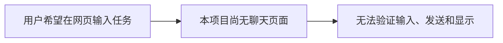
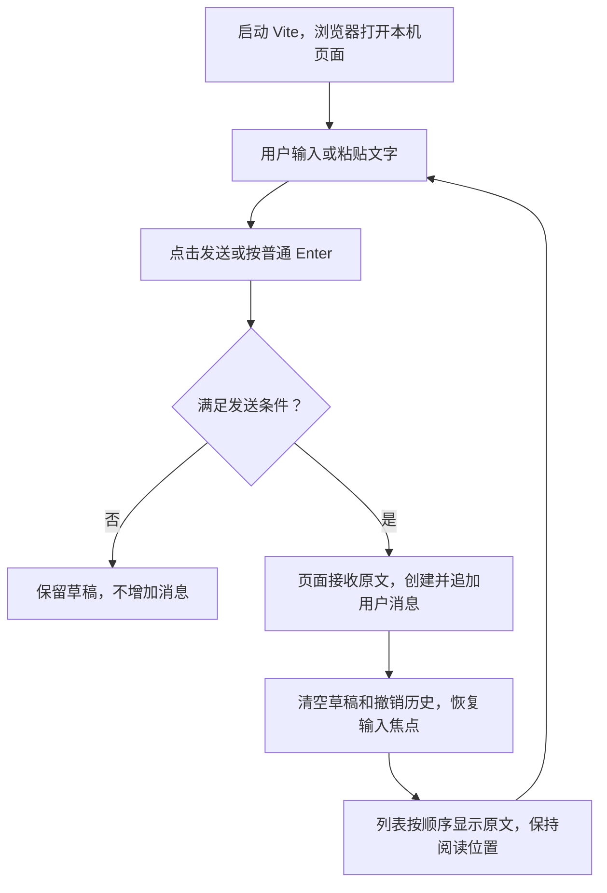
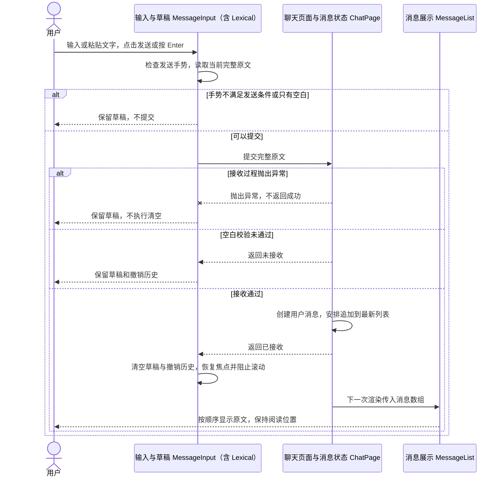

# Feature1：建立基本的聊天页面

状态：待整体批准。需求、页面职责划分及技术选型均已讨论确认；本文是合并后的技术设计，尚未实现，所有验收均待执行。

对应[里程碑1第一步](./README.md#第一步建立基本的聊天页面)。后续每一步分别作为一个 Feature 推进。本文件只设计 Feature1，文档通过不代表开始编码。

## 1. 总结

**需求理解：**

这个功能要建立一个能在本机浏览器中打开的基本聊天页面，让用户可以输入文字、执行发送，并在消息列表中看到自己发出的内容；连续发送时，各条消息按发送顺序保留和展示。它解决的是 Agent 需要一个接收用户输入、展示交互内容的网页入口的问题，完成后，用户应能实际操作并验证“输入 → 发送 → 显示”的完整过程，为后续接入模型服务、展示模型回复和工具执行过程提供页面基础。本步只完成这些基本交互，不接入真实模型，也不生成模拟回复。

**技术方案：**

在 `web/` 下建立 React + TypeScript 页面，暂由 Vite 提供本地开发页面，使用本机已有的 Node.js 和 npm。`App` 负责应用装配，渲染聊天页面 `ChatPage`。通用控件采用 shadcn/ui，配合 Tailwind CSS，本步按需引入发送按钮。输入组件采用 Lexical 纯文本模式，管理草稿、光标、撤销历史和发送手势；`ChatPage` 接收提交，用 React 状态保存发送后的消息，并组织输入区与消息区布局；消息列表只读展示这些消息。用户消息显示原文，发送后不自动滚动。

后续确定要支持 dsh 式引用标签，因此现在采用 Lexical；本步只启用普通文字编辑。AI 回复的 Markdown 展示在第三步设计。当前草稿和消息只存在页面内存中，刷新或关闭页面后清空。

## 2. 系统变化说明

**Before：** 本项目尚无自建的聊天页面。



**After：** 浏览器可以完成本地的输入、发送和显示。



## 3. 系统设计

### 3.1 模块变化

以下应用文件均拟新增，当前尚无 `web/` 应用。配置、入口、样式和测试文件名是整理时采用的常规组织方式。应用装配与聊天页面分开，聊天交互由 `ChatPage`、`MessageInput`、`MessageList` 协作完成。`components/ui/` 存放 shadcn/ui 基础控件，不保存草稿或消息。

| 拟新增文件 | 职责 |
| --- | --- |
| `web/package.json`、`web/package-lock.json` | 声明并锁定 React、Lexical、Tailwind CSS 和所需 shadcn/ui 基础依赖及测试依赖，提供 npm 开发、构建与测试脚本 |
| `web/index.html`、`web/src/main.tsx` | 提供页面容器，将 React 应用挂载到浏览器 |
| `web/vite.config.ts`、`web/tsconfig.json` | 配置 Vite、Tailwind CSS 接入及 TypeScript 路径解析 |
| `web/components.json` | 配置 shadcn/ui 的组件目录、样式入口及路径映射 |
| `web/src/styles.css` | 引入 Tailwind CSS 与 shadcn/ui 主题变量，提供编辑区域和消息展示所需样式 |
| `web/src/components/ui/button.tsx` | 引入 shadcn/ui Button 源码，作为发送按钮使用 |
| `web/src/lib/utils.ts` | 沿用 shadcn/ui 配套的类名合并工具 |
| `web/src/types.ts` | 声明组件共享的 `UserMessage` 类型 |
| `web/src/components/MessageInput.tsx` | 管理 Lexical 草稿、输入操作、发送按钮及发送后的收尾 |
| `web/src/App.tsx` | 应用级装配，现阶段渲染 `ChatPage` |
| `web/src/pages/ChatPage.tsx` | 保存消息列表，检查提交、创建消息，协调两个子组件并组织聊天页面布局 |
| `web/src/components/MessageList.tsx` | 只读显示消息，提供独立的滚动阅读区域 |
| `web/src/pages/ChatPage.test.tsx`、`web/src/components/MessageInput.test.tsx` | 验证接收契约、连续追加、草稿保护和发送按键规则 |
| `web/src/components/MessageInput.browser.test.tsx` | 在真实浏览器中单独挂载输入组件，验证输入、粘贴、原文提取和撤销历史 |
| `web/src/components/MessageList.browser.test.tsx` | 在真实浏览器中单独挂载消息列表，验证原文展示、换行、排版和复制 |
| `web/src/pages/ChatPage.browser.test.tsx` | 在真实浏览器中挂载聊天页及真实子组件，验证发送、清空和恢复焦点不会改变阅读位置 |
| `web/tests/e2e/chat.spec.ts` | 只验证实际页面入口能够启动、发送并显示消息，以及刷新后清空页面内存状态 |

**应用装配：`App`**

`main.tsx` 将应用挂载到浏览器，`App` 渲染 `ChatPage`。消息状态、发送处理和聊天页面布局统一由 `ChatPage` 承担，现阶段不引入路由库。

```text
main.tsx
└── App
    └── ChatPage
        ├── MessageInput
        └── MessageList
```

**输入与草稿：`MessageInput`**

- 使用 shadcn/ui `Button` 展示发送按钮，将可发送状态与点击操作接到本组件已有的发送流程；文字编辑区域由 Lexical 提供。
- 为组件保留稳定的 Lexical 编辑器，普通重新渲染不重新创建编辑器。编辑器负责文字、光标、选区和撤销历史；不在 `ChatPage` 或组件内另外保存一份字符串草稿。
- 支持多行输入和普通文字粘贴。组件可以保存“是否可以发送”的派生结果，用于绘制按钮；发送时仍重新读取当前编辑内容。
- 点击按钮和普通 Enter 进入同一条发送流程。Shift+Enter 换行；其他带修饰键的 Enter、输入法确认候选词和长按产生的重复 Enter 不触发发送。
- 空字符串或只有空白时按钮禁用，发送流程也会拒绝提交。使用裁剪后的视图判断是否为空，提交原文不裁剪。
- 提取文字时，将实际换行映射为换行字符，保留空格、缩进、连续空行和末尾换行，不额外增加段落空行。
- 收到 `true` 后清空草稿和撤销历史，并恢复输入焦点；收到 `false` 或处理抛异常时，不执行清空。发送前正常撤销、重做，发送后不能通过撤销恢复已发送内容。
- 聚焦和更新选区时阻止浏览器及 Lexical 自动滚动，不把恢复输入焦点变成跳转到列表底部。

**聊天页面与消息接收：`ChatPage`**

- 消息数组初始为空，保存在当前页面的 React 状态中。
- 再次检查收到的文字。只有空白时返回 `false`，不创建消息。
- 有效提交创建一次编号，固定 `role: 'user'`，保留完整 `text`，根据最新列表追加一条消息，然后返回 `true`。相同文字多次提交会得到不同编号的多条消息。
- 所有校验和编号创建在排队追加之前完成；排队后直接返回成功。更新函数只计算新数组，不生成编号或执行其他副作用。
- 将接收函数交给输入组件，将消息数组交给消息列表，并提供聊天页面布局；不操作编辑器或主动滚动列表。

**消息展示与阅读：`MessageList`**

- 按数组顺序展示，使用消息编号作为 React 的 `key`。不保存消息副本、不生成编号、不修改或重排数据。空数组没有消息条目。
- 用户文字通过 React 文本内容展示。`<b>你好</b>` 和 `**你好**` 均显示这些字符。
- 文字使用 `white-space: pre-wrap` 和 `overflow-wrap: anywhere`：保留空白与换行，长段落、网址和连续字符可以在区域内换行。显示换行不修改原文，支持直接选择和复制文字。
- `ChatPage` 提供输入区上方的可用空间，列表在其中独立滚动，输入区留在列表外；消息累积不把整个页面和输入区一起向下推。
- 新消息只追加内容，保留滚动容器和已有消息节点。不因消息变化调用滚动到底部、滚动到最新消息或聚焦列表；发送前在底部也不主动追随新内容。
- 滚动区域提供可访问名称，并支持键盘聚焦与滚动。

**与参考源码的关系：**

Pi 的[事件设计](../../pi/packages/agent/README.md#event-flow)将 Agent 运行与界面展示分开；本步在 `web/` 实现网页职责，不建立或调用 Agent 核心。按用户指定，浏览器交互主要参考 dsh：其[编辑器](../../deepseek-harness/packages/client/ui-conversation/src/client/input/editor/runtime.ts)在 Lexical 纯文本能力上注册引用节点，[消息创建](../../deepseek-harness/packages/llm/llm/src/message.ts)生成稳定编号，[普通用户文字](../../deepseek-harness/packages/client/ui-primitives/src/user-text.tsx)直接展示文本。

有四处明确差异：dsh 已有独立会话数据层，我们本步由 `ChatPage` 保存页面消息；dsh 的[网页入口](../../deepseek-harness/apps/web/vite.config.ts)依赖自身服务注入启动信息，我们暂用独立 Vite 页面；dsh 的[滚动处理](../../deepseek-harness/packages/client/ui-chat/src/client/chat/use-chat-scroll.ts)会在用户提交后跟随到底部，我们按已确认的交互要求保持阅读位置；dsh 的[基础控件](../../deepseek-harness/packages/client/ui-primitives/src/Button.tsx)主要自行实现，我们选择 shadcn/ui 作为通用控件来源。这些参考文件只读，不修改或直接引入其完整运行体系。

### 3.2 数据交互流程



文字来自用户操作，草稿保存在输入组件的 Lexical 编辑器中；接收后生成的消息保存在 `ChatPage` 的 React 状态中。组件通过普通函数调用和 React 属性传递数据，不经过业务 HTTP 接口。`App` 只装配页面，不参与每次发送的数据流。Vite 的文件服务只负责让浏览器加载页面及开发资源。

读取编辑内容发生异常时也停止后续发送与清空。`true` 表示本步已接受并安排状态更新，返回时不要求浏览器已经绘制完成。页面刷新或关闭后，草稿和消息都不保留。

### 3.3 关键接口与数据契约

拟新增的共享类型位于 `web/src/types.ts`：

```ts
type UserMessage = {
  id: string;
  role: 'user';
  text: string;
};
```

消息由 `ChatPage` 在每次有效提交时创建，编号生成后保持不变。先后顺序由数组追加顺序决定。当前不增加 `source`、内容块或引用字段。

**案例一：用户消息提交回调**

**接口类型：** React Props 接口（回调属性，同步调用）。

**接口定义：**

```typescript
type MessageInputProps = {
  onSend: (text: string) => boolean;
};
```

**提供与调用关系：** `ChatPage` 提供处理函数 `handleSend`，以 `onSend` 的名称传入 `MessageInput`，由 `MessageInput` 主动调用。

- **请求方（调用方）：** `MessageInput`
- **接收方（函数提供方）：** `ChatPage`

**触发条件：** 用户点击发送按钮，或按下符合发送规则的 Enter。

**输入数据：** 调用 `onSend` 时传入用户原文，保留空格、缩进和换行。

```typescript
const text: string = "  你好\n第二行  ";
```

**接收方处理：**

1. 检查 `text` 是否只有空白；无效时停止处理。
2. 有效时创建包含 `id`、`role: 'user'`、`text` 的用户消息，保存完整原文。
3. 安排将消息追加到 `ChatPage` 保存的消息数组。

**返回结果与请求方后续：**

- **`true`：** 页面已接收并安排消息更新。请求方清空草稿和撤销历史，恢复输入焦点，不主动滚动页面。
- **`false`：** 拒绝接收，消息数组不变。请求方保留草稿和撤销历史。

**异常处理：** 接收过程抛出异常时，不产生正常返回结果；请求方不执行成功后的清空步骤。

---

**案例二：消息列表数据输入**

**接口类型：** React Props 接口（数据属性）。

**接口定义：**

```typescript
type MessageListProps = {
  messages: readonly UserMessage[];
};
```

**提供与接收关系：** `ChatPage` 将消息数组通过 `messages` 属性传给 `MessageList`，由后者读取并展示。

- **数据提供方：** `ChatPage`
- **数据接收方：** `MessageList`

**触发条件：** 页面首次渲染，以及消息更新后重新渲染。

**输入数据结构与示例：**

```typescript
type UserMessage = {
  id: string;
  role: 'user';
  text: string;
};

const messages: readonly UserMessage[] = [
  {
    id: "message-001",
    role: "user",
    text: "你好",
  },
];
```

**接收方处理：**

1. 按数组顺序逐条展示，使用 `id` 识别消息。
2. 将 `text` 按普通文字显示，保留空白与换行，长内容自动换行。
3. 只读使用数据，不添加、删除、重排或修改消息。
4. 新增消息时保持阅读位置，不主动滚动到底部。

**输出结果与提供方后续：** 接收方生成消息列表界面，不向提供方回传业务结果。需要更新内容时，由 `ChatPage` 更新消息数组并重新传入。

**边界处理：** 空数组属于正常输入，显示空列表，不生成占位消息。

## 4. 技术决策

### 4.1 使用 React + TypeScript + Vite，在 web/ 内组织网页代码

- **做法：** React 组织界面及状态，TypeScript 声明组件契约，Vite 暂时提供开发页面；使用本机已有 Node.js 和 npm。浏览器打开启动时提供的本机页面地址。

### 4.2 现在采用 Lexical 纯文本模式

- **做法：** 本步只启用文字编辑与撤销历史，后续引用标签在此编辑器基础上设计；不先实现引用选择或标签节点。

### 4.3 草稿归 Lexical，发送后的消息归 ChatPage

- **做法：** `App` 负责应用装配；`ChatPage` 用页面 React 状态保存消息，提供发送处理和聊天页面布局；输入组件持有编辑器，消息列表只读展示。不引入独立 Session、全局状态框架或路由库。

### 4.4 用同步布尔回调表达本步的接收结果

- **做法：** 输入组件提交原文，`ChatPage` 接受后返回 `true`，输入组件才清空草稿和撤销历史；拒绝或抛异常时保留草稿。

### 4.5 消息暂用 id、role 和 text 表达

- **做法：** 每次有效提交创建独立编号，明确 `role: 'user'`，以字符串保存原文；不照搬 dsh 的完整消息来源与内容块体系。

### 4.6 用户原文展示，发送后保持阅读位置

- **做法：** 普通用户文字直接展示，CSS 保留空白并换行；列表和输入组件均不因发送而将页面滚动到底部。

### 4.7 通用控件采用 shadcn/ui，配合 Tailwind CSS

- **做法：** 按官方 Vite 接入方式配置 Tailwind CSS，将需要的 shadcn/ui 组件源码放在 `web/src/components/ui/`。本步使用 `Button` 作为发送按钮，后续有实际需要时再引入菜单、弹窗等组件。Lexical 负责编辑，`ChatPage` 负责消息接收，`MessageList` 负责原文展示和独立滚动。

## 5. 风险与边界

### 风险 1：选字时按 Enter，消息却被发出

- **案例：** 用户正在用中文输入法选字，按 Enter 是想确认输入、继续写后面的内容。页面却把这次按键当成发送，导致没写完的消息被发出，输入框也被清空。
- **解决方案：** 输入组件区分“确认中文输入”和“发送消息”。刚结束选字时，也不能把用于确认的 Enter 当成发送。实现后，用真实中文输入法操作验证。实现可参考 dsh 的[输入保护](../../deepseek-harness/packages/client/ui-conversation/src/client/input/editor/keymap.ts)。

### 风险 2：发出的消息缺字，或空行数量变了

- **案例：** 用户粘贴了一段带空行的文字，又在末尾补了几个字，立即发送。消息列表里却少了最后输入的几个字，或者原本空一行的地方变成了空两行。
- **解决方案：** 发送时，输入组件读取编辑器当前的完整文字，保留原有空格和换行；聊天页接收后也不裁剪原文。实现后，用“输入后立刻发送”和带连续空行的粘贴内容验证。文字提取可参考 dsh 的[对应处理](../../deepseek-harness/packages/client/ui-conversation/src/client/input/editor/projection.ts)。

### 风险 3：发送新消息后，正在看的内容突然跳走

- **案例：** 用户往上滚动查看前面的消息，同时在输入框里写了一条新消息。发送后，列表突然跳到底部，刚才正在看的内容不见了；输入框清空后重新获得焦点，也可能触发同样的跳转。
- **解决方案：** 聊天页把输入区和消息区分开布局，列表新增消息时保留原来的滚动区域和已有消息。发送、清空草稿和恢复输入焦点都不触发自动滚动，即使原来就在底部也不自动跟随。实现后，分别在上方阅读、停在底部和发送多行草稿的情况下验证。

### 风险 4：刷新页面后，消息和草稿都不见了

- **案例：** 用户已经发送了几条消息，又在输入框里写了一段尚未发送的文字。刷新页面后，消息列表和输入框都变空，之前的内容无法找回。
- **解决方案：** 本步接受刷新或关闭页面后清空的限制，暂不增加保存功能。第八步再把已发送的会话记录保存到本机磁盘，支持重新打开后查看；该计划不包含未发送草稿的恢复。

## 6. 验收标准

**测试原则：** 优先使用能够验证目标行为、同时执行成本最低的测试层级。只有当问题必须通过完整系统才能验证时，才使用 E2E 测试。

验收由 Agent 负责执行。接收契约和按键规则在组件内检查；涉及浏览器实际编辑、排版、选区或滚动时，只挂载相关组件，加载实际使用的样式，在真实浏览器中检查。使用浏览器不自动意味着 E2E：组件测试不经过应用启动入口，E2E 才从实际页面地址进入，连同入口和完整页面一起检查。本步只有案例 3 使用 E2E；案例 6 挂载 `ChatPage` 及其真实子组件，属于组件集成测试，其余自动化案例围绕单个组件验证。组件内已有可独立验证的纯逻辑时，优先使用单元测试，不为增加测试层级额外拆分实现。

自动化测试均保存为项目中的代码，后续修改时可以重复执行。实现时提供组件测试命令，以及只运行案例 3 的 `npm run test:e2e`；后者负责启动测试所需的本地页面。执行结果及必要的截图或日志用于说明本次运行情况，不能代替测试代码。

真实中文输入法确认选字的场景，由 Agent 在单独挂载输入组件的浏览器页面中补充验证，先检查可用的系统级自动化方式。组件测试代码可以重复检查输入法事件发生时是否阻止发送，但模拟事件不能代替真实选字过程，浏览器引擎测试也不能直接算作实际 Safari 验证。若当前环境无法覆盖，应在案例 4 下明确记录未验证部分及原因，不能把这部分标为通过，也不默认转交用户测试。

避免在多个层级重复同一断言。测试文件均拟新增，测试框架与依赖版本未在本文中指定，所有案例尚未执行。

参考 dsh 的分层做法：[按键路由测试](../../deepseek-harness/packages/client/ui-conversation/tests/keymap-routing.client.spec.tsx)在 DOM 模拟环境中发送合成按键，检查编辑器的处理；[编辑器核心测试](../../deepseek-harness/packages/client/ui-conversation/tests/lexical-editor-core.client.spec.tsx)直接驱动无界面编辑器，检查节点和文字投影。这些局部行为不依赖完整网页；本步同样按待验证行为选择范围，不直接照搬其整套测试工具。

### 案例 1：ChatPage 接收原文、拒绝空白并连续追加

- **存放位置：** 拟新增 `web/src/pages/ChatPage.test.tsx`，用例“接收契约与连续追加”。
- **类型：** 组件测试。
- **验证内容：** 从空消息列表开始，先提交只有空格和换行的 `" \n "`，应返回 `false`，列表保持为空。随后不等待页面更新，连续提交 `"  你好\n世界  "`、`"重复"`、`"重复"`，应全部返回 `true`，最终按提交顺序显示三条消息，完整保留原文中的空格和换行。三条消息的角色均为 `user`，编号互不相同，页面再次更新时编号保持不变。

### 案例 2：输入组件只在接收成功后清空

- **存放位置：** 拟新增 `web/src/components/MessageInput.test.tsx`，用例“按接收结果保护草稿”。
- **类型：** 组件测试。
- **验证内容：** 在三个独立测试中，分别让接收函数返回 `true`、返回 `false` 和抛出错误。每次都在输入框中输入 `"  草稿\n第二行  "`，然后点击发送，接收函数都应只收到一次完整原文。返回 `true` 时，输入框清空；返回 `false` 或报错时，原文和之前的撤销记录都保留。报错由测试环境接住，以便继续检查草稿没有丢失。

### 案例 3：实际页面可以打开、发送并在刷新后清空

- **存放位置：** 拟新增 `web/tests/e2e/chat.spec.ts`，用例“页面启动、发送与刷新清空”。
- **类型：** 端到端测试（E2E）。
- **验证内容：** 按启动说明运行网页，在浏览器打开实际本机地址，使用真实的应用入口、聊天页和子组件。从空消息列表开始，输入“你好”并点击发送，列表应出现这条用户消息，输入框清空并恢复焦点，页面不出现 AI 回复。再输入“还没发出的草稿”，不发送，直接刷新页面，消息列表和草稿都应清空。这个案例验证实际入口、页面装配及真正的浏览器刷新；连续追加、按键边界和原文细节由对应组件测试负责，不在这里重复穷举。

### 案例 4：输入法、换行与组合按键不会误发

- **存放位置：** 拟新增 `web/src/components/MessageInput.test.tsx`，用例“换行、组合键与重复按键”“输入法事件防误发”；真实输入法及实际 Safari 的补充验证结果记录于本案例。
- **类型：** 组件测试；真实输入法与实际 Safari 的补充检查同样只验证输入组件。
- **验证内容：** 单独挂载 `MessageInput`，用记录调用并返回 `false` 的 `onSend` 保留有效草稿，各按键场景从独立状态开始。输入有效文字后，普通 Enter 应调用一次；Shift+Enter 应只插入换行；Ctrl+Enter、Cmd+Enter、Alt+Enter 均不调用 `onSend`。连续发送带重复标记的 Enter 事件，确认即使草稿未清空，这些重复按键也不会再次提交。清空输入框，或只输入空格和换行时，按钮禁用，按 Enter 不调用 `onSend`。再发送模拟输入法事件，检查正在选字及刚结束选字时用于确认的 Enter 不会提交。除此之外，Agent 还需在输入组件的浏览器页面中用真实中文输入法输入“你好”，按 Enter 确认候选词，确认文字留在输入框里、`onSend` 没有被调用，并在实际 Safari 中确认刚结束选字的那次 Enter 不会误发；这部分按前述覆盖要求单独记录结果。

### 案例 5：输入组件提交完整原文，不丢失最后输入的字

- **存放位置：** 拟新增 `web/src/components/MessageInput.browser.test.tsx`，用例“输入及粘贴后立即提交原文”。
- **类型：** 组件测试（真实浏览器运行）。
- **验证内容：** 在真实浏览器中单独挂载 `MessageInput`，用可记录调用的函数接收 `onSend`。分别通过逐字输入和粘贴准备 `"  第一行\n\n    第二行  \n"`（`\n` 表示实际换行），完成后立即发送，回调收到的文字应与原文完全一致，保留开头空格、第二行缩进、中间空行及末尾换行。另在末尾补上“最后几个字”并立即发送，回调也应完整收到这些字。这里只检查编辑和提交，不启动聊天页；消息列表如何展示原文由案例 8 验证。

### 案例 6：发送后保持阅读位置

- **存放位置：** 拟新增 `web/src/pages/ChatPage.browser.test.tsx`，用例“发送及恢复焦点时保持阅读位置”。
- **类型：** 组件集成测试（真实浏览器运行）。
- **验证内容：** 在真实浏览器中挂载 `ChatPage`，保留真实的 `MessageInput`、Lexical 和 `MessageList`，不经过应用启动入口。先连续发送消息，直到列表出现纵向滚动条。向上滚动，让一条旧消息停在屏幕中间，再输入“新消息”并发送，旧消息应仍停在原来的阅读位置。滚到底部再发送一条，列表也不应主动跟随新增消息。随后回到上方，发送一段多行草稿，确认输入框清空和恢复焦点后，阅读位置仍没有跳走。向下滚动可以找到刚发送的消息；输入区不会被消息累积挤走，列表也可以用键盘滚动。这里需要真实排版和组件协作，但不需要启动完整应用。

### 案例 7：发送成功是撤销历史的分界

- **存放位置：** 拟新增 `web/src/components/MessageInput.browser.test.tsx`，用例“发送成功后隔离撤销历史”。
- **类型：** 组件测试（真实浏览器运行）。
- **验证内容：** 在真实浏览器中单独挂载 `MessageInput`，让 `onSend` 记录收到的原文并返回 `true`。输入“待发送内容”，先撤销，再重做，应能撤回并恢复这段文字。发送成功后再次按撤销，已发送的文字不应重新出现在输入框里。接着输入“新的草稿”并撤销，应只影响这次草稿的编辑，不再次调用 `onSend`，此前记录的提交内容也保持不变。这里只需要验证编辑器的历史和提交边界，不需要消息列表或完整应用。

### 案例 8：消息列表按原文展示，长内容不会撑宽页面

- **存放位置：** 拟新增 `web/src/components/MessageList.browser.test.tsx`，用例“原文展示、长内容换行与复制”。
- **类型：** 组件测试（真实浏览器运行）。
- **验证内容：** 在真实浏览器中单独挂载 `MessageList`，直接传入包含 `"  第一行\n\n    第二行  \n"`、`<b>你好</b>`、`**你好**` 和一长串无空格的 `a` 的消息数组。列表应按数组顺序保留原文中的空格、缩进、空行及末尾换行，标签和星号直接显示为字符；长内容在限定宽度内换行、内容不截断、不撑宽容器。文字可以直接选中并复制，复制出的内容与对应原文一致。再传入空数组，消息条目应全部消失，不生成占位消息。这里需要真实浏览器排版、选区和复制，但不需要输入组件或完整应用。

参考的官方说明：[shadcn/ui 的源码分发方式](https://ui.shadcn.com/docs)、[Vite 与 Tailwind CSS 接入](https://ui.shadcn.com/docs/installation/vite)、[组件目录配置](https://ui.shadcn.com/docs/components-json)、[Button](https://ui.shadcn.com/docs/components/button)、[Lexical React 接入与纯文本模式](https://lexical.dev/docs/getting-started/react)、[编辑状态读取](https://lexical.dev/docs/concepts/editor-state#reading-state)、[禁止选区滚动](https://lexical.dev/docs/concepts/updates#common-update-tags)、[React 连续状态更新](https://react.dev/learn/queueing-a-series-of-state-updates)、[稳定的列表编号](https://react.dev/learn/rendering-lists#rules-of-keys)。这些资料用于核对设计，不代表相关测试已运行。
