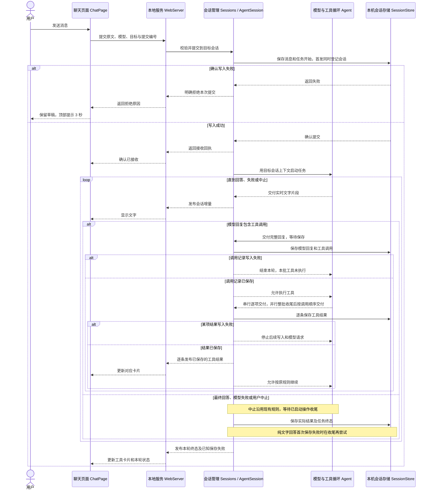
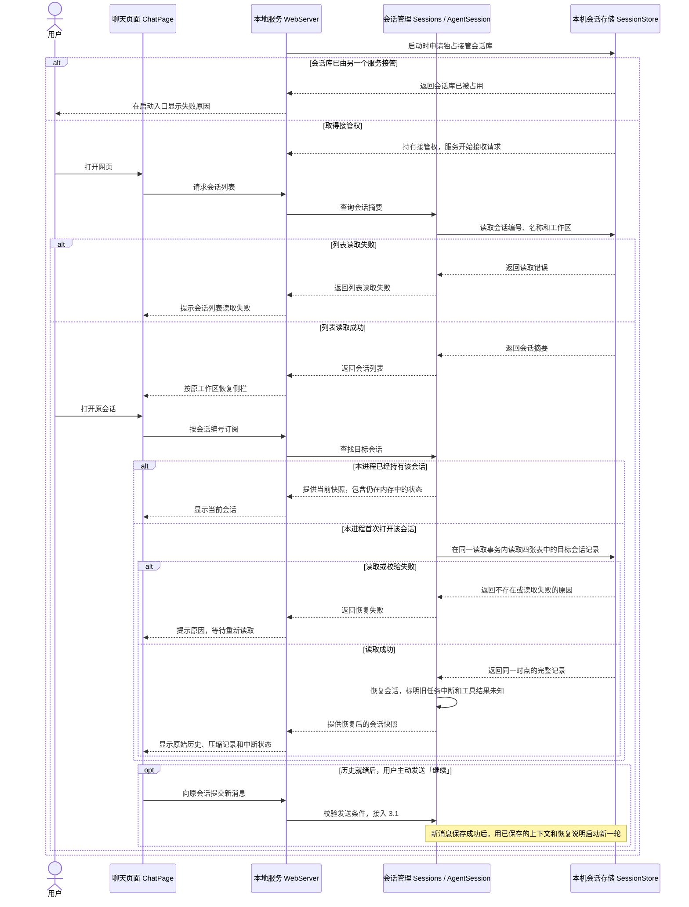

# Feature 10 本地存储与历史回看技术设计

状态为**已实现**。发送与保存、重启恢复两条流程已接入现有网页入口。

## 1. 总结

用户在本地网页发出的消息、Agent 的回复、工具调用与结果、任务状态和压缩记录保存在 SQLite。服务重启后，用户从原工作区打开原会话，查看完整的已保存历史。用户主动发送后，Agent 用该会话已保存的有效上下文开始新一轮。重启前缺少结束记录的任务显示「已中断」。对于只有调用记录的工具，页面显示「结果未知」，下一轮上下文说明文件等外部状态可能已改变。

会话管理 `Sessions` 和 `AgentSession` 决定何时保存，`SessionStore` 执行 SQLite 读写，`Agent` 等待必要记录写入后再执行工具或继续请求模型。`WebServer` 把接收回执和会话状态交给网页。SQLite 使用四张业务表，同一份库由一个本地服务实例独占接管。

## 2. 系统变化说明

**现在**　`AgentSession` 在本地服务内存里持有会话。网页刷新或重连时可以取回当前状态，服务重启后只剩独立保存的工作区登记和配置。

**完成后**　用户消息写入后才确认接收。工具调用写入后才执行，工具结果写入后才通知完成。历史回看和接续以 SQLite 的已保存记录为准。同一个服务进程仍保留实时流式内容和当次保存失败状态，供刷新和重连恢复。

## 3. 系统设计

### 3.1 发送、执行并保存

用户发送「修改 `README.md` 的启动命令」后，本地服务保存本次记录，并按保存结果决定能否执行后续步骤。



#### 聊天页面 `ChatPage`

**职责**　提交消息，依据后端回执确认接收，按会话显示保存状态。

**接口新增 0 项，修改 1 项**

- 【修改】发送（页面回调）。明确收到保存拒绝时，按现有草稿规则保留或恢复原文，并通过顶部通知栏显示 3 秒。连接中断导致接收状态不明时，页面继续对账。运行中的失败从会话更新取得。本轮末尾显示保存失败及已知原因。已执行但结果未保存的工具卡片为 `Error`，只显示「工具已执行，结果未保存」，详情不可展开。未收到完成通知的卡片随任务终态退出运行状态。

**数据新增 0 项，修改 0 项**　草稿归网页，会话快照和保存失败状态由服务端提供。已有发送失败规则保护用户在等待期间输入的新草稿。

#### 本地服务 `WebServer`

**职责**　接收网页请求，把会话管理给出的结果和状态送回网页。

**接口新增 0 项，修改 4 项**

- 【修改】`POST /api/sessions/start`（HTTP）。接收首条消息和工作区编号。登记会话、消息和任务开始一起保存成功后返回原接收回执。明确的保存失败带可区分的错误码。
- 【修改】`POST /api/messages`（HTTP）。接收已有会话中的消息或 `/compact`。对应的开始记录保存后确认接收。已保存的同一提交可核对回执。
- 【修改】`POST /api/sessions`（HTTP）。沿用独立新建入口，会话登记保存后返回成功。
- 【修改】会话订阅（WebSocket）。沿用会话编号和订阅编号，快照与更新携带任务状态及保存失败。断开订阅后释放连接，后台任务按现有规则继续。
- 【沿用】`POST /api/abort`（HTTP）。以会话和任务编号定位运行，等待已启动操作收尾。

**数据新增 0 项，修改 1 项**　修改提交错误响应，明确区分服务端确认的保存拒绝与接收状态不明。保存拒绝供网页恢复草稿并显示提示。

#### 会话管理 `Sessions` / `AgentSession`

**职责**　持有会话归属和当前状态，负责保存、任务起止与错误通知。

**接口新增 0 项，修改 4 项**

- 【修改】`Sessions.create()`。保存会话摘要后登记到当前服务。
- 【修改】`Sessions.start()`。准备首发的会话编号和摘要。首条消息与登记一起保存后，再发布会话已创建。复用当前首发编号，已写入的同一提交重试时返回原关联记录。
- 【修改】`AgentSession.submit()`。**用途**是接收会话中的新任务。**主要流程**是校验目标、模型、原文及是否空闲，按会话与提交编号检查重复，保存消息与任务开始后才调度 Agent。首发由同一次提交写入会话摘要。相同编号和相同提交核对原回执，编号复用但内容不同则拒绝。只有已明确回滚的写入失败才可报告未接收。
- 【修改】`AgentSession.subscribe()`。初次订阅返回当前快照，随后返回增量。运行中的保存失败由会话保留在本进程内存中，刷新或重连仍可取得。

**数据新增 2 项，修改 2 项**

- 【新增】任务记录 `RunRecord`，归 `coding-agent`。保存任务所属会话、提交编号、选用模型、起止和终态。聊天任务以用户消息编号作为运行编号，手动压缩沿用压缩记录编号。
- 【新增】保存失败信息 `SaveFailure`，归 `AgentSession`。记录失败阶段及相关工具位置，供网页定位。明确确认磁盘空间不足时展示相应原因，其他原因使用相应提示。
- 【修改】`ConversationSnapshot` 与 `ConversationUpdate`。传递任务状态及保存失败。网页以会话编号和订阅编号校验归属。
- 【沿用】`ConversationMessage`、`CompactionRecord` 和 `SessionSummary`。工具结果按助手消息编号和内容位置关联，供应商的工具调用编号仍用于模型请求。摘要写入成功后才成为有效摘要。压缩后的实际输入用量仍由后续回复提供，首次关联到该回复时同次保存，避免只留下引用或只留下用量。

构造示例

```typescript
const run = {
  id: 'user-021',
  sessionId: 'session-a',
  clientMessageId: 'submit-021',
  modelId: 'deepseek-flash',
  kind: 'task',
  status: 'running',
  startedAt: 1794310800000,
}

const failure = {
  runId: 'user-021',
  stage: 'tool-result',
  reason: 'storage-full',
  toolCall: { assistantMessageId: 'assistant-023', contentIndex: 1 },
}
```

手动压缩沿用独立回执，保存开始记录后才开始整理。自动压缩沿用现有触发点与摘要生成失败规则。摘要、范围或统计记录写入失败时保留上一次有效上下文，按已确认的保存规则结束当前任务。纯文字最终回复和对应终态作为一组保存，首次失败时在收尾再尝试。仍失败时保留已显示的文字并标明「回答已生成，但未保存」。失败状态留在会话内存，后续重启按 3.2 恢复。

#### 模型与工具循环 `Agent`

**职责**　执行通用模型与工具循环，在工具执行和下一次模型请求前等待调用方确认记录已保存。

**接口新增 0 项，修改 2 项**

- 【修改】`run()` 与 `continue()`。通过 `AgentRunInput` 接收可等待的保存检查。模型带工具调用的回复完整交付后先等保存成功，再按现有校验和执行规则处理。串行工具每项执行后检查结果写入，再决定是否启动下一项。并行工具整批收尾后按调用顺序逐条检查。检查失败使本轮终止，原有工具自身错误仍作为工具结果处理。中止时继续等待已启动的工具收尾，保留实际结果。

**数据新增 0 项，修改 1 项**　`AgentRunInput` 增加保存检查约定，使用已有模型回复和工具结果。SQLite 读写及用户提示由 `AgentSession` 决定。

#### 本机会话存储 `SessionStore`

**职责**　按会话保存记录，确保必须一起成立的记录一起提交。

**接口新增 1 项，修改 0 项**

- 【新增】`save()`（模块调用）。保存一条独立记录或一组必须一起提交的记录。会话首发、最终回复及其任务终态、回复用量与压缩记录的首次关联分别按需合成一次提交。失败保留此前已提交的记录。

**数据新增 4 项，修改 0 项**　四张业务表由 `SessionStore` 读写。

- `sessions` 保存编号、所属工作区、名称和创建时间。工作区登记仍由现有工作区模块保存。
- `runs` 保存任务编号、会话和提交编号、任务类型、选用模型及开始与结束状态。同一会话的提交编号可用于对账。
- `messages` 保存会话和任务归属、消息编号、稳定的写入顺序及完整消息。工具调用随助手回复保存，工具结果单独保存并关联原调用。
- `compactions` 保存会话和任务归属，以及压缩状态、摘要、保留范围、前后估算、摘要用量和后续回复编号。原始消息继续保留在 `messages`。

### 3.2 重启后回看并继续

本地服务重启后，用户可以在原工作区打开原会话，查看已保存的历史，或主动发送新消息接着聊。



#### 本机会话存储 `SessionStore`

**职责**　持有 SQLite 连接和会话库接管权，提供可一致读取的会话历史。接管覆盖服务的运行期间。服务正常退出时，在已启动的任务收尾后释放接管权。进程异常退出后，下一服务可以接管同一份库。

**接口新增 4 项，修改 0 项**

- 【新增】`open()`（模块调用）。打开会话库并取得独占接管权，成功后会话接口才能提供服务。会话库已被占用时，返回明确原因。
- 【新增】`close()`（模块调用）。关闭连接并释放接管权。启动在取得接管权后发生错误时，也执行清理。
- 【新增】`listSessions()`（模块调用）。读取侧栏所需的 `SessionSummary`，包括会话编号、名称、工作区和创建时间。
- 【新增】`loadSession(id)`（模块调用）。**用途**是为 `Sessions` 恢复一个会话。**主要流程**是从同一个 SQLite 读取事务取得会话、任务、消息与压缩记录，检查它们的归属及相互引用，返回完整历史。查不到目标编号时明确返回不存在。任一部分读取或校验失败时，结束事务并返回错误。

**数据新增 0 项，修改 0 项**　沿用四张已确认的业务表。独占接管随服务连接的生命周期管理。列表查询与单会话恢复分别读取各自需要的数据。

#### 会话管理 `Sessions` / `AgentSession`

**职责**　按原会话编号恢复历史和状态。相同编号在本进程内共用一个 `AgentSession`。只有接管会话库后，才把磁盘上只有开始记录的旧任务显示为「已中断」。已经保存的工具结果仍对应原调用，缺少结果且无法确认时显示「结果未知」。

**接口新增 0 项，修改 4 项**

- 【修改】`Sessions.list()`（模块调用）。从会话库读取列表，供侧栏恢复工作区归属。
- 【修改】`Sessions.get()`（模块调用）。先查本进程持有的会话。首次打开时读取完整历史，校验通过后恢复目标会话。读取失败时向本次请求返回错误，再次打开时重试。
- 【修改】`AgentSession` 构造（模块调用）。可用已保存的消息、任务和压缩记录恢复会话快照。打开会话只准备回看，用户发送新消息时进入 3.1。
- 【修改】`buildModelHistory()`（模块调用）。用户接着聊时，沿用最近一次成功保存的压缩摘要和近期原文，为相关的缺失工具结果补充恢复说明。`AgentSession` 继续在发送前校验目录，并按 Feature 9 为新请求读取适用的项目说明。

**数据新增 0 项，修改 0 项**　沿用 3.1 的 `SessionSummary`、任务记录、`ConversationMessage`、`CompactionRecord` 和会话快照。恢复状态从同一份已保存记录推导，原始历史保留。工具结果缺失的说明用于组织下一次模型输入。

构造示例。用户接着聊时，模型收到的恢复说明可以是「上轮中断，修改 `README.md` 的工具结果未记录。文件可能已修改，请先检查当前内容」。

#### 本地服务 `WebServer`

**职责**　启动时取得会话库接管权，关闭时等待运行收尾再释放。把列表、历史快照和读取失败原因交给网页。

**接口新增 0 项，修改 3 项**

- 【修改】`start()`（服务入口）。独占接管成功后才开放会话服务。会话库已被占用时在启动入口明确提示。
- 【修改】`close()`（服务入口）。停止接受新任务，等待已启动任务收尾，再释放会话库。
- 【修改】`GET /api/sessions`（HTTP 接口）。返回已保存的会话摘要。读取错误作为失败返回。
- 【沿用】会话订阅（WebSocket）。按原会话编号返回快照并继续同步更新，复用已有的订阅错误返回。

**数据新增 0 项，修改 0 项**　传递会话管理提供的列表、快照和错误。

#### 聊天页面 `ChatPage`

**职责**　按原工作区展示会话，区分已保存结果、结果未知和读取失败。工作区目录暂时不可用时，用户仍可回看历史。

**接口新增 0 项，修改 1 项**

- 【修改】打开会话（页面回调）。订阅选中的会话并显示恢复状态。读取失败时提示原因，待取得完整快照后恢复发送。

**数据新增 0 项，修改 0 项**　使用服务返回的 `SessionSummary` 和 `ConversationSnapshot`。

## 4. 技术决策

### 4.1 【工程决策｜SessionStore】用本机 SQLite 保存四类记录

沿用 Hermes 以 SQLite 保存会话与消息的思路，继续采用 Pi 和本项目的独立会话、原文保留与摘要规则。回复用量随回复保存，摘要用量随压缩记录保存，足以恢复目前的 token 展示。完整费用账本需要另外覆盖未形成已保存回复的调用。[Hermes 会话表](../../../hermes/hermes_state_common.py#L445) · [Hermes 用量表](../../../hermes/hermes_state_common.py#L548) · [Pi 上下文恢复](../../../pi/packages/coding-agent/src/core/session-manager.ts#L468)

使用 Node.js 内置 `node:sqlite`，默认文件位于 `~/.agent-learning/sessions.sqlite`。服务用同一个连接通过 SQLite 的 `locking_mode=EXCLUSIVE` 和启动事务取得并持有排他锁。测试通过 `WebServer` 的库路径选项使用临时数据库。该做法在持有期间也会阻止外部 SQLite 客户端直接读库，网页仍通过本地服务查看历史。已在 Node 24.16.0 的临时库验证第二个进程会被挡住、强制结束原进程后可以接管。[Node.js SQLite](https://nodejs.org/download/release/v24.16.0/docs/api/sqlite.html) · [SQLite 独占锁说明](https://www.sqlite.org/pragma.html#pragma_locking_mode)

### 4.2 【功能决策｜Agent、AgentSession、ChatPage】先保存，再确认接收或工具完成

用户消息落盘成功才确认接收并启动模型。工具调用先保存再执行。串行逐项写结果，并行采用 Pi 和 Hermes 共同的整批收尾后按调用顺序逐条保存。完成通知采用 Hermes 的时机，在对应结果写入成功后发布。相比 Feature 6，先跑完的并行工具会等这批收尾才能显示最终结果。[Pi 并行执行](../../../pi/packages/agent/src/agent-loop.ts#L629) · [Hermes 并行保存](../../../hermes/agent/tool_executor.py#L1607) · [Hermes 完成通知](../../../hermes/agent/tool_executor.py#L1165)

明确的发送拒绝使用顶部 3 秒提醒，任务内失败在对应轮次末尾展示。工具已执行但结果未保存时，卡片状态为 `Error`，详情不可展开。纯文字回答首次写入失败时在收尾补存。这里沿用 DSH 将发送提示与本轮失败分开呈现的原则，发送提示使用用户选定的顶部位置。[DSH 发送提示](../../../deepseek-harness/packages/client/ui-conversation/src/client/skeleton/InputBar.tsx#L101) · [DSH 本轮错误](../../../deepseek-harness/packages/client/ui-chat/src/client/chat/MessageItem.tsx#L131) · [Hermes 纯文字收尾](../../../hermes/tests/agent/test_text_turn_incremental_persistence.py#L155)

### 4.3 【功能决策｜会话恢复】原会话回看，由用户发起下一轮

已保存历史用于网页回看，有效上下文用于新模型请求。缺少结果的工具按已保存证据标记，并在新请求里补上恢复说明。用户主动发送后才开始新一轮。Hermes 在符合条件时可以自动续跑，Feature 10 沿用用户已确认的主动发送规则。[Hermes 历史视图](../../../hermes/hermes_state_messages.py#L1616) · [Hermes 自动续跑](../../../hermes/tui_gateway/session_auto_continue.py#L58) · [DSH 工具缺失说明](../../../deepseek-harness/packages/core/session/src/repair.ts#L31)

### 4.4 【工程决策｜WebServer、SessionStore】取得独占接管权后按同一快照恢复

启动时先取得会话库接管权，再开放会话服务。第一次恢复某个会话时用一次 SQLite 读取事务读取四张表的相关记录。列表只读摘要。本进程已经打开的会话复用当前状态。SQLite 的读取事务提供同一已提交版本，避免把不同状态拼成一份历史。[Hermes 的进程归属判断](../../../hermes/tui_gateway/turn_marker.py#L64) · [SQLite 读取事务](https://www.sqlite.org/lang_transaction.html)

## 5. 风险与边界

### 5.1 工具已经改了文件，磁盘上只有调用

- **案例**　服务可能在改文件前退出，也可能在改完、保存结果前退出。两种情况下，SQLite 都可能只有调用记录。
- **解决方案**　恢复后只显示已知事实。缺失结果显示「结果未知」。后续模型请求收到核对现状的提醒。进程仍在且已知结果写入失败时，网页明确显示「工具已执行，结果未保存」。此前保存的记录和实际文件改动保留。

### 5.2 首发已保存，回执在网络中丢失

- **案例**　用户刷新后尝试再次发送同一首发。数据库已有记录，但页面还在等待回执。
- **解决方案**　使用原提交编号核对同一工作区、模型和原文，确认已保存的同一任务。重试返回已有结果。复用编号却提交了不同内容时明确拒绝。

### 5.3 第二个服务误把仍在跑的任务标成中断

- **案例**　开发端口和日常端口分别启动了本地服务，两者指向同一个会话库。
- **解决方案**　会话库独占接管覆盖整个服务生命周期。第二个进程报告库被占用。正常关闭在任务收尾后释放，异常退出后由下一进程接管。运行时的网页回看走持有会话库的服务。

### 5.4 读取失败被当成空会话

- **案例**　会话摘要可读，但历史或摘要引用读取失败。若页面显示空会话，用户可能继续发送，模型会缺少必要上下文。
- **解决方案**　同一事务读取并验证相关记录。失败返回明确原因，页面取得完整快照后才允许发送。工作区目录暂时不可用时，仍可查看已保存的历史。

## 6. 验收标准

验收覆盖发送落盘、工具顺序和错误、中止、压缩、重启接续、独占与一致性。场景与执行结果见 [Feature 10 验收标准](./feature10-验收标准.md)。

## 7. 文件变更

### 本机会话存储 `SessionStore`

| 文件 | 类型 | 用途 | 变更 |
| --- | --- | --- | --- |
| `packages/coding-agent/src/session-store.ts` | 新增 | 会话持久化 | 独占接管，保存四类记录，按同一时点恢复目标会话。 |
| `packages/coding-agent/test/session-store.test.ts` | 新增 | SQLite 集成验证 | 验证提交回滚、独占释放和一致性读取。 |

### 会话管理 `Sessions` / `AgentSession`

| 文件 | 类型 | 用途 | 变更 |
| --- | --- | --- | --- |
| `packages/coding-agent/src/{sessions,agent-session}.ts` | 修改 | 会话与任务协调 | 仅有内存状态 → 写入确认、历史恢复与保存失败状态。 |
| `packages/coding-agent/src/{compaction,types,index}.ts` | 修改 | 会话数据和上下文 | 进程内历史 → 从已保存摘要与原文恢复，传递任务和保存状态。 |
| `packages/server/test/webserver.test.ts` | 修改 | 会话与服务集成测试 | 经 HTTP 和 WebSocket 验证落盘关口、顺序、压缩提交和恢复。 |

### 模型与工具循环 `Agent`

| 文件 | 类型 | 用途 | 变更 |
| --- | --- | --- | --- |
| `packages/agent/src/{agent,types}.ts` | 修改 | 多轮执行 | 收到结果即继续 → 等待必要记录保存后才启动后续步骤。 |

### 本地服务 `WebServer`

| 文件 | 类型 | 用途 | 变更 |
| --- | --- | --- | --- |
| `packages/server/src/webserver/{index,protocol}.ts` | 修改 | HTTP 和 WebSocket | 进程内会话接入 → 接管库、区分保存拒绝及历史读取失败。 |
| `packages/server/test/webserver.test.ts` | 修改 | 服务集成测试 | 重启后会话消失 → 原编号恢复、接续和独占验收。 |
| `packages/server/test/tool-execution.live.ts` | 修改 | 真实工具验收 | 临时凭据和工作区 → 同时使用临时会话库。 |

### 聊天页面 `ChatPage`

| 文件 | 类型 | 用途 | 变更 |
| --- | --- | --- | --- |
| `web/src/pages/ChatPage.tsx`、`web/src/chat/{client,state}.ts` | 修改 | 发送与订阅 | 恢复进程内会话 → 同步已保存历史、已中断与保存失败。 |
| `web/src/components/{MessageList,AssistantMessage,CompactionRecords,SaveFailureNotice}.tsx` | 修改 | 聊天与压缩展示 | 展示实时结果 → 依据已保存结果和恢复状态显示卡片。 |
| `web/src/styles.css`、`web/src/pages/ChatPage.browser.test.tsx`、`web/src/components/MessageList.browser.test.tsx` | 修改 | 提示与网页测试 | 增加顶部提示、结果未知与详情不可展开的覆盖。 |
| `web/tests/e2e/{sessions,compaction.live}.spec.ts` | 修改 | 实际网页入口 | 增加真实重启后历史与继续发送验收。 |
| `web/tests/e2e/server-fixture.mjs`、`web/tests/e2e/{deepseek-live,project-context.live}.spec.ts` | 修改 | 浏览器测试环境 | 临时凭据和工作区 → 同时使用临时会话库。 |

### 其他

| 文件 | 类型 | 用途 | 变更 |
| --- | --- | --- | --- |
| `feature10-验收标准.md` | 新增 | 验收案例 | 保存独占、故障、重启和真实模型验收条件。 |
