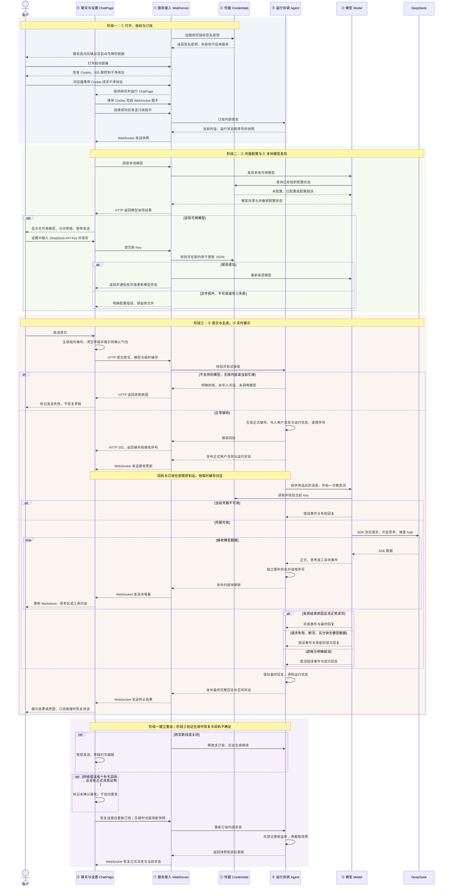

# 单会话流式聊天总体技术设计

状态：阶段一已于 2026-11-03 完成实现、自动验收并合并 `main`；阶段二、三及真实聊天尚未实施。阶段一证据见[验收记录](./feature2-验收记录.md)。本文保留总体设计依据。用户于 2026-11-02 确认将单会话流式聊天拆为三个依次设计、实施和验收的子阶段。本文保存最终架构、共享契约和[已确认决策](../README.md#single-chat-phases)，不把阶段拆分视为整份设计已通过。工程默认沿用 dsh，已确认的产品行为和 Pi 式 Model 契约优先。

本文“本期”指三个子阶段合计的单会话聊天目标。阶段文档说明各自范围与验收，共享类型只在本文及对应模块统一定义，不为每个阶段建立另一套协议或状态。

## 1. 总结

**需求理解：** 在已有聊天页上完成真正可用的 DeepSeek 聊天：用户从左侧栏底部打开设置，在“模型”中添加 DeepSeek、保存 API Key，随后发送消息并逐段看到模型的思考与回答。后端持有唯一的当前对话，刷新或重连后恢复内容；模型生成独立于网页连接。当前回答结束后才能再次发送，期间可继续编辑草稿。提交失败、模型出错和超时均明确展示，不自动重试或恢复已清空的草稿。本期不建立多会话管理、消息队列、具体工具定义与执行、磁盘聊天记录；模型内容与事件直接支持 text、thinking、toolCall，工具参数设计留到后续工具阶段。

**技术方案：** 一个 Node.js + TypeScript 后端，用原生 `node:http` 接收 HTTP 请求，使用 `ws` 承载 WebSocket。Agent 接受提交、持有当前对话与运行状态、准备历史并消费 Model 事件；WebServer 将 Agent 的内部状态更新发送给网页。Model 使用 OpenAI SDK 的 Chat Completions 接口接收 DeepSeek SSE，转换为项目事件。凭据模块统一保护本地 JSON。日常由后端提供构建后的页面，开发保留现有 Vite 并代理业务 HTTP / WebSocket。页面继续使用 React、Lexical 与现有 shadcn/ui 体系。

### 子阶段与交接条件

1. [阶段一：打开、授权与订阅](./feature2-阶段一-打开授权与订阅.md)。交付真实页面入口、本地访问授权、WebSocket、Agent 初始快照及重连。验收两种入口、未授权拒绝、空快照和订阅释放；页面允许编辑草稿，聊天发送尚不可用。
2. [阶段二：凭据配置与本地模型发现](./feature2-阶段二-凭据配置与本地模型发现.md)。依赖阶段一的入口与授权，交付设置、模型 Key 增改删、本地模型发现和变更通知；尚不调用 DeepSeek，聊天发送仍不可用。
3. [阶段三：提交生成与实时展示](./feature2-阶段三-提交生成与实时展示.md)。依赖前两阶段，交付真实聊天、模型事件、Markdown 与思考展示，以及生成中刷新恢复、失败和超时处理；此时才验收完整真实模型链路。

阶段一先建立 Credentials 的网页签名密钥读写与 Agent 的真实初始状态；阶段二再扩展同一 Credentials 的模型 Key 能力；阶段三扩展同一 Agent 的模型调用。第一阶段的空快照与测试事件能验证接入及订阅机制，不能替代第三阶段真实生成中的内容恢复验收。后续工具定义、工具执行及循环按第三至第七步（原第四至第八步）推进。

## 2. 系统变化说明

**Before：** 现有 `ChatPage` 把输入追加到页面内存中的用户消息列表；没有后端、模型调用、凭据配置或模型回复，刷新后清空。当前能力见[原页面设计](../feature1/feature1-基本聊天页面.md)与[验收记录](../feature1/feature1-验收记录.md)。

**After：** 消息与生成状态转由后端保存，页面保存草稿和展示状态。有效发送立即清空草稿、显示临时气泡；HTTP 确认后与正式消息对应，WebSocket 持续更新回复。保留原文、输入法、撤销与阅读位置规则；新增侧栏、模型设置、模型可用状态、Markdown 回答和默认收起的思考区域。后端重启清空聊天，凭据仍保留。

## 3. 系统设计

**目录与模块边界（2026-11-02 确认）：** 根目录 `web/` 保留前端，后端四个模块统一放在 `packages/`。它们属于同一仓库的 npm workspace，在同一个 Node.js 服务进程中组合运行；本次只更新设计，尚不创建这些代码目录。

```text
web/                                  # 已有前端应用
packages/
├── server/
│   ├── src/main.ts                    # 应用装配、启动与退出
│   ├── src/webserver/index.ts         # HTTP、WebSocket 与页面服务
│   ├── src/webserver/browser-auth.ts  # 浏览器授权
│   ├── src/webserver/protocol.ts      # 网络契约
│   ├── test/
│   └── README.md
├── agent/
│   ├── src/index.ts                   # 公开入口
│   ├── src/agent.ts                   # 历史与运行协调
│   ├── src/types.ts                   # 状态、快照与内部更新
│   ├── test/
│   └── README.md
├── model/
│   ├── src/index.ts                   # 公开入口
│   ├── src/types.ts                   # 模型消息、内容与事件
│   ├── src/deepseek.ts                # 服务商适配
│   ├── src/event-stream.ts
│   ├── src/tool-arguments.ts
│   ├── test/
│   └── README.md
└── credentials/
    ├── src/index.ts                   # 公开入口
    ├── src/credentials.ts             # 凭据管理
    ├── src/credential-file.ts         # 文件保护
    ├── src/types.ts                   # 凭据及非敏感状态类型
    ├── test/
    └── README.md
package.json                          # workspace 与统一运行命令
package-lock.json                     # 全仓依赖锁
tsconfig.base.json                    # 共用编译选项
```

每个包有自己的 `package.json`、`tsconfig.json` 和 `README.md`；阅读顺序是 README → 公开入口 → 实现 → `test/`。Agent、Model、Credentials 通过 `src/index.ts` 暴露当前阶段已有能力，跨包不引用私有实现文件。

类型回到所属模块：模型契约归 Model，状态与快照归 Agent，凭据状态归 Credentials，HTTP/WS 契约归 Server 的 `webserver/protocol.ts`，不再建设顶层共享类型目录。`web` 通过公开类型入口使用 `import type`，不加载后端运行时代码；Server 对外声明独立的 `protocol` 类型入口。

依赖方向保持 `server → agent → model → credentials`，Server 也直接使用 Model 的本地发现和 Credentials 的授权/配置能力。Agent 不依赖 Server，协议类型只能引用核心模块类型，不能反向成为 Agent 的依赖。组织方式参考 Pi 的[根工作区配置](</Users/stardust/agent learning/pi/package.json>)与 [Agent 公开入口](</Users/stardust/agent learning/pi/packages/agent/src/index.ts>)；Credentials 独立成包是本项目已确认的集中管理分工，运行职责不因此改变。

### 3.1 模块变化

以下是拟新增或拟修改的设计，尚未实现。接口清单概述完整协作，数据结构与字段来源直接列在所属模块；关键接口的详细处理见 §3.3，文件清单见第 7 节。

本节列三个阶段累计的最终变化。分期归属：WebServer 在阶段一建立入口与订阅，阶段二接凭据接口，阶段三接提交接口；Credentials 在阶段一管理网页签名密钥、阶段二管理模型 Key；Model 在阶段二提供本地发现、阶段三执行调用；Agent 在阶段一提供状态订阅、阶段三协调生成；ChatPage 按三个阶段分别接入连接、设置和聊天。阶段文件的新增或修改以对应阶段的交接基线为准。

#### ① 服务入口与传输：WebServer（新增）

负责提供页面、验证本地访问授权、接收 HTTP 请求及管理 WebSocket 连接，将输入交给 Agent，并把 Agent 的快照与更新发送给网页。对话与运行状态归 Agent 持有。

**接口：新增 8 项。**

- 【新增】`start()`（进程内调用）：启动本地应用并提供访问入口；main 调用 WebServer 经 Credentials 加载 `BrowserAuthFile`（网页签名文件内容）、装配 Agent 并监听本机地址，成功后返回地址及授权链接供用户打开，授权初始化或端口冲突则报错并清理本次资源。
- 【新增】`close()`（进程内调用）：正常退出应用并释放运行资源；main 请求 WebServer 停止接入和订阅，并在 `RunningState`（当前生成状态）非空时中止本次模型调用，完成清理后 main 继续退出，最后一条网络事件不保证送达。
- 【新增】[GET /?token=…](#key-browser-auth)（HTTP 接口）：让浏览器取得本地应用访问授权；浏览器提交启动令牌，WebServer 签发含 `BrowserCookiePayload`（授权地址与有效期）的 Cookie 并返回 303，浏览器保存后请求干净地址进入页面。
- 【新增】[GET /api/models](#key-models-http)（HTTP 接口）：让页面知道当前有哪些模型可用；网页客户端请求 WebServer，后端调用本地发现并返回 `ModelDiscovery`（可用模型与凭据状态），ChatPage 据此更新模型选项和配置提示。
- 【新增】[PUT /api/providers/deepseek](#key-models-http)（HTTP 接口）：保存或替换用户填写的 DeepSeek Key；网页客户端提交 `apiKey`（本次新输入），WebServer 交给 Credentials 更新 `AuthFile`（本地 Key 配置）后返回 `ModelDiscovery`（更新后的模型与配置状态），页面显示结果并刷新选项。
- 【新增】[DELETE /api/providers/deepseek](#key-models-http)（HTTP 接口）：移除已保存的 DeepSeek Key；网页客户端请求 WebServer，后端交给 Credentials 更新 `AuthFile`（本地 Key 配置）并返回 `ModelDiscovery`（当前模型与凭据状态），页面更新可用模型，后续调用不回退旧 Key。
- 【新增】[POST /api/messages](#key-submit-http)（HTTP 接口）：提交用户消息并启动本次回答生成；ChatPage 发送 `SubmitMessageRequest`（原文、模型和临时编号），WebServer 校验后交给 Agent 保存并安排生成，返回 `SubmitMessageAccepted`（正式编号及接收进度），页面对应气泡后通过 WebSocket 继续展示回答。
- 【新增】[WebSocket /api/events](#key-ws-subscription)（实时通道）：让页面持续收到当前对话及后续变化；网页发送 `ClientFrame`（订阅或取消指令），WebServer 校验后消费 Agent 内部订阅并发送 `ServerFrame`（快照、更新或配置通知），页面按编号和序号恢复展示，配置变化则另行查询模型。

**数据：新增 5 项。**

- 【新增】`SubmitMessageRequest`：**前端发给后端的一次聊天提交**，包含用户原文、所选模型和临时消息编号。ChatPage 准备这些内容，WebServer 校验后交给 Agent 接收。

```typescript
type SubmitMessageRequest = {
  clientMessageId: string; // ChatPage 为每次人工发送生成的临时展示编号，不用于去重
  modelId: string; // ChatPage 从本地发现结果中选择的模型标识
  text: string; // MessageInput 提供的完整用户原文，保留空格与换行
};
```

- 【新增】`SubmitMessageAccepted`：**后端已接收这次提交的回执**，包含正式消息编号和接收时的更新序号。WebServer 将 Agent 的接收结果返回 ChatPage，页面用它对应临时气泡，并等待订阅追到这个位置后再判断能否发送。

```typescript
type SubmitMessageAccepted = {
  clientMessageId: string; // Agent 原样带回本次临时编号，页面据此对应气泡
  userMessageId: string; // Agent 接收时生成的正式用户消息编号
  acceptedSeq: number; // Agent 保存 user 和运行状态后的序号，页面等待订阅追到此处
};
```

- 【新增】`ClientFrame`：**前端发给后端的订阅或取消订阅指令**。网页客户端提供指令和订阅编号，WebServer 据此建立或取消对应的 Agent 内部订阅。

```typescript
type ClientFrame =
  | { type: 'subscribe'; subscriptionId: string } // 网页生成新订阅编号，要求取得快照及后续更新
  | { type: 'unsubscribe'; subscriptionId: string }; // 网页带回所属编号，仅取消对应订阅
```

- 【新增】`ServerFrame`：**后端通过 WebSocket 发给前端的一条消息**，可以是完整对话快照、一次对话更新或模型配置变化通知。WebServer 封装后发送，网页客户端据此恢复对话、更新展示或重新查询模型。

```typescript
type ServerFrame =
  | { type: 'snapshot'; subscriptionId: string; snapshot: ConversationSnapshot } // WebServer 为 Agent 快照补上网络订阅编号
  | { type: 'update'; subscriptionId: string; update: ConversationUpdate } // WebServer 为 Agent 更新补上网络订阅编号
  | { type: 'models_changed' }; // WebServer 在凭据变化后通知页面重新查询，不占用对话序号
```

- 【新增】`BrowserCookiePayload`：**本地网页授权凭据中的访问地址和有效期等信息**。WebServer 将它签名后放入 Cookie，浏览器在后续请求中带回，WebServer 校验后决定是否允许访问页面、HTTP 接口或建立 WebSocket。

```typescript
type BrowserCookiePayload = {
  version: 1; // WebServer 写入的 Cookie 格式版本
  authority: string; // WebServer 根据可信访问地址确定的主机与端口
  issuedAt: number; // WebServer 签发时的 Unix 毫秒时间
  expiresAt: number; // WebServer 按固定 30 天有效期计算的到期时间
};
```

#### ② 本地凭据：Credentials（新增）

负责本地凭据的读取、校验、保存、删除与文件保护，向 Model 提供调用所需的当前 Key，向页面提供非敏感配置状态。

**接口：新增 6 项。**

- 【新增】[readStatus()](#key-credentials)（进程内调用）：判断本机是否具备模型调用凭据；Model 请求 Credentials 检查 `AuthFile`（本地 Key 配置），取得 `CredentialStatus`（未配置、已配置或错误），再据此筛选模型供页面选择。
- 【新增】[readApiKey()](#key-credentials)（进程内调用）：让每次模型调用使用当前保存的 Key；Model 请求 Credentials 重读并校验 `AuthFile`（本地 Key 配置），成功取得 Key 字符串后放入认证头，失败则产生本次调用的 error 事件。
- 【新增】[saveApiKey(key)](#key-credentials)（进程内调用）：安全保存或替换模型 Key；WebServer 交入网页新 Key，Credentials 校验并在锁内更新 `AuthFile`（本地 Key 配置），完成后 WebServer 重新取得 `ModelDiscovery`（模型与配置状态）并通知页面。
- 【新增】[deleteApiKey()](#key-credentials)（进程内调用）：使后续调用不再取得已删除的 Key；WebServer 请求 Credentials 在锁内更新 `AuthFile`（本地 Key 配置），成功后重新发现模型、返回 `ModelDiscovery`（模型与配置状态）并通知页面。
- 【新增】[loadOrCreateBrowserSecret()](#key-browser-secret)（进程内调用）：让本地网页授权使用持久签名密钥；WebServer 启动时请求 Credentials 校验或安全创建 `BrowserAuthFile`（网页签名文件），取得 `Buffer`（密钥字节）用于 Cookie 签发与校验，失败则终止启动。
- 【新增】[watch(onChange)](#key-credentials)（文件监听）：让本地文件外部变化及时反映到页面；WebServer 向 Credentials 登记 `onChange`（配置变更回调），文件变化后重新取得 `ModelDiscovery`（模型与配置状态）并发送 `ServerFrame` 的 models_changed 通知，返回的清理函数用于停止监听。

**数据：新增 3 项。**

- 【新增】`AuthFile`：**本地凭据文件中保存的服务商 API Key 配置**。Credentials 统一读取、校验和更新这些内容，再向 Model 提供当前 Key 或配置状态。

```typescript
type AuthFile = {
  deepseek?: { // 网页选择的提供方；本期只接入 DeepSeek，缺条目表示未配置
    type: 'api_key'; // Credentials 校验的凭据类型，沿用 Pi 的 JSON 形式
    key: string; // 用户在设置中输入、Credentials 保存的 Key，仅供后端读取
  };
};
```

- 【新增】`CredentialStatus`：**本地模型凭据的配置情况**，分为未配置、本地检查通过和配置错误。Credentials 检查后提供状态，Model 据此筛选可用模型，ChatPage 据此显示配置提示。

```typescript
type CredentialStatus =
  | { state: 'missing' } // Credentials 读取后确认无文件或无 DeepSeek 凭据
  | { state: 'configured' } // Credentials 本地格式与权限检查通过，未验证远端有效性
  | { state: 'error'; message: string }; // Credentials 提供脱敏的读取、权限或格式错误
```

- 【新增】`BrowserAuthFile`：**本地文件中保存的网页授权签名密钥及其格式版本**。Credentials 安全加载或创建这份数据，WebServer 取得密钥后签发和校验 Cookie，不将它用于模型调用。

```typescript
type BrowserAuthFile = {
  version: 1; // Credentials 读写的网页签名文件格式版本
  secret: string; // Credentials 安全生成的 32 字节随机值，以 base64url 保存
};
```

#### ③ 模型：Model（新增）

负责本地模型发现、服务商请求转换和一次调用的事件流，接收 Agent 准备好的消息，不持有聊天历史或网页连接。

**接口：新增 2 项。**

- 【新增】`discoverModels()`（进程内查询）：列出本机当前可用的模型而不请求服务商；WebServer 调用 Model，Model 结合 `ModelInfo`（内置模型信息）和 `CredentialStatus`（本地凭据状态）返回 `ModelDiscovery`（可用模型与状态），WebServer 交给页面更新选择。
- 【新增】[stream(model, context, options)](#key-model-stream)（进程内事件流）：提供一次模型调用的过程与最终回复；Agent 传入 `ModelInfo`（所选模型）、`ModelContext`（系统提示词和消息）及可选取消信号，Model 立即返回 `ModelEventStream`（同次事件与最终结果）、后台读取当前 Key 请求服务商，Agent 消费事件并保存回复。

**数据：新增 17 项。**

- 【新增】`ModelInfo`：**一个受支持模型的基本信息**，包括标识、名称、提供方和接口类型。Model 提供这些信息，ChatPage 用来展示模型选项，Agent 将选中的模型交给 Model 发起调用。

```typescript
type ModelInfo = {
  id: string; // Model 内置支持目录中的模型标识，本期默认 deepseek-flash
  name: string; // Model 内置的展示名称，ChatPage 用于模型选择
  provider: string; // Model 内置的提供方标识，用于选择适配与凭据
  api: string; // Model 内置的协议标识，用于选择请求转换方式
};
```

- 【新增】`ModelDiscovery`：**本地模型发现的结果**，说明有哪些模型可用，以及凭据是否配置正常。Model 将内置模型目录与 Credentials 的检查结果组合起来，WebServer 返回给 ChatPage 更新选项和提示。

```typescript
type ModelDiscovery = {
  models: ModelInfo[]; // Model 根据内置目录与本地凭据状态筛出的可用模型
  deepseek: CredentialStatus; // Credentials 提供的非敏感本地状态，页面据此显示配置或错误
};
```

- 【新增】`ModelContext`：**一次模型调用要带上的系统提示词和消息**。Agent 为本次调用整理这些内容，Model 的 `stream()` 将它们转换成服务商请求并发起调用。

```typescript
type ModelContext = {
  systemPrompt?: string; // Agent 为本次调用准备的系统提示词
  messages: ModelMessage[]; // Agent 整理的历史消息与当前输入，排除失败的 assistant 回复
};
```

- 【新增】`ModelMessage`：**发给模型的一条消息**，可以是系统指令、用户输入、历史回复或工具结果。Agent 整理这些消息后交给 Model，Model 将它们转换成服务商要求的格式。

```typescript
type ModelMessage =
  | SystemMessage // Agent 准备的系统指令
  | UserMessage // Agent 保留的正式用户输入
  | AssistantMessage // Model 生成、Agent 筛选后纳入本次上下文的回复
  | ToolResultMessage; // 后续工具执行方提供的结果，本期仅定义结构
```

- 【新增】`SystemMessage`：**告诉模型应当遵守什么规则**，例如“请用中文回答”。Agent 准备这些指令，Model 将它们放进本次请求。

```typescript
type SystemMessage = {
  role: 'system'; // Agent 标记此消息为系统指令
  content: string | TextContent[]; // Agent 准备的系统内容
  timestamp: number; // 消息创建方记录的 Unix 毫秒时间
};
```

- 【新增】`UserMessage`：**记录用户输入的原话**。Agent 保存这些内容，Model 将其放进请求，聊天页面也用它展示用户说过的话。

```typescript
type UserMessage = {
  role: 'user'; // Agent 标记此消息为用户输入，区别于原页面同名类型
  content: string | TextContent[]; // Agent 接收并保留的用户原文
  timestamp: number; // Agent 创建正式消息时记录的 Unix 毫秒时间
};
```

- 【新增】`AssistantMessage`：**模型的一条回复**，包含正文、思考、工具请求以及结束状态等信息。Model 生成这份数据，Agent 保存结果并准备后续上下文，ChatPage 展示回答或失败原因。

```typescript
type AssistantMessage = {
  role: 'assistant'; // Model 创建的回复角色
  content: (TextContent | ThinkingContent | ToolCall)[]; // Model 按服务商输出顺序累积的内容块
  api: string; // 本次传入 ModelInfo 的协议标识
  provider: string; // 本次传入 ModelInfo 的提供方标识
  model: string; // 调用方选择并交给 Model 的模型标识
  responseId?: string; // 服务商实际返回的响应编号，未报告时缺省
  responseModel?: string; // 服务商实际报告的模型名称，未报告时缺省
  stopReason: 'pending' | ModelStopReason; // Model 维护的生成中或最终结束原因
  errorMessage?: string; // Model 生成的脱敏失败说明
  usage?: ModelUsage; // 服务商实际报告的用量，未报告时缺省
  timestamp: number; // Model 创建本次回复时记录的 Unix 毫秒时间
  durationMs?: number; // Model 统计的本次调用耗时，单位毫秒
};
```

- 【新增】`ToolResultMessage`：**工具执行后返回的结果**，通过调用编号对应到原来的工具请求。后续工具执行方将结果交给 Agent，Model 再将其放进请求；本期只定义结构，不执行工具。

```typescript
type ToolResultMessage = {
  role: 'toolResult'; // 后续工具执行方创建的结果角色，本期不执行工具
  toolCallId: string; // 对应 Model 先前返回的 ToolCall.id
  toolName: string; // 对应 Model 返回的工具名称
  content: TextContent[]; // 后续执行方提供的结果内容
  isError: boolean; // 后续执行方标明工具执行是否失败
  timestamp: number; // 后续执行方创建结果时记录的 Unix 毫秒时间
};
```

- 【新增】`TextContent`：**一段正文文字**，系统指令、用户输入或模型回复都可以包含它。Model 用它转换输入，Agent 保存回复中的文字，ChatPage 按 Markdown 展示模型正文。

```typescript
type TextContent = {
  type: 'text'; // 内容创建方标明这是正文块
  text: string; // 来自用户/系统输入或服务商正文的文字
};
```

- 【新增】`ThinkingContent`：**模型生成的一段思考内容**，也可以带有服务商提供的思考来源信息。Model 整理这些数据，Agent 保存，ChatPage 将其放在独立、默认收起的思考区中。

```typescript
type ThinkingContent = {
  type: 'thinking'; // Model 根据服务商思考输出标记的内容类型
  thinking: string; // Model 从 reasoning_content 等思考数据累积的原文
  thinkingSignature?: string; // 适配器从服务商取得并保留的思考来源信息，缺失时不伪造
};
```

- 【新增】`ToolCall`：**模型提出的一次工具调用请求**，包含调用编号、工具名称、参数及可能的参数错误。Agent 保存请求，ChatPage 展示内容；未来执行方读取参数并拒绝错误参数，本期不执行工具。

```typescript
type ToolCall = {
  type: 'toolCall'; // Model 根据服务商工具调用输出标记的类型
  id: string; // 服务商返回的调用编号，用于后续对应工具结果
  name: string; // 服务商返回的工具名称
  arguments: JsonObject; // Model 解析最终参数文本得到的对象；解析失败时为 {}
  argumentsError?: string; // Model 保存的参数错误原因及原文，未来执行方须拒绝
};
```

- 【新增】`JsonValue`：**工具参数中可以出现的一种 JSON 值**，可以是字符串、数字、布尔值、空值、数组或对象。Model 解析服务商返回的参数文字时，用它表示参数中的各项内容。

```typescript
type JsonValue =
  | null | boolean | number | string // JSON 原文可包含的基本值
  | JsonValue[] | JsonObject; // Model 解析参数时得到的嵌套数组或对象
```

- 【新增】`JsonObject`：**按字段名组织的一组工具参数**。Model 将参数文字解析成这种对象，保存到工具调用中，后续执行方再读取；本期不定义具体工具参数。

```typescript
type JsonObject = {
  [key: string]: JsonValue; // Model 从工具参数 JSON 解析得到的键值，不在此定义工具 Schema
};
```

- 【新增】`ModelUsage`：**一次模型调用实际报告的 token 用量**，可以包含输入、输出和总量。Model 从服务商取得这些数字，Agent 将其保存到最终回复中，未报告的字段保持未知。

```typescript
type ModelUsage = {
  input?: number; // 服务商报告的输入 token 总量，缺失不补零
  output?: number; // 服务商报告的输出 token 数量，缺失不补零
  total?: number; // 服务商报告的总 token 数量，缺失不自行补算
};
```

- 【新增】`ModelStopReason`：**本次模型调用为什么结束**，区分正常回答结束、长度限制、工具请求、失败和取消。Model 给出原因，Agent 据此收尾并筛选后续历史，ChatPage 显示相应结果。

```typescript
type ModelStopReason =
  | 'stop' | 'length' | 'toolUse' // Model 将服务商有效结束原因转换为正常终止原因
  | 'error' | 'aborted'; // Model 将调用失败或明确取消转换为失败终止原因
```

- 【新增】`ModelEvent`：**模型生成过程中发生的一次变化**，例如增加正文、结束一个内容块或结束本次调用。Model 按顺序发布这些事件，Agent 将它们整理成回复内容和对话更新。

```typescript
type ModelEvent =
  | { type: 'start'; partial: AssistantMessage } // Model 创建的初始回复；partial 是同次共享对象
  | { type: 'text_start'; contentIndex: number; partial: AssistantMessage } // Model 开始正文块；contentIndex 来自本次块顺序
  | { type: 'text_delta'; contentIndex: number; delta: string; partial: AssistantMessage } // Model 从 SSE 正文取得 delta，按 contentIndex 更新共享 partial
  | { type: 'text_end'; contentIndex: number; content: string; partial: AssistantMessage } // Model 提供该正文块完整 content，Agent 用于校准
  | { type: 'thinking_start'; contentIndex: number; partial: AssistantMessage } // Model 开始思考块；contentIndex 来自本次块顺序
  | { type: 'thinking_delta'; contentIndex: number; delta: string; partial: AssistantMessage } // Model 从 SSE 思考取得 delta，按 contentIndex 更新共享 partial
  | { type: 'thinking_end'; contentIndex: number; content: string; partial: AssistantMessage } // Model 提供该思考块完整 content，Agent 用于校准
  | { type: 'toolcall_start'; contentIndex: number; partial: AssistantMessage } // Model 开始工具块；contentIndex 来自本次块顺序
  | { type: 'toolcall_delta'; contentIndex: number; delta: string; partial: AssistantMessage } // Model 从 SSE 参数文本取得 delta，Agent 保留原文进度
  | { type: 'toolcall_end'; contentIndex: number; toolCall: ToolCall; partial: AssistantMessage } // Model 解析得到最终 toolCall，Agent 用于校准参数与错误标记
  | { type: 'done'; reason: 'stop' | 'length' | 'toolUse'; message: AssistantMessage } // Model 正常终止；reason 来自有效结束原因，message 为完整回复
  | { type: 'error'; reason: 'error' | 'aborted'; error: AssistantMessage }; // Model 失败或明确取消；reason 为对应原因，error 为保留部分内容的最终回复
```

- 【新增】`ModelEventStream`：**同一次模型调用从开始到结束的事件序列**，也提供等待最终回复的方式。Model 返回它，Agent 逐项读取事件或等待最终结果，两种方式都不会额外调用模型。

```typescript
interface ModelEventStream extends AsyncIterable<ModelEvent> { // Model 提供的同次事件序列，Agent 逐项消费
  result(): Promise<AssistantMessage>; // Model 提供的同一次最终回复等待，不另发请求
}
```

#### ④ 运行协调：Agent（新增）

负责接受提交、准备模型历史、调用 Model 并消费事件，是当前对话与运行状态的唯一持有者。它提供内部快照与更新订阅，浏览器连接、Cookie 和网络订阅编号归 WebServer 管理。

**接口：新增 2 项。**

- 【新增】[submit(input)](#key-agent-submit)（进程内调用）：接收用户输入并管理一次回答生成；WebServer 交入原文、模型与临时编号，Agent 校验后保存 `ConversationMessage`（正式消息）和 `RunningState`（当前运行状态），返回正式编号及接收序号供 WebServer 回应 202，再后台调用 Model 并发布变化。
- 【新增】[subscribe(signal)](#key-agent-subscribe)（进程内订阅）：让新订阅恢复对话并接着接收变化；WebServer 提供独立取消信号，Agent 先提供 `ConversationSnapshot`（完整对话与运行状态）、再持续提供 `ConversationUpdate`（带序号的新变化），WebServer 转发给页面，取消只释放该订阅。

**数据：新增 6 项。**

- 【新增】`ConversationMessage`：**后端保存的一条正式对话消息**，在模型消息之外带有正式编号和可选的临时对应编号。Agent 保存消息，WebServer 转发，ChatPage 据此对应临时气泡并展示对话。

```typescript
type ConversationMessage = {
  id: string; // Agent 为正式 user 或 assistant 生成的消息编号
  clientMessageId?: string; // user 接收时带回的网页临时编号，供页面对应气泡
  message: ModelMessage; // Agent 保存的用户消息或累积后的模型消息内容
};
```

- 【新增】`RunningState`：**当前是否正在生成回答**，生成时还记录对应的用户消息和回复编号。Agent 维护这份状态并拒绝并发提交，WebServer 和 ChatPage 用它判断当前运行情况。

```typescript
type RunningState = null | { // null 由 Agent 表示当前没有生成任务
  userMessageId: string; // Agent 记录的本次已接收 user 编号
  assistantMessageId: string; // Agent 为本次回复分配的正式编号
};
```

- 【新增】`ConversationSnapshot`：**当前对话在某个时刻的完整内容和状态**。Agent 按自己已处理到的位置一起复制消息、运行状态和序号，WebServer 发给新订阅，ChatPage 用它恢复对话并从这个位置继续更新。

```typescript
type ConversationSnapshot = {
  seq: number; // Agent 截取当前消费进度时的连续更新序号
  messages: ConversationMessage[]; // Agent 独立复制的正式对话内容
  running: RunningState; // Agent 在同一进度下复制的运行状态
  activeContent: ActiveContent[]; // Agent 在同一进度下复制的未结束块进度
};
```

- 【新增】`ConversationUpdate`：**当前对话新发生的一次变化**，可以是接收用户消息，也可以是模型回复发生变化。Agent 为变化编号，WebServer 转发，ChatPage 按连续序号更新展示。

```typescript
type ConversationUpdate = {
  seq: number; // Agent 为每次正式变化递增的连续序号
  change:
    | { type: 'accepted'; user: ConversationMessage; running: Exclude<RunningState, null> } // Agent 接收产生的正式 user 与运行状态
    | { type: 'model'; messageId: string; event: ModelFrame }; // Agent 已消费的模型变化及其所属正式回复编号
};
```

- 【新增】`ActiveContent`：**哪些内容块还在生成**，以及它们所在的消息和块位置。Agent 随快照提供这些记录，ChatPage 据此继续更新对应块；工具块还保留尚未收齐的参数文字。

```typescript
type ActiveContent = {
  messageId: string; // Agent 正在累积的正式回复编号
  contentIndex: number; // Model 事件提供的内容块位置
} & (
  | { type: 'text' | 'thinking' } // Agent 标明尚未结束的正文或思考块
  | { type: 'toolCall'; argumentsText: string } // Agent 按已消费增量保存的半截参数原文
);
```

- 【新增】`ModelFrame`：**Agent 已处理的一次模型回复变化**，可以包含内容片段、块结束或最终结果。Agent 根据已读取的模型事件生成它，WebServer 转发给 ChatPage，页面据此更新对应内容并用最终结果修正展示。

```typescript
type ModelFrame =
  | { type: 'start'; initial: Pick<AssistantMessage, 'role' | 'api' | 'provider' | 'model' | 'timestamp'> } // Agent 从 start 事件提取的初始角色、来源与时间，不发送共享 partial
  | { type: 'text_start' | 'thinking_start' | 'toolcall_start'; contentIndex: number } // Agent 已消费的内容块开始位置，type 区分正文、思考与工具
  | { type: 'text_delta' | 'thinking_delta' | 'toolcall_delta'; contentIndex: number; delta: string } // Agent 已消费的块增量，contentIndex 定位块，delta 来自本次事件
  | { type: 'text_end' | 'thinking_end'; contentIndex: number; content: string } // Agent 已消费的块终值，content 用于校准正文或思考
  | { type: 'toolcall_end'; contentIndex: number; toolCall: ToolCall } // Agent 从 Model 的 toolcall_end 取得最终 toolCall，用于校准参数与错误标记
  | { type: 'done'; reason: 'stop' | 'length' | 'toolUse'; message: AssistantMessage } // Agent 从 Model 的 done 取得正常结束原因和完整回复，用于结束本次运行
  | { type: 'error'; reason: 'error' | 'aborted'; error: AssistantMessage }; // Agent 从 Model 的 error 取得失败原因和部分回复，用于收尾本次运行
```

#### ⑤ 聊天与设置页面：ChatPage（修改）

负责输入、模型配置和结果展示，协调网络状态与临时气泡。Lexical 持有草稿，正式对话来自 Agent，设置表单只短暂持有新输入的 Key。

**接口：修改 2 项，新增 6 项。**

- 【修改】`MessageInput.onSend`（页面回调）：接收用户草稿并决定是否发送；ChatPage 通过 `MessageInputProps`（发送开关与回调）提供处理函数，MessageInput 交入原文后页面确认模型可用、订阅就绪、无提交未决且无生成，再创建 `LocalSubmission`（临时气泡）并发起提交，返回 true 才清空本次草稿和撤销历史、恢复焦点。
- 【修改】`MessageList.messages`（组件数据）：将正式对话和提交状态显示为聊天列表；ChatPage 通过 `MessageListProps`（待展示的正式消息与临时气泡）传给 MessageList，列表只读显示用户原文、模型内容及错误，后续由页面合并新数据再传入。
- 【新增】`SettingsDialog`（弹窗组件）：让用户从设置中管理 DeepSeek Key；ChatPage 打开弹窗，SettingsDialog 使用 `ProviderFormState`（新 Key、操作状态与错误）接收编辑或删除操作，取得 `ModelDiscovery`（更新后的模型与配置状态）后显示结果、刷新选项并清理成功保存或关闭后的新输入。
- 【新增】`getModels()`（前端请求函数）：为页面取得可选择的模型；ChatPage 调用网页客户端请求 WebServer，取得 `ModelDiscovery`（可用模型与凭据状态）后更新模型选项和配置提示。
- 【新增】`saveApiKey()`（前端请求函数）：把设置中填写的新 Key 保存到本地后端；SettingsDialog 交给网页客户端新 Key，客户端请求 WebServer 并返回 `ModelDiscovery`（更新后的模型与配置状态），页面据此显示结果、刷新列表并清理成功保存的新输入。
- 【新增】`deleteApiKey()`（前端请求函数）：从设置中移除已保存的 Key；SettingsDialog 请求网页客户端调用后端删除接口，取得 `ModelDiscovery`（当前模型与凭据状态）后更新列表，失败则保留原配置并显示原因。
- 【新增】`submitMessage()`（前端请求函数）：将网页草稿提交给后端并跟踪是否接收；ChatPage 提供 `SubmitMessageRequest`（原文、模型与临时编号），客户端返回 `SubmitMessageAccepted`（接收回执）或错误，页面结合 WS 正式消息更新 `LocalSubmission`（临时气泡状态）并继续接收回答。
- 【新增】`subscribe()`（前端订阅）：让聊天页保持当前对话的实时展示；ChatPage 请求网页客户端发送 `ClientFrame`（订阅指令）、接收 `ServerFrame`（快照与更新）并提供 `ConnectionState`（连接及快照就绪状态），页面应用数据，断线后重新订阅而不重发用户提交。

**数据：新增 3 项，修改 3 项。**

- 【修改】原页面 `UserMessage` → `ConversationMessage`：**聊天页面使用的一条正式对话消息**，可以承载用户输入或模型回复。Agent 为消息分配正式编号并保存，ChatPage 和 MessageList 改用它替代原页面的 UserMessage，展示对话并对应临时气泡。

```typescript
type ConversationMessage = {
  id: string; // Agent 为正式 user 或 assistant 生成的消息编号
  clientMessageId?: string; // user 接收时带回的网页临时编号，供页面对应气泡
  message: ModelMessage; // Agent 保存的用户消息或累积后的模型消息内容
};
```

- 【新增】`LocalSubmission`：**前端尚未对应到正式消息的临时聊天气泡**，记录待确认、失败或未确认的提交状态。ChatPage 在发送时创建并根据回执或订阅消息更新，MessageList 负责展示，正式消息到达后按临时编号对应。

```typescript
type LocalSubmission = {
  clientMessageId: string; // ChatPage 为本次人工发送生成的临时编号
  modelId: string; // 本次发送选中的模型，来自页面模型选择
  text: string; // MessageInput 提交的完整原文，仅留当前页面
  state: 'pending' | 'failed' | 'unconfirmed'; // 网页按接收证据或错误更新的临时展示状态
  errorMessage?: string; // 网页从明确拒绝或网络失败得到的展示说明
  accepted?: SubmitMessageAccepted; // 已到达的 HTTP 回执；订阅追上前保留，防止迟到错误降级
};
```

- 【新增】`ConnectionState`：**网页是否连上后端、是否已收到当前对话的状态**。网页客户端更新它，ChatPage 据此判断是否仍需等待连接或对话恢复，等待时暂停发送、保留草稿编辑。

```typescript
type ConnectionState =
  | 'connecting' // 网页客户端正在尝试建立 WebSocket
  | 'awaitingSnapshot' // 握手已完成，网页尚未收到当前订阅的有效快照
  | 'ready' // 网页已应用当前快照；能否发送还要检查模型、提交和运行状态
  | 'disconnected'; // 网页客户端发现连接中断或当前尝试失败，等待恢复
```

- 【修改】`MessageInputProps`：**聊天输入框从页面收到的发送开关和提交处理方式**。ChatPage 提供这些设置，MessageInput 据此判断能否发送、交出完整草稿，并按处理结果决定是否清空。

```typescript
type MessageInputProps = {
  onSend: (text: string) => boolean; // ChatPage 提供的回调，true 只表示前端已发起提交
  sendDisabled: boolean; // ChatPage 根据模型、连接、提交与生成状态计算，禁发送不禁编辑
};
```

- 【修改】`MessageListProps`：**页面交给消息列表的展示内容**，包括正式对话和本地临时气泡。ChatPage 汇总后传入，MessageList 只读展示，后续变化仍由 ChatPage 更新后传入。

```typescript
type MessageListProps = {
  messages: readonly (ConversationMessage | LocalSubmission)[]; // ChatPage 合并正式对话和未对应的本地气泡
};
```

- 【新增】`ProviderFormState`：**模型设置表单中的新 Key、操作状态和错误信息**。SettingsDialog 根据用户输入和配置请求更新它，显示保存或删除进度，并在保存成功或关闭时清理新 Key。

```typescript
type ProviderFormState = {
  apiKey: string; // 用户本次在 SettingsDialog 输入的新 Key，保存成功或关闭后清空
  status: 'idle' | 'saving' | 'deleting'; // SettingsDialog 按当前配置操作维护的表单状态
  errorMessage?: string; // 网页客户端返回的脱敏输入、网络或文件更新错误
};
```

### 3.2 数据交互流程



Agent 在后端内存保存对话、运行状态和唯一对话更新序号；WebServer 管理客户端连接并转发 Agent 更新；网页保存草稿、展开状态及尚未对应的临时气泡；磁盘只保存本期凭据。启动授权签名密钥在服务启动时加载，模型 Key 每次调用重新取得。后端重启重新开始空对话与序号，网页以新快照重新建立基线。

### 3.3 关键接口

本节只展开跨端 HTTP API，以及决定授权、凭据安全、生成或状态恢复的重要接口；数据结构见 §3.1。

<a id="key-browser-secret"></a>

#### 案例一：loadOrCreateBrowserSecret()：加载网页签名密钥

**接口类型：** 后端内部异步函数；磁盘数据由 Credentials 独占管理。

**接口定义：** 签名文件结构见 §3.1 Credentials，调用签名如下。

```typescript
function loadOrCreateBrowserSecret(): Promise<Buffer>;
```

**提供与调用关系：** WebServer 在启动过程中调用 Credentials 的公开入口，其他模块不直接读取签名 JSON。

- **调用方：** WebServer 的启动/授权初始化逻辑
- **函数提供方：** Credentials

**触发条件：** 每次后端进程启动，发生在输出启动链接及用户打开页面之前。

**输入数据：** 无业务参数，读取 `~/.agent-learning/browser-auth.json`；该文件保存网页签名密钥，区别于模型 `auth.json`。

**接收方处理：**

1. 检查文件可读性、权限、JSON 版本及密钥格式。
2. 缺失时在跨进程锁内重新检查，创建 32 字节随机密钥；目录创建 `0700`、文件创建与替换 `0600`。
3. 使用同目录随机临时文件独占创建和原子替换，成功后返回密钥字节；不声称断电持久性。

**返回结果与调用方后续：** Promise 成功给出仅供后端使用的密钥，授权逻辑在本次进程中持有它，用于签发和校验 Cookie。同账号副本共用该文件，各自仍持有独立对话和进程启动令牌。

**异常处理：** 已有文件损坏、权限过宽、读取或写入失败均拒绝本次初始化并保留文件，不静默重置。密钥不进入网页状态、Cookie 明文或日志；更换文件需重启才影响已加载密钥。

<a id="key-browser-auth"></a>

#### 案例二：GET /?token=…、GET /：授权与页面进入

**接口类型：** HTTP 导航请求，包含授权 Cookie 签发与重定向。

**接口定义：**

```http
GET /?token=<本进程启动令牌>
GET /
```

**提供与调用关系：** 浏览器请求本地 WebServer，授权逻辑使用案例一得到的密钥。

- **请求方：** 浏览器；独立客户端也可先执行同一授权交换
- **接收方：** WebServer

**触发条件：** 打开启动链接，或已有 Cookie 后刷新干净页面地址。

**输入数据：** 首次进入携带 URL 令牌；后续请求由浏览器自动携带适用的 Cookie。开发用 `/auth?token=…` 经 Vite 同源代理到后端根授权入口。

**接收方处理：**

1. 检查 Host、浏览器来源等信任条件，再验证启动令牌或已有 Cookie。
2. 有效启动令牌换发 HMAC-SHA256 签名 Cookie，通过 `Set-Cookie` 和 `303 Location: ./` 清理 URL；令牌留在当前进程，可重复交换。
3. 浏览器再次请求干净地址，后端验证 Cookie 后提供页面；已有有效 Cookie 的普通访问不重新签发。

**返回结果与请求方后续：** 浏览器保存 Cookie、跳转并加载 ChatPage。Cookie 固定 30 天有效、普通访问不续期，绑定访问地址与端口，名称按访问地址区分，使用 `HttpOnly`、`SameSite=Strict`、`Path=/`；本机 HTTP 不设 `Secure`，实际 HTTPS 才设置。

**异常处理：** 无有效令牌也无有效 Cookie 返回 `401`，目标或来源不可信返回 `403`；显式跨站、`Origin: null` 或不匹配来源被拒绝。无 Origin 的独立客户端仍需 Cookie。同一地址重启后持久密钥可校验旧 Cookie，启动令牌更新；更换密钥并重启使旧 Cookie 失效。

**开发入口约束：** Vite 固定端口、启用 `strictPort`，保留 Host、Origin 和 Cookie，按 Vite 地址授权；不改写来源绕过校验，也不开泛化 CORS。模型文件损坏不阻断此网页授权。

<a id="key-ws-handshake"></a>

#### 案例三：WebSocket /api/events：握手

**接口类型：** 建立长连接的 HTTP Upgrade，尚不包含对话订阅指令。

**接口定义：**

```http
GET /api/events
Upgrade: websocket
Cookie: <已签发的本地访问凭据>
```

**提供与调用关系：** ChatPage 使用网页客户端发起连接，由 WebServer 接受握手；后端不把浏览器连接传入 Agent。

- **发起方：** 网页客户端
- **接收方：** WebServer

**触发条件：** 页面初始化，或连接中断后的重连尝试。

**输入数据：** 连接地址及浏览器自动携带的 Cookie、Host/Origin。独立客户端需自行保留 Cookie 并在握手中携带。

**接收方处理：** 校验目标、来源与 Cookie 后建立连接，纳入心跳与关闭资源管理；尚未建立 Agent 订阅。

**返回结果与发起方后续：** 连接打开后，网页客户端继续发送案例四的订阅消息，页面仍等待当前订阅快照，不能仅因握手成功就开放发送。

**异常处理：** 授权/来源失败拒绝握手，网络失败保持页面不可发送、允许编辑。浏览器仅凭 WS 错误不能可靠区分网络与授权故障，给出连接异常及重开启动链接指引；只有明确 HTTP `401` 才归为授权失效。Cookie 到期不额外关闭已建立 WS，已接收模型任务继续。

**恢复与清理：** 准备过程 3 秒提示慢连接，15 秒未就绪结束本次尝试后重连；收到当前快照或取消尝试时清理计时。重连基数 500ms、倍率 2、上限 10s，在当次上限的 50%–100% 随机等待，离线暂停。恢复连接后用新编号重新订阅、取快照，不自动重发提交。

<a id="key-ws-subscription"></a>

#### 案例四：WebSocket /api/events：订阅与推送

**接口类型：** 已建立 WebSocket 上的双向消息协议。

**接口定义：** 网页发送 §3.1 WebServer 的 `ClientFrame`，WebServer 返回 `ServerFrame`；其中状态数据由 Agent 提供，网络订阅编号由 WebServer 管理。

**提供与收发关系：** 网页客户端发送 `ClientFrame`；WebServer 调用 Agent 内部订阅，再将其数据封装成 `ServerFrame`。

- **指令发送方 / 更新接收方：** 网页客户端
- **指令接收方 / 更新发送方：** WebServer
- **状态提供方：** Agent

**触发条件：** WS 打开后自动订阅；重连、跳号或需重新核对状态时重新订阅；离开页面或替换订阅时释放旧订阅。

**输入数据示例：**

```json
{ "type": "subscribe", "subscriptionId": "sub-1" }
```

**接收方处理：**

1. 校验消息，为本次网络订阅建立独立取消信号，再调用案例五。
2. 先发送快照，再按连续序号发送快照之后的更新；替换订阅先取消旧订阅。
3. 为每个快照/更新添加本次 `subscriptionId`，不随片段重复发送完整 `partial`。
4. 最终 `done` / `error` 带完整回复，清楚表达结果，但不结束订阅或 WS。

**持续输出与前端后续：** 前端只接收当前编号的数据，以快照建立基线，依消息 ID 和 `contentIndex` 累积片段，块结束和最终回复做权威校准。工具参数尚未收齐时以 `activeContent.argumentsText` 恢复原文进度，不混入最终 JSON 参数。

**异常、停止与清理：** 旧序号不重复应用，跳号暂停发送并重新取快照；旧订阅帧不进入新基线。取消、断线、非法帧或发送失败只清理所属连接/订阅，不停止共享生成。服务端 2 秒 Ping、两次未响应心跳检查清理失活连接，不阻塞其他页面。

<a id="key-agent-subscribe"></a>

#### 案例五：Agent.subscribe()：快照与更新

**接口类型：** 同一后端进程中的异步可迭代接口，不是 HTTP 或 WebSocket。

**接口定义：**

```typescript
interface Agent {
  subscribe(signal: AbortSignal): AsyncIterable<
    | { type: 'snapshot'; snapshot: ConversationSnapshot }
    | { type: 'update'; update: ConversationUpdate }
  >;
}
```

**提供与调用关系：** WebServer 为一个网络订阅调用一次 Agent 接口，并持续读取返回的序列。

- **调用方 / 消费方：** WebServer
- **函数提供方 / 状态发布方：** Agent

**触发条件：** WebServer 接受新的有效订阅指令。

**输入数据：** `AbortSignal` 只控制这一份内部订阅的释放，与模型调用的取消信号分开。

**接收方处理：**

1. 先登记更新监听，再同步截取独立快照及其序号。
2. 首先提供快照，再提供大于该快照序号的更新，去除已被快照包含的部分。
3. 只使用已经消费到的模型事件更新状态，块结束与最终回复校准；不将可能领先的 Model 共享 `partial` 直接作为可恢复对话。

**返回结果与调用方后续：** 返回的序列在初始空状态也立即提供真实快照；后续 Agent 变化继续发布。WebServer 消费并封装网络消息，Agent 不知道 Cookie、浏览器连接或网络订阅编号。

**异常、停止与清理：** 取消后清理该订阅的监听和等待，不重置 Agent、不取消生成。后端重启清空内存对话与序号，客户端以新快照建立基线；模型失败保留在状态中，不作为订阅自身失败。

<a id="key-credentials"></a>

#### 案例六：Credentials：模型凭据读写与变更监听

**接口类型：** Credentials 提供的内部异步文件管理接口及变更监听。

**接口定义：**

```typescript
function readStatus(): Promise<CredentialStatus>;
function readApiKey(): Promise<string>;
function saveApiKey(key: string): Promise<void>;
function deleteApiKey(): Promise<void>;
function watch(onChange: () => void): () => void;
```

```json
{
  "deepseek": { "type": "api_key", "key": "用户保存的真实密钥" }
}
```

**提供与调用关系：** Model 为发现或实际调用读取凭据，WebServer 为网页设置执行更新；文件始终由 Credentials 读写。

- **调用方：** Model、WebServer
- **函数提供方：** Credentials
- **变更消费方：** 触发本地重新发现和页面通知的服务协调逻辑

**触发条件：** 初始化发现、每次真实模型调用、网页保存/删除，或文件外部修改。

**输入数据：** 保存时输入新 Key，删除和读取不接受浏览器给定文件路径；唯一模型文件是 `~/.agent-learning/auth.json`，不读取环境变量或独立配置命令。

**接收方处理：**

1. 读取前检查权限和格式，校验凭据类型及非空、可作认证头的 Key，不猜测前缀或固定长度。
2. 更新时持跨进程锁、重新读取并校验，改动本次目标，再以同目录临时文件原子替换。
3. 保存或删除成功以及外部修改后触发配置刷新，删除不留旧 Key 缓存。

**返回结果与调用方后续：** `readStatus()` 返回非敏感状态，`readApiKey()` 仅向后端提供当前 Key；保存/删除完成表示本地写入成功，服务随后重新发现模型并通知页面。`watch()` 返回清理函数，停止服务时释放监听。已组装请求继续使用当次取得的 Key，变化应用于后续调用。

**异常处理：** 缺文件或缺条目表示未配置；已有坏文件、宽权限或读取错误表示配置错误，不视为空文件、不强制覆盖、不回退旧缓存。写入失败保留原文件且不报已保存；错误不包含 JSON 原文、Key 或请求头。目录 `0700`、文件 `0600`，明文 JSON 仍不能阻止同账号程序或管理员读取。

<a id="key-models-http"></a>

#### 案例七：GET /api/models、PUT / DELETE /api/providers/deepseek：模型查询与配置

**接口类型：** 内部发现函数，以及网页的模型查询/配置 HTTP 接口。

**接口定义：**

```http
GET /api/models
PUT /api/providers/deepseek
DELETE /api/providers/deepseek
```

**提供与调用关系：** 网页请求 WebServer；WebServer 调用 Credentials 完成保存/删除，再调用 Model 本地发现；Model 通过 Credentials 查询配置状态。

- **HTTP 请求方：** ChatPage / SettingsDialog 的网页客户端
- **HTTP 接收方：** WebServer
- **内部发现提供方：** Model

**触发条件：** 页面初始化、用户打开或修改设置，或收到 `models_changed`。

**输入数据：** 查询和删除无 Key 正文，保存正文为 `{ apiKey: string }`，只承载用户新输入的 Key。

**接收方处理：**

1. 查询时结合程序支持目录与本地凭据状态产生可用列表，不访问服务商。
2. 保存/删除先经案例六落盘，成功后重新发现，并返回当前列表与状态。
3. 通过既有 WS 向所有连接发 `models_changed`，页面重新查询；该通知不递增 Agent 对话序号。

**返回结果与请求方后续：** 页面显示默认 `deepseek-flash` 或“无可用模型”，设置仅接收非敏感状态，不回填保存的 Key。`configured` 只表示本地检查通过，不表示远端账号权限验证。保存或关闭表单后清理新输入 Key，不写浏览器持久化存储。

**异常处理：** 授权错误按案例二拒绝；本地查询以 `error` 状态明确反馈，保存/删除失败显示脱敏原因，不将失败显示为成功。模型文件错误不阻止设置打开。阶段二尚不开放聊天发送。

<a id="key-submit-http"></a>

#### 案例八：POST /api/messages：提交与回执

**接口类型：** HTTP 请求/回执；回执与 WebSocket 执行结果分开。

**接口定义：**

```http
POST /api/messages
```

**提供与调用关系：** 网页客户端提交给 WebServer，WebServer 调用 Agent；正式消息及生成结果另经订阅返回。

- **请求方：** ChatPage 的 `submitMessage()`
- **HTTP 接收方：** WebServer
- **接收决定提供方：** Agent

**触发条件：** 模块清单中的 `MessageInput.onSend` 有效发起提交；已授权独立客户端也可提交。

**输入数据示例：**

```json
{ "clientMessageId": "local-1", "modelId": "deepseek-flash", "text": "  你好\n第二行  " }
```

**接收方处理：** WebServer 校验授权与网络输入，Agent 按案例九校验业务并记录接收；不等待模型首片段或 WS 送达。

**返回结果与请求方后续：** 成功返回 HTTP `202` 和如下回执，页面据临时编号对应正式 user；订阅未追到 `acceptedSeq` 时仍暂停发送，不使用旧空闲状态。

```json
{ "clientMessageId": "local-1", "userMessageId": "user-1", "acceptedSeq": 1 }
```

**异常处理：** `400` 输入无效、`409` 正在生成、`401` 授权无效、`403` 目标/来源不可信。只有协议明确拒绝才证明未接收；网络、代理错误或十秒无回执且无正式消息证据时标记“未确认接收”，重新取快照。正式 user 或有效回执均能证明接收，迟到 HTTP 错误不降级，快照暂时缺少消息不证明未接收。不自动重发、去重或恢复草稿，人工再发相同内容是新调用。

<a id="key-agent-submit"></a>

#### 案例九：Agent.submit()：接收与后台运行

**接口类型：** 后端内部异步业务调用，返回接收结果，生成继续在后台执行。

**接口定义：** 输入和结果沿用既有字段，结构写在 Agent 自己的契约中，不依赖 Server 的网络类型。

```typescript
interface Agent {
  submit(input: {
    clientMessageId: string;
    modelId: string;
    text: string;
  }): Promise<{
    clientMessageId: string;
    userMessageId: string;
    acceptedSeq: number;
  }>;
}
```

**提供与调用关系：** WebServer 调用 Agent；Agent 是 Model 的唯一聊天运行调用方和历史持有方。

- **调用方：** WebServer
- **函数提供方：** Agent

**触发条件：** 已通过网络校验的有效消息进入后端。

**输入数据：** 同案例八的原文、模型标识和临时编号；临时编号只作展示对应，不是去重键。

**接收方处理：**

1. 验证原文非空白、模型受支持和当前空闲，拒绝时不写入或调用模型。
2. 在不被另一提交插入的接收操作内生成正式编号，追加 user、记录正在生成并递增序号。
3. 返回接收结果，后台准备完整消息，排除此前失败或取消的整条 assistant、保留 user。
4. 调用案例十、消费模型事件、独立累积并发布更新，最终保存回复并清除运行状态。

**返回结果与调用方后续：** WebServer 据接收结果回复 `202`；“已接收”不保证模型成功。多个浏览器共享同一忙碌状态，正常结束或失败后才可再次接受提交。

**异常处理：** 接收前拒绝不产生 user 或模型调用；接收后凭据、请求或模型失败保留 user 与失败 assistant，释放忙碌并发出终止更新。失败前缀虽然可见，不进入下一次输入，用户只说“继续”时不保证从前缀续写。

<a id="key-model-stream"></a>

#### 案例十：Model.stream()：单次调用与事件流

**接口类型：** 立即返回异步可迭代对象的内部函数，包含持续事件和同次最终结果。

**接口定义：** `stream()` 引用 §3.1 Model 中的消息、上下文与事件流类型。

```typescript
function stream(
  model: ModelInfo,
  context: ModelContext,
  options?: { signal?: AbortSignal },
): ModelEventStream;
```

**提供与调用关系：** Agent 调用 `stream()` 并持续消费；Model 读取 Credentials 当前 Key，转换为 SDK 请求并消费 DeepSeek SSE。

- **调用方 / 事件消费方：** Agent
- **函数提供方 / 事件发布方：** Model
- **外部数据提供方：** DeepSeek，经 OpenAI SDK 解析 SSE

**触发条件：** Agent 已接收本次输入并准备好消息历史。

**输入数据：** `model` 为已选模型，`context.messages` 是调用方准备的历史与当前输入，`signal` 仅用于明确取消。可选 `tools` 的职责方向保留，具体声明与参数类型留后续工具阶段，本期不传或以空定义伪造。请求固定配置如下：

```json
{
  "model": "deepseek-flash",
  "stream": true,
  "thinking": { "type": "enabled" },
  "reasoning_effort": "high"
}
```

**接收方处理：**

1. 返回流对象后在后台读取当前 Key、校验并转换请求；Key 仅进入 SDK 认证头，不进入模型 JSON 正文。
2. 将正文与 `reasoning_content` 分别组装为 text、thinking，保留思考来源信息；同时完整收集 toolCall ID、名称与 JSON 参数。
3. 按块位置发布开始、增量、块结束事件，维护本次 assistant；不管理整段历史。
4. 收到有效结束原因后继续正常读完流与尾部用量，最终只发布一个终止事件，终止后不再发布片段。

**持续输出与调用方后续：** 正常更新前有 `start`；`partial` 是共享实时对象，不是事件时刻快照，Agent 依靠独立增量与块终值维护状态。`result()` 等待同一次调用，不再次请求，返回与终止事件对应的完整回复。`usage` 只保存实际报告字段，input 表示服务商报告的输入总量，缺失未知、不填零，不加入缓存费用计算；`pending` 仅表示生成中。

**结束与异常处理：** `done` 的原因是 stop、length 或 toolUse；`error` 的原因是 error 或 aborted。`length` 表示可能未完整回答，`toolUse` 只表示提出调用、不表示已执行。读取凭据或准备请求失败可在首片段前直接发 error；断流、协议错误、缺失有效结束原因或尾部失败均为 error。预期调用失败通过 error 与最终失败回复表达，不以 `result()` Promise 拒绝代替终止事件，保留已生成内容。

**超时、取消与资源释放：** 关闭 SDK 自动重试，`maxRetries: 0`，不增加外层重试。首次等待和后续读取连续五分钟无 SDK 模型数据才超时，原始 SSE 心跳不算数据；持续数据可超过五分钟。超时中止上游并返回 error，明确取消返回 aborted，清理计时器与监听。网页断线不触发此取消。

**工具参数边界：** 最终不能解析为 JSON 对象时保留 toolCall，以 `{}` 和包含原因、原文的 `argumentsError` 表示；空参数或仅空白按 `{}` 接收；非空参数严格解析为非 null、非数组的 JSON 对象，不修复非法转义或控制字符，也不补全截断结构。`toolcall_end` 不保证参数有效，此类块级错误不单独把正常流改为 error；后续执行方必须拒绝错误参数。本期不执行工具。无工具请求不把旧思考拼成用户正文，后续工具回填按服务商要求另行接入。

## 4. 技术决策

### 【工程决策｜服务入口与传输】原生 HTTP、共享 WebSocket 与 dsh 式授权

**场景：** 同一本地应用要接收提交、提供网页并持续传输生成结果，还要保护设置中的密钥操作。

**做法：** 原生 `node:http` + `ws`，单进程；连接、订阅、后台生成分开。工程生命周期直接沿用 dsh，包括固定 30 天 Cookie、持久签名密钥、请求与握手授权、心跳和退避重连，不增加 Cookie 到期主动断开已有连接的规则。

**源码对照：** dsh 的 [WebServer](</Users/stardust/agent learning/deepseek-harness/packages/host/webserver/src/index.ts:462>) 用原生 HTTP；[StreamServer](</Users/stardust/agent learning/deepseek-harness/packages/api/gateway/src/stream-server.ts:45>) 用 `ws` 接管升级；[BrowserAuth](</Users/stardust/agent learning/deepseek-harness/packages/client/connection/src/browser-auth.ts:202>) 管理启动令牌和签名 Cookie，[RPC admission](</Users/stardust/agent learning/deepseek-harness/packages/client/connection/src/rpc-host.ts:129>) 先检查请求可信性与凭据。本项目保留同样的职责分工，按唯一当前对话收敛传输协议，不复制完整 RPC 目录、远程 Peer 与权限体系。

### 【工程决策｜服务入口与传输、凭据】保留 Vite，并分离网页授权签名文件

**场景：** 当前已有 Vite 页面工程；模型凭据损坏时仍必须能打开设置。

**做法：** 日常入口与 dsh 一样由后端提供构建网页；开发使用已确认的 Vite 同源代理。网页授权签名文件单独保存，共用 Credentials 的安全文件操作。

**源码对照：** dsh [initializeSecret](</Users/stardust/agent learning/deepseek-harness/packages/client/connection/src/browser-auth.ts:181>) 将签名密钥放入其通用凭据记录。本项目已选 Pi 形式的模型 `auth.json`，因此另存 `browser-auth.json`，防止坏模型文件阻断授权；这是文件组织适配，代价是管理两个受保护文件。Vite 代理是已确认开发方式所需适配，必须验证 Host、Origin 和 Cookie 一致，不用来源改写规避校验。

### 【工程决策｜凭据、模型】Pi JSON，dsh 读写保护，本地模型发现

**场景：** 用户保存、删除或手动修改本地 Key 后，模型列表和下一次调用需要反映当前配置。

**做法：** JSON 是唯一密钥来源；锁内重读、校验、原子替换，文件错误停止新调用而保留网页；本地目录结合凭据状态产生模型列表，调用时再读取当前 Key。

**源码对照：** Pi [AuthStorage](</Users/stardust/agent learning/pi/packages/coding-agent/src/core/auth-storage.ts:17>) 使用提供方凭据映射；dsh [credentials-local](</Users/stardust/agent learning/deepseek-harness/packages/credentials/credentials-local/src/index.ts:1>) 集中读写、权限检查与变更通知，[atomic-write](</Users/stardust/agent learning/deepseek-harness/packages/util/atomic-write/src/index.ts:66>) 负责文件锁和同目录替换。区别是 dsh 用 YAML 并允许环境来源，本项目已明确只用 JSON；原子替换与 dsh 一样不等于断电持久性保证，不额外声称有 `fsync`。

### 【工程决策｜Agent、模型】Pi 式一次调用与内容块，历史归 Agent

**场景：** 相同模型能力需要服务于当前聊天，以及后续工具循环，不能把网页会话管理塞入模型适配器。

**做法：** Model 输入由 Agent 准备，输出三类内容块和十二类事件；共享 `partial`、异步迭代与同次 `result()` 沿用 Pi，五种结束原因按本期选择收敛。Agent 独立累积事件，持有历史与运行状态，失败 assistant 只供展示，后续输入排除。原草案 Conversation 的这些职责统一归 Agent，不再与未来 Agent 并列。

**源码对照：** Pi [消息与事件类型](</Users/stardust/agent learning/pi/packages/ai/src/types.ts:790>)、[事件流](</Users/stardust/agent learning/pi/packages/ai/src/utils/event-stream.ts:26>)、[调用方消费](</Users/stardust/agent learning/pi/packages/agent/src/agent-loop.ts:381>) 分别承担这些职责；[上下文转换](</Users/stardust/agent learning/pi/packages/ai/src/api/transform-messages.ts:216>) 排除失败回复。Pi 当前还包含其他 API、内容类型、结束状态和缓存费用，本期不移入；工具参数 Schema 继续按用户要求留后。

Pi 的 [AgentState](</Users/stardust/agent learning/pi/packages/agent/src/types.ts:382>) 持有消息、运行状态与流式回复，[Agent.processEvents](</Users/stardust/agent learning/pi/packages/agent/src/agent.ts:565>) 先更新状态再通知内部订阅者。本项目沿用这种核心归属；当前只做单次模型调用，后续工具循环在 Agent 职责中扩展。网页恢复增加的快照、序号与网络封装仍按已确认方案处理，不将 HTTP / WebSocket 对象交给 Agent。

参数解析按主干 [Feature3 §4.6](../feature3-工具定义与调用接收.md#strict-tool-arguments) 的后续确认统一为严格 JSON，替代本稿早期的有限修复选择；不另建工具专用解析器，其他消息、事件与结束契约保持不变。

### 【工程决策｜Agent、服务入口与传输】快照与增量共同确定恢复进度

**场景：** 网页刚订阅时模型仍在生成，快照不能与随后片段重叠或留下空档。

**做法：** Agent 独立累积当前对话、先监听后截快照、连续序号、最终完整回复校准；WebServer 转发内部订阅，跳号重新订阅。HTTP 接收与 WS 展示按临时编号对应，不构成提交去重。

**源码对照：** dsh [HistoryController.follow](</Users/stardust/agent learning/deepseek-harness/packages/api/session-controller/src/history.ts:120>) 先监听、再截快照与流基线；[assistant-stream 累积器](</Users/stardust/agent learning/deepseek-harness/packages/api/session-controller/src/assistant-stream.ts:37>) 持有独立进度。本项目没有持久会话日志，用一个内存对话序号连接已选的快照与增量，不复制其持久日志游标体系。

dsh 的 [prompt](</Users/stardust/agent learning/deepseek-harness/packages/api/session-controller/src/commands.ts:319>) 包含请求编号去重，[客户端提交处理](</Users/stardust/agent learning/deepseek-harness/packages/api/session-controller/src/client/sessions/session.ts:858>) 会清理未接收的失败回显。本项目沿用用户已经确认的差异：不做提交去重，失败或未确认气泡在当前页面保留并标记；不能为了对齐 dsh 把这些行为改回去。

### 【功能决策｜聊天与设置、Agent】立即清空、不自动重试、等待当前回答

**做法：** 有效发起提交后立即清空草稿；明确拒绝与未确认接收分别显示，不自动恢复或重发。重复人工提交正常新调用；提交未决、生成中、订阅恢复中或无模型时暂停发送，始终允许编辑草稿。后端也拒绝并发生成。排队发送与用户自由选择推理强度记录为后续待办。

### 【功能决策｜模型、聊天与设置】固定开启 high 思考，明确完成与失败

**做法：** 模型请求显式开启思考与 `high`，页面默认折叠思考。正常结束、长度上限和工具调用使用 `done`，失败与取消使用 `error`；五分钟没有模型数据则超时。失败内容保留展示，后续模型输入排除这条失败 assistant。

DeepSeek [接入说明](https://api-docs.deepseek.com/)与[思考模式说明](https://api-docs.deepseek.com/guides/thinking_mode/)已在本轮设计讨论中于 2026-10-30 核对；这些说明支持模型标识、请求字段及 `reasoning_content`，不能代替真实调用验收。

### 【工程决策｜聊天与设置】原页面控件体系与 dsh Markdown 处理

**场景：** 流式回答可能很长，正文需要持续排版，设置又需要正常键盘与焦点行为。

**做法：** 输入继续用现有 Lexical；弹窗沿用项目 shadcn/ui。正文采用 dsh 的 mdast / micromark GFM 解析与尾部更新，流结束完整校准；thinking 使用同一安全正文展示能力并单独折叠。

**源码对照：** dsh [MarkdownText](</Users/stardust/agent learning/deepseek-harness/packages/client/ui-primitives/src/markdown/MarkdownText.tsx:1>)、[incremental](</Users/stardust/agent learning/deepseek-harness/packages/client/ui-primitives/src/markdown/incremental.ts:1>) 与 [parseGfm](</Users/stardust/agent learning/deepseek-harness/packages/client/ui-primitives/src/markdown/parse.ts:27>) 分别负责 React 展示、稳定前块及 GFM 解析；[ReasoningRow](</Users/stardust/agent learning/deepseek-harness/packages/client/ui-chat/src/client/chat/ReasoningRow.tsx:35>) 提供独立思考展示。本项目采用已选的基础内容范围，继续使用原页面视觉和控件约定，不整包移入 dsh UI 插件。

## 5. 风险与边界

### 后端重启会丢失本期聊天

- **案例：** 回答正在生成或已经完成时，重启 Node 服务；旧聊天不能从内存恢复，但浏览器授权可能仍有效，模型 Key 仍存在。
- **解决方案：** 重连后以空的新快照为准，取消旧序号基线，不自动重跑；聊天落盘按第七步（原第八步）推进，见[妥协记录](../../设计妥协记录.md#1-当前对话暂保存在后端内存)。

### 未确认提交后人工重发可能产生两次调用

- **案例：** 后端已经接收，回执却丢失，网页暂时显示“未确认接收”；用户后来人工再发同样内容，两次请求都可能成立。
- **解决方案：** 先重新取快照并展示真实接收状态，不自动重发、不从快照缺失推断未接收。保留用户明确选择的不做提交去重；相同内容不是失败恢复指令。

### 失败回复可见，但模型不知道这个回答前缀

- **案例：** 长回复中断后用户只发“继续”，模型输入排除了失败 assistant，不能保证从界面上的最后一句继续。
- **解决方案：** 标明失败原因与部分内容；后续输入按已选规则保留 user、排除失败 assistant，不悄悄把失败内容带回模型。

### 明文凭据与启动链接都需要本机保护

- **案例：** 同账号程序读取 JSON，或他人拿到当前进程启动链接，可能取得模型 Key 或本机应用授权。
- **解决方案：** 文件 `0600`、目录 `0700`，Key 不回传、不持久化于浏览器、不记录请求正文；启动链接只作为启动入口输出，交换后清理 URL 并禁止缓存和 Referer 传播。该方式不能阻止同账号程序或管理员读取磁盘，不能作为远程多用户权限体系。

### 原子替换不能保证突然断电后最新保存仍在

- **案例：** 保存成功后机器立即断电，文件系统尚未持久化最新写入；最新 Key 可能无法按预期保留。
- **解决方案：** 与当前 dsh 一样采用同目录替换，覆盖正常写入失败与并发更新保护；不宣称断电持久性。文件异常按配置错误处理、不用旧缓存；真正要求断电保证时再补文件及目录同步策略。

### 流式 Markdown 的引用定义可能稍后才生效

- **案例：** 链接引用与定义跨过已稳定的前块边界，流式阶段先显示字面内容，完整回复结束后才校准链接。
- **解决方案：** 沿用 dsh 的流式尾部更新与结束后完整重解析；未闭合代码或 Markdown 不执行 HTML，不为流式临时形态误报模型失败。

### 一个当前对话会不断占用内存与上下文

- **案例：** 后端长时间不重启且持续聊天，累积消息越来越多，模型可能拒绝过长输入，浏览器与服务内存也会增长。
- **解决方案：** 本期不静默截断或伪造压缩，真实失败按 `error` 反馈；上下文压缩、会话管理和长期存储在对应后续设计中处理。本期验收使用明确的新进程起点，不宣称支持无限历史。

## 6. 验收标准

以下均为实施后由 Agent 执行的规划，当前未编写或运行。复用现有 Vitest 与 Playwright；根 `npm run test:packages` 在准备包依赖后执行后端各包测试，也可用 `npm --prefix packages/<模块> test` 单独验证某包；网页继续使用 `test:unit`、`test:browser`、`test:e2e`。局部逻辑优先单元或集成测试，实际入口、授权代理与真实模型链路采用 E2E。测试中的凭据使用临时目录与假值，不读写用户真实配置。

以下是三个阶段累计验收，不要求第一阶段提前完成全部案例。阶段一覆盖网页签名文件、访问授权、初始快照、连接重建与清理；阶段二覆盖模型凭据、本地发现与设置；阶段三覆盖模型调用、提交竞态、生成中恢复和真实 DeepSeek 链路。各阶段文档给出本阶段的具体测试落点与完成边界。

### 1. 凭据读写保护与模型发现

- **存放位置：** 拟新增 `packages/credentials/test/credentials.test.ts` 的“缺失、损坏、权限、原子更新、并发修改与脱敏”，及 `packages/model/test/model-discovery.test.ts` 的“凭据变更与本地模型列表”。
- **类型：** 单元与集成测试（临时文件系统，不请求服务商）。
- **验证内容：** 从缺文件开始保存、替换与删除 Key，检查目录和文件权限、当前调用读到的值与模型列表；坏 JSON、不可读文件、宽权限、写入与替换失败均明确报错、保留旧文件且不回退缓存。并发写入不得丢失其他有效条目，模型发现不发网络请求；日志和返回状态不含原始 Key。

### 2. 模型事件、失败与五分钟空闲

- **存放位置：** 拟新增 `packages/model/test/model-stream.test.ts` 的“块事件与一次终止”“共享 partial 与独立增量”“完成、尾部失败与缺失结束原因”“空闲超时与明确取消”“工具参数 JSON 错误”。
- **类型：** 集成测试（真实 SDK 适配路径，受控流响应、假计时器）。
- **验证内容：** 输入交错的 text、thinking、toolCall 数据，验证顺序、片段拼接、块位置和完整结果；五种结束原因均正确映射，首次数据前失败也有 error，缺失 finish reason、尾部失败及断流不误报 done，终止后无事件。持续数据超过五分钟可完成，连续五分钟无 SDK 数据才超时；取消只返回 aborted，不产生额外请求或重试。无效工具参数留块并标记原文，不能补齐截断 JSON；`result()` 与事件终值属于同一次调用。

### 3. 接收、并发、历史与快照衔接

- **存放位置：** 拟新增 `packages/agent/test/agent.test.ts` 的“接收即记录但不等首片段”“多客户端并发”“失败历史筛选”“快照切点与连续序号”“中途工具参数恢复”。
- **类型：** 集成测试（Agent 接受受控 Model 流，不依赖 HTTP / WebSocket）。
- **验证内容：** Agent 接收时写入正式 user 与运行状态，返回对应 seq；第二个并发请求拒绝且不调用模型，前次结束后同内容及同临时编号均可作为新调用。失败 user 与部分回复保留，后次输入排除失败 assistant。让生产进度领先消费进度，并在快照前后插入增量，检查没有重复、遗漏或读取未来 partial；工具参数中途快照保留原文，重连后收齐正确。无网页连接时 Agent 仍可独立执行并提供状态；取消内部订阅不取消模型，关闭网页的实际释放由 WebServer 集成测试覆盖。

### 4. 网页授权与传输接入

- **存放位置：** 拟新增 `packages/server/test/webserver.test.ts` 的“令牌交换、Cookie 与重启”“Host、Origin 与握手授权”“订阅释放与心跳清理”。
- **类型：** 集成测试（本地临时监听、真实 HTTP / WebSocket、可控时钟）。
- **验证内容：** 正确链接签发 Cookie 并清理地址；错误目标、跨站来源、伪造/到期 Cookie 的请求或新握手被拒绝，没有 Origin 的客户端仍需授权。保留签名文件重启后旧 Cookie 可用，换签名文件并重启后旧 Cookie 无效，坏签名文件不静默重置。Cookie 到期不额外强行关闭已建立 WS；失活连接按心跳清理，后台调用继续，凭据写入和流式内容不因一个客户端断开而失败。

### 5. 临时气泡、发送门禁与网络竞态

- **存放位置：** 拟新增 `web/src/chat/state.test.ts` 的“回执和订阅任意顺序”“迟到错误与十秒未确认”“新快照、跳号及重连”；修改 `web/src/pages/ChatPage.test.tsx` 的“发送条件与草稿保护”。
- **类型：** 单元与组件测试。
- **验证内容：** 两条接收证据无论先后均只展示对应正式消息，晚到 HTTP 错误不降级；回执先到时等待订阅追到接收进度，不能误用旧空闲状态。明确拒绝和网络未知分开，十秒无证据标记未确认并取快照，不自动重发或恢复草稿。连接或快照未就绪、无模型、提交未决、生成中均不可发送但可编辑；同步双手势不会在页面状态更新前发出第二个请求。新快照替换基线，旧订阅帧和旧更新不重复应用，跳号暂停并重取。

### 6. 设置、Markdown、思考与原输入规则

- **存放位置：** 拟新增 `web/src/components/SettingsDialog.test.tsx`、`AssistantMessage.browser.test.tsx`；修改已有 `MessageInput.test.tsx`、`MessageInput.browser.test.tsx`、`MessageList.browser.test.tsx` 和 `ChatPage.browser.test.tsx`。
- **类型：** 组件测试与组件集成测试（排版、焦点和滚动在真实浏览器运行）。
- **验证内容：** 完成侧栏设置、DeepSeek 增改删、保存失败与无模型展示；Key 不回填或写浏览器存储，弹窗键盘与焦点可用。流式标题、表格和未闭合代码不破坏正文，结束后校准，危险 HTML / 链接不执行；thinking 默认收起、展开实时更新且结束不强制折回。保留中文组合输入、完整原文、清空与撤销边界、焦点及阅读位置；禁用发送不禁用编辑。合成输入法事件只证明处理分支，真实 macOS 输入法与实际 Safari 的未覆盖部分另在验收记录中如实标注。

- **交互约定：** 有效发起后立即清空本次草稿与撤销历史、恢复焦点，失败不恢复或覆盖新草稿；同步拒绝或抛异常则保留草稿，渲染前的重复发送手势也须被门禁拦住。用户原文与阅读位置保持，正文按 GFM 渲染并禁止模型 HTML、脚本和危险链接，稳定前块只更新尾部、结束后完整重解析。非空 thinking 默认收起，生成中显示“思考中”、结束后显示“思考过程”，保持本页面主动展开状态；工具块只展示请求及参数错误。刷新仅恢复后端已接收内容，不恢复草稿、本地失败条目或展开状态；空块不伪造回答，片段 Markdown 不完整不作为调用错误。

### 7. 两种实际入口与重连恢复

- **存放位置：** 修改 `web/tests/e2e/chat.spec.ts` 的“日常单服务入口”“Vite 授权与代理”“生成中刷新及多页面共享”；实施后证据记录于拟新增的 `feature2-验收记录.md`。
- **类型：** 端到端测试（E2E，模型侧使用可控服务响应）。
- **验证内容：** 分别通过构建页面入口和 Vite 入口交换令牌、保存假 Key、提交并收到真实通道上的片段；检查开发代理没有破坏 Cookie / Origin，日常不依赖 Vite。生成中刷新或断线后恢复同一后端内容，第二个页面能看到共享状态且不能并发提交；重启后聊天清空、凭据仍在。这里必须经过页面入口、真实代理、HTTP、WS 和进程重启，组件测试不能证明装配成立。

### 8. 真实 DeepSeek 完整链路

- **存放位置：** 拟新增 `web/tests/e2e/deepseek-live.spec.ts` 的“网页配置后真实流式回答”；脱敏证据保存于 `feature2-验收记录.md`，不保存密钥或含令牌的链接。
- **类型：** 端到端测试（E2E，实施获准后使用实际配置的 Key）。
- **验证内容：** 从新后端进程和实际网页入口开始，经设置保存真实 Key，发送问题，在结束前看到至少一个模型内容更新，最后得到可核对的真实回答与终止状态；下一条消息包含已接收的上下文，思考请求为 enabled/high。更换实际配置后下一次请求使用新值，错误 Key 返回真实错误；不能用假回复、仅模型脚本成功、HTTP 202 或“已配置”代替这条链路。真实计费、账号权限和模型可用性只有执行时才能确认。

## 7. 文件变更

### ① 服务入口与传输：WebServer（新增）

| 文件 | 类型 | 用途 | 变更 |
| --- | --- | --- | --- |
| `packages/server/src/main.ts` | 新增 | 应用启动与退出 | 启动完整本地服务并输出授权链接，退出时统一释放运行资源 |
| `packages/server/src/webserver/index.ts` | 新增 | 页面与通信入口 | 提供构建网页、提交回执和 WebSocket 推送，断线只释放客户端订阅 |
| `packages/server/src/webserver/browser-auth.ts` | 新增 | 本地访问授权 | 完成启动令牌交换、Cookie 校验与授权失效反馈 |
| `packages/server/src/webserver/protocol.ts` | 新增 | 网页与后端通信约定 | 统一提交回执和网络帧结构，引用 Agent 数据而不让 Agent 依赖网络契约 |
| `packages/server/package.json`、`packages/server/tsconfig.json` | 新增 | 服务包依赖与构建 | 声明核心包依赖、运行命令和公开协议类型入口，检查服务接入代码 |
| `packages/server/README.md` | 新增 | 服务模块阅读入口 | 说明启动、授权、HTTP/WS、协议入口与测试顺序 |
| `web/vite.config.ts` | 修改 | 开发入口 | 仅提供前端开发页面 → 同源代理授权交换、业务 HTTP 和 WebSocket，保留真实 Host 与 Origin |
| `packages/server/test/webserver.test.ts` | 新增 | 服务接入验收 | 验证授权、接收、握手、心跳与订阅清理，确认断线不停止生成 |

### ② 本地凭据：Credentials（新增）

| 文件 | 类型 | 用途 | 变更 |
| --- | --- | --- | --- |
| `packages/credentials/src/credentials.ts` | 新增 | 凭据管理 | 统一提供当前 Key、非敏感状态与增改删能力，区分模型凭据和网页授权密钥 |
| `packages/credentials/src/credential-file.ts` | 新增 | 凭据文件保护 | 拒绝不安全权限和坏文件，在锁内更新并原子替换，失败时保留原文件 |
| `packages/credentials/src/index.ts`、`packages/credentials/src/types.ts` | 新增 | 凭据公开入口与类型 | 统一导出后端凭据能力及调用方所需状态，不暴露文件处理内部实现 |
| `packages/credentials/package.json`、`packages/credentials/tsconfig.json`、`packages/credentials/README.md` | 新增 | 凭据包配置与阅读入口 | 独立声明依赖、检查命令及接口阅读顺序 |
| `packages/credentials/test/credentials.test.ts` | 新增 | 凭据验收 | 验证缺失、损坏、权限、并发更新、写入失败保护与脱敏 |

### ③ 模型：Model（新增）

| 文件 | 类型 | 用途 | 变更 |
| --- | --- | --- | --- |
| `packages/model/src/index.ts` | 新增 | 模型能力入口 | 提供本地模型发现与单次调用入口，接收调用方准备的消息 |
| `packages/model/src/deepseek.ts` | 新增 | DeepSeek 调用 | 读取当前凭据、转换请求与 SSE 响应，落实固定思考配置、超时和终止规则 |
| `packages/model/src/event-stream.ts` | 新增 | 模型事件与结果 | 同时提供过程事件和同次最终回复，保证一次终止且不重复请求 |
| `packages/model/src/tool-arguments.ts` | 新增 | 工具参数收集 | 收集 JSON 参数，按严格 JSON 对象规则解析，保留无法解析的原文 |
| `packages/model/src/types.ts` | 新增 | 模型消息与事件契约 | 统一各类消息、三类内容块、十二类事件与五种结束原因 |
| `packages/model/package.json`、`packages/model/tsconfig.json`、`packages/model/README.md` | 新增 | 模型包配置与阅读入口 | 声明模型适配依赖与公开入口，说明一次调用和本地发现的阅读顺序 |
| `packages/model/test/model-discovery.test.ts` | 新增 | 本地发现验收 | 验证凭据变化影响可用模型，发现过程不访问服务商 |
| `packages/model/test/model-stream.test.ts` | 新增 | 模型流验收 | 验证内容拼接、单次终止、用量、超时、取消、断流与参数 JSON 错误 |

### ④ 运行协调：Agent（新增）

| 文件 | 类型 | 用途 | 变更 |
| --- | --- | --- | --- |
| `packages/agent/src/agent.ts` | 新增 | 当前对话与运行协调 | 统一接收输入、持有历史与状态、准备上下文、调用 Model 并提供内部订阅 |
| `packages/agent/src/types.ts` | 新增 | Agent 状态与更新契约 | 表达可恢复快照、连续更新与当前生成进度，不依赖 HTTP 或 WebSocket 契约 |
| `packages/agent/src/index.ts` | 新增 | Agent 公开入口 | 向 Server 导出运行与状态契约，隔离内部事件累积实现 |
| `packages/agent/package.json`、`packages/agent/tsconfig.json`、`packages/agent/README.md` | 新增 | Agent 包配置与阅读入口 | 声明对 Model 的依赖，提供独立检查、测试和阅读顺序 |
| `packages/agent/test/agent.test.ts` | 新增 | Agent 协作验收 | 验证接收、并发、历史筛选、快照切点与中途恢复，确认无网页连接也可执行 |

### ⑤ 聊天与设置页面：ChatPage（修改）

| 文件 | 类型 | 用途 | 变更 |
| --- | --- | --- | --- |
| `web/src/pages/ChatPage.tsx` | 修改 | 聊天页面协调 | 页面内存追加用户消息 → 协调后端对话、订阅、模型选择、临时气泡与设置入口 |
| `web/src/components/MessageInput.tsx` | 修改 | 草稿与发送 | 本地追加后清空 → 发起提交即清空，并按外部状态暂停发送、保留编辑能力 |
| `web/src/components/MessageList.tsx` | 修改 | 消息展示 | 只读展示用户原文 → 同时展示正式对话、模型回复与本地提交状态，保持阅读位置规则 |
| `web/src/types.ts` | 修改 | 页面数据类型 | 页面自有用户文字类型 → 引用共享对话类型，补充页面临时提交与连接状态 |
| `web/src/styles.css` | 修改 | 页面布局与展示 | 基础聊天布局 → 容纳侧栏、设置弹窗和模型回复，保留原文与滚动规则 |
| `web/src/chat/client.ts` | 新增 | 网页服务接入 | 提交消息、配置凭据、建立订阅并处理断线恢复，不自动重发用户消息 |
| `web/src/chat/state.ts` | 新增 | 网页状态合并 | 对应临时与正式消息，合并回执、快照和增量，忽略旧进度并处理跳号 |
| `web/src/components/SettingsDialog.tsx` | 新增 | 模型配置界面 | 提供 DeepSeek 凭据增改删、保存状态和明确错误，关闭或保存后清理新输入 Key |
| `web/src/components/ui/dialog.tsx` | 新增 | 设置弹窗基础交互 | 按现有 shadcn/ui 约定提供标题、焦点约束、Escape 关闭与焦点返回 |
| `web/src/components/AssistantMessage.tsx` | 新增 | 模型回复展示 | 按顺序显示三类内容块、思考折叠状态与完成或失败原因 |
| `web/src/components/markdown/MarkdownText.tsx` | 新增 | 流式正文展示 | 将累计正文持续渲染为 Markdown，结束后完整校准 |
| `web/src/components/markdown/incremental.ts` | 新增 | 流式 Markdown 更新 | 保留稳定前块、更新尾部，避免每个片段重解析整条回复 |
| `web/src/components/markdown/render.tsx` | 新增 | 安全正文排版 | 展示标题、列表、链接、代码块和表格，禁止执行模型 HTML 与危险链接协议 |
| `web/src/chat/state.test.ts` | 新增 | 网页状态验收 | 验证回执竞态、迟到错误、未确认接收、新快照与旧订阅隔离 |
| `web/src/components/SettingsDialog.test.tsx` | 新增 | 设置交互验收 | 验证凭据增改删、错误反馈、Key 清理及弹窗键盘与焦点行为 |
| `web/src/components/AssistantMessage.browser.test.tsx` | 新增 | 回复展示验收 | 验证流式 Markdown、思考展开保持、工具块与终止原因展示 |
| `web/src/pages/ChatPage.test.tsx` | 修改 | 页面行为验收 | 验证本地追加消息 → 验证发送条件、异步提交状态与新草稿保护 |
| `web/src/pages/ChatPage.browser.test.tsx` | 修改 | 页面组件协作验收 | 验证本地发送后阅读位置 → 在异步提交及流式展示下继续验证焦点、编辑与阅读位置 |
| `web/src/components/MessageInput.test.tsx` | 修改 | 输入契约验收 | 验证同步接收与清空 → 验证新回调含义及暂停发送不禁用编辑，保留输入法和撤销断言 |
| `web/src/components/MessageInput.browser.test.tsx` | 修改 | 真实浏览器输入验收 | 验证本地提交、原文与撤销 → 在异步提交和发送门禁下保持这些行为 |
| `web/src/components/MessageList.browser.test.tsx` | 修改 | 消息排版验收 | 仅验证用户原文 → 扩展对话与状态展示，保留原文、复制和换行检查 |

### 其他

**运行入口：** 根 `npm install` 安装 workspace 依赖；`npm run build` 按 Credentials → Model → Agent → Server → web 构建，`npm --prefix packages/server start` 启动。Server 在运行时定位根 `web/dist/`，自身构建不读取前端产物。开发用根 `npm run dev:server` 首次构建并监听后端依赖图，另一终端运行 `npm --prefix web run dev`。这些均是待实施命令。

以下项目级配置、启动说明和完整链路验收跨越多个模块，不增加业务模块。具有明确归属的契约与测试已列在对应模块下。

| 文件 | 类型 | 用途 | 变更 |
| --- | --- | --- | --- |
| `package.json` | 新增 | 全仓 workspace 与运行命令 | 管理 `web`、`packages/*`，统一依赖安装、按依赖顺序构建、开发监听和包测试 |
| `package-lock.json` | 新增 | 全仓依赖锁定 | 汇总网页与后端包依赖，实施迁移后取代网页独立锁文件，各包不再单独持锁 |
| `tsconfig.base.json` | 新增 | 共用类型检查配置 | 统一当前 TypeScript 基础选项，各包及网页保留自身运行环境配置 |
| `web/package.json` | 修改 | 网页依赖与命令 | 仅支持基础聊天页 → 支持模型设置、Markdown 展示及完整聊天验收 |
| `web/tsconfig.json` | 修改 | 网页类型检查 | 仅覆盖网页自有代码 → 同时覆盖引用的共享消息、状态与通信契约 |
| `README.md` | 修改 | 项目运行入口说明 | 只指向基础网页命令 → 说明日常单服务和开发双进程入口 |
| `web/README.md` | 修改 | 网页开发与验收说明 | 只说明基础页面启动与测试 → 说明后端依赖、授权入口和完整聊天测试 |
| `web/tests/e2e/chat.spec.ts` | 修改 | 完整应用入口验收 | 本地发送与刷新清空 → 验证两种入口、授权代理、共享对话与刷新恢复 |
| `web/tests/e2e/deepseek-live.spec.ts` | 新增 | 真实模型链路验收 | 从网页配置 Key 到真实 SSE、WebSocket 片段及最终回答验证完整调用 |
| `planning/里程碑1/feature2/feature2-验收记录.md` | 新增 | 实施后的验证证据 | 记录已执行案例、脱敏结果与仍未覆盖的真实环境行为，不替代测试代码 |

以上文件仍是实施落点，当前页面和命令尚未具备完整后端能力，验收证据在实施后产生。实施时把 `web/package-lock.json` 中的现有依赖迁移到根锁文件，校验后移除独立锁；这是后续实施工作，本轮不安装依赖、不迁移实际配置。
