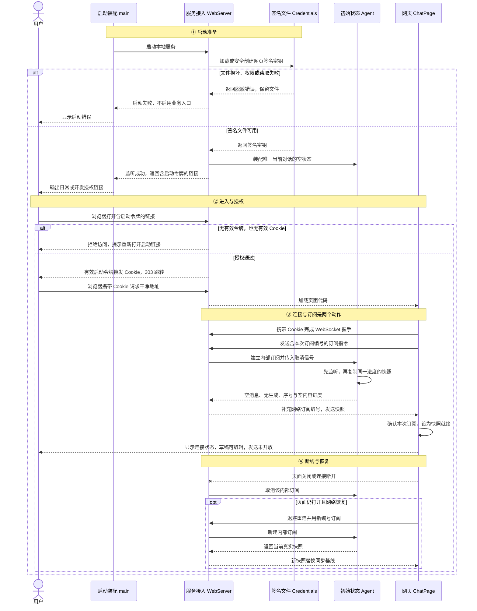

# 阶段一：打开、授权与订阅

状态：已于 2026-11-03 完成实现及本阶段自动验收，并合并 `main`。实际结果与未实测范围见[验收记录](./feature2-验收记录.md)。下文保留实施依据及设计时的变更说明，不将阶段一通过视为真实聊天链路通过。

## 1. 总结

**需求理解：** 用户启动本地服务，打开服务提供的授权链接，浏览器取得访问凭据并加载聊天页面，自动建立 WebSocket、订阅 Agent 的唯一当前对话并收到真实初始快照。刷新或断线后重新连接、重新订阅，页面明确显示连接或恢复状态，草稿始终可编辑。本阶段尚无聊天提交和模型调用，发送保持不可用；模型 Key 设置及本地模型发现由阶段二完成，真实生成及生成中恢复由阶段三完成。

**技术方案：** Node.js + TypeScript、原生 `node:http` 与 `ws` 建立入口；Credentials 在启动时安全加载网页签名密钥；WebServer 交换启动令牌与签名 Cookie、校验访问并管理客户端连接；Agent 提供真实内存状态的快照与内部订阅。日常由 Node 提供构建页面，开发保留 Vite 同源代理。共享类型沿用最终契约，本阶段实际状态为无消息、无生成，不增设临时聊天接口。

目录沿用总体设计的新组织：根 `web/`，后端为 `packages/server`、`packages/agent`、`packages/model`、`packages/credentials`。本阶段 Model 包只提供快照所需类型，不提供模型调用；类型分别回到所属包，无顶层共享类型目录。每个包具有公开入口、`test/` 与 README，代码和配置均待实施。

## 2. 系统变化说明

**Before：** 现有 `web/` 由 Vite 启动，`ChatPage` 在页面内存追加用户文字，没有后端、授权、WebSocket 或 Agent 状态。

**After：** 日常可从 Node 服务入口打开网页，开发仍使用 Vite；浏览器授权后订阅真实 Agent 初始状态，看到连接与快照恢复状态。原页面本地追加行为暂停，草稿可编辑但发送不可用；刷新不恢复未发送草稿。完成本阶段只证明接入与订阅成立，不表示可以聊天。

## 3. 系统设计

### 3.1 模块变化

本节新增或修改相对当前基础页面。总体设计列的是三阶段累计能力，本阶段只建设以下部分，Model 执行层尚不启用。

#### ① 服务入口与传输：WebServer（新增）

负责启动、页面交付、授权交换、WebSocket 握手和网络订阅，将 Agent 内部快照封装给网页。

**接口：新增 5 项。**

- 【新增】`start()`（进程内调用）：启动本地应用并提供访问入口；main 调用 WebServer 经 Credentials 加载 `BrowserAuthFile`（网页签名文件内容）、装配 Agent 并监听本机地址，成功后返回地址及授权链接供用户打开，授权初始化或端口冲突则报错并清理本次资源。
- 【新增】`close()`（进程内调用）：正常退出接入服务；main 请求 WebServer 结束连接、心跳与内部订阅并释放本次资源，页面的 `ConnectionState`（连接及快照就绪状态）转为断线，清理完成后进程退出，本阶段尚无模型调用需要中止。
- 【新增】[GET /?token=…](#key-browser-auth)（HTTP 接口）：让浏览器取得本地应用访问授权；浏览器提交启动令牌，WebServer 签发含 `BrowserCookiePayload`（授权地址与有效期）的 Cookie 并返回 303，浏览器保存后请求干净地址进入页面。
- 【新增】[GET /](#key-browser-auth)（HTTP 页面入口）：打开已授权的本地聊天页；浏览器携带含 `BrowserCookiePayload`（授权地址与有效期）的 Cookie 请求 WebServer，校验通过后取得页面和静态资源，ChatPage 再建立状态订阅。
- 【新增】[WebSocket /api/events](#key-ws-subscription)（实时通道）：让已授权页面取得当前对话的真实初始状态；网页发送 `ClientFrame`（订阅指令），WebServer 调用 Agent 并发送含 `ConversationSnapshot`（完整对话与运行状态）的 `ServerFrame`（网络消息），页面收到有效快照才就绪，本阶段仍不开放发送。

**数据：新增 3 项。**

- 【新增】`BrowserCookiePayload`：**本地网页授权凭据中的访问地址和有效期等信息**。WebServer 将它签名后放入 Cookie，浏览器在后续请求中带回，WebServer 校验后决定是否允许访问页面、HTTP 接口或建立 WebSocket。

```typescript
type BrowserCookiePayload = {
  version: 1; // WebServer 写入的 Cookie 格式版本
  authority: string; // WebServer 根据可信访问地址确定的主机与端口
  issuedAt: number; // WebServer 签发时的 Unix 毫秒时间
  expiresAt: number; // WebServer 按固定 30 天有效期计算的到期时间
};
```

- 【新增】`ClientFrame`：**前端发给后端的订阅或取消订阅指令**。网页客户端提供指令和订阅编号，WebServer 据此建立或取消对应的 Agent 内部订阅。

```typescript
type ClientFrame =
  | { type: 'subscribe'; subscriptionId: string } // 网页生成新订阅编号，要求取得快照及后续更新
  | { type: 'unsubscribe'; subscriptionId: string }; // 网页带回所属编号，仅取消对应订阅
```

- 【新增】`ServerFrame`：**后端通过 WebSocket 发给前端的一条消息**，可以是完整对话快照、一次对话更新或模型配置变化通知。WebServer 封装后发送，网页客户端据此恢复对话、更新展示或重新查询模型。

```typescript
type ServerFrame =
  | { type: 'snapshot'; subscriptionId: string; snapshot: ConversationSnapshot } // WebServer 为 Agent 快照补上网络订阅编号
  | { type: 'update'; subscriptionId: string; update: ConversationUpdate } // WebServer 为 Agent 更新补上网络订阅编号
  | { type: 'models_changed' }; // WebServer 在凭据变化后通知页面重新查询，不占用对话序号
```

#### ② 网页授权密钥：Credentials（新增部分能力）

本阶段仅管理网页签名文件，模型 `auth.json` 的读写在阶段二加入同一模块。

**接口：新增 1 项。**

- 【新增】[loadOrCreateBrowserSecret()](#key-browser-secret)（进程内调用）：让本地网页授权使用持久签名密钥；WebServer 启动时请求 Credentials 校验或安全创建 `BrowserAuthFile`（网页签名文件），取得 `Buffer`（密钥字节）用于 Cookie 签发与校验，失败则终止启动。

**数据：新增 1 项。**

- 【新增】`BrowserAuthFile`：**本地文件中保存的网页授权签名密钥及其格式版本**。Credentials 安全加载或创建这份数据，WebServer 取得密钥后签发和校验 Cookie，不将它用于模型调用。

```typescript
type BrowserAuthFile = {
  version: 1; // Credentials 读写的网页签名文件格式版本
  secret: string; // Credentials 安全生成的 32 字节随机值，以 base64url 保存
};
```

#### ③ 模型消息契约：Model（新增类型能力）

本阶段仅声明 Agent 快照需要的模型消息类型，源码放在所属 Model 包，模型发现与 SDK 调用分别在阶段二、三启用。

**接口：新增 0 项。** 只导出类型，不建立空的模型运行函数。

**数据：新增 12 项。**

- 【新增】`ModelMessage`：**发给模型的一条消息**，可以是系统指令、用户输入、历史回复或工具结果。Agent 整理这些消息后交给 Model，Model 将它们转换成服务商要求的格式。

```typescript
type ModelMessage =
  | SystemMessage // Agent 准备的系统指令
  | UserMessage // Agent 保留的正式用户输入
  | AssistantMessage // Model 生成、Agent 筛选后纳入本次上下文的回复
  | ToolResultMessage; // 后续工具执行方提供的结果，本期仅定义结构
```

- 【新增】`SystemMessage`：**告诉模型应当遵守什么规则**，例如“请用中文回答”。Agent 准备这些指令，Model 将它们放进本次请求。

```typescript
type SystemMessage = {
  role: 'system'; // Agent 标记此消息为系统指令
  content: string | TextContent[]; // Agent 准备的系统内容
  timestamp: number; // 消息创建方记录的 Unix 毫秒时间
};
```

- 【新增】`UserMessage`：**记录用户输入的原话**。Agent 保存这些内容，Model 将其放进请求，聊天页面也用它展示用户说过的话。

```typescript
type UserMessage = {
  role: 'user'; // Agent 标记此消息为用户输入，区别于原页面同名类型
  content: string | TextContent[]; // Agent 接收并保留的用户原文
  timestamp: number; // Agent 创建正式消息时记录的 Unix 毫秒时间
};
```

- 【新增】`AssistantMessage`：**模型的一条回复**，包含正文、思考、工具请求以及结束状态等信息。Model 生成这份数据，Agent 保存结果并准备后续上下文，ChatPage 展示回答或失败原因。

```typescript
type AssistantMessage = {
  role: 'assistant'; // Model 创建的回复角色
  content: (TextContent | ThinkingContent | ToolCall)[]; // Model 按服务商输出顺序累积的内容块
  api: string; // 本次传入 ModelInfo 的协议标识
  provider: string; // 本次传入 ModelInfo 的提供方标识
  model: string; // 调用方选择并交给 Model 的模型标识
  responseId?: string; // 服务商实际返回的响应编号，未报告时缺省
  responseModel?: string; // 服务商实际报告的模型名称，未报告时缺省
  stopReason: 'pending' | ModelStopReason; // Model 维护的生成中或最终结束原因
  errorMessage?: string; // Model 生成的脱敏失败说明
  usage?: ModelUsage; // 服务商实际报告的用量，未报告时缺省
  timestamp: number; // Model 创建本次回复时记录的 Unix 毫秒时间
  durationMs?: number; // Model 统计的本次调用耗时，单位毫秒
};
```

- 【新增】`ToolResultMessage`：**工具执行后返回的结果**，通过调用编号对应到原来的工具请求。后续工具执行方将结果交给 Agent，Model 再将其放进请求；本期只定义结构，不执行工具。

```typescript
type ToolResultMessage = {
  role: 'toolResult'; // 后续工具执行方创建的结果角色，本期不执行工具
  toolCallId: string; // 对应 Model 先前返回的 ToolCall.id
  toolName: string; // 对应 Model 返回的工具名称
  content: TextContent[]; // 后续执行方提供的结果内容
  isError: boolean; // 后续执行方标明工具执行是否失败
  timestamp: number; // 后续执行方创建结果时记录的 Unix 毫秒时间
};
```

- 【新增】`TextContent`：**一段正文文字**，系统指令、用户输入或模型回复都可以包含它。Model 用它转换输入，Agent 保存回复中的文字，ChatPage 按 Markdown 展示模型正文。

```typescript
type TextContent = {
  type: 'text'; // 内容创建方标明这是正文块
  text: string; // 来自用户/系统输入或服务商正文的文字
};
```

- 【新增】`ThinkingContent`：**模型生成的一段思考内容**，也可以带有服务商提供的思考来源信息。Model 整理这些数据，Agent 保存，ChatPage 将其放在独立、默认收起的思考区中。

```typescript
type ThinkingContent = {
  type: 'thinking'; // Model 根据服务商思考输出标记的内容类型
  thinking: string; // Model 从 reasoning_content 等思考数据累积的原文
  thinkingSignature?: string; // 适配器从服务商取得并保留的思考来源信息，缺失时不伪造
};
```

- 【新增】`ToolCall`：**模型提出的一次工具调用请求**，包含调用编号、工具名称、参数及可能的参数错误。Agent 保存请求，ChatPage 展示内容；未来执行方读取参数并拒绝错误参数，本期不执行工具。

```typescript
type ToolCall = {
  type: 'toolCall'; // Model 根据服务商工具调用输出标记的类型
  id: string; // 服务商返回的调用编号，用于后续对应工具结果
  name: string; // 服务商返回的工具名称
  arguments: JsonObject; // Model 解析最终参数文本得到的对象；解析失败时为 {}
  argumentsError?: string; // Model 保存的参数错误原因及原文，未来执行方须拒绝
};
```

- 【新增】`JsonValue`：**工具参数中可以出现的一种 JSON 值**，可以是字符串、数字、布尔值、空值、数组或对象。Model 解析服务商返回的参数文字时，用它表示参数中的各项内容。

```typescript
type JsonValue =
  | null | boolean | number | string // JSON 原文可包含的基本值
  | JsonValue[] | JsonObject; // Model 解析参数时得到的嵌套数组或对象
```

- 【新增】`JsonObject`：**按字段名组织的一组工具参数**。Model 将参数文字解析成这种对象，保存到工具调用中，后续执行方再读取；本期不定义具体工具参数。

```typescript
type JsonObject = {
  [key: string]: JsonValue; // Model 从工具参数 JSON 解析得到的键值，不在此定义工具 Schema
};
```

- 【新增】`ModelUsage`：**一次模型调用实际报告的 token 用量**，可以包含输入、输出和总量。Model 从服务商取得这些数字，Agent 将其保存到最终回复中，未报告的字段保持未知。

```typescript
type ModelUsage = {
  input?: number; // 服务商报告的输入 token 总量，缺失不补零
  output?: number; // 服务商报告的输出 token 数量，缺失不补零
  total?: number; // 服务商报告的总 token 数量，缺失不自行补算
};
```

- 【新增】`ModelStopReason`：**本次模型调用为什么结束**，区分正常回答结束、长度限制、工具请求、失败和取消。Model 给出原因，Agent 据此收尾并筛选后续历史，ChatPage 显示相应结果。

```typescript
type ModelStopReason =
  | 'stop' | 'length' | 'toolUse' // Model 将服务商有效结束原因转换为正常终止原因
  | 'error' | 'aborted'; // Model 将调用失败或明确取消转换为失败终止原因
```

#### ④ 初始状态与订阅：Agent（新增部分能力）

持有唯一当前对话的真实初始状态，向内部调用方提供快照与订阅，不接触浏览器连接或 Cookie。

**接口：新增 1 项。**

- 【新增】[subscribe(signal)](#key-agent-subscribe)（进程内订阅）：让新订阅恢复对话并接着接收变化；WebServer 提供独立取消信号，Agent 先提供 `ConversationSnapshot`（完整对话与运行状态）、再持续提供 `ConversationUpdate`（带序号的新变化），WebServer 转发给页面，取消只释放该订阅。

**数据：新增 6 项。**

- 【新增】`ConversationMessage`：**后端保存的一条正式对话消息**，在模型消息之外带有正式编号和可选的临时对应编号。Agent 保存消息，WebServer 转发，ChatPage 据此对应临时气泡并展示对话。

```typescript
type ConversationMessage = {
  id: string; // Agent 为正式 user 或 assistant 生成的消息编号
  clientMessageId?: string; // user 接收时带回的网页临时编号，供页面对应气泡
  message: ModelMessage; // Agent 保存的用户消息或累积后的模型消息内容
};
```

- 【新增】`RunningState`：**当前是否正在生成回答**，生成时还记录对应的用户消息和回复编号。Agent 维护这份状态并拒绝并发提交，WebServer 和 ChatPage 用它判断当前运行情况。

```typescript
type RunningState = null | { // null 由 Agent 表示当前没有生成任务
  userMessageId: string; // Agent 记录的本次已接收 user 编号
  assistantMessageId: string; // Agent 为本次回复分配的正式编号
};
```

- 【新增】`ConversationSnapshot`：**当前对话在某个时刻的完整内容和状态**。Agent 按自己已处理到的位置一起复制消息、运行状态和序号，WebServer 发给新订阅，ChatPage 用它恢复对话并从这个位置继续更新。

```typescript
type ConversationSnapshot = {
  seq: number; // Agent 截取当前消费进度时的连续更新序号
  messages: ConversationMessage[]; // Agent 独立复制的正式对话内容
  running: RunningState; // Agent 在同一进度下复制的运行状态
  activeContent: ActiveContent[]; // Agent 在同一进度下复制的未结束块进度
};
```

- 【新增】`ConversationUpdate`：**当前对话新发生的一次变化**，可以是接收用户消息，也可以是模型回复发生变化。Agent 为变化编号，WebServer 转发，ChatPage 按连续序号更新展示。

```typescript
type ConversationUpdate = {
  seq: number; // Agent 为每次正式变化递增的连续序号
  change:
    | { type: 'accepted'; user: ConversationMessage; running: Exclude<RunningState, null> } // Agent 接收产生的正式 user 与运行状态
    | { type: 'model'; messageId: string; event: ModelFrame }; // Agent 已消费的模型变化及其所属正式回复编号
};
```

- 【新增】`ActiveContent`：**哪些内容块还在生成**，以及它们所在的消息和块位置。Agent 随快照提供这些记录，ChatPage 据此继续更新对应块；工具块还保留尚未收齐的参数文字。

```typescript
type ActiveContent = {
  messageId: string; // Agent 正在累积的正式回复编号
  contentIndex: number; // Model 事件提供的内容块位置
} & (
  | { type: 'text' | 'thinking' } // Agent 标明尚未结束的正文或思考块
  | { type: 'toolCall'; argumentsText: string } // Agent 按已消费增量保存的半截参数原文
);
```

- 【新增】`ModelFrame`：**Agent 已处理的一次模型回复变化**，可以包含内容片段、块结束或最终结果。Agent 根据已读取的模型事件生成它，WebServer 转发给 ChatPage，页面据此更新对应内容并用最终结果修正展示。

```typescript
type ModelFrame =
  | { type: 'start'; initial: Pick<AssistantMessage, 'role' | 'api' | 'provider' | 'model' | 'timestamp'> } // Agent 从 start 事件提取的初始角色、来源与时间，不发送共享 partial
  | { type: 'text_start' | 'thinking_start' | 'toolcall_start'; contentIndex: number } // Agent 已消费的内容块开始位置，type 区分正文、思考与工具
  | { type: 'text_delta' | 'thinking_delta' | 'toolcall_delta'; contentIndex: number; delta: string } // Agent 已消费的块增量，contentIndex 定位块，delta 来自本次事件
  | { type: 'text_end' | 'thinking_end'; contentIndex: number; content: string } // Agent 已消费的块终值，content 用于校准正文或思考
  | { type: 'toolcall_end'; contentIndex: number; toolCall: ToolCall } // Agent 从 Model 的 toolcall_end 取得最终 toolCall，用于校准参数与错误标记
  | { type: 'done'; reason: 'stop' | 'length' | 'toolUse'; message: AssistantMessage } // Agent 从 Model 的 done 取得正常结束原因和完整回复，用于结束本次运行
  | { type: 'error'; reason: 'error' | 'aborted'; error: AssistantMessage }; // Agent 从 Model 的 error 取得失败原因和部分回复，用于收尾本次运行
```

#### ⑤ 页面连接：ChatPage（修改）

保留原输入组件，接入连接与快照恢复状态；聊天发送等待阶段三。

**接口：新增 1 项，修改 1 项。**

- 【新增】网页客户端 `subscribe()`（前端订阅）：恢复页面与后端初始对话的连接；ChatPage 请求网页客户端发送 `ClientFrame`（订阅指令），取得 `ServerFrame`（包含初始快照的网络消息）和 `ConnectionState`（连接及快照就绪状态）后更新页面，断线重新订阅，本阶段不提交聊天。
- 【修改】`MessageInput.onSend`（页面回调）：在接通聊天前保留草稿编辑并阻止发送；ChatPage 通过 `MessageInputProps`（发送开关与回调）接收发送操作，本阶段返回 false，MessageInput 保留草稿，sendDisabled 禁用发送但不禁编辑。

**数据：新增 1 项，修改 1 项。**

- 【新增】`ConnectionState`：**网页是否连上后端、是否已收到当前对话的状态**。网页客户端更新它，ChatPage 据此判断是否仍需等待连接或对话恢复，等待时暂停发送、保留草稿编辑。

```typescript
type ConnectionState =
  | 'connecting' // 网页客户端正在尝试建立 WebSocket
  | 'awaitingSnapshot' // 握手已完成，网页尚未收到当前订阅的有效快照
  | 'ready' // 网页已应用当前快照；能否发送还要检查模型、提交和运行状态
  | 'disconnected'; // 网页客户端发现连接中断或当前尝试失败，等待恢复
```

- 【修改】`MessageInputProps`：**聊天输入框从页面收到的发送开关和提交处理方式**。ChatPage 提供这些设置，MessageInput 据此判断能否发送、交出完整草稿，并按处理结果决定是否清空。

```typescript
type MessageInputProps = {
  onSend: (text: string) => boolean; // ChatPage 提供的回调，true 只表示前端已发起提交
  sendDisabled: boolean; // ChatPage 根据模型、连接、提交与生成状态计算，禁发送不禁编辑
};
```

### 3.2 数据交互流程



图按日常单服务入口表达。开发时页面由 Vite 提供，`/auth` 和 `/api/*` 代理到同一个后端；后端看到的是保留下来的 Vite Host/Origin。已有有效 Cookie 的干净地址访问直接校验并加载页面，不要求每次重新交换启动令牌。端口、来源或握手授权不通过时不建立内部订阅，相关分支见 §3.3。

### 3.3 关键接口

本节只展开跨端 HTTP API，以及决定授权、凭据安全、生成或状态恢复的重要接口；数据结构见 §3.1。

<a id="key-browser-secret"></a>

#### 案例一：loadOrCreateBrowserSecret()：加载网页签名密钥

**接口类型：** Credentials 提供的后端内部异步文件接口。

**接口定义：**

```typescript
function loadOrCreateBrowserSecret(): Promise<Buffer>;
```

**提供与调用关系：** WebServer 在启动时调用 Credentials 的公开入口；调用方不自行操作 JSON。

- **调用方：** WebServer 的启动/授权初始化逻辑
- **函数提供方：** Credentials

**触发条件：** 每次后端进程启动，发生在监听成功及输出访问链接之前。

**输入数据：** 无业务参数；固定读取 `~/.agent-learning/browser-auth.json`，该文件与模型 Key 的 `auth.json` 分开。

**接收方处理：**

1. 检查可读性、权限、JSON 版本与密钥格式。
2. 缺文件时持跨进程锁、重新检查后创建；创建目录权限 `0700`，创建与替换文件权限 `0600`。
3. 沿用 dsh 的同目录随机临时文件独占创建与原子替换，返回密钥字节，不声称断电持久性。

**返回结果与调用方后续：** Promise 成功返回仅供后端使用的密钥，WebServer 在当前进程中持有它，用于签发和校验 Cookie。同账号副本共用该文件，各后端的当前对话和随机启动令牌仍独立。

**异常处理：** 已有文件权限过宽、JSON 损坏、密钥格式无效或读写失败均拒绝初始化，不静默重置或覆盖错误文件。密钥不进入网页、Cookie 明文或日志；替换文件后需重启才影响当前进程。

<a id="key-browser-auth"></a>

#### 案例二：GET /?token=…、GET /：授权与页面进入

**接口类型：** HTTP 导航，先交换凭据、再重定向加载页面。

**接口定义：**

```http
GET /?token=<本进程启动令牌>
GET /
```

**提供与调用关系：** 浏览器访问 WebServer，由 WebServer 使用已加载签名密钥校验授权。

- **请求方：** 浏览器；独立客户端也可执行同一交换
- **接收方：** WebServer

**触发条件：** 首次打开启动链接，或已有 Cookie 后打开、刷新干净地址。

**输入数据：** 首次 URL 携带启动令牌；之后浏览器自动携带适用的 Cookie。开发入口为 `http://127.0.0.1:5173/auth?token=…`。

**接收方处理：**

1. 检查 Host 与浏览器来源，验证启动令牌或 Cookie。
2. 有效令牌换发 HMAC-SHA256 签名 Cookie，返回 `Set-Cookie` 和 `303 Location: ./`；令牌仅在当前进程有效且可重复交换。
3. 浏览器保存 Cookie 后自动请求干净地址，校验通过才加载 ChatPage；已有有效 Cookie 的普通访问直接进入，不续期。

**返回结果与请求方后续：** 页面加载后进入案例三。Cookie 固定 30 天，绑定访问地址与端口，名称按访问地址区分，包含上述载荷的签名；签名密钥本身不放进 Cookie。使用 `HttpOnly`、`SameSite=Strict`、`Path=/`，本机 HTTP 不设 `Secure`，实际 HTTPS 才设置。

**异常处理：** 目标或来源不可信返回 `403`；缺失、无效授权返回 `401`。显式跨站、`Origin: null` 或不匹配来源被拒绝；无 Origin 的独立客户端仍须先交换并保留 Cookie，再用于业务 HTTP 和握手。同一地址、同一签名密钥重启后可继续校验未过期 Cookie，但启动令牌更新；更换签名文件并重启使旧 Cookie 失效。模型 Key 文件损坏不阻断网页授权。

**开发代理约束：** Vite 固定 `127.0.0.1:5173`、启用 `strictPort`；`/auth?token=…` 重写到后端根授权入口，`/api/*` 代理业务 HTTP / WebSocket。保留 Host、Origin 与 Cookie，按 Vite 地址签发授权；不开泛化 CORS，不改写来源绕过检查。

<a id="key-ws-handshake"></a>

#### 案例三：WebSocket /api/events：握手与连接恢复

**接口类型：** HTTP Upgrade 长连接；打开连接尚不等于订阅就绪。

**接口定义：**

```http
GET /api/events
Upgrade: websocket
Cookie: <已签发的本地访问凭据>
```

**提供与调用关系：** ChatPage 通过网页客户端发起连接，WebServer 接受握手和管理连接。

- **发起方：** 网页客户端
- **接收方：** WebServer

**触发条件：** 页面初始化，或中断后的重连尝试。

**输入数据：** 连接地址、Host/Origin 与 Cookie；浏览器自动携带 Cookie，独立客户端自行保留并携带。

**接收方处理：** 校验 Host、来源和 Cookie 后建立连接，登记关闭与心跳清理；此时尚不调用 Agent 订阅，须等待案例四的指令。

**返回结果与发起方后续：** 连接打开后发送订阅指令，页面保持“等待快照”，收到当前订阅的有效快照才就绪。本阶段就绪也不开放聊天发送，草稿始终可编辑。

**异常、恢复与清理：**

- 不可信目标/来源拒绝握手，授权无效同样拒绝。仅凭浏览器 WS 错误不能可靠区分网络与授权故障，显示连接异常及重新打开启动链接的指引；只有明确 HTTP `401` 才归为授权失效，不误报模型 Key 错误。
- 准备过程 3 秒显示慢连接提示，15 秒仍未就绪则结束本次尝试后重连；收到快照或取消尝试时清理相应计时。
- 重连基数 500ms、倍率 2、上限 10s，每次在当次上限的 50%–100% 随机等待；离线暂停，恢复后重连和重新订阅。
- 服务端每 2 秒 Ping、两次未响应心跳检查后清理失活连接。关闭仅清理所属连接/订阅，不重置 Agent；不增加 Cookie 到期强制关闭已有 WS 的计时器。

这里没有模型五分钟空闲计时，也没有消息提交十秒回执计时；它们属于阶段三。

<a id="key-ws-subscription"></a>

#### 案例四：WebSocket /api/events：订阅与初始快照

**接口类型：** WebSocket 消息协议；网页 `subscribe()` 封装连接及协议收发。

**接口定义：** 网页发送 §3.1 WebServer 的 `ClientFrame`，服务返回 `ServerFrame`；快照和更新数据结构见 §3.1 Agent。

**提供与收发关系：** 网页客户端发送订阅指令；WebServer 调用案例五取得真实状态，再封装网络帧发回网页。

- **指令发送方 / 快照接收方：** 网页客户端
- **指令接收方 / 快照发送方：** WebServer
- **状态提供方：** Agent

**触发条件：** WS 打开后订阅；重连或需重取状态时使用新编号；离开页面或替换订阅时释放旧订阅。

**输入数据示例：**

```json
{ "type": "subscribe", "subscriptionId": "sub-1" }
```

**接收方处理：**

1. 校验指令，为本次订阅创建独立取消信号，调用 Agent 的 `subscribe(signal)`；Agent 不接收网络编号。
2. 替换旧订阅时先取消旧内部订阅；将新订阅的第一份快照与其后更新加上本次 `subscriptionId` 发送。
3. 收到取消指令或所属连接关闭时，释放对应内部订阅及发送资源，不重置 Agent。

**持续输出与前端后续：** 初始快照使用最终协议，是真实空状态，不是假模型回复。

```json
{
  "type": "snapshot",
  "subscriptionId": "sub-1",
  "snapshot": {
    "seq": 0,
    "messages": [],
    "running": null,
    "activeContent": []
  }
}
```

前端仅处理当前编号的帧，以有效快照重新建立序号基线，忽略旧订阅数据；旧序号不重复应用，跳号则暂停并重取快照。`messages` 为正式消息，`running` 为当前运行状态，`activeContent` 为未结束内容块的进度；本阶段分别为空数组、`null` 与空数组。收到快照后结束本次准备计时，阶段内仍禁用发送。`models_changed` 分支到阶段二启用，真实生成更新及其恢复到阶段三启用。

**异常、停止与清理：** 非法帧、取消或发送失败只清理所属资源，不影响其他页面或 Agent 状态。受控测试可以验证协议更新，但不能作为真实模型生成证据；对话终止事件将来只结束任务，不关闭订阅。

<a id="key-agent-subscribe"></a>

#### 案例五：Agent.subscribe()：内部快照订阅

**接口类型：** 后端进程内的异步可迭代接口，不经过 HTTP 或 WebSocket。

**接口定义：**

```typescript
interface Agent {
  subscribe(signal: AbortSignal): AsyncIterable<
    | { type: 'snapshot'; snapshot: ConversationSnapshot }
    | { type: 'update'; update: ConversationUpdate }
  >;
}
```

**提供与调用关系：** WebServer 持续读取 Agent 提供的异步序列；网络帧只在 WebServer 封装。

- **调用方 / 消费方：** WebServer
- **函数提供方 / 状态发布方：** Agent

**触发条件：** WebServer 接受一条有效网络订阅指令。

**输入数据：** 一个仅作用于该订阅的 `AbortSignal`，与将来的模型取消信号分开。

**接收方处理：**

1. 先登记监听，再同步复制同一进度的独立快照及序号。
2. 序列首先提供快照，再提供大于该快照序号的更新，避免快照/更新之间遗漏或重复。
3. 状态由 Agent 持有；此阶段为初始空状态，后续生成状态也由 Agent 按已消费模型事件累积，不能直接引用可能领先的共享 `partial`。

**返回结果与调用方后续：** WebServer 取得第一项后发送网络快照，继续等待后续更新；Agent 不知道 Cookie、连接、网络订阅编号或前端展示。后端重启后消息和序号清空，页面以新快照建立基线。

**异常、停止与清理：** 取消信号结束该订阅的等待并移除监听，不取消共享任务或清空状态。阶段三的模型失败会成为状态更新，不冒充订阅本身失败。

## 4. 技术决策

- 【功能决策｜服务接入、Agent、页面】第一阶段完成真实初始状态订阅，允许编辑草稿、暂停聊天发送；阶段三才开启提交并验证生成中恢复。
- 【工程决策｜服务接入、Credentials】沿用 dsh 的原生 HTTP、`ws`、启动令牌、持久签名 Cookie、权限和文件更新保护；唯一文件组织适配是已确认的独立 `browser-auth.json`。
- 【工程决策｜Agent】对话与状态唯一归 Agent，WebServer 转发内部订阅；共享契约从最终设计沿用，不设 Conversation 执行层。
- 【工程决策｜服务接入、页面】日常单服务、开发 Vite 同源代理沿用既定方案；授权不能依赖来源改写，连接与快照就绪分别处理。

这些是已确认方案及成熟参考的采用记录，不新增待选项。第一阶段完整方案仍待本轮模块核对，不因沿用选择而标为已验收。

## 5. 风险与边界

### 授权文件损坏会阻止启动

- **案例：** 网页签名文件存在但格式损坏或权限过宽，无法安全签发 Cookie。
- **解决方案：** 返回脱敏启动错误、保留文件并停止启用业务入口，人工修复或移走后再启动；不静默换密钥。模型凭据文件尚未参与此阶段，不应造成同类启动依赖。

### 浏览器 Cookie 有效不代表当前对话已恢复

- **案例：** Cookie 校验通过、WebSocket 也已打开，但当前订阅还未取得快照，页面不知道后端状态。
- **解决方案：** 区分握手与快照就绪，旧订阅帧不改变新基线；前两个阶段发送均不可用，阶段三也只在已确认的完整发送条件成立后放开。

### 开发代理可能造成授权地址不一致

- **案例：** Cookie 按后端端口签发，却由浏览器通过 Vite 端口访问，或代理改写 Host/Origin 掩盖真实来源。
- **解决方案：** 同源代理保留地址与来源事实，开发启动链接从 Vite `/auth` 进入并按其地址授权；通过真实代理 E2E 验证，不能只测试后端直连。

### 空快照验收不能证明真实生成恢复

- **案例：** 空状态重连通过，就宣称模型生成期间刷新也不会漏片段或重复显示。
- **解决方案：** 本阶段验证入口、订阅、快照与资源释放；受控事件测试只证明局部规则，第三阶段在真实运行状态与模型数据下再验证完整恢复。

## 6. 验收标准

以下测试均为拟新增或修改，尚未执行。后端使用临时目录与临时监听，不接触真实用户密钥文件；根 `npm run test:packages` 准备包依赖后执行模块测试，可用 `npm --prefix packages/<模块> test` 单独定位；网页继续使用 `test:unit`、`test:browser`、`test:e2e`。Model 本阶段只做类型检查，无运行行为测试。

### 1. 签名密钥安全初始化

- **存放位置：** `packages/credentials/test/credentials.test.ts`，“签名文件创建、并发加载、权限与损坏保护”。
- **类型：** 文件系统集成测试。
- **验证内容：** 缺文件时创建有效密钥与正确权限，并发加载取得同一值；已有有效文件不被改写，坏 JSON、宽权限、读取或写入失败明确报错且保留原文件，输出不包含密钥。

### 2. 授权交换、有效期与握手

- **存放位置：** `packages/server/test/webserver.test.ts`，“Cookie 交换与重启”“目标来源拒绝”“握手授权”。
- **类型：** HTTP / WebSocket 集成测试，使用可控时钟。
- **验证内容：** 启动链接换发 Cookie 并清理 URL，已授权请求可用；伪造、过期凭据和不可信来源被拒绝，无 Origin 仍需 Cookie。保留签名文件重启后 Cookie 有效，更换密钥并重启后失效，普通访问不续期，已有 WS 不因到期新增强制关闭。

### 3. Agent 初始状态与订阅清理

- **存放位置：** `packages/agent/test/agent.test.ts`，“真实空快照”“快照独立性”“多订阅与取消释放”；`packages/server/test/webserver.test.ts`，“受控 Agent 订阅转发与旧订阅清理”。
- **类型：** 单元与集成测试。
- **验证内容：** 真实 Agent 返回最终结构的空快照，各浏览器观察同一状态；修改返回副本不改变源状态，取消只释放所属订阅。用受控订阅源检查 WebServer 的帧封装、先快照后更新顺序及旧订阅取消，不将测试事件作为实际模型链路已通过的证据。

### 4. 页面恢复、就绪边界与草稿

- **存放位置：** `web/src/chat/state.test.ts`、`web/src/pages/ChatPage.test.tsx`；扩展已有 `MessageInput.test.tsx`、`MessageInput.browser.test.tsx`、`ChatPage.browser.test.tsx`。
- **类型：** 单元、组件及真实浏览器组件集成测试。
- **验证内容：** 握手成功仍等待当前编号快照，旧订阅帧不使页面提前就绪；断线、离线与重连切换不覆盖草稿，发送始终不可用而编辑与输入法处理继续有效。使用假计时器验证退避、就绪等待及取消计时，真实浏览器验证焦点和阅读位置；未覆盖的真实输入法或实际 Safari 行为另记，不以合成事件冒充。

### 5. 两种入口的真实闭环

- **存放位置：** `web/tests/e2e/chat.spec.ts`，“阶段一日常授权与空快照”“阶段一 Vite 代理与恢复”；证据写入实施后产生的 `feature2-验收记录.md`。
- **类型：** E2E。
- **验证内容：** 分别从 Node 构建页面和 Vite 开发入口进入，真实交换 Cookie、建立 WS、取得 Agent 空快照；刷新、断线与后端重启后重新订阅，输入仍可编辑且不能提交聊天。检查 Vite 不绕过 Host/Origin 校验、未运行模型调用。此项必须经过实际页面、Cookie、代理、监听与 WS，局部组件无法证明入口装配成立。

## 7. 文件变更

### ① 服务入口与传输：WebServer（新增）

| 文件 | 类型 | 用途 | 变更 |
| --- | --- | --- | --- |
| `packages/server/src/main.ts` | 新增 | 启动装配 | 启动服务、输出授权入口，退出时统一清理资源 |
| `packages/server/src/webserver/index.ts` | 新增 | 页面与 WebSocket | 提供授权页面入口并绑定 Agent 订阅，尚不接入聊天提交或模型设置 |
| `packages/server/src/webserver/browser-auth.ts` | 新增 | 浏览器授权 | 完成启动令牌、Cookie 签发与校验，拒绝不可信访问 |
| `packages/server/src/webserver/protocol.ts` | 新增 | 网络契约 | 使用总体设计的订阅编号与快照结构，按后续阶段启用其他消息 |
| `packages/server/package.json`、`packages/server/tsconfig.json`、`packages/server/README.md` | 新增 | 服务包配置与阅读入口 | 声明当前包依赖、运行和协议类型入口，说明启动与授权的阅读顺序 |
| `web/vite.config.ts` | 修改 | 开发代理 | 仅提供开发页面 → 同源代理 `/auth` 与 `/api/*` 的 HTTP / WebSocket |
| `packages/server/test/webserver.test.ts` | 新增 | 接入验收 | 验证令牌交换、授权、握手、快照转发、替换订阅及心跳清理 |

### ② 网页授权密钥：Credentials（新增部分能力）

| 文件 | 类型 | 用途 | 变更 |
| --- | --- | --- | --- |
| `packages/credentials/src/credentials.ts` | 新增 | 授权密钥加载 | 只提供本阶段所需的签名密钥加载，不提前提供空的模型凭据函数 |
| `packages/credentials/src/credential-file.ts` | 新增 | 文件保护 | 安全权限、锁内重读与原子替换，失败保留原文件 |
| `packages/credentials/src/index.ts`、`packages/credentials/src/types.ts` | 新增 | 凭据入口与类型 | 导出签名密钥加载能力与本阶段文件类型，后续扩展同一公开入口 |
| `packages/credentials/package.json`、`packages/credentials/tsconfig.json`、`packages/credentials/README.md` | 新增 | 凭据包配置与阅读入口 | 独立检查和测试文件保护，说明公开入口与实现边界 |
| `packages/credentials/test/credentials.test.ts` | 新增 | 签名文件验收 | 验证创建、并发、损坏、权限、读写失败与脱敏 |

### ③ 模型消息契约：Model（新增类型能力）

| 文件 | 类型 | 用途 | 变更 |
| --- | --- | --- | --- |
| `packages/model/src/types.ts` | 新增 | 模型消息类型 | 声明快照所需的最终消息和内容类型，不包含模型调用实现 |
| `packages/model/src/index.ts` | 新增 | 模型类型入口 | 只导出本阶段需要的消息类型，运行入口按后续阶段加入 |
| `packages/model/package.json`、`packages/model/tsconfig.json`、`packages/model/README.md` | 新增 | 类型包配置与阅读入口 | 支持 Agent 的类型依赖与构建，标明模型发现及调用的阶段边界 |

### ④ 初始状态与订阅：Agent（新增部分能力）

| 文件 | 类型 | 用途 | 变更 |
| --- | --- | --- | --- |
| `packages/agent/src/agent.ts` | 新增 | 初始状态与内部订阅 | 提供真实初始快照和独立订阅清理，保持后续运行状态唯一归属 |
| `packages/agent/src/types.ts` | 新增 | Agent 状态契约 | 沿用最终快照和更新结构，不依赖网络协议 |
| `packages/agent/src/index.ts` | 新增 | Agent 公开入口 | 导出初始状态订阅和所需类型，WebServer 不跨入内部文件 |
| `packages/agent/package.json`、`packages/agent/tsconfig.json`、`packages/agent/README.md` | 新增 | Agent 包配置与阅读入口 | 声明对 Model 类型的依赖，提供独立检查、测试和阅读说明 |
| `packages/agent/test/agent.test.ts` | 新增 | 状态订阅验收 | 验证空状态、快照独立性、多订阅及取消释放 |

### ⑤ 页面连接：ChatPage（修改）

| 文件 | 类型 | 用途 | 变更 |
| --- | --- | --- | --- |
| `web/src/pages/ChatPage.tsx` | 修改 | 页面协调 | 本地发送追加 → 展示连接状态并接收真实初始快照，尚不提交聊天 |
| `web/src/components/MessageInput.tsx` | 修改 | 草稿输入 | 按草稿发送 → 支持外部禁用发送且继续编辑，保留输入法与撤销规则 |
| `web/src/types.ts` | 修改 | 页面状态 | 只有用户文字类型 → 补充连接状态，后续聊天类型在阶段三接入 |
| `web/src/styles.css` | 修改 | 页面反馈 | 基础聊天布局 → 增加连接、恢复与错误提示，保持阅读位置规则 |
| `web/src/chat/client.ts` | 新增 | WebSocket 生命周期 | 连接、订阅、断线恢复与资源清理，不自动重发用户输入 |
| `web/src/chat/state.ts` | 新增 | 订阅状态 | 区分连接与快照就绪，隔离旧订阅帧并重置快照基线 |
| `web/src/chat/state.test.ts` | 新增 | 页面同步验收 | 验证旧订阅隔离、空快照、断线与重新就绪 |
| `web/src/pages/ChatPage.test.tsx` | 修改 | 页面行为验收 | 本地发送追加 → 验证连接状态、禁用发送与草稿保护 |
| `web/src/pages/ChatPage.browser.test.tsx` | 修改 | 真实浏览器页面验收 | 本地发送后的阅读位置 → 补充连接状态变化时的编辑、焦点与阅读位置 |
| `web/src/components/MessageInput.test.tsx` | 修改 | 输入契约验收 | 本地接收与清空 → 补充外部禁用发送，保留原输入分支断言 |
| `web/src/components/MessageInput.browser.test.tsx` | 修改 | 浏览器输入验收 | 原输入验收 → 增加发送不可用时仍可编辑，保留已有原文与撤销检查 |

### 其他

**运行入口：** 根 `npm install` 安装 workspace 依赖；日常 `npm run build` 按 Credentials → Model → Agent → Server → web 构建，再运行 `npm --prefix packages/server start`。Model 此时只构建消息契约，Server 运行时从仓库根定位 `web/dist/`，不在自身构建时读取前端产物。开发运行根 `npm run dev:server` 首次构建并监听后端各包、重启 Server，另一终端运行 `npm --prefix web run dev`；不能只监听 Server 本包源码。这些均为待实施命令。

| 文件 | 类型 | 用途 | 变更 |
| --- | --- | --- | --- |
| `package.json`、`package-lock.json`、`tsconfig.base.json` | 新增 | 全仓依赖与运行 | 管理 `web`、`packages/*`，统一安装、依赖顺序构建、后端监听和包测试，沿用当前 TypeScript 版本 |
| `web/package.json`、`web/tsconfig.json` | 修改 | 网页构建与检查 | 独立页面检查 → 作为 workspace 成员引用各包公开类型，并支持本阶段验收 |
| `README.md`、`web/README.md` | 修改 | 启动说明 | 仅前端运行说明 → 补充日常单服务、开发双进程及授权入口 |
| `web/tests/e2e/chat.spec.ts` | 修改 | 实际入口验收 | 本地发送与刷新清空 → 先验证授权、两种入口及空快照重连，聊天案例在阶段三更新 |
| `planning/里程碑1/feature2/feature2-验收记录.md` | 新增 | 实施后的证据 | 记录本阶段实际结果、脱敏日志与未验证项，实施后产生 |

实施时将现有网页依赖迁移到根 `package-lock.json`，校验后移除 `web/package-lock.json`，各模块不另建锁文件。本轮只记录迁移计划，不修改真实配置或安装依赖。
