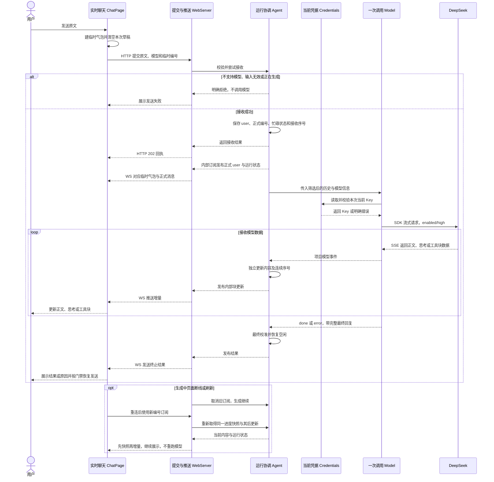

# 阶段三：提交生成与实时展示

状态：2026-11-04 按用户本轮指令实施，受控完整链路与真实 DeepSeek 验收通过；实现位于 `codex/feature2-stage3` worktree，尚未合并主干。实际结果见[验收记录的阶段三部分](./feature2-验收记录.md#阶段三验收)与[实施计划](./feature2-阶段三-实施计划.md)。依赖[阶段一](./feature2-阶段一-打开授权与订阅.md)的接入与订阅、[阶段二](./feature2-阶段二-凭据配置与本地模型发现.md)的 Key 管理与模型发现；共享契约以[总体设计](./feature2-单会话流式聊天技术设计.md)为准。

## 1. 总结

**需求理解：** 用户在已授权且已配置模型的网页发送消息，后端记录接收并返回回执，Agent 准备历史、调用 Model，由 OpenAI SDK 消费真实 DeepSeek SSE，转换成 text、thinking、toolCall 内容与事件，Agent 保存运行进度并通过 WebSocket 让网页实时显示。回答结束、失败或超时均明确反馈，刷新或重连恢复后端内容；生成中仍可编辑草稿，暂不接受下一次提交。本阶段完成单会话真实聊天，具体工具定义、参数 Schema、执行和循环仍留后续工具步骤。

**技术方案：** 沿用同一个 WebServer、Credentials 和 Agent，增加 HTTP 提交与模型流适配。Model 只负责一次调用，Agent 负责消息历史、运行状态与事件消费；页面用临时编号合并 HTTP/WS 两条反馈。使用既有快照、连续序号、块增量和最终回复校准，显示安全 Markdown 与独立思考区域。

目录沿用总体设计：根 `web/` 展示交互，`packages/server` 只装配与接入，`packages/agent` 协调运行，`packages/model` 调用模型，`packages/credentials` 沿用阶段二凭据能力。类型由所属模块公开导出，前端只做类型引用，后端同进程运行，包拆分不新增服务进程。

## 2. 系统变化说明

**Before（阶段二交接基线）：** 页面已能授权、订阅初始状态、配置 Key 并显示本地模型，发送仍不可用。

**After：** 满足订阅、模型与空闲条件后启用发送，接收真实模型回复与明确终止状态；当前对话可连续聊天，生成中刷新和断线后恢复，失败内容仍可见。后端重启聊天清空，凭据不受影响。

## 3. 系统设计

### 3.1 模块变化

本节记录相对前两阶段已完成基线的新增与修改；现已按这些边界实施，保持总体设计的模块与类型归属。

#### ① 提交与推送：WebServer（修改）

**接口：新增 1 项，修改 2 项。**

- 【新增】[POST /api/messages](#key-submit-http)（HTTP 接口）：提交用户消息并启动本次回答生成；ChatPage 发送 `SubmitMessageRequest`（原文、模型和临时编号），WebServer 校验后交给 Agent 保存并安排生成，返回 `SubmitMessageAccepted`（正式编号及接收进度），页面对应气泡后通过 WebSocket 继续展示回答。
- 【修改】[WebSocket /api/events](#key-ws-subscription)（实时通道）：让页面持续收到当前对话及后续变化；网页发送 `ClientFrame`（订阅或取消指令），WebServer 校验后消费 Agent 内部订阅并发送 `ServerFrame`（快照、更新或配置通知），页面按编号和序号恢复展示，配置变化则另行查询模型。
- 【修改】`close()`（进程内调用）：正常退出应用并释放运行资源；main 请求 WebServer 停止接入和订阅，并在 `RunningState`（当前生成状态）非空时中止本次模型调用，完成清理后 main 继续退出，最后一条网络事件不保证送达。

**数据：新增 2 项，沿用 2 项。**

- 【新增】`SubmitMessageRequest`：**前端发给后端的一次聊天提交**，包含用户原文、所选模型和临时消息编号。ChatPage 准备这些内容，WebServer 校验后交给 Agent 接收。

```typescript
type SubmitMessageRequest = {
  clientMessageId: string; // ChatPage 为每次人工发送生成的临时展示编号，不用于去重
  modelId: string; // ChatPage 从本地发现结果中选择的模型标识
  text: string; // MessageInput 提供的完整用户原文，保留空格与换行
};
```

- 【新增】`SubmitMessageAccepted`：**后端已接收这次提交的回执**，包含正式消息编号和接收时的更新序号。WebServer 将 Agent 的接收结果返回 ChatPage，页面用它对应临时气泡，并等待订阅追到这个位置后再判断能否发送。

```typescript
type SubmitMessageAccepted = {
  clientMessageId: string; // Agent 原样带回本次临时编号，页面据此对应气泡
  userMessageId: string; // Agent 接收时生成的正式用户消息编号
  acceptedSeq: number; // Agent 保存 user 和运行状态后的序号，页面等待订阅追到此处
};
```

- 【沿用】`ServerFrame`：**后端通过 WebSocket 发给前端的一条消息**，可以是完整对话快照、一次对话更新或模型配置变化通知。WebServer 封装后发送，网页客户端据此恢复对话、更新展示或重新查询模型。

```typescript
type ServerFrame =
  | { type: 'snapshot'; subscriptionId: string; snapshot: ConversationSnapshot } // WebServer 为 Agent 快照补上网络订阅编号
  | { type: 'update'; subscriptionId: string; update: ConversationUpdate } // WebServer 为 Agent 更新补上网络订阅编号
  | { type: 'models_changed' }; // WebServer 在凭据变化后通知页面重新查询，不占用对话序号
```

- 【沿用】`ClientFrame`：**前端发给后端的订阅或取消订阅指令**。网页客户端提供指令和订阅编号，WebServer 据此建立或取消对应的 Agent 内部订阅。

```typescript
type ClientFrame =
  | { type: 'subscribe'; subscriptionId: string } // 网页生成新订阅编号，要求取得快照及后续更新
  | { type: 'unsubscribe'; subscriptionId: string }; // 网页带回所属编号，仅取消对应订阅
```

#### ③ 一次调用：Model（修改）

`ModelMessage` 引用的系统、用户、工具结果及内容块类型沿用[阶段一 §3.1 Model 的完整结构](./feature2-阶段一-打开授权与订阅.md)；下列代码展开本阶段新增及直接使用的数据。

**接口：新增 1 项，沿用 1 项。**

- 【新增】[stream(model, context, options)](#key-model-stream)（进程内事件流）：提供一次模型调用的过程与最终回复；Agent 传入 `ModelInfo`（所选模型）、`ModelContext`（系统提示词和消息）及可选取消信号，Model 立即返回 `ModelEventStream`（同次事件与最终结果）、后台读取当前 Key 请求服务商，Agent 消费事件并保存回复。
- 【沿用】`discoverModels()`（进程内查询）：列出本机当前可用的模型而不请求服务商；WebServer 调用 Model，Model 结合 `ModelInfo`（内置模型信息）和 `CredentialStatus`（本地凭据状态）返回 `ModelDiscovery`（可用模型与状态），WebServer 交给页面更新选择。

**数据：新增 3 项，沿用 3 项。**

- 【新增】`ModelContext`：**一次模型调用要带上的系统提示词和消息**。Agent 为本次调用整理这些内容，Model 的 `stream()` 将它们转换成服务商请求并发起调用。

```typescript
type ModelContext = {
  systemPrompt?: string; // Agent 为本次调用准备的系统提示词
  messages: ModelMessage[]; // Agent 整理的历史消息与当前输入，排除失败的 assistant 回复
};
```

- 【新增】`ModelEvent`：**模型生成过程中发生的一次变化**，例如增加正文、结束一个内容块或结束本次调用。Model 按顺序发布这些事件，Agent 将它们整理成回复内容和对话更新。

```typescript
type ModelEvent =
  | { type: 'start'; partial: AssistantMessage } // Model 创建的初始回复；partial 是同次共享对象
  | { type: 'text_start'; contentIndex: number; partial: AssistantMessage } // Model 开始正文块；contentIndex 来自本次块顺序
  | { type: 'text_delta'; contentIndex: number; delta: string; partial: AssistantMessage } // Model 从 SSE 正文取得 delta，按 contentIndex 更新共享 partial
  | { type: 'text_end'; contentIndex: number; content: string; partial: AssistantMessage } // Model 提供该正文块完整 content，Agent 用于校准
  | { type: 'thinking_start'; contentIndex: number; partial: AssistantMessage } // Model 开始思考块；contentIndex 来自本次块顺序
  | { type: 'thinking_delta'; contentIndex: number; delta: string; partial: AssistantMessage } // Model 从 SSE 思考取得 delta，按 contentIndex 更新共享 partial
  | { type: 'thinking_end'; contentIndex: number; content: string; partial: AssistantMessage } // Model 提供该思考块完整 content，Agent 用于校准
  | { type: 'toolcall_start'; contentIndex: number; partial: AssistantMessage } // Model 开始工具块；contentIndex 来自本次块顺序
  | { type: 'toolcall_delta'; contentIndex: number; delta: string; partial: AssistantMessage } // Model 从 SSE 参数文本取得 delta，Agent 保留原文进度
  | { type: 'toolcall_end'; contentIndex: number; toolCall: ToolCall; partial: AssistantMessage } // Model 解析得到最终 toolCall，Agent 用于校准参数与错误标记
  | { type: 'done'; reason: 'stop' | 'length' | 'toolUse'; message: AssistantMessage } // Model 正常终止；reason 来自有效结束原因，message 为完整回复
  | { type: 'error'; reason: 'error' | 'aborted'; error: AssistantMessage }; // Model 失败或明确取消；reason 为对应原因，error 为保留部分内容的最终回复
```

- 【新增】`ModelEventStream`：**同一次模型调用从开始到结束的事件序列**，也提供等待最终回复的方式。Model 返回它，Agent 逐项读取事件或等待最终结果，两种方式都不会额外调用模型。

```typescript
interface ModelEventStream extends AsyncIterable<ModelEvent> { // Model 提供的同次事件序列，Agent 逐项消费
  result(): Promise<AssistantMessage>; // Model 提供的同一次最终回复等待，不另发请求
}
```

- 【沿用】`ModelInfo`：**一个受支持模型的基本信息**，包括标识、名称、提供方和接口类型。Model 提供这些信息，ChatPage 用来展示模型选项，Agent 将选中的模型交给 Model 发起调用。

```typescript
type ModelInfo = {
  id: string; // Model 内置支持目录中的模型标识，本期默认 deepseek-flash
  name: string; // Model 内置的展示名称，ChatPage 用于模型选择
  provider: string; // Model 内置的提供方标识，用于选择适配与凭据
  api: string; // Model 内置的协议标识，用于选择请求转换方式
};
```

- 【沿用】`ModelMessage`：**发给模型的一条消息**，可以是系统指令、用户输入、历史回复或工具结果。Agent 整理这些消息后交给 Model，Model 将它们转换成服务商要求的格式。

```typescript
type ModelMessage =
  | SystemMessage // Agent 准备的系统指令
  | UserMessage // Agent 保留的正式用户输入
  | AssistantMessage // Model 生成、Agent 筛选后纳入本次上下文的回复
  | ToolResultMessage; // 后续工具执行方提供的结果，本期仅定义结构
```

- 【沿用】`AssistantMessage`：**模型的一条回复**，包含正文、思考、工具请求以及结束状态等信息。Model 生成这份数据，Agent 保存结果并准备后续上下文，ChatPage 展示回答或失败原因。

```typescript
type AssistantMessage = {
  role: 'assistant'; // Model 创建的回复角色
  content: (TextContent | ThinkingContent | ToolCall)[]; // Model 按服务商输出顺序累积的内容块
  api: string; // 本次传入 ModelInfo 的协议标识
  provider: string; // 本次传入 ModelInfo 的提供方标识
  model: string; // 调用方选择并交给 Model 的模型标识
  responseId?: string; // 服务商实际返回的响应编号，未报告时缺省
  responseModel?: string; // 服务商实际报告的模型名称，未报告时缺省
  stopReason: 'pending' | ModelStopReason; // Model 维护的生成中或最终结束原因
  errorMessage?: string; // Model 生成的脱敏失败说明
  usage?: ModelUsage; // 服务商实际报告的用量，未报告时缺省
  timestamp: number; // Model 创建本次回复时记录的 Unix 毫秒时间
  durationMs?: number; // Model 统计的本次调用耗时，单位毫秒
};
```

#### ④ 运行协调：Agent（修改）

**接口：新增 1 项，修改 1 项。**

- 【新增】[submit(input)](#key-agent-submit)（进程内调用）：接收用户输入并管理一次回答生成；WebServer 交入原文、模型与临时编号，Agent 校验后保存 `ConversationMessage`（正式消息）和 `RunningState`（当前运行状态），返回正式编号及接收序号供 WebServer 回应 202，再后台调用 Model 并发布变化。
- 【修改】[subscribe(signal)](#key-agent-subscribe)（进程内订阅）：让新订阅恢复对话并接着接收变化；WebServer 提供独立取消信号，Agent 先提供 `ConversationSnapshot`（完整对话与运行状态）、再持续提供 `ConversationUpdate`（带序号的新变化），WebServer 转发给页面，取消只释放该订阅。

**数据：沿用 6 项。**

- 【沿用】`ConversationMessage`：**后端保存的一条正式对话消息**，在模型消息之外带有正式编号和可选的临时对应编号。Agent 保存消息，WebServer 转发，ChatPage 据此对应临时气泡并展示对话。

```typescript
type ConversationMessage = {
  id: string; // Agent 为正式 user 或 assistant 生成的消息编号
  clientMessageId?: string; // user 接收时带回的网页临时编号，供页面对应气泡
  message: ModelMessage; // Agent 保存的用户消息或累积后的模型消息内容
};
```

- 【沿用】`RunningState`：**当前是否正在生成回答**，生成时还记录对应的用户消息和回复编号。Agent 维护这份状态并拒绝并发提交，WebServer 和 ChatPage 用它判断当前运行情况。

```typescript
type RunningState = null | { // null 由 Agent 表示当前没有生成任务
  userMessageId: string; // Agent 记录的本次已接收 user 编号
  assistantMessageId: string; // Agent 为本次回复分配的正式编号
};
```

- 【沿用】`ConversationSnapshot`：**当前对话在某个时刻的完整内容和状态**。Agent 按自己已处理到的位置一起复制消息、运行状态和序号，WebServer 发给新订阅，ChatPage 用它恢复对话并从这个位置继续更新。

```typescript
type ConversationSnapshot = {
  seq: number; // Agent 截取当前消费进度时的连续更新序号
  messages: ConversationMessage[]; // Agent 独立复制的正式对话内容
  running: RunningState; // Agent 在同一进度下复制的运行状态
  activeContent: ActiveContent[]; // Agent 在同一进度下复制的未结束块进度
};
```

- 【沿用】`ConversationUpdate`：**当前对话新发生的一次变化**，可以是接收用户消息，也可以是模型回复发生变化。Agent 为变化编号，WebServer 转发，ChatPage 按连续序号更新展示。

```typescript
type ConversationUpdate = {
  seq: number; // Agent 为每次正式变化递增的连续序号
  change:
    | { type: 'accepted'; user: ConversationMessage; running: Exclude<RunningState, null> } // Agent 接收产生的正式 user 与运行状态
    | { type: 'model'; messageId: string; event: ModelFrame }; // Agent 已消费的模型变化及其所属正式回复编号
};
```

- 【沿用】`ActiveContent`：**哪些内容块还在生成**，以及它们所在的消息和块位置。Agent 随快照提供这些记录，ChatPage 据此继续更新对应块；工具块还保留尚未收齐的参数文字。

```typescript
type ActiveContent = {
  messageId: string; // Agent 正在累积的正式回复编号
  contentIndex: number; // Model 事件提供的内容块位置
} & (
  | { type: 'text' | 'thinking' } // Agent 标明尚未结束的正文或思考块
  | { type: 'toolCall'; argumentsText: string } // Agent 按已消费增量保存的半截参数原文
);
```

- 【沿用】`ModelFrame`：**Agent 已处理的一次模型回复变化**，可以包含内容片段、块结束或最终结果。Agent 根据已读取的模型事件生成它，WebServer 转发给 ChatPage，页面据此更新对应内容并用最终结果修正展示。

```typescript
type ModelFrame =
  | { type: 'start'; initial: Pick<AssistantMessage, 'role' | 'api' | 'provider' | 'model' | 'timestamp'> } // Agent 从 start 事件提取的初始角色、来源与时间，不发送共享 partial
  | { type: 'text_start' | 'thinking_start' | 'toolcall_start'; contentIndex: number } // Agent 已消费的内容块开始位置，type 区分正文、思考与工具
  | { type: 'text_delta' | 'thinking_delta' | 'toolcall_delta'; contentIndex: number; delta: string } // Agent 已消费的块增量，contentIndex 定位块，delta 来自本次事件
  | { type: 'text_end' | 'thinking_end'; contentIndex: number; content: string } // Agent 已消费的块终值，content 用于校准正文或思考
  | { type: 'toolcall_end'; contentIndex: number; toolCall: ToolCall } // Agent 从 Model 的 toolcall_end 取得最终 toolCall，用于校准参数与错误标记
  | { type: 'done'; reason: 'stop' | 'length' | 'toolUse'; message: AssistantMessage } // Agent 从 Model 的 done 取得正常结束原因和完整回复，用于结束本次运行
  | { type: 'error'; reason: 'error' | 'aborted'; error: AssistantMessage }; // Agent 从 Model 的 error 取得失败原因和部分回复，用于收尾本次运行
```

#### ⑤ 实时聊天：ChatPage（修改）

**接口：新增 1 项，修改 3 项。**

- 【新增】`submitMessage()`（前端请求函数）：将网页草稿提交给后端并跟踪是否接收；ChatPage 提供 `SubmitMessageRequest`（原文、模型与临时编号），客户端返回 `SubmitMessageAccepted`（接收回执）或错误，页面结合 WS 正式消息更新 `LocalSubmission`（临时气泡状态）并继续接收回答。
- 【修改】`MessageInput.onSend`（页面回调）：接收用户草稿并决定是否发送；ChatPage 通过 `MessageInputProps`（发送开关与回调）提供处理函数，MessageInput 交入原文后页面确认模型可用、订阅就绪、无提交未决且无生成，再创建 `LocalSubmission`（临时气泡）并发起提交，返回 true 才清空本次草稿和撤销历史、恢复焦点。
- 【修改】`MessageList.messages`（组件数据）：将正式对话和提交状态显示为聊天列表；ChatPage 通过 `MessageListProps`（待展示的正式消息与临时气泡）传给 MessageList，列表只读显示用户原文、模型内容及错误，后续由页面合并新数据再传入。
- 【修改】网页客户端 `subscribe()`（前端订阅）：让聊天页保持当前对话的实时展示；ChatPage 请求网页客户端发送 `ClientFrame`（订阅指令）、接收 `ServerFrame`（快照与更新）并提供 `ConnectionState`（连接及快照就绪状态），页面应用数据，断线后重新订阅而不重发用户提交。

**数据：新增 1 项，修改 3 项，沿用 1 项。**

- 【新增】`LocalSubmission`：**前端尚未对应到正式消息的临时聊天气泡**，记录待确认、失败或未确认的提交状态。ChatPage 在发送时创建并根据回执或订阅消息更新，MessageList 负责展示，正式消息到达后按临时编号对应。

```typescript
type LocalSubmission = {
  clientMessageId: string; // ChatPage 为本次人工发送生成的临时编号
  modelId: string; // 本次发送选中的模型，来自页面模型选择
  text: string; // MessageInput 提交的完整原文，仅留当前页面
  afterMessageId?: string; // 本地气泡创建时上一条正式消息的编号，仅用于保持显示顺序，不参与接收或去重
  state: 'pending' | 'failed' | 'unconfirmed'; // 网页按接收证据或错误更新的临时展示状态
  errorMessage?: string; // 网页从明确拒绝或网络失败得到的展示说明
  accepted?: SubmitMessageAccepted; // 已到达的 HTTP 回执；订阅追上前保留，防止迟到错误降级
};
```

- 【修改】原页面 `UserMessage` → `ConversationMessage`：**聊天页面使用的一条正式对话消息**，可以承载用户输入或模型回复。Agent 为消息分配正式编号并保存，ChatPage 和 MessageList 改用它替代原页面的 UserMessage，展示对话并对应临时气泡。

```typescript
type ConversationMessage = {
  id: string; // Agent 为正式 user 或 assistant 生成的消息编号
  clientMessageId?: string; // user 接收时带回的网页临时编号，供页面对应气泡
  message: ModelMessage; // Agent 保存的用户消息或累积后的模型消息内容
};
```

- 【沿用】`ConnectionState`：**网页是否连上后端、是否已收到当前对话的状态**。网页客户端更新它，ChatPage 据此判断是否仍需等待连接或对话恢复，等待时暂停发送、保留草稿编辑。

```typescript
type ConnectionState =
  | 'connecting' // 网页客户端正在尝试建立 WebSocket
  | 'awaitingSnapshot' // 握手已完成，网页尚未收到当前订阅的有效快照
  | 'ready' // 网页已应用当前快照；能否发送还要检查模型、提交和运行状态
  | 'disconnected'; // 网页客户端发现连接中断或当前尝试失败，等待恢复
```

- 【修改】`MessageInputProps`：**聊天输入框从页面收到的发送开关和提交处理方式**。ChatPage 提供这些设置，MessageInput 据此判断能否发送、交出完整草稿，并按处理结果决定是否清空。

```typescript
type MessageInputProps = {
  onSend: (text: string) => boolean; // ChatPage 提供的回调，true 只表示前端已发起提交
  sendDisabled: boolean; // ChatPage 根据模型、连接、提交与生成状态计算，禁发送不禁编辑
};
```

- 【修改】`MessageListProps`：**页面交给消息列表的展示内容**，包括正式对话和本地临时气泡。ChatPage 汇总后传入，MessageList 只读展示，后续变化仍由 ChatPage 更新后传入。

```typescript
type MessageListProps = {
  messages: readonly (ConversationMessage | LocalSubmission)[]; // ChatPage 合并正式对话和未对应的本地气泡
};
```

### 3.2 数据交互流程



上图表达一次正常调用及关键接收分支。凭据读取失败、模型请求失败、超时、取消、缺失结束原因与尾部断流均按既定 `error` 路径收尾，具体规则见下一节和总体设计，不因图中正常 SSE 循环而假定调用必然成功。

### 3.3 关键接口

本节只展开跨端 HTTP API，以及决定授权、凭据安全、生成或状态恢复的重要接口；数据结构见 §3.1。

<a id="key-submit-http"></a>

#### 案例一：POST /api/messages：提交与回执

**接口类型：** HTTP 提交接口；响应是接收回执，不是最终模型回答。

**接口定义：**

```http
POST /api/messages
```

**提供与调用关系：** ChatPage 调用网页客户端，客户端请求 WebServer；WebServer 调用 Agent 的 `submit()`，并将结果作为回执返回。

- **函数调用方 / 提供方：** ChatPage / 网页客户端
- **HTTP 请求方 / 接收方：** 网页客户端 / WebServer
- **接收决定提供方：** Agent

**触发条件：** 模块清单中的 `MessageInput.onSend` 通过前端检查；已授权独立客户端也可直接提交。

**输入数据示例：**

```json
{ "clientMessageId": "local-1", "modelId": "deepseek-flash", "text": "  你好\n第二行  " }
```

**接收方处理：** WebServer 校验授权和网络输入，Agent 校验业务并在一次接收操作中追加正式 user、记录运行状态与序号，然后返回；不等待模型首片段或 WS 送达才回执。Key 由 Model 在已接收后读取，失败同样形成正式失败回复。

**返回结果与请求方后续：** 成功为 HTTP `202`，示例如下。页面依临时编号关联正式消息；回执先到时，要等当前订阅至少追到 `acceptedSeq`，才可再次依据空闲状态恢复发送。

```json
{ "clientMessageId": "local-1", "userMessageId": "user-1", "acceptedSeq": 1 }
```

**异常与未确认处理：**

- `400` 表示输入无效，`409` 表示正在生成，`401` 表示授权无效，`403` 表示目标/来源不可信；协议明确拒绝时气泡为发送失败，不产生正式 user。
- 网络失败或十秒无回执且无正式消息证据时，气泡为“未确认接收”，重新取快照；快照暂时找不到不证明未接收。
- 有效回执或 WS 正式 user 均能证明接收；迟到 HTTP 错误不降级已有接收证据。WS 先到时也用 `clientMessageId` 对应临时气泡，随后按正式 ID 更新。
- 不自动重发、不以文本或临时编号去重，不恢复已清空草稿；未决时暂停发送、允许编辑。页面刷新仅恢复 Agent 已接收内容，本地失败/未确认条目不持久化。

<a id="key-agent-submit"></a>

#### 案例二：Agent.submit()：接收与后台运行

**接口类型：** 后端内部异步业务调用；返回接收结果，模型生成继续在后台运行。

**接口定义：** 字段与 HTTP 契约对应，但由 Agent 定义自己的结构，不依赖 Server 网络类型。

```typescript
interface Agent {
  submit(input: {
    clientMessageId: string;
    modelId: string;
    text: string;
  }): Promise<{
    clientMessageId: string;
    userMessageId: string;
    acceptedSeq: number;
  }>;
}
```

**提供与调用关系：** WebServer 调用 Agent；Agent 持有唯一当前对话，准备上下文并调用 Model。

- **调用方：** WebServer
- **函数提供方：** Agent
- **模型调用方 / 历史持有方：** Agent

**触发条件：** 已通过网络校验的消息交给 Agent。

**输入数据：** 原文、支持的模型标识和临时展示编号；`clientMessageId` 只关联展示，不控制模型调用次数。

**接收方处理：**

1. 检查原文非空白、模型受支持且当前空闲；不通过时不写正式消息、不调用模型。
2. 接收与忙碌切换不留可插入另一提交的异步空隙：生成正式编号，追加 user，保存 `RunningState`，递增对话序号。
3. 返回接收结果；后台准备历史，保留 user，排除以前失败或取消的整条 assistant。
4. 调用案例三，按已消费的事件独立累积内容、块进度和连续序号，并通过订阅发布。
5. 最终整条回复校准状态，保留最终 assistant，清除运行状态；正常、失败均结束本次忙碌。

**返回结果与调用方后续：** WebServer 可返回 `202`；接收不保证后续模型成功。所有页面共享这一份对话和忙碌状态，当前回答结束后才接受下一次提交，无队列。

**异常处理：** 接收前拒绝无模型副作用；接收后凭据、准备请求或模型失败，保留正式 user 与失败 assistant（含已生成内容），发布终止更新并恢复空闲。失败 assistant 后续不进入上下文；用户只说“继续”不保证模型能从失败前缀续写。页面断线或取消订阅不取消生成；后端重启清空对话及序号，凭据仍保留。

<a id="key-model-stream"></a>

#### 案例三：Model.stream()：单次调用与事件流

**接口类型：** 立即返回异步可迭代对象的内部调用；同一对象同时提供事件和最终结果。

**接口定义：** `ModelInfo` 是已选模型；消息内容使用既定 `ModelMessage` / `AssistantMessage`，支持 text、thinking、toolCall。完整消息字段由 Model 的公开类型入口统一维护。

```typescript
function stream(
  model: ModelInfo,
  context: ModelContext,
  options?: { signal?: AbortSignal },
): ModelEventStream;
```

**提供与调用关系：** Agent 调用 `stream()` 并消费事件；Model 调用 Credentials 的 `readApiKey()`，经 OpenAI SDK 请求 DeepSeek、解析其 SSE。Model 不保存整段会话历史。

- **调用方 / 事件消费方：** Agent
- **函数提供方 / 事件发布方：** Model
- **Key 提供方：** Credentials，仅后端可读
- **外部数据提供方：** DeepSeek

**触发条件：** Agent 已接收 user 并准备好本次上下文。

**输入数据示例：** 当前输入和历史均由 Agent 组装，不由 Model 向前端查询。

```typescript
const context: ModelContext = {
  messages: [
    { role: 'user', content: '  你好\n第二行  ', timestamp: 1730000000000 },
  ],
};
```

本期请求固定以下配置；具体工具声明和参数 Schema 留后续工具阶段，不传假工具定义。

```json
{
  "model": "deepseek-flash",
  "stream": true,
  "thinking": { "type": "enabled" },
  "reasoning_effort": "high"
}
```

**接收方处理：**

1. 立即返回流对象，后台读取并校验当前 Key、转换请求；Key 进入 SDK 认证头，不进入模型 JSON 正文。已组装请求持有当次 Key，配置更新作用于后续调用。
2. 以正文、`reasoning_content` 和工具参数数据分别产生 text、thinking、toolCall 块，按 `contentIndex` 发布开始、增量和块结束。
3. 维护同一次 assistant 的内容、思考来源及响应元数据，`partial` 是共享实时对象，不是历史快照。
4. 获得有效结束原因后继续正常读完流和尾部用量；只发布一次终止，之后不再发布片段。

**持续输出与调用方后续：** Agent 独立应用事件；`result()` 返回同一次调用的完整最终回复，不额外请求。正常更新前有 start，准备失败可在 start 前直接 error。用量仅保存实际报告字段，缺失表示未知、不补零，不加入缓存费用计算；`pending` 只表示生成中。

**结束与异常处理：**

| 终止事件 | reason | 调用方如何理解 |
| --- | --- | --- |
| `done` | `stop` | 正常回答结束 |
| `done` | `length` | 长度限制结束，内容可能不完整 |
| `done` | `toolUse` | 提出了工具调用，本期只展示、不执行 |
| `error` | `error` | 凭据、请求、协议、断流或超时等失败，保留部分内容 |
| `error` | `aborted` | 明确取消导致停止，保留部分内容 |

有效 finish reason 与流正常读完必须同时成立；缺失结束原因、尾部读取失败不能报成功。预期调用失败通过 error 和最终失败回复表达，不改为只拒绝 `result()` Promise。

**超时、取消与清理：** SDK `maxRetries: 0`，无外层重试。首次等待及后续读取连续五分钟无 SDK 模型数据才超时，原始 SSE 心跳不算模型数据；持续返回数据可超过五分钟。超时中止上游并报 error，明确取消报 aborted，清理计时器及监听；网页断线不触发取消。

**工具参数边界：** 沿用合并后的严格 JSON 规则，空参数或仅空白按 `{}` 接收，非空参数必须解析为非 null、非数组的对象，不修复非法转义或控制字符、不补全截断 JSON；最终不能解析为对象时，toolCall 保留、`arguments` 为 `{}`，`argumentsError` 保存原因和原文，仍发 toolcall_end。块级参数错误不把本来正常结束的流改为 error；未来执行方必须拒绝错误参数。本期不执行工具，无工具请求不将旧思考拼成用户正文，后续工具回填按服务商要求设计。

<a id="key-agent-subscribe"></a>

#### 案例四：Agent.subscribe()：内部状态订阅

**接口类型：** 进程内异步可迭代订阅，沿用阶段一签名，开始提供真实生成状态。

**接口定义：**

```typescript
interface Agent {
  subscribe(signal: AbortSignal): AsyncIterable<
    | { type: 'snapshot'; snapshot: ConversationSnapshot }
    | { type: 'update'; update: ConversationUpdate }
  >;
}
```

**提供与调用关系：** WebServer 消费 Agent 状态；Agent 消费 Model 事件，两份流的职责不同。

- **调用方 / 状态消费方：** WebServer
- **函数提供方 / 状态发布方：** Agent

**触发条件：** 新网络订阅、刷新、重连或跳号后重新订阅。

**输入数据：** 仅控制本次内部订阅的 `AbortSignal`，不使用模型取消信号，也不接收 `subscriptionId`。

**接收方处理：** 先登记监听，再同步复制独立状态和序号；先给快照，再给更大序号的更新。快照只反映 Agent 已消费的事件，不直接引用可能领先的 Model 共享 `partial`；活动工具块还保存半截参数原文。

**持续输出与调用方后续：** 第一项含当前全部正式内容、运行状态及活动块进度，随后提供连续更新；块终值和整条最终回复用于校准。WebServer 只封装网络消息，不建立第二份运行状态。

**异常、停止与清理：** 取消只结束本次订阅、释放监听，不停止模型。模型 done/error 是对话变化，不结束订阅；后端重启后新快照成为新的基线，不保留持久增量日志。

<a id="key-ws-subscription"></a>

#### 案例五：WebSocket /api/events：实时更新与恢复

**接口类型：** 既有 WebSocket 上的订阅消息，沿用完整快照及有序增量协议。

**接口定义：** 网页发送 §3.1 WebServer 的 `ClientFrame`，服务返回 `ServerFrame`；§3.1 Agent 的 `ModelFrame` 不重复发送共享 `partial`。

**提供与收发关系：** 网页发送 ClientFrame，WebServer 将案例四的数据封装为 ServerFrame，ChatPage 持有前端显示状态。

- **订阅指令发送方 / 更新接收方：** 网页客户端
- **指令接收方 / 更新发送方：** WebServer
- **正式状态提供方：** Agent

**触发条件：** 首次订阅和重连先取快照；接收 user、内容块变化或任务终止后持续推送更新。

**输入与输出示例：** 当前快照或上一更新已确认到 `seq: 3`，下一份正文增量可为：

```json
{
  "type": "update",
  "subscriptionId": "sub-1",
  "update": {
    "seq": 4,
    "change": {
      "type": "model",
      "messageId": "assistant-1",
      "event": { "type": "text_delta", "contentIndex": 0, "delta": "你好" }
    }
  }
}
```

**接收方处理：**

1. WebServer 为网络订阅建立独立内部订阅，先快照再增量；替换时取消旧订阅，添加当前网络编号。
2. 网页只应用当前编号，快照建立新基线，旧序号忽略；后续须连续，按正式消息 ID 和块位置更新。
3. `activeContent` 恢复生成中块进度，工具 `argumentsText` 恢复半截 JSON；最终 done/error 的整条回复权威校准。
4. accepted 更新中的正式 user 带回临时编号，按案例一合并接收证据，不因 HTTP/WS 顺序不同生成重复气泡。

**持续输出与页面后续：** 生成中刷新或重连从当前快照继续展示，不重跑模型。连接恢复、快照有效且已追上必要接收序号后，确认没有正在生成及其他发送限制才恢复发送；等待期间可编辑草稿。done/error 结束本次任务，不关闭 WS 或订阅。

**异常、停止与清理：** 旧订阅帧忽略，跳号暂停发送并用新编号重取快照；断线、取消、非法帧或发送失败只清理所属资源。沿用阶段一心跳与退避，不自动补发 HTTP 提交。`models_changed` 仍单独重新查询模型，不递增对话序号。

## 4. 技术决策

- 【功能决策｜Agent、页面】单次生成期间允许编辑、暂停发送，后端拒绝并发；队列发送仍是未来待办。
- 【功能决策｜Model、页面】固定开启 high 思考，正文 Markdown、思考独立折叠，保留部分失败内容与真实终止原因。
- 【功能决策｜接入、页面】立即清空、临时编号对应、未确认结果核对，不做去重、重试或失败草稿恢复。
- 【工程决策｜Agent、Model】Pi 式消息、内容块与事件、同次 result 直接沿用；Agent 管历史与运行，Model 管一次调用，WebServer 只接入与封装。

来源与参考文件沿用总体设计 §4，不重新打开已有选型；本阶段不因已有 toolCall 类型而引入具体工具参数库或工具执行。

## 5. 风险与边界

### 未确认提交后人工重发可能执行两次

- **案例：** 接收成功却丢失回执，用户后来手动再发同一内容。
- **解决方案：** 先重取快照核对，不自动重发、不按内容或编号去重；两次正常接收都执行是已确认边界。

### 失败内容可见但后续模型看不到

- **案例：** 部分回复失败后只说“继续”，模型未收到被排除的失败前缀，不能保证从界面末尾续写。
- **解决方案：** 清晰标记失败并保留展示，按既定历史规则准备下一轮；不悄悄改变筛选行为。

### 重启与长对话仍有当前范围限制

- **案例：** 后端重启清空聊天；长时间持续聊天导致上下文过长或内存增长。
- **解决方案：** 新快照作为新基线，不自动重跑或静默截断；历史落盘、上下文治理按对应后续设计处理，不宣称无限历史。

## 6. 验收标准

以下为实施验收标准，实际执行证据见验收记录。低层测试使用受控响应，真实模型 E2E 使用明确授权的 Key；根 `npm run test:packages` 准备依赖后执行后端包测试，也可单独运行 `npm --prefix packages/<模块> test`，网页沿用原测试命令；证据不得含密钥或启动令牌。

### 1. 模型适配与终止

- **存放位置：** `packages/model/test/model-stream.test.ts`。
- **类型：** SDK 适配集成测试，使用可控数据与计时器。
- **验证内容：** 验证三类块、十二类事件、五种结束原因、同次 result、无重试、首片段前失败、尾部失败和缺失结束原因；持续数据不过早超时、五分钟无模型数据才失败，空参数按对象接收，严格解析失败保留原文与块，不启用有限修复。

### 2. 接收、历史与恢复进度

- **存放位置：** `packages/agent/test/agent.test.ts`、`packages/server/test/webserver.test.ts`。
- **类型：** Agent 与网络接入集成测试。
- **验证内容：** 接收先记录后返回、并发拒绝且不请求模型、同内容新发送不去重；凭据使用当前值，错误收尾释放忙碌，失败历史正确筛选。使生产进度领先消费，在快照切点前后插入数据，验证无重复或遗漏以及工具参数半截恢复，断线不取消模型。

### 3. 前端竞态、草稿与内容展示

- **存放位置：** `web/src/chat/state.test.ts`、`web/src/pages/ChatPage.test.tsx`、`web/src/components/AssistantMessage.browser.test.tsx` 及本阶段修改的原页面浏览器测试。
- **类型：** 单元、组件与真实浏览器组件集成测试。
- **验证内容：** 覆盖 HTTP/WS 任意先后、迟到错误、十秒未确认、旧订阅与跳号、全部发送门禁，确认清空和失败结果不覆盖新草稿。正文安全渲染，thinking 默认收起且保留用户展开，用户原文、输入法处理、焦点与阅读位置规则保持；真实系统输入法未覆盖项如实记录。

- **交互约定：** 有效发起后立即清空本次草稿与撤销历史、恢复焦点，失败不恢复或覆盖新草稿；同步拒绝或抛异常则保留草稿，渲染前的重复发送手势也须被门禁拦住。用户原文与阅读位置保持，正文按 GFM 渲染并禁止模型 HTML、脚本和危险链接，稳定前块只更新尾部、结束后完整重解析。非空 thinking 默认收起，生成中显示“思考中”、结束后显示“思考过程”，保持本页面主动展开状态；工具块只展示请求及参数错误。刷新仅恢复后端已接收内容，不恢复草稿、本地失败条目或展开状态；空块不伪造回答，片段 Markdown 不完整不作为调用错误。

### 4. 真实运行恢复与服务商闭环

- **存放位置：** `web/tests/e2e/chat.spec.ts` 的受控生成恢复案例；`web/tests/e2e/deepseek-live.spec.ts` 的真实 DeepSeek 案例；证据写入 `feature2-验收记录.md` 的阶段三部分。
- **类型：** E2E。
- **验证内容：** 经实际入口、授权和设置取得真实流式回答，结束前收到内容更新，下一轮使用已接收历史；生成中刷新、断线和多页面订阅保持同一内容与忙碌状态，重启聊天清空、凭据保留。真实 Key 更换和无效 Key 按实际返回处理；只有完整页面、HTTP、文件、SDK/SSE 与 WS 链路才能证明本阶段交付，不以模型脚本或配置成功替代。

## 7. 文件变更

### ① 提交与推送：WebServer（修改）

| 文件 | 类型 | 用途 | 变更 |
| --- | --- | --- | --- |
| `packages/server/src/webserver/index.ts`、`packages/server/src/main.ts` | 修改 | 真实调用接入 | 接入与配置服务 → 增加提交、生成推送及运行退出清理 |
| `packages/server/src/webserver/protocol.ts` | 修改 | 提交契约 | 订阅与配置通知 → 补齐总体设计中的提交请求和接收回执 |
| `packages/server/package.json`、`packages/server/README.md` | 修改 | 服务装配与接口说明 | 接入与设置能力 → 更新提交、运行退出与核心包接入说明，不承担模型实现依赖 |
| `packages/server/test/webserver.test.ts` | 修改 | 传输协作验收 | 入口及设置 → 增加提交拒绝、接收回执与断线不取消调用 |

### ③ 一次调用：Model（修改）

| 文件 | 类型 | 用途 | 变更 |
| --- | --- | --- | --- |
| `packages/model/src/index.ts`、`packages/model/src/deepseek.ts` | 修改 | 模型调用 | 本地模型目录与发现 → 增加真实请求、协议转换、超时和终止规则 |
| `packages/model/src/event-stream.ts` | 新增 | 事件与结果 | 保证内部队列、同次最终结果与一次终止，不再次请求模型 |
| `packages/model/src/tool-arguments.ts` | 新增 | 参数 JSON 处理 | 收集参数与最终解析，保留无法解析原文，不执行工具 |
| `packages/model/src/types.ts` | 修改 | 调用契约 | 已有消息及发现类型 → 增加上下文和十二类事件流接口 |
| `packages/model/package.json`、`packages/model/README.md` | 修改 | 模型调用依赖与阅读入口 | 本地发现 → 在 Model 包声明 OpenAI SDK 等调用依赖，说明流和结果契约 |
| `packages/model/test/model-stream.test.ts` | 新增 | 真实适配路径验收 | 用受控 SDK 响应验证转换、五种结束原因、断流、取消与空闲超时 |

### ④ 运行协调：Agent（修改）

| 文件 | 类型 | 用途 | 变更 |
| --- | --- | --- | --- |
| `packages/agent/src/agent.ts` | 修改 | 聊天运行协调 | 初始状态与订阅 → 增加提交、历史筛选、Model 消费及运行结束 |
| `packages/agent/README.md` | 修改 | 运行模块阅读入口 | 初始状态与订阅 → 说明提交、历史准备、事件消费与终止顺序 |
| `packages/agent/test/agent.test.ts` | 修改 | 运行协作验收 | 空快照与取消 → 增加并发接收、失败历史、真实更新切点与中途工具参数恢复 |

### ⑤ 实时聊天：ChatPage（修改）

| 文件 | 类型 | 用途 | 变更 |
| --- | --- | --- | --- |
| `web/src/pages/ChatPage.tsx`、`web/src/types.ts`、`web/src/styles.css` | 修改 | 聊天页面协调 | 连接与模型设置 → 增加提交、临时气泡、运行状态与回复展示 |
| `web/src/chat/client.ts`、`web/src/chat/state.ts` | 修改 | 提交与同步 | 空快照和模型通知 → 合并 HTTP/WS 证据、连续增量与最终回复，跳号重订阅 |
| `web/src/components/MessageInput.tsx`、`web/src/components/MessageList.tsx` | 修改 | 输入与列表 | 发送不可用及用户文字 → 按完整门禁提交、显示正式用户和模型内容，保留输入与阅读位置规则 |
| `web/src/components/AssistantMessage.tsx` | 新增 | 回复内容 | 按序显示 text、thinking、toolCall 和最终原因 |
| `web/src/components/markdown/MarkdownText.tsx`、`web/src/components/markdown/incremental.ts`、`web/src/components/markdown/render.tsx` | 新增 | 安全流式 Markdown | 沿用 dsh 的稳定前块、尾部更新、终值重解析与安全展示 |
| `web/src/chat/state.test.ts`、`web/src/pages/ChatPage.test.tsx` | 修改 | 竞态与门禁验收 | 连接与配置状态 → 增加回执乱序、迟到错误、未确认、并发手势与草稿保护 |
| `web/src/components/AssistantMessage.browser.test.tsx` | 新增 | 内容展示验收 | 验证三类内容、流式 Markdown、思考展开保持与终止原因 |
| `web/src/components/MessageInput.test.tsx`、`web/src/components/MessageInput.browser.test.tsx`、`web/src/components/MessageList.browser.test.tsx`、`web/src/pages/ChatPage.browser.test.tsx` | 修改 | 原页面行为回归 | 独立页面和禁用发送 → 在真实异步状态下保留输入法、原文、撤销、焦点与阅读位置 |

### 其他

| 文件 | 类型 | 用途 | 变更 |
| --- | --- | --- | --- |
| `package-lock.json` | 修改 | 全仓调用与展示依赖 | 前两阶段依赖 → 统一锁定 Model 包 SDK 与网页正文解析依赖，不另建模块锁文件 |
| `web/package.json` | 修改 | 正文展示依赖 | 设置依赖 → 增加 dsh 式 Markdown 所需解析依赖，由根锁文件统一管理 |
| `web/tests/e2e/chat.spec.ts` | 修改 | 完整系统恢复验收 | 入口与配置 → 验证生成中刷新、断线、多页面共享和进程重启 |
| `web/tests/e2e/deepseek-live.spec.ts` | 新增 | 真实服务商验收 | 从网页配置到真实模型 SSE、WS 更新及最终回答验证整条链路 |
| `planning/里程碑1/feature2/feature2-验收记录.md` | 修改 | 分阶段验证证据 | 前两阶段记录 → 增补阶段三脱敏真实调用结果及未验证项，实施后产生 |
