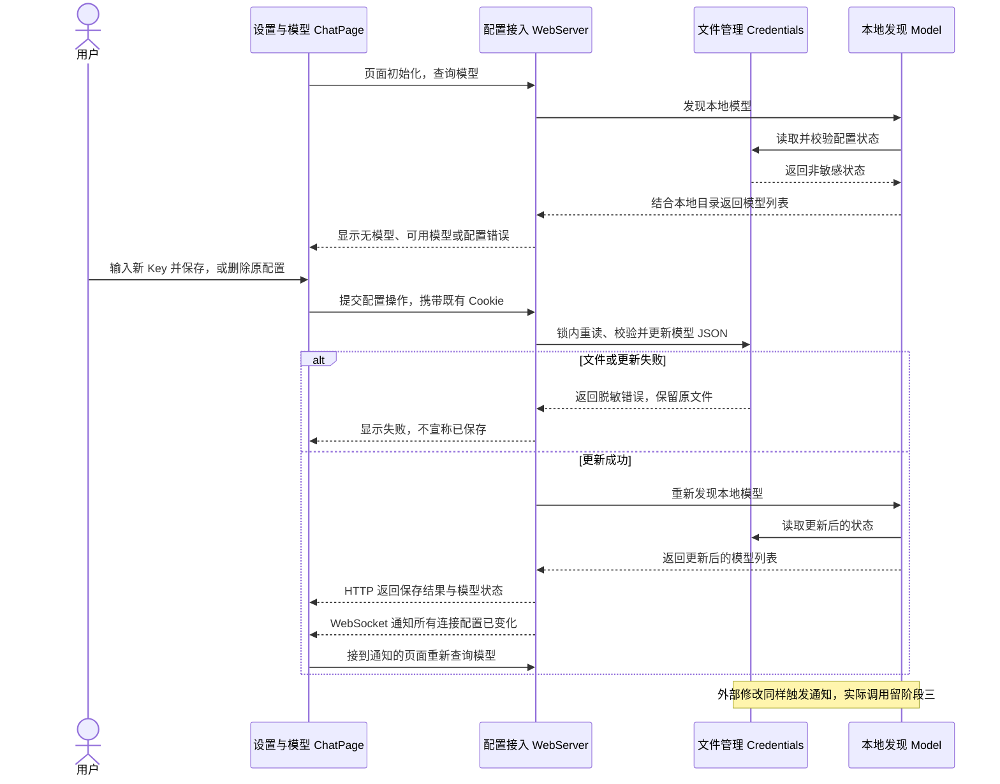

# 阶段二：凭据配置与本地模型发现

状态：阶段草案，整理已确认方案，后续逐模块核对，尚未实施。依赖[阶段一](./feature2-阶段一-打开授权与订阅.md)；共享架构、字段及安全规则以[总体设计](./feature2-单会话流式聊天技术设计.md)为准。

## 1. 总结

**需求理解：** 用户在已授权的本地网页，从侧栏底部进入“设置 → 模型 → 添加提供方 → DeepSeek”，输入并保存 API Key，页面更新可用模型；能够替换、删除 Key 并得到明确的保存或配置错误。本地 JSON 的保护、校验与更新统一归 Credentials。保存成功只表示本地配置可用，不验证 DeepSeek 账号权限或远端 Key 有效性；本阶段尚不开放聊天发送。

**技术方案：** 在阶段一同一服务中增加配置 HTTP 接口，扩展同一 Credentials 管理 `~/.agent-learning/auth.json`，由 Model 的 `discoverModels()` 将本地支持目录与凭据状态组合为模型列表。配置写入或外部修改后刷新列表，通过既有 WebSocket 发送模型变更通知。Agent 的状态与订阅机制沿用阶段一，不建立新运行层。

目录沿用总体设计：前端仍在根 `web/`，本阶段扩展 `packages/server`、`packages/credentials` 与阶段一已提供类型的 `packages/model`，`packages/agent` 沿用。契约从各包公开入口引用，文件测试在各自 `test/`，依赖统一写入根锁文件。

## 2. 系统变化说明

**Before（阶段一交接基线）：** 页面可以授权进入并订阅 Agent 初始状态，只有网页签名文件，没有模型 Key 配置入口或本地模型列表。

**After：** 页面能增改删 DeepSeek Key，及时看到本地可用模型及错误状态；签名文件与模型文件分别保护，模型文件损坏仍可进入设置。聊天提交与真实调用由阶段三接入。

## 3. 系统设计

### 3.1 模块变化

本节“修改”指阶段一完成后的预计基线，不表示当前已存在这些后端能力；当前仓库仍只有基础页面实现。

#### ① 配置接入：WebServer（修改）

`ServerFrame` 引用的对话快照与更新沿用[阶段一 §3.1 Agent 的完整结构](./feature2-阶段一-打开授权与订阅.md)，本阶段只启用配置变化通知。

**接口：新增 3 项，修改 1 项。**

- 【新增】[GET /api/models](#key-get-models)（HTTP 接口）：让页面知道当前有哪些模型可用；网页客户端请求 WebServer，后端调用本地发现并返回 `ModelDiscovery`（可用模型与凭据状态），ChatPage 据此更新模型选项和配置提示。
- 【新增】[PUT /api/providers/deepseek](#key-provider-http)（HTTP 接口）：保存或替换用户填写的 DeepSeek Key；网页客户端提交 `apiKey`（本次新输入），WebServer 交给 Credentials 更新 `AuthFile`（本地 Key 配置）后返回 `ModelDiscovery`（更新后的模型与配置状态），页面显示结果并刷新选项。
- 【新增】[DELETE /api/providers/deepseek](#key-provider-http)（HTTP 接口）：移除已保存的 DeepSeek Key；网页客户端请求 WebServer，后端交给 Credentials 更新 `AuthFile`（本地 Key 配置）并返回 `ModelDiscovery`（当前模型与凭据状态），页面更新可用模型，后续调用不回退旧 Key。
- 【修改】[WebSocket /api/events](#key-models-notify)（实时通道）：让所有已连接页面及时看到配置变化；WebServer 在既有通道发送 `ServerFrame` 的 models_changed（模型变化通知），网页客户端重新查询 `ModelDiscovery`（模型与凭据状态），ChatPage 更新选择和提示，对话序号保持不变。

**数据：沿用 1 项。**

- 【沿用】`ServerFrame`：**后端通过 WebSocket 发给前端的一条消息**，可以是完整对话快照、一次对话更新或模型配置变化通知。WebServer 封装后发送，网页客户端据此恢复对话、更新展示或重新查询模型。

```typescript
type ServerFrame =
  | { type: 'snapshot'; subscriptionId: string; snapshot: ConversationSnapshot } // WebServer 为 Agent 快照补上网络订阅编号
  | { type: 'update'; subscriptionId: string; update: ConversationUpdate } // WebServer 为 Agent 更新补上网络订阅编号
  | { type: 'models_changed' }; // WebServer 在凭据变化后通知页面重新查询，不占用对话序号
```

#### ② 模型凭据：Credentials（修改）

**接口：新增 5 项。**

- 【新增】[readStatus()](#key-credentials)（进程内调用）：判断本机是否具备模型调用凭据；Model 请求 Credentials 检查 `AuthFile`（本地 Key 配置），取得 `CredentialStatus`（未配置、已配置或错误），再据此筛选模型供页面选择。
- 【新增】[readApiKey()](#key-credentials)（进程内调用）：让每次模型调用使用当前保存的 Key；Model 请求 Credentials 重读并校验 `AuthFile`（本地 Key 配置），成功取得 Key 字符串后放入认证头，失败则产生本次调用的 error 事件。
- 【新增】[saveApiKey(key)](#key-credentials)（进程内调用）：安全保存或替换模型 Key；WebServer 交入网页新 Key，Credentials 校验并在锁内更新 `AuthFile`（本地 Key 配置），完成后 WebServer 重新取得 `ModelDiscovery`（模型与配置状态）并通知页面。
- 【新增】[deleteApiKey()](#key-credentials)（进程内调用）：使后续调用不再取得已删除的 Key；WebServer 请求 Credentials 在锁内更新 `AuthFile`（本地 Key 配置），成功后重新发现模型、返回 `ModelDiscovery`（模型与配置状态）并通知页面。
- 【新增】[watch(onChange)](#key-credentials)（文件监听）：让本地文件外部变化及时反映到页面；WebServer 向 Credentials 登记 `onChange`（配置变更回调），文件变化后重新取得 `ModelDiscovery`（模型与配置状态）并发送 `ServerFrame` 的 models_changed 通知，返回的清理函数用于停止监听。

**数据：新增 2 项。**

- 【新增】`AuthFile`：**本地凭据文件中保存的服务商 API Key 配置**。Credentials 统一读取、校验和更新这些内容，再向 Model 提供当前 Key 或配置状态。

```typescript
type AuthFile = {
  deepseek?: { // 网页选择的提供方；本期只接入 DeepSeek，缺条目表示未配置
    type: 'api_key'; // Credentials 校验的凭据类型，沿用 Pi 的 JSON 形式
    key: string; // 用户在设置中输入、Credentials 保存的 Key，仅供后端读取
  };
};
```

- 【新增】`CredentialStatus`：**本地模型凭据的配置情况**，分为未配置、本地检查通过和配置错误。Credentials 检查后提供状态，Model 据此筛选可用模型，ChatPage 据此显示配置提示。

```typescript
type CredentialStatus =
  | { state: 'missing' } // Credentials 读取后确认无文件或无 DeepSeek 凭据
  | { state: 'configured' } // Credentials 本地格式与权限检查通过，未验证远端有效性
  | { state: 'error'; message: string }; // Credentials 提供脱敏的读取、权限或格式错误
```

#### ③ 本地发现：Model（修改）

**接口：新增 1 项。**

- 【新增】`discoverModels()`（进程内查询）：列出本机当前可用的模型而不请求服务商；WebServer 调用 Model，Model 结合 `ModelInfo`（内置模型信息）和 `CredentialStatus`（本地凭据状态）返回 `ModelDiscovery`（可用模型与状态），WebServer 交给页面更新选择。

**数据：新增 2 项。**

- 【新增】`ModelInfo`：**一个受支持模型的基本信息**，包括标识、名称、提供方和接口类型。Model 提供这些信息，ChatPage 用来展示模型选项，Agent 将选中的模型交给 Model 发起调用。

```typescript
type ModelInfo = {
  id: string; // Model 内置支持目录中的模型标识，本期默认 deepseek-flash
  name: string; // Model 内置的展示名称，ChatPage 用于模型选择
  provider: string; // Model 内置的提供方标识，用于选择适配与凭据
  api: string; // Model 内置的协议标识，用于选择请求转换方式
};
```

- 【新增】`ModelDiscovery`：**本地模型发现的结果**，说明有哪些模型可用，以及凭据是否配置正常。Model 将内置模型目录与 Credentials 的检查结果组合起来，WebServer 返回给 ChatPage 更新选项和提示。

```typescript
type ModelDiscovery = {
  models: ModelInfo[]; // Model 根据内置目录与本地凭据状态筛出的可用模型
  deepseek: CredentialStatus; // Credentials 提供的非敏感本地状态，页面据此显示配置或错误
};
```

#### ⑤ 设置与模型列表：ChatPage（修改）

**接口：新增 4 项，修改 1 项。**

- 【新增】`SettingsDialog`（弹窗组件）：让用户从设置中管理 DeepSeek Key；ChatPage 打开弹窗，SettingsDialog 使用 `ProviderFormState`（新 Key、操作状态与错误）接收编辑或删除操作，取得 `ModelDiscovery`（更新后的模型与配置状态）后显示结果、刷新选项并清理成功保存或关闭后的新输入。
- 【新增】`getModels()`（前端请求函数）：为页面取得可选择的模型；ChatPage 调用网页客户端请求 WebServer，取得 `ModelDiscovery`（可用模型与凭据状态）后更新模型选项和配置提示。
- 【新增】`saveApiKey()`（前端请求函数）：把设置中填写的新 Key 保存到本地后端；SettingsDialog 交给网页客户端新 Key，客户端请求 WebServer 并返回 `ModelDiscovery`（更新后的模型与配置状态），页面据此显示结果、刷新列表并清理成功保存的新输入。
- 【新增】`deleteApiKey()`（前端请求函数）：从设置中移除已保存的 Key；SettingsDialog 请求网页客户端调用后端删除接口，取得 `ModelDiscovery`（当前模型与凭据状态）后更新列表，失败则保留原配置并显示原因。
- 【修改】网页客户端 `subscribe()`（前端订阅）：让设置变化同步到当前页面；网页客户端从 `ServerFrame` 读取 models_changed（模型变化通知）后重新查询 `ModelDiscovery`（可用模型与凭据状态），ChatPage 更新选项和错误，既有对话订阅继续使用。

**数据：新增 1 项。**

- 【新增】`ProviderFormState`：**模型设置表单中的新 Key、操作状态和错误信息**。SettingsDialog 根据用户输入和配置请求更新它，显示保存或删除进度，并在保存成功或关闭时清理新 Key。

```typescript
type ProviderFormState = {
  apiKey: string; // 用户本次在 SettingsDialog 输入的新 Key，保存成功或关闭后清空
  status: 'idle' | 'saving' | 'deleting'; // SettingsDialog 按当前配置操作维护的表单状态
  errorMessage?: string; // 网页客户端返回的脱敏输入、网络或文件更新错误
};
```

### 3.2 数据交互流程



### 3.3 关键接口

本节只展开跨端 HTTP API，以及决定授权、凭据安全、生成或状态恢复的重要接口；数据结构见 §3.1。

<a id="key-credentials"></a>

#### 案例一：Credentials：模型凭据读写与变更监听

**接口类型：** Credentials 的内部异步文件接口，以及文件变更监听。

**接口定义：**

```typescript
function readStatus(): Promise<CredentialStatus>;
function readApiKey(): Promise<string>;
function saveApiKey(key: string): Promise<void>;
function deleteApiKey(): Promise<void>;
function watch(onChange: () => void): () => void;
```

`AuthFile` 使用 Pi 的提供方映射 JSON，文件为 `~/.agent-learning/auth.json`，示意如下；真实 Key 只写入本地文件，不作为网页读取响应。

```json
{
  "deepseek": { "type": "api_key", "key": "用户保存的真实密钥" }
}
```

**提供与调用关系：** WebServer 处理设置时调用保存/删除；Model 发现模型时调用 `readStatus()`，阶段三真实调用时才用 `readApiKey()`。WebServer 监听文件变化并安排重新发现。

- **调用方：** WebServer、Model
- **函数提供方：** Credentials
- **变更消费方：** WebServer 的配置刷新逻辑

**触发条件：** 初始化发现、网页保存/删除、文件外部修改；每次模型调用读取当前 Key 留阶段三使用。

**输入数据：** 保存接收用户新输入的 Key；读取、删除无业务参数；监听接收变更回调。不接受浏览器提供文件路径，也不读取环境变量或增加配置命令。

**接收方处理：**

1. 统一检查文件读取、权限、JSON、提供方凭据类型，Key 须非空且可作认证头，不猜测前缀或固定长度。
2. 保存/删除持跨进程锁，锁内重新读取并校验，再更新目标条目；使用同目录随机临时文件独占创建与原子替换。
3. 目录创建 `0700`，文件创建与替换 `0600`；坏文件不能当空文件覆盖，模型文件与网页签名文件分别保护。
4. 保存、删除成功或外部变化后刷新配置，删除后不继续使用旧缓存。

**返回结果与调用方后续：** `readStatus()` 给出 missing/configured/error，`readApiKey()` 仅向后端返回当前 Key；保存/删除的 Promise 完成后，WebServer 重新发现模型并返回新状态、通知页面。`watch()` 返回停止监听函数，关闭服务时调用。仅 `auth.json` 提供模型 Key，删除后不存在其他回退来源。

**异常处理：** 无文件或无提供方条目是未配置；已有文件损坏、权限过宽或读取失败是错误，保留原文件且不回退旧缓存。写入失败不报保存成功，错误不包含 Key、JSON 原文或请求头。本地检查不验证远端 Key；明文文件权限不能阻止同账号程序或管理员读取。已组装请求使用当次 Key、变更影响下次调用的规则在阶段三兑现。

<a id="key-get-models"></a>

#### 案例二：GET /api/models：查询可用模型

**接口类型：** HTTP 查询接口。

**接口定义：** 请求与响应分别使用下列路由及 §3.1 的 `ModelDiscovery`。

```http
GET /api/models
```

**提供与调用关系：** ChatPage 调用网页客户端，客户端请求 WebServer；WebServer 调用 Model 的 `discoverModels()` 本地查询，不向页面暴露凭据读取接口。

- **函数调用方：** ChatPage 的初始化/状态刷新逻辑
- **客户端函数提供方：** 网页客户端
- **HTTP 请求方 / 接收方：** 网页客户端 / WebServer

**触发条件：** 页面初始化，或收到配置变化通知后重新查询。

**输入数据：** 无请求正文；携带阶段一取得的授权 Cookie、合法目标及来源。

**接收方处理：** WebServer 验证本地访问授权，调用 `discoverModels()` 并将其结果作为 HTTP 响应体；不返回保存的 Key 或认证头。

**返回结果与请求方后续：** 客户端将 `ModelDiscovery` 交回 ChatPage。页面更新模型选择与提供方状态；没有可用模型时显示“无可用模型”，允许编辑草稿，发送保持禁用。本阶段有模型也保持禁用，等待阶段三接通提交。

**异常处理：** 授权无效返回 `401`，目标/来源不可信返回 `403`；网络失败展示查询失败，不宣称已取得最新配置。可读到的本地配置错误由响应的 error 状态展示，与网络错误区分。

<a id="key-provider-http"></a>

#### 案例三：PUT / DELETE /api/providers/deepseek：保存与删除 Key

**接口类型：** HTTP 配置接口。

**接口定义：** 保存接收新 Key，保存与删除成功后均返回 §3.1 的 `ModelDiscovery`。

```http
PUT /api/providers/deepseek
DELETE /api/providers/deepseek
```

**提供与调用关系：** 用户操作 SettingsDialog，页面调用网页客户端；WebServer 接收 HTTP，调用 Credentials 更新，再调用 Model 发现。

- **界面触发方：** SettingsDialog / ChatPage
- **HTTP 请求方 / 接收方：** 网页客户端 / WebServer
- **文件操作提供方：** Credentials
- **模型列表提供方：** Model

**触发条件：** 从侧栏底部“设置 → 模型 → 添加提供方 → DeepSeek”输入 Key 后保存，或编辑、删除已有配置。

**输入数据示例：** PUT 正文只包含新输入；DELETE 不携带 Key 正文。

```typescript
const body: { apiKey: string } = {
  apiKey: '仅用于说明的新输入密钥',
};
```

**接收方处理：**

1. WebServer 校验访问授权和输入结构，再调用 Credentials 的保存/删除接口。
2. Credentials 依案例一完成锁内校验与写入，失败则保留原文件。
3. 成功后重新调用 `discoverModels()`，返回更新后的列表与状态，并触发案例四通知所有已连接页面。

**返回结果与请求方后续：** 成功响应体为 `ModelDiscovery`，客户端用结果刷新界面。保存表示本地落盘，不声称已通过 DeepSeek 验证。界面只展示是否已配置，不回填保存的完整 Key；保存成功或关闭弹窗时清理新输入，既不存 localStorage，也不进入聊天历史。

**异常处理：** 授权错误按阶段一拒绝；输入或文件更新失败报告脱敏原因，表单显示失败，不报保存成功。坏文件不自动覆盖，模型配置错误仍允许打开设置处理。弹窗沿用 shadcn/ui Dialog 的标题、键盘、焦点与关闭后返回规则；失败不会自动发起模型请求。

<a id="key-models-notify"></a>

#### 案例四：WebSocket models_changed：配置变化通知

**接口类型：** Credentials 内部变更通知，加既有 WebSocket 上的单向配置通知。

**接口定义：**

```json
{ "type": "models_changed" }
```

**提供与收发关系：** WebServer 接到成功更新或 Credentials 文件变化后重新发现模型，向全部既有 WS 连接发送通知；网页收到后调用 `getModels()`。

- **文件变化发布方：** Credentials
- **网络通知发送方：** WebServer
- **网络通知接收方：** 各页面的网页客户端
- **模型列表更新方：** ChatPage

**触发条件：** 网页保存/删除成功，或模型凭据文件外部变化；失败写入不作为成功配置更新。

**输入数据：** 通知不包含 Key、模型列表、对话序号或订阅编号，只表达需要重新查询。

**接收方处理：** 服务清除旧配置状态、重新发现；网页调用案例二取得当前结果，再更新列表及错误提示。外部文件变坏同样得到 error，不继续使用旧可用状态。

**持续输出与页面后续：** 同一页面可多次收到通知，每次按当前文件状态刷新；该消息不是对话 update，不递增 Agent 序号，不结束当前订阅。服务关闭时释放文件监听与连接。

**异常与恢复：** 通知发送失败按所属连接处理，不回滚已成功写入的文件，也不影响其他连接；断线页面恢复后重新查询最新模型。模型调用、已取 Key 的生命周期与真实鉴权失败处理由阶段三验证，本阶段只证明本地配置闭环。

## 4. 技术决策

- 【功能决策｜设置、Model】只支持 DeepSeek，默认 `deepseek-flash`；保存后更新本地模型列表，远端有效性留实际调用验证。
- 【工程决策｜Credentials】Pi 的提供方 JSON 形式、dsh 的文件保护与变更刷新直接沿用；只从本项目 `auth.json` 读取 Key。
- 【功能决策｜Credentials、页面】坏文件保留并报配置错误，写入失败不显示成功，不强制覆盖、不回退旧缓存；模型文件错误不妨碍网页授权与设置访问。

参考做法与差异沿用总体设计中的 Credentials、Model、设置模块，不重新提出技术选型问题。

## 5. 风险与边界

### 本地已配置仍可能远端认证失败

- **案例：** 任意非空但无效 Key 能通过本地结构检查，页面显示本地已有配置。
- **解决方案：** 明确只表示本地可用，不显示远端验证成功；阶段三按 DeepSeek 实际响应展示认证失败。

### 坏文件与并发修改可能破坏配置

- **案例：** 两个页面同时保存，或外部将 JSON 改坏后页面继续覆盖。
- **解决方案：** 锁内重读与校验，按当前内容更新；错误文件保留、明确报错。Key 明文仍受同账号程序和管理员可读的限制。

## 6. 验收标准

均为待实施案例，复用根 `npm run test:packages` 或各包 `npm --prefix packages/<模块> test`，网页沿用原测试命令；使用临时目录与假 Key，不进行实际模型请求。

### 1. 配置文件与本地发现

- **存放位置：** `packages/credentials/test/credentials.test.ts`、`packages/model/test/model-discovery.test.ts`。
- **类型：** 单元与文件系统集成测试。
- **验证内容：** 增改删、坏文件、权限、并发写入及写入失败均满足既定保护，删除不留缓存 Key；对应模型列表变化正确，网络监测确认没有服务商请求，错误和状态不泄露 Key。

### 2. 设置与通知

- **存放位置：** `packages/server/test/webserver.test.ts`、`web/src/components/SettingsDialog.test.tsx`、`web/src/pages/ChatPage.test.tsx`。
- **类型：** 接入集成与组件测试。
- **验证内容：** 未授权操作拒绝，已授权页面能保存、替换和删除；页面不回填 Key，关闭后清理输入，失败不显示成功。配置通知使其他页面重新发现模型，Agent 对话序号不受影响，发送仍不可用。

### 3. 实际网页配置闭环

- **存放位置：** `web/tests/e2e/chat.spec.ts`，“阶段二配置、重启与多页面”；证据写入 `feature2-验收记录.md` 的阶段二部分。
- **类型：** E2E。
- **验证内容：** 从阶段一实际授权入口进入设置，保存假 Key 后出现可用模型，重启仍可读取，删除后显示无可用模型；另一个页面跟随状态更新，配置错误仍能打开设置。该项依赖真实入口、Cookie、文件与页面，低层测试不足以证明完整装配。

## 7. 文件变更

### ① 配置接入：WebServer（修改）

| 文件 | 类型 | 用途 | 变更 |
| --- | --- | --- | --- |
| `packages/server/src/webserver/index.ts` | 修改 | 配置服务接入 | 页面与订阅入口 → 增加模型查询、Key 增改删及变更通知 |
| `packages/server/package.json`、`packages/server/README.md` | 修改 | 服务依赖与接口说明 | 入口与授权依赖 → 声明本地发现所需直接依赖，说明配置 HTTP 接口与通知 |
| `packages/server/test/webserver.test.ts` | 修改 | 配置接入验收 | 授权和订阅验收 → 增加配置授权、响应脱敏与多页面通知 |

### ② 模型凭据：Credentials（修改）

| 文件 | 类型 | 用途 | 变更 |
| --- | --- | --- | --- |
| `packages/credentials/src/credentials.ts` | 修改 | 模型凭据管理 | 仅签名密钥加载 → 补齐模型 Key 读取、增改删、状态与变更监听 |
| `packages/credentials/src/credential-file.ts` | 修改 | 文件保护 | 服务签名文件 → 将同一保护机制用于模型文件，保留错误文件与写入失败前内容 |
| `packages/credentials/src/index.ts`、`packages/credentials/src/types.ts` | 修改 | 凭据公开契约 | 仅签名文件能力 → 导出模型 Key 操作、配置状态与类型 |
| `packages/credentials/package.json`、`packages/credentials/README.md` | 修改 | 变更监听依赖与阅读入口 | 签名文件初始化 → 加入已选的文件监听能力并说明模型凭据 API |
| `packages/credentials/test/credentials.test.ts` | 修改 | 模型文件验收 | 签名文件初始化 → 增加模型文件读写、删除、并发、错误和脱敏 |

### ③ 本地发现：Model（修改）

| 文件 | 类型 | 用途 | 变更 |
| --- | --- | --- | --- |
| `packages/model/src/index.ts` | 修改 | 本地发现入口 | 只导出消息类型 → 增加本地模型发现，调用入口仍留阶段三 |
| `packages/model/src/deepseek.ts` | 新增 | DeepSeek 本地适配 | 用本地支持目录与凭据状态产生可用模型 |
| `packages/model/src/types.ts` | 修改 | 发现契约 | 快照依赖的消息类型 → 增加总体设计的模型信息与发现结果类型 |
| `packages/model/package.json`、`packages/model/README.md` | 修改 | 发现依赖与阅读入口 | 类型包说明 → 声明 Credentials 依赖，说明本地发现 API 与不发远端请求的边界 |
| `packages/model/test/model-discovery.test.ts` | 新增 | 发现验收 | 验证模型与凭据状态的对应关系及零远端请求 |

### ⑤ 设置与模型列表：ChatPage（修改）

| 文件 | 类型 | 用途 | 变更 |
| --- | --- | --- | --- |
| `web/src/pages/ChatPage.tsx`、`web/src/styles.css` | 修改 | 配置入口与模型状态 | 只显示连接与空对话 → 增加侧栏、设置入口、模型选择及配置错误 |
| `web/src/chat/client.ts` | 修改 | 配置网络接入 | 仅订阅状态 → 增加配置请求与变更后重新查询 |
| `web/src/components/SettingsDialog.tsx`、`web/src/components/ui/dialog.tsx` | 新增 | 模型设置弹窗 | 按现有 shadcn/ui 约定提供保存、替换、删除、键盘与焦点管理 |
| `web/src/components/SettingsDialog.test.tsx` | 新增 | 设置交互验收 | 验证本地配置、错误、Key 清理与弹窗交互 |
| `web/src/pages/ChatPage.test.tsx` | 修改 | 模型状态验收 | 连接与禁用发送 → 增加无模型、已配置、配置错误及阶段内仍禁止聊天 |

### 其他

| 文件 | 类型 | 用途 | 变更 |
| --- | --- | --- | --- |
| `package-lock.json` | 修改 | 全仓依赖锁 | 阶段一工作区依赖 → 锁定配置、文件监听和设置控件所需依赖，不另建包内锁文件 |
| `web/package.json` | 修改 | 设置控件依赖 | 基础页面依赖 → 按需加入已选 Dialog 所需依赖，由根锁文件统一管理 |
| `web/tests/e2e/chat.spec.ts` | 修改 | 配置链路验收 | 授权与空快照 → 增加网页配置、重启读取及多页面状态刷新 |
| `planning/里程碑1/feature2/feature2-验收记录.md` | 修改 | 分阶段验证证据 | 阶段一记录 → 增补阶段二脱敏配置结果与未覆盖项，实施后产生 |
