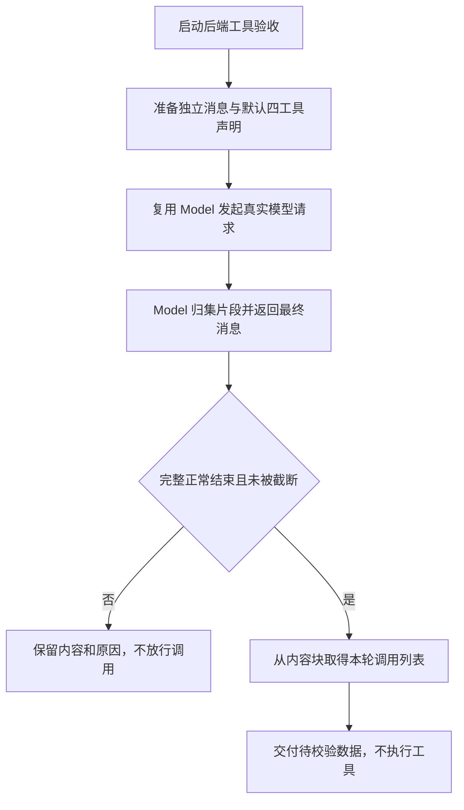
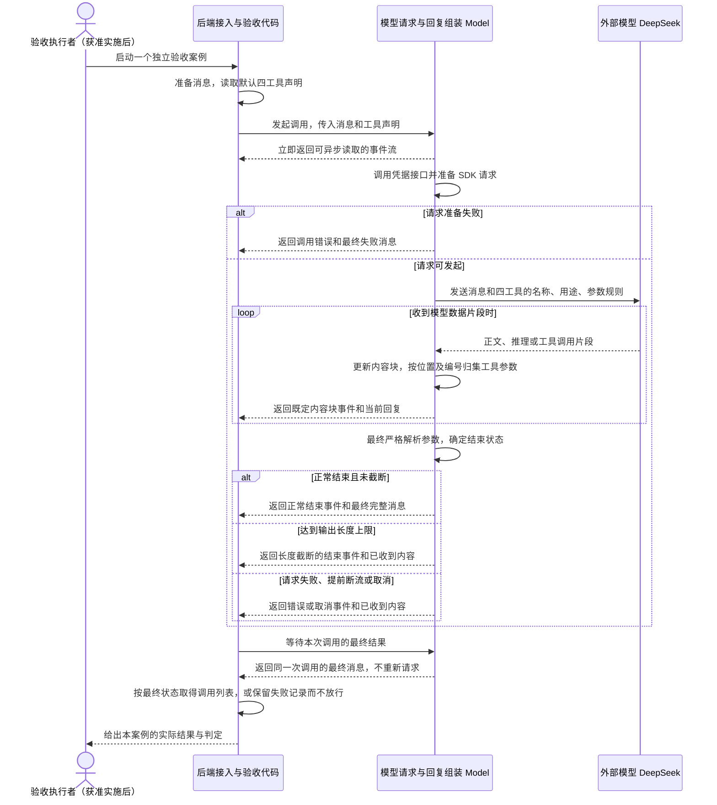

# Feature3：工具定义与调用接收

状态：**待整体批准**。需求、关键决策及两个模块均已确认；尚未实施、安装依赖或执行测试。

对应[里程碑1第三步](./README.md#第三步建立工具定义与调用接收)。本文整理已批准的方案、模块、接口、风险与验收，供整体核对；设计通过不代表实现或验收已经完成。

## 设计进度

- 当前阶段：完整文档核对与整体批准。
- 已批准需求：参考 Pi 引入统一的工具定义和模型接入，后端收齐工具调用信息；本期仅包含 `read`、`bash`、`edit`、`write` 四种工具，其他工具暂不纳入。本步不执行工具、不要求网页展示。
- 已确认技术决策：四种工具及默认提供范围、沿用 Pi 参数约定、接收与执行前校验分开、工具调用数据结构、整轮结束后的交付规则、严格 JSON 参数解析、沿用 Pi 的调用归集与编号处理、TypeBox 统一声明参数、后端 Model 函数接入与验收；模型消息与事件流直接沿用模块二已确认的契约，见第 4 节。
- 已批准模块：工具定义模块；Model 工具接入与验收，包含本地集成测试和四个独立真实模型案例。
- 待确认内容：整份设计文档。代码、依赖兼容和所有测试仍待获准实施后验证；执行、目录与权限校验留到后续阶段，原里程碑范围不因此放宽。

## 1. 总结

**需求理解：**

本步参考 Pi，为 `read`、`bash`、`edit`、`write` 四种工具建立统一的定义和模型接入方式；为简化当前范围，`grep`、`find`、`ls`、`powershell` 暂不定义。每个工具都能够描述自己的名称、用途和参数要求；在本阶段后端工具接入入口，由调用方默认将这四种工具的说明放入 `ModelContext.tools`，模型能够请求调用其中的工具。后端负责收齐并整理模型返回的完整工具名称和参数，供后续模块消费。通过直接调用 Model 函数接口、使用独立上下文发起真实模型请求验收，不要求网页参与。本步不执行工具，普通网页聊天暂不接入工具流程，实际执行与网页串联留到后续执行阶段。

**技术方案：**

新增工具声明文件，用 TypeBox 各维护一份参数规则，推导本地类型并导出 `defaultTools`。后端调用方通过模块二既定的 `ModelContext.tools` 提供声明，复用其消息、事件流和 `result()`，只补齐参数类型并将公共 Model 的最终参数解析改为严格 JSON。声明用单元测试验证，接入用本地集成测试及单独运行的真实 DeepSeek 案例验证。

**当前事实与前置依赖：** 当前 checkout 只有 `web/` 基础聊天页，本项目 Model、凭据等后端能力仍待第二步实施。本文“复用”指复用已批准设计，不声称代码已经存在。实施需先落地模块二，再整合本步参数类型及严格解析变更。

## 2. 系统变化说明

**Before：** 当前代码仅能输入、发送和显示用户消息。为说明本步增量，下图采用第二步已确认、尚待实施的后端设计基线：普通聊天不携带本期工具声明，工具消息与事件接口已经约定，但尚无四种具体声明和接入验收。


**After：** 在模块二 Model 可用的前提下，增加后端工具接入与验收入口，普通网页聊天维持第二步范围。



调用列表可以为空，也可以包含带 `argumentsError` 的调用；它不是已验证可执行的列表。

## 3. 系统设计

### 3.1 模块变化

**工具定义模块——拟新增 `server/src/tools.ts`。** 集中创建四份工具声明和各自的 TypeBox 参数规则，导出 `defaultTools` 与四种参数类型。每份声明只有名称、用途和参数规则；使用模块二的通用 `Tool` 格式，不另建相似类型。声明由该模块持有，后端调用方读取后放入 `ModelContext.tools`；Model 继续负责 SDK 转换、流式接收与最终结果。请求失败或停止沿用既定 Model 流程，不改变声明数据。

对外接口增量如下；内部参数常量和四份声明对象不另计为接口：

- 新增导出值 1 个：`defaultTools`，提供四种默认工具声明。
- 新增导出类型 4 个：`ReadParams` 表达读取参数；`BashParams` 表达命令与超时参数；`EditParams` 表达同文件替换数组；`WriteParams` 表达目标路径与文本。均从 TypeBox 规则推导。
- 新增函数、方法、事件各 0 个：调用方直接读取导出值，不增加注册或执行入口。

该文件不包含执行函数、不保存会话或凭据。Pi 的具体工具文件还包含执行等代码；本步只有四份声明，先集中在一个文件，不复制图片处理、输出截断或临时文件管理等执行能力。后端依赖声明中引入已批准的 TypeBox；不改前端依赖。

**拟新增 `server/tests/tools.test.ts`：** 使用 Node 内置测试验证工具参数声明，具体用例见 §6。真实模型请求在后续 Model 接入验收中检查，不在这组声明单元测试中执行。

`server/` 是本阶段暂定后端目录名，最终与模块二的后端组织对齐；上述文件和测试目前均不存在，尚未实施。

**Model 模块——工具接入与验收已批准。**

在模块二拟提供的 Model 中补齐 `Tool.parameters` 的 TypeBox `TSchema` 类型，并按 §4.6 修改公共最终参数解析处理；具体 Model 文件名沿其最终组织。不另建接收器、工具接入服务或 Agent 循环，不更改 `stream` 公共调用方式。

对外接口增量：补齐既定类型 1 个，即 `Tool` 的参数规则类型；新增函数、方法、事件各 0 个。沿用函数 `stream` 发起一次模型调用，沿用方法 `result()` 取得同次最终消息；`ModelContext` 继续提供消息与声明，`ModelEventStream` 继续输出事件，`AssistantMessage` 与 `ToolCall` 继续表达回复和工具请求。调用签名不变，最终参数解析行为按 §4.6 调整。

拟新增 `server/tests/model-tools.test.ts`，使用真实声明与 Model，仅替换凭据接口和 SDK 网络边界；拟新增 `server/tests/model-tools.live.ts`，显式运行真实模型请求。两份代码都从调用方传入 `defaultTools`，持续消费事件后读取 `result()`，用最终状态决定交付，不通过删除工具块实现“不放行”。

验收代码只调用上述接口，不新增生产对外接口或独立业务模块。

真实案例使用模块二正常凭据接口，每次准备独立消息并提供全部四种工具；本步只验收调用信息，不执行、不生成结果、不写普通聊天历史。TypeBox 版本与后端工具链一起锁定并通过类型检查，不据 Pi 自身开发环境推断本项目必须升级 TypeScript；不改前端依赖。

### 3.2 数据交互流程



声明在工具模块创建并由调用方读取；历史消息由每个案例独立准备。Model 只组装本次回复，不持有或累积会话历史；参数片段缓存在本次调用内，最终形成 `ToolCall.arguments` 或 `argumentsError`。本期这些数据不写入普通聊天历史。

`partial` 是共享且持续变化的对象，不是逐事件历史快照；验收以最终消息判定完整内容，需要保存某一时刻状态时自行复制。单条 `toolcall_end` 可以先于整流最终失败，不能据此提前放行。

### 3.3 已确认的工具参数约定

模型按各工具声明的参数要求填写调用；后端接收模型返回的调用信息。使用 TypeBox 统一声明参数规则，从同一份规则生成给模型的参数说明并推导本地 TypeScript 类型；不再手工维护两份定义。以下为已批准工具模块的声明示意，尚未实现到项目代码。参数含义沿用 Pi，不借说明文字增加额外的数值或格式校验。接收与执行前校验的分工见 §4.3，参数解析规则见 §4.6。

**通用工具声明——模块二的格式在本阶段补齐参数类型。**

```ts
import type { TSchema } from 'typebox';

type Tool<TParameters extends TSchema = TSchema> = {
  name: string;
  description: string;
  parameters: TParameters;
};
```

```ts
import { Type, type Static } from 'typebox';

const readParameters = Type.Object({
  path: Type.String({ description: '要读取的文本文件路径' }),
  offset: Type.Optional(Type.Number({ description: '起始行号，从 1 开始' })),
  limit: Type.Optional(Type.Number({ description: '最多读取的行数' })),
});

const bashParameters = Type.Object({
  command: Type.String({ description: '要运行的 Bash 命令' }),
  timeout: Type.Optional(Type.Number({ description: '超时时间，单位为秒' })),
});

const editParameters = Type.Object({
  path: Type.String({ description: '要修改的文本文件路径' }),
  edits: Type.Array(Type.Object({
    oldText: Type.String({ description: '用于精确定位替换位置的原文' }),
    newText: Type.String({ description: '替换后的文本' }),
  }), { description: '对同一文件提出的一处或多处替换' }),
});

const writeParameters = Type.Object({
  path: Type.String({ description: '要创建或覆盖的文本文件路径' }),
  content: Type.String({ description: '要写入的文本内容，允许为空字符串' }),
});

export type ReadParams = Static<typeof readParameters>;
export type BashParams = Static<typeof bashParameters>;
export type EditParams = Static<typeof editParameters>;
export type WriteParams = Static<typeof writeParameters>;
```

对应 Pi 源码：[read](../../pi/packages/coding-agent/src/core/tools/read.ts#L14)、[bash](../../pi/packages/coding-agent/src/core/tools/bash.ts#L40)、[edit](../../pi/packages/coding-agent/src/core/tools/edit.ts#L32)、[write](../../pi/packages/coding-agent/src/core/tools/write.ts#L11)。

**工具声明与默认导出：**

以下对象与参数规则放在同一个拟新增文件 `server/src/tools.ts`。`Tool` 直接使用 Model 的通用声明格式，由模块二的后端类型组织提供。

```ts
const readTool: Tool = {
  name: 'read',
  description: '读取文本文件，可指定起始行和最多读取行数。',
  parameters: readParameters,
};

const bashTool: Tool = {
  name: 'bash',
  description: '请求在工作目录运行 Bash 命令，可指定超时秒数。',
  parameters: bashParameters,
};

const editTool: Tool = {
  name: 'edit',
  description: '对同一文本文件提出一处或多处精确文本替换。',
  parameters: editParameters,
};

const writeTool: Tool = {
  name: 'write',
  description: '请求创建或覆盖文本文件。',
  parameters: writeParameters,
};

export const defaultTools: Tool[] = [
  readTool,
  bashTool,
  editTool,
  writeTool,
];
```

这组说明描述模型可以提出的请求，不代表本阶段已有相应文件读写或命令执行。TypeBox 推导的本地参数类型也不等于模型返回参数已经通过校验；接收结果仍使用下述未校验的 `ToolCall`。

**Model 输入与调用——复用模块二的通用接口。**

```ts
type ModelContext = {
  systemPrompt?: string;
  messages: ModelMessage[];
  tools?: Tool[];
};

interface ModelEventStream extends AsyncIterable<ModelEvent> {
  result(): Promise<AssistantMessage>;
}

declare function stream(
  model: Model,
  context: ModelContext,
  options?: { signal?: AbortSignal },
): ModelEventStream;
```

`Model`、`ModelMessage`、`ModelEvent` 和完整 `AssistantMessage` 沿用模块二；这里只重述本步会用到的契约。本阶段后端调用如下，Model 不自行加载具体工具：

```ts
const response = stream(model, {
  messages,
  tools: defaultTools,
});
```

调用方持续消费事件后，通过 `response.result()` 取得同一次调用的最终消息，不追加模型请求。只有最终为 `stop` 或 `toolUse` 且未截断时，才从内容块读取本轮待校验调用；没有调用则为空。最终为 `error`、`aborted` 或 `length` 时仍保留消息内容和原因，但不交给后续工具处理。

**工具调用接收数据：**

四种工具的调用共用以下结构。模型接收模块整理数据，后续模块读取；按 §4.5 的规则在整轮结束后决定是否交付。模型消息沿用模块二已经确认的 `AssistantMessage.content` 有序内容块结构，见 §4.9，不重新选择消息组织方式。

```ts
type ToolCall = {
  type: 'toolCall';
  id: string;
  name: string;
  arguments: Record<string, unknown>;
  argumentsError?: string;
};
```

`id` 沿用模型返回的调用编号，用于后续将工具结果对应回具体调用；同一种工具可以被调用多次，不能只靠名称关联。按 §4.7 沿用 Pi，不额外保证编号非空或唯一，不自动生成或修正编号。`name` 保留模型实际返回的名称，参数先作为未校验的对象保存，不提前断言符合某种工具的入参类型。

最终非空参数文字按严格 JSON 规则解析，无法解析成对象时，保留调用，将 `arguments` 设为 `{}`，并在 `argumentsError` 中保存原因和原始参数文字；后续据此区分真正的空参数与解析失败。空参数文字按 `{}` 接收，具体规则见 §4.6。

对应 Pi 源码：[ToolCall](../../pi/packages/ai/src/types.ts#L436)、[工具结果关联](../../pi/packages/agent/src/agent-loop.ts#L930)。

**沿用模块二的模型回复内容：**

```ts
type TextContent = {
  type: 'text';
  text: string;
};

type ThinkingContent = {
  type: 'thinking';
  thinking: string;
  thinkingSignature?: string;
};

type AssistantContent = TextContent | ThinkingContent | ToolCall;
```

`AssistantMessage.content` 使用上述内容块数组；模型返回推理内容时按独立块保留，来源标记用于后续请求格式转换，不混入普通正文。本阶段不因此增加页面展示。消息的来源、状态、用量和时间字段，以及模型事件流，继续沿用模块二既有约定。

## 4. 技术决策

### 4.1 【功能决策｜工具定义模块、Model 模块】本期仅定义并默认提供四种工具

**做法：** 本期仅定义 `read`、`bash`、`edit`、`write`；在 §4.10 的后端工具接入入口，由调用方默认随请求提供这四种工具的说明。`grep`、`find`、`ls`、`powershell` 暂不定义，普通网页聊天暂不携带工具声明。

### 4.2 【功能决策｜工具定义模块、Model 模块】四种工具的参数约定沿用 Pi

**做法：** 四种工具使用 §3.3 已确认的参数字段、类型和可选性，不另外设计一套参数命名；声明形式按 §4.8 使用 TypeBox。

### 4.3 【工程决策｜工具定义模块、Model 模块】模型调用接收与执行前校验分开

**做法：** 模型接收模块负责收齐工具调用名称、解析参数并保留解析错误，不检查工具是否存在或参数是否符合某种工具的要求。工具名查找、必填字段及类型等规则由后续执行模块在执行前统一校验；不能将“已接收到调用”当成“已通过校验”。本步不执行工具；后续接入执行时必须完成这些检查。

调用内容有问题不直接等同于模型请求本身发生网络错误；调用接收与执行前校验分别表达结果。解析错误使用 §3.3 的工具调用数据结构表达，具体参数解析规则见 §4.6；模型流结束后遵守 §4.5 的交付规则。

对应 Pi 源码：[参数解析](../../pi/packages/ai/src/utils/json-parse.ts#L106)、[执行前工具查找与参数校验](../../pi/packages/agent/src/agent-loop.ts#L708)。

### 4.4 【工程决策｜Model 模块】工具调用保留 Pi 的核心字段

**做法：** 使用 §3.3 的 `ToolCall` 结构，保留调用标记、模型返回的编号和名称、未校验参数，以及可选的解析错误；不丢弃参数解析失败的调用。当前仅接入 DeepSeek 的 Chat Completions，暂不加入 Pi 中面向其他模型服务的签名、命名空间字段。编号处理遵循 §4.7，不新增统一的缺失、重复编号检查。

### 4.5 【功能决策｜Model 模块】等整次模型响应结束后再决定交付工具调用

**做法：** 生成期间只暂存、拼接调用信息，不提前交给后续工具处理。模型完整结束且未被截断后，交付本轮调用列表；参数解析错误仍按 §3.3 保留，交给后续执行前校验处理。请求失败、取消或因输出长度上限截断时，保留已收到的信息与结束原因，不放行这些调用。没有工具调用时，调用列表为空，正常保留文字回复。

这一等待规则以最终结束状态为依据，单条工具调用收齐不代表整轮响应已成功结束。本步不执行工具、不生成工具结果，也不因截断或调用内容有问题而再次请求模型。

对应 Pi 源码：[等待最终消息与判断结束原因](../../pi/packages/agent/src/agent-loop.ts#L242)、[截断调用不执行](../../pi/packages/agent/src/agent-loop.ts#L478)。Pi 后续执行层还会将截断调用生成工具错误并回传模型；本步仅实现接收及状态保留。

<a id="strict-tool-arguments"></a>

### 4.6 【功能决策｜Model 模块】最终参数严格按 JSON 对象解析，不自动修复

**做法：** 空参数文字或只有空白时，按 `{}` 接收，不增加解析错误；缺少必填字段留给执行前校验。非空参数文字使用标准 JSON 解析，且结果必须为非 `null`、非数组的对象。数组、`null`、字符串、数字、布尔值等均不作为参数对象接收，按 §3.3 保存解析错误与原始参数文字。

不修复无效转义或原始控制字符，不自动补齐截断的 JSON，不保留不完整 JSON 中仅能解析成功的前半段。参数解析失败不丢弃调用，也不直接变成模型请求的网络错误。

对应 Pi 源码：[最终参数解析](../../pi/packages/ai/src/utils/json-parse.ts#L106)、[有限 JSON 修复](../../pi/packages/ai/src/utils/json-parse.ts#L86)。本项目沿用空参数和对象类型要求，但不采用 Pi 的有限修复；部分 Pi 能修复的参数会在本项目中记录为解析失败。

**与模块二的衔接：** 模块二的旧记录允许有限修复；本会话随后明确确认严格解析，本条是对该解析行为的局部替代。整合两阶段设计时须将公共 Model 的最终工具参数解析统一为本条规则，不另外建立一套工具专用解析器；其他消息、事件与结束契约保持不变。

### 4.7 【功能决策｜Model 模块】沿用 Pi 的调用归集与编号处理，不增加额外检查

**做法：** 接收模型返回的片段，优先按本次响应中的调用位置 `index`、其次按 `id` 找到已有调用；均未找到才新建记录。编号暂未到达时先保存为空字符串，后续片段提供编号后补入；分别累积调用参数，最终按 §4.6 解析。

不增加统一的编号缺失、重复检查，不因为编号为空或重复而额外阻断整轮交付，不自动生成或修正编号，也不按工具名称或参数做提交去重。归集逻辑保持 Pi 的顺序，包括按 `id` 回查已有调用；不另加不同位置使用相同编号时的拒绝或拆分规则。交付仍遵守 §4.5 的模型结束状态判断。

后续工具查找与参数校验、执行以及结果回填仍属于后续步骤；结果回填时沿用收到的调用编号，不在本步提前实现。此前已确认的严格 JSON 参数解析保持不变。

对应 Pi 源码：[按位置及编号归集](../../pi/packages/ai/src/api/openai-completions.ts#L499)、[后续补入编号](../../pi/packages/ai/src/api/openai-completions.ts#L655)、[执行前检查](../../pi/packages/agent/src/agent-loop.ts#L708)、[结果关联](../../pi/packages/agent/src/agent-loop.ts#L930)。

### 4.8 【工程决策｜工具定义模块、Model 模块】使用 TypeBox 统一维护工具参数规则

**做法：** 新增 TypeBox 后端依赖，按 §3.3 为四种工具分别声明一份参数规则，供模型请求读取；本地参数类型由这些规则推导，后续执行前校验可以复用同一份规则。本步仅引入参数声明与类型推导，工具执行前校验仍留给后续模块，不一并引入 Pi 的参数自动转换行为。当前只记录设计，尚未安装依赖。

对应 Pi 源码：[参数声明与类型推导](../../pi/packages/coding-agent/src/core/tools/read.ts#L14)、[通用工具的参数字段](../../pi/packages/ai/src/types.ts#L754)、[转换为模型请求](../../pi/packages/ai/src/api/openai-completions.ts#L1507)。

### 4.9 【工程决策｜Model 模块】沿用模块二已经确认的模型输入、消息与事件契约

**做法：** `ModelContext` 的 `systemPrompt`、完整 `messages` 和可选 `tools` 继续由调用方提供；工具声明只有名称、用途和参数规则，不携带执行函数。Model 负责转换为 SDK 请求，不自行管理会话历史。本阶段补齐四种具体工具及 TypeBox 参数规则，不重新建立工具调用消息与流式接收体系。

模型回复仍采用 `text`、`thinking`、`toolCall` 有序内容块；来源、结束状态、用量和时间沿用既有 `AssistantMessage`。三类块的开始、增量和结束事件继续使用 `contentIndex`，内部事件保留共享 `partial`；`done`、`error` 携带最终完整消息。`toolcall_end` 表示请求内容收齐，不表示参数有效或工具已经执行。

`stream(model, context, { signal? })` 立即返回可异步迭代的 `ModelEventStream`；`result()` 等待同一次调用的最终消息，不另发请求。`done` 的原因仍为 `stop`、`length`、`toolUse`，`error` 的原因仍为 `error`、`aborted`；本步根据 §4.5 决定后续工具调用交付。

**既有批准依据：** 用户明确指出上述内容在模块二已决定；核对[第二步独立 worktree 中的输入与流接口记录](</Users/stardust/.codex/worktrees/a8c7/agent learning/planning/里程碑1/README.md:55>)及[消息与事件记录](</Users/stardust/.codex/worktrees/a8c7/agent learning/planning/里程碑1/README.md:58>)后直接沿用。该处仍是设计记录，不代表当前 checkout 已有实现；除 §4.6 的最新严格解析选择外，不借第三步改动其余既定契约。本轮未修改第二步所属的 worktree。

### 4.10 【功能决策｜工具定义模块、Model 模块】本阶段从后端 Model 函数接口接入与验收

**做法：** 由后端调用方将默认四种工具声明放入 `ModelContext.tools`，调用既有设计的 Model 接口；使用独立上下文发起真实模型请求，检查最终返回的工具名称和参数，交付仍遵守 §4.5。Model 不自行导入或加载具体工具，本步不增加执行或结果回填。

普通网页聊天暂不接入工具流程，网页串联留到后续工具执行阶段。本阶段的验收入口是后端函数接口，不要求网页参与，也不把普通聊天历史变成带有尚未执行工具调用的可继续对话。可重复测试文件与运行方式见 §6；真实模型文件显式单独运行，不随普通单测自动发请求。

该做法复用模块二已确认的 `ModelContext.tools` 与 `ModelEventStream.result()`，不重新设计 Model 的输入、消息或事件体系。

## 5. 风险与边界

### 风险 1：异常调用编号可能影响后续结果关联

- **案例：** 模型返回空编号或重复编号时，接收层沿用 Pi 的归集行为；重复编号可能让片段归入已有调用，后续结果也可能无法可靠区分对应的调用。
- **解决方案：** 本期按用户确认的范围接受 Pi 现有行为，不增加编号检查、修正或新的失败规则。保留接收到的编号供后续使用，本步不执行工具，也不对编号非空或唯一作保证。

### 风险 2：严格解析会拒绝 Pi 能修复的部分参数

- **案例：** 参数已经收齐，但文字内含非法转义或未转义换行；Pi 可能修复成功，本项目会记录为 `argumentsError`。
- **解决方案：** 按已确认严格规则保留原文与错误，不推测修改内容。若真实调用反复出现此类问题，再按[设计妥协记录](../设计妥协记录.md#工具参数-json-暂不自动修复)重新评估兼容处理。

### 风险 3：工具块看似完整，但整轮响应未完整结束

- **案例：** 某条参数已收齐，随后连接断开、取消，或回答达到长度上限；部分参数可以解析也不代表整轮可放行。
- **解决方案：** Model 保留实际收到的内容和原因，调用方等待最终状态后按 §4.5 决定交付。`length` 保持正常终止中的截断原因，不伪装成网络错误；以 §6 的工具块后失败、取消和截断案例验证。

### 风险 4：本地类型被误当成模型参数已经通过校验

- **案例：** 本地 `ReadParams` 要求 `path`，模型却返回缺少该字段的合法对象；直接强制认定它符合该类型会给后续执行错误保证。
- **解决方案：** 接收参数保持未校验对象，保留未知名称及不符合规则的参数，执行前再检查。声明单元测试不代替生产执行前校验，集成测试验证接收层不提前拦截。

### 风险 5：前置 Model 未落地，或两个阶段仍使用不同解析规则

- **案例：** 当前没有本项目后端代码，另一 worktree 的旧记录仍允许有限修复；仅凭声明或模拟回包不能证明真实服务可用。
- **解决方案：** 实施依赖模块二落地，整合公共参数类型和严格解析，锁定依赖并运行后端类型检查。本地与真实服务测试分别记录结果；缺配置、API 失败或模型未请求预期工具时如实记录待执行或未通过，不替换成模拟成功。

## 6. 验收标准

声明采用单元测试，声明、Model、SDK 请求与返回组装的协作采用集成测试；真实 DeepSeek 案例单独运行，也属于后端集成验收，不增加网页或 E2E 测试。普通生命周期案例复用模块二，本步只补工具相关覆盖。

所有案例均为**待实施、待执行**，由 Agent 在获准实施后运行，不能据此标记本阶段已完成。测试代码随项目保存，日志和执行记录只是当次证据，不替代测试代码。

### 案例 1：四种工具参数声明符合约定

- **存放位置：** 拟新增 `server/tests/tools.test.ts`，用例“四种工具参数声明符合约定”。
- **类型：** 单元测试，使用 Node 内置测试与 TypeBox 参数规则检查；由 Agent 在获准实施后执行。
- **验证内容：** 从实际导出的四种工具声明取得参数规则，检查四种工具的正常参数与缺失必填项，确认 `edit.edits` 使用数组结构、`write.content` 允许空字符串。该检查验证声明本身，不把具体工具的参数校验加入 Model 接收流程，也不执行文件操作或命令。真实模型请求交给后续接入验收覆盖，不增加网页或 E2E 测试。

### 案例 2：四种声明进入 SDK 请求，多调用片段正确归集

- **存放位置：** `server/tests/model-tools.test.ts`，用例“四工具声明进入请求”“交错调用片段归集”。
- **类型：** 本地集成测试。
- **验证内容：** 使用真实 `defaultTools` 与 Model，只替换凭据接口和 SDK 网络返回。检查实际请求含四种名称、用途和参数规则，让两次调用的参数片段交错到达，确认最终名称、原编号及各自参数正确对应、不混拼。Model 公共调用方式不为测试增加专用参数。

### 案例 3：严格解析与执行前校验的边界

- **存放位置：** `server/tests/model-tools.test.ts`，用例“空参数与严格解析”“接收不提前校验具体工具”。
- **类型：** 本地集成测试。
- **验证内容：** 使用有效流结束原因返回空白参数、合法对象、数组、`null`、其他标量、非法转义与截断 JSON 文本。空白得到无错误的 `{}`；不合法最终参数保留调用、原编号与名称，得到 `{}` 和含原文的 `argumentsError`，整流仍按实际原因正常结束。另返回未知工具或缺必填项的合法对象，确认 Model 原样保留、不做工具规则校验。模块二旧修复测试同步调整，不另造解析器。

### 案例 4：最终状态决定交付，失败内容不被删除

- **存放位置：** `server/tests/model-tools.test.ts`，用例“工具块结束后整流失败”“截断或取消不放行”“无调用时列表为空”。
- **类型：** 本地集成测试，复用模块二落地后的生命周期测试设施。
- **验证内容：** 工具块先结束，随后分别出现整流错误、提前断流、取消或长度截断，最终消息仍保留已收到的内容和真实原因，调用方不把调用作为成功交付，不通过删内容块实现“不放行”。正常 `stop` 带工具调用时允许交付，纯文字回复得到空调用列表。`result()` 返回同一次调用的最终消息，不触发额外 SDK 请求。

### 案例 5：真实模型提出 read 调用

- **存放位置：** `server/tests/model-tools.live.ts`，用例“真实 read 调用接收”。
- **类型：** 真实 DeepSeek 服务集成测试。
- **验证内容：** 用独立上下文和全部四种声明，请求“使用 read 读取 note.txt，从第 1 行开始，最多 5 行”。正常完整结束后检查实际 `read` 调用的路径、起始行和行数，记录原编号及结束原因。不准备或读取真实文件，不将请求参数当成读取结果。

### 案例 6：真实模型提出 bash 调用

- **存放位置：** `server/tests/model-tools.live.ts`，用例“真实 bash 调用接收”。
- **类型：** 真实 DeepSeek 服务集成测试。
- **验证内容：** 用新的独立上下文和全部四种声明，请求“使用 bash 运行 pwd，超时 10 秒”。正常完整结束后检查实际名称、命令与超时参数，记录原编号及原因；不启动 shell，不声称取得命令输出。

### 案例 7：真实模型提出 edit 调用

- **存放位置：** `server/tests/model-tools.live.ts`，用例“真实 edit 调用接收”。
- **类型：** 真实 DeepSeek 服务集成测试。
- **验证内容：** 用新的独立上下文和全部四种声明，请求“使用 edit，将 note.txt 中的旧内容替换为新内容，以 edits 数组描述”。检查正常完整结果中 `edit` 的路径和 `edits` 内旧、新文本，不变成顶层旧格式；不读取、修改文件或伪造执行结果。

### 案例 8：真实模型提出 write 调用

- **存放位置：** `server/tests/model-tools.live.ts`，用例“真实 write 调用接收”。
- **类型：** 真实 DeepSeek 服务集成测试。
- **验证内容：** 用新的独立上下文和全部四种声明，请求“使用 write，将文本你好写入 draft.txt，content 只含这两个字”。正常完整结束后检查实际名称、路径和文本内容，记录原编号及原因，不创建文件。模型没有提出预期调用或参数不符合任务时记录未通过，不改成模拟回包。

**实施后拟在项目根目录运行：**

```sh
# 本地单元与集成测试，不包含 model-tools.live.ts
node --experimental-test-module-mocks --test server/tests/*.test.ts

# 显式运行真实模型案例，使用模块二正常凭据接口
node --test server/tests/model-tools.live.ts
```

第二条命令单独发起真实模型请求，不随普通单测自动运行；四个案例都重新准备上下文并提供全部四种工具，不自动重试。目录随模块二最终组织对齐。执行后分别记录输入、实际返回、结束状态和判定，不输出凭据；当前没有运行通过记录。
