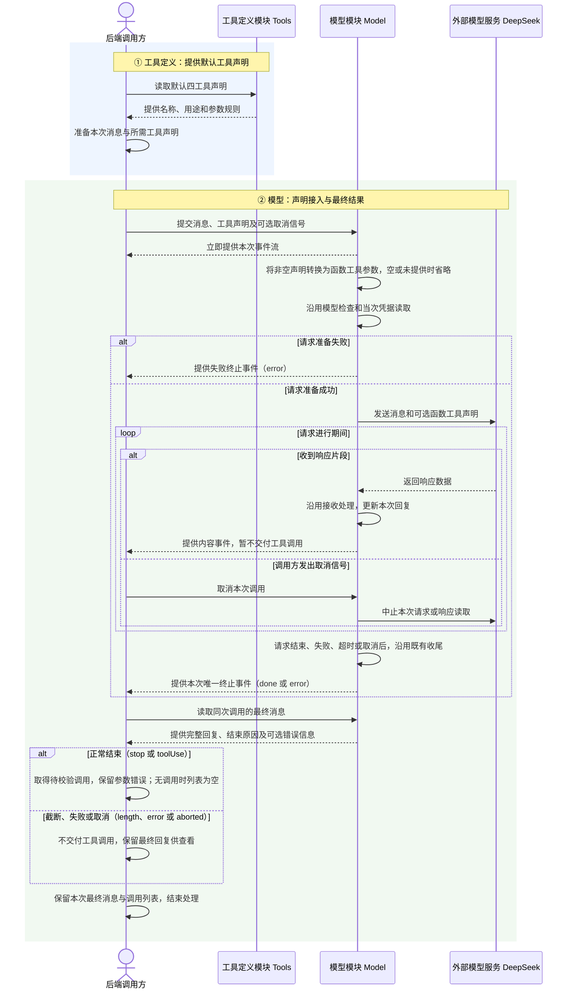

# Feature3：工具定义与调用接收

状态：**已实现并验收，尚未合并主干**。用户于 2026-11-05 要求继续实现；四工具声明、模型请求接入、独立验收及四个真实模型案例均已完成，见[验收记录](./feature3-验收记录.md)。实现保留在 `.worktrees/feature3`，分支为 `codex/feature3`。

对应[里程碑1第三步](../README.md#第三步建立工具定义与调用接收)。前置能力见 [Feature2 总体技术设计](../feature2/feature2-单会话流式聊天技术设计.md)及其[验收记录](../feature2/feature2-验收记录.md)。

## 1. 总结

**需求理解：**

本次为 `read`、`bash`、`edit`、`write` 四种工具补齐统一声明，让后端调用方能够通过 Model 将工具名称、用途和参数规则发给 DeepSeek。调用方使用独立上下文，默认提供全部四种声明，等待最终响应后按结束状态取得待校验调用，并通过本地测试和四个真实模型案例验证接入。本次不增加其他工具、不执行工具、不写入普通聊天历史；网页工具接入、执行前校验、权限控制、结果回填与循环仍留后续步骤。

**技术方案：**

在 `packages/server` 新增四工具声明，用 TypeBox 维护参数规则并推导本地类型；在 `packages/model` 新增通用 `Tool`、扩展 `ModelContext.tools` 并转换 SDK `tools` 请求参数。独立验收调用方负责最终交付判断，真实案例显式单独运行。

## 2. 系统变化说明

**Before：** Model 已有调用接收能力，但没有四工具声明、`ModelContext.tools` 或 SDK 声明发送。已有接收、解析和生命周期约定见 [Feature2 Model](../feature2/feature2-单会话流式聊天技术设计.md#key-model-stream)，本文不再展开。

**After：** 后端独立调用方可提供四工具声明，Model 将其发给模型；调用方根据最终状态取得待校验调用，验证真实接入。普通聊天继续省略工具声明。

## 3. 系统设计

### 3.1 模块变化

#### ① 工具定义：Tools（已新增）

**职责：** 在 `packages/server/src/tools.ts` 集中持有四种工具的名称、用途、参数规则及推导类型，供后端调用方读取。具体声明归应用层，Model 只接收通用声明；不增加执行函数或独立工具服务。

**接口：新增 0 项，修改 0 项，沿用 0 项。** 导出的声明对象和类型属于数据，不计为可调用接口。

**数据：新增 5 项，修改 0 项。**

##### 【新增】`defaultTools`

供后端调用方默认提供的四种工具声明。Tools 创建参数规则和声明；调用方把这组数据放进 `ModelContext.tools`，Model 读取名称、用途和参数规则组成 SDK 请求。省略 `tools` 的请求不会自动加载这组默认值。

**构造示例：** 以下声明已写入生产代码。参数字段、类型与可选性沿用已确认约定；描述文字不等于执行前校验。

```typescript
import { Type, type Static } from 'typebox'
import type { Tool } from '@agent-learning/model'

const readParameters = Type.Object({
  path: Type.String({ description: '要读取的文本文件路径' }),
  offset: Type.Optional(Type.Number({ description: '起始行号，从 1 开始' })),
  limit: Type.Optional(Type.Number({ description: '最多读取的行数' })),
})

const bashParameters = Type.Object({
  command: Type.String({ description: '要运行的 Bash 命令' }),
  timeout: Type.Optional(Type.Number({ description: '超时时间，单位为秒' })),
})

const editParameters = Type.Object({
  path: Type.String({ description: '要修改的文本文件路径' }),
  edits: Type.Array(Type.Object({
    oldText: Type.String({ description: '在原文件中唯一匹配、且不与其他替换重叠的原文' }),
    newText: Type.String({ description: '替换后的文本' }),
  }), { description: '对同一原文件提出的一处或多处替换，不按前一处替换后的内容匹配' }),
})

const writeParameters = Type.Object({
  path: Type.String({ description: '要创建或覆盖的文本文件路径' }),
  content: Type.String({ description: '要写入的文本内容，允许为空字符串' }),
})

export const defaultTools: Tool[] = [
  { name: 'read', description: '请求读取文本文件，可指定起始行和最多读取行数。', parameters: readParameters },
  { name: 'bash', description: '请求在工作目录运行 Bash 命令，可指定超时秒数。', parameters: bashParameters },
  { name: 'edit', description: '请求对同一文本文件进行一处或多处精确文本替换。', parameters: editParameters },
  { name: 'write', description: '请求创建或覆盖文本文件。', parameters: writeParameters },
]

export type ReadParams = Static<typeof readParameters>
export type BashParams = Static<typeof bashParameters>
export type EditParams = Static<typeof editParameters>
export type WriteParams = Static<typeof writeParameters>
```

`offset`、`limit`、`timeout` 不额外增加整数、最小值或最大值约束，`edits` 不额外增加最少项数约束。字段是否适合实际执行，以及路径、匹配、超时等限制，留到后续执行前校验；本步的说明不会授予文件或命令权限。

- 【新增】`ReadParams`：由 `Static<typeof readParameters>` 推导并导出，表达路径和可选行范围，供后续读取执行方在校验后使用。
- 【新增】`BashParams`：由 `Static<typeof bashParameters>` 推导并导出，表达命令和可选超时秒数，供后续命令执行方在校验后使用。
- 【新增】`EditParams`：由 `Static<typeof editParameters>` 推导并导出，表达同文件的替换数组，供后续编辑执行方在校验后使用。
- 【新增】`WriteParams`：由 `Static<typeof writeParameters>` 推导并导出，表达目标路径和写入文本，供后续写入执行方在校验后使用。

#### ② 模型：Model（已修改声明输入与请求转换）

**职责：** 增加通用工具声明输入，将声明转换为 DeepSeek Chat Completions 的函数工具参数。具体四工具仍由调用方选择；独立验收代码消费最终消息并判断交付，不新增生产调用列表接口。

**接口：新增 0 项，修改 2 项，沿用 0 项。**

##### 【修改】`stream()`（进程内调用）

**用途：** 后端调用方提交消息和可选工具声明，Model 发起一次模型请求并提供其事件流；本步扩展上下文输入，保留调用方式和返回类型。

```typescript
declare function stream(
  model: ModelInfo,
  context: ModelContext,
  options?: { signal?: AbortSignal },
): ModelEventStream
```

**主要流程：**

1. 后端调用方将 `defaultTools` 放入 `ModelContext.tools`，提交独立消息，取得既有 `ModelEventStream`。
2. Model 将非空声明转换为 SDK 的 `type: 'function'`、`function.name`、`function.description` 和 `function.parameters`；省略或传空数组时不发送 SDK `tools` 字段。不自动加载默认工具。
3. Model 发起请求，沿用现有接收和错误处理，调用方消费事件并等待同次 `result()`。声明不引入工具名称、必填字段或权限检查，返回参数仍是待校验数据。
4. 独立验收调用方仅在最终原因为 `stop`、`toolUse` 时取得调用列表，纯文字结果为空列表；`length`、`error`、`aborted` 均不放行，最终消息仍保留供核对。调用方记录结果后结束，不执行、不回填、不追加普通聊天历史或再次请求模型。

**调用示例（构造）：** `await result()` 等待同一次请求结束，不重新请求。下例的 `calls` 仍可能包含 `argumentsError`，不是已通过执行校验的列表。

```typescript
const model = findModel('deepseek-flash')!
const response = stream(model, context)

for await (const event of response) {
  console.log(event.type)
}

const finalMessage = await response.result()
const calls = finalMessage.stopReason === 'stop' || finalMessage.stopReason === 'toolUse'
  ? finalMessage.content.filter((block) => block.type === 'toolCall')
  : []
```

`context` 的构造见本模块数据清单。正常返回一个 `read` 调用时，`calls` 保留其原编号、名称和参数；若最终是 `length`，`calls` 为空，原调用仍留在 `finalMessage.content` 中供核对。

##### 【修改】`createModelStream()`（进程内调用）

可信后端调用方继续提交共享 Credentials 和可选的受控 `fetch`、`baseURL`，取得与 `stream()` 相同签名的函数；本步让该函数同样接收 `ModelContext.tools` 并完成请求转换，测试通过现有网络边界验证实际 SDK 请求，不增加工具专用注入参数。

**数据：新增 1 项，修改 1 项。**

##### 【新增】`Tool`

Model 的通用声明类型，由 `packages/model/src/types.ts` 定义并经包入口导出。Tools 用它描述名称、用途和 TypeBox 参数规则，Model 读取这三项转换请求。参数类型采用 `TSchema`，可用泛型保留具体规则；不包含执行函数、工具实例或页面展示状态。具体值见 Tools 的 `defaultTools` 构造示例。

##### 【修改】`ModelContext`

在现有 `systemPrompt` 和 `messages` 上增加可选的 `tools: Tool[]`。后端调用方准备消息与声明；Model 只读取本次传入内容，省略声明时保持现有普通聊天请求。默认四工具由调用方选择，不能把“默认”解释为所有聊天都会携带。

**构造示例：**

```typescript
const context: ModelContext = {
  messages: [{
    role: 'user',
    content: '使用 read 读取 note.txt，从第 1 行开始，最多 5 行。',
    timestamp: 1793779200000,
  }],
  tools: defaultTools,
}
```

### 3.2 数据交互流程

本期由后端调用方直接使用 Model 函数接口，验收代码承担这一调用角色；Agent 和 WebServer 的工具串联留到后续执行阶段，验收方式见 §6。



**数据归属：** Tools 持有默认四工具声明；Model 暂存本次回复，并通过现有接口提供事件和最终消息；调用方持有本次独立上下文、最终消息及待校验调用列表。读取最终消息不会再发起模型请求，参数错误也不会被当作已通过执行校验。

本期调用内容仅在本次调用及调用方内存中保留，不写入 Agent 当前对话、不执行工具；密钥不进入返回内容或日志。图中已有的请求准备、接收和收尾沿用 [Feature2 Model 约定](../feature2/feature2-单会话流式聊天技术设计.md#key-model-stream)，测试运行与判定不作为系统模块交互展开。

## 4. 技术决策

### 4.1 【功能决策｜Tools、Model】默认四种声明，后端独立验收，不开启普通聊天工具

**做法：** 沿用已确认的 `read`、`bash`、`edit`、`write` 范围与参数约定，后端调用方显式传入 `defaultTools`。本步只验收请求和调用接收；网页与执行串联留到第四步，不新增执行壳或工具结果。

**依据与限制：** Pi 的默认编程工具也是这四种，见 [createCodingToolDefinitions()](</Users/stardust/agent learning/pi/packages/coding-agent/src/core/tools/index.ts:164>)；参数见 [readSchema](</Users/stardust/agent learning/pi/packages/coding-agent/src/core/tools/read.ts:14>)、[bashSchema](</Users/stardust/agent learning/pi/packages/coding-agent/src/core/tools/bash.ts:40>)、[editSchema](</Users/stardust/agent learning/pi/packages/coding-agent/src/core/tools/edit.ts:32>)、[writeSchema](</Users/stardust/agent learning/pi/packages/coding-agent/src/core/tools/write.ts:11>)。本项目的 `read` 只声明文本读取，不承诺 Pi 的图片、截断等执行能力。`edit` 的描述保留针对原文件、唯一匹配和不重叠的语义，不在本步实现这些检查。

独立上下文避免产生没有对应工具结果的普通聊天历史。当前 [Agent.generate()](</Users/stardust/agent learning/packages/agent/src/agent.ts:43>) 没有执行循环；Pi 对缺少结果的历史还会[补充错误结果](</Users/stardust/agent learning/pi/packages/ai/src/api/transform-messages.ts:179>)，本步不引入这种历史补救流程。

### 4.2 【功能决策｜Model】等待整轮正常结束，截断与失败不放行

**做法：** 沿用已确认的最终状态规则：调用方等待 `result()`，仅在 `stop`、`toolUse` 时取得调用列表；空列表是正常结果，参数解析错误仍留待后续检查。`length`、`error`、`aborted` 不交给后续工具处理，也不删除已收到的块。

**依据与限制：** Pi 的 [Agent 循环](</Users/stardust/agent learning/pi/packages/agent/src/agent-loop.ts:242>) 在取得最终消息后决定后续动作，错误、取消和截断均不执行工具。本步将此判断用于独立验收调用方，不引入错误结果回填或循环。

### 4.3 【工程决策｜Tools、Model】TypeBox 单份规则与通用声明

**做法：** TypeBox 规则同时供模型参数说明和本地类型推导使用，Model 定义通用 `Tool`，应用层 Tools 定义具体四种工具。Model 与 Server 均锁定 TypeBox `1.3.27`；已通过当前 TypeScript `5.9.3` 构建，不升级现有工具链。

**依据与差异：** Pi 的 [Tool](</Users/stardust/agent learning/pi/packages/ai/src/types.ts:754>)及四工具源码使用同一规则推导参数类型。Pi 当前还提供 `constrainedSampling`，可改变服务商侧严格参数生成；本期按已确认三字段声明裁剪，不新增这套采样兼容能力，也不把“声明了规则”当成“返回参数已通过校验”。TypeBox 使用与本地 Pi 相同的 `1.3.27`，兼容性已实测。

### 4.4 成熟方案采用：调用方提供声明，Model 负责 SDK 转换

Pi 的公开 [Context.tools](</Users/stardust/agent learning/pi/packages/ai/src/types.ts:771>)同样由调用方提供，但当前会经 [normalizeContext()](</Users/stardust/agent learning/pi/packages/ai/src/utils/transcript.ts:30>)放进系统消息的 `toolsAdded`，再由 provider 重放工具声明并[转换 SDK 请求](</Users/stardust/agent learning/pi/packages/ai/src/api/openai-completions.ts:1484>)。本项目沿用已确认的“单次上下文直接转换”设计，四种声明固定用于独立请求，不引入工具变更历史。此简化不支持重放会话中的工具集变化，需要该能力时再重新设计。

Pi 的可执行 [AgentTool](</Users/stardust/agent learning/pi/packages/agent/src/types.ts:466>)另有执行职责，本步只采用 AI 层声明，不创建执行对象。

## 5. 风险与边界

### 风险 1：独立调用方提前交付工具请求

- **案例：** 某条工具参数完整，随后 SDK 尾部读取失败、超时、取消或长度截断；单看 `toolcall_end` 会把本不应交付的调用放行。
- **解决方案：** 独立调用方等待最终消息，只在约定的正常状态取得调用列表；补齐带工具内容的取消、截断及交付判断测试，不重写 Model 收尾。

### 风险 2：类型或参数规则被误当成执行许可

- **案例：** 模型返回合法对象，但缺少 `read.path`，使用未知工具名，或请求写入不允许的位置；本地参数类型不能证明这些请求能安全执行。
- **解决方案：** 接收结果保持未校验对象，不强制转成四种本地参数类型。本步不执行；名称、规则、路径及权限等检查必须在后续执行前完成。

### 风险 3：本地接入测试通过，真实模型仍未提出预期调用

- **案例：** 受控 SSE 证明声明转换和接收正确，但真实凭据不可用、远端拒绝请求，或模型只返回文字，没有提出案例要求的调用。
- **解决方案：** 四种真实案例显式单独执行，记录实际请求任务、返回名称、参数、结束原因和判定；缺凭据时记录待执行，远端失败或调用不符合任务时记录未通过，不改成模拟成功、不自动重试。首轮 `edit` 因模型先提出 `read` 判未通过；明确只验收指定调用、无需预读后显式复验，四例均通过，原失败见验收记录。

## 6. 验收标准

声明规则用单元测试；声明、Model、SDK 请求及返回组装用集成测试，真实 DeepSeek 案例也属于后端集成测试。目标不依赖网页实际入口，不新增 E2E。测试沿用现有 Vitest 与 `createModelStream()` 受控网络边界，不增加测试专用生产接口。

以下验收目标均已实施并执行，结果见[验收记录](./feature3-验收记录.md)。已有 Model 测试保留为回归检查，不重列接收、解析和生命周期案例；相关实现与历史验收见 Feature2。自动化由 Agent 执行，日志与验收记录不代替测试代码。

### ① 工具定义：Tools

#### T1：四种声明与约定一致（新增）

- **类型：** 单元测试。
- **目的：** 模型依赖声明填写参数，确保四种声明没有漏字段或改变已确认规则。
- **怎么测：** 在新增 `packages/server/test/tools.test.ts` 中读取真实 `defaultTools`，逐一检查名称、用途和参数规则；用各工具正常参数与缺少必填项的参数检查规则，检查 `edit.edits` 为数组、`write.content` 可为空，且可选数字与数组未增加本期未约定的约束。不执行文件或命令，也不据此认定 Model 返回参数已校验。

### ② 模型：Model

#### M1：调用方声明正确进入 SDK 请求（新增）

- **类型：** 集成测试。
- **目的：** 调用方传入工具后，确保模型请求确实带上对应声明，普通聊天仍可省略工具。
- **怎么测：** 扩展 `packages/model/test/model-stream.test.ts`，用通用声明调用实际 `createModelStream()`，仅替换凭据读取和 `fetch`，检查 SDK 请求中的名称、用途和参数规则。新增空声明数组检查，确认请求不含 `tools`；省略声明的已有断言原样保留，不另建同目的案例。

#### M2：补齐无效参数下编号和名称保留的断言

- **类型：** 集成测试。
- **目的：** 参数无效时，确保调用方仍能识别是哪次调用、哪个工具的请求。
- **怎么测：** 在 `packages/model/test/model-stream.test.ts` 现有 `strictly finalizes tool arguments %j` 案例中，仅追加 `id`、`name` 未丢失的断言；不重建输入场景、不修改解析器。

#### M3：实际四工具声明接入后仍保留待校验边界（新增）

- **类型：** 集成测试。
- **目的：** 实际四工具声明发给模型后，确保声明没有被误用为接收时的执行校验。
- **怎么测：** 在新增 `packages/server/test/model-tools.test.ts` 中导入真实 `defaultTools` 与 Model，仅替换凭据读取和 `fetch`，检查请求包含四种声明。分别返回未知名称和 `read` 缺 `path` 的合法对象，检查接收层仍保留；不新增交错归集或 JSON 解析案例，不执行文件或命令。

#### M4：独立调用方按最终状态交付（新增）

- **类型：** 集成测试。
- **目的：** 工具内容已出现后发生失败或截断时，确保调用方不会将其当作可继续处理的成功调用。
- **怎么测：** 在 `packages/server/test/model-tools.test.ts` 检查独立调用方：最终为 `stop`、`toolUse` 时取得调用，纯文字结果为空列表；最终为 `length`、`error`、`aborted` 时列表为空，最终消息仍保留。补足工具参数已出现后取消、长度截断的检查；已有错误结果用于验证调用方不放行，不重新验收 Model 的超时、断流检测、事件收尾或同次结果机制。

#### L1：真实模型提出 read 调用（新增）

- **类型：** 集成测试（真实 DeepSeek 服务）。
- **目的：** 确保真实模型能按声明提出读取请求，而非只在受控回包中成立。
- **怎么测：** 在新增 `packages/server/test/model-tools.live.ts` 中准备独立消息和全部四种声明，请求“使用 read 读取 note.txt，从第 1 行开始，最多 5 行”。检查最终正常完整结束，实际 `read` 调用的路径、起始行和行数符合任务，记录原编号和原因。不准备或读取真实文件，不把参数当成文件内容。

#### L2：真实模型提出 bash 调用（新增）

- **类型：** 集成测试（真实 DeepSeek 服务）。
- **目的：** 确保真实模型能按声明提出命令与超时参数。
- **怎么测：** 在同一真实测试文件中重新准备独立消息和全部四种声明，请求“使用 bash 运行 pwd，超时 10 秒”。检查最终正常完整结束，实际名称、命令和超时符合任务，记录原编号和原因；不启动 shell 或声称取得命令输出。

#### L3：真实模型提出 edit 调用（新增）

- **类型：** 集成测试（真实 DeepSeek 服务）。
- **目的：** 确保真实模型使用已确认的数组结构表达同文件替换。
- **怎么测：** 重新准备独立消息和全部四种声明，请求“使用 edit，将 note.txt 中的旧内容替换为新内容，以 edits 数组描述”。检查最终正常完整结束，路径为 `note.txt`，`edits` 内为指定旧、新文本，未退回顶层 `oldText/newText` 格式；不读取或修改文件，不伪造执行结果。

#### L4：真实模型提出 write 调用（新增）

- **类型：** 集成测试（真实 DeepSeek 服务）。
- **目的：** 确保真实模型保留任务指定的路径与写入原文。
- **怎么测：** 重新准备独立消息和全部四种声明，请求“使用 write，将文本你好写入 draft.txt，content 只含这两个字”。检查最终正常完整结束，实际名称、路径与文本符合任务，记录原编号和原因；不创建文件。四种案例中，未提出所需调用或参数不符合任务均判未通过，不能替换为模拟回包。

**运行约定：** 本地单元与集成测试加入现有 `test/`；真实案例使用 `.live.ts` 文件名，由单独 Vitest 配置和 `test:tools:live` 脚本显式选择，不进入普通 `npm test`。脚本与配置均已创建。

```sh
npm run build:packages
npm --prefix packages/model test
npm --prefix packages/server test

# 显式发起四个真实模型案例
npm --prefix packages/server run test:tools:live
```

真实测试使用现有 Credentials 的正常读取接口，不新增测试专用 Key 入口、不输出 Key、不保存认证头或原始服务商异常。缺少配置时记录待执行；有配置时四个案例各用独立上下文与全部四种声明，不自动重试。已保存实际任务、返回调用和判定，见验收记录。

## 7. 文件变更

以下为 Feature3 的实现文件范围；另有根 README、规划状态、实施计划与验收记录的同步更新。

### ① 工具定义：Tools

| 文件 | 类型 | 用途 | 变更 |
| --- | --- | --- | --- |
| `packages/server/src/tools.ts` | 新增 | 提供默认四工具声明和本地参数类型 | 定义名称、用途、单份参数规则与推导类型，供后端调用方显式使用 |
| `packages/server/test/tools.test.ts` | 新增 | 检查四工具声明 | 验证字段、可选项和正常及缺失参数，不执行工具 |

### ② 模型：Model

| 文件 | 类型 | 用途 | 变更 |
| --- | --- | --- | --- |
| `packages/model/src/types.ts` | 修改 | 表达模型调用输入 | 只有系统提示和消息 → 新增通用 `Tool` 及可选 `ModelContext.tools` |
| `packages/model/src/index.ts` | 修改 | 提供公共模型类型 | 现有公开类型 → 同时导出通用 `Tool`，不导出具体四工具 |
| `packages/model/src/deepseek.ts` | 修改 | 将声明发给模型 | 请求不携带声明 → 按本次上下文转换函数工具；无工具请求及现有接收行为沿用 |
| `packages/model/test/model-stream.test.ts` | 修改 | 检查声明请求与补足断言 | 已有无声明请求和接收覆盖 → 增加声明转换、空声明数组及编号和名称保留的缺口断言 |
| `packages/server/test/model-tools.test.ts` | 新增 | 检查实际声明与独立调用方 | 验证四声明发送、待校验边界与最终交付判断，不重建接收层测试 |
| `packages/server/test/model-tools.live.ts` | 新增 | 验证真实模型四工具请求 | 四个独立上下文检查真实返回的名称、参数与结束原因，不执行工具 |
| `packages/server/vitest.tools-live.config.ts` | 新增 | 单独选择真实模型案例 | 显式包含 `.live.ts`，与普通离线测试分开运行 |
| `packages/model/README.md` | 修改 | 说明公开模型调用 | 仅说明无声明调用 → 补充可选工具声明与请求转换，保留不执行边界 |
| `packages/model/package.json` | 修改 | 声明模型公开类型的依赖 | 无参数规则依赖 → 声明并锁定 TypeBox `1.3.27`，已验证兼容性 |

### 其他

| 文件 | 类型 | 用途 | 变更 |
| --- | --- | --- | --- |
| `packages/server/package.json` | 修改 | 提供声明运行依赖与显式验收命令 | 仅现有服务依赖及普通测试 → 增加同版本 TypeBox 和 `test:tools:live` |
| `package-lock.json` | 修改 | 固定依赖解析结果 | 现有依赖树 → 纳入经过兼容检查的 TypeBox，保留现有工具链 |
