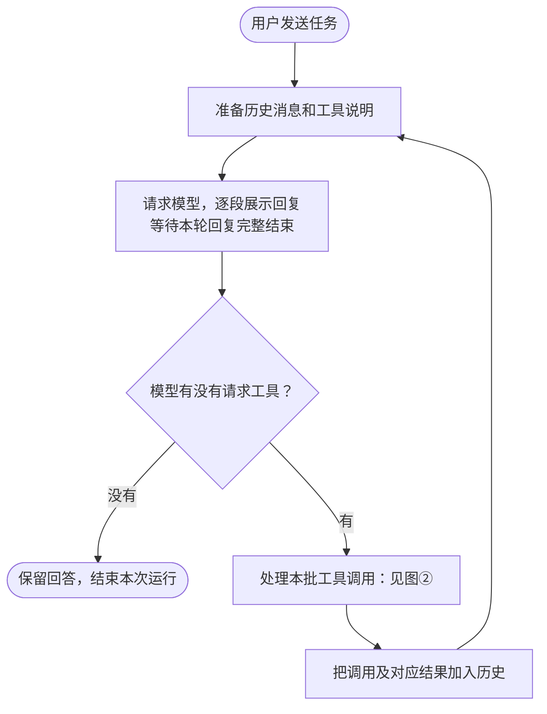
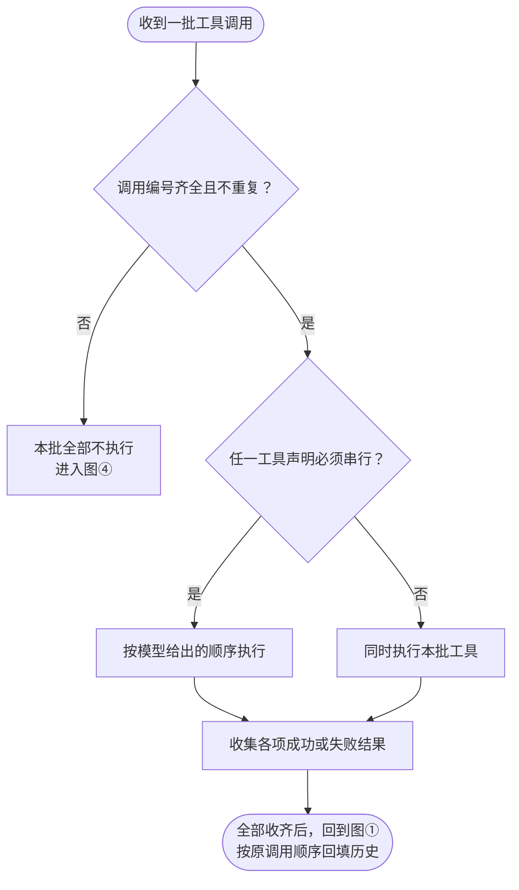
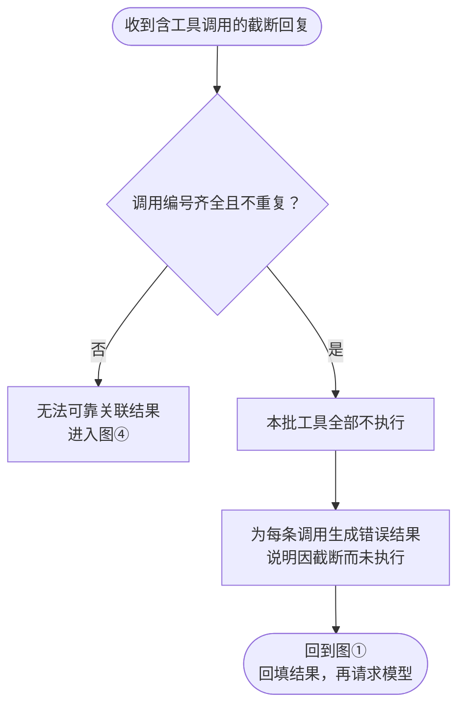
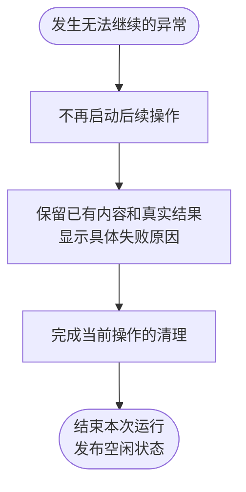
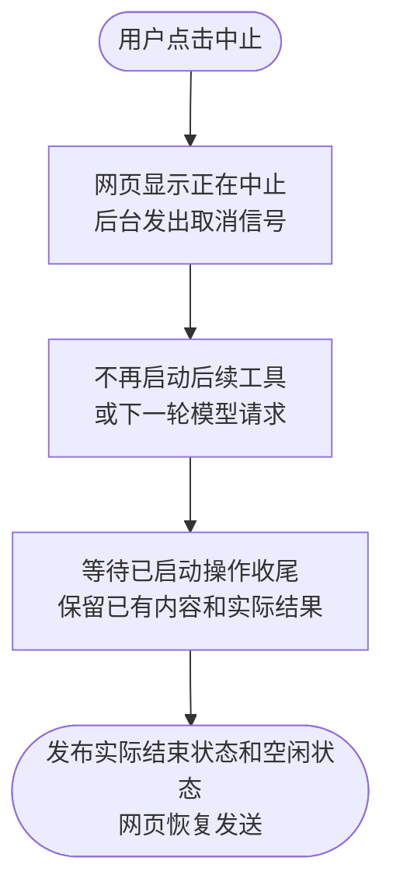

# Feature6：ReAct 循环设计讨论记录

日期：2026-11-07。

本文件前述各节保留设计阶段的已确认选择和当时待审状态；2026-11-08 的实施授权及结果见文末。

## 需求基线

依据[里程碑1第六步](../README.md#第六步建立基本的-react-循环)，用户一次发送触发连续的模型决策：模型提出工具请求，本地执行并回填真实结果，再让模型依据结果继续使用工具或回答。网页展示各轮过程，整次运行结束后恢复发送，运行中仍可编辑草稿。至少两轮先后发生的工具决策是验收门槛，不是功能次数上限；一次回复中的多条调用不算多轮决策。

验收沿用规划中的真实文件线索场景：index.txt 指向 note.txt，模型先读取前者，再根据结果请求读取后者，最后回答文件中的项目名称。

工作区、八种现有工具、订阅恢复和用户中止沿用 Feature4、Feature5。消息排队仍是既有待办；上下文压缩留在功能七，本地聊天存储与重启恢复留在功能八。

## 已确认：按 Pi 的规则支持同批工具并行

用户明确认可：同批默认并行，任一工具声明必须串行时整批串行，本次不增加自动文件冲突分析。

每轮等待完整模型回复后才处理本批工具，收齐本批结果后再请求下一轮模型。需要依据前一轮结果才能决定的动作仍分轮完成。网页需要能表示多个工具同时执行；中止沿用发出取消、等待已启动操作收尾并保留结果的规则。

已说明并接受的代价：并行调度不自动识别文件依赖，多个调用修改同一文件可能冲突。

依据：[Pi executeToolCalls](../../../pi/packages/agent/src/agent-loop.ts:508)、[默认并行配置](../../../pi/packages/agent/src/agent.ts:253)。

## 已确认：带工具调用的回复截断后采用方案 A

用户在了解输出额度与上下文总容量的区别后，明确选择参考 Pi、采用 A：调用编号有效时，本批工具全部不执行，为每条调用回填因截断未执行的错误原因，再让模型决定下一步。只有后续收到完整、合法的新调用时才真实执行；此前各轮已经产生的内容和结果保留。

这条恢复路径不要求先做 compact。功能六暂不引入压缩；如果下一次模型请求因上下文超限等错误失败，按现有失败规则明确结束。不能承诺截断后下一次请求一定成功，也不能承诺模型一定能修正；反复截断可能增加请求与费用，用户仍能中止。

本选择仅改变带工具调用的截断回复处理。纯文字回复截断沿用已有保留内容、提示不完整并结束的行为。调用编号缺失或重复时仍沿用整批拒绝，不对无法可靠关联的调用伪造结果。

依据：[Pi 截断分支](../../../pi/packages/agent/src/agent-loop.ts:263)、[未执行错误结果](../../../pi/packages/agent/src/agent-loop.ts:478)。

## 沿用的规则

- 普通工具名、参数和执行错误作为对应结果保留；其余调用可以完成，再由模型依据整批结果决定下一步，不由程序直接重跑失败工具。
- 模型请求失败、用户中止和服务关闭沿用现有处理，不在本步引入网络自动重试、消息排队或压缩。
- 无后续工具调用的正常回复结束本次运行；toolUse 却没有可处理调用等异常仍明确报错。结束运行不等于独立证明任务已经完成。
- 中止保留真实结果、不回滚文件修改，断开网页连接不取消后台任务，所有已启动操作收尾后才解除忙碌。
- 工具批次编号校验与模型输入中的工具结果配对保护继续保留。

来源：[Feature4 已确认调度](../feature4/feature4-工作区选择与四工具执行.md#411-工程决策agenttools网页整次任务覆盖模型请求顺序执行与最终回答)、[Feature5 已确认范围](../feature5/feature5-用户停止当前调用技术设计.md#4-技术决策)。

## 已确认：拆分后的主流程

用户明确认可上一轮拆分展示的主流程。确认范围为下列图①—⑤及随图说明，不表示增量模块、接口、数据或最终设计稿已通过。

### 图①：正常循环

用户发送一次任务后，模型根据工具结果连续决策，直到没有后续工具调用而结束。



此图只展示正常回复路径；回复截断、异常与中止分别按图③—⑤处理。一次模型回复结束不代表整次任务结束。

### 图②：工具执行

收到没有被截断的一批工具请求时，先校验批次编号，再按已确认规则串行或并行执行。



每项工具完成后即可展示结果。某个工具普通报错不取消其他工具，错误同样交给模型判断。

### 图③：带工具调用的回复截断

收到包含工具调用的截断回复时，按方案 A 回填未执行原因，再让模型决定下一步。



此处不做 compact。下一次请求若因上下文超限失败，进入图④。纯文字回复被截断则沿用现有的不完整提示并结束。

### 图④：无法继续的异常

模型请求失败、调用编号缺失或重复、模型声明使用工具却没有提供调用等情况，结束本次运行。



普通工具执行错误仍按图②处理，不直接进入本图。

### 图⑤：用户中止

用户在模型生成或工具执行期间点击中止后，等待已启动操作收尾，再交回控制权。



中止不回滚文件修改。任务已在竞态中自然完成时保留自然完成结果，刷新或断线不触发本流程。

## 已确认：Agent 模块

用户回复“可以”，认可上一轮展示的 Agent 职责、接口、数据变化及验证方向。Model 继续负责一次模型请求，Tools 继续负责具体操作，循环协调仍归现有 Agent，不新增 Session 或其他协调层。

### 职责与运行

- 将固定的两次模型请求、一批工具改为已确认的连续循环，每轮都提供工具声明。
- 同一用户任务保持同一个 userMessageId，每次模型回复使用新的 assistantMessageId，分别保留各轮内容。
- 同批工具按 Pi 规则执行，每项完成即可展示结果，整批收齐后才请求下一轮模型。
- 整次运行共用取消信号，中止或异常时等待所有已启动操作收尾后才解除忙碌。

### 对外接口

新增 0 项，修改 5 项；保持现有调用形式，调整配置或行为。

- `new Agent({ stream, tools })`：Server 装配模型调用与工具，工具可声明串行执行。
- `submit(input)`：校验并接收一次用户任务后立即返回回执，后台执行完整循环，运行期间继续拒绝新提交。
- `subscribe(signal)`：提供当前快照与连续更新，包含多个工具的执行状态和结果；取消订阅只清理该订阅。
- `abort(userMessageId)`：仅取消编号对应运行，等待已启动模型与工具收尾，保留实际结果后返回。
- `close()`：停止接收新任务，取消当前运行并等待全部收尾。

### 数据

原三项加上后续确认的结束原因补充，合计修改 4 项，数据归属均在 Agent；外层快照与内部模型工具结果消息结构继续沿用。

- `ExecutableTool`：增加可选 executionMode，取值为 parallel 或 sequential，不填时按并行处理。执行策略不发给模型。
- `RunningState`：activeTools 列表替代单个 activeTool，phase 只保留 model 和 tools，不再预设最后一轮为 answer。
- `ConversationUpdate`：工具结果更新增加从 0 计数的 messageIndex，与结果消息同时提供，用于将结果插入指定历史位置。
- `ConversationMessage`：工具结果条目外层增加可选 toolErrorCode，明确取消时为 interrupted；不进入内部 ModelMessage，不改变模型输入格式。具体约定见下方已确认的结束原因补充。

RunningState 构造示例：

```ts
const running = {
  userMessageId: 'user-1',
  assistantMessageId: 'assistant-1',
  phase: 'tools',
  activeTools: [
    { assistantMessageId: 'assistant-1', contentIndex: 0 },
    { assistantMessageId: 'assistant-1', contentIndex: 1 },
  ],
}
```

结果顺序：若先请求 A、再请求 B，而 B 先完成，先保存并展示 B；A 完成后将其结果插到 B 前面。下一轮模型收到的结果仍为 A、B 顺序，重连快照与页面增量一致。Pi 使用执行完成事件及时报告进度，再按调用顺序整理结果；本项目通过现有快照与增量协议同步插入位置，行为与已确认图②保持一致。

### 验证方向

复用现有取消、旧编号保护和订阅清理覆盖；获准实施后补齐以下 Agent 单元测试目标：

- 用可控模型流完成两轮以上工具决策，检查每轮历史、工具声明与整次忙碌状态。
- 控制 B 先于 A 完成，检查即时展示状态、历史顺序与新订阅快照。
- 给出截断回复，确认工具零执行、错误原因进入下一轮。
- 并行执行期间中止，让其中一个工具延迟收尾，确认之前不能恢复发送。

## 已确认：参考 dsh 的五状态规范

用户要求参考 dsh 规范网页工具状态，尤其区分截断等情况。核对本地干净 checkout：`687f282e8625c6b8d11ff58211a90524be2e4317`，提交时间 2026-10-17，remote 为 deepseek-ai/deepseek-harness。以下为源码及已有测试的静态核对，未启动或运行 dsh。

dsh 的数据生命周期分 preparing、start、result 三阶段，通用工具行进一步投影为五种展示状态：preparing、running、ok、error、stopped。只有 error.code 为 interrupted 时投影为 stopped，其他 isError 结果仍为 error。它没有单独的截断工具行状态；max-tokens 默认在调度工具前结束步骤，页面以独立的整轮截断提示展示，未分派的 preparing 工具行在步骤或整轮结束后隐藏。

来源：[三阶段契约](../../../deepseek-harness/packages/client/ui-tool/src/client/contract/slots.ts:78)、[五种展示状态及投影](../../../deepseek-harness/packages/client/ui-tool/src/client/tool/models/tool-call-model.ts:302)、[准备行结束后隐藏](../../../deepseek-harness/packages/client/ui-chat/src/client/conversation-nodes/tool.ts:338)、[截断时跳过工具调度](../../../deepseek-harness/packages/core/agent-loop/src/agent.ts:547)、[整轮截断提示](../../../deepseek-harness/packages/client/ui-chat/src/client/chat/MessageItem.tsx:148)。

用户询问为何不能沿用 dsh 的五状态。重新核对后，没有技术原因要求扩展为七状态；此前建议只是额外细分了接收参数与等待执行，并将未执行独立成终态。七状态提案已撤回。用户随后回复“可以”，明确认可五状态加明确结束原因的修订规范。

已确认五状态：准备中覆盖参数生成和等待分派；运行中表示已开始调用工具并等待结果；成功表示取得成功结果；失败表示本次工具请求未成功完成，可包括参数无效、回复截断而未执行或执行报错，由详情明确原因及是否启动；已停止用于因中止而结束的调用，原因中说明启动前取消或执行中止。不能仅凭整次任务的取消信号覆盖已完成的成功或失败结果。

本项目仍沿用已确认的 Pi 截断恢复 A：不执行本批工具，回填未执行原因后继续决策。保留本批工具行并将对应错误结果显示为失败，详情明确“本批工具未执行，原因是本轮回复截断”；整次任务仍可继续。这是对 dsh 默认结束后隐藏准备行的展示适配，不要求新增状态。工具输出内容自身被截短时保留实际成功或失败状态，截断说明放在结果详情，不新增截断终态。

影响范围：五状态需要可靠地区分失败与已停止，已按回退规则补审并确认下面的 Agent/Tools 结束原因约定，之后重新审阅网页模块。上一轮网页草案中“无需新增结果信息、全部依靠现有字段推导”不再作为定稿前提；原有 Agent 整体职责、循环、并行规则与中止收尾规则保留。

### 已确认：结束原因的数据补充

用户回复“可以”，认可新增 toolErrorCode 和 Tools 取消错误约定。

已核对的缺口：文件与网络取消可能直接抛取消信号的 reason，而 bash 的取消、超时及普通非零退出目前均被包装为一般 Error；仅凭 isError 或最终 signal.aborted 不能可靠识别每一项的实际结束原因。

采用 dsh 的错误码分流方式，在 Agent 持有的 ConversationMessage 外层增加可选 toolErrorCode，当前统一以 interrupted 表示明确的取消结果，其余普通失败继续使用 isError 与已有错误正文。该字段不写入内部 ModelMessage，不作为模型输入或工具执行指令。

构造示例，不是实跑记录：

```ts
const entry = {
  id: 'result-1',
  toolCall: {
    assistantMessageId: 'assistant-1',
    contentIndex: 0,
  },
  toolErrorCode: 'interrupted',
  message: {
    role: 'toolResult',
    toolCallId: 'call-1',
    toolName: 'bash',
    isError: true,
    content: [{ type: 'text', text: '已有输出\n任务已取消' }],
    timestamp: Date.now(),
  },
}
```

Tools 保持 execute 的正常返回类型 Promise<string>，在能确认取消的分支给错误附加可识别标记并保留原有正文或部分输出；普通执行错误、网络失败和工具超时仍是失败。Agent 根据工具明确报告的取消原因记录 interrupted，不根据错误文字或之后才发生的整次取消猜测。已有结果一旦确定，不被后续中止覆盖。

新增 ConversationMessage 这一项 Agent 数据修改，Agent 合计修改四项数据；Tools.execute 保持正常返回 Promise<string>，其取消错误行为标为修改，其余已确认的 Agent 数据和入口继续保留。没有结果、且在启动前就被用户取消的调用，依据本次任务明确的中止记录显示已停止，详情说明未启动，不伪造工具执行结果。

## 已确认：修订后的网页模块

用户回复“可以”，认可修订后的网页职责、接口、数据消费与验收方向。

- 对外接口新增 0 项、修改 3 项：applyFrame 校验多活动工具、结果插入位置与错误码，无法可靠应用时触发现有重订阅；MessageList 保留完整结果条目并按助手编号与内容下标关联；AssistantMessage 统一推导五状态并按整次任务控制执行过程折叠。
- 数据新增 1 项、修改 1 项：本地派生 ToolState 使用已确认五状态，不额外存储；ToolResults 保持位置关联，值改为完整 ConversationMessage，传递正文与 toolErrorCode。
- 已有结果决定成功、失败或已停止，晚到的整次中止不改写结果；无结果时按活动列表、待执行与明确任务结束原因判定，启动前中止不伪造工具结果。
- 截断未执行显示失败并说明原因，输出正文截短不新增状态；多轮期间保留执行过程，整体结束才自动收起；刷新只恢复现状，不重新提交。
- 复用网页现有状态、客户端和组件测试，补齐插入顺序、五状态、跨轮重复编号与整任务折叠的实际缺口。

## 文档表达调整（2026-11-08）

用户要求技术架构文档以业务人员能够阅读和判断为目标，允许必要的技术名称，但避免从编程和落地执行的视角组织正文。完整稿已调整为先说明用户场景、模块职责、协作方式与结果，再提供必要的技术对照；验收描述发生什么、应得到什么结果，具体测试文件集中在文件清单。此次只调整表达，已确认的功能范围、设计选择及验收检查点保留。

用户进一步要求“怎么测”必须是具体案例，而非抽象检查点的集合。验收章节已补足具体文件内容、命令输出、事件顺序与预期结果，并将原来混写的不同情况拆为独立编号；这些内容是待执行的验收样例，不是已实测证据，原有功能范围和回归要求不变。

## 待整体批准

完整稿：[Feature6：ReAct 循环技术设计](./feature6-ReAct循环技术设计.md)。已确认的五张图和三个模块已汇总，整稿状态为“待整体批准”；尚未授权实施。

基线核对：已运行 `npm --prefix packages/agent test`，现有 32 项测试全部通过。它们验证当前实现，不表示 Feature6 已实现或验收通过；本步需要修改的旧断言及新增覆盖将在获准实施后编写。

网页相关基线：`npm --prefix web run test:unit -- src/chat/state.test.ts src/chat/client.test.ts src/components/AssistantMessage.test.tsx` 的现有 46 项测试通过；`npm --prefix web run test:browser -- src/components/AssistantMessage.browser.test.tsx src/components/MessageList.browser.test.tsx` 的现有 5 项真实浏览器组件测试通过。这些结果不包含尚未实现的并行、多轮与截断恢复增量。

尚未修改产品代码，尚未编写或运行本功能的新测试。


## 实施授权与实现（2026-11-08）

用户要求“在当前目录下新建一个 worktree，继续实现 feature6 的功能，并完成全部校验”，据此执行上述完整设计。此前“待整体批准”“尚未授权实施”为历史状态，已由本次指令更新。

实现位于 `.worktrees/feature6`、分支 `codex/feature6`。再次核对 Pi HEAD 为 `1402973a9dbe8c627341e04c9744c54953e285ca`，循环、整批调度与截断回填规则保持一致。用户随后明确提供下载目录的 `.env` 用于真实验收；仅测试临时配置接收凭据，不输出 Key、不改原文件。实际校验见[验收记录](./feature6-验收记录.md)。

最终独立审查发现的两项问题已修复，根 npm test 414 项及独立真实工具 7 项全部通过，无失败或跳过；未合并主干。

## main 合并与复验（2026-11-08）

按用户要求合并 main，并在主目录重新执行全套校验。复验定位并修复输入组件的迟到选区同步抢焦点问题；同时修正真实模型案例中过窄的路径、前置检查提示和末尾换行假设，保持连续两轮读取、一次 write、真实结果回填及八工具检查。最终 422 项通过，无失败或跳过。`.worktrees/feature6` 与 `codex/feature6` 已清理，原有六份规划草稿继续保留。
