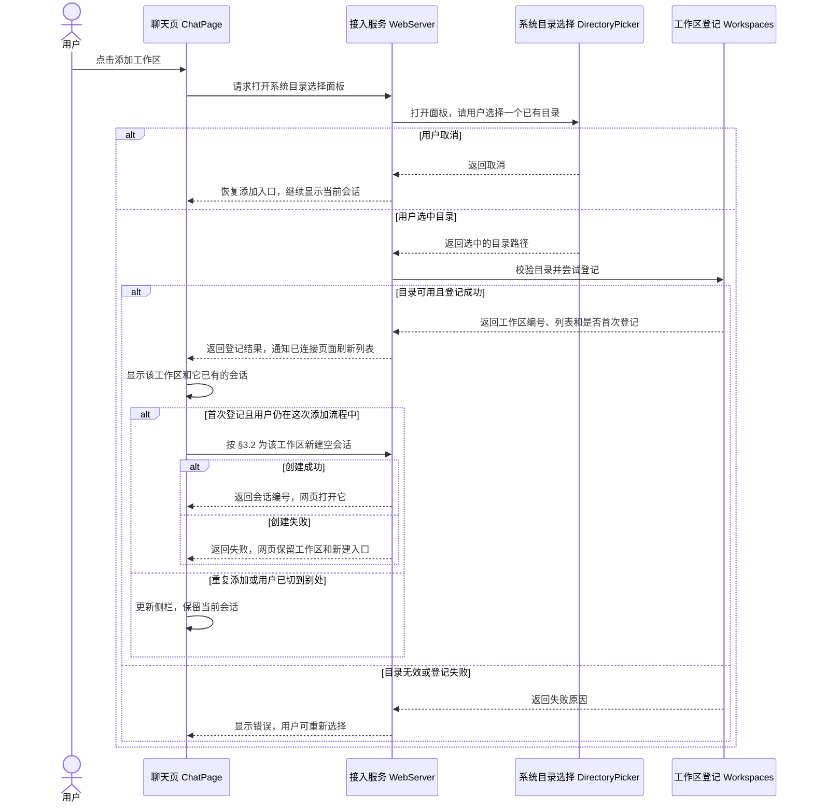
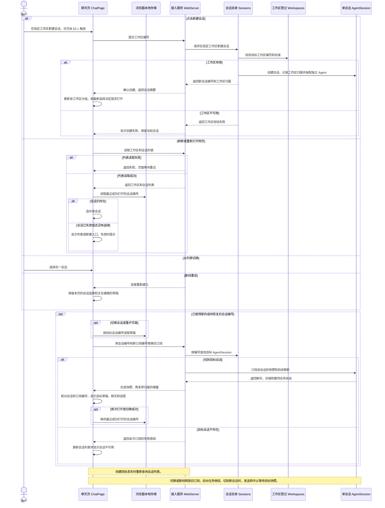
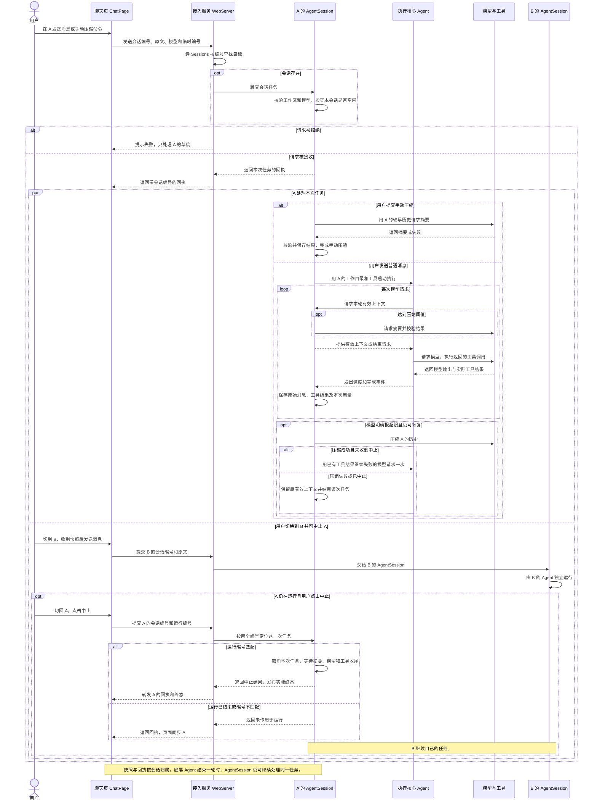

# Feature8 基础 Session 机制技术设计

本整稿承接已确认的需求、关键取舍和三条流程，作为本次实施依据。见[设计讨论记录](./feature8-设计讨论记录.md)。

### 新会话首发修订

顶部「新会话」和工作区行的新建入口共用一份未发送草稿。顶部沿用上次为新会话选过的目录，工作区入口预选该目录。输入框上方可改选已有目录，或复用系统面板登记已有目录。添加工作区和切换草稿都不创建正式会话。此修订替代 §3.1、§3.2 中点击入口后提前创建空会话的网页流程。

发送首条消息时，网页把选中的工作区和消息一起提交。后端沿用 `AgentSession` 的接收与目录校验，接收成功后登记会话。回执丢失时，同一标签页用原编号核对列表或手动重试。重试使用原目录、模型和原文。已开始的会话继续沿用原有历史、订阅和提交规则。

## 1. 总结

**需求理解**　用户可以添加多个已有的本机目录，在每个工作区下新建、打开和切换多段会话。各会话可以同时运行，模型只使用目标会话的历史、压缩摘要和公共配置，工具相对路径从该会话的工作区起算。用户可以切回任一正在运行的会话查看进度或中止。只要本地服务进程仍在，网页就能恢复其聊天和进度。草稿按会话留在同一浏览器，刷新或关闭标签页再打开后可以继续编辑。功能 9 负责加载项目说明，功能 10 负责将会话写入磁盘并在服务重启后恢复。

**技术方案**　后端用 `Workspaces` 登记目录。`coding-agent` 里的 `Sessions` 按编号找到对应的 `AgentSession`。每个 `AgentSession` 管这段会话的历史、压缩和工作环境，并使用自己的 `Agent` 执行模型与工具循环。网页通过 `WebServer` 提交和订阅目标会话，浏览器保存最近打开的会话编号和各会话草稿。

## 2. 系统变化说明

**Before**　网页只能添加一个工作区，后端用全局 `boundWorkspaceId` 校验唯一的「当前对话」。刷新或重连可恢复进程里的任务，刷新会清空草稿。[当前工作区](../../../packages/server/src/workspaces.ts#L65) · [当前网页](../../../web/src/pages/ChatPage.tsx#L86) · [当前刷新测试](../../../web/tests/e2e/chat.spec.ts#L71)

**After**　网页按工作区列出会话，后端按会话编号选择 Agent，并从该会话的工作区取得工具目录。切换时重新订阅目标会话，已经运行的任务继续。刷新或重新打开网页时按最近打开记录恢复会话，并从浏览器取回该会话的草稿。

## 3. 系统设计

### 3.1 添加已有目录作为工作区

用户点击侧栏「添加工作区」，在现有系统面板选中一个已有文件夹，网页把它显示为工作区。首次添加时，按 §3.2 在该工作区打开一段空会话。



#### 聊天页 ChatPage

**职责**　保持「添加工作区」入口可用，一次完成一个目录的选择。每个工作区行显示其会话及「新建会话」入口，输入区的目录来自当前会话所属的工作区。

**接口新增 0 项，修改 1 项**

- 【修改】添加工作区（页面动作）。等待选择期间阻止重复打开面板。首次登记成功后，网页使用返回的工作区编号进入 §3.2。重复选择相同目录时沿用已有工作区，显示已有分组和会话。若用户在添加回执到达前已切去别的会话，更新侧栏并保留较新的选择。


**数据新增 0 项，修改 0 项。** 按 `WorkspaceView` 的编号关联 `SessionSummary.workspaceId`，形成侧栏分组。

#### 网页通信 `chat/client` 与接入服务 WebServer

**职责**　沿用已有 HTTP 和列表变更通知。成功响应标明本次选中的是哪一个工作区，页面直接用该编号处理后续动作。

**接口新增 0 项，修改 4 项**

- 【修改】`getWorkspaces()`。接收并校验新的工作区列表结果。
- 【修改】`pickWorkspace()`。接收取消结果或包含选中工作区编号的登记结果。
- 【修改】`GET /api/workspaces`（HTTP）。返回所有已登记工作区和各自的可用状态。
##### 【修改】`POST /api/workspaces/pick`（HTTP）

**用途**　为网页打开系统选择面板，将选中的已有目录登记为工作区。

**主要流程**　沿用现有授权检查，一次只开启一个面板。用户取消时返回 `{ cancelled: true }`。有效选择交给 `Workspaces` 校验和登记，成功时返回结果，并沿用 `workspaces_changed` 通知其他页面。登记失败则返回原因。网页分别处理登记和空会话创建的结果。创建会话失败时，已登记的工作区仍在侧栏，可以从该行再次新建。
**数据新增 0 项，修改 1 项。** `WorkspacePick` 的成功分支包含 `workspaceId`、`created` 和 `view`。其中 `created` 表示是否首次登记，页面据此判断是否自动打开空会话。

#### 系统目录选择 DirectoryPicker

**职责**　通过现有 macOS 面板取得用户选定的已有目录。

**接口新增 0 项，修改 0 项**

- 【沿用】`DirectoryPicker(signal)`。返回选中的目录或取消结果。WebServer 释放选择请求时取消等待。

**数据新增 0 项，修改 0 项。** 选中的路径交给 `Workspaces` 校验。[现有选择器](../../../packages/server/src/directory-picker.ts#L24)

#### 工作区登记 Workspaces

**职责**　记录真实目录和稳定编号。把别名解析为实际路径，在现有文件锁内按路径去重并写入。路径相同复用原编号，路径不同各自登记。目录移走时仍保留其登记并标为不可用。

**接口新增 0 项，修改 3 项**

- 【修改】`register(path)`。校验路径、实际目录和访问能力，在文件锁内登记或复用工作区，返回编号、是否首次登记和列表。
- 【修改】`view()`。返回各工作区的编号、目录、名称和可用状态。当前选中的会话由网页维护。
- 【修改】`resolveBoundDirectory(workspaceId)` 改为 `resolveDirectory(workspaceId)`。按指定工作区编号查找并校验实际目录，结果供 §3.2 创建会话和 §3.3 开始任务使用。编号不存在或目录不可用时明确拒绝。

**数据新增 0 项，修改 2 项**

- 【修改】`WorkspaceFile`。`workspaces.json` 保留现有的工作区编号和路径。读取时兼容带 `boundWorkspaceId` 的旧文件，以登记列表为准。下一次成功新增时写入新结构。列表损坏继续报错并保留原文件。
- 【修改】`WorkspaceView`。返回 `workspaces`，每条包含原编号、路径、名称和是否可用。工作区列表通过该数据跨服务重启恢复，已发送会话的重启恢复归功能 10。

构造示例

```typescript
const workspaces: WorkspaceFile = {
  workspaces: [
    { id: 'workspace-qinghe', path: '/tmp/青禾' },
    { id: 'workspace-baiyu', path: '/tmp/白榆' },
  ],
}
```

### 3.2 新建、打开和恢复会话

用户从工作区行新建会话、从列表打开已有会话，或重新连接网页，页面恢复目标会话的草稿、聊天和任务进度。



#### 聊天页 ChatPage 与输入框 MessageInput

**职责**　管理侧栏选择和输入框。打开目标会话时，按编号恢复草稿。只把当前会话、当前订阅的快照和更新放到页面。创建期间可以切换已有会话。如果创建回执到达时用户已经选了别的会话，新会话进入列表，页面保留用户较新的选择。

**接口新增 2 项，修改 1 项**

- 【新增】新建会话（页面动作）。把用户所选工作区的编号交给客户端。创建成功后取得后端分配的编号和名称，创建失败时保留当前页面。各工作区内按创建顺序显示「会话 1」「会话 2」等默认名称。
- 【新增】打开会话（页面动作）。从列表或新建回执取得目标编号。等待目标快照时可以写草稿，发送和中止按钮等快照确认后再按现有规则启用。
- 【修改】`MessageInput`（组件契约）。进入目标会话时载入保存的文本。用户编辑时，把更新写回该会话的存储项，保留空格和换行。浏览器存储不可用时，可以继续编辑并在当前页面内保留草稿，页面提示草稿无法在重开后恢复。

**数据新增 2 项，修改 0 项**

- 【新增】最近打开的会话编号。浏览器用它在刷新和新开页面时选择会话。已经打开的标签页各自保持自己的当前选择。多标签页共享最近一次成功打开的记录，刷新时可能恢复另一个标签页最后打开的会话。断线重连使用本页已经选中的编号，恢复快照后继续显示本页会话。
- 【新增】按会话编号保存的草稿原文。浏览器使用 `localStorage` 保存，例如会话 `session-b` 的草稿为 `"  先跑测试\n再整理结果  "`。这份文字供输入框恢复，已发送的消息和任务进度从目标 `AgentSession` 获取。服务重启后编号找不到时回到列表，功能 10 负责恢复已发送会话。

#### 网页通信 `chat/client`

**职责**　用现有 HTTP 和 WebSocket 通道查询会话、创建会话和接收目标会话的状态。切换目标后只接收新会话、新订阅的数据。

**接口新增 3 项，修改 1 项**

- 【新增】`getSessions()`（HTTP 客户端）。取得后端会话列表。
- 【新增】`createSession(workspaceId)`（HTTP 客户端）。向后端提交工作区编号，返回新会话摘要。
- 【新增】切换订阅目标（连接操作）。使用当前 WebSocket 切换会话目标或释放当前订阅。连接断开后，以页面当前目标重新订阅。
- 【修改】`subscribe`（连接与订阅）。每次向后端请求快照时同时带上会话编号和新的订阅编号。编号不同的旧帧丢弃，序号出现缺口时重新取得当前会话快照。收到会话列表变更通知后重新读取列表。

**数据新增 0 项，修改 2 项。** `Subscription` 提供切换目标的操作，`ChatState` 保留当前会话归属。会话摘要和订阅消息来自 WebServer。

#### 接入服务 WebServer

**职责**　WebServer 检查网页授权与请求格式，把列表查询、新建和按编号查找交给 `Sessions`，并转发目标 `AgentSession` 的快照和更新。

**接口新增 2 项，修改 1 项**

- 【新增】`GET /api/sessions`（HTTP）。返回当前服务进程登记的会话摘要。网页初次打开和重连时查询。新建成功后复用已有变更通知方式，通知其他已连接的页面更新列表。

##### 【新增】`POST /api/sessions`（HTTP）

**用途**　为网页在指定工作区创建独立的空会话。

**主要流程**　WebServer 校验工作区编号的请求格式，将编号交给 `Sessions`。创建成功后返回 `201` 与会话摘要。格式错误返回 `400`，工作区编号或目录无效返回 `409`。明确失败时网页保留原会话并提示原因。回执丢失时，网页重新查询列表，用户可以从列表打开已创建的会话。

##### 【修改】会话订阅（WebSocket）

**用途**　为当前页面恢复指定会话，并持续收到其后续更新。

**主要流程**　网页建立连接后可接收全局配置和列表通知，有会话目标时才请求会话快照。切换时，WebServer 验证请求、释放旧订阅，再通过 `Sessions` 查找目标 `AgentSession`。会话层先登记监听，再取得快照及其更新序号，发送快照和序号之后的更新。会话不存在时，回送带目标和订阅编号的错误，网页可继续用同一连接选择其他会话。释放订阅会清理监听和等待发送的数据，该会话已接收的任务继续执行。

**数据新增 1 项，修改 2 项。** 新增创建请求 `CreateSessionRequest`，含 `workspaceId`。修改网页消息类型 `ClientFrame` 和 `ServerFrame`，为订阅请求、快照及更新增加 `sessionId`，并在服务端消息中加入目标不存在及列表变更通知。

#### 会话目录 Sessions 与工作区登记 Workspaces

**职责**　`Sessions` 属于 `coding-agent`，用会话编号管理多个 `AgentSession`。创建时调用宿主提供的目录校验，校验通过才登记会话。宿主用 §3.1 的 `Workspaces.resolveDirectory(workspaceId)` 实现校验。已有会话可直接按编号打开，目录不可用时仍可查看记录。

**接口新增 3 项，修改 0 项**

- 【新增】`Sessions.create(workspaceId)`。校验工作区编号和目录，分配会话编号，登记一个带工作区归属的空 `AgentSession`。
- 【新增】`Sessions.list()`。返回会话摘要，供侧栏和页面恢复使用。
- 【新增】`Sessions.get(sessionId)`。按编号查找 `AgentSession`，供接入层定位目标会话。
- 【沿用 §3.1】`Workspaces.resolveDirectory(workspaceId)`。按工作区编号查找并校验目录，由宿主提供给会话层调用。

**数据新增 1 项，修改 0 项。** 会话摘要 `SessionSummary` 归 `Sessions`。包含会话编号、工作区编号、名称和创建时间，供侧栏分组和恢复选择使用。`AgentSession` 持有聊天历史和运行快照。

构造示例

```typescript
const session: SessionSummary = {
  id: 'session-b',
  workspaceId: 'workspace-baiyu',
  name: '会话 2',
  createdAt: '2026-11-09T16:00:00+08:00',
}
```

#### 单会话 AgentSession 与执行核心 Agent

**职责**　`AgentSession` 持有一段会话的原始聊天、压缩记录和整项任务状态，并装配独立的 `Agent`。新建时以空历史开始。重新打开时从仍存在的 `AgentSession` 读取状态。底层 Agent 提供执行中的消息和事件，供 `AgentSession` 更新会话。

**接口新增 1 项，修改 0 项**

- 【新增】`AgentSession.subscribe(signal)`。先提供目标会话的完整快照，再提供同一序号下的连续更新。取消订阅时释放监听。

**数据新增 0 项，修改 2 项。** `ConversationSnapshot` 和 `ConversationUpdate` 从现有 Agent 移到会话层。快照包含聊天、压缩记录、容量和整项任务状态。增量延续该会话自己的序号，供网页校验并更新显示。

### 3.3 并行执行、压缩与中止

用户在 A 发送任务，随后可以在 B 发起另一项。若 A 需要压缩或被中止，由 A 的 `AgentSession` 协调整项任务的后续动作与收尾。



#### 聊天页 ChatPage、输入框 MessageInput 与网页通信

**职责**　页面发起操作时记下目标会话。发送回执、失败和中止进度按编号留在原会话，消息列表、草稿和按钮使用当前会话的数据。切换到新会话时先取得它的快照。同一会话断线时，对已知运行沿用功能 5 的中止规则。

**接口新增 0 项，修改 4 项**

- 【修改】发送（页面动作）。按现有规则立即清空本次草稿。明确拒绝时，在原会话恢复原文，前提是用户尚未开始下一份草稿且浏览器没有该会话的新草稿。回执或网络异常时保留原会话的未确认状态，切回后通过该会话快照核对。仅原会话暂停接收本页的新提交，其他会话按各自状态发送。空闲快照暂时找不到原请求时，仍等待有效回执或正式记录；这是当前已测试的网页行为。早期里程碑曾描述空闲后可手动发送，本步按实际运行规则隔离会话。[当前发送门槛](../../../web/src/pages/ChatPage.tsx#L170) · [现有未确认测试](../../../web/src/pages/ChatPage.test.tsx#L261) · [早期单会话规划](../README.md#single-chat-phases)
- 【修改】中止（页面动作）。捕获当时的会话和运行编号。回执归原会话。目标仍显示时同步它，已经切走时在切回后同步。
- 【修改】`submitMessage(input)`。校验 `202` 回执的会话编号与临时编号。
- 【修改】`abortMessage(input)`。校验回执与请求的会话编号和运行编号。

**数据新增 0 项，修改 2 项。** `LocalSubmission` 按会话和临时编号关联回执与正式记录，仍保存在当前页面内存中。刷新或重新打开后，由后端快照恢复已经接收的消息，由浏览器恢复当时保存的草稿。`AbortState` 按会话和运行编号保存中止进度。网页通信使用 WebServer 的请求和回执类型。

#### 接入服务 WebServer

**职责**　校验授权和请求格式，经 `Sessions` 找到目标 `AgentSession`。创建和订阅按 §3.2 处理。执行请求交给会话层，WebServer 负责映射回执和错误。

**接口新增 0 项，修改 3 项**

##### 【修改】`POST /api/messages`（HTTP）

**用途**　把普通消息或 `/compact` 交给指定会话。

**主要流程**　网页提交会话编号、原文、模型和临时编号。WebServer 按会话编号查找并交给 `AgentSession` 接收，成功时返回 `202` 和该会话的回执。格式错误返回 `400`，会话不存在返回 `404`，工作区不可用或会话忙碌返回 `409`，服务关闭期间返回 `503`。

##### 【修改】`POST /api/abort`（HTTP）

**用途**　中止指定会话当时的运行，并反馈实际处理结果。

**主要流程**　WebServer 查找目标 `AgentSession`，转交运行编号。格式错误返回 `400`，会话不存在返回 `404`。会话层等待匹配的任务收尾后，返回 `handled: true`。运行已结束或编号不符时，返回 `handled: false`。网页从该会话的快照和更新取得实际终态。

- 【修改】`WebServer.close()`。停止新请求，释放网页连接，交给 `Sessions.close()` 等待会话任务和共用工具环境收尾。

**数据新增 0 项，修改 4 项。** `SubmitMessageRequest` 使用 `sessionId` 指定目标，`SubmitMessageAccepted` 回传 `sessionId`。`AbortRequest` 和 `AbortResult` 都含 `sessionId` 与 `runId`。网络回执与内部 Agent 执行结果分别归属各自的接口。

构造示例

```typescript
const submission: SubmitMessageRequest = {
  sessionId: 'session-b',
  clientMessageId: 'draft-b-01',
  modelId: 'deepseek-flash',
  text: '读取 b.txt 并告诉我结果',
}

const stop: AbortRequest = {
  sessionId: 'session-a',
  runId: 'run-a-01',
}
```

#### 会话目录 Sessions 与工作区登记 Workspaces

**职责**　`Sessions` 按会话编号查找 `AgentSession`。每个 `AgentSession` 按自己的工作区编号取得当前有效的目录。关闭服务时，`Sessions` 统一关闭各会话，之后清理 `coding-agent` 共用的工具运行资源。

**接口新增 1 项，修改 0 项**

- 【新增】`Sessions.close()`。停止创建新会话，对所有已登记的 `AgentSession` 发出关闭并等待收尾，再关闭共用工具环境。
- 【沿用 §3.2】`Sessions.get(sessionId)`。返回请求对应的 `AgentSession`。
- 【沿用 §3.1】`Workspaces.resolveDirectory(workspaceId)`。由宿主提供给 `AgentSession` 使用，按会话的工作区编号校验目录。

**数据新增 0 项，修改 0 项。** 使用 §3.2 的会话归属。工作目录随已接收的任务确定。

#### 单会话 AgentSession

**职责**　接收会话任务，维护整项任务的运行编号、取消信号和对外状态。它保存原始历史、压缩记录及容量统计，为底层 Agent 提供这次任务的模型、提示词、工具和有效上下文。Agent 发出的完成消息和工具结果写进会话记录，先保存本轮完成的工具结果，再准备下一次模型请求。网页通过 §3.2 的订阅取得一份连续快照与更新。

**接口新增 3 项，修改 0 项**

- 【新增】`AgentSession.submit(input)`。按工作区归属校验目录。校验完成后同步检查模型和本会话是否空闲，接收时占用任务位置并返回回执。并发提交同一会话时，只接收一项任务。普通消息交给 Agent 执行，`/compact` 由会话层发起摘要调用。
- 【新增】`AgentSession.abort(runId)`。核对运行编号，取消整项任务，等待当前 Agent 运行及摘要调用实际收尾，保留已有内容和确认完成的工具结果。运行已结束或编号不符时返回 `false`。目录后来不可用时仍可中止已知运行。
- 【新增】`AgentSession.close()`。停止本会话的接收，取消并等待当前任务，再释放执行事件订阅。
- 【沿用 §3.2】`AgentSession.subscribe(signal)`。发布带本会话序号的快照与更新。底层 Agent 一轮结束时，会话仍可继续压缩或重试，整项任务实际收尾后才发布空闲。

**数据新增 0 项，修改 5 项。** `ConversationMessage`、`SubmissionAccepted`、`RunningState`、`CompactionRecord` 和 `ContextUsage` 的会话级归属转到 `AgentSession`。快照和更新沿用 §3.2 的数据定义。

压缩沿用功能 7 的验收边界。每次模型请求前检查有效输入的容量。相同输入只尝试一次阈值压缩，失败且原输入仍放得下时继续。明确超限时，由 `AgentSession` 压缩并恢复当前失败的模型请求一次，直接使用已经完成并记录的工具结果。模型成功回复后，后续工具轮次的请求重新判断。候选摘要失败、中止或未有效缩短时保留原有效上下文。压缩成功后，原始聊天仍可查看，后续请求使用摘要加近期原文。[功能 7 压缩规则](../../../docs/里程碑1/feature7/feature7-基础上下文压缩技术设计.md#4-技术决策)

#### 通用执行核心 Agent

**职责**　接收模型、上下文和可执行工具，运行通用的「请求模型 → 执行工具 → 回填结果」循环。维护执行中的消息和工具状态，发出通用事件。每次请求前通过传入的准备动作取得模型输入。模型失败时把原有错误类型交回调用方，由调用方决定是否继续。已启动的操作在收到取消信号后按现有规则收尾。

**接口新增 1 项，修改 2 项**

- 【修改】`Agent.run(...)`。将当前 Agent 的任务入口收敛为通用执行，接收模型、可执行工具、请求前上下文准备动作和任务取消信号。完成一个普通执行后返回实际结果。
- 【新增】`Agent.continue(...)`。从调用方提供的执行上下文继续。超限时由 `AgentSession` 提供压缩后的上下文，已完成的工具结果随上下文传入。
- 【修改】`Agent.subscribe(...)`。提供执行过程和完成消息给 `AgentSession`。完整会话快照由 §3.2 的 `AgentSession.subscribe()` 提供。

**数据新增 0 项，修改 1 项。** `ExecutableTool` 保留通用参数、执行次序、取消信号和不透明的结果详情，工作目录、提示词片段及文件记录回调由 `coding-agent` 管理。Agent 将工具输出回填给模型。工具执行中提交的详情按调用编号保留，成功、失败或中止时都随对应事件交回，由 `AgentSession` 解释其中的文件读写记录。

#### `coding-agent` 工具与模型 Model

**职责**　`coding-agent` 以任务目录装配现有工具及本机工具环境。工具执行时使用该任务的目录和取消信号。确认完成的文件操作在发生时记录，随后收到中止也保留已写事实。Model 使用既有模型调用入口，分别处理普通回复和摘要请求。

**接口新增 0 项，修改 1 项**

- 【修改】`createTools(...)`。为目标会话装配八种具体工具，绑定本次任务的目录。工具输出由 Agent 回填给模型，确认的文件详情由 `AgentSession` 记录，用于显示与压缩。
- 【沿用】`ToolRuntime.close()`。所有会话结束后清理共用本机工具环境。
- 【沿用】Model 流式请求。接收已准备的输入和取消信号，返回流式事件或错误。会话层的摘要调用使用既有摘要请求和校验规则。

**数据新增 0 项，修改 0 项。** 使用现有工具输出、错误类型和文件操作记录。会话层保存已确认文件事实。[写入确认位置](../../../packages/server/src/local-tools.ts#L104)

#### 验收覆盖

- 沿用现有请求前压缩、明确超限后恢复、摘要中止及工具收尾的案例。将会话行为的断言移到 `AgentSession` 入口，底层 Agent 继续验收通用循环与工具调度。[现有压缩验收](../../../packages/agent/test/agent-compaction.test.ts#L148) · [现有并行工具收尾](../../../packages/agent/test/agent.test.ts#L688)
- 补充可控的 A/B 场景。A 已完成 `read` 后遇到超限，核对摘要和重试沿用同一运行编号，`read` 只执行一次。另测 A 的摘要中止时，B 的任务继续完成，以及工具已写入后收到中止的文件事实仍随 A 保留。[现有已改记录案例](../../../packages/agent/test/agent-compaction.test.ts#L67)

本轮复跑现有 `@agent-learning/agent` 的 78 项测试，全部通过。`AgentSession` 新边界和多会话验收待实现后执行。

## 4. 技术决策

### 4.1 【功能决策｜ChatPage、Workspaces】添加多个已有目录

客户端采用 DSH 的分组和新建入口，首次登记已有目录后打开一段空会话。后端沿用真实路径去重，重复选择同一目录复用登记。旧登记中的编号和路径继续可读。DSH 自带目录浏览和新建目录功能，本项目用已有 macOS 目录选择面板完成用户选定的添加范围。[DSH 分组及新建入口](../../../deepseek-harness/packages/client/ui-workspace/src/client/rows/WorkspaceBrowser.tsx#L557) · [DSH 添加后打开](../../../deepseek-harness/packages/client/ui-workspace/src/client/rows/WorkspaceBrowser.tsx#L1375) · [DSH 路径去重](../../../deepseek-harness/packages/workspace/workspace/src/index.ts#L510)

### 4.2 【工程决策｜Workspaces、Sessions、AgentSession】执行目录由目标会话决定

`AgentSession` 记录所选工作区编号。任务开始时，它通过宿主提供的 `Workspaces` 校验目录，并用该目录装配本次工具。Hermes 在创建会话时校验真实目录，并把会话目录带入执行环境。Pi 恢复会话时也用该会话记录的目录。Hermes 的历史列表还可按 Git 根目录分组。本项目的列表按用户登记的实际目录组织，所以单独添加父目录和子目录时，它们各有自己的工作区。[Hermes 创建校验](../../../hermes/gateway/session_policy.py#L400) · [Hermes 执行目录](../../../hermes/gateway/session_policy.py#L976) · [Hermes 历史分组](../../../hermes/hermes_state_sessions.py#L32) · [Pi 恢复目录](../../../pi/packages/coding-agent/src/core/agent-session-runtime.ts#L209)

### 4.3 【功能决策｜Sessions、AgentSession、WebServer】不同会话同时运行

每段会话有独立的 `AgentSession` 和 Agent。`AgentSession` 管整项任务的接收、快照和中止，并保留同一会话一次接收一项任务的规则。Pi 的终端替换会话时会收尾旧运行。本项目按 Hermes Desktop 的行为，在网页切换时只更换订阅，让后台继续。用户中止时同时核对会话和运行编号，等待目标任务收尾。[Pi 内存会话](../../../pi/packages/coding-agent/src/core/session-manager.ts#L1803) · [Pi 切换与收尾](../../../pi/packages/coding-agent/src/core/agent-session-runtime.ts#L167) · [Hermes Desktop 并行测试](../../../hermes/apps/desktop/e2e/unread-dot-restart.spec.ts#L102) · [Hermes 中止](../../../hermes/gateway/session_authority.py#L837)

### 4.4 【功能决策｜ChatPage、MessageInput】按 DSH 保存浏览器草稿

同一浏览器按会话编号保存草稿原文，也保存最近成功打开的会话编号。刷新和重新打开应用时，先确认会话仍存在，再恢复草稿和后端快照。断线重连沿用本页当前选择。DSH 使用浏览器 `localStorage` 按会话保存草稿，本项目保存现有纯文本输入及其空格和换行。[DSH 会话选择](../../../deepseek-harness/packages/client/ui-workspace/src/client/navigation.ts#L442) · [DSH 草稿存储](../../../deepseek-harness/packages/client/ui-conversation/src/client/stores.ts#L43) · [DSH 切换和刷新测试](../../../deepseek-harness/apps/web/tests/draft-initialization.e2e.ts#L410)

### 4.5 【工程决策｜AgentSession、Agent、工具】会话与通用执行分层

`coding-agent` 管工具实现、工作环境、会话目录、原始历史、有效上下文和压缩。`AgentSession` 在模型请求前准备有效输入，接收 Agent 的进度与完成事件，并在明确超限后协调压缩与继续。底层 Agent 跑通用循环，保存执行中的消息和状态。Pi 同样让会话层在请求前准备上下文，执行结束后可由会话层通过 `Agent.continue()` 恢复。这需要 Agent 提供通用继续入口。整项任务的编号与取消由 `AgentSession` 持有，底层一轮的边界不会提前结束网页任务。[Pi 会话装配](../../../pi/packages/coding-agent/src/core/sdk.ts#L411) · [Pi 会话记录](../../../pi/packages/coding-agent/src/core/agent-session.ts#L1147) · [Pi 请求前压缩](../../../pi/packages/coding-agent/src/core/agent-session.ts#L899) · [Pi 运行后恢复](../../../pi/packages/coding-agent/src/core/agent-session.ts#L1943)

依赖方向为 `server` 调用 `coding-agent`，`coding-agent` 调用 `agent` 和 `model`，`agent` 调用 `model`。工作区校验由服务端提供。`coding-agent` 定义网页工具所需的服务商接口和结果类型，服务端提供现有的服务商选择及凭据装配。工具的目录、参数校验和文件事实由 `coding-agent` 解释。网页通过 `server/protocol` 使用会话消息与状态类型。

`agent` 的源码和公开类型只处理通用执行。调用方交给它已选模型、系统提示词和可调用工具。工具按通用调用规则执行，具体工具名、目录和文件详情由 `coding-agent` 解释。模型层标记超限，Agent 返回失败，`AgentSession` 决定是否压缩与继续。`AgentSession` 持有供用户恢复的历史及整项任务状态，`WebServer` 将会话错误转换为 HTTP 或 WebSocket 响应。使用独立运行的 Agent 测试和源码依赖检查验收此边界。[Pi 的通用工具结果](../../../pi/packages/agent/src/types.ts#L424) · [功能 8 包边界验收](./feature8-验收标准.md#package-boundaries)

## 5. 风险与边界

### A 的回复或中止回执在打开 B 后才到

- **案例**　用户在 A 发送后立即切到 B，A 的流式更新或 HTTP 回执随后到达。网页若按当时打开的会话应用回执，就会错误地更新 B 的消息、草稿或按钮。
- **解决方案**　发送和中止时捕获目标编号。回执按会话和临时编号或运行编号归档。WebSocket 同时校验会话编号、订阅编号和更新序号。页面切换后用目标快照校准。

### 两个任务同时编辑同一个文件

- **案例**　同一工作区的 A、B 同时编辑 `note.txt`。两个任务都可能读到旧内容，然后分别写回，后一次写入会覆盖前一次修改。
- **解决方案**　这是已确认的并行代价。目录用于确定工具相对路径的起点，工作区文件由会话共用。中止保留已发生的修改。并行验收用不同文件核对执行归属。[现有文件编辑](../../../packages/server/src/local-tools.ts#L146)

### 底层执行结束时，会话仍在压缩或重试

- **案例**　A 读完 `note.txt` 后模型报超限。底层 Agent 结束这轮，如果网页此时误判为空闲，用户可能发来另一项任务，或原中止按钮失去目标。
- **解决方案**　`AgentSession` 持有整项任务的运行编号、忙碌状态与取消信号。压缩后从失败请求继续，复用已取得的工具结果。整项任务收尾后才发布空闲。工具在确认写入时记录文件事实，之后收到中止也保留该记录。

### 多个标签页保存同一个会话的草稿

- **案例**　两个标签页同时打开 A，并写入不同文本。刷新后会读到最后保存的 A 草稿。如果两个标签页各自打开 A、B，刷新还可能恢复另一个标签页最后打开的会话。
- **解决方案**　沿用已确认的 DSH 浏览器共享语义。已打开的页面保留各自的当前选择。存储不可用时，草稿保留在当前页面并提示重开后无法恢复。系统自动恢复被拒绝的原文前，先核对该会话是否已有新草稿。[DSH 浏览器存储](../../../deepseek-harness/packages/client/store/src/index.ts#L146)

### 浏览器还记得会话编号，后端已经重启

- **案例**　用户刷新浏览器时仍有 A 的最近打开记录，后端进程已经更换，登记的工作区仍存在，但内存中没有 A。
- **解决方案**　网页先核对当前会话列表。目标已失效时提示并回到列表，其他会话仍可手动打开。工作区来自本机登记文件，会话落盘和重启恢复由功能 10 处理。此限制沿用既有[设计妥协记录](../../设计妥协记录.md#1-会话暂保存在后端内存)。

## 6. 验收标准

[功能 8 验收标准](./feature8-验收标准.md)共 41 个案例，覆盖工作区登记、会话新建与切换、草稿与会话恢复、并行任务与目录隔离、压缩与中止、真实模型接续，以及 Agent 的独立执行和错误交接。每个案例给出初始状态、操作和可检查的结果。

现有工作区、聊天、工具和压缩行为沿用对应测试。功能 8 新增行为的结果见[最终复跑](./feature8-验收标准.md#results)。跨会话并行与恢复使用受控模型流验证时序，真实模型接续需显式提供 DeepSeek 测试凭据。实际复跑结果和环境条件见[执行说明](./feature8-验收标准.md#execution)。

## 7. 文件变更

### 工作区登记 Workspaces

| 文件 | 类型 | 用途 | 变更 |
| --- | --- | --- | --- |
| `packages/server/src/workspaces.ts` | 修改 | 工作区登记与目录校验 | 从全局绑定改为按已登记编号定位目录，兼容旧登记，回传本次选中的工作区。 |

### 会话目录 Sessions、单会话 AgentSession 与编程工具

| 文件 | 类型 | 用途 | 变更 |
| --- | --- | --- | --- |
| `packages/coding-agent/package.json`、`packages/coding-agent/tsconfig.json`、`packages/coding-agent/src/index.ts` | 新增 | 编程会话包与入口 | 提供会话服务和宿主接入类型，供服务端装配。 |
| `packages/coding-agent/src/sessions.ts` | 新增 | 进程内会话登记 | 分配会话编号，按编号定位 `AgentSession`，协调全体会话及共用工具资源收尾。 |
| `packages/coding-agent/src/agent-session.ts`、`packages/coding-agent/src/types.ts` | 新增 | 单会话任务和记录 | 管原始历史、会话状态、工作环境、压缩恢复与中止，向网页提供会话快照。 |
| `packages/agent/src/compaction.ts`、`packages/agent/src/system-prompt.ts` | 修改 | 有效上下文、摘要和系统提示 | 将现有逻辑迁入 `packages/coding-agent/src/`，供 `AgentSession` 准备请求并继续任务。 |
| `packages/server/src/tools.ts`、`packages/server/src/local-tools.ts`、`packages/server/src/web-tools.ts`、`packages/server/src/tool-runtime.ts` | 修改 | 八种工具及运行资源 | 将定义、校验、具体执行和资源迁入 `packages/coding-agent/src/`，由会话按任务目录装配。 |
| `packages/agent/test/agent-compaction.test.ts`、`packages/agent/test/compaction.test.ts` | 修改 | 压缩及恢复回归 | 迁入 `packages/coding-agent/test/`，按 `AgentSession` 验证现有压缩规则、接续及文件记录。 |
| `packages/server/test/local-tools-abort.test.ts`、`packages/server/test/tool-execution.test.ts`、`packages/server/test/tools.test.ts`、`packages/server/test/model-tools.test.ts` | 修改 | 工具回归 | 随工具迁入 `packages/coding-agent/test/`，按新装配方式验证声明、真实结果和中止。 |

### 通用执行核心 Agent

| 文件 | 类型 | 用途 | 变更 |
| --- | --- | --- | --- |
| `packages/agent/src/agent.ts`、`packages/agent/src/types.ts`、`packages/agent/src/index.ts` | 修改 | 模型与工具循环 | 从直接持有整段会话和压缩改为接收有效上下文、发出执行事件并提供继续入口。会话级类型交由 `coding-agent`。 |
| `packages/agent/test/agent.test.ts` | 修改 | 通用循环回归 | 验证新的执行入口、工具调用、进度与中止收尾，直接运行 Agent 验证通用工具和超限结果交接。 |

### 接入服务 WebServer

| 文件 | 类型 | 用途 | 变更 |
| --- | --- | --- | --- |
| `packages/server/src/webserver/index.ts` | 修改 | HTTP、WebSocket 与宿主装配 | 从直接装配 Agent 改为为 `Sessions` 提供工作区校验和服务商能力，按编号把操作转给 `AgentSession`。 |
| `packages/server/src/webserver/protocol.ts` | 修改 | 网页与服务端的数据契约 | 加入会话摘要与创建数据，调整工作区结果、订阅、提交和中止字段，并提供会话级类型。 |
| `packages/server/src/web-providers.ts` | 修改 | 网页服务商适配 | 用 `coding-agent` 的网页工具契约提供现有 Tavily 能力。 |
| `packages/server/test/webserver.test.ts` | 修改 | 接入及会话集成验收 | 现有单会话和工作区覆盖使用显式会话编号，增加旧登记兼容、未知目标、跨工作区目录、压缩与并行边界的检查。测试注入按会话提供受控执行。 |
| `packages/server/test/web-providers.test.ts`、`packages/server/test/web-tools-abort.test.ts` | 修改 | 网页工具及服务商回归 | 通过新的工具入口与现有服务商配置验证结果和中止。 |
| `packages/server/test/tool-execution.live.ts` | 修改 | 实际入口工具验收 | 先在选中的工作区创建会话，再通过该会话执行原有真实工具用例。 |

### 聊天页 ChatPage、MessageInput 与网页通信

| 文件 | 类型 | 用途 | 变更 |
| --- | --- | --- | --- |
| `web/src/pages/ChatPage.tsx` | 修改 | 工作区和会话选择、聊天操作 | 从唯一聊天页改为按工作区分组、打开指定会话，按归属管理草稿和暂存回执。 |
| `web/src/components/MessageInput.tsx` | 修改 | 草稿编辑 | 从页面内草稿改为可按会话载入和保存原文。 |
| `web/src/types.ts` | 修改 | 网页暂存提交 | 为未确认的提交保留所属会话。 |
| `web/src/chat/client.ts` | 修改 | 网页通信 | 查询和创建会话，按目标切换订阅并核对提交和中止回执。 |
| `web/src/chat/state.ts` | 修改 | 网页快照与更新 | 校验目标会话和订阅，按当前会话显示快照、增量和临时状态。 |
| `web/src/components/AssistantMessage.tsx`、`web/src/components/MessageList.tsx`、`web/src/components/CompactionRecords.tsx`、`web/src/components/ContextMeter.tsx` | 修改 | 会话内容与容量展示 | 改用网页协议提供的会话级类型。 |
| `web/src/components/AssistantMessage.test.tsx`、`web/src/components/CompactionRecords.test.tsx` | 修改 | 会话展示回归 | 使用会话级类型提供验收样例。 |
| `web/src/styles.css` | 修改 | 侧栏会话分组 | 从单一当前对话行改为各工作区的会话行和选中样式。 |
| `web/src/test/ChatPageHarness.tsx` | 修改 | 页面组件装配 | 提供工作区、会话列表和目标快照供浏览器组件验收。 |
| `web/src/pages/ChatPage.test.tsx`、`web/src/pages/ChatPage.browser.test.tsx` | 修改 | 页面行为验收 | 覆盖第二个工作区、会话切换、原文恢复和迟到回执。 |
| `web/src/chat/client.test.ts`、`web/src/chat/state.test.ts`、`web/src/chat/submission.test.ts` | 修改 | 协议与页面状态验收 | 现有覆盖随归属字段调整，核对快照、回执和错误只应用于对应会话。 |

### 实际应用入口

| 文件 | 类型 | 用途 | 变更 |
| --- | --- | --- | --- |
| `web/tests/e2e/test-utils.ts` | 修改 | 真实入口验收工具 | 从打开唯一当前对话改为等待并跟踪目标会话。 |
| `web/tests/e2e/chat.spec.ts` | 修改 | 实际入口恢复与凭据验收 | 将刷新后的草稿结果改为按会话恢复，补足关闭标签页后重新打开的验证。浏览器存储断言按会话选择和草稿的允许范围检查，保留模型密钥仅在本机凭据文件的验证。 |
| `web/tests/e2e/abort.spec.ts`、`web/tests/e2e/react-loop.spec.ts` | 修改 | 中止和多轮工具回归 | 从唯一对话运行改为在指定会话运行，沿用既有验证内容。 |
| `web/tests/e2e/compaction.live.spec.ts`、`web/tests/e2e/deepseek-live.spec.ts` | 修改 | 真实服务商验收 | 按会话执行原有聊天、工具和压缩覆盖，检查两段会话各自接续。浏览器存储验证识别会话选择与草稿，继续检查凭据保存边界。 |
| `web/tests/e2e/sessions.spec.ts` | 新增 | 多会话端到端验收 | 经实际网页入口证明两段任务重叠，且中止只作用于选中的任务。 |

### 其他

| 文件 | 类型 | 用途 | 变更 |
| --- | --- | --- | --- |
| `package.json`、`package-lock.json`、`packages/server/package.json`、`web/package.json` | 修改 | 工作区依赖与构建顺序 | 将 `coding-agent` 纳入构建和测试，更新服务端依赖。网页从服务端协议取得会话类型。 |
| `scripts/dev-server.mjs`、`packages/server/test/dev-server.test.ts` | 修改 | 开发模式 | 纳入新包构建和监听，验证修改该包会重载本地服务。 |
| `README.md` | 修改 | 使用说明 | 随交付说明多个工作区、会话切换和草稿恢复。 |
| `planning/设计妥协记录.md` | 修改 | 会话保存边界 | 将唯一会话的内存边界更新为多会话，保存与重启恢复继续归功能 10。 |
| [feature8-验收标准.md](./feature8-验收标准.md) | 新增 | 功能 8 独立验收标准 | 按功能主题列出场景、检查点、已有覆盖和执行状态。 |
