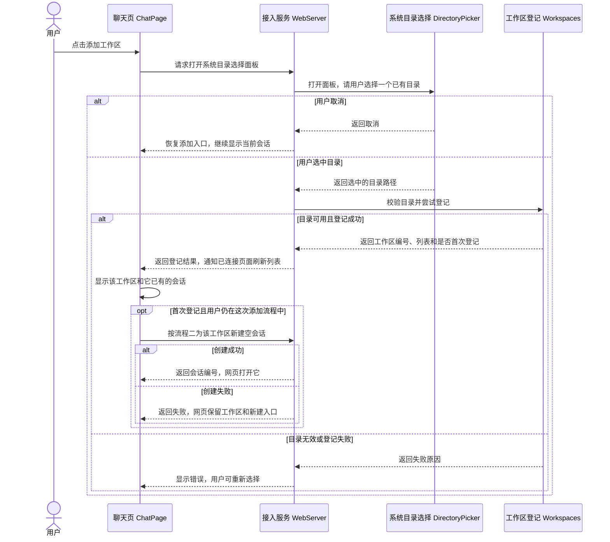
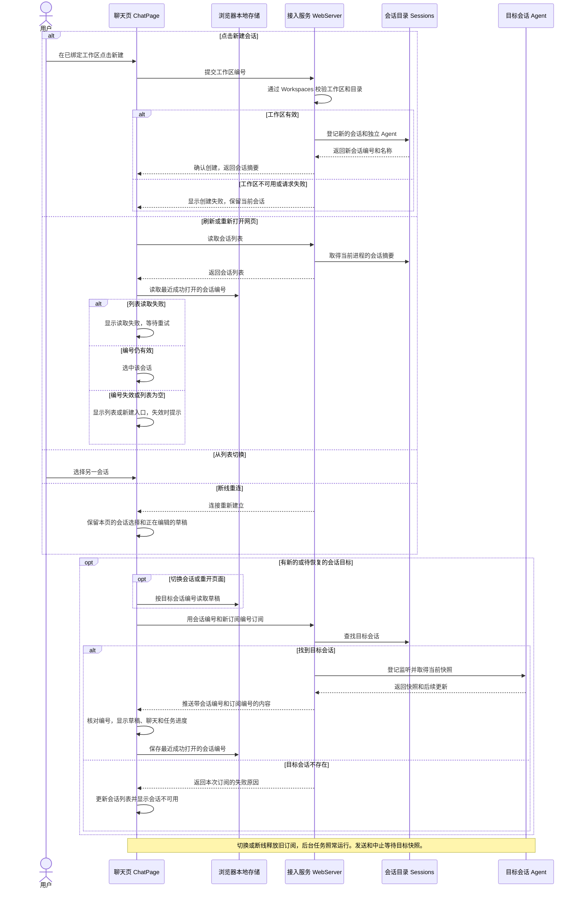
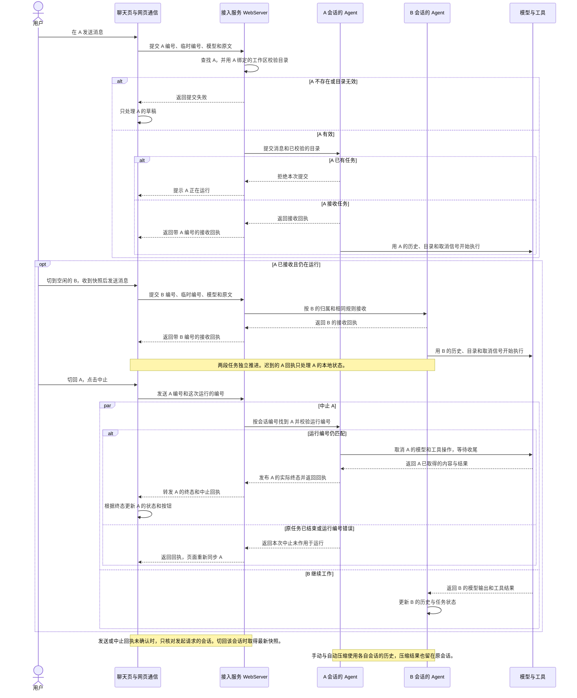

# Feature8 基础 Session 机制设计讨论

## 已确认的需求

同一工作区可以新建、列出和切换多个会话。每个会话由后端分配稳定编号，从空历史开始，切回后可继续。消息、实际模型输入中的会话历史、工具调用及结果、压缩摘要和边界、token 统计及运行状态按会话隔离。提交、实时更新和中止都归属目标会话，编号无效时明确报错。

只要后端服务还在运行，刷新或断线重连后就能重新打开已有会话。会话共用工作区文件，新建和切换本身无需调用模型或工具。项目说明加载由功能 9 负责，会话落盘和重启后恢复由功能 10 负责。用户于 2026-11-09 确认范围，允许参考 Hermes，并要求由用户决定与 Pi 不同的关键做法。需求与验收见[里程碑 1 规划](../README.md#第八步基础-session-机制)。

### 范围更新　支持多个工作区

用户于 2026-11-09 确认当时的并行执行流程，同时要求解除只能添加一个文件夹的限制，客户端参考 DSH，后端参考 Hermes。用户已明确添加的对象是多个已有的本机目录。侧栏按工作区组织会话，每个会话从自己的工作区取得工具目录。已有流程中的工作区选择和目录校验部分按多工作区版本逐条审阅。

现有网页在工作区列表已有项目时禁用添加。后端的登记文件本身保存目录列表，但任务仍通过单个 `boundWorkspaceId` 校验。解除添加限制也需要调整后端目录选择，让它使用会话记录的工作区。[现有添加限制](../../../web/src/pages/ChatPage.tsx#L86) · [后端目录校验](../../../packages/server/src/workspaces.ts#L65)

DSH 把会话列在各工作区下面，并提供按工作区新建会话的动作。它的添加对话框可以选择现有目录，也可以先创建磁盘目录再打开。Hermes 在创建会话时校验目标目录，并在该会话的执行环境中使用它。[DSH 工作区会话入口](../../../deepseek-harness/packages/client/ui-workspace/src/client/rows/WorkspaceBrowser.tsx#L557) · [DSH 添加目录测试](../../../deepseek-harness/apps/web/tests/workspace-management.e2e.ts#L67) · [Hermes 目录校验](../../../hermes/gateway/session_policy.py#L400) · [Hermes 会话目录](../../../hermes/gateway/session_policy.py#L1019)

## 已确认的功能决策

### 1. 允许自由切换和不同会话并行执行

用户于 2026-11-09 明确选择 B。A 运行时可以新建或切到 B，并在 B 启动任务。A 继续在后台执行，切回 A 可以查看进度或中止 A，B 按自己的进度继续。同一会话沿用一次执行一个任务的规则。

现有后端只有一个 `Agent`，它同时持有对话和当前任务。浏览器断线只移除更新订阅，任务仍由后端执行。[当前任务状态](../../../packages/agent/src/agent.ts#L12) · [浏览器订阅](../../../packages/server/src/webserver/index.ts#L347)

Pi 的终端在替换当前会话前先中止并收尾旧任务。Hermes Desktop 的测试设计覆盖另一种行为，A 暂停输出时可新建 B，B 完成一轮后再让 A 继续输出。Hermes 也支持在服务端限制同时运行的会话数。[Pi 会话替换](../../../pi/packages/coding-agent/src/core/agent-session-runtime.ts#L167) · [Hermes Desktop 测试](../../../hermes/apps/desktop/e2e/unread-dot-restart.spec.ts#L102) · [Hermes 运行上限](../../../hermes/gateway/run_busy.py#L295)

| 选项 | 切到 B 后会怎样 | 代价 |
| --- | --- | --- |
| A. 可以切换，同一工作区一次跑一个任务 | A 在后台继续。B 可以查看和写草稿，等 A 完成或中止并收尾后才可发送。 | 后端需要统一判断工作区是否忙碌。长任务会让 B 等待。 |
| B. 可以切换，两个会话也可以同时跑（已选） | A 在后台继续，B 可立即发送。每个会话各自停止和显示结果。 | 两个任务可能同时读写同一个项目文件，覆盖修改或读到中途状态。 |
| C. 先结束 A，再切到 B | A 完成或用户主动中止并收尾后，才可切换。 | 运行期间查看另一段对话也要等待。 |

并行按会话隔离消息、模型输入、任务状态和中止。工具可以访问同一个目录，现有 `edit` 会读取原文再写回，同时编辑同一个文件可能覆盖先完成的修改。[本地文件编辑](../../../packages/server/src/local-tools.ts#L146)

### 2. 重新打开会话与草稿归属

用户于 2026-11-09 确认按 DSH 的方式保存草稿。每个会话的草稿按编号保存在同一浏览器，切回、刷新、关闭标签页再新开后，只要原会话还在，就能继续编辑。两个标签页编辑同一个会话时，共用一份保存记录，后保存的内容可能覆盖先保存的内容。

DSH 网页也把最近打开的会话编号存入同一浏览器，等会话列表准备好后重新打开仍存在的会话。已有网页测试覆盖恢复正在输出的回复，以及切换和刷新后恢复各自的草稿。[DSH 会话选择](../../../deepseek-harness/packages/client/ui-workspace/src/client/navigation.ts#L442) · [草稿读取](../../../deepseek-harness/packages/client/ui-conversation/src/client/stores.ts#L43) · [刷新恢复运行测试](../../../deepseek-harness/apps/web/tests/session-replay-reload.e2e.ts#L47) · [切换与刷新恢复草稿测试](../../../deepseek-harness/apps/web/tests/draft-initialization.e2e.ts#L410)

## 架构复议　引入 coding-agent（边界已确认）

用户提出引入 `coding-agent`，统一承接现有工具实现、会话保存与恢复、压缩以及 `Sessions` 管理。现有 `Agent` 同时做通用模型工具循环、会话快照和压缩，`WebServer` 直接装配工具。会话与执行之间的边界变化影响流程二和流程三的模块分工。添加工作区的用户流程和已确认的会话并行、草稿与目录归属需求保留。[当前 Agent 状态](../../../packages/agent/src/agent.ts#L12) · [当前自动压缩和超限重试](../../../packages/agent/src/agent.ts#L186) · [当前服务装配](../../../packages/server/src/webserver/index.ts#L99)

Pi 的 `agent` 接收配置和可执行工具，负责模型与工具循环，持有运行中的消息、进度和取消状态。`coding-agent` 的 SDK 从 `SessionManager` 恢复会话上下文并创建 Agent，再用 `AgentSession` 订阅运行事件。完成的消息追加到会话记录，项目目录、提示和工具由外层装配。`AgentSession` 可以在下一次模型响应之前检查压缩。明确超限时，它压缩并通过 `Agent.continue()` 继续。Pi 的 `SessionManager` 管单个会话的记录。本项目的 `Sessions` 列出并查找多个会话。[Pi SDK 装配](../../../pi/packages/coding-agent/src/core/sdk.ts#L411) · [Pi 工具工厂](../../../pi/packages/coding-agent/src/core/tools/index.ts#L195) · [Pi 会话记录](../../../pi/packages/coding-agent/src/core/agent-session.ts#L1147) · [Pi 请求前压缩](../../../pi/packages/coding-agent/src/core/agent-session.ts#L899) · [Pi 运行后恢复](../../../pi/packages/coding-agent/src/core/agent-session.ts#L1943)

用户于 2026-11-09 确认以下边界，并要求单会话执行入口沿用 Pi 的名称 `AgentSession`。

- `agent` 接收消息、模型和工具，执行完整的「模型 → 工具 → 模型」循环，保存执行中的消息与状态，发出通用事件并响应中止。通用工具接口与调度留在这里。
- `coding-agent` 内含 `Sessions` 和单会话执行入口 `AgentSession`。`Sessions` 将会话编号对应到 `AgentSession`。`AgentSession` 持有原始历史、压缩记录、工作区归属、对外任务状态和快照。它准备系统提示、目录和可用工具，把 Agent 的完成消息写入会话记录。现有八种工具的定义、具体实现和运行资源归 `coding-agent`。设置和凭据可由宿主装配后交给工具使用。
- `WebServer` 负责授权、HTTP、WebSocket 和系统目录选择。它按会话编号把提交、中止和订阅交给会话层。现有 `Workspaces` 负责登记和校验目录，`AgentSession` 使用归属的工作区目录。浏览器可以订阅不同会话，每段会话仍有独立运行的 Agent。

已选做法参考 Pi，由 `AgentSession` 在请求前给 Agent 准备有效上下文，收到明确超限后负责压缩，并让 Agent 从已取得的消息和工具结果继续。这让会话层掌握整项任务的生存期，要求 Agent 提供可继续执行的入口。备选做法是由 Agent 保持原有重试流程并向会话层询问是否继续。该做法对当前循环改动较少，会话层与执行层需要在重试中交换更多状态。

网页看到的是 `AgentSession` 的任务状态。底层 Agent 因超限先结束一轮时，整项任务继续显示运行或压缩。用户中止按会话和运行编号送到 `AgentSession`，由它一起取消摘要调用及 Agent 当前运行并等待收尾。保留功能 7 的请求前阈值检查、明确超限后仅重试当前失败请求一次、已执行工具结果可继续使用，以及压缩失败时保留原有效上下文的约定。[功能 7 压缩设计](../../../docs/里程碑1/feature7/feature7-基础上下文压缩技术设计.md#4-技术决策)

沿用当前排期，功能 8 接管进程内的会话保存和恢复，功能 9 接入项目说明，功能 10 接入磁盘保存和重启恢复。三项能力由 `coding-agent` 承接。[里程碑规划](../README.md#第八步基础-session-机制)

## 核心流程

多工作区、并行会话、草稿和 `coding-agent` 分层的需求与关键取舍已确认。三个流程按顺序分别完成流程图与模块核对。已确认的方案汇总在[技术设计整稿](./feature8-基础Session机制技术设计.md)，供实施与验收核对。

1. 添加已有目录作为工作区。登记成功后，网页可以在该工作区使用流程二创建并打开会话。
2. 新建、打开和恢复会话。侧栏选中目标会话，页面恢复草稿、聊天记录和任务进度。
3. 并行执行和中止任务。多个会话可以同时接收任务，各自更新、压缩和中止。

### 流程一　添加已有目录作为工作区（已确认）

用户于 2026-11-09 确认添加流程图及模块分工。整合后的流程二、流程三分别审阅。

用户点击侧栏「添加工作区」，在现有系统面板选中一个已有文件夹，网页把它显示为工作区。首次添加时，按 DSH 的交互在该工作区打开一段空会话。[DSH 添加后打开会话](../../../deepseek-harness/packages/client/ui-workspace/src/client/rows/WorkspaceBrowser.tsx#L1375)



#### 聊天页 ChatPage

**职责**　保持「添加工作区」入口可用，一次完成一个目录的选择。每个工作区行显示其会话及「新建会话」入口，输入区的目录来自当前会话所属的工作区。

**接口新增 0 项，修改 2 项**

- 【修改】添加工作区（页面动作）。等待选择期间阻止重复打开面板。首次登记成功后，网页使用返回的工作区编号进入流程二。重复选择相同目录时沿用已有工作区，显示已有分组和会话。若用户在添加回执到达前已切去别的会话，更新侧栏并保留较新的选择。
- 【修改】新建会话（流程二的页面动作）。从具体工作区行接收工作区编号，按编号提交新建。目录已不可用时显示提示，用户仍可打开其已有会话。

**数据新增 0 项，修改 0 项。** 按 `WorkspaceView` 的编号关联 `SessionSummary.workspaceId`，形成侧栏分组。

#### 网页通信 `chat/client` 与接入服务 WebServer

**职责**　沿用已有 HTTP 和列表变更通知。成功响应标明本次选中的是哪一个工作区，页面直接用该编号处理后续动作。

**接口新增 0 项，修改 4 项**

- 【修改】`getWorkspaces()`。接收并校验新的工作区列表结果。
- 【修改】`pickWorkspace()`。接收取消结果或包含选中工作区编号的登记结果。
- 【修改】`GET /api/workspaces`（HTTP）。返回所有已登记工作区和各自的可用状态。
- 【修改】`POST /api/workspaces/pick`（HTTP）。沿用现有授权检查和一次只开启一个系统选择框的规则。取消时返回 `{ cancelled: true }`。有效选择交给 `Workspaces` 校验和登记，成功时带回结果，沿用 `workspaces_changed` 更新其他页面。注册成功与空会话创建分别反馈，创建空会话失败时工作区仍可从侧栏进入并重试。
- 【沿用】`DirectoryPicker`。系统面板返回选中的目录或取消结果。[现有目录选择器](../../../packages/server/src/directory-picker.ts#L24)

**数据新增 0 项，修改 1 项。** `WorkspacePick` 的成功分支包含 `workspaceId`、`created` 和 `view`。其中 `created` 表示是否首次登记，页面据此判断是否自动打开空会话。

#### 工作区登记 Workspaces

**职责**　记录真实目录和稳定编号。把别名解析为实际路径，在现有文件锁内按路径去重并写入。路径相同复用原编号，路径不同各自登记。目录移走时仍保留其登记并标为不可用。[现有登记](../../../packages/server/src/workspaces.ts#L51) · [DSH 路径去重](../../../deepseek-harness/packages/workspace/workspace/src/index.ts#L510)

**接口新增 0 项，修改 3 项**

- 【修改】`register(path)`。校验路径、实际目录和访问能力，登记或复用工作区，返回编号、是否首次登记和列表。
- 【修改】`view()`。返回各工作区的编号、目录、名称和可用状态。当前选中的会话由网页维护。
- 【修改】`resolveBoundDirectory(workspaceId)` 改为 `resolveDirectory(workspaceId)`。按指定工作区编号查找并校验实际目录，结果供流程二创建会话和流程三开始任务使用。编号不存在或目录不可用时明确拒绝。

**数据新增 0 项，修改 2 项**

- 【修改】`WorkspaceFile`。`workspaces.json` 保留现有的工作区编号和路径。读取时兼容带 `boundWorkspaceId` 的旧文件，以登记列表为准。下一次成功新增时写入新结构。列表损坏继续报错并保留原文件。
- 【修改】`WorkspaceView`。返回 `workspaces`，每条包含原编号、路径、名称和是否可用。工作区列表通过该数据跨服务重启恢复，已发送会话的重启恢复归功能 10。

构造示例

```typescript
const workspaces: WorkspaceFile = {
  workspaces: [
    { id: 'workspace-qinghe', path: '/tmp/青禾' },
    { id: 'workspace-baiyu', path: '/tmp/白榆' },
  ],
}
```

#### 与已确认流程的衔接

- **流程二。** 工作区行提供目标编号。WebServer 校验这个工作区后，将编号写入新会话。浏览器按该编号分组、显示输入区路径。最近打开的会话仍按会话编号恢复，即使同名工作区也能区分。
- **流程三。** 提交时从目标会话取得工作区编号，通过 `resolveDirectory()` 取得目录，再把该目录交给 Agent。会话选中状态只属于网页，任务继续使用开始时取得的目录。参考 Hermes 在目标会话的执行环境里使用该会话的目录，以及目录消失时保留可读聊天的处理。Hermes 的历史列表还可以按 Git 根目录聚合。本项目按用户添加的实际目录分组，添加父目录与子目录时各自拥有工作区编号。[Hermes 执行目录](../../../hermes/gateway/session_policy.py#L976) · [Hermes Git 分组](../../../hermes/hermes_state_sessions.py#L32)

#### 验收覆盖

- **保留旧工作区，集成测试。** 写入带旧绑定字段的工作区文件，其中「青禾」编号为 `workspace-qinghe`。通过工作区选择入口添加「白榆」，核对两个工作区都可用，重启后均能查到且「青禾」原编号保留。复用现有重启及登记用例。[已有工作区集成测试](../../../packages/server/test/webserver.test.ts#L903)
- **重复路径去重，集成测试。** 选择指向「青禾」的符号链接，核对复用 `workspace-qinghe`。页面用返回的登记状态识别已有分组。复用现有别名路径覆盖。[已有别名检查](../../../packages/server/test/webserver.test.ts#L922)
- **添加后打开新会话，真实浏览器组件集成测试。** 在「青禾」已存在的情况下添加「白榆」，核对添加按钮仍可用、两个工作区分组均显示，页面用「白榆」的编号新建并打开空会话。现有用例中添加按钮被禁用的断言按新规则调整。[现有工作区交互测试](../../../web/src/pages/ChatPage.browser.test.tsx#L460)
- **跨工作区执行，端到端测试。** 「青禾」和「白榆」各放一个 `note.txt`，内容分别为「项目是青禾」和「项目是白榆」。在「青禾」发起任务，让受控模型在发出 `read` 调用前等待。切到「白榆」并在其会话读 `note.txt`，随后放行「青禾」的 `read`。核对两次实际工具回填分别为「项目是白榆」和「项目是青禾」。
- **工作区不可用，集成测试。** 保留「青禾」会话，移走它的目录后提交「读 note.txt」，核对请求被拒绝且没有模型或工具调用。通过已有会话订阅仍能查看先前内容。复用现有目录失效和无外发覆盖。[现有目录失效检查](../../../packages/server/test/webserver.test.ts#L929)

本轮复跑现有工作区 Server 集成测试和 Chromium 页面组件测试，共 2 项通过。覆盖现有目录选择、取消、去重、目录失效和登记恢复。新增多工作区场景待实现后执行。

### 流程二　新建、打开和恢复会话（已确认）

用户于 2026-11-09 确认加入 `AgentSession` 后的多工作区流程图及模块，见[技术设计 §3.2](./feature8-基础Session机制技术设计.md#32-新建打开和恢复会话)。下文为此前单工作区版本的确认记录。

用户于 2026-11-09 确认本流程及对应模块。

用户从侧栏新建或打开会话，或刷新、重新打开网页、断线后重连，页面显示目标会话的草稿和后端进度。



#### 聊天页 ChatPage 与输入框 MessageInput

**职责**　管理侧栏选择和输入框。打开目标会话时，按编号恢复草稿。只把当前会话、当前订阅的快照和更新放到页面。创建期间可以切换已有会话。如果创建回执到达时用户已经选了别的会话，新会话进入列表，页面保留用户较新的选择。

**接口新增 2 项，修改 1 项**

- 【新增】新建会话（页面动作）。通过客户端取得后端分配的编号和名称，创建失败时保留当前页面。暂拟用「会话 1」「会话 2」等默认名称区分列表项。
- 【新增】打开会话（页面动作）。从列表或新建回执取得目标编号。等待目标快照时可以写草稿，发送和中止按钮等快照确认后再按现有规则启用。
- 【修改】`MessageInput`（组件契约）。进入目标会话时载入保存的文本。用户编辑时，把更新写回该会话的存储项，保留空格和换行。浏览器存储不可用时，可以继续编辑并在当前页面内保留草稿，页面提示草稿无法在重开后恢复。

**数据新增 2 项，修改 0 项**

- 【新增】最近打开的会话编号。浏览器用它在刷新和新开页面时选择会话。已经打开的标签页各自保持自己的当前选择。多标签页共享最近一次成功打开的记录，刷新时可能恢复另一个标签页最后打开的会话。断线重连使用本页已经选中的编号。
- 【新增】按会话编号保存的草稿原文。浏览器使用 `localStorage` 保存，例如会话 `session-b` 的草稿为 `"  先跑测试\n再整理结果  "`。这份文字供输入框恢复，已发送的消息和任务进度从目标 Agent 获取。服务重启后编号找不到时回到列表，功能 10 负责恢复已发送会话。

#### 网页通信 `chat/client`

**职责**　用现有 HTTP 和 WebSocket 通道查询会话、创建会话和接收目标会话的状态。切换目标后只接收新会话、新订阅的数据。

**接口新增 3 项，修改 1 项**

- 【新增】`getSessions()`（HTTP 客户端）。取得后端会话列表。
- 【新增】`createSession(workspaceId)`（HTTP 客户端）。向后端提交工作区编号，返回新会话摘要。
- 【新增】切换订阅目标（连接操作）。使用当前 WebSocket 切换会话目标或释放当前订阅。连接断开后，以页面当前目标重新订阅。
- 【修改】`subscribe`（连接与订阅）。每次向后端请求快照时同时带上会话编号和新的订阅编号。编号不同的旧帧丢弃，序号出现缺口时重新取得当前会话快照。收到会话列表变更通知后重新读取列表。

**数据新增 0 项，修改 0 项。** 使用 WebServer 的会话摘要和订阅消息。

#### 接入服务 WebServer 与工作区 Workspaces

**职责**　WebServer 执行网页授权检查，处理会话查询和创建，并将订阅交给编号对应的 Agent。Workspaces 校验新会话所用的现有绑定。已有会话的查看可以恢复，即使工作目录暂时不可用，发送仍沿用目录校验。

**接口新增 2 项，修改 1 项**

- 【新增】`GET /api/sessions`（HTTP）。返回当前服务进程登记的会话摘要。网页初次打开和重连时查询。新建成功后复用已有变更通知方式，通知其他已连接的页面更新列表。
- 【新增】`POST /api/sessions`（HTTP）。接收工作区编号。WebServer 通过现有 `Workspaces.resolveBoundDirectory()` 校验工作区，创建成功后以 `201` 返回会话摘要。请求格式错误返回 `400`，绑定或目录无效返回 `409`。网页收到失败结果时显示提示并保留当前会话。
- 【修改】会话订阅（WebSocket）。验证会话编号，并释放当前连接的旧订阅。找到对应 Agent 后发快照，再发更新。会话编号无效时回送带目标和订阅编号的错误，页面可继续使用连接选别的会话。关闭订阅只释放监听和待发送的数据。

**数据新增 1 项，修改 2 项。** 新增创建请求 `CreateSessionRequest`，含 `workspaceId`。修改网页消息类型 `ClientFrame` 和 `ServerFrame`，为订阅请求、快照及更新增加 `sessionId`，并在服务端消息中加入目标不存在及列表变更通知。

#### 会话目录 Sessions 与目标 Agent

**职责**　`Sessions` 在内存中登记稳定编号、工作区归属和对应的 Agent。每个 Agent 已经能独立持有聊天、压缩、更新序号和任务状态，因此每创建一个会话就创建一个 Agent。列表只读摘要。Pi 的内存会话和固定目录归属可作参考，网页切换只替换订阅，已批准的并行行为见决策 1。[Pi 内存会话](../../../pi/packages/coding-agent/src/core/session-manager.ts#L1803) · [当前 Agent 状态](../../../packages/agent/src/agent.ts#L12)

**接口新增 3 项，修改 0 项**

- 【新增】`Sessions.create(workspaceId)`。分配会话编号和空 Agent，登记工作区归属。
- 【新增】`Sessions.list()`。返回会话摘要，供侧栏和页面恢复使用。
- 【新增】`Sessions.get(sessionId)`。按编号查找会话，供接入层定位 Agent。
- 【沿用】`Agent.subscribe(signal)`。首帧提供该实例的完整快照，随后提供自己的连续更新，取消订阅时释放监听。[当前 Agent 订阅](../../../packages/agent/src/agent.ts#L401)

**数据新增 1 项，修改 0 项。** 会话摘要 `SessionSummary` 归 `Sessions`。包含会话编号、工作区编号、名称和创建时间，供侧栏和恢复选择使用。聊天历史和运行快照继续由 Agent 持有。

构造示例

```typescript
const session: SessionSummary = {
  id: 'session-b',
  workspaceId: 'workspace-01',
  name: '会话 2',
  createdAt: '2026-11-09T16:00:00+08:00',
}
```

#### 验收覆盖

- **独立创建，集成测试。** 在有效工作区先后创建 A 和 B，核对编号不同、快照各自为空，模型请求计数为零。
- **目标不存在，集成测试。** 订阅不存在的 `session-missing`，核对收到带目标编号的明确错误。用同一连接再订阅存在的 B，核对取得 B 的快照。
- **切换保留草稿，真实浏览器组件集成测试。** 在 A 写 `"  先跑测试\n再整理结果  "`，在 B 写 `"检查 README"`。切回两段会话，分别核对草稿原文。
- **重开页面恢复草稿，端到端测试。** 在 A 写 `"  先跑测试\n再整理结果  "`，关闭页面并在同一个浏览器环境中重新打开应用，核对通过实际入口重新打开 A，并恢复草稿的空格和换行。
- **运行中刷新，端到端测试。** 复用已有案例的「第一段已经到达」场景。在 A 生成第一段时填入「生成期间编辑的草稿」后刷新，核对 A 的同一任务仍在运行、第一段和草稿都能恢复，模型请求只发生一次。旧案例中刷新清空草稿的断言随此决策调整。[当前 E2E](../../../web/tests/e2e/chat.spec.ts#L10)
- **断线重连，端到端测试。** 复用已有案例中「离线时继续生成的第二段」的场景，核对上线后继续显示 A 的同一任务及新增回复，输入框保留断线前的草稿。[当前 E2E](../../../web/tests/e2e/chat.spec.ts#L77)

本轮已复跑现有「阶段三 SDK 流式对话、历史与生成恢复」。Node 与 Vite 入口共 2 项通过，验证当前单会话刷新和断线恢复。上面的多会话与草稿持久化验收等待实现后执行。

### 流程三　并行执行、压缩与中止（已确认）

用户于 2026-11-09 确认 `AgentSession` 版本的流程图与模块，见[技术设计 §3.3](./feature8-基础Session机制技术设计.md#33-并行执行压缩与中止)。下文保留此前单工作区版本的确认记录。

用户于 2026-11-09 确认本流程及对应模块。多工作区要求涉及从目标会话解析目录的部分，具体调整待补审。

用户在 A 发起任务，切到 B 发起另一项任务，再切回 A 中止。A 保留已产生的内容并等待收尾，B 继续自己的任务。



#### 聊天页 ChatPage 与输入框 MessageInput

**职责**　页面在发送或中止的那一刻记下目标会话，之后用同一个编号处理回执和错误。当前页面只显示所选会话的消息、草稿与按钮状态。A 的提交未确认或正在中止时，B 仍按 B 自己的状态判断能否发送。新切到的会话先取得自己的快照。同一个已同步会话断线时，沿用功能 5 对已知运行的中止规则。

**接口新增 0 项，修改 2 项**

- 【修改】发送（页面动作）。点击发送后按现有规则立即清空本次草稿。用目标会话的快照核对回执和正式消息或压缩记录。明确拒绝时只在原会话恢复原文，前提是用户还没有开始写下一份草稿，且浏览器没有该会话的新草稿。网络或回执异常时保留原会话的未确认状态，切回后用该会话快照核对，沿用现有的手工重试与自动重发边界。
- 【修改】中止（页面动作）。捕获当前会话编号和运行编号。重复点击、等待收尾和失败处理沿用功能 5。回执只更新目标会话的中止状态。目标仍在当前页面时重新同步它，已切走则在切回时取得新快照。

**数据新增 0 项，修改 2 项。** `LocalSubmission` 按会话和临时编号关联回执及正式记录。中止状态 `AbortState` 按会话和运行编号保存处理进度。页面合并消息、显示错误和限制按钮时只取当前会话的条目。

#### 网页通信 `chat/client`

**职责**　通过已有 HTTP 接口交付明确的目标会话，并在把回执交回页面前检查其归属。流式快照和更新沿用流程二的会话编号与订阅编号校验。

**接口新增 0 项，修改 2 项**

- 【修改】`submitMessage(input)`。要求请求带会话编号，校验成功回执来自同一会话和同一次提交。回执匹配失败时按未确认处理。
- 【修改】`abortMessage(input)`。要求请求带会话编号和运行编号，校验回执的两个编号均与请求一致。

**数据新增 0 项，修改 0 项。** 使用 WebServer 的提交和中止契约。

#### 接入服务 WebServer 与工作区 Workspaces

**职责**　根据请求中明确的会话编号选择 Agent。新任务从该会话的登记取得工作区编号，再通过 Workspaces 取得有效目录。中止只需要定位会话和运行，即使工作区目录后来不可用，仍可停止已知任务。

**接口新增 0 项，修改 3 项**

- 【修改】`POST /api/messages`（HTTP）。接收会话编号、原文、模型和临时编号。格式错误返回 `400`，会话不存在返回 `404`。从会话记录取得工作区归属，绑定无效时返回 `409`。目录有效后，把原文和固定目录交给目标 Agent。该 Agent 已忙则返回 `409`，接收后返回 `202` 和该会话的回执。普通消息和 `/compact` 用同一入口，分别得到消息或压缩回执。服务收尾期间拒绝新提交。
- 【修改】`POST /api/abort`（HTTP）。接收会话编号和运行编号，格式错误返回 `400`，会话不存在返回 `404`。只调用目标 Agent 的中止。运行编号仍匹配时等待收尾再回执。若目标任务已结束或编号不同，回执为 `handled: false`，当前运行照常推进。
- 【修改】`WebServer.close()`（服务生命周期）。开始关闭后停止接收新会话和新任务，释放网页连接，等待所有会话的 Agent 停止和收尾，再关闭共用的工具运行环境。工具环境的全局关闭用于退出服务。

**数据新增 0 项，修改 4 项。** `SubmitMessageRequest` 改由 `sessionId` 指定目标，工作区由后端查找。`SubmitMessageAccepted` 在现有回执中加 `sessionId`。`AbortRequest` 和 `AbortResult` 都加 `sessionId`，保留 `runId` 和原来的中止结果语义。会话编号由传输层包装，Agent 原有输入和回执类型继续使用。

构造示例

```typescript
const submission: SubmitMessageRequest = {
  sessionId: 'session-b',
  clientMessageId: 'draft-b-01',
  modelId: 'deepseek-flash',
  text: '读取 b.txt 并告诉我结果',
}

const stop: AbortRequest = {
  sessionId: 'session-a',
  runId: 'run-a-01',
}
```

#### 会话目录 Sessions 与执行 Agent

**职责**　`Sessions` 提供指定会话的 Agent。每个 Agent 用自己的历史、压缩记录和 token 统计准备模型输入，用自己的取消信号执行任务。已接收的任务归该 Agent，网页切换、关闭或断线时继续推进。每个 Agent 沿用一次执行一个任务的规则，因此 A 忙碌时可以在 B 开始任务。停止只作用于目标运行，保留已有消息、工具结果和已发生的文件修改。[现有接收与忙碌检查](../../../packages/agent/src/agent.ts#L35) · [现有中止与收尾](../../../packages/agent/src/agent.ts#L435)

**接口新增 1 项，修改 0 项**

- 【新增】`Sessions.close()`。关闭会话目录的创建入口，对所有登记的 Agent 发出关闭并等待收尾。
- 【沿用】`Sessions.get(sessionId)`。使用流程二的会话查找，取得固定的工作区归属和 Agent。
- 【沿用】`Agent.submit(input)`。在单个 Agent 内检查是否忙碌，接收后异步调用模型和工具。手动压缩也占用该会话的运行位置，自动压缩在原任务内执行。
- 【沿用】`Agent.abort(runId)`。编号匹配时取消本次任务并等待收尾，编号已失效时返回 `false`。Agent 发布实际终态，页面据此恢复按钮。[现有中止](../../../packages/agent/src/agent.ts#L435)
- 【沿用】`Agent.close()`。停止接收任务，取消本实例的当前运行并等待结束。

**数据新增 0 项，修改 0 项。** 每个 Agent 独立持有 `ConversationSnapshot`、运行编号和任务取消信号。`Sessions` 使用流程二的会话归属记录。

Pi 会等待当前 Agent 完成中止收尾。Hermes 同时核对会话与这次运行的代次，DSH 从当前会话发起中止。这里用会话编号和已有运行编号定位目标，保留功能 5 的中止语义。[Pi 中止](../../../pi/packages/coding-agent/src/core/agent-session.ts#L2464) · [Hermes 中止](../../../hermes/gateway/session_authority.py#L837) · [DSH 中止](../../../deepseek-harness/packages/api/session-controller/src/client/sessions/session.ts#L347)

#### 模型 Model 与工具运行环境 ToolRuntime

**职责**　共用现有模型配置、工具定义和本机工具运行环境。每次调用由发起的 Agent 提供独立历史、目录和取消信号，工具结果交还发起它的 Agent。相对路径以本次任务的目录为起点。同一工作区中的会话可以访问同一批文件，同时写同一个文件存在相互覆盖的风险。[现有工具调用](../../../packages/agent/src/agent.ts#L261) · [工具取消信号](../../../packages/server/src/tool-runtime.ts#L100) · [文件编辑](../../../packages/server/src/local-tools.ts#L146)

**接口新增 0 项，修改 0 项**

- 【沿用】模型流式调用和工具执行。模型取得目标 Agent 准备的上下文，工具取得任务目录和取消信号。单个任务的取消只结束使用该信号的操作。

**数据新增 0 项，修改 0 项。** 使用现有模型上下文和工具执行参数，数据归发起任务的 Agent。

#### 验收覆盖

- **并行运行与中止，端到端测试。** 在一个工作区创建 A、B，准备内容分别为「青禾」「白榆」的 `a.txt` 和 `b.txt`。先让 A 读取 `a.txt` 并暂停它的最终回复，再切到 B 读取 `b.txt`，暂停 B 的最终回复，确认两项任务确实重叠。切回 A 中止，核对 A 的实际工具结果仍可查看。再放行 B 的回复，核对 B 正常完成，以及模型请求和工具回填各自使用目标会话的数据。实际网页、HTTP、订阅、模型适配和本地工具都参与验证。
- **同一会话重复提交，集成测试。** A 的模型流正在等待时，向 A 再提交「继续读」，核对 `409`、A 只有一次已接收任务且模型只调用一次。
- **错误运行编号，集成测试。** A、B 都在运行时，把 B 的运行编号和 A 的会话编号组合提交中止。核对返回 `handled: false`，两项任务继续。使用不存在的会话编号的提交拒绝场景见里程碑规划。
- **压缩隔离，集成测试。** A 有包含「青禾」的历史，B 已记录「白榆」。在 A 执行 `/compact`，再检查 B 快照和后续实际模型输入，核对 B 的消息、压缩记录和 token 统计没有被 A 更新，模型输入没有 A 的摘要。复用已有压缩测试的受控模型和快照检查。[现有压缩恢复覆盖](../../../packages/server/test/webserver.test.ts#L800)
- **迟到拒绝，页面组件集成测试。** 在 A 发送「读取 a.txt」并让接收回执等待。切到 B 输入「读取 b.txt」后再让 A 的提交收到明确拒绝。核对 B 草稿和按钮不变，切回 A 时原文和拒绝原因仍可查看。
- **服务关闭，集成测试。** A、B 都正在执行可控任务时停止服务，核对两项任务都收到取消、各自收尾后才关闭共用工具运行环境。复用现有等待运行操作收尾的覆盖。[现有收尾测试](../../../packages/agent/test/agent.test.ts#L688)

本轮复跑现有 Agent 中止和收尾用例 4 项、Server 中止及压缩恢复用例 4 项、Node 与 Vite 网页中止及多轮工具 E2E 共 4 项，12 项全部通过。现有测试验证单会话的接收、中止、收尾和恢复，跨会话并行及隔离仍待功能 8 实现后执行。[Agent 测试](../../../packages/agent/test/agent.test.ts#L471) · [Server 测试](../../../packages/server/test/webserver.test.ts#L121) · [网页中止测试](../../../web/tests/e2e/abort.spec.ts#L10) · [多轮工具测试](../../../web/tests/e2e/react-loop.spec.ts#L10)
