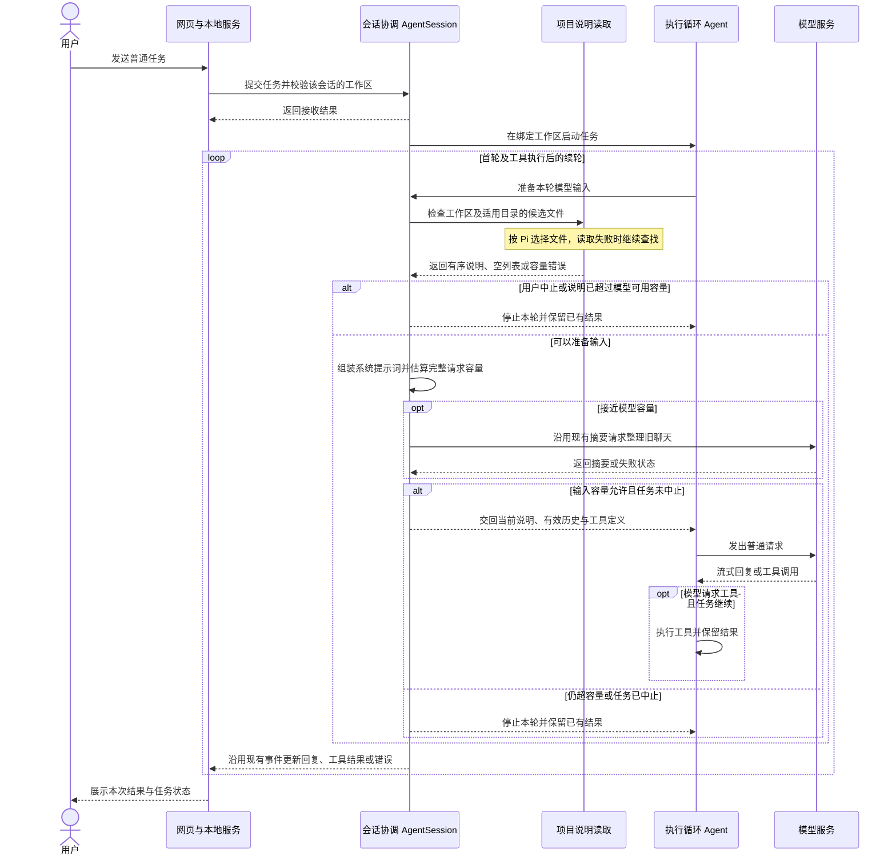

# Feature 9 项目说明加载与启动上下文技术设计

本设计按 2026-11-10 的实现请求执行。已确认的需求、选项和流程图审阅见[设计讨论记录](./feature9-设计讨论记录.md)。

## 1. 总结

用户在任一工作区发送任务时，会话自动读取适用的项目说明，把背景和约定带入实际发给模型的请求。项目说明更新后，下一轮普通模型请求使用当时有效的版本。不同工作区各自匹配说明，同一工作区的多个会话可以共用说明，各自保存聊天历史。没有说明也可以正常聊天，旧聊天压缩后仍可使用项目说明。

会话层在模型调用前按 Pi 的规则读说明，再把来源和全文组装进系统提示词。刷新时机参考 DSH，首轮和工具续轮都检查。执行循环沿用现有的请求准备回调。每次普通请求带一份当前说明，聊天历史单独组装。

## 2. 系统变化说明

- **当前**　正式提交时，会话用工作区、工具简介、通用规则和 si 文档导航生成系统提示词。每轮再加入本会话的有效聊天历史。
- **完成后**　每轮普通模型请求前，系统提示词增加适用的项目说明段。项目说明随系统提示词计入容量。普通回复、工具结果和错误继续通过现有会话事件展示，摘要请求仍使用独立的摘要指令。

## 3. 系统设计

### 3.1 每轮普通任务加载适用的项目说明

用户发送任务后，会话在首轮及工具执行后的续轮准备项目说明，模型结合说明和本会话历史给出回复或工具调用。



#### 会话协调 `AgentSession`（修改）

**职责**　用提交时校验过的工作区准备每轮普通模型输入，把项目说明、工具定义和当前有效的聊天历史组装到一起。会话各自持有本轮说明和历史。同一会话只有正在执行的任务可以准备和更新其输入。

**接口（新增 0 项，修改 2 项）**

- 【修改】`AgentSession` 构造配置。接收本地服务提供的全局说明目录。
- 【修改】`prepareContext`（交给执行循环的请求准备回调）。在首轮、工具续轮及已有超限恢复后的普通请求前获取当前说明，再估算本轮容量。自动压缩如能缩短聊天，普通请求用本轮已准备的说明和新的有效历史。用户中止时收尾并保留已有结果。仍无法容纳时沿用现有任务错误。模型明确返回超限后的单次恢复沿用 Feature7。
- 【沿用】`submit`（会话提交）。沿用接收回执、工作区校验和忙碌检查。打开草稿、切换或恢复网页订阅仍只执行原有页面与订阅操作。
- 【沿用】`/compact`（手动整理聊天）。摘要请求沿用自己的提示词，项目说明单独保留供普通请求使用。手动压缩的前后容量按会话当前已准备的说明和两份聊天历史估算。

**数据（新增 0 项，修改 0 项）**

- 【沿用】`ModelContext` 是发给模型的输入。`systemPrompt` 放本轮说明和已有系统提示词。`messages` 仍由该会话的聊天历史和压缩摘要形成。项目说明每次普通请求带一份当前版本，消息历史仅累积聊天和工具内容。不同会话分别准备自己的输入。说明变化时重新估算容量，已有实际用量样本仅在对应模型与提示词一致时沿用。

#### 项目说明读取 `loadProjectContextFiles`（新增）

**职责**　按 Pi 规则查找、读取、排序并返回说明。只读取固定候选文件，保留候选路径作为来源。嵌套 Git 工作树沿用 Pi 的遮蔽规则，工作树有同名说明时跳过上层主工作区的同名副本。

**接口（新增 1 项，修改 0 项）**

- 【新增】`loadProjectContextFiles`（会话层内部调用）。接收会话绑定目录、应用全局说明目录、由当前模型容量推导的正文读取上界和停止信号。每个目录取首个可读取的普通文件，按全局说明、外层到工作区的目录说明排序。允许链接指向普通文件。打开后核实实际打开的目标仍是普通文件，避免文件被替换后等待特殊文件。候选缺失、目标不是普通文件或读取失败时继续查找，读取失败在本地日志保留路径和原因。没有文件时返回空列表，停止时关闭已打开的文件。读取选中的正文时使用同一模型容量约束内存占用。已能判断正文单独就装不下时，向会话返回容量错误。

**数据（新增 1 项，修改 0 项）**

- 【新增】`ProjectContextFile` 保存候选文件的路径与正文。读取模块创建，会话用它组装当前模型请求，路径用于标记说明来源。它不进入网页聊天快照。

构造示例

```typescript
const file: ProjectContextFile = {
  path: '/project/AGENTS.md',
  content: '运行项目检查前，先阅读 README.md。',
};
```

#### 系统提示词组装 `buildSystemPrompt`（修改）

**职责**　把适用说明放在独立的项目说明段，保留每份来源路径。

**接口（新增 0 项，修改 1 项）**

- 【修改】`buildSystemPrompt`（会话层内部调用）。接收有序的 `ProjectContextFile` 列表，在普通任务的系统提示词中按序加入来源和正文。无说明时沿用原有内容。有说明时即使未提供工具，模型仍能收到说明。

**数据（新增 0 项，修改 0 项）**

- 【沿用】输出仍是普通任务的系统提示词字符串。`ProjectContextFile` 归读取模块。

#### 本地服务 `WebServer`（装配修改）

**职责**　创建会话时提供本应用的全局说明目录。正式入口使用 `~/.agent-learning/`。测试可以指定临时目录，以便验证全局说明而不读取本机的真实配置。

**接口（新增 0 项，修改 1 项）**

- 【修改】`WebServer` 构造配置。允许装配方提供全局说明目录。网页提交与订阅仍使用原有协议。

**数据（新增 0 项，修改 1 项）**

- 【修改】`WebServerOptions` 增加可选的全局说明目录。会话接收目录位置并交由项目说明读取模块使用。

#### 执行循环、模型服务与网页（沿用）

**职责**　`Agent` 等本轮输入准备好后调用模型，执行工具后再进入下一轮。模型模块把系统提示词转换为请求中的 `system` 消息。网页沿用接收回执、流式结果与任务错误的展示。

**接口（新增 0 项，修改 0 项）**　沿用 `Agent.run`、模型流式请求和网页现有提交与订阅。

**数据（新增 0 项，修改 0 项）**　沿用模型请求和会话更新的数据结构。

## 4. 技术决策

### 【功能决策｜会话层】采用 Pi 的说明发现和提示词组织

每个目录按 `AGENTS.override.md`、`AGENTS.md`、`AGENTS.MD`、`CLAUDE.md`、`CLAUDE.MD` 的顺序取第一个可读的普通文件。从绑定工作区向上一直查到文件系统根目录。用户目录在这条路径上时一并检查。全局说明来自本应用配置目录，放在最前面，其余按从外层到工作区排列。同一路径只加入一次，嵌套工作树沿用 Pi 的同名遮蔽。系统提示词用独立的 `project_context` 段标明每份来源和内容。[Pi 文件发现](../../../pi/packages/coding-agent/src/core/resource-loader.ts#L184) · [Pi 说明段](../../../pi/packages/coding-agent/src/core/system-prompt.ts#L79)

### 【功能决策｜会话层】采用 DSH 的普通请求前更新时机

开始准备普通模型请求时检查磁盘。文件新增、改写、删除影响下次请求，发出的请求继续使用当时的内容。本期按 Pi 确定适用范围，因此工具到达更深的目录时仍使用已确定的目录链。DSH 把更新存成会话消息，本项目每轮把当前说明组装在系统提示词里。这样一份说明在一次请求中只出现一次，压缩仍只整理会话历史。[DSH 请求前检查](../../../deepseek-harness/packages/context/agent-instructions/src/index.ts#L334) · [DSH 版本核对](../../../deepseek-harness/packages/context/agent-instructions/src/state.ts#L371)

### 【工程决策｜项目说明读取】跟随 Pi 的符号链接规则

候选路径是符号链接时，若目标为可读的普通文件，使用目标全文，保留候选路径作为来源。候选缺失或不可读时继续按顺序查找。[Pi 候选读取](../../../pi/packages/coding-agent/src/core/resource-loader.ts#L184)

### 【工程决策｜会话层】说明全文使用现有模型容量

采用 Pi 全文规则，沿用当前模型的容量和回复预留。读取时用同一容量限制预先拦住明显无法放入的正文，仍可放入的说明保留全文。正常请求的其余内容过大时，按 Feature7 整理历史或提示超限。说明自身超限时提示精简说明。[现有容量校验](../../../packages/coding-agent/src/agent-session.ts#L217)

## 5. 风险与边界

### 风险 1　工作区中的链接可以指向工作区外的文件

- **案例**　下载的项目把 `AGENTS.md` 链接到本机其他文件。只要目标是服务可读的普通文件，其内容就可能进入发给模型的请求，含密钥的文件也适用这条读取规则。
- **处理**　用户已确认沿用 Pi 的链接行为。候选校验与验收会覆盖这一边界，诊断日志只记录候选路径和失败原因。全局、祖先及链接目标的内容应按可能随模型请求发送的信息对待。

### 风险 2　说明占据模型容量后，旧聊天压缩也可能腾不出空间

- **案例**　全局和项目说明很长，或同一任务执行工具后说明被替换为大文件。仅说明就已装不下时，这轮模型请求无法发出。
- **处理**　按所选模型的容量检查说明，复用已有任务错误提示缩短说明。保留已接受的消息和已完成的工具结果。预计剩余空间不足时，按既有规则整理旧聊天后再判断。

### 风险 3　每轮读文件增加模型调用前的等待

- **案例**　工作区或祖先目录在响应较慢的文件系统上，多轮任务会重复等待说明读取。
- **处理**　每个目录检查固定候选，首版以当前读取结果为准。用户中止后收尾并停止本轮请求。后续若实测等待明显，再评估按文件版本复用已读内容。

## 6. 验收标准

[独立验收标准](./feature9-验收标准.md)覆盖文件发现、逐轮使用和隔离、压缩与容量、真实模型使用。自动化检查出站请求和会话状态，真实模型验收从网页发首条任务并同时核对实际请求与可见回答。已有覆盖与功能 9 待执行的案例分别记录。

## 7. 文件变更

### 会话协调

| 文件 | 类型 | 用途 | 变更 |
| --- | --- | --- | --- |
| `packages/coding-agent/src/agent-session.ts` | 修改 | 会话输入与容量协调 | 提交时组装普通提示词 → 每轮结合适用说明准备普通请求，压缩沿用独立摘要请求。 |
| `packages/coding-agent/test/agent-session.test.ts` | 修改 | 验证会话请求及中止 | 增加说明更新、重复调用和读取中止的检查。 |
| `packages/coding-agent/test/agent-compaction.test.ts` | 修改 | 验证压缩和超限 | 原提示词及摘要断言 → 补充说明在普通和摘要请求中的归属、容量错误及恢复验证。 |

### 项目说明读取

| 文件 | 类型 | 用途 | 变更 |
| --- | --- | --- | --- |
| `packages/coding-agent/src/project-context.ts` | 新增 | 读取适用的说明文件 | 按候选顺序读取和排列说明，处理回退、符号链接、工作树、取消和容量。 |
| `packages/coding-agent/test/project-context.test.ts` | 新增 | 验证文件规则 | 覆盖候选顺序、读取失败、路径范围、符号链接和嵌套工作树。 |

### 系统提示词组装

| 文件 | 类型 | 用途 | 变更 |
| --- | --- | --- | --- |
| `packages/coding-agent/src/system-prompt.ts` | 修改 | 组装普通系统提示词 | 固定提示词段落 → 同时加入当前适用的项目说明和来源。 |
| `docs/prompts/systemPrompt.md` | 修改 | 说明普通请求中的提示词 | 当前组装说明 → 说明普通请求何时带项目说明及其位置。 |

### 本地服务

| 文件 | 类型 | 用途 | 变更 |
| --- | --- | --- | --- |
| `packages/server/src/webserver/index.ts` | 修改 | 正式入口装配 | 创建会话时提供工作区与工具 → 同时提供全局说明目录。 |
| `packages/server/test/webserver.test.ts` | 修改 | 验证正式提交与模型请求 | 在首发和跨会话用例中核对工作区说明、会话历史及缺少说明时的请求。 |
| `web/tests/e2e/project-context.live.spec.ts` | 新增 | 验证真实用户路径 | 从网页首发任务，核对真实模型输入和回答。 |

### 其他

| 文件 | 类型 | 用途 | 变更 |
| --- | --- | --- | --- |
| `planning/里程碑1/feature9/feature9-验收标准.md` | 新增 | 独立验收标准 | 列出验收场景、证据要求和执行状态。 |
| `README.md` | 修改 | 说明使用方式 | 工作区和会话说明 → 补充自动加载、更新时机与适用范围。 |
