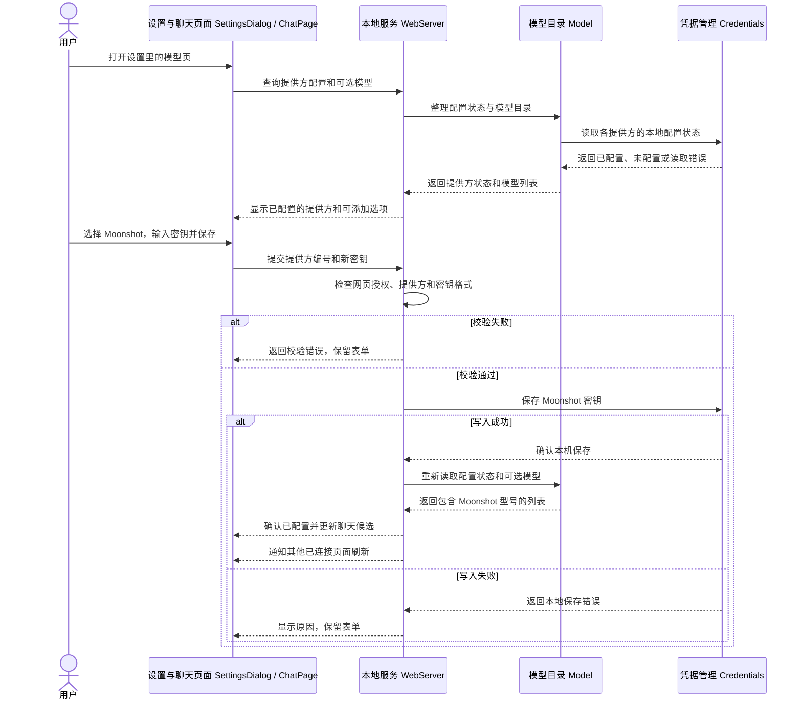
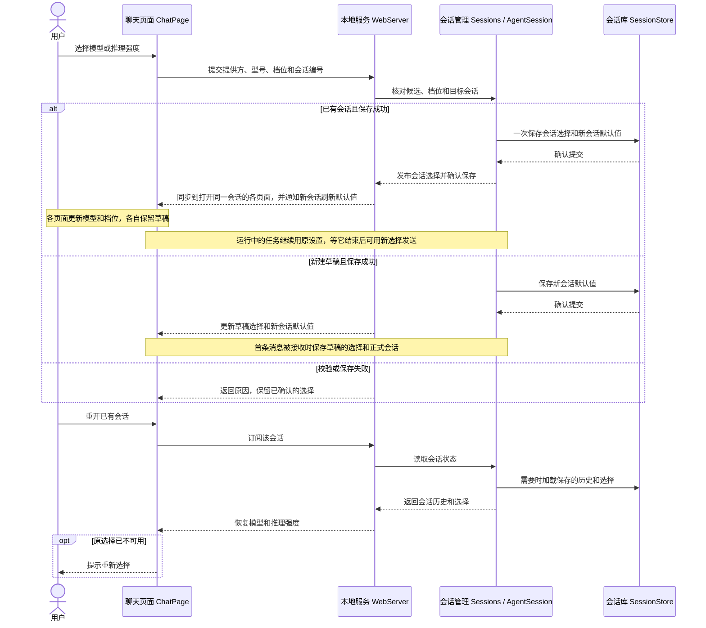
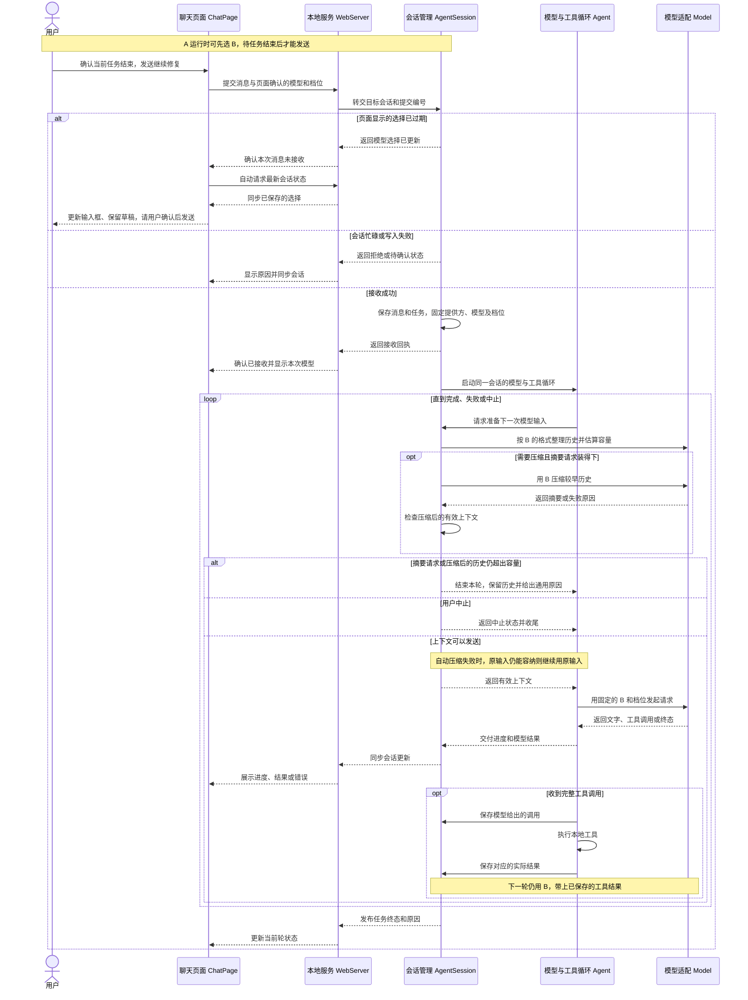

# 里程碑 2 Feature 1 多模型供应商与模型切换技术设计

状态为**已实现，真实验收按型号记录**。见 [验收记录](./feature1-多模型供应商与模型切换验收记录.md)。

## 1. 总结

**需求理解**　用户在本地网页的「设置 → 模型」查看已配置的提供方，也可以从「添加提供方」选一家还未配置的提供方，填写 API Key 并保存。保存完成后该提供方的模型立即可选，远端认证结果在实际请求时反馈。本期覆盖规划中的九家提供方，凡 Pi 能通过本期 API Key 入口接通、适合文本编程任务并支持工具调用的模型，都开放选择。聊天菜单按提供方分组并可搜索，用户可选模型和该模型支持的推理强度。已建立的会话在选择时保存设置，同时更新新会话默认值。任务运行期间也可以先选下一次的模型和档位，等当前任务结束或确认中止后再发送。每次任务按接收时确定的模型和档位执行，容量不足时用该模型压缩历史，压缩仍无法满足容量时结束这轮并给出通用红字提示。

**技术方案**　模型层复用 `pi-ai` 的目录和协议适配，将服务商输出转换为项目已有的流式事件。凭据模块按提供方保存本机 Key。会话层把模型选择与新会话默认值写入现有 `sessions.sqlite`，在接收消息时固定任务使用的提供方、模型与推理强度。设置页和聊天页根据服务端确认的状态更新。

**实施取舍**　运行依赖固定在 `@earendil-works/pi-ai@1.5.2`。Moonshot 中国区从该版本的目录提供 Kimi K3.1 Pro 和 Kimi K3。MiniMax 中国区提供 M3 和 M3.1 Flash。Google AI Studio 目录以 Gemini 3.7 Flash 的正式发布日期 2026-08-13 为下限，使用固定型号 ID。目录提供 Gemini 3.7 Flash、3.8 Flash、4 Argon、4 Carbon 和 4 Hydrogen。Gemini 4 Hydrogen 和 Carbon 以 Google 官方模型元数据补入目录，复用 Pi 的 Gemini 原生流式协议。切到 Gemini 4 时，外部模型的工具历史以文字进入请求，同型号的 Gemini 工具记录保留原始签名。DeepSeek Flash 复用已有的流式校验、断流检测和工具解析，并补齐跨供应商历史转换与推理档位；其余模型由 Pi 发起请求。百炼中国仅提供普通 API Key 入口下的 Qwen 系列，智谱使用开放平台 API Key。单次输出上限取目录上限、65,536 和模型容量四分之一中的最小值，容量估算与 SDK 请求使用同一上限。

## 2. 系统变化说明

**Before**　模型目录与设置接口只接入 DeepSeek Flash。推理强度在请求中固定为 High。会话库保存历史和每次任务使用的模型编号。网页根据当前列表选择模型，会话快照还没有保存的模型和推理强度。 [模型目录](../../../packages/model/src/deepseek.ts#L11) · [网页选择](../../../web/src/pages/ChatPage.tsx#L229) · [会话恢复](../../../packages/coding-agent/src/agent-session.ts#L47)

**After**　配置的提供方在聊天菜单中贡献可选模型。用户的模型和推理强度随会话恢复。任务记录固定该轮实际使用的设置，会话历史可经适配后交给新模型。提供方整组隐藏已从本期范围移除。认证使用本机 API Key。

## 3. 系统设计

### 3.1 配置提供方后，在聊天里选到它的模型

用户在设置中保存提供方的 API Key，服务端返回新的本地配置状态与可选模型。以下用 DeepSeek 已配置、用户添加 Moonshot 举例。



#### 设置与聊天页面 `SettingsDialog`、`ChatPage`

**职责**　显示已配置的提供方和添加入口。添加列表过滤已配置的提供方。保存成功后清除输入的 Key、更新已配置列表和聊天候选。编辑和删除已有 Key 走同一条刷新链路。保存失败时在表单内提示，用户可重试。聊天候选按提供方分组并可搜索。

**接口新增 0 项，修改 3 项**

- 【修改】`getModels()`（网页请求）。读取提供方状态、模型列表及 §3.2 的新会话默认值。
- 【修改】`saveApiKey(providerId, apiKey)`、`deleteApiKey(providerId)`（网页请求）。把操作定位到提供方，使用返回的数据更新设置与聊天候选。

**数据新增 0 项，修改 0 项**　消费 `ModelDiscovery`。Key 输入由设置表单暂存，服务端的响应只包含状态与模型信息。

#### 本地服务 `WebServer`

**职责**　校验配置请求，转交凭据模块，并同步保存结果。

**接口新增 0 项，修改 3 项**

- 【修改】`GET /api/models`（HTTP）。返回每个提供方的本地配置状态和可选模型。
- 【修改】`PUT /api/providers/:providerId`（HTTP）。检查网页授权、请求来源、目录中的提供方编号和 Key 格式。调用 `Credentials.saveApiKey()` 写入或替换。收到写入确认后返回最新状态，并通过 `models_changed` 通知其他页面。保存期间只执行本地操作。格式或写入错误返回脱敏原因，未收到回执的页面可重新查询。
- 【修改】`DELETE /api/providers/:providerId`（HTTP）。删除该提供方的 Key 后返回新列表，并通知其他页面刷新。已有会话选到不可用模型的行为见 §3.2。

**数据新增 0 项，修改 0 项**　使用模型层的 `ModelDiscovery` 和 §3.2 的默认选择。

#### 模型目录 `Model`

**职责**　用已接通的提供方入口和 Pi 目录生成可选模型，根据本机配置状态决定哪些模型出现在聊天菜单。

**接口新增 0 项，修改 1 项**

- 【修改】`discoverModels()`（进程内调用）。读取本期提供方的凭据状态，将已配置入口的文本工具模型返回给服务。目录中每个模型对应实际调用协议、容量和推理能力。

**数据新增 0 项，修改 2 项**

- 【修改】`ModelDiscovery`。从单个 DeepSeek 状态扩为提供方状态列表与可选模型列表。服务和网页用同一份结果显示「已配置」和筛选候选。
- 【修改】`ModelInfo`。已有提供方、模型编号、容量等字段。补充可调推理档位与默认档位，供 §3.2 的菜单和 §3.3 的请求准备使用。

构造示例。只展示一个已配置的提供方和一个待添加的提供方，模型信息节选。

```typescript
const modelDiscovery = {
  providers: [
    { id: 'deepseek', name: 'DeepSeek', status: { state: 'configured' } },
    { id: 'moonshotai-cn', name: 'Moonshot', status: { state: 'missing' } },
  ],
  models: [
    { provider: 'deepseek', id: 'deepseek-flash', name: 'DeepSeek Flash' },
  ],
}
```

#### 凭据管理 `Credentials`

**职责**　按提供方管理本机 API Key。

**接口新增 0 项，修改 0 项**　沿用 `readStatus()`、`saveApiKey()`、`deleteApiKey()` 与文件变更监听。凭据文件写入失败时保留已保存的配置。文件损坏时返回读取错误，保留原文件。

**数据新增 0 项，修改 0 项**　沿用 `auth.json` 和 `CredentialStatus`。Key 保存在本机文件，由模型层在发起请求时读取。

### 3.2 选择模型和推理强度，重开会话后恢复

用户在聊天菜单选模型或档位。服务端保存选择后同步给页面。重新进入已有会话时恢复该会话的选择，新会话继承最近一次已保存的默认值。



#### 聊天页面 `ChatPage`

**职责**　输入框显示下次发送所选的模型与档位，任务记录显示该次任务实际使用的模型与档位。同一会话在另一个页面改选时，当前页面收到服务端更新后自动更新输入框，保留草稿。换模型时带入目标模型默认档位。有可调档位时才显示「推理强度」入口。当前任务运行或中止收尾期间，可以为下一条消息选模型、调档位并编辑草稿。服务端确认当前任务结束且选择保存成功后才允许发送。会话模型已不可用时提示重新选择。

**接口新增 1 项，修改 0 项**

- 【新增】`saveModelSelection()`（网页请求）。确认选择时提交整组设置。保存失败显示原因。回执不明时同步服务端状态后再允许发送。配置刷新沿用 §3.1 的 `getModels()`。

**数据新增 0 项，修改 0 项**　已有会话使用服务端同步的 `ModelSelection`，新建草稿使用新会话默认值。菜单候选和档位来自 `ModelInfo`。

#### 本地服务 `WebServer`

**职责**　接收选择，返回保存结果，并把会话选择和新会话默认值交给页面。

**接口新增 1 项，修改 1 项**

- 【新增】`PUT /api/model-selection`（HTTP）。请求带提供方、模型编号和档位。带会话编号时更新该会话的下次选择与新会话默认值，运行中的会话也可保存。新建草稿没有会话编号，只保存默认值。服务端校验后调用会话管理，收到持久化确认才返回成功。不存在的会话、不可用的模型和不适用的档位都返回明确原因。
- 【修改】会话 WebSocket 订阅（实时通道）。快照带上已保存的选择，变更时把会话更新发给所有订阅该会话的页面。连接恢复或更新序号不连续时沿用现有快照恢复。新会话默认值随 §3.1 已统计的 `GET /api/models` 返回，变更沿用 `models_changed` 通知。 [现有快照恢复](../../../web/src/chat/state.ts#L146)

**数据新增 0 项，修改 0 项**　HTTP 请求和回执使用会话层的 `ModelSelection`。模型列表的默认选择由服务附上，模型目录自身只读取提供方和模型。

#### 会话管理 `Sessions`、`AgentSession`

**职责**　确认选择归属的会话，持久化确认后更新该会话的下次选择。重开时优先恢复明确保存的选择。早期会话可以从已有任务模型记录恢复，旧 DeepSeek Flash 使用既有的 High。没有会话选择或旧任务时使用新会话默认值。已保存的选择后来不可用时，页面提示用户重新选。

**接口新增 2 项，修改 0 项**

- 【新增】`Sessions.selectModel()`（进程内调用）。用目录核对提供方、模型与档位，形成可保存的整组选择。有会话编号则交给对应会话处理。新建草稿直接保存默认值。
- 【新增】`AgentSession.selectModel()`（进程内调用）。同一次存储操作提交会话的下次选择和默认值，成功后同步给已订阅的网页。已接收任务继续使用接收时固定的设置。

**数据新增 1 项，修改 2 项**

- 【新增】`ModelSelection`。会话库保存的选择包含提供方、模型编号和可用的推理强度。服务、网页和任务准备共用这个含义。没有可调档位的模型省略档位。
- 【修改】`ConversationSnapshot` 与 `ConversationUpdate`。同步当前会话保存的选择。快照用于重开和重连，更新用于同一会话在多个页面中同步。

构造示例。

```typescript
const selection: ModelSelection = {
  provider: 'deepseek',
  modelId: 'deepseek-flash',
  reasoningEffort: 'high',
}
```

#### 会话库 `SessionStore`

**职责**　把当前会话选择和新会话默认值保存在 `sessions.sqlite`。两者用同一个 SQLite 事务提交。若确认回滚，两处仍使用上一次已保存的值。若提交结果不明，沿用现有存储错误处理，服务端同步确认前不反馈保存成功。

**接口新增 2 项，修改 1 项**

- 【新增】`saveModelSelection()`、`getDefaultSelection()`（进程内调用）。前者支持保存指定会话与默认值，或单独保存默认值。后者供模型查询和新会话读取默认值。
- 【修改】`loadSession()`（进程内调用）。加载历史时读取保存的选择。旧库用新增表兼容，已有记录可直接读取。

**数据新增 1 项，修改 1 项**　新增 `model_selections` 保存每个会话一份选择和全局一份默认值。修改 `SessionHistory`，加载时包含会话选择。新建草稿的选择随首条消息和会话登记一同写入。已存在会话的选择优先于默认值。

### 3.3 用新模型继续同一会话

用户可以在任务运行中先切到另一个模型。等当前任务结束或确认中止后，再用新的选择发送。服务端在接收时固定本次任务的设置，按该模型的格式和容量准备历史。需要压缩时由本次任务固定的模型处理。



#### 聊天页面 `ChatPage`、本地服务 `WebServer`

**职责**　把页面已确认的选择随消息提交，并根据回执和订阅显示本次任务的模型与状态。

**接口新增 0 项，修改 2 项**

- 【修改】`POST /api/sessions/start`、`POST /api/messages`（HTTP）。发送原文、提交编号、会话或工作区，以及输入框当时显示的完整选择。若发送恰好早于选择同步，服务端在接收新消息前返回 `409 model_selection_changed`。已有会话自动重新订阅快照，新建草稿重新读取默认值。页面保留草稿并提示「模型设置已更新，请确认后再发送。」用户看到新设置后主动发送。相同提交编号和相同内容继续返回原回执，变更模型或档位的请求须用新的提交编号。中止沿用现有接口。 [现有草稿恢复](../../../web/src/pages/ChatPage.tsx#L373)

**数据新增 0 项，修改 2 项**　`StartSessionRequest`、`SubmitMessageRequest` 使用 §3.2 的 `ModelSelection`。已有任务恢复时按已保存的任务记录展示实际选择。

#### 会话管理 `AgentSession` 与会话库 `SessionStore`

**职责**　接收时保存任务选择，在每次模型请求前准备项目说明、工具与会话上下文。以前的有效摘要、聊天和工具结果可以继续使用。只有调用记录的工具按现有「结果未知」规则进入模型上下文。

**接口新增 0 项，修改 3 项**

- 【修改】`submit()`（进程内调用）。检查会话空闲、选择已确认和提交编号是否已接收，保存消息与任务设置后返回接收回执。首发保存会话登记和初始选择。对重试先核对原回执，后续的模型选择不会改写已接收任务。
- 【修改】`prepareContext`（每轮请求前的回调）。按本次任务固定的提供方、型号和实际请求格式重新估算容量。上一个模型的实际用量只用于它自己的记录。接近上限时用本次任务的模型自动压缩。提供方明确报容量超限时沿用现有压缩恢复次数和工具结果保护。
- 【修改】`compact()`（进程内调用）。手动压缩使用接收 `/compact` 时的选择，自动压缩使用本次任务接收时固定的模型及档位。摘要通过容量与缩短检查且写入成功后，才替换有效上下文。自动压缩失败时保留原有效历史，原输入仍能容纳就继续。摘要本身装不下或压缩后仍超限、导致本轮无法继续时，压缩卡片说明原因，本轮红字显示「当前模型容量不足，无法继续这轮，请切换模型重新压缩。」用户中止时结束本轮。 [已有压缩失败规则](../../../docs/里程碑1/feature7/feature7-基础上下文压缩技术设计.md#L537)

**数据新增 0 项，修改 1 项**　`RunRecord` 增加提供方和推理强度，已有模型编号保留。新任务持久化本次选择。读取旧任务时兼容缺失字段，已知的旧 DeepSeek Flash 设置按原有行为恢复。任务记录与会话的下次选择分别取自各自保存的数据。

#### 模型与工具循环 `Agent`

**职责**　让模型和本地工具交替执行，直到本轮结束。工具的调用和结果保持配对。用户中止后停止后续请求，等已启动的操作收尾并保存已知结果。

**接口新增 0 项，修改 2 项**　`run()` 和 `continue()` 通过 `AgentRunInput` 接收本次档位，与已接收的模型一起传给每次模型调用。现有工具参数校验、写入关口与中止信号继续生效。

**数据新增 0 项，修改 1 项**　`AgentRunInput` 携带本次档位。后续页面选择从下一次提交生效。

#### 模型适配 `Model`

**职责**　根据提供方、模型和接口协议发起真实请求。调用前读取对应 Key，在项目历史和 Pi 的请求结构之间转换。模型层转交流式文字、思考、工具调用、终态和实际用量。

**接口新增 0 项，修改 4 项**

- 【修改】`findModel()`（目录查询）。使用提供方和模型编号共同定位，避免不同提供方的同名型号混用。
- 【修改】`estimateContextTokens()` 与 `estimateMessageTokens()`（容量估算）。按当前目标模型可接收的历史格式估算输入，并使用该模型的容量和输出预留。
- 【修改】`stream()`（流式调用）。使用 `pi-ai` 按模型协议发送，传递已确认的档位、中止信号和对应 Key。源模型和目标模型一致时保留协议要求回传的字段。模型不同时使用 Pi 的历史转换，保留可用文字及成对的工具调用和结果。模型适配把文字、思考、工具、认证失败、限流和中止映射到项目事件。终态或取消后结束迭代并释放请求资源。确认来自服务商的用量才进入实际用量字段。Pi 初始化的零值和来源不明的字段留空。 [Pi 流式输出初始化](../../../pi/packages/ai/src/api/openai-completions.ts#L319)

**数据新增 0 项，修改 1 项**　`AssistantMessage` 保存提供方要求下次原样回传的必要字段。适配层只在适用的目标上使用这些字段。网页收到可展示内容、模型信息及可用的实际用量。旧消息按其已有字段转换，历史中的调用编号和值仍可回看。

## 4. 技术决策

- **【功能决策｜模型目录】复用九家提供方的适用目录。** 九家为 OpenAI、Anthropic、Google、Mistral、Moonshot、阿里、MiniMax、DeepSeek、智谱。优先复用 `pi-ai` 的目录与调用能力。按实际 API Key 入口纳入文本工具模型。未完成本项目逐款实测的目录型号可以选用，真实验收记录按型号标明结果。DSH 从已安装的 Pi 目录读取协议和模型信息，再结合本地配置决定显示哪些模型。 [Pi 目录读取](../../../pi/packages/ai/src/models.ts#L708) · [DSH 目录接入](../../../deepseek-harness/packages/llm/llm-pi-ai/src/adapter.ts#L295)
- **【功能决策｜模型设置】保存即显示已配置，认证结果随实际请求反馈。** 采用 DSH 的提供方分组、过滤已配置项和模型菜单。模型各自提供推理档位。界面中的「已配置」由本机保存确认决定。 [DSH 添加逻辑](../../../deepseek-harness/packages/client/ui-settings-models/src/client/ModelsSection.tsx#L365) · [DSH 模型与档位](../../../deepseek-harness/packages/client/ui-model-selection/src/client/ModelSelect.tsx#L507)
- **【功能决策｜会话设置】一次选择更新当前会话和新会话默认值。** 沿用 DSH 的用户行为。DSH 把默认值另行保存。本项目将两份设置写入现有 `sessions.sqlite` 的同一事务，确认后同步到页面。Pi 的会话恢复也优先读取会话自己的模型和档位。 [DSH 保存](../../../deepseek-harness/packages/api/session-controller/src/commands.ts#L152) · [Pi 恢复模型](../../../pi/packages/coding-agent/src/core/sdk.ts#L209) · [Pi 恢复档位](../../../pi/packages/coding-agent/src/core/sdk.ts#L253)
- **【功能决策｜发送与模型选择】运行时可预选下一次的模型和档位。** 模型选择更新会话的下次设置和新会话默认值。当前任务继续用接收时固定的设置，待服务端确认结束后才接收新消息。现有会话已经在接收消息时检查运行状态，可沿用这道校验。 [现有发送校验与任务启动](../../../packages/coding-agent/src/agent-session.ts#L67)
- **【功能决策｜多页面同步】设置不一致时拒绝本次发送，自动同步并保留草稿。** 此行为已确认。DSH 的模型菜单订阅会话选择，发送时由服务端从会话读取模型。本项目同样用会话订阅自动更新各页面。发送请求附带页面所见的模型与档位，服务端在接收前核对。不一致时，网页更新模型和档位并保留草稿，由用户确认后主动发送。 [DSH 菜单订阅](../../../deepseek-harness/packages/client/ui-model-selection/src/client/directory.ts#L59) · [DSH 发送契约](../../../deepseek-harness/packages/api/session-controller/src/types.ts#L343) · [DSH 模型请求准备](../../../deepseek-harness/packages/core/agent/src/model-selection.ts#L81)
- **【功能决策｜上下文压缩】使用任务接收时选中的模型压缩。** 沿用 Pi 的请求前容量检查。自动压缩与该次任务的模型请求用同一组设置，手动压缩用接收命令时的设置。DSH 默认取上次实际请求的模型作为摘要模型。容量恢复需要用户另选模型时，使用 §3.3 的通用红字。 [Pi 请求前压缩](../../../pi/packages/coding-agent/src/core/agent-session.ts#L767) · [DSH 摘要模型](../../../deepseek-harness/packages/compaction/compaction-basic/src/summarizer.ts#L120)
- **【工程依据｜模型适配】由模型层封装 Pi 调用。** DSH 复用 `pi-ai` 时仍维护自己的凭据、消息和流式事件。本项目同样在模型层转换，Agent 继续组织工具执行，会话层继续掌管历史与压缩。Pi 的跨模型转换会成对更新工具调用编号和结果编号。 [DSH 调用适配](../../../deepseek-harness/packages/llm/llm-pi-ai/src/adapter.ts#L402) · [Pi 历史转换](../../../pi/packages/ai/src/api/transform-messages.ts#L110)

## 5. 风险与边界

### 5.1 相同品牌的 API Key 可能对应不同入口

- **案例**　Pi 自带的中国区千问入口是 Token Plan。用户填入普通百炼 Key 时，使用 Token Plan 地址可能无法调用。目录里的型号和账号实际能用的型号也可能不同。
- **解决方案**　实施时按九家供应商的真实官方 Key 入口核对端点、认证和可用目录。普通百炼和智谱开放平台各用官方普通 API 地址，复用 Pi 的模型元数据。保存成功后的权限或额度问题随真实请求反馈，验收记录标明所用入口。 [Pi 千问入口](../../../pi/packages/ai/src/providers/qwen-token-plan-cn.ts#L6) · [百炼官方 API 地址](https://help.aliyun.com/en/model-studio/base-url)

### 5.2 跨供应商的历史带有专属回传字段

- **案例**　切回 DeepSeek 后，历史中既有 DeepSeek 的工具轮次，也有另一家提供方的回复。DeepSeek 对思考模式下带工具的请求有回传要求。
- **解决方案**　保存实际返回的回传字段，用 Pi 按目标协议整理请求。优先实测 DeepSeek → 另一家 → DeepSeek 的真实工具任务，并核对每次工具调用与结果。目标模型拒绝历史时结束当前轮，提示实际原因并保留历史。 [DeepSeek 工具调用](https://api-docs.deepseek.com/guides/thinking_mode/#tool-calls)

### 5.3 容量更小的模型可能连摘要也装不下

- **案例**　切换后旧历史超过新模型容量，或项目说明、工具定义与近期原文已占满新模型容量。
- **解决方案**　用本次任务固定的模型容量检查摘要请求和压缩后输入。历史无法压缩到可用范围时，显示已确认的通用红字。用户可换到容量更大的模型，在原会话执行 `/compact` 后再继续。项目说明或工具定义本身超限时按实际原因提示。容量圆环继续区分估算与服务商真实用量。 [现有容量检查](../../../packages/coding-agent/src/agent-session.ts#L218)

### 5.4 目录和 SDK 版本会影响实际调用

- **案例**　目录可能包含账号暂未获准调用的型号。升级 SDK 也可能改变长工具参数、思考字段和取消行为。DSH 当前锁定的版本对长工具参数流使用了补丁。
- **解决方案**　实施时用锁文件固定经核对的版本，复跑现有模型与工具回归。对流式参数、长参数、中止和推理档位做受控检查，按提供方执行真实验收。记录型号、入口、版本和实际结果。 [DSH 版本记录](../../../deepseek-harness/pnpm-lock.yaml#L13) · [DSH 流式适配说明](../../../deepseek-harness/packages/llm/llm-pi-ai/README.zh.md#L260)

## 6. 验收标准

验收覆盖提供方配置、选择与恢复、任务内模型固定、跨供应商工具回填、容量异常与手动恢复，以及按型号执行的真实请求。受控测试验证固定分支和持久化，真实请求核对提供方协议、工具结果和可见的最终效果。已确认范围、案例、测试层级和执行状态见 [Feature 1 验收标准](./feature1-多模型供应商与模型切换验收标准.md)。

## 7. 文件变更

下表列的是实施时预计涉及的文件。实际验收证据见第 6 节。

### 设置与聊天页面

| 文件 | 类型 | 用途 | 变更 |
| --- | --- | --- | --- |
| `web/src/components/SettingsDialog.tsx` | 修改 | 配置模型提供方 | 单一提供方 → 已配置列表和可添加提供方表单 |
| `web/src/pages/ChatPage.tsx`、`web/src/styles.css` | 修改 | 选择模型与档位并展示运行状态 | 单模型选择 → 按提供方分组的模型与档位菜单、恢复与失败状态 |
| `web/src/chat/client.ts`、`web/src/chat/state.ts` | 修改 | 读取配置、同步会话选择 | 单模型契约 → 多提供方配置、保存选择和会话恢复 |
| `web/src/chat/client.test.ts`、`web/src/chat/state.test.ts`、`web/tests/e2e/sessions.spec.ts` | 修改 | 验证网页配置和会话恢复 | 扩展现有回归，覆盖多提供方、选择保存和重开 |

### 本地服务

| 文件 | 类型 | 用途 | 变更 |
| --- | --- | --- | --- |
| `packages/server/src/webserver/index.ts`、`packages/server/src/webserver/protocol.ts` | 修改 | 配置、发送与会话同步 | DeepSeek 专用入口 → 多提供方和会话选择契约 |
| `packages/server/test/webserver.test.ts` | 修改 | 验证实际 HTTP 与 WebSocket | 补充多提供方、持久化确认、并发和异常链路 |

### 会话管理与会话库

| 文件 | 类型 | 用途 | 变更 |
| --- | --- | --- | --- |
| `packages/coding-agent/src/sessions.ts`、`packages/coding-agent/src/agent-session.ts` | 修改 | 管理会话选择与任务上下文 | 每条提交仅给模型编号 → 保存会话选择并固定每次任务的完整设置 |
| `packages/coding-agent/src/session-store.ts`、`packages/coding-agent/src/types.ts` | 修改 | 保存与恢复选择 | 历史与运行记录 → 另存会话选择、默认值和任务设置 |
| `packages/coding-agent/src/compaction.ts` | 修改 | 准备不同模型的有效历史 | DeepSeek 输入估算 → 按当前目标模型估算和整理 |
| `packages/coding-agent/test/agent-session.test.ts`、`packages/coding-agent/test/session-store.test.ts` | 修改 | 验证容量和存储边界 | 补充跨模型容量、旧库读取、选择写入与回滚 |

### 模型与工具循环

| 文件 | 类型 | 用途 | 变更 |
| --- | --- | --- | --- |
| `packages/agent/src/agent.ts`、`packages/agent/src/types.ts` | 修改 | 固定任务的模型调用设置 | 每轮使用固定模型 → 每轮同时使用固定推理档位 |

### 模型目录与适配

| 文件 | 类型 | 用途 | 变更 |
| --- | --- | --- | --- |
| `packages/model/src/index.ts`、`packages/model/src/types.ts` | 修改 | 提供模型目录与流式契约 | DeepSeek 专用模型数据 → 多提供方能力和回传信息 |
| `packages/model/src/catalog.ts` | 新增 | 维护本期接通的提供方入口与模型目录 | 接入九家适用目录和凭据入口 |
| `packages/model/src/pi-stream.ts` | 新增 | 调用 Pi 支持的模型 | 将供应商协议、结果与中止转换为项目事件 |
| `packages/model/src/context.ts` | 修改 | 准备模型输入与容量估算 | DeepSeek 消息格式 → 支持按目标模型转换与估算 |
| `packages/model/test/model-discovery.test.ts`、`packages/model/test/model-stream.test.ts`、`packages/model/test/context-estimate.test.ts` | 修改 | 验证模型能力、调用与容量 | 补充多提供方、档位、可回放历史、失败与中止 |

### 其他

| 文件 | 类型 | 用途 | 变更 |
| --- | --- | --- | --- |
| `packages/model/package.json`、`package-lock.json` | 修改 | 固定实际调用依赖 | 接入经验证的 `pi-ai` 版本 |
| [Feature 1 验收标准](./feature1-多模型供应商与模型切换验收标准.md) | 新增 | 定义验收案例与证据 | 覆盖配置、会话选择和切换续做 |
