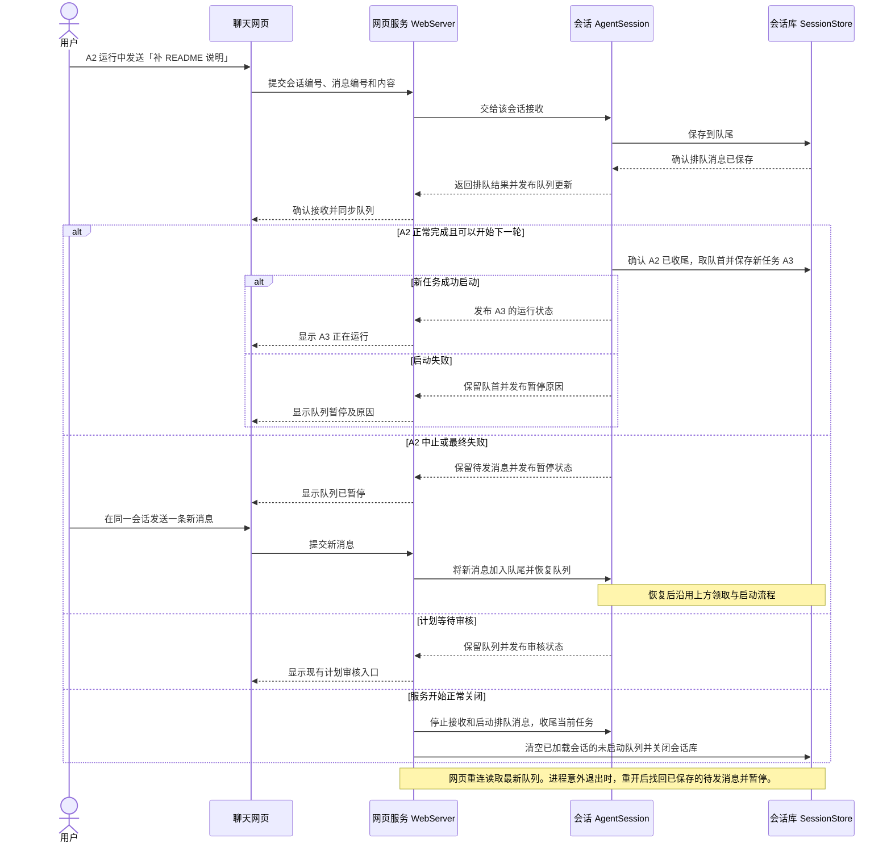
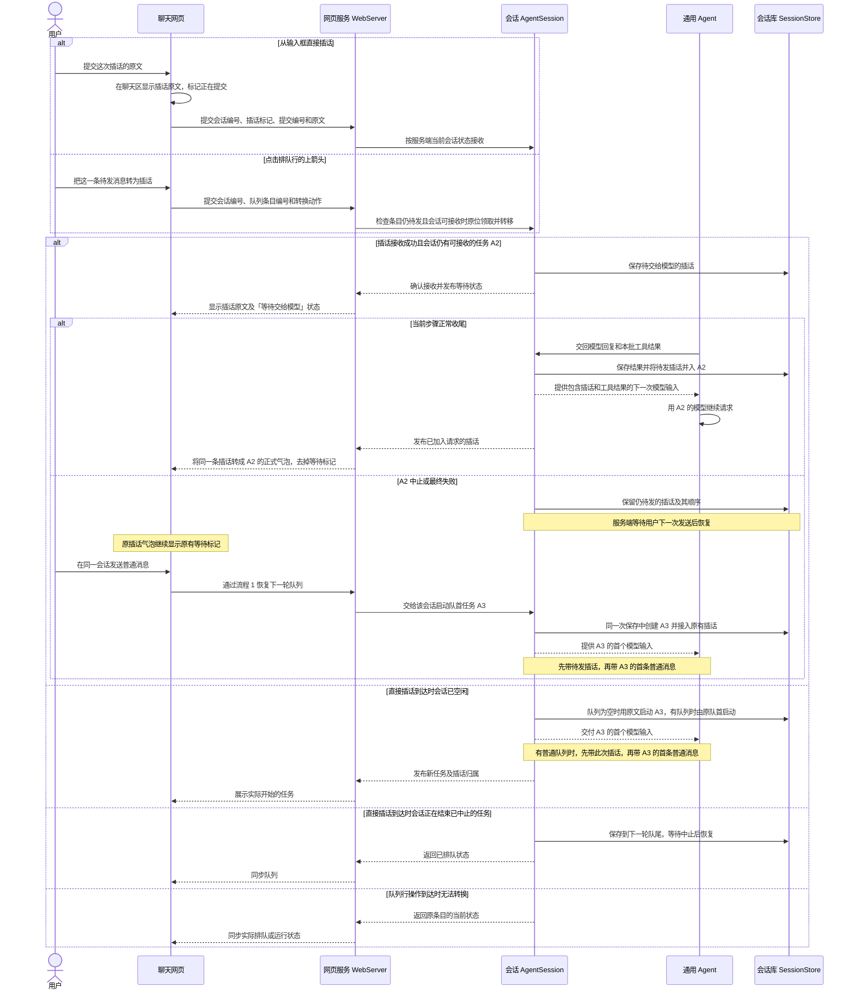
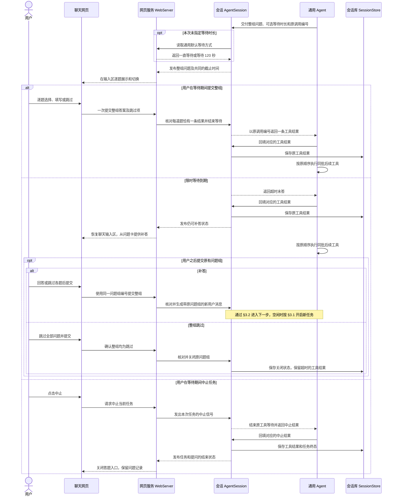

# 里程碑 2 Feature 10 人机协同技术设计

**评审状态**　已批准。 [设计讨论记录](feature10-设计讨论记录.md)

## 1. 总结

用户可以在同一会话里为当前任务插话、提前排入下一条任务，或回答 Agent 在关键选择处提出的问题。插话先显示，等当前步骤和工具结果收尾后再进入模型请求。下一轮消息由服务端依次执行。一次反问可以包含多道题，每题可单选、多选、自由填写或跳过。整组通常等待 120 秒，也可在「通用」改默认值或在本次调用指定时长。超时让任务继续，整组问题仍可补答。中止、重连和恢复保留实际已经发生的工作，并明确哪些输入仍待处理。

会话层 `AgentSession` 决定每条输入在哪个任务、哪一次模型请求生效。会话库 `SessionStore` 保存已确认的待发内容和执行记录。网页用服务端回执和会话状态展示进度。通用 Agent 保持工具调用与结果配对，在模型步骤边界接收新的用户输入。

## 2. 系统变化说明

**Before**　聊天网页可以编辑下一条草稿或中止任务。服务端在同一会话运行期间拒绝再次提交普通消息。模型在一轮工具结果返回后继续发请求，用户只能在任务结束后补充信息。 [网页发送条件](../../../web/src/pages/ChatPage.tsx#L714)

**After**　普通发送可以进入下一轮队列。插话进入当前任务的下一次模型请求，也可以在会话已经空闲时启动新任务。Agent 可以一次发出一组由服务端等待的问题。整组回答写入同一个工具结果，超时后补答通过插话或新任务交给模型。

## 3. 系统设计

### 3.1 下一轮排队

任务运行期间，用户普通发送后看到待发条目。当前任务正常收尾后，服务端按队列顺序启动，每条各开一个任务。



#### 聊天网页

**职责**　在输入区上方显示服务端确认的队列。纯文本行可以在原位编辑。确认保存后保留原编号和排队位置，恢复编辑、删除、转为插话三个操作。取消编辑回到已保存的内容。

含图的待发项用 `[image]` 表示图片。有随图文字时一起显示，例如 `[image] 这个呢`。整行禁用编辑，垃圾桶删除原图和文字所在的整条消息。上箭头沿用 §3.2 的规则，在当前任务可接收插话时转移整条消息，保留原图和文字。

**接口（新增 3，修改 1）**

- 【修改】发送动作，页面回调。使用服务端回执区分「已排队」与「已启动」。等待回执时保留原始提交编号。
- 【新增】编辑、删除和转插话三个页面动作。以待发条目编号提交，页面根据回执和最新状态更新同一条。转插话接到 §3.2。

**数据**　使用会话层的 `MessageQueue`。本地编辑内容随条目暂存，普通聊天草稿可以独立保留。

#### 网页服务 WebServer

**职责**　校验请求属于指定会话，发布服务端实际接收和运行状态。服务开始正常关闭时，冻结已加载会话的入队和启动。

**接口（新增 2，修改 3）**

- 【修改】`POST /api/messages`，HTTP。**用途**　接收既有会话的普通发送或插话。**主要流程**　校验会话及提交内容。普通发送遇到运行中任务时进入队列。已经有暂停队列时，新消息排在队尾并恢复队列。按实际结果返回接收回执。插话根据 §3.2 分流。
- 【新增】`PATCH /api/sessions/:sessionId/queue/:clientMessageId`，HTTP。原位编辑纯文本条目，或把尚未领取的整条消息转入插话。条目已被领取或暂不能转换时，网页同步实际状态。
- 【新增】`DELETE /api/sessions/:sessionId/queue/:clientMessageId`，HTTP。删除仍在队列里的指定条目。服务端校验条目当前状态和编号。
- 【修改】会话订阅，WebSocket。快照和增量带上普通队列、插话及问答状态。断线重连后以服务端最新快照恢复。
- 【修改】服务关闭，生命周期入口。关闭开始时阻止接收和自动领取，等在途启动和已运行任务收尾。在会话库关闭前清空本次已加载会话的未启动条目。

**数据（新增 0，修改 1）**

- 【修改】`SubmitMessageResult` 增加已排队和已接收插话的回执。保留原提交编号与会话编号。已进入任务的提交可关联正式消息。

#### 会话 AgentSession

**职责**　决定当前会话能否启动队首。它从任务接收、收尾和计划审核状态决定队列继续还是暂停。

**接口（新增 1，修改 2）**

- 【修改】`submit()`，模块调用。**用途**　接收普通发送并按会话状态处理。**主要流程**　同一会话同一提交编号只接收一次。保存待发项后给回执。已暂停时，用户新发送加入队尾，从原队首启动。普通队首启动时读取会话最新确认的模型和推理强度，以此固定整个新任务。模型不可用或附件不适用时保留队首并说明原因。
- 【修改】`finish()`，任务收尾。终态和最后一条回复保存成功且收尾事件完成后，才继续领取队首。中止、最终失败或保存结果未确认时暂停队列。计划待审时先处理审核。定时任务使用自己的会话占用规则，已暂停的人工队列由下一次用户提交恢复。
- 【新增】待发项操作，模块调用。检查原条目仍待发，按编号更新文本、删除或转为插话。编辑前核对原条目为纯文本，带附件的编辑请求直接拒绝。旧提交重试回查原条目结果，后来保存的编辑和删除继续有效。

**数据（新增 2，修改 2）**

- 【新增】`QueuedMessage` 归会话持有，保留提交编号、原文、附件、会话引用和排队顺序。发送重试按最初提交校验，实际执行采用最后一次已保存的内容。
- 【新增】`MessageQueue` 保存待发条目和暂停原因。下面的构造示例表示原任务结束后仍待启动的一条消息。
- 【修改】`ConversationSnapshot`、`ConversationUpdate` 增加会话交互状态。普通队列、待发插话和问答共用这两种同步数据。

```ts
const queue = {
  paused: true,
  items: [{ clientMessageId: 'q-17', text: '补 README 说明' }],
}
```

#### 会话库 SessionStore

**职责**　保存服务端已经确认的待发条目和正式任务。领取队首与正式任务、首条消息和附件绑定在同一次保存中完成。

**接口（新增 0，修改 2）**

- 【修改】会话保存。支持入队、编辑、删除、转移、领取和关闭清理。保存失败时保留原条目。保存结果未确认时暂停领取，由服务端重新核对记录。
- 【修改】会话读取。从已保存的记录恢复仍待发的顺序。正常关服清理当前已加载会话。进程异常退出后，重开会话时找回已保存、尚未启动的条目并保持暂停。

**数据（新增 1，修改 0）**

- 【新增】待发消息持久记录，关联会话、提交编号、原内容和当前处理位置。待发附件从入队起保留，启动时按实际模型校验并绑定正式消息。删除或清理时释放附件保留。会话引用在任务真正启动时取内容。

### 3.2 任务运行中插话

用户直接发出插话，或点待发条目的上箭头。服务端按会话收到请求时的状态处理，聊天区先显示插话原文，模型在步骤边界读取它。



#### 聊天网页

**职责**　直接插话按发送手势立即显示原文。服务端确认后，同一条气泡处于等待状态。上箭头转换成功后，原消息从普通队列移到聊天区。进入模型请求后，原气泡按实际步骤顺序转为正式消息。中止或失败时，保留同一条待发气泡及原有等待标记，任务本身显示结束状态。

**接口（新增 1，修改 1）**

- 【新增】直接插话动作，页面回调。按会话提交原文，标记为插话。草稿、暂时可见的气泡和服务端记录以同一个提交编号对应。
- 【修改】聊天消息展示。按实际任务归属关联多条用户消息、助手片段与工具结果。同一条内容从本地显示、服务端确认到正式记录只出现一次。重连从服务端快照恢复待发气泡。上箭头复用 §3.1 的条目操作。

**数据**　待发插话取自会话状态。已加入请求的消息使用正式任务归属。只有当前助手片段显示实时执行进度。

#### 网页服务 WebServer

**职责**　按会话转发新插话和原队列条目的转换，回传实际接收方式。

**接口（新增 0，修改 0）**

- 【修改，计入 §3.1】`POST /api/messages`、条目 `PATCH` 和会话订阅。直接插话用 `mode: 'steer'` 提交，回执可为正在等待的插话、已经排队或已经启动。上箭头按原条目编号操作，证实已领取时直接同步实际状态。

**数据（新增 0，修改 1）**

- 【修改】`SubmitMessageRequest` 增加可选发送方式。请求以会话编号为地址，正式消息的任务归属由服务端确定。

构造示例。

```ts
const request = {
  sessionId: 'session-1',
  clientMessageId: 's-17',
  mode: 'steer',
  provider: 'deepseek',
  modelId: 'deepseek-flash',
  reasoningEffort: 'low',
  text: '保留旧接口',
}
```

#### 会话 AgentSession

**职责**　按接收时的会话状态确定投递。正在运行时等当前步骤结束。会话空闲时，可以在原会话启动新任务。任务中止或最终失败后，把尚未交给模型的插话保留到用户下一次发送。

**接口（新增 0，修改 1）**

- 【修改】下一次模型输入准备，模块调用。**用途**　在实际发送前，把待发插话和已经完成的内容合并。**主要流程**　先保存本步助手回复和所有匹配的工具结果。再按接收顺序将插话加入本任务，用已有的模型容量和附件检查准备下一次请求。纯文字回复后如果已有待发插话，原任务多执行一步；已派发请求的重试继续使用该请求原输入。
- 【修改，计入 §3.1】`submit()` 和待发项操作。直接插话遇到空闲会话，有普通队列时仍由原队首启动，先带旧待发插话，再带此次插话和新任务首条普通消息。普通队列为空时用本次输入开启新任务，首个模型请求先带旧待发插话，再带本次输入。直接请求若在中止收尾期间到达，作为下一轮消息排到队尾，收尾后由这次发送触发恢复。上箭头只在任务可接收且条目仍待发时搬移同一条。正在中止或空闲时保留条目原位置。所有启动动作经过计划审核检查。

**数据（新增 1，修改 1）**

- 【新增】`SteeringInput` 保留原提交编号、内容和顺序。确定实际任务之前由会话持有。服务停止和异常退出使用 §3.1 已确认的两类待发消息保存规则。
- 【修改】`ConversationMessage` 支持一轮多条用户消息及各自的实际任务归属。插话接入当前任务时放在本批工具结果之后。接入下一轮时，先保存从上一轮带来的插话，再保存该轮的首条普通消息。

#### 通用 Agent

**职责**　等本次回复和整批工具完成，再判断是否开始下一次模型请求。整个任务使用接收时固定的模型和推理强度。错误和中止按原终态返回会话层。

**接口（新增 0，修改 1）**

- 【修改】`Agent.run()`，模块调用。增加会话提供的步骤边界判断。覆盖工具批次收尾及纯文字正常完成，使用会话准备好的上下文继续。调用已完成的工具结果保留并进入后续模型上下文。

**数据（新增 0，修改 1）**

- 【修改】`AgentRunInput` 增加会话提供的继续条件并保留已有模型上下文准备入口。会话负责保存原文和任务归属。

#### 会话库 SessionStore

**职责**　同一次保存中完成待发插话的领取和正式历史写入。恢复后的首个任务在创建时一起保存继承的插话与正式首条消息。

**接口（新增 0，修改 0）**

- 【修改，计入 §3.1】现有保存、读取与历史校验支持同一任务的多段用户输入。仍按原调用编号和顺序校验助手消息与工具结果。重复提交不会再附加同一条输入。

**数据（新增 0，修改 0）**　使用 §3.1 的待发记录和本流程的 `ConversationMessage`。只恢复仍待发的条目。已经进入某个任务记录的内容可以从那个任务查看。

### 3.3 反问、等待与补答

模型遇到影响结果的关键选择时调用反问。用户在聊天输入区逐题处理并整组提交，也可在期限结束后从原问题卡补答。



#### 聊天网页和通用设置

**职责**　在「通用」显示两种默认等待方式，初始值为「等待 120 秒后继续」。输入区显示当前题和题目进度，用户可切换题目，逐题选择、填写或跳过，全部处理后提交。切换题目时保留本页已有答案。普通聊天草稿独立保留。超时后恢复聊天输入，用户可从原问题卡打开整组题继续处理。补答时可以在本页分次填写，部分答案保留为草稿，等每道题都回答或跳过后才可整组提交。

**接口（新增 2，修改 1）**

- 【新增】等待设置读取和保存，页面操作。按服务端确认结果显示选项。
- 【新增】提交整组回答，页面操作。按原问题组编号提交各题的回答或跳过，回执由服务端确认。整组超时后可以补答，也可以将所有题跳过后提交来关闭。
- 【修改】聊天输入区。根据当前问题组状态展示答题入口。页面刷新时恢复原问题组及共同的原截止时间。

**数据**　使用已保存的默认等待方式和会话层发布的问题组。选中项和自由文字作为网页答题草稿，提交时才送到服务端。

#### 网页服务 WebServer

**职责**　保存本机等待设置，确认会话和问题归属，转发用户回复。

**接口（新增 3，修改 0）**

- 【新增】`GET /api/settings/question-wait`、`PUT /api/settings/question-wait`，HTTP。读取或保存两种默认等待方式。旧配置缺省使用 120 秒。设置变动从之后未指定时长的调用生效。
- 【新增】`POST /api/sessions/:sessionId/questions/:questionBatchId/reply`，HTTP。**用途**　一次接收原问题组的完整答案。**主要流程**　校验会话、问题组编号、回复编号和内容，再交给会话层校验各题答案并决定写入原工具结果还是接收为补答。重复请求返回同一接收结果。
- 【修改，计入 §3.1】会话订阅同步问题组、共同的截止时间和可补答状态。

**数据（新增 2，修改 0）**

- 【新增】`QuestionWaitSettings`，归本机设置持有，为省略 `timeout` 的反问提供默认等待方式。
- 【新增】`QuestionReplyRequest` 使用唯一回复编号和 `answers`。每个题目编号恰好对应一项选中项、自由文字或跳过结果。

#### 会话 AgentSession

**职责**　提供内置反问工具。每次调用展示一组包含一道或多道题的问题，各题可独立配置多选。网页手动启动的普通、计划和只读任务可提问，工作区工具遵守各自权限。定时任务按无人值守的工具范围运行。

**接口（新增 2，修改 0）**

- 【新增】`ask_user_question`，模型可用工具。**用途**　遇到会改变操作结果的缺失信息时向用户提问。**主要流程**　轮到本调用时校验非空的问题列表、各题唯一编号、选项和 `timeout`。按本次参数或通用默认值固定整组截止时间并发布。收到有效的整组答案或到达截止时间时，用原调用编号返回一条工具结果。超时保留整组补答入口。等待期间中止会结束整组问题。等待结束后释放计时器和中止监听。
- 【新增】会话回答操作，模块调用。校验每题恰有一条结果，选中项必须属于该题且符合单选或多选规则。提交刚跨过截止时间时，保留原超时结果并按迟交处理。超时后全组跳过只关闭原问题组。其余补答在整组提交时携带原问题组、完整答案和原调用编号，作为一条新的用户消息进入 §3.2。运行中的任务在步骤收尾后读取补答。会话空闲且普通队列为空时，提交补答本身即可启动新一轮。已有队列时由原队首启动，补答进入其首个模型请求。计划仍待审核时，补答保留待发，等审核流程允许任务启动。

**数据（新增 2，修改 0）**

- 【新增】反问工具的输入与返回。`questions` 包含各题的 `id`、`question`，以及可选的 `header`、`options` 和 `multi_select`。选项含 `label` 和可选的 `description`。默认单选，可用自由输入代替选项。多选题可以同时提交已选项和自由文字。`timeout` 以秒为单位，用于整组，允许 1 至 2,147,483 的整数或 `-1`。`-1` 表示本次一直等待。提供参数时以本次为准，省略时使用通用默认。模型仅在用户为本次明确指定等待方式时传入 `timeout`。

等待期间提交返回 `answers`，按题目 `id` 配对，每项包含 `selected` 和可选的 `custom`。空的 `selected` 加上省略 `custom` 表示该题已跳过。整组到期仍未提交时返回 `pending: true`、原 `callId` 及提示，已填写但未提交的答案仍是草稿。跳过或超时均提示模型继续不依赖缺失答案的工作。之后收到的整组补答使用 `answer_to_pending_question` 用户消息。

构造示例

```ts
const args = {
  questions: [
    { id: 'interfaces', question: '哪些旧接口需要保留？', options: [{ label: 'A' }, { label: 'B' }], multi_select: true },
    { id: 'docs', question: '文档还需要说明什么？' },
    { id: 'version', question: '需要指定废弃版本吗？' },
  ],
  timeout: 180,
}

const submitted = { answers: [
  { id: 'interfaces', selected: ['A', 'B'] },
  { id: 'docs', selected: [], custom: '补一条迁移示例' },
  { id: 'version', selected: [] },
] }
const timedOut = { pending: true, callId: 'call-8', message: '等待已超时，用户仍可补答。请继续不依赖答案的工作。' }
const lateReply = {
  kind: 'answer_to_pending_question',
  tool: 'ask_user_question',
  callId: 'call-8',
  questions: args.questions,
  answers: submitted.answers,
}
```

- 【新增】`UserQuestionBatch` 归会话持有，记录原任务、原助手消息、原工具调用、各题、共享状态及可选的截止时间。问题组编号在会话内唯一，各题编号在组内唯一。网页根据 `deadlineAt` 展示倒计时，服务端据此裁定超时。

```ts
const questionBatch = {
  id: 'qb-17',
  runId: 'A2',
  assistantMessageId: 'assistant-8',
  toolCallId: 'call-8',
  questions: args.questions,
  status: 'waiting',
  deadlineAt: new Date('2026-11-23T10:03:00+08:00').getTime(),
}
```

#### 通用 Agent

**职责**　按已确认的串行规则执行包含反问的批次。反问前的操作照常运行。反问返回后，剩余工具按原顺序和原参数执行。整批完成后，把原助手消息和整批工具结果加入下一次模型请求。反问结果使用原工具调用编号，模型适配器沿用现有工具消息格式。整个任务中止时停止继续启动后续工具。 [现有 Agent 回填](../../../packages/agent/src/agent.ts#L142) · [模型请求中的工具消息](../../../packages/model/src/context.ts#L114)

**接口（新增 0，修改 1）**

- 【修改】工具执行调用，模块调用。随现有中止信号提供实际工具调用编号，供会话匹配问题和原结果。

**数据（新增 0，修改 1）**

- 【修改】`ExecutableTool` 的执行上下文增加工具调用编号。正常批次通过已有串行标记选择执行方式。

#### 会话库 SessionStore

**职责**　保存完整的问题组和对应的一条工具结果。超时后收到的整组答复记录为带原调用编号、各题和答案的用户消息。正在等待的原任务随进程异常退出而中断，已经保存为「超时未答」的问题组仍可补答。

**接口（新增 0，修改 0）**

- 【修改，计入 §3.1】保存和读取会话时恢复已经保存的可补答状态。通过原工具结果和补答或关闭记录还原同一个问题的状态。

**数据（新增 0，修改 1）**

- 【修改】问答相关的工具结果及用户消息关联信息。原工具结果记录当时返回的回答、跳过或超时，之后的补答保留在自己的用户消息里。

## 4. 技术决策

### 【功能决策｜网页与会话】普通队列按先后启动

任务正常结束后自动继续。中止或最终失败后保留待发消息，用户再次发送时新消息入队尾、原队首先启动。正常关服清空已加载会话的待发队列，意外退出只恢复已保存且未启动的项，待下次发送才恢复。照用 DSH 的队列接收、明确中止和日志恢复行为。 [DSH 中止和恢复验收](../../../deepseek-harness/apps/web/tests/queue-actions.e2e.ts#L288) · [DSH 正常关服范围](../../../deepseek-harness/packages/core/agent-loop/src/index.ts#L95) · [DSH 冷会话恢复](../../../deepseek-harness/packages/api/session-controller/tests/session-cold.host.spec.ts#L340)

待发图片的摘要采用截图版本 `b150a55` 的 `[image]` 显示。当前 DSH 已改用缩略图，两版均对含图条目禁用编辑，并提供整条删除及运行中的转插话操作。本项目由会话层同时校验原条目是否可编辑。 [DSH 截图版本的摘要](https://github.com/deepseek-ai/deepseek-harness/blob/b150a551b8d465e31e418e1b2eaf5e79bbb7d28e/packages/client/runtime/src/client/sessions/queue-mirror.ts#L8-L18) · [DSH 截图版本的队列按钮](https://github.com/deepseek-ai/deepseek-harness/blob/b150a551b8d465e31e418e1b2eaf5e79bbb7d28e/packages/client/ui-conversation/src/client/queue/QueueDock.tsx#L153-L202) · [当前 DSH 缩略图](../../../deepseek-harness/packages/client/ui-conversation/src/client/queue/QueueDock.tsx#L210)

### 【功能决策｜网页与会话】插话按会话接收

直接插话交给接收时的会话状态，普通队列行的上箭头仅转换仍待发的那个条目。正常的纯文字步骤也检查已接收的插话。中止或最终失败时的待发插话随第一个恢复任务继续。以 Pi 的步骤边界和 DSH 的网页待发气泡、队列领取为参考。暂停收尾时保留待转换条目的原排队位置，是本项目保护原顺序的约定。 [Pi 下一步骤](../../../pi/packages/agent/src/agent-loop.ts#L289) · [DSH 会话输入](../../../deepseek-harness/packages/api/session-controller/src/types.ts#L323) · [DSH 待发气泡](../../../deepseek-harness/packages/client/ui-chat/src/client/chat/ChatFlow.tsx#L73) · [DSH 领取顺序](../../../deepseek-harness/packages/core/agent-loop/src/inbox.ts#L102)

### 【功能决策｜会话与模型】新选择从新任务生效

排队消息真正启动时，使用会话最新确认的模型和推理强度。A2 启动后改选模型，A2 后续模型请求继续使用其固定值，A3 才采用新选择。本项目现有受控浏览器测试已验证这个边界。DSH 在每次模型步骤准备时读取选择。 [本项目模型测试](../../../web/tests/e2e/model-selection.spec.ts#L89) · [DSH 准备模型步骤](../../../deepseek-harness/packages/core/agent-loop/src/agent.ts#L286)

### 【功能决策｜通用设置、会话与网页】整组提问、等待和补答

沿用 DSH 的组内题号、逐题单选或多选、逐题跳过和整组提交。每次调用共用一个等待时长。有 `timeout` 时按本次值，省略时使用「通用」默认，初始值为 120 秒。限时调用从服务端开始等待时计时，切题、编辑、刷新和设置变更都沿用首次确定的截止时间。 [DSH 工具参数与返回](../../../deepseek-harness/packages/interaction/tool-ask-user/src/timed.ts#L113) · [DSH 整组提交](../../../deepseek-harness/packages/client/ui-user-questions/src/client/QuestionComposer.tsx#L369)

等待期间的整组提交写入原工具结果。中止任务会关闭仍在等待的整组问题。已记录超时的问题组在原任务中止后仍可补答，补答作为新的用户消息进入同一会话。沿用本项目已确认的关闭规则，超时后全组跳过只关闭问题组，无需发起模型请求。 [Pi 等待生命周期](../../../pi/packages/coding-agent/src/core/extensions/runner.ts#L593) · [DSH 超时与中止处理](../../../deepseek-harness/packages/interaction/user-questions/src/index.ts#L271) · [DSH 追加补答](../../../deepseek-harness/packages/interaction/user-questions/src/index.ts#L212)

### 【工程决策｜通用 Agent 与会话】反问批次保持原调用顺序

包含反问的批次复用本项目的串行执行。原结果保存后继续后续调用，用户终止整个任务时结束当前等待。模型在下一次请求才读取本批结果。交给模型的工具说明要求将依赖答案的操作安排在收到答案之后。 [DSH 工具批次](../../../deepseek-harness/packages/core/tools/src/batch.ts#L59) · [本项目串行执行](../../../packages/agent/src/agent.ts#L155)

## 5. 风险与边界

### 同批修改会在模型看到答案前执行

- **案例**　模型在同一条回复里问「是否保留旧接口」并已经给出修改命令。提问返回后，后面的命令依据原参数执行。模型在整批结束后才读到答案。
- **解决方案**　遵循已批准的串行规则，并在工具说明中要求模型先问、后做依赖答案的决定。用户回复和跳过都按实际结果记录，文件及命令权限由现有执行门检查。受控用例验证这条顺序和可见结果。

### 丢失回执或进程退出可能重复启动消息

- **案例**　服务端已接收，网页在收到回执前断开。用户重试，或服务进程在队首开始时退出。
- **解决方案**　发送、编辑和转换以稳定提交编号和服务端当前状态核对。队首领取、正式任务创建和附件绑定一起保存。恢复时只装载仍待发的条目，已经启动而被打断的任务按已中断记录。

### 排队附件在真正启动前可能过期或不适用

- **案例**　带图片的消息排队期间，用户改选了无法接收图片的模型。暂存附件也可能在长时间等待时达到现有过期时间。
- **解决方案**　接受排队时保留附件，真正启动时按实际模型重新核对。失败条目保留在队首并显示原因，用户可移除或调整模型后恢复。

### 截止时间附近同时收到回答和中止

- **案例**　两页同时回答，或答案到达时服务端刚好将问题标为超时。
- **解决方案**　按同一问题组的服务端状态裁定一次，使用回复编号重试。超时原结果保持原样，随后收到的有效整组答案按补答处理。等待中的问题组被中止后结束，已保存的超时可补答记录可在恢复后继续查看。

## 6. 验收标准

共 28 个验收案例。受控验收核对排队与恢复顺序、页面显示和模型输入时点、工具批次配对，以及多题多选、整组提交、单次等待时长、跳过、超时补答和中止。真实服务验收从网页使用真实模型完成一项编程任务，核对用户干预改变了后续工作和最终文件。既有模型切换用例已受控复跑通过。本轮结果已记录。 [人机协同验收标准](feature10-人机协同验收标准.md) · [验收记录](feature10-人机协同验收记录.md)

## 7. 文件变更

### 聊天网页和通用设置

| 文件 | 类型 | 用途 | 变更 |
| --- | --- | --- | --- |
| [ChatPage.tsx](../../../web/src/pages/ChatPage.tsx)、[MessageInput.tsx](../../../web/src/components/MessageInput.tsx) | 修改 | 聊天入口 | 运行时保留草稿 → 可排队、插话与回答问题。 |
| [MessageList.tsx](../../../web/src/components/MessageList.tsx)、[AssistantMessage.tsx](../../../web/src/components/AssistantMessage.tsx) | 修改 | 聊天展示 | 单个首消息对应一轮 → 按真实归属显示插话、问题、回答和工具结果。 |
| `web/src/components/MessageQueue.tsx`、`web/src/components/UserQuestionCard.tsx` | 新增 | 队列和问答组件 | 展示待发项的操作以及等待、补答和关闭入口。 |
| [SettingsDialog.tsx](../../../web/src/components/SettingsDialog.tsx) | 修改 | 通用设置 | 现有设置项 → 增加两档反问等待方式。 |
| [chat/client.ts](../../../web/src/chat/client.ts)、[chat/state.ts](../../../web/src/chat/state.ts)、[web/src/types.ts](../../../web/src/types.ts) | 修改 | 提交与状态同步 | 普通提交和任务状态 → 区分已排队、待发插话、正式消息与问题状态。 |
| [i18n/zh-CN.ts](../../../web/src/i18n/zh-CN.ts)、[i18n/en.ts](../../../web/src/i18n/en.ts)、[message-input.css](../../../web/src/components/message-input.css) | 修改 | 文案与输入区 | 普通输入和状态展示 → 队列、插话气泡与问题卡显示。 |
| `web/tests/e2e/human-collaboration.spec.ts` | 新增 | 网页端到端验收 | 覆盖会话状态、用户操作和模型实际收到的顺序。 |
| [model-selection.spec.ts](../../../web/tests/e2e/model-selection.spec.ts) | 修改 | 模型切换回归 | 运行中拒绝普通提交 → 保存下一轮队列，同时核对当前任务内固定模型。 |

### 网页服务 WebServer

| 文件 | 类型 | 用途 | 变更 |
| --- | --- | --- | --- |
| [webserver/index.ts](../../../packages/server/src/webserver/index.ts) | 修改 | 接收与关服 | 单任务接收 → 支持排队、插话、回复问题及关服清理。 |
| [webserver/protocol.ts](../../../packages/server/src/webserver/protocol.ts) | 修改 | 前后端消息协议 | 普通消息与运行状态 → 增加待发和可答状态。 |
| [webserver.test.ts](../../../packages/server/test/webserver.test.ts) | 修改 | 接口验收 | 现有会话接收测试 → 增加服务端拒绝、重试、关闭和恢复边界。 |

### 会话 AgentSession 与会话库 SessionStore

| 文件 | 类型 | 用途 | 变更 |
| --- | --- | --- | --- |
| [agent-session.ts](../../../packages/coding-agent/src/agent-session.ts)、[types.ts](../../../packages/coding-agent/src/types.ts)、[index.ts](../../../packages/coding-agent/src/index.ts) | 修改 | 会话执行与状态 | 只接收一条运行输入 → 协调队列、步骤插话和问答。 |
| [sessions.ts](../../../packages/coding-agent/src/sessions.ts) | 修改 | 会话加载与关闭 | 结束已加载任务 → 同时冻结领取并清理对应待发条目。 |
| `packages/coding-agent/src/user-question-tool.ts` | 新增 | 内置反问工具 | 读取问题、验证参数，把用户操作转为模型可读的工具结果。 |
| [session-store.ts](../../../packages/coding-agent/src/session-store.ts)、[compaction.ts](../../../packages/coding-agent/src/compaction.ts) | 修改 | 保存与上下文准备 | 每轮首条输入 → 保留排队归属、反问与补答关系及近期插话。 |
| [agent-session.test.ts](../../../packages/coding-agent/test/agent-session.test.ts)、[session-store.test.ts](../../../packages/coding-agent/test/session-store.test.ts) | 修改 | 会话与持久化验收 | 增加队首领取、等待裁定、消息归属和重启恢复测试。 |

### 通用 Agent

| 文件 | 类型 | 用途 | 变更 |
| --- | --- | --- | --- |
| [agent.ts](../../../packages/agent/src/agent.ts)、[types.ts](../../../packages/agent/src/types.ts) | 修改 | 模型和工具循环 | 工具收尾才自然续步 → 同时检查已接收插话，为反问保留原工具调用编号。 |

### 其他

| 文件 | 类型 | 用途 | 变更 |
| --- | --- | --- | --- |
| [里程碑路线图](../README.md) | 修改 | 功能入口与范围 | 增加技术设计、验收和讨论记录入口。 |
| [设计讨论记录](feature10-设计讨论记录.md) | 修改 | 决策追踪 | 记录三条流程的确认及整稿评审状态。 |
| [人机协同验收标准](feature10-人机协同验收标准.md) | 新增 | 独立验收标准 | 记录可复跑场景、历史覆盖和执行条件。 |
