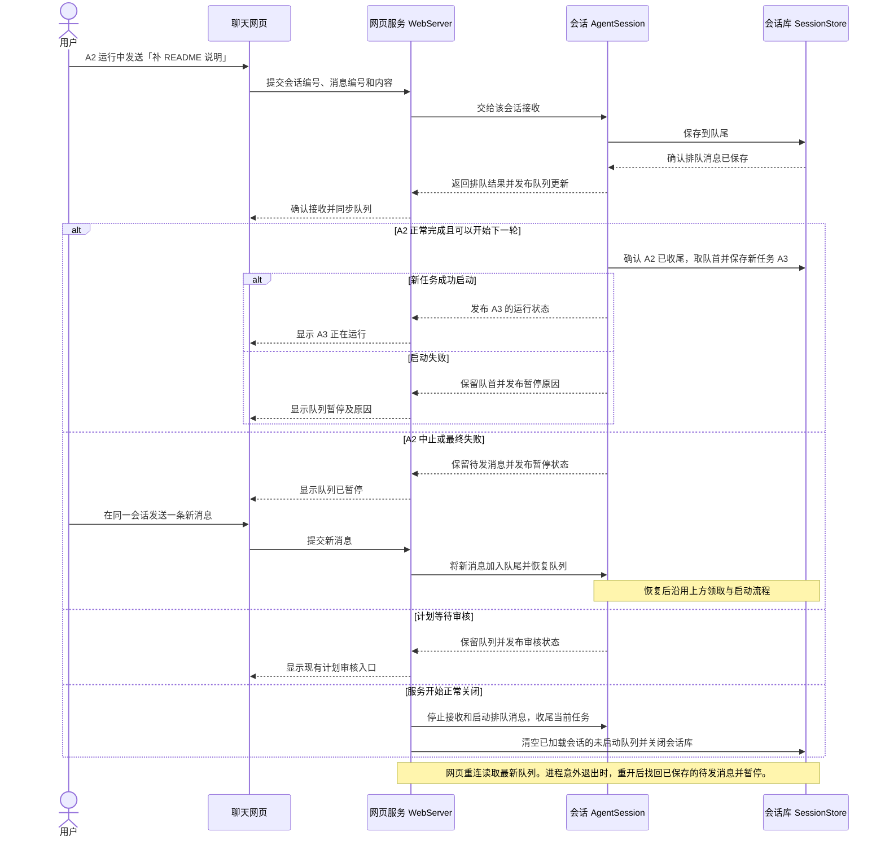
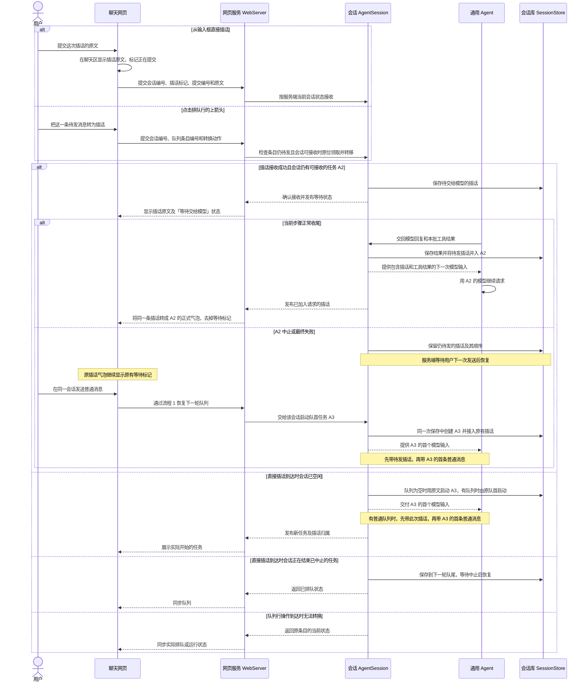
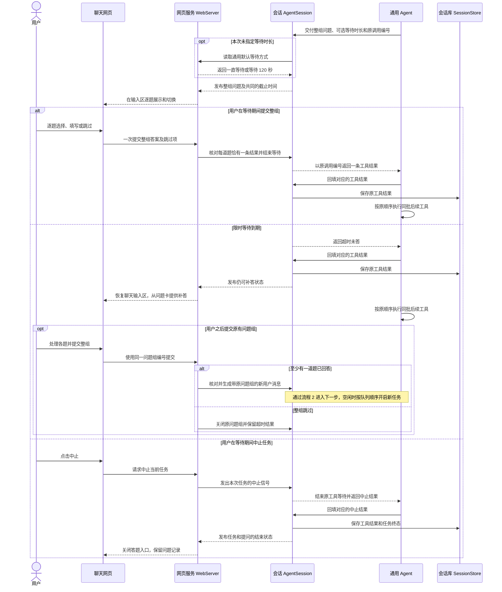

# 里程碑 2 Feature 10 人机协同设计讨论记录

三条核心流程和整份技术设计均已批准。 [技术设计](feature10-人机协同技术设计.md) · [验收标准](feature10-人机协同验收标准.md) · [里程碑范围](../README.md)

## 已确认范围

- **插话**　服务端接收后，网页显示等待。当前模型步骤及其工具调用收尾后，插话作为原任务里的新用户消息进入下一次模型请求。已经完成的工具结果保留。 [DSH 插话与问答轨迹](../../../deepseek-harness/snapshots/web/steering/trajectory.expected.md#L39)
- **下一轮排队**　运行期间可提前发送后续消息。当前任务正常结束后，服务端按提交顺序启动队列里的任务。
- **反问**　Agent 遇到影响任务结果的关键选择时，可以在聊天输入区一次提出多道题。用户逐题单选、多选、自由填写或跳过，处理完后整组提交。刷新网页后仍可回答等待中的一组题。中止任务会关闭正在等待的整组问题。已记录为「超时未答」的问题组仍可补答。

## 已确认决策

### 整组提问、等待方式和补答

采用 DSH 的多题、多选和单次指定等待时长。一次调用的各题共用一个截止时间。未传 `timeout` 时采用「通用」设置，初始默认值为 120 秒，也可在「通用」改为一直等待。本次传入秒数时使用该值，`-1` 表示本次一直等待。等待期间整组提交回填为一条工具结果。逐题跳过记为该题未作答。收到跳过项或超时结果后，模型继续处理不依赖缺失答案的工作。超时停等，整组仍可补答。补答作为带原调用编号、原问题组和全部答案的新用户消息进入同一会话。任务仍运行时在下一步交给模型，会话空闲时可由补答开启新一轮。 [DSH 工具参数与返回](../../../deepseek-harness/packages/interaction/tool-ask-user/src/timed.ts#L113) · [DSH 补答](../../../deepseek-harness/packages/interaction/user-questions/src/index.ts#L188)

### 提问按模型给出的顺序执行

包含提问的工具批次串行执行。排在提问前的调用照常执行。轮到提问时，后续调用等待。提问因回答、跳过或超时返回后，后续调用按原顺序和原参数执行，沿用现有权限检查。用户中止任务时沿用现有取消流程。 [DSH 批次调度](../../../deepseek-harness/packages/core/tools/src/batch.ts#L59) · [本项目串行调度和权限检查](../../../packages/agent/src/agent.ts#L129)

回答在整批完成后进入下一次模型请求。同一批里已经排好的调用在此之前仍使用原参数。依赖回答的操作需要等模型读到回答后再发出，由模型在安排工具调用时遵循这个约定。

### 中止或失败后由新消息恢复队列

当前任务正常完成时，服务端继续处理队列。用户中止或任务最终失败时，待发消息按原顺序保留并暂停。用户在同一会话再发一条消息时，新消息排到队尾，由服务端从原队首开始执行。 [DSH 中止与队列恢复](../../../deepseek-harness/apps/web/tests/queue-actions.e2e.ts#L288) · [DSH 最终失败收尾](../../../deepseek-harness/packages/core/agent-loop/src/agent.ts#L408)

### 正常关闭和意外退出后的队列处理

服务开始正常关闭时停止接收及启动排队消息，按现有流程结束正在运行的任务，并在关闭会话库前清空本次服务已加载会话的未启动队列。发生意外退出时，重开会话找回已经保存、尚未启动的排队消息。队列保持暂停，等用户再发消息时恢复。 [DSH 正常关闭范围](../../../deepseek-harness/packages/core/agent-loop/src/index.ts#L95) · [DSH 冷会话队列恢复](../../../deepseek-harness/packages/api/session-controller/tests/session-cold.host.spec.ts#L340) · [本项目服务关闭](../../../packages/server/src/webserver/index.ts#L906)

## 已确认流程 1　下一轮排队

用户在任务运行期间发送普通消息，服务端确认接收后显示在队列里，轮到时在同一个会话启动新任务。

**队列操作**　纯文本待发项可以编辑、删除和转为插话。点击编辑后原地显示文本框和确认、取消。确认保存后使用新文本，条目保留其编号和排队位置，并恢复三个操作。删除和转插话按原条目操作。 [DSH 队列编辑和三项操作](../../../deepseek-harness/packages/client/ui-conversation/src/client/queue/QueueDock.tsx#L237) · [DSH 原位替换](../../../deepseek-harness/packages/core/agent-loop/src/inbox.ts#L133)

**图片条目（已确认）**　待发图片显示为 `[image]`，有随图文字时一并显示。含图后整条禁用编辑，垃圾桶删除整条。当前任务可以接收插话时，上箭头将原图和文字一起转为插话。 [DSH 截图版本的摘要](https://github.com/deepseek-ai/deepseek-harness/blob/b150a551b8d465e31e418e1b2eaf5e79bbb7d28e/packages/client/runtime/src/client/sessions/queue-mirror.ts#L8-L18) · [DSH 截图版本的队列按钮](https://github.com/deepseek-ai/deepseek-harness/blob/b150a551b8d465e31e418e1b2eaf5e79bbb7d28e/packages/client/ui-conversation/src/client/queue/QueueDock.tsx#L153-L202)



### 聊天网页

**职责**　在输入区上方显示服务端确认的待发消息和暂停原因。用户可原地编辑待发文本、删除或转为插话。条目开始运行后，内容出现在聊天记录里。

**接口（新增 3，修改 1）**　发送动作处理排队回执，确认前沿用发送中状态。编辑、删除和转插话按待发条目编号提交。编辑原位保存新文本，取消编辑保留原文。结果以回执和订阅为准。

**数据**　使用会话快照里的队列，按服务端顺序展示。断线后从最新快照恢复。 [DSH 排队操作验收](../../../deepseek-harness/apps/web/tests/queue-actions.e2e.ts#L188)

### 网页服务 WebServer

**职责**　把请求转给对应会话，给网页发布队列状态，并在正常关闭开始时停止队列启动。

**接口（新增 2，修改 3）**　现有 `POST /api/messages` 增加「已排队」回执。订阅的快照和更新增加队列。关闭入口先冻结队列启动，待任务收尾后清空已加载会话的未启动项。新增 `DELETE /api/sessions/:sessionId/queue/:clientMessageId` 删除待发条目。同一路径的 `PATCH` 编辑纯文本条目或把它转成插话。条目已经启动时，返回当前状态供网页同步。

**数据（新增 0，修改 1）**　`SubmitMessageResult` 增加排队和插话结果，携带会话编号和原提交编号。同一个编号的重试返回同一条目的当前接收状态。

### 会话 AgentSession

**职责**　按会话维护队列和领取顺序。用户发送可恢复暂停队列。需要审核的计划先走审核入口，定时任务仍使用自己的会话占用规则。待发任务按实际启动时的会话模型和推理强度运行。以 A2 和 A3 为例，A2 中途改选模型 B 后，A2 的各次请求继续使用启动时的选择，A3 启动时才使用 B。 [本项目模型选择验收](../../../web/tests/e2e/model-selection.spec.ts#L89)

**接口（新增 1，修改 2）**　`submit()` 保存排队项并返回接收回执。`finish()` 在上一轮终态和收尾处理完成后，决定继续领取还是暂停。队首启动失败时暂停，显示原因并保留队首。新增待发项操作，根据会话内同一条目的当前状态执行编辑、删除或转插话。重试原提交时返回该条目的接收结果，保留后来保存的编辑。

**数据（新增 2，修改 2）**　新增 `QueuedMessage` 记录原提交编号、正文、附件和会话引用。新增 `MessageQueue` 记录队列顺序、是否暂停及原因。`ConversationSnapshot` 和 `ConversationUpdate` 用它同步队列。构造示例中，`q-17` 是暂停后仍可见的一条消息。

```ts
const queue = {
  paused: true,
  items: [{ clientMessageId: 'q-17', text: '补 README 说明' }],
}
```

### 会话库 SessionStore

**职责**　安全保存服务端确认的待发消息。取走队首和创建正式任务在同一次保存中完成。队列中的附件保留到条目启动、移除或正常关机清理。任务启动时按当前模型校验附件，并准备会话引用。

**接口（新增 0，修改 2）**　现有会话保存操作增加入队、移除、转正式任务和清空队列。会话读取操作恢复顺序和原内容。启动保存失败时保留队首。保存结果未确认时暂停启动，等服务端核对记录。

**数据（新增 1，修改 0）**　增加待发消息的持久记录，按会话和原提交编号定位。异常重启时读出已保存且尚未启动的消息，恢复为暂停。若条目已转成正式任务，则按现有任务状态恢复。 [本项目提交事务](../../../packages/coding-agent/src/session-store.ts#L199) · [DSH 冷会话队列恢复](../../../deepseek-harness/packages/api/session-controller/tests/session-cold.host.spec.ts#L340)

## 已确认流程 2　任务运行中插话

用户可以从输入框发起插话，也可以把已有的排队消息转成插话。两种入口都交给服务端按该会话当时的状态处理。接收后的插话在当前步骤收尾后进入下一次模型请求。

**已确认的异常处理**　沿用 DSH。任务中止或最终失败时，服务端保留已接收、仍在等待的插话及顺序。聊天区继续展示同一条插话气泡和原有等待标记，任务本身显示结束状态。刷新或重连时，网页根据服务端仍待发的条目重建这些气泡。用户再次发送时，恢复后的第一个任务带上这些插话。 [DSH 中止后继续](../../../deepseek-harness/apps/web/tests/steering.e2e.ts#L298) · [DSH 待发插话来源](../../../deepseek-harness/packages/client/ui-chat/src/client/chat/ChatView.tsx#L180) · [DSH 聊天气泡渲染](../../../deepseek-harness/packages/client/ui-chat/src/client/chat/ChatFlow.tsx#L73) · [DSH 最终失败后继续](../../../deepseek-harness/packages/core/agent-loop/tests/loop.spec.ts#L1071)

**接收规则**　直接插话随会话编号和 `steer` 标记提交，由服务端确定实际任务。若到达时会话已空闲且普通队列为空，插话内容作为同一会话新任务的首条消息。若已有普通队列，先启动原队首，插话随队首的首个模型请求送入。若服务端正在收尾已中止的任务，这次新提交放到下一轮队尾，等待中止完成后按顺序处理。 [DSH 直接提交字段](../../../deepseek-harness/packages/api/session-controller/src/types.ts#L323) · [DSH 空闲插话测试](../../../deepseek-harness/packages/core/agent-loop/tests/agent.spec.ts#L115) · [DSH 中止期间的接收条件](../../../deepseek-harness/packages/core/agent-loop/src/agent.ts#L171)

队列行的上箭头用来搬移已存在的条目。会话仍能接收插话且条目仍待发时，服务端把这条消息从普通队列转到插话队列，保留原编号和内容。若会话已经空闲或正在中止，仍待发的条目留在原排队位置。若条目已被领取，网页按实际状态同步。这样两个入口都能处理到达时状态已变化的情况。 [DSH 队列转插话](../../../deepseek-harness/packages/api/session-controller/src/commands.ts#L483)



如果 A2 给出了纯文字回复，已经接收的插话仍然会让 A2 再发一次模型请求。等待反问时，已接收的插话等本批工具收尾，再和该次提问的结果一起进入下一次请求。回复、工具结果和插话按发生顺序显示。 [Pi 的模型步骤收尾](../../../pi/packages/agent/src/agent-loop.ts#L289) · [DSH 的纯文字收尾边界](../../../deepseek-harness/packages/core/agent-loop/src/agent.ts#L398) · [DSH 问答与插话轨迹](../../../deepseek-harness/snapshots/web/steering/trajectory.expected.md#L39)

例如 A2 中止时有两条待发插话 S1、S2，以及两条下一轮消息 B、C。再次发送 D 后，先启动 B 对应的任务，其首个模型请求中新输入的顺序是 S1、S2、B。C、D 仍各自启动任务，按原队列顺序处理。 [DSH 领取输入的顺序](../../../deepseek-harness/packages/core/agent-loop/src/inbox.ts#L102)

### 聊天网页

**职责**　提供与普通排队发送分开的「插话」入口。直接插话时，点击发送就在聊天区显示原文并标记「正在提交」。服务端确认接收后，同一条消息显示「等待交给模型」。通过上箭头转换的消息在转换确认后从普通队列移到聊天区，显示原文和等待状态。插话进入下一次模型请求时，同一条消息按该任务的实际顺序成为正式气泡，去掉等待标记。多条插话按服务端确认的顺序展示，刷新或重连后读取最新状态。 [DSH 待发气泡](../../../deepseek-harness/packages/client/ui-chat/src/client/chat/ChatFlow.tsx#L64) · [DSH 等待期间原文仍可见](../../../deepseek-harness/apps/web/tests/steering.e2e.ts#L140)

**接口（新增 1，修改 1）**　新增直接插话动作，提交会话编号和插话标记。队列行复用流程 1 的条目操作。修改聊天状态和消息列表消费插话状态的方式，按服务端确认的任务编号关联各段回复、插话和工具结果。

**数据**　使用会话发布的待发插话和带任务归属的正式消息。一次插话有独立提交编号，服务端确认前保留原文。 [现有网页消息分组](../../../web/src/components/MessageList.tsx#L29) · [现有运行状态校验](../../../web/src/chat/state.ts#L168)

### 网页服务 WebServer

**职责**　按会话转发插话和队列条目操作，给网页返回接收结果及后续状态。

**接口（新增 0，修改 0，与流程 1 共用）**　`POST /api/messages` 增加 `mode: 'steer'`，同一入口可以返回已接收插话、已排队或已启动新任务。待发条目的 `PATCH` 支持转换。现有订阅同步等待、已并入任务和恢复后的实际归属。同一个提交编号的重试取得原条目的当前状态。

**数据（新增 0，修改 1）**　`SubmitMessageRequest` 增加发送方式，构造示例使用 `steer`。仍在运行的任务使用它自己的模型和推理强度。空闲时启动新任务则核对提交时的会话选择。回执使用原提交编号关联，插话归属由后续状态同步。`SubmitMessageResult` 在流程 1 统一计数。

### 会话 AgentSession

**职责**　根据提交到达时的会话状态接收内容，确定插话在哪个任务和模型步骤生效。在本步回复及工具结果保存后，让通用 Agent 读取包含插话的下一次输入。A2 中止或失败时，待发插话与普通队列一起暂停，下一次用户发送后在恢复的第一个任务中接入。

**接口（新增 0，修改 1）**　流程 1 的接收、队列操作和收尾沿同一会话的实际状态处理插话。转换操作在同一次保存中移出普通队列并放入插话队列。修改下一次模型输入准备，在已有工具结果后加入待发插话并核对模型容量与附件。把这批插话和本轮新增内容视为同一个保留范围，容量不足时向用户反馈。

**数据（新增 1，修改 1）**　新增 `SteeringInput`，记录提交编号、内容和接收顺序，由会话持有。`ConversationMessage` 增加插话标记和实际任务归属。`ConversationSnapshot` 和 `ConversationUpdate` 同时同步两类待发状态，在流程 1 统一计数。下面是直接插话请求的构造示例。

```ts
const request = {
  sessionId: 'session-1',
  clientMessageId: 's-17',
  mode: 'steer',
  provider: 'deepseek',
  modelId: 'deepseek-flash',
  reasoningEffort: 'low',
  text: '保留旧接口',
}
```

### 通用 Agent

**职责**　在一条模型回复及其整批工具处理完成后，判断是否继续发模型请求。带着插话继续时使用该任务已固定的模型和推理强度。

**接口（新增 0，修改 1）**　现有 `Agent.run()` 输入增加会话提供的继续条件，覆盖工具批次结束和纯文字回复即将结束这两处。继续时从会话准备新的模型输入。已有模型重试结束后才进入下一步骤。 [本项目模型循环](../../../packages/agent/src/agent.ts#L75) · [本项目会话准备模型输入](../../../packages/coding-agent/src/agent-session.ts#L924)

**数据（新增 0，修改 1）**　`AgentRunInput` 允许会话在步骤边界提供继续判断和准备后的输入。通用 Agent 从输入里读取消息，会话负责保存插话及其任务归属。

### 会话库 SessionStore

**职责**　保存待发插话，记录正式消息的归属和顺序。插话转成历史消息时，在同一次保存里从待发项转移，避免刷新或重启后重复加入。A3 接入原有插话时，同一次保存创建 A3 并记录旧插话和 A3 的首条普通消息。转入任务后如果模型请求失败，仍可在该任务中查看原文和失败结果。

**接口（新增 0，修改 0，与流程 1 共用）**　会话保存和读取操作包含插话。允许同一个任务中有多条明确归属的用户消息，继续检查工具调用与结果的编号和顺序。正常关闭和异常恢复的保存规则与流程 1 一致。

**数据（新增 0，修改 1）**　待发消息记录按会话区分普通排队和插话，在流程 1 统一计数。正式历史记录实际任务归属，允许 A3 的首条普通消息前有已转移的插话前缀，随后按原步骤顺序保存。 [本项目历史校验](../../../packages/coding-agent/src/session-store.ts#L423) · [DSH 同时清理两类待发输入](../../../deepseek-harness/packages/core/agent-loop/src/inbox.ts#L96)

## 已确认流程 3　反问、等待与补答

模型遇到会影响结果的关键选择时调用反问工具。服务端轮到该工具时展示一组问题。用户整组提交或等到超时后，再处理同批后续工具。



限时调用从服务端正式等待整组问题时开始计时。切题、编辑、刷新和设置变更都沿用原截止时间。若整组提交时刚跨过截止时间，服务端保留原超时结果，按补答接收一次。修改「通用」影响之后未指定时长的调用。 [DSH 计时机制](../../../deepseek-harness/packages/interaction/user-questions/src/timed-wait.ts#L31) · [DSH 超时和补答](../../../deepseek-harness/packages/interaction/user-questions/src/index.ts#L188)

**恢复边界**　正在等待的问题组随任务主动中止结束。已超时的问题组仍可补答，即使原任务后来结束。超时后逐题跳过只标记该题，全组跳过后提交会关闭问题组，沿用本项目既有关闭约定。服务意外退出时，原运行按「已中断」恢复。已保存的「超时未答」仍可补答。DSH 还会从异常中断的定时提问记录恢复一部分可补答项，本期以已保存的超时结果为恢复边界。 [DSH 问题恢复规则](../../../deepseek-harness/packages/interaction/user-questions/src/projection.ts#L219) · [本项目中断记录](../../../packages/coding-agent/src/agent-session.ts#L131)

### 聊天网页和通用设置

**职责**　通用设置提供「等待 120 秒后继续」和「一直等待回复」作为默认值。当前提问在聊天输入区逐题展示。用户可切换题目并保留已填内容，按题单选、多选、自由填写或跳过，最后一次提交。普通聊天草稿保留，等待结束后可继续编辑。超时后通过原问题卡补答。

**接口（新增 2，修改 1）**　新增等待设置保存和整组回答提交。设置根据服务端保存结果显示。提交带问题组编号和每道题的结果，服务端确认后关闭或更新原卡片。修改聊天输入区，根据会话快照加载原问题组及截止时间。 [既有通用设置](../../../web/src/components/SettingsDialog.tsx#L251) · [DSH 回答组件](../../../deepseek-harness/packages/client/ui-user-questions/src/client/QuestionComposer.tsx#L369)

**数据**　设置页使用服务端确认的默认等待方式。聊天页使用会话发布的各题、整组状态和可选的共同截止时间。

### 网页服务 WebServer

**职责**　读写本机设置，校验问题回答属于当前登录用户可操作的会话，并把结果交给会话层。

**接口（新增 3，修改 0）**　`GET /api/settings/question-wait` 读取默认设置，`PUT /api/settings/question-wait` 校验并保存。`POST /api/sessions/:sessionId/questions/:questionBatchId/reply` 接收整组答案，返回这次提交结果。会话订阅按前两条流程共用，增加问题组状态。

**数据（新增 2，修改 0）**　新增 `QuestionWaitSettings` 表示本机默认等待方式，旧设置文件缺少字段时使用 120 秒。新增 `QuestionReplyRequest`，包含回复编号和整组逐题结果。 [现有设置接口](../../../packages/server/src/webserver/index.ts#L816) · [设置文件保存](../../../packages/server/src/settings-file.ts#L19)

### 会话 AgentSession

**职责**　提供内置反问工具 `ask_user_question`，每次调用可提出一道或多道题。会话层在工具开始时为整组确定等待时长。用户手动启动的普通、计划和只读任务可使用反问。工作区操作仍受各模式的权限检查。定时任务按无人值守流程运行。 [现有工具声明和权限检查](../../../packages/coding-agent/src/agent-session.ts#L234) · [DSH 提问工具](../../../deepseek-harness/packages/interaction/tool-ask-user/src/timed.ts#L107)

**接口（新增 2，修改 0）**　新增 `ask_user_question` 工具和会话回答操作。工具校验题目、题号、选项和时长，再把本次等待状态同步给网页。服务端拒绝缺项、重复题号和无效选项。整组提交、超时和中止由会话裁定一次，相同回复编号重试返回原结果。超时后的补答带整组问题和原调用编号进入流程 2。 [Pi 交互等待和收尾](../../../pi/packages/coding-agent/src/core/extensions/runner.ts#L592) · [DSH 补答去重](../../../deepseek-harness/packages/interaction/user-questions/src/index.ts#L188)

**数据（新增 2，修改 0）**　`UserQuestionBatch` 由会话持有，记录原任务、原工具调用、整组题目和共用的等待状态，通过 `ConversationSnapshot` 和 `ConversationUpdate` 同步。工具接收 `questions` 和可选的 `timeout`，结果用 `answers` 表示整组已提交，用 `pending: true` 表示整组超时可补答。 [工具参数和结果示例](feature10-人机协同技术设计.md#33-反问等待与补答)

### 通用 Agent 和会话库 SessionStore

**职责**　通用 Agent 沿用串行批次执行，先处理排在提问前的工具，提问返回后让后续工具按原顺序运行。中止时取消等待并按现有规则结束当次任务。会话库按原编号保存提问和工具结果，超时后的补答单独保存为用户消息，带上原调用引用。

**接口（新增 0，修改 1）**　现有工具执行上下文提供当前工具调用编号，供反问精确关联其结果。会话保存和读取沿用前面流程里的变更，额外记录问题处理结果，确保重连或恢复后可以定位原问题。 [现有工具执行上下文](../../../packages/agent/src/types.ts#L3) · [现有串行执行](../../../packages/agent/src/agent.ts#L155) · [现有工具结果归属](../../../packages/coding-agent/src/agent-session.ts#L1301)

**数据（新增 0，修改 2）**　工具执行上下文增加当前调用编号。会话历史中的工具结果增加可恢复的问答状态，补答通过原问题引用与本次用户消息关联。问题的正式结果和历史校验沿用原工具调用配对。
