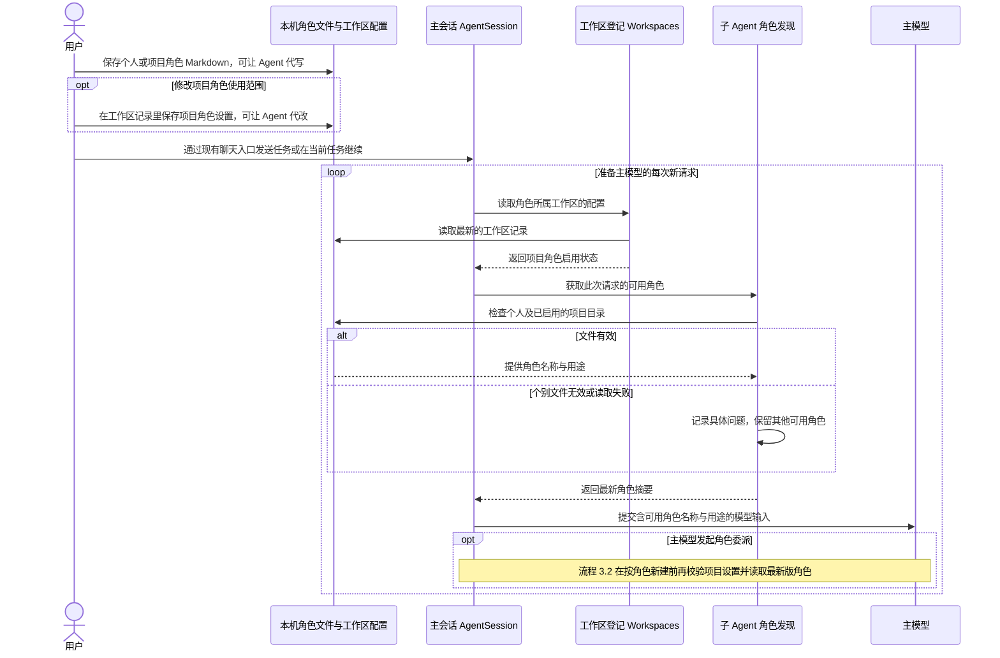
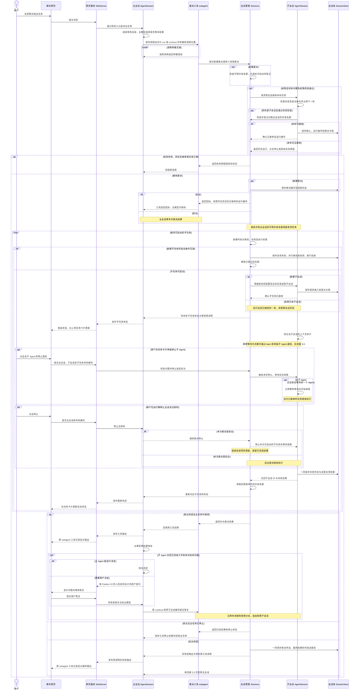
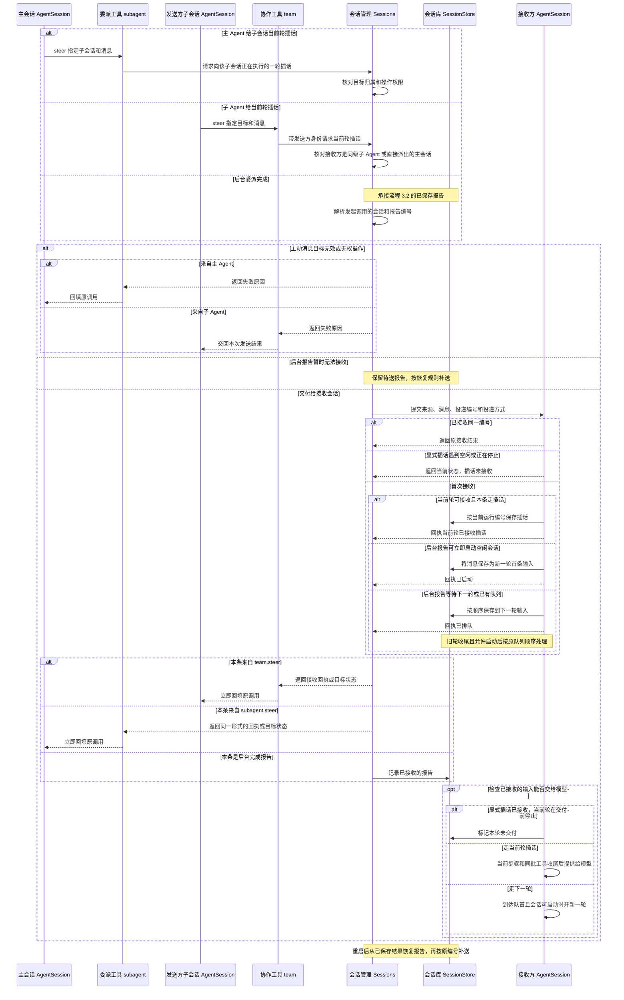
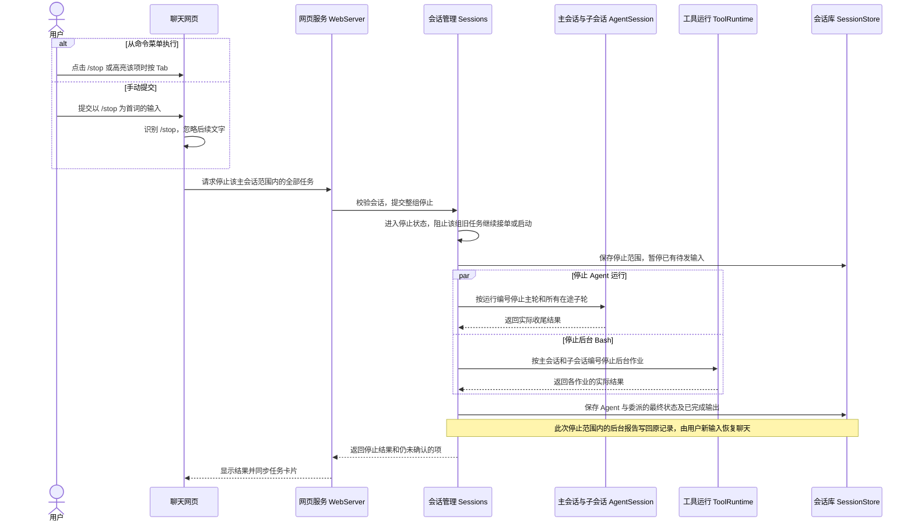

# 里程碑 2 Feature 12 Multi-Agent 技术设计

**评审状态**　2026-11-26 确认实施。 [设计讨论记录](feature12-设计讨论记录.md)

## 1. 总结

用户可以用 Markdown 注册个人和项目子 Agent。主 Agent 在原聊天里按角色或通用指令交办单个、并行或串行任务，选择当轮等待结果或由后台稍后回报。子 Agent 有独立历史，前台和后台执行结束后都能从原会话继续。子 Agent 可以向同伴或主 Agent 续办任务，也可以给正在运行的一轮插话。用户在工具记录查看参数和结果，从任务卡片单独停止子任务，也可以用 `/stop` 停止当前会话的在途任务和后台 Bash。结构化工作流安排在 Feature 13 Code Mode。 [里程碑 2 功能范围](../README.md#第十二步multi-agent) · [Code Mode](../README.md#第十三步code-mode)

服务端用同一个进程内的 `AgentSession` 运行每个独立子会话，沿用模型调用、工具循环和 SQLite 存储。`Sessions` 统一调度、限制同一主会话最多 8 个在途子任务，并按调用记录归还结果。后台报告依赖 Feature 10 的会话插话和下一轮队列，以原调用为依据恢复与去重。 [会话恢复](../../../packages/coding-agent/src/sessions.ts#L167) · [Feature 10 人机协同技术设计](../feature10/feature10-人机协同技术设计.md)

## 2. 系统变化说明

**Before**　主模型通过自己的会话执行工具。其他普通会话拥有独立历史和停止信号，模型工具目录提供本机文件、Bash 和网页等工具。聊天页有会话级任务卡片，展示正在运行的后台 Bash。会话忙碌时沿用 Feature 10 的插话与待发队列。 [现有工具目录](../../../packages/coding-agent/src/tools.ts#L77) · [会话接收条件](../../../packages/coding-agent/src/agent-session.ts#L385) · [任务卡片](../../../web/src/components/BackgroundTasks.tsx#L12)

**After**　主模型可通过 `subagent` 调度拥有独立历史的子会话。子 Agent 通过 `team` 协作。在原聊天中，前台结果随工具调用返回，后台报告按接收方实际状态投递。任务卡片按子会话展示最新运行状态。会话级 `/stop` 可以一次停止当前任务和归属这次聊天的后台工作。运行、报告、停止和刷新都以服务端记录为准。

## 3. 系统设计

### 3.1 从文件注册并发现子 Agent 角色

用户手动保存角色及工作区配置，或者让 Agent 写入文件。现有会话下一次准备模型请求时即可向主模型提供文件中的最新角色摘要。按名称启动子任务时，程序再读取最新的角色正文和配置。

用户要求 SI 创建或修改可复用的角色时，主 Agent 先阅读应用的角色创建指南，再按其中的目录和 Markdown 格式写入或修改文件。指南沿用 Skill 创建文档的查阅入口。 [子 Agent 角色创建指南](../../../docs/subagents.md) · [Skill 创建指引](../../../docs/skills.md#创建和修改)



#### 网页服务 WebServer

**职责。** 沿用网页的任务提交入口。创建主会话时传入读取本机工作区项目角色设置的能力。 [现有会话装配](../../../packages/server/src/webserver/index.ts#L239)

**接口（新增 0，修改 1）。**

- 【修改】`createSessions`（内部会话装配）。为主会话绑定按工作区编号读取项目角色设置的依赖。

**数据（新增 0，修改 0）。** 装配时使用工作区编号，项目角色设置由 Workspaces 读取。

#### 工作区登记 Workspaces

**职责。** 从 `~/.agent-learning/workspaces.json` 对应工作区读取用户设置。新工作区和缺少该字段的旧记录默认关闭。重复登记沿用同一条记录。用户手动修改文件，或明确交给 Agent 修改。 [现有工作区文件](../../../packages/server/src/workspaces.ts#L24)

**接口（新增 1，修改 0）。**

- 【新增】`getProjectAgentsEnabled`（模块调用）。按工作区编号读取已保存的有效值。主会话准备上下文时使用。派发项目角色前再次读取。

**数据（新增 0，修改 1）。** 本机工作区记录 `Workspace` 增加可选的 `projectAgentsEnabled`。值为 `true` 时允许使用该工作区的项目角色。构造示例是一条工作区记录。

```json
{
  "id": "workspace-si",
  "path": "/Users/example/si",
  "projectAgentsEnabled": true
}
```

#### 子 Agent 角色发现

**职责。** 个人角色放在 `~/.si/agents/`，项目角色放在登记工作区的 `.si/agents/`。发现时提取文件头。项目启用后，同名角色优先采用项目版本。格式错误或单个文件读取失败时记录原因，保留其他可用角色。 [SI Skill 目录习惯](../../../docs/skills.md#查找范围) · [Pi 角色同名优先级](../../../pi/packages/coding-agent/examples/extensions/subagent/agents.ts#L128)

**接口（新增 1，修改 0）。**

- 【新增】`discoverSubagentRoles`（模块调用）。按当前工作区路径和启用状态从磁盘取得最新摘要，返回角色来源供后续委派。

**数据（新增 1，修改 0）。** 角色摘要 `SubagentRoleSummary` 供会话识别可用角色。主模型接收名称与用途。每个项目角色子任务实际启动前，服务端读取来源工作区的最新设置，再按角色来源加载文件。角色被删除或项目角色被关闭时，工具返回具体原因。

角色文件构造示例。`model` 可省略，示例沿用主会话的模型与推理级别。

```markdown
---
name: test-reviewer
description: 检查改动遗漏了哪些测试场景
tools: [read, grep, find, ls]
---

阅读相关实现和现有测试，给出缺失场景、相关文件和判断依据。
```

构造示例

```typescript
{
  name: "test-reviewer",
  description: "检查改动遗漏了哪些测试场景",
  source: "project",
  path: "/Users/example/si/.si/agents/test-reviewer.md",
}
```

#### 会话 AgentSession

**职责。** 按现有上下文准备时机读配置、发现角色并组装主模型实际收到的目录。按实际工作目录和可用工具生成子会话的基础提示，包括项目说明及适用 Skill。前后台都追加身份指令，指定角色时再追加 Markdown 正文。主 Agent 把任务和必要背景写入独立的首条输入，沿用 Pi 的 `Task: …` 形式。前台和后台续用已有子会话时采用该会话现有配置，并核对当前使用权限。 [Pi 基础系统提示](../../../pi/packages/coding-agent/src/core/system-prompt.ts#L150) · [Pi 追加角色与提交任务](../../../pi/packages/coding-agent/examples/extensions/subagent/index.ts#L420) · [SI 提示词组装](../../../packages/coding-agent/src/agent-session.ts#L357)

**子 Agent 身份指令。** 前台和后台共用基于 Pi P2 的身份指令，结果报告给本次发起者。提示原文和工具文案见运行时提示词文档。 [Pi P2 通用指令](../../../pi/apps/p2/plugins/subagents/tools.ts#L581) · [SI Multi-Agent 提示词](../../../docs/prompts/subagents/systemPrompt.md)

**接口（新增 0，修改 2）。**

- 【修改】`prepareContext`（内部上下文准备）。在准备主模型请求时获取当前项目角色授权和目录。完成角色写入的工具调用收尾后，下一次模型请求可读取新配置。
- 【修改】`configure`（内部模型输入组装）。在可使用委派工具时，将更新后的角色名称和用途交给主模型。主 Agent 可用 `read` 且能定位 SI 应用文档时，在 `<docs>` 中指向 `docs/subagents.md`，提示在创建或修改角色前先读取指南。 [现有应用文档指引](../../../packages/coding-agent/src/system-prompt.ts#L53)

`<docs>` 沿用 Pi 在用户提出相关需求时指向内置文档的方式。在现有段落增加创建或修改子 Agent 角色的读取条件，以及随 SI 应用分发的 `docs/subagents.md` 绝对路径。 [Pi 文档指引](../../../pi/packages/coding-agent/src/core/system-prompt.ts#L162)

**数据（新增 0，修改 0）。** 消费角色发现返回的 `SubagentRoleSummary`，沿用模型上下文的系统提示字段。

### 3.2 委派子 Agent 任务

下图展示主模型通过 `subagent.run` 新建子会话，或用 `subagent.continue` 续用已收尾的子会话。`team.continue` 复用同一个续用流程，服务端按调用者身份确定目标、读取目标会话历史，并按 `background` 向发起方交付结果。



#### 委派工具 `subagent`

**职责。** 主会话的 `run` 创建一个或多个子会话，`continue` 在自己的子会话里开启下一轮。`subagent` 只注册给主会话。按流程 3.1 解析所选角色，校验归属和项目角色授权。子会话的工具取上游可授权能力和角色配置的交集，执行时同时核对自身与主会话当前的权限和计划状态，并沿用 Hook。已加载的 MCP 工具按连接凭据与远端工具身份继承。`steer` 的接收和投递见流程 3.3。 [Pi P2 工具授权范围](../../../pi/apps/p2/plugins/subagents/tools.ts#L382) · [SI 工具权限](../../../packages/coding-agent/src/agent-session.ts#L234)

**接口（新增 1，修改 0）。**

- 【新增】`subagent`（模型工具）。**用途。** 发起任务、续用已有子会话或操作运行中的子会话。**主要流程。** `run` 接收单个 `task`、并行 `tasks` 或串行 `chain`，每次选择 `background`。各项可指定角色 `agent`、会话名称 `name` 和本机已有目录 `cwd`。默认沿用主会话目录，可以用 `agentScope` 限定查找角色的范围。单批最多 8 项、同时最多执行 4 项，受主会话总上限约束。并行按输入顺序组装结果，串行用 `{previous}` 传递紧邻上一步的结果，失败时返回失败位置。`continue` 用 `sessionId` 或唯一 `name`、`message` 和 `background` 提交新一轮。目标先核对权限和当前状态并确认接单，调用方再等待终态或收到后台回执。

  前台子 Agent 可在工具结果写入已完成工作和待决定事项。主 Agent 作出决定后，用 `continue` 和原 `sessionId` 续用。需要用户决定时沿用 Feature 10 的反问流程。`status` 省略目标时列出当前主会话的子 Agent、最新状态和可续用 ID，指定目标时查看一项。`stop` 按会话 ID 或名称停止指定子会话当前轮。 [Feature 10 反问流程](../feature10/feature10-人机协同技术设计.md#L261) · [Pi 串行收尾](../../../pi/packages/coding-agent/examples/extensions/subagent/index.ts#L706)

**数据（新增 0，修改 0）。** 任务指明新建参数或已有会话 ID，以及本次 `background`。前台结果和后台报告提供可续用的子会话 ID。后台回执提供本次委派编号。

#### 工具调度 Agent

**职责。** 沿用先保存调用、再执行、回填结果的流程。给工具传入本次调用在助手消息中的位置，供主会话将子会话进度关联到正确的工具调用。 [SI 工具执行与结果配对](../../../packages/agent/src/agent.ts#L129) · [SI 调用位置](../../../packages/coding-agent/src/agent-session.ts#L1152)

**接口（新增 0，修改 1）。**

- 【修改】`AgentTool.execute`（内部工具执行接口）。执行上下文补充助手回复里该工具的序号 `contentIndex`，并沿用停止信号。主会话提供对应的助手消息编号。调度器仍以原工具调用编号构造模型所见结果。

**数据（新增 0，修改 1）。** 工具执行上下文增加调用位置中的序号。工具结果沿用 `ToolResultMessage`。

#### 会话管理 Sessions 与会话 AgentSession

**职责。** Sessions 在同一服务内新建独立子会话，或按工具的授权范围定位并恢复已有会话。新建时采用实际工作目录、角色指令和工具配置，委派任务成为首条消息。续用时追加发送者及本次任务，目标模型沿用自己的对话及会话配置。会话管理层保存发起方、目标运行与原调用，工具按本次等待方式返回。停止主轮时，其前台子任务随本轮收尾。用户在任务卡片单独停止子 Agent 时，停止范围按该子 Agent 的运行编号确定。 [SI 会话工厂](../../../packages/server/src/webserver/index.ts#L239) · [SI 接收与运行](../../../packages/coding-agent/src/agent-session.ts#L514) · [SI 中止收尾](../../../packages/coding-agent/src/agent-session.ts#L1439)

**接口（新增 2，修改 0）。**

- 【新增】`Sessions.startDelegatedTask`（模块调用）。接收新建或续用请求。Sessions 按目标归属的主会话统一检查并登记并发名额。提交失败或接单前取消时释放已登记的名额，已启动的轮次实际收尾后释放。两个工具的 `continue` 共用同一入口，先校验权限与目标状态，再登记名额并保存接单结果。未能接单时，原工具调用收到实际状态。前台等待结果，续用的后台回执在目标确认接单后返回。
- 【新增】`AgentSession.runDelegatedTask`（内部调用）。**用途。** 复用目标会话的接收与执行，提供可等待的终态。**主要流程。** 传入本次任务及发起会话。任务接单前取消时结束准备。目标接单后，解除发起方等待和中止目标执行各按停止范围处理。子 Agent 被单独停止时，它的前台 `team.continue` 立即解除等待，目标的执行继续。目标终态带答复或失败原因，交给会话管理。
- 【沿用】`AgentSession.abort(runId)`（模块调用）。网页和模型都通过会话管理定位目标，再复用子会话本轮的停止信号。目标已经收尾时取得该轮实际状态。 [SI 按运行编号停止](../../../packages/coding-agent/src/agent-session.ts#L1439)

停止主 Agent 当前轮会取消它直接等待的前台子任务，后台委派继续执行。用户单独停止正在等 B 的 A 时，A 解除等待并收尾，B 自己的任务继续执行。会话级 `/stop` 见流程 3.4。

**数据（新增 1，修改 0）。** Sessions 维护每个主会话的并发登记，覆盖准备、运行及停止收尾中的子任务。会话、委派关系和运行结果由 SessionStore 保存。

#### 会话库 SessionStore

**职责。** 新建时将首条任务与子会话关系一同保存。每次前台或后台委派记下对应的运行和发起它的工具调用，回看时可以定位本次执行与子会话历史。服务重启后沿用已确认的「已中断」处理。 [SI 会话与消息保存](../../../packages/coding-agent/src/session-store.ts#L199) · [Hermes 子会话关系](../../../hermes/tools/delegate_tool_child_run.py#L44)

**接口（新增 1，修改 1）。**

- 【修改】`save`（模块调用）。保存会话来源、父会话关系、子会话配置和本轮委派关联。各项任务收尾时，将本轮终态和该项结果放在同一次 SQLite 提交中。整批收尾时，一同保存委派终态、汇总结果和报告待发送状态。
- 【新增】按父会话查找子会话（模块查询）。恢复原聊天中的子项及对应运行状态。

**数据（新增 3 张关联表）。**

- 【新增】`subagent_sessions`。子会话仍在 `sessions` 中保存普通会话字段，关联表记录子会话身份、`parent_session_id`、实际工作目录和已选角色配置。普通旧会话的记录可以直接保留。源工作区编号用于续用时核对项目角色授权。同一子会话持续使用同一个 ID。
- 【新增】`delegations` 和 `delegation_items`。记录委派编号、发起会话与工具调用位置、本次 `background` 值。多项任务按任务序号关联目标会话、运行编号和已保存结果。后台委派用委派编号作为完成报告的稳定编号，记录待发送或已确认接收。结果按这条关联交回原调用所在会话。主聊天的任务卡片按子会话归属展示状态。

父子归属独立于普通会话字段，逐项结果可以用外键校验所关联的运行。具体表结构和来源见[数据库逐表说明](../../../docs/database/subagent_delegations.md)。

构造示例

```typescript
const childSession = {
  id: "child-review-01",
  workspaceId: "workspace-si",
  source: "subagent",
  parentSessionId: "session-review",
  cwd: "/Users/example/si",
  role: { name: "test-reviewer", source: "project", workspaceId: "workspace-si" },
}

const delegation = {
  id: "delegation-review-02",
  background: false,
  callerSessionId: "session-review",
  toolCall: { assistantMessageId: "assistant-12", contentIndex: 0 },
  tasks: [{ targetSessionId: "child-review-01", targetRunId: "run-review-02", taskIndex: 1 }],
}
```

#### 主会话、网页服务与原聊天展示

**职责。** 主会话按原调用发布完成输出，按子会话发布当前运行状态。WebServer 转发给当前聊天。网页用现有工具行展示参数与输出，用右上角卡片展示子 Agent 状态和停止操作。 [SI 工具行](../../../web/src/components/AssistantMessage.tsx#L67) · [DSH 工具输入与输出](../../../deepseek-harness/packages/client/ui-tool/src/client/tool/components/ToolRow.tsx#L420) · [SI 任务卡片入口](../../../web/src/pages/ChatPage.tsx#L1159)

**网页交互。**

- **聊天中的工具记录**使用「工具调用 · subagent」。展开后展示输入参数和实际输出。前台直接展示工具结果。后台先显示接收回执，结束后按原调用关联展示最终结论、失败或停止信息。模型历史里的工具结果保留原回执，完成报告按流程 3.3 投递。 [DSH 工具输入与输出](../../../deepseek-harness/packages/client/ui-tool/src/client/tool/components/ToolRow.tsx#L420) · [SI 工具调用与结果配对](../../../packages/agent/src/agent.ts#L133)
- **右上角任务卡片**沿用原入口，名称改为「任务」。卡片内有子任务时显示「子 Agent」一组，当前主会话的每个子 Agent 一行。运行时显示名称和停止图标。图标悬停和键盘聚焦时提示「停止」，并提供可读名称。单击后图标暂时禁用，等服务端确认停止后在同一位置显示「已停止」。请求异常时同步实际状态，任务仍在运行时可重试。自然结束时显示「已完成」，失败或服务重启中断时显示对应的终态。 [SI 现有任务卡片](../../../web/src/components/BackgroundTasks.tsx#L12)

**接口（新增 1，修改 2）。**

- 【修改】会话订阅（WebSocket）。主会话快照及后续更新携带当前聊天的子任务状态和已保存的后台完成输出。刷新和重连从快照恢复，由服务端按原工具调用绑定输出。
- 【修改】主会话列表查询（HTTP）。默认列出主会话，子 Agent 状态由所属主会话的订阅提供。
- 【新增】单独停止子任务（HTTP）。网页提交主会话 ID、子会话 ID 和所见的运行编号。服务端校验归属并停止对应轮次，返回实际状态。任务已完成或新的轮次已启动时，原请求仍以所选轮次为准。单独停止的结果通过该次委派交回，主会话以及其他并行运行的子任务按各自的流程继续。
- 【沿用】停止当前任务（HTTP）。提交主会话和当前轮编号，前台调用从本轮的停止信号感知取消。

**数据（新增 0，修改 2）。** 主会话的 `ConversationSnapshot` 和 `ConversationUpdate` 携带两处界面所需的数据。工具行按助手消息编号及调用位置找到最终输出。卡片按子会话 ID 合并记录，使用最新一轮的运行编号和状态。子会话身份与委派关联从 SessionStore 恢复，实时状态来自对应子会话。

### 3.3 投递当前轮插话与后台报告

`subagent.steer` 和 `team.steer` 共用当前轮插话。两个工具的 `continue` 从流程 3.2 开启新一轮。后台完成报告由服务端按接收方状态选择投递时机。



#### 子 Agent 协作工具 `team`

**职责。** 只注册给子会话。前台或后台的子会话通过此工具联系自己的主会话或同级子会话，服务端带上发送方身份。读取同级状态和已完成答复时沿用同一会话归属范围。 [Pi P2 团队工具](../../../pi/apps/p2/plugins/subagents/tools.ts#L672) · [DSH 消息发送](../../../deepseek-harness/packages/subagent/subagent/src/manager.ts#L568)

**接口（新增 1，修改 0）。**

- 【新增】`team`（模型工具）。`continue` 与 `subagent.continue` 共用 `sessionId` 或 `name`、`message`、`background`，使用流程 3.2 的接单与结果交付。`steer` 与 `subagent.steer` 共用目标字段和 `message`，在当前轮可接收时回执，空闲或正在停止时返回该状态。指定 `name: "parent"` 时定位直属主会话。`list` 查询同级状态，`answer` 按会话 ID 或名称读取目标最近完成的答复。

**数据（新增 0，修改 0）。** 使用与 `subagent` 共用的目标字段、消息及回执。输入保存和去重由接收方会话处理。

#### 委派工具 `subagent`

**职责。** 转交主 Agent 给子会话当前轮的插话，收到接收结果后回填原工具调用。

**接口（新增 0，修改 0）。** 复用流程 3.2 已计入的 `subagent` 工具。`steer` 成功时交回接收回执。接收时若目标轮已结束或正在停止，交回实际状态。 [Hermes 插话接收结果](../../../hermes/tools/delegate_tool_registry.py#L356)

**数据（新增 0，修改 0）。** 已接收的插话关联目标会话的本次运行。若接收后目标轮在交付前停止，状态标明本轮未交付。 [Hermes 插话与收尾竞态](../../../hermes/tools/delegate_tool_registry.py#L166)

#### 会话管理 Sessions

**职责。** 通过父会话关系定位接收方，协调前后台子会话间的消息、完成报告和针对子会话的停止。只在目标属于发起方有权操作的会话范围内投递。回执与报告分别关联各自的请求或委派。 [Pi P2 限定同会话接收方](../../../pi/apps/p2/plugins/subagents/tools.ts#L704) · [Pi P2 报告关联](../../../pi/apps/p2/plugins/subagents/tools.ts#L198)

**接口（新增 1，修改 0）。**

- 【新增】`deliverSubagentInput`（内部投递）。**用途。** 将主动插话或后台报告交给接收会话。**主要流程。** 核对发送方、接收方和会话归属。两个工具的显式插话都指定当前轮，接收方一起检查运行状态、绑定运行编号和保存输入。后台报告使用委派编号，接收方保存输入和编号后确认接收，发送方再更新投递状态。重启恢复时补建尚未生成的报告，并按原编号发送待发送报告，目标接收过时返回原回执。停止操作沿用各运行的停止信号。

**数据（新增 0，修改 0）。** 使用 SessionStore 保存的会话关系、委派关联与报告状态。

#### 接收方会话 AgentSession

**职责。** 复用 Feature 10 的会话接收和收尾时机。两种工具的 `steer` 都绑定当前轮。后台完成报告在接收时按实际会话状态选择投递时机，停止收尾时到达的报告进入下一轮。 [Feature 10 插话和收尾](../feature10/feature10-人机协同技术设计.md#L227) · [DSH 收尾分流](../../../deepseek-harness/packages/core/agent-loop/src/agent.ts#L168)

**接口（新增 0，修改 1）。**

- 【修改】会话输入接收（Feature 10 已设计的内部能力）。支持带发送者身份、消息和投递编号的输入。两种工具的 `steer` 成功时进入当前轮的下一次模型请求。后台报告在运行中作为插话保存，空闲时可以启动下一轮，停止收尾时保存到下一轮队列并在收尾后唤醒。已有待发任务按原顺序处理。计划审核等启动条件由接收会话检查。

**数据（新增 0，修改 1）。** 会话待发输入增加来源，用于保留身份、匹配投递和决定接收时机。发送方和接收方各自保存所属会话内发生的交互。

构造示例

```typescript
{
  deliveryId: "team-review-04",
  source: { kind: "subagent-message", sessionId: "child-review-01" },
  targetSessionId: "child-test-02",
  action: "steer",
  text: "重连测试也要覆盖旧订阅中尚未送达的最后一条消息。",
}
```

#### 会话库与网页展示

**职责。** 通过现有保存和同步路径记录消息来源、等待状态及最终所在的执行轮次。完成报告按原编号投递给发起方 Agent，主聊天内的原工具行按流程 3.2 展示已保存的后台完成输出。报告保存与去重沿用委派记录。刷新后从快照恢复原工具行和右上角卡片。 [SI 会话订阅](../../../packages/server/src/webserver/protocol.ts#L81) · [DSH 已接收输入归位](../../../deepseek-harness/packages/core/agent-loop/src/inbox.ts#L102)

**接口（新增 0，修改 0）。** 复用流程 3.2 已计入的会话保存和订阅接口。

**数据（新增 0，修改 0）。** 使用会话的输入来源及委派记录。消息归接收会话，报告关联原后台委派。

### 3.4 用 /stop 停止当前会话的全部在途任务

用户在已有聊天中点击命令菜单里的 `/stop`，或在该项高亮时按 Tab，立即执行停止。用户也可以直接输入并提交。服务端按当前主会话及其子会话的归属统一停止工作，并返回实际收尾状态。主会话空闲但仍有后台任务时也能使用。

手动提交时，忽略开头空白，按空白分出第一个词。首词是 `/stop` 就执行停止，后续文字直接忽略。例如提交 `/stop 然后改 README` 只执行停止，「然后改 README」不会发给模型或进入待发队列。`解释 /stop 怎么用` 和 `/stopwatch` 按普通聊天处理。



#### 聊天网页与网页服务 WebServer

**职责。** 输入框把 `/stop` 作为会话命令提交给服务端。命令可在运行中使用，使用现有命令菜单、状态提示和任务卡片。 [现有命令入口](../../../web/src/components/MessageInput.tsx#L129)

**接口（新增 1，修改 1）。**

- 【修改】斜杠命令提交（页面回调）。沿用 `/compact` 的菜单交互，点击菜单项或在该项高亮时按 Tab 直接提交。手动输入按首词识别 `/stop`，其余文字不参与提交。两条路径都在普通消息的忙碌检查之前调用会话控制接口，保留输入法确认的现有行为。网页在服务端收尾期间显示「正在停止」，之后按实际结果更新任务卡片。没有活跃任务时提示当前会话已无在途任务。
- 【新增】停止当前会话的全部任务（HTTP，拟 `POST /api/sessions/{sessionId}/stop`）。按会话 ID 校验归属后交给 Sessions。重叠的停止请求共用同一次收尾结果。返回已停止、已自然结束或未确认的实际结果。

**数据（新增 0，修改 0）。** 任务卡片和工具行复用流程 3.2 的状态。命令处理结果用于网页提示。

#### 会话管理 Sessions 与会话库 SessionStore

**职责。** 会话管理用主会话 ID 和父子关系确定本次范围。它先进入停止状态，撤销已接收批次的后续项，再停止主轮和正在准备或执行的子轮。收尾期间接单请求返回「正在停止」。已有的用户待发输入保留在队列，等用户主动提交时按原顺序恢复。记录各项真实结果后解除收尾中的接单限制。 [SI 运行停止](../../../packages/coding-agent/src/agent-session.ts#L1439) · [Feature 10 已有队列规则](../feature10/feature10-人机协同技术设计.md#L429)

**接口（新增 1，修改 1）。**

- 【新增】`Sessions.stopAllWork`（模块调用）。按收到命令时的会话归属阻止旧任务启动，停止各运行并等待收尾。相邻的委派接单和 Bash 注册通过同一停止边界处理。被停止范围命中的待发报告及迟到报告照常保存到原工具记录，作为完成输出供用户查看。
- 【修改】`save`（模块调用，计入流程 3.2）。保存本次停止范围触及的委派状态和报告处理结果。进入恢复流程时，已停止范围内的自动报告保留为原工具输出，新的对话轮次由用户输入触发。

**数据（新增 0，修改 1）。** 后台委派关联保存本次停止对报告交付的处理结果。Sessions 按当前会话和当时的运行范围执行停止。

#### 工具运行 ToolRuntime

**职责。** 根据作业登记里的会话 ID 定位当前主会话及其子会话启动的后台 Bash。沿用单个作业的停止、进程组清理与退出状态确认。前台 Bash 通过其所属 Agent 轮次的停止信号收尾。 [SI Bash 作业归属与停止](../../../packages/coding-agent/src/tool-runtime.ts#L384)

**接口（新增 1，修改 0）。**

- 【新增】按所属会话停止后台作业（模块调用）。对范围内正在登记或运行的作业发出停止并等待已有收尾逻辑。已经自然退出的作业保留实际终态。处理仍在启动的作业时，向其启动过程传递本次停止信号。

**数据（新增 0，修改 0）。** 使用现有作业登记的会话 ID、作业编号、停止信号和终态。

## 4. 技术决策

### 【功能决策｜子 Agent 角色发现】用 Markdown 注册，由工作区文件控制项目角色

个人与项目角色用同一文件格式。文件头必填 `name`、`description`，可选 `tools`、`model`。正文是角色长期指令。用户在工作区登记文件里开启项目角色，旧记录和新登记默认关闭。设置按工作区持有，与这次任务指定的工作目录分离。主模型每次组装请求读取角色摘要，启动前再校验实际来源并读取最新版，用户改动可在同一主轮的后续模型请求生效。Pi 提供角色发现、作用域和按名称启动的参考，SI 使用请求前重读来承接第一步。 [Pi 角色文件](../../../pi/packages/coding-agent/examples/extensions/subagent/README.md#agent-definitions) · [Pi 角色发现](../../../pi/packages/coding-agent/examples/extensions/subagent/agents.ts#L128) · [SI 上下文准备](../../../packages/coding-agent/src/agent-session.ts#L989)

主模型的角色目录借用 Pi Skill 先提供用途、选中后按需加载详细指令的做法。SI 的角色目录只提供名称和用途，由 `subagent.run` 按名称读取角色正文。创建角色所需的完整规则写在 SI 应用指南，系统提示的 `<docs>` 沿用 Pi 的按需查阅模式。 [Pi Skill 提示组装](../../../pi/packages/coding-agent/src/core/skills.ts#L358) · [Pi 文档指引](../../../pi/packages/coding-agent/src/core/system-prompt.ts#L162) · [SI 应用文档提示词](../../../docs/prompts/docs.md) · [子 Agent 角色创建指南](../../../docs/subagents.md)

### 【功能决策｜委派工具与会话】前后台共用会话和显式等待方式

`run` 创建子会话，每个并行项和串行项可以选择自己的角色及模型。串行的 `{previous}` 传递紧邻上一步，失败后结束后续步骤。调用方通过 `background` 选择等待或后台回报，同一个子会话可以切换方式续用。角色未指定模型时继承发起主会话的模型和推理级别。SI 沿用 Pi 的单项、并行和串行形态，后台与前台都在现有服务内运行。Hermes 的进程内子 Agent 使用独立会话和 SQLite 历史，为这一做法提供参考。 [Pi 模型选择](../../../pi/packages/coding-agent/examples/extensions/subagent/index.ts#L389) · [Pi 串行执行](../../../pi/packages/coding-agent/examples/extensions/subagent/index.ts#L706) · [Hermes 子会话记录](../../../hermes/tools/delegate_tool_child_run.py#L44)

### 【功能决策｜协作工具】同步续用和当前轮插话的协议

主 Agent 用 `subagent` 联系自己派出的子 Agent，子 Agent 用 `team` 联系同级或直属主 Agent。两种工具的 `continue` 接收同样的参数，目标先确认接单，调用方再按设定等待或收回执。`steer` 绑定接收时的当前轮，忙碌的接收方在当前步骤收尾后读到。空闲或停止收尾时返回实际状态。Pi P2 的团队工具提供通信范围参考，SI 采用与 Hermes 当前轮插话和结束后续用一致的动作边界。 [Pi 团队工具](../../../pi/apps/p2/plugins/subagents/tools.ts#L672) · [Hermes 续用检查](../../../hermes/tools/delegate_tool_continue.py#L33) · [Hermes 插话处理](../../../hermes/tools/delegate_tool_registry.py#L360)

`subagent` 的模型可见说明采用 Pi 编码扩展对单项、并行和串行委派的介绍，以及 P2 对后台完成报告的说明。`team` 采用 P2 对工作途中通信、查同级状态和读取答复的说明，保留只在有助于任务时发消息的指导。动作名、接收条件和结果以 SI 的协议为准，特别是 `continue` 启动空闲会话，`steer` 只向当前轮插话。前台等待工具结果，后台接单后继续工作，完成结果由服务端投递。 [Pi 编码扩展工具说明](../../../pi/packages/coding-agent/examples/extensions/subagent/index.ts#L617) · [Pi P2 后台报告说明](../../../pi/apps/p2/plugins/subagents/tools.ts#L396) · [Pi P2 团队工具说明](../../../pi/apps/p2/plugins/subagents/tools.ts#L672)

### 【功能决策｜主聊天】在工具行看结果，从任务卡片停止

主聊天沿用工具行的输入与输出。右上角用现有入口显示会话的子 Agent 和最新运行状态。停止动作按用户看到的运行编号提交。单独停 A 时，A 解除对 B 的等待并收尾，B 的已接单任务继续执行。整轮中止按主会话委派关系通知它直接等待的前台子任务。 [DSH 工具输入与输出](../../../deepseek-harness/packages/client/ui-tool/src/client/tool/components/ToolRow.tsx#L420) · [SI 任务卡片](../../../web/src/components/BackgroundTasks.tsx#L12) · [SI 按运行编号停止](../../../packages/coding-agent/src/agent-session.ts#L1439)

### 【功能决策｜聊天与会话管理】/stop 按当前会话归属停止在途任务

Hermes 的会话端按归属停止后台进程和委派，运行中的主轮也有命令处理入口。SI 采用这个范围。在同一工作区开启的其他聊天各自继续。用户待发内容按 Feature 10 暂停保留，已执行或停止的后台结果仍可在原工具行查看。`/stop` 把本次范围内的后台报告保存在原记录，用户主动提交后可以恢复聊天。 [Hermes `/stop` 会话后台范围](../../../hermes/gateway/session_ancillary.py#L410) · [Hermes 运行期 `/stop`](../../../hermes/gateway/run_busy.py#L1193) · [Feature 10 暂停队列](../feature10/feature10-人机协同技术设计.md#L429)

手动提交采用 Hermes 的首词识别方式。`/stop` 只执行停止，命令后的文字直接忽略。菜单入口沿用 SI 的 `/compact` 行为，鼠标点击和 Tab 确认都直接执行。 [Hermes 命令解析](../../../hermes/gateway/platforms/event.py#L234) · [Hermes 停止处理](../../../hermes/gateway/slash_commands.py#L431) · [SI 菜单选中后提交](../../../web/src/components/MessageInput.tsx#L259) · [SI Tab 确认菜单项](../../../web/src/components/MessageInput.tsx#L361)

### 【工程决策｜会话库与后台报告】逐项保存，恢复时重建和补送

Hermes 逐项持久化已完成的结果，汇总时将委派终态、结果和待发送状态一起保存。SI 把每一项结果与执行终态写进同一份 SQLite，整批结果在同一次保存中进入待发送状态。服务重启时根据逐项结果补建缺少的报告，按原委派编号投递。接收会话保存输入和报告编号后再确认，保证补送时同一个报告只进入一次。后台投递时机采用 DSH 的自动分流，任务「改 README」等已有排队输入沿原顺序交付。 [Hermes 逐项保存](../../../hermes/tools/async_delegation.py#L200) · [Hermes 完成记录](../../../hermes/persistence/sqlite/authority/coordination.py#L485) · [DSH 停止后唤醒](../../../deepseek-harness/packages/core/agent-loop/src/agent.ts#L232)

### 【工程决策｜会话管理】主会话总并发上限为 8

采用 Hermes 将容量检查与登记做成同一次操作的方式。Hermes 后台池按批次登记，也可以在满额时转同步执行。SI 的名额按子会话实际运行轮次计算，前台、后台和续用共享 8 个。单次并行 `run` 同时执行最多 4 项。新调用需要名额而满额时返回容量状态，已接收批次按原调度继续。任务在准备、执行、停止收尾期间占用名额，收尾或接单失败后释放。 [Hermes 容量检查与登记](../../../hermes/tools/async_delegation.py#L814) · [Hermes 满额处理](../../../hermes/tools/delegate_tool_dispatch.py#L519) · [Pi 单次并发限制](../../../pi/packages/coding-agent/examples/extensions/subagent/index.ts#L38)

## 5. 风险与边界

### 角色在模型决定后被修改或停用

- **案例** 主模型已看到项目审查员，用户随后关闭该工作区的项目角色，模型仍按刚才的目录调用。
- **解决方案** 启动前读取角色来源工作区的新设置，确认仍可使用后加载最新文件正文。续用项目角色时也检查该来源的权限。

### 两次续用同时到达，或目标已有待发任务

- **案例** 主 Agent 和同伴同时续用空闲的 `reviewer`。另一个场景是主会话空闲，但用户的「改 README」已经排在队首。
- **解决方案** 目标按一次接收操作检查状态、占用轮次并保存任务。成功接单后才发回执，另一个请求收到实际状态。已有待发任务时沿原顺序处理。

### A 在等 B 时，用户从任务卡片停止 A

- **案例** A 用前台 `team.continue` 启动 B，B 还在执行。用户只点 A 的停止。
- **解决方案** A 解除对 B 的等待并开始收尾，B 自己的运行继续。网页用所点的子会话及运行编号请求停止，并以实际终态更新卡片。

### 进程退出时只有部分结果已经保存

- **案例** 并行任务第一个已完成，第二个执行中，服务在准备整批报告时退出。另一次退出发生在接收会话已保存报告但发送端尚未标记确认时。
- **解决方案** 从逐项结果重建报告，区分已完成、已中断和未启动。补送使用同一个报告编号。续跑沿同一子会话的历史由主 Agent 发起，涉及文件修改的未知结果先核对实际状态。

### /stop 与新任务接单或后台回报重叠

- **案例** `/stop` 到达时，一个子 Agent 正准备启动 Bash，另一个子 Agent 刚完成并在发送报告。
- **解决方案** Sessions 先确定停止范围，再处理在途接单、运行与 Bash 作业。被命中的后台报告保存为原工具记录的输出，停止收尾后保持该会话暂停，等待用户主动提交。

### 普通停止前已接收但尚未交给模型的后台报告

- **案例** 后台报告已保存为主会话的下一步插话，主会话的当前工具仍在执行。用户点击普通「停止」，旧轮在模型读取报告前结束。
- **已确认** 报告保留原编号，等用户下一次主动启动主会话时交付一次。停止收尾期间新到的报告可以按正常队列规则推进，之前保留的报告仍等待用户。子会话由获授权的继续委派恢复其保留报告。 [DSH 停止保留待发输入](../../../deepseek-harness/packages/api/session-controller/src/commands.ts#L528) · [DSH 读取待发输入](../../../deepseek-harness/packages/core/agent-loop/src/inbox.ts#L102)

## 6. 验收标准

受控验收覆盖角色读取和授权、单个及批量调度、续用与插话、单独停止、会话级 `/stop`、并发和恢复。Agent 间协作逐项核对发起工具的回执、接收方保存的输入、运行编号和实际模型请求。用真实模型从网页验证角色注册后委派和续用，以及前台并行的子 Agent 通过 `team` 传递发现并据此回答。报告队列和反问闭环依赖 Feature 10 的接收流程。 [独立验收标准](feature12-Multi-Agent验收标准.md) · [开发指南的校验命令](../../../docs/development.md#校验)

## 7. 文件变更

以下文件范围用于实施评审，新增文件名为拟定名称。

### 子 Agent 角色发现与工作区登记

| 文件 | 类型 | 用途 | 变更 |
| --- | --- | --- | --- |
| `packages/coding-agent/src/subagent-roles.ts` | 新增 | 角色目录 | 解析 Markdown、发现个人和项目角色、按来源加载最新定义。 |
| [workspaces.ts](../../../packages/server/src/workspaces.ts) | 修改 | 工作区登记 | 保存工作区路径和编号 → 同条记录保存并读取项目角色开关。 |
| [workspaces.test.ts](../../../packages/server/test/workspaces.test.ts) | 修改 | 工作区覆盖 | 核对旧记录和重复登记 → 加入开关默认值和重新登记保留值。 |
| `packages/coding-agent/test/subagent-roles.test.ts` | 新增 | 角色验收 | 覆盖角色读取、同名、失效、开关变化和模型工具配置。 |

### 委派工具与子 Agent 协作工具

| 文件 | 类型 | 用途 | 变更 |
| --- | --- | --- | --- |
| `packages/coding-agent/src/subagent-tools.ts` | 新增 | 委派与协作 | 注册 `subagent` 和 `team`，校验参数、交办任务并返回工具结果。 |
| `packages/coding-agent/test/subagents.test.ts` | 新增 | 工具和调度验收 | 覆盖三种委派方式、两种等待方式、权限、接单竞争、共享并发和通信。 |

### 工具调度 Agent、会话管理与会话库

| 文件 | 类型 | 用途 | 变更 |
| --- | --- | --- | --- |
| [agent.ts](../../../packages/agent/src/agent.ts)、[types.ts](../../../packages/agent/src/types.ts) | 修改 | 工具调度 | 按编号关联工具结果 → 同时向工具提供原调用位置。 |
| [sessions.ts](../../../packages/coding-agent/src/sessions.ts) | 修改 | 会话管理 | 创建和恢复普通会话 → 调度已授权的子会话，管理并发、停止和后台回报。 |
| [tool-runtime.ts](../../../packages/coding-agent/src/tool-runtime.ts) | 修改 | Bash 作业 | 按编号停止单项 → 可按会话归属停止本组的后台作业。 |
| [agent-session.ts](../../../packages/coding-agent/src/agent-session.ts)、[system-prompt.ts](../../../packages/coding-agent/src/system-prompt.ts)、[types.ts](../../../packages/coding-agent/src/types.ts) | 修改 | 会话执行与状态 | 组装单会话上下文和订阅记录 → 加入角色摘要、子会话指令、独立续用与子任务状态。 |
| [session-store.ts](../../../packages/coding-agent/src/session-store.ts) | 修改 | SQLite 会话库 | 保存各会话的运行和消息 → 保存父子关联、逐项结果和报告状态。 |
| [session-store.test.ts](../../../packages/coding-agent/test/session-store.test.ts)、[agent-session.test.ts](../../../packages/coding-agent/test/agent-session.test.ts) | 修改 | 会话与恢复验收 | 覆盖会话写入、恢复和订阅 → 增加委派历史、跨重启重建、补送和去重。 |

### 网页服务与原聊天展示

| 文件 | 类型 | 用途 | 变更 |
| --- | --- | --- | --- |
| [index.ts](../../../packages/server/src/webserver/index.ts)、[protocol.ts](../../../packages/server/src/webserver/protocol.ts) | 修改 | 会话协议 | 发布普通会话状态 → 发布子任务和原工具输出，接收单独停止及会话级停止。 |
| [webserver.test.ts](../../../packages/server/test/webserver.test.ts) | 修改 | 服务端入口验收 | 核对独立会话中止 → 覆盖主子会话订阅、接单和停止。 |
| [client.ts](../../../web/src/chat/client.ts)、[state.ts](../../../web/src/chat/state.ts) | 修改 | 聊天状态 | 恢复会话消息和运行状态 → 应用子任务更新和按编号停止。 |
| [ChatPage.tsx](../../../web/src/pages/ChatPage.tsx)、[BackgroundTasks.tsx](../../../web/src/components/BackgroundTasks.tsx) | 修改 | 任务卡片 | 会话右上角展示后台 Bash → 同一卡片加入子 Agent 状态与停止。 |
| [MessageInput.tsx](../../../web/src/components/MessageInput.tsx) | 修改 | 聊天命令 | 现有斜杠命令菜单 → 加入 `/stop`，支持运行中提交。 |
| [MessageList.tsx](../../../web/src/components/MessageList.tsx)、[AssistantMessage.tsx](../../../web/src/components/AssistantMessage.tsx) | 修改 | 工具记录 | 展示工具输入和输出 → 在原 `subagent` 工具行关联后台结论。 |
| [zh-CN.ts](../../../web/src/i18n/zh-CN.ts)、[en.ts](../../../web/src/i18n/en.ts)、[styles.css](../../../web/src/styles.css) | 修改 | 聊天文案和样式 | Bash 任务卡片及工具行 → 加入任务分组、状态和图标文案。 |
| `web/tests/e2e/subagent-tasks.spec.ts` | 新增 | 网页端到端验收 | 从聊天进入委派、停止指定子任务并刷新恢复。 |

### 其他

| 文件 | 类型 | 用途 | 变更 |
| --- | --- | --- | --- |
| [subagents.md](../../../docs/subagents.md) | 新增 | 子 Agent 角色创建指南 | 供用户和主 Agent 查阅存放位置、Markdown 格式、项目授权与验证方式。 |
| [docs.md](../../../docs/prompts/docs.md)、[systemPrompt.md](../../../docs/prompts/systemPrompt.md)、[Multi-Agent 提示词](../../../docs/prompts/subagents/systemPrompt.md) | 新增和修改 | 提示词记录 | 记录角色目录、身份指令、首条任务、工具说明及角色创建指南入口。 |
| [数据库总览](../../../docs/database/README.md)、[子 Agent 的会话与委派表](../../../docs/database/subagent_delegations.md) | 新增 | SQLite 表说明 | 记录三张表的职责、约束、来源与恢复。 |
| [docs/README.md](../../../docs/README.md) | 修改 | 文档索引 | 增加子 Agent 角色指南、实际提示词和数据库说明入口。 |
| [feature12-Multi-Agent验收标准.md](feature12-Multi-Agent验收标准.md) | 新增 | 验收标准 | 记录可执行场景、环境和执行状态。 |
