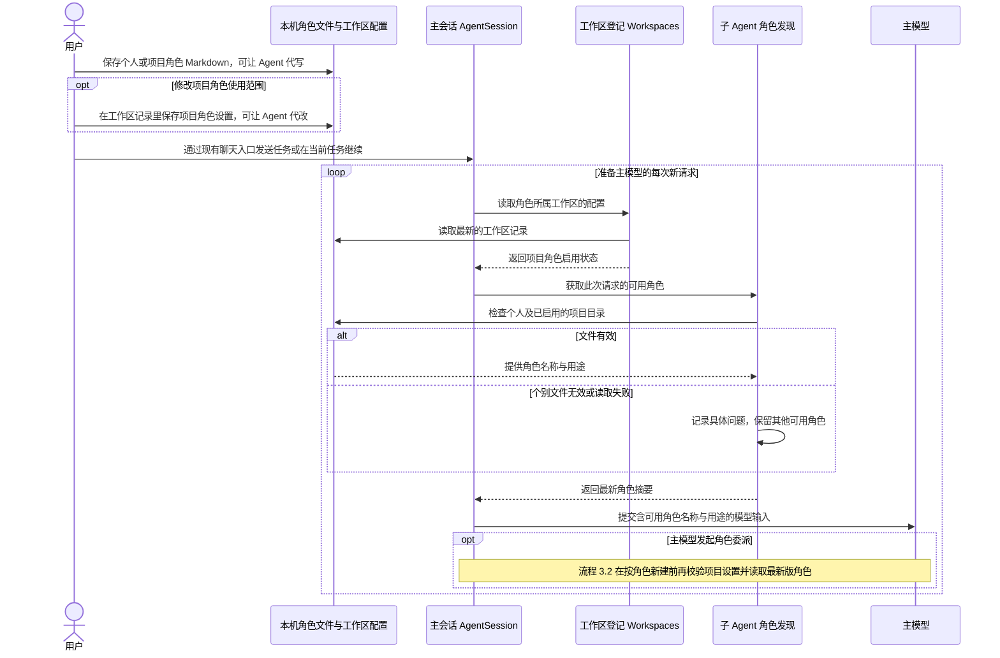
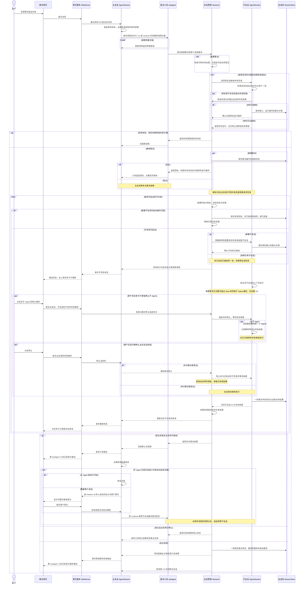
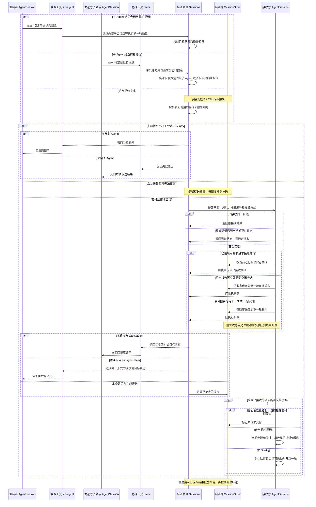

# 里程碑 2 Feature 12 Multi-Agent 设计讨论记录

## 已认可的设计

Feature 12 支持角色注册、前后台任务编排和可持续协作的子会话。运行行为以 Pi 编码扩展、Durable 后台示例和 P2 为参考。子会话及消息记录以 Hermes 为参考。由 Code Mode 调用子 Agent、校验结构化返回和分支的工作流留到 Feature 13。 [Multi-Agent 规划](../README.md#第十二步multi-agent) · [Code Mode 规划](../README.md#第十三步code-mode)

### 角色注册、发现与启动上下文

- 用户在个人或项目范围保存 Markdown。文件头写必填的 `name`、`description`，可选的 `tools`、`model`。正文是每次启动时使用的角色工作指令。省略模型时沿用主会话的模型与推理级别。个人和项目角色可以重复使用，预先准备好的委派指令也可以复用。 [Pi 角色定义](../../../pi/packages/coding-agent/examples/extensions/subagent/README.md#agent-definitions) · [Pi 启动配置](../../../pi/packages/coding-agent/examples/extensions/subagent/index.ts#L389)
- 主模型先看到角色名称与用途。它根据任务选角色，并通过相应的委派工具提交。服务端读该角色的正文，为子 Agent 按实际工作目录准备通用编码指令、项目说明与适用的 Skill，再加上角色指令。主 Agent 交办的本次任务成为子会话的第一条输入。主对话里需要传递的背景由主 Agent 写进任务。 [Pi 系统提示](../../../pi/packages/coding-agent/src/core/system-prompt.ts#L128) · [角色指令和本次任务](../../../pi/packages/coding-agent/examples/extensions/subagent/index.ts#L420)
- **项目角色按工作区通过文件启用。** 用户可手动编辑，或明确交给 Agent 编辑 `~/.agent-learning/workspaces.json` 中对应工作区的 `projectAgentsEnabled`。该配置与工作区 ID、路径保存在同一条记录中。新工作区默认关闭。旧记录缺少开关时也按关闭处理，原 ID 和路径可继续使用。重新添加同一个目录时沿用原记录及设置。用户开启后，当前工作区已有及后续新增、修改的项目角色都可进入可用目录。服务端在选用项目角色时校验它所属工作区的开关。前台和后台共用规则，`agentScope` 选择本次查找范围。 [SI 工作区记录](../../../packages/server/src/workspaces.ts#L24) · [旧记录与重复登记覆盖](../../../packages/server/test/workspaces.test.ts#L7) · [Pi 作用域与项目角色确认](../../../pi/packages/coding-agent/examples/extensions/subagent/index.ts#L627)

### 同一服务运行独立子会话

前台和后台都由 SI 服务为每个子会话创建独立的 `AgentSession`，复用模型调用、工具执行和同一个 SQLite 会话库。每个子会话有自己的消息、运行状态和停止信号。前台和后台创建的子会话都可凭同一会话 ID 续用。续用沿用该子会话的历史和现有配置，由本次调用选择是否等待。Hermes 这条委派路径用独立 `AIAgent` 复用对话执行，在进程内用线程池并行。SI 使用现有异步会话运行能力。Hermes 的这条构建路径设置了 `skip_context_files`，SI 按已确认的 Pi 方式为子会话加载实际工作目录中的项目说明。后台报告时机沿用已确认的 DSH 规则。 [Hermes 子 Agent 构建](../../../hermes/tools/delegate_tool.py#L308) · [Hermes 并行执行](../../../hermes/tools/delegate_tool_dispatch.py#L177) · [Hermes 前后台分流](../../../hermes/tools/delegate_tool_dispatch.py#L544) · [Hermes 停止范围](../../../hermes/website/docs/user-guide/features/delegation.md#L729) · [SI 并行会话测试](../../../packages/server/test/webserver.test.ts#L1676)

### 主 Agent 的委派工具 `subagent`

`subagent` 只提供给主 Agent，用于委派和管理自己派出的子会话。每次执行任务时由 `background` 选择等待方式。传 `false` 时主会话等待任务完成，拿到原工具调用的结果。传 `true` 时工具先回执，任务完成后沿 DSH 的规则报告。Hermes 的 `delegate_task` 将委派和运行控制放在同一工具中，由会话运行方式决定等待。SI 将选择交给当前工具调用的参数。 [Hermes 委派动作](../../../hermes/tools/delegate_tool.py#L911) · [Hermes 模型调用的运行方式](../../../hermes/tools/delegate_tool.py#L982)

子任务默认使用主会话的工作目录。`cwd` 可以指定本机已有目录，例如主 Agent 刚创建的 Git worktree。子会话仍归原主会话，按实际目录加载项目说明，续聊时沿用该路径。路径不可用时提示用户。 [Pi 前台目录](../../../pi/packages/coding-agent/examples/extensions/subagent/index.ts#L331) · [Pi 子会话工作目录](../../../pi/apps/p2/plugins/subagents/tools.ts#L382)

**工具参数草案**

- **`run`**　新建子会话并执行首轮任务，显式传入 `background`。单项提供 `task`，可指定角色、名称和工作目录。省略角色时使用通用子 Agent 指令，沿用主会话的模型和推理级别。
- **并行 `tasks`、串行 `chain`**　和单个任务共用同一个 `run`，每项各建一个子会话。并行按请求顺序汇总各项答复或失败。串行按顺序执行，`{previous}` 取紧邻上一步的答复，某步失败时结束后续步骤，成功时提供最后一步答复。前台把本批结果回填到工具调用。后台回执提供委派编号，整批结束后投递同样的结果。已启动子会话的 ID 用于查看状态和后续续用。 [Pi 串行收尾](../../../pi/packages/coding-agent/examples/extensions/subagent/index.ts#L706) · [Hermes 批量结果](../../../hermes/website/docs/user-guide/features/delegation.md#L192)
- **`continue`**　用原 `sessionId` 或同一主会话内的唯一名称找到已有子会话。传入 `message`，上轮已收尾且允许启动时，从原历史开启下一轮。本次 `background` 独立决定等答复还是先收回执。目标仍在运行或收尾时，工具返回当前状态。 [Hermes 续用的状态检查](../../../hermes/tools/delegate_tool_continue.py#L33)
- **`steer`**　用 `sessionId` 或同一主会话内的唯一名称，向正在运行的子会话提交 `message`。服务端确认接收后立即回执，当前步骤和同批工具调用结束后把消息交给子模型。目标已结束或正在停止时，返回当前状态。 [Hermes 插话及回执](../../../hermes/tools/delegate_tool_registry.py#L338) · [SI 插话时机](../feature10/feature10-人机协同技术设计.md#L227)
- **`stop`**　按会话 ID 或名称停止子会话当前工作。**`status`** 按会话 ID 或名称读取状态，省略目标时列出当前主会话的子 Agent 及可续用 ID。

同一主会话下最多同时执行 **8 个子任务**。单次并行 `run` 最多提交 8 项，同时执行最多 4 项，也受主会话总上限约束。会话管理统一检查容量。已满时，新发起的子任务返回容量状态，已接收的批次按释放的名额继续调度。

两种工具的 `continue` 和 `steer` 共用下文的状态规则。交办下一轮时，调用方等目标空闲后用 `continue`。 [Hermes 续用的状态检查](../../../hermes/tools/delegate_tool_continue.py#L33) · [Hermes 插话的投递时机](../../../hermes/tools/delegate_tool_registry.py#L360)

**通用子 Agent 指令。** 前台和后台共用 Pi P2 创建子会话时所用指令的中文版本。自定义角色正文和首条任务输入沿用 Pi 编码扩展的组装方式。模型可见的工具说明按 SI 已确认的动作和状态规则调整。 [技术设计中的提示词](feature12-Multi-Agent技术设计.md#31-从文件注册并发现子-agent-角色) · [Pi P2 通用指令](../../../pi/apps/p2/plugins/subagents/tools.ts#L581) · [Pi 角色和任务组装](../../../pi/packages/coding-agent/examples/extensions/subagent/index.ts#L420)

### 子 Agent 协作工具 `team`

`team` 只提供给子 Agent，供前台和后台的子任务联系自己的主 Agent 或同级子 Agent。服务端从调用会话取得发送者身份，并在执行工具时检查目标归属。Pi P2 也将团队工具限定给子 Agent，SI 的续用和插话采用与主工具一致的动作。 [Pi P2 团队工具与目标解析](../../../pi/apps/p2/plugins/subagents/tools.ts#L672)

- **`continue`** 与 `subagent.continue` 共用 `sessionId` 或 `name`、`message`、`background`，从目标会话的历史开启下一轮。`background: false` 时调用方等目标交回答复。传 `true` 时，目标确认接单后工具返回回执，完成报告发回发起这次调用的会话。
- **`steer`** 与 `subagent.steer` 共用 `sessionId` 或 `name`、`message`，给接收方当前轮插话并返回统一回执。
- **`answer`** 按会话 ID 或名称读取同级子 Agent 最近完成的答复。
- **`list`** 列出其他子 Agent 及运行状态。

`team` 可用 `name: "parent"` 指向当前子 Agent 的主会话。联系同级子 Agent 时，填写其 `sessionId` 或唯一名称。接收方看到消息及发送者身份。

#### 续用与当前轮插话

**动作和字段（已确认）。** `subagent` 和 `team` 的 `continue`、`steer` 共用参数、目标状态判断和返回结果。调用方和可联系范围由工具决定。 [Feature 10 会话输入与收尾](../feature10/feature10-人机协同技术设计.md#L227) · [Hermes 续用的状态检查](../../../hermes/tools/delegate_tool_continue.py#L33) · [Hermes 当前轮插话](../../../hermes/tools/delegate_tool_registry.py#L360)

| 接收方状态 | `continue` | `steer` |
| --- | --- | --- |
| 空闲 | 满足启动条件时接单并开启新一轮。目标确认接单后，后台返回回执，前台继续等答复。已有待发任务时返回「已有待发任务」，保留原队列顺序。其他无法启动的情况返回实际原因。 | 返回「空闲」，这条插话未接收。 |
| 正在运行 | 返回「正在运行」，当前仍执行已有任务。 | 回执「当前轮已接收插话」，当前步骤和同批工具收尾后交给模型。 |
| 正在停止、尚未收尾 | 返回「正在停止」，待本轮收尾后可以再续用。 | 返回「正在停止」，这条插话未接收。 |

插话已接收但在交给模型前当前轮停止时，服务端记录为「未交付」。显式插话绑定接收时的运行编号。后台完成报告由服务端自动投递，按下文的接收状态分流。

**续用接单（已确认）。** 目标会话在同一次接收操作里检查状态和启动条件、为本次请求占用下一轮并保存输入及运行关联。两个请求同时续用同一个会话时，先被目标成功接收的请求才收到成功回执，另一请求收到「正在运行」「正在接收」或当时的实际状态。后台调用等目标确认接单，随后返回回执。

#### 主 Agent 与子 Agent 的工具对照

| 行为 | 主 Agent 的 `subagent` | 子 Agent 的 `team` | 对应关系 |
| --- | --- | --- | --- |
| 续用 | `continue` 续用自己派出的子 Agent。 | `continue` 续用同级子 Agent 或自己的主 Agent。 | 相同字段、启动条件、前后台等待和结果投递。 |
| 当前轮插话 | `steer` 发给自己派出的子 Agent。 | `steer` 发给同级子 Agent 或自己的主 Agent。 | 相同字段、投递条件和回执。 |
| 查询列表与状态 | `status` 省略目标列出自己的子 Agent，指定目标查看一项。 | `list` 列出同级子 Agent。 | 共用状态和列表字段。主工具是否显式增加 `list` 仍是命名提议。 |
| 新建与停止 | `run` 创建子会话，`stop` 停止指定子任务。 |  | 由主 Agent 管理它派出的子任务。 |
| 读取已有答复 |  | `answer` 读取同级子 Agent 最近完成的答复。 | 发起委派或续用的两种工具都按 `background` 交付本次调用的结果。 |

前台子任务可以直接给同级子 Agent 传信息，接收方按自己的运行状态处理。给正在等自己的主 Agent 插话时，服务端先保存，等这批工具返回后交给主模型。前台子 Agent 遇到必须先由主 Agent 决定的问题时，结束本轮，将已完成的工作和待决定的问题写入工具结果。主 Agent 可自行决定，或先向用户提问。拿到答复后，主 Agent 用 `continue` 和原 `sessionId` 提交答复，子会话从已保存的历史开启下一轮。 [SI 工具批次收尾后回填](../../../packages/agent/src/agent.ts#L155)

### 子会话和 SQLite 记录

- 主会话和子会话共用 SI 的 SQLite 会话库。每个子 Agent 有自己的 `sessions.id`，标记 `source = "subagent"`，通过 `parent_session_id` 关联直接派出它的会话。子会话保存自己的工作目录和当前角色配置。每次委派记录所用子会话、当前运行和发起它的工具调用，同时记录本次的前后台方式。这样同一子会话可以多次执行，每次都能定位到对应的主会话调用。 [Hermes 子会话创建](../../../hermes/tools/delegate_tool_child_run.py#L44) · [Hermes 会话库文档](https://hermes-agent.nousresearch.com/docs/developer-guide/session-storage) · [Pi CLI 启动](../../../pi/packages/coding-agent/examples/extensions/subagent/index.ts#L389)
- 任务输入、助手回复、工具调用和结果，通过子会话自己的 `messages.session_id` 保存。SI 的消息还属于该会话下的一次 `run`。前台或后台续用时，服务端按同一子会话 ID 读取已有历史，添加本次委派为新一轮输入。再次打开持久化的会话时，SI 的会话管理会重建会话实例并恢复历史。 [Hermes 消息表](../../../hermes/persistence/sqlite/_schema_ddl.py#L197) · [Hermes 续聊读取](../../../hermes/tools/delegate_tool_continue.py#L178) · [SI 会话、执行与消息表](../../../packages/coding-agent/src/session-store.ts#L76) · [SI 会话恢复](../../../packages/coding-agent/src/sessions.ts#L167)

### 后台回报、网页展示、停止和恢复

- 以后台方式运行的任务可能晚于发起方当轮结束。后台程序将带执行方身份的结果或失败原因送回发起调用的会话。报告关联原调用，同一结果重复送达时只接收一次。前台结果沿用工具调用编号配对。 [DSH 完成报告投递](../../../deepseek-harness/packages/subagent/subagent/src/manager.ts#L1135) · [Pi P2 报告编号](../../../pi/apps/p2/plugins/subagents/tools.ts#L198) · [SI 工具调用与结果配对](../../../packages/agent/src/agent.ts#L133)
- 子 Agent 的网页操作集中在两处。主聊天用现有的可展开工具记录展示 `subagent` 的参数和输出。右上角沿用当前会话的任务卡片，展示子 Agent 名称和状态，允许单独停止运行中的子任务。主 Agent 仍用 `continue` 续用子会话，历史由服务端保存。 [DSH 工具输入与输出](../../../deepseek-harness/packages/client/ui-tool/src/client/tool/components/ToolRow.tsx#L420) · [SI 右上角任务卡片](../../../web/src/components/BackgroundTasks.tsx#L12)
- **单独停止子任务（已确认）。** A 通过前台 `team.continue` 等待 B 时，用户单独停止 A，A 立即解除这次等待并开始收尾。B 已接单的任务继续执行，结果保存到 B 的会话。停止主 Agent 当前轮时，主 Agent 直接等待的前台委派随本轮停止，后台委派继续。停止整个会话时，一并停止该会话的子任务。 [前台取消](../../../pi/packages/coding-agent/examples/extensions/subagent/README.md#error-handling) · [P2 主对话停止测试](../../../pi/apps/p2/test/p2/subagents.test.ts#L156) · [P2 会话停止](../../../pi/apps/p2/README.md#L299)
- 服务重启后，保留已经保存的聊天、工具记录和子任务结果。执行到一半的项显示「已中断」，尚未启动的项保留「未启动」，有调用且缺少结果的工具显示「结果未知」。未生成的完成报告可按已保存的逐项结果重建，待发送的报告按原编号补送。接收方以该编号去重。 [SI 中断恢复](../../../docs/development.md#L11) · [Hermes 已完成子任务记录和恢复](../../../hermes/tools/async_delegation.py#L200)

### 后台完成报告的投递

采用 DSH 的投递时机。以后台方式执行的任务结束后，报告送回发起调用的会话。服务端查看该会话接收报告时的运行状态。 [DSH 自动报告](../../../deepseek-harness/packages/subagent/subagent/src/manager.ts#L1135) · [DSH 消息投递](../../../deepseek-harness/packages/core/agent-loop/src/agent.ts#L168)

- **正在运行且可以接收插话**　以插话保存。等本步模型回复和同批工具调用收尾，在当前轮下一次请求交给接收方模型。如果本步原本已经给出最终答复，服务端仍会检查已接收的插话。
- **已经空闲**　以 `followup` 加入下一轮输入，触发会话启动下一轮。
- **刚停止、还在收尾**　服务端检查当前轮的停止信号，保存到下一轮输入并记录有新输入到达。旧轮完成收尾后按下一轮规则启动。报告和停止的先后以服务端接收为准。 [DSH 等待收尾并唤醒](../../../deepseek-harness/packages/core/agent-loop/src/agent.ts#L232) · [DSH 停止竞态测试](../../../deepseek-harness/packages/core/agent-loop/tests/cancel.spec.ts#L222)

在 SI 复用 Feature 10 设计的会话层接收逻辑。用户消息从网页入口提交，后台报告与 `team` 消息由服务端提交并标明来源。当前普通提交遇到忙碌时会返回错误，插话和队列是待实现的已确认设计。会话还需遵守计划审核等现有启动条件。 [SI 当前消息接收](../../../packages/coding-agent/src/agent-session.ts#L385) · [Feature 10 插话接收](../feature10/feature10-人机协同技术设计.md#L227)

**下一轮队列恢复**

后台报告可以唤醒主会话。加入下一轮队列时沿用已有条目的顺序。例如，任务 A 运行时用户提前发送了「改 README」。用户停止 A 后，子 Agent 的报告到达并排在「改 README」后面。A 收尾后，服务端先启动「改 README」，再按顺序处理报告。Feature 12 将后台报告加入会话队列的恢复触发来源。 [DSH 停止保留队列](../../../deepseek-harness/packages/api/session-controller/src/commands.ts#L540) · [DSH 原队首先启动测试](../../../deepseek-harness/packages/core/agent-loop/tests/cancel.spec.ts#L196) · [SI 原有队列恢复设计](../feature10/feature10-人机协同技术设计.md#L429)

## 流程与模块对齐

前三条流程已获确认。整稿补充了 `/stop` 停止当前会话全部在途任务的设计，供整体审阅。 [Multi-Agent 技术设计](feature12-Multi-Agent技术设计.md) · [Multi-Agent 验收标准](feature12-Multi-Agent验收标准.md)

`/stop` 的触发规则已确认。点击命令菜单项或用 Tab 选中会直接执行。手动提交时，首词是 `/stop` 就执行停止，后续文字忽略。

角色注册与发现、任务委派、子 Agent 协作与运行管理按三条流程核对。任务委派使用同一条创建和续用路径，在结果返回处说明前后台差异。Agent 间通信、报告投递时机、停止范围和重启恢复在协作与运行管理流程展开。

### 3.1 从文件注册并发现子 Agent 角色（已确认）

用户手动保存角色及工作区配置，或者让 Agent 写入文件。现有会话下一次准备模型请求时即可向主模型提供文件中的最新角色摘要。按名称启动子任务时，程序再读取最新的角色正文和配置。

Claude Code 监听个人和项目角色目录，下一次委派使用更新后的定义。SI 复用现有上下文准备流程，每次组装新的主模型请求时重读角色目录。按角色新建子会话前，服务端直接读取所选角色的最新版。这样在同一轮让 Agent 创建角色时，下一次模型请求也能发现它。个人和项目角色保存位置沿用先前选定的 SI 目录。 [Claude Code 角色文件与监听](https://code.claude.com/docs/en/sub-agents#write-subagent-files) · [SI 每步准备上下文](../../../packages/coding-agent/src/agent-session.ts#L989)



#### 网页服务 WebServer

**职责。** 沿用网页的任务提交入口。创建主会话时传入读取本机工作区项目角色设置的能力。 [现有会话装配](../../../packages/server/src/webserver/index.ts#L239)

**接口（新增 0，修改 1）。**

- 【修改】`createSessions`（内部会话装配）。为主会话绑定按工作区编号读取项目角色设置的依赖。

**数据（新增 0，修改 0）。** 装配时使用工作区编号，项目角色设置由 Workspaces 读取。

#### 工作区登记 Workspaces

**职责。** 从 `workspaces.json` 对应工作区读取用户设置。新工作区和缺少该字段的旧记录默认关闭。重复登记沿用同一条记录。当前工作区的角色开关由本机配置文件管理。 [现有工作区文件](../../../packages/server/src/workspaces.ts#L24)

**接口（新增 1，修改 0）。**

- 【新增】`getProjectAgentsEnabled`（模块调用）。按工作区编号读取已保存的有效值。主会话准备上下文时使用。派发项目角色前再次读取。

**数据（新增 0，修改 1）。** 本机工作区记录 `Workspace` 增加可选的 `projectAgentsEnabled`。值为 `true` 时允许使用该工作区的项目角色。构造示例是一条工作区记录。

```json
{
  "id": "workspace-si",
  "path": "/Users/example/si",
  "projectAgentsEnabled": true
}
```

#### 子 Agent 角色发现

**职责。** 个人角色放在 `~/.si/agents/`，项目角色放在登记工作区的 `.si/agents/`。发现时提取文件头。项目启用后，同名角色优先采用项目版本。格式错误或单个文件读取失败时记录原因，保留其他可用角色。 [SI Skill 目录习惯](../../../docs/skills.md#查找范围) · [Pi 角色同名优先级](../../../pi/packages/coding-agent/examples/extensions/subagent/agents.ts#L128)

**接口（新增 1，修改 0）。**

- 【新增】`discoverSubagentRoles`（模块调用）。按当前工作区路径和启用状态从磁盘取得最新摘要，返回角色来源供后续委派。

**数据（新增 1，修改 0）。** 角色摘要 `SubagentRoleSummary` 供会话识别可用角色。主模型接收名称与用途。每个项目角色子任务实际启动前，服务端读取来源工作区的最新设置，再按角色来源加载文件。角色被删除或项目角色被关闭时，工具返回具体原因。

构造示例

```typescript
{
  name: "test-reviewer",
  description: "检查改动遗漏了哪些测试场景",
  source: "project",
  path: "/Users/example/si/.si/agents/test-reviewer.md",
}
```

#### 会话 AgentSession

**职责。** 按现有上下文准备时机读配置、发现角色并组装主模型实际收到的目录。按角色新建子会话时读取最新版角色正文、工具和模型配置。前台和后台续用已有子会话时采用该会话现有配置，并核对当前使用权限。 [现有上下文准备](../../../packages/coding-agent/src/agent-session.ts#L989) · [既有 Skill 目录注入](../../../packages/coding-agent/src/system-prompt.ts#L62)

**接口（新增 0，修改 2）。**

- 【修改】`prepareContext`（内部上下文准备）。在准备主模型请求时获取当前项目角色授权和目录。完成角色写入的工具调用收尾后，下一次模型请求可读取新配置。
- 【修改】`configure`（内部模型输入组装）。在可使用委派工具时，将更新后的角色名称和用途交给主模型。

**数据（新增 0，修改 0）。** 消费角色发现返回的 `SubagentRoleSummary`，沿用模型上下文的系统提示字段。

**验收要点。** 通过指定目录发现个人角色。旧工作区记录默认关闭项目角色，改配置后下一次请求采用新范围。新增、修改或删除角色后，现有主会话下一次请求正确更新目录。按角色新建时读取最新定义，项目在请求后被关闭时返回失败。模型先收到摘要，选中角色后子会话获得完整指令。

### 3.2 委派子 Agent 任务（已确认）

下图展示主模型通过 `subagent.run` 新建子会话，或用 `subagent.continue` 续用已收尾的子会话。`team.continue` 复用同一个续用流程，服务端按调用者身份确定目标、读取目标会话历史，并按 `background` 向发起方交付结果。



#### 委派工具 `subagent`

**职责。** 主会话的 `run` 创建一个或多个子会话，`continue` 在自己的子会话里开启下一轮。`subagent` 只注册给主会话。按流程 3.1 解析所选角色，校验归属和项目角色授权。子会话的工具取上游可授权能力和角色配置的交集，执行时沿用会话权限及 Hook。`steer` 的接收和投递见流程 3.3。 [Pi P2 工具授权范围](../../../pi/apps/p2/plugins/subagents/tools.ts#L382) · [SI 工具权限](../../../packages/coding-agent/src/agent-session.ts#L234)

**接口（新增 1，修改 0）。**

- 【新增】`subagent`（模型工具）。**用途。** 发起任务、续用已有子会话或操作运行中的子会话。**主要流程。** `run` 校验参数后提交新建委派。单批最多 8 项，同时执行最多 4 项，与其他调用共用主会话的 8 个名额。并行按请求顺序组装各项答复或失败。串行在前一步成功后启动下一步，失败时返回失败位置。`continue` 先检查原子会话的归属、权限和当前状态，取得名额后接收下一轮输入。两个动作按选定方式等待终态或返回已接收回执。前台子 Agent 结束本轮后，可用工具结果把已完成工作和待决定事项交给主 Agent。主 Agent 作出决定后用 `continue` 和原 `sessionId` 续用。需要用户决定时，沿用 Feature 10 的反问流程。 [Feature 10 反问流程](../feature10/feature10-人机协同技术设计.md#L261) · [Pi 并行限制](../../../pi/packages/coding-agent/examples/extensions/subagent/index.ts#L38) · [Pi 串行收尾](../../../pi/packages/coding-agent/examples/extensions/subagent/index.ts#L706) · [Hermes 前后台共用执行](../../../hermes/tools/delegate_tool_dispatch.py#L544)

**数据（新增 0，修改 0）。** 任务指明新建参数或已有会话 ID，以及本次 `background`。前台结果和后台报告提供可续用的子会话 ID。后台回执提供本次委派编号。

#### 工具调度 Agent

**职责。** 沿用先保存调用、再执行、回填结果的流程。给工具传入本次调用在助手消息中的位置，供主会话将子会话进度关联到正确的工具调用。 [SI 工具执行与结果配对](../../../packages/agent/src/agent.ts#L129) · [SI 调用位置](../../../packages/coding-agent/src/agent-session.ts#L1152)

**接口（新增 0，修改 1）。**

- 【修改】`AgentTool.execute`（内部工具执行接口）。执行上下文补充助手回复里该工具的序号 `contentIndex`，并沿用停止信号。主会话提供对应的助手消息编号。调度器仍以原工具调用编号构造模型所见结果。

**数据（新增 0，修改 1）。** 工具执行上下文增加调用位置中的序号。工具结果沿用 `ToolResultMessage`。

#### 会话管理 Sessions 与会话 AgentSession

**职责。** Sessions 在同一服务内新建独立子会话，或按工具的授权范围定位并恢复已有会话。新建时采用实际工作目录、角色指令和工具配置，委派任务成为首条消息。续用时追加发送者及本次任务，目标模型沿用自己的对话及会话配置。会话管理层保存发起方、目标运行与原调用，工具按本次等待方式返回。停止主轮时，其前台子任务随本轮收尾。用户在任务卡片单独停止子 Agent 时，停止范围按该子 Agent 的运行编号确定。 [SI 会话工厂](../../../packages/server/src/webserver/index.ts#L239) · [SI 接收与运行](../../../packages/coding-agent/src/agent-session.ts#L514) · [SI 中止收尾](../../../packages/coding-agent/src/agent-session.ts#L1439)

**接口（新增 2，修改 0）。**

- 【新增】`Sessions.startDelegatedTask`（模块调用）。接收新建或续用请求。Sessions 按目标归属的主会话统一检查并登记并发名额。提交失败或接单前取消时释放已登记的名额，已启动的轮次实际收尾后释放。两个工具的 `continue` 共用同一入口，先校验权限与目标状态，再登记名额并保存接单结果。未能接单时，原工具调用收到实际状态。前台等待结果，续用的后台回执在目标确认接单后返回。
- 【新增】`AgentSession.runDelegatedTask`（内部调用）。**用途。** 复用目标会话的接收与执行，提供可等待的终态。**主要流程。** 传入本次任务及发起会话。任务接单前取消时结束准备。目标接单后，解除发起方等待和中止目标执行各按停止范围处理。子 Agent 被单独停止时，它的前台 `team.continue` 立即解除等待，目标的执行继续。目标终态带答复或失败原因，交给会话管理。
- 【沿用】`AgentSession.abort(runId)`（模块调用）。网页和模型都通过会话管理定位目标，再复用子会话本轮的停止信号。目标已经收尾时取得该轮实际状态。 [SI 按运行编号停止](../../../packages/coding-agent/src/agent-session.ts#L1439)

**数据（新增 1，修改 0）。** Sessions 维护每个主会话的并发登记，覆盖准备、运行及停止收尾中的子任务。会话、委派关系和运行结果由 SessionStore 保存。

#### 会话库 SessionStore

**职责。** 新建时将首条任务与子会话关系一同保存。每次前台或后台委派记下对应的运行和发起它的工具调用，回看时可以定位本次执行与子会话历史。服务重启后沿用已确认的「已中断」处理。 [SI 会话与消息保存](../../../packages/coding-agent/src/session-store.ts#L199) · [Hermes 子会话关系](../../../hermes/tools/delegate_tool_child_run.py#L44)

**接口（新增 1，修改 1）。**

- 【修改】`save`（模块调用）。保存会话来源、父会话关系、子会话配置和本轮委派关联。各项任务收尾时，将本轮终态和该项结果放在同一次 SQLite 提交中。整批收尾时，一同保存委派终态、汇总结果和报告待发送状态。
- 【新增】按父会话查找子会话（模块查询）。恢复原聊天中的子项及对应运行状态。

**数据（新增 1，修改 1）。**

- 【修改】会话记录。增加 `source = "subagent"` 和 `parent_session_id`。子会话还保存实际工作目录、当前角色配置及其来源。源工作区编号用于续用时核对项目角色授权。同一子会话持续使用同一个 ID。
- 【新增】委派关联。记录委派编号、发起会话与工具调用位置、本次 `background` 值。多项任务按任务序号关联目标会话、运行编号和已保存结果。后台委派用委派编号作为完成报告的稳定编号，记录待发送或已确认接收。结果按这条关联交回原调用所在会话。主聊天的任务卡片按子会话归属展示状态。

构造示例

```typescript
const childSession = {
  id: "child-review-01",
  workspaceId: "workspace-si",
  source: "subagent",
  parentSessionId: "session-review",
  cwd: "/Users/example/si",
  role: { name: "test-reviewer", source: "project", workspaceId: "workspace-si" },
}

const delegation = {
  id: "delegation-review-02",
  background: false,
  callerSessionId: "session-review",
  toolCall: { assistantMessageId: "assistant-12", contentIndex: 0 },
  tasks: [{ targetSessionId: "child-review-01", targetRunId: "run-review-02", taskIndex: 1 }],
}
```

#### 主会话、网页服务与原聊天展示

**职责。** 主会话按原调用发布完成输出，按子会话发布当前运行状态。WebServer 转发给当前聊天。网页用现有工具行展示参数与输出，用右上角卡片展示子 Agent 状态和停止操作。 [SI 工具行](../../../web/src/components/AssistantMessage.tsx#L67) · [DSH 工具输入与输出](../../../deepseek-harness/packages/client/ui-tool/src/client/tool/components/ToolRow.tsx#L420) · [SI 任务卡片入口](../../../web/src/pages/ChatPage.tsx#L1159)

**网页交互（已确认）。**

- **聊天中的工具记录**使用「工具调用 · subagent」。展开后展示输入参数和实际输出。前台直接展示工具结果。后台先显示接收回执，结束后按原调用关联展示最终结论、失败或停止信息。模型历史里的工具结果保留原回执，完成报告按流程 3.3 投递。 [DSH 工具输入与输出](../../../deepseek-harness/packages/client/ui-tool/src/client/tool/components/ToolRow.tsx#L420) · [SI 工具调用与结果配对](../../../packages/agent/src/agent.ts#L133)
- **右上角任务卡片**沿用原入口，名称改为「任务」。卡片内有子任务时显示「子 Agent」一组，当前主会话的每个子 Agent 一行。运行时显示名称和停止图标。图标悬停和键盘聚焦时提示「停止」，并提供可读名称。单击后图标暂时禁用，等服务端确认停止后在同一位置显示「已停止」。请求异常时同步实际状态，任务仍在运行时可重试。自然结束时显示「已完成」，失败或服务重启中断时显示对应的终态。 [SI 现有任务卡片](../../../web/src/components/BackgroundTasks.tsx#L12)

**接口（新增 1，修改 2）。**

- 【修改】会话订阅（WebSocket）。主会话快照及后续更新携带当前聊天的子任务状态和已保存的后台完成输出。刷新和重连从快照恢复，由服务端按原工具调用绑定输出。
- 【修改】主会话列表查询（HTTP）。默认列出主会话，子 Agent 状态由所属主会话的订阅提供。
- 【新增】单独停止子任务（HTTP）。网页提交主会话 ID、子会话 ID 和所见的运行编号。服务端校验归属并停止对应轮次，返回实际状态。任务已完成或新的轮次已启动时，原请求仍以所选轮次为准。单独停止的结果通过该次委派交回，主会话以及其他并行运行的子任务按各自的流程继续。
- 【沿用】停止当前任务（HTTP）。提交主会话和当前轮编号，前台调用从本轮的停止信号感知取消。

**数据（新增 0，修改 2）。** 主会话的 `ConversationSnapshot` 和 `ConversationUpdate` 携带两处界面所需的数据。工具行按助手消息编号及调用位置找到最终输出。卡片按子会话 ID 合并记录，使用最新一轮的运行编号和状态。子会话身份与委派关联从 SessionStore 恢复，实时状态来自对应子会话。

**验收要点（待核对）。** 单个委派会把子答复回填到原调用。并行限制、顺序和部分失败可在工具层验证。串行需核对紧邻上一步的传递和失败后的未启动项。项目开关关闭、角色或目录无效时没有子任务开始。停止主轮时保存已完成结果和每项状态，主模型结束当前轮。后台完成后在原工具行显示输出。刷新后能恢复工具输出和卡片状态。卡片仅显示当前主会话的子 Agent。单击停止只影响选定子任务的那一轮，和自然完成重叠时显示实际终态。用真实模型走一次新建及续用，核对子 Agent 执行和主模型对结果的使用。前台并行的两个子 Agent 能通过 `team` 传递发现，主会话继续等待该批结果。前台子 Agent 可以交回待决定事项。主 Agent 自行决定或获得用户答复后，用 `continue` 和原会话 ID 开启下一轮，并能用到先前的工作。对仍在运行或收尾的目标调用 `continue` 时返回状态。后台委派先返回接收回执，完成后交回报告。跨方式续用需要用前台创建后后台接续，再用前台继续一次，确认三轮消息都追加到同一个子会话，主会话按每次委派的方式接收结果。现有并行会话中止测试作为基础覆盖。 [SI 并行会话测试](../../../packages/server/test/webserver.test.ts#L1676)

- 主 Agent 用后台 `subagent.continue`、同伴用后台 `team.continue` 同时续用同一个空闲子 Agent。阻塞目标接单，核对两个请求都没有提前得到成功回执。释放接单后，核对仅一项接单、保存一轮输入、返回带运行编号的回执。另一项收到目标真实状态。另测已有待发任务时，续用返回实际状态，保留原队列顺序。
- A 用前台 `team.continue` 等待已接单的 B。B 保持执行时从任务卡片停止 A，核对 A 解除等待并完成自己的收尾，B 的任务继续且结果保存在 B 的会话里。
- 同一主会话发起两个并行批次，分别运行 4 项，核对混合 `run` 和 `continue` 也受同一个上限约束。满额的新请求返回容量状态。释放一个名额时，并发争取该名额的请求最多一个成功。停止收尾期间仍计数，失败或取消后可以再次使用名额。其他主会话独立计数。

### 3.3 投递当前轮插话与后台报告（已确认）

`subagent.steer` 和 `team.steer` 共用当前轮插话。两个工具的 `continue` 从流程 3.2 开启新一轮。后台完成报告由服务端按接收方状态选择投递时机。



#### 子 Agent 协作工具 `team`

**职责。** 只注册给子会话。前台或后台的子会话通过此工具联系自己的主会话或同级子会话，服务端带上发送方身份。读取同级状态和已完成答复时沿用同一会话归属范围。 [Pi P2 团队工具](../../../pi/apps/p2/plugins/subagents/tools.ts#L672) · [DSH 消息发送](../../../deepseek-harness/packages/subagent/subagent/src/manager.ts#L568)

**接口（新增 1，修改 0）。**

- 【新增】`team`（模型工具）。`continue` 使用流程 3.2 的续用与结果交付。`steer` 使用相同的运行状态检查和接收回执，接收方空闲或正在停止时返回该状态。`list` 查询同级状态，`answer` 读取目标最近完成的答复。

**数据（新增 0，修改 0）。** 使用与 `subagent` 共用的目标字段、消息及回执。输入保存和去重由接收方会话处理。

#### 委派工具 `subagent`

**职责。** 转交主 Agent 给子会话当前轮的插话，收到接收结果后回填原工具调用。

**接口（新增 0，修改 0）。** 复用流程 3.2 已计入的 `subagent` 工具。`steer` 成功时交回接收回执。接收时若目标轮已结束或正在停止，交回实际状态。 [Hermes 插话接收结果](../../../hermes/tools/delegate_tool_registry.py#L356)

**数据（新增 0，修改 0）。** 已接收的插话关联目标会话的本次运行。若接收后目标轮在交付前停止，状态标明本轮未交付。 [Hermes 插话与收尾竞态](../../../hermes/tools/delegate_tool_registry.py#L166)

#### 会话管理 Sessions

**职责。** 通过父会话关系定位接收方，协调前后台子会话间的消息、完成报告和针对子会话的停止。只在目标属于发起方有权操作的会话范围内投递。回执与报告分别关联各自的请求或委派。 [Pi P2 限定同会话接收方](../../../pi/apps/p2/plugins/subagents/tools.ts#L704) · [Pi P2 报告关联](../../../pi/apps/p2/plugins/subagents/tools.ts#L198)

**接口（新增 1，修改 0）。**

- 【新增】`deliverSubagentInput`（内部投递）。**用途。** 将主动插话或后台报告交给接收会话。**主要流程。** 核对发送方、接收方和会话归属。两个工具的显式插话都指定当前轮，接收方一起检查运行状态、绑定运行编号和保存输入。后台报告使用委派编号，接收方保存输入和编号后确认接收，发送方再更新投递状态。重启恢复时补建尚未生成的报告，并按原编号发送待发送报告，目标接收过时返回原回执。停止操作沿用各运行的停止信号。

**数据（新增 0，修改 0）。** 使用 SessionStore 保存的会话关系、委派关联与报告状态。

#### 接收方会话 AgentSession

**职责。** 复用 Feature 10 的会话接收和收尾时机。两种工具的 `steer` 都绑定当前轮。后台完成报告在接收时按实际会话状态选择投递时机，停止收尾时到达的报告进入下一轮。 [Feature 10 插话和收尾](../feature10/feature10-人机协同技术设计.md#L227) · [DSH 收尾分流](../../../deepseek-harness/packages/core/agent-loop/src/agent.ts#L168)

**接口（新增 0，修改 1）。**

- 【修改】会话输入接收（Feature 10 已设计的内部能力）。支持带发送者身份、消息和投递编号的输入。两种工具的 `steer` 成功时进入本次模型下一步，自动报告按实际落点保存。已有待发任务时沿用队列顺序，计划审核等启动条件仍由该会话检查。

**数据（新增 0，修改 1）。** 会话待发输入增加来源，用于保留身份、匹配投递和决定接收时机。发送方和接收方各自保存所属会话内发生的交互。

构造示例

```typescript
{
  deliveryId: "team-review-04",
  source: { kind: "subagent-message", sessionId: "child-review-01" },
  targetSessionId: "child-test-02",
  action: "steer",
  text: "重连测试也要覆盖旧订阅中尚未送达的最后一条消息。",
}
```

#### 会话库与网页展示

**职责。** 通过现有保存和同步路径记录消息来源、等待状态及最终所在的执行轮次。完成报告按原编号投递给发起方 Agent，主聊天内的原工具行按流程 3.2 展示已保存的后台完成输出。报告保存与去重沿用委派记录。刷新后从快照恢复原工具行和右上角卡片。 [SI 会话订阅](../../../packages/server/src/webserver/protocol.ts#L81) · [DSH 已接收输入归位](../../../deepseek-harness/packages/core/agent-loop/src/inbox.ts#L102)

**接口（新增 0，修改 0）。** 复用流程 3.2 已计入的会话保存和订阅接口。

**数据（新增 0，修改 0）。** 使用会话的输入来源及委派记录。消息归接收会话，报告关联原后台委派。

**验收要点（待核对）。** 核对主 Agent 只看到 `subagent`，子 Agent 只看到 `team`。分别用 `subagent.steer` 和 `team.steer` 向同一个运行中的子 Agent 插话，验证相同回执与下一步投递。目标空闲或正在停止时，两边都返回实际状态。目标在接收后、交付前停止时，两边都标记未交付。分别用两个工具的 `continue` 核对同一接收条件和前后台结果交付。子 Agent 可联系自己的主 Agent 和同级子 Agent，跨会话组的目标返回错误，接收方能辨认发送方。停止信号设置后、旧轮结束前到达的后台报告按原队首恢复，整轮仍遵守计划审核。重启补送同一报告只接收一次。前台子 Agent 把需主 Agent 决策的事项交回工具结果，主 Agent 用 `continue` 和原会话编号交付答复。

**报告恢复验收（待核对）。** 在一项任务保存终态后、整批写入报告前模拟进程退出，核对重启后的报告保留已完成的真实结果，其他项按「已中断」或「未启动」回报。单个后台任务也走同一恢复路径。在接收会话已保存报告、发起方尚未记为已接收时再次退出，核对补送后只有一条输入。 [Hermes 批次中断恢复测试](../../../hermes/tests/tools/test_async_delegation.py#L1052) · [Hermes 单项中断恢复测试](../../../hermes/tests/tools/test_async_delegation.py#L1095)

## 工程决策

### 【工程决策｜会话库与后台报告】按保存的结果恢复投递

Hermes 在各子任务结束时保存单项结果，汇总时把委派终态、最终结果和报告待发送状态一起记录。恢复时保留已经记录的结果，重新投递未送达报告。 [Hermes 逐项保存](../../../hermes/tools/async_delegation.py#L200) · [Hermes 委派完成记录](../../../hermes/persistence/sqlite/authority/coordination.py#L485) · [Hermes 补送流程](../../../hermes/tools/async_delegation.py#L343)

SI 沿用这一顺序，结果和投递状态写在同一份 SQLite 的委派记录里。每项终态与结果一起保存。整批汇总后，按委派编号保存最终结果和待发送报告。服务启动时，已完成的项用已保存结果，执行中的项记为「已中断」，未开始的项记为「未启动」。服务据此补建尚未生成的报告，并补送已有待发送报告。接收方保存报告编号与实际输入后再确认，发送方随后标记已接收。即使在这两步之间退出，重试也会取回原接收结果。 [SI 会话保存事务](../../../packages/coding-agent/src/session-store.ts#L266) · [Hermes 未完成委派恢复](../../../hermes/tools/async_delegation.py#L243)

### 【工程决策｜会话管理】每个主会话总并发上限为 8

Hermes 的后台调度在同一把锁内检查并发容量并登记，并用两个请求争抢最后一个名额验证上限。Hermes 的后台池按委派批次计数，外层满额时部分调用会回退到同步执行。 [Hermes 并发检查与登记](../../../hermes/tools/async_delegation.py#L814) · [Hermes 满额回退](../../../hermes/tools/delegate_tool_dispatch.py#L519) · [Hermes 并发竞争测试](../../../hermes/tests/tools/test_async_delegation.py#L677)

SI 复用检查与登记合在一起的做法。Sessions 按子 Agent 归属的主会话计数，在启动前同步检查并登记，每个正在接单、执行或停止收尾的子会话轮次占一个名额。前台、后台、`run` 和两个工具续用子会话的 `continue` 共用 8 个名额。`team.continue` 的目标为主会话时，主会话照常按自己的状态接单，计数只覆盖子会话。单次并行 `run` 按 Pi 的规则最多同时执行 4 项。 [Pi 单次调用限制](../../../pi/packages/coding-agent/examples/extensions/subagent/index.ts#L38)

满额时，需要启动子任务的新调用返回「子 Agent 并发已满」。已接收批次中的后续项继续使用批次调度，在有名额时启动。接单失败或接单前取消时释放所占名额，已启动任务在实际收尾后释放。后台报告投递在任务收尾后执行。 [Hermes 后台池的满额处理](../../../hermes/tools/async_delegation.py#L844)

## 参考与验证状态

对照了仓库内 Pi `69a699348`、Hermes `fd58c762e0` 和 DSH `4b399c39a6` 的源码与现有测试。当前结论来自静态源码核对，真实模型验收随技术设计确定。 [Pi P2 团队通信测试](../../../pi/apps/p2/test/p2/subagent-team.test.ts#L37)
