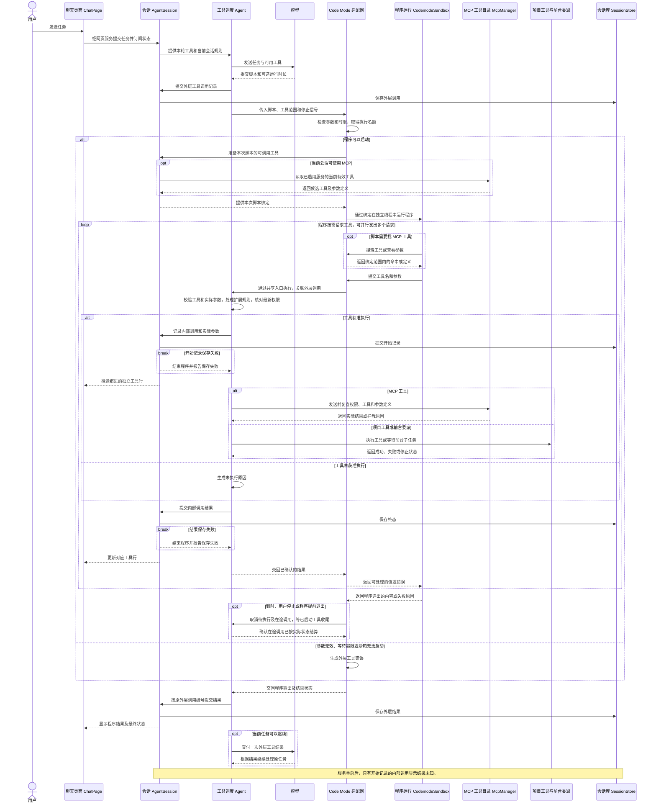

# 里程碑 2 Feature 13 Code Mode 技术设计

本稿记录已实施的 Code Mode 方案。 [设计讨论记录](feature13-设计讨论记录.md) · [验收记录](feature13-Code%20Mode验收记录.md)

## 1. 总结

**需求理解。** 模型可以在一次 `codemode` 调用中提交 JavaScript，程序根据真实工具结果选择下一步，再把挑出的内容交回模型。脚本可以在同一次执行中查找并调用当前会话有权使用的 MCP 工具，包括尚未直接提供给模型的工具。首版用真实模型验证文件筛选、脚本内 MCP 发现和多个一次性子 Agent 的结构化检查。`codemode` 作为默认工具提供，模型仍可直接调用其他工具。脚本中的每次调用沿用会话权限。网页实时显示缩进的独立工具行，重启后可回看已保存的调用。页面启停和统一工具管理留待后续设计。

**技术方案。** SI 在 `packages/coding-agent/` 实现 `codemode` 工具，复用 Pi Codemode SDK 的 QuickJS 运行环境。SI 的工具调度器执行内部调用，会话与 SQLite 记录每次调用。主模型收到程序选出的内容和运行结果，继续处理原任务。

## 2. 系统变化说明

**Before**　模型可一次提交多个工具调用。需要根据实际搜索结果决定读取哪些文件时，通常要等结果回到模型再作决策。

**After**　模型可以把这种判断写成脚本。脚本第一次用某个 MCP 工具时，可以在本次执行中查找、查看参数并调用。程序发出的工具调用由 SI 调度，网页在 Code Mode 下方显示每次调用。外层结果按原调用编号进入模型历史。

## 3. 系统设计

### 3.1 执行一次 Code Mode 调用

用户提交任务，模型发出 `codemode` 调用。程序可以在本轮发现 MCP 工具，并按工具结果选择后续动作。网页显示实际调用，模型用程序选出的结果继续任务。



#### 会话 `AgentSession` 与会话库 `SessionStore`

**职责。** 会话在每轮按现有规则组装工具，并提供 `codemode` 的脚本绑定范围。SQLite 保存内部调用和外层调用的关联。会话把已提交的变化同步到网页。

**接口（新增 0，修改 3）。**

- 【修改】会话准备工具（模块调用）。在普通、只读、计划模式中默认提供 `codemode`。模型工具清单沿用 Feature 5 的直接声明和 `tool_search` 加载记录。普通模式的 `codemode` 工具说明提示模型可在脚本内发现 MCP。脚本绑定在开始前单独取得，包括本轮适合程序调用的工具，以及当前 MCP 目录里允许本会话调用的工具。会话权限、服务状态和子 Agent 角色工具限制都参与筛选。只读和计划模式沿用现有规则，MCP 工具仅在普通模式进入脚本绑定。
- 【修改】`SessionStore.save`（模块调用）。**用途。** 保存内部调用的开始和结束。**主要流程。** 在工具实际执行前，校验归属并保存开始记录和实际参数摘要。工具结束后按原编号提交终态、结果摘要和已有的文件操作信息。参数无效或权限、Hook 拦截时，保存带原因的「未执行」记录。开始记录保存失败时停止启动该工具。结果保存失败时会话停止推进并按现有方式报告，已开始的工具按实际状态收尾。
- 【修改】会话库读回与快照准备（模块调用）。恢复按当前会话保存的父子调用关系。服务重启后，已经开始且缺少终态的调用显示「结果未知」。若外层结果也缺失，会话在原外层调用编号的恢复提示里补充有界的工具名、目标和状态摘要，优先列出结果未知或已确认改变外部状态的调用，沿用现有内部路径过滤。主模型据此核对外部状态后再继续。

**数据（新增 1，修改 2）。**

- 【新增】内部调用记录 `NestedToolCallRecord`。由会话库保存，记录从属于同一会话、运行和外层工具位置。在外层调用内，开始与结束使用相同的子调用编号。状态覆盖执行中、成功、失败、未执行、已停止，缺少终态时由恢复流程显示结果未知。`argumentsPreview` 保留关键参数，例如文件路径。终态记录有界的结果或失败摘要。真实文件操作进入压缩的读写文件清单，沿用内部路径过滤。
- 【修改】`ConversationSnapshot` 会话快照。增加该会话的内部调用记录，供刷新后回看。
- 【修改】`ConversationUpdate` 会话增量。携带已提交的内部调用变化，沿用现有会话序号。两种数据供服务端和网页同步。正常回填时，主模型收到配对的外层调用与程序输出。

构造示例

```typescript
const nestedCall = {
  runId: "run-31",
  parent: { assistantMessageId: "assistant-31", contentIndex: 0 },
  id: "2",
  name: "read",
  argumentsPreview: { path: "packages/server/package.json", limit: 8 },
  status: "succeeded",
  fileOperation: { kind: "read", path: "/work/si/packages/server/package.json" },
}
```

#### 工具调度 `Agent`

**职责。** 让模型工具调用和程序内部调用使用同一套参数校验、Hook、会话权限和停止流程。维护外层模型调用与子调用的关联。

**接口（新增 1，修改 2）。**

- 【新增】`executeTool`（工具执行上下文中的内部调用入口，拟议名称）。**用途。** 供 Code Mode 适配器执行本次脚本已绑定的工具。**主要流程。** 从会话提供的脚本绑定中解析工具，分配子调用编号，校验原参数及 Hook 改写后的实际参数，核对最新权限和停止信号。获准后等待开始记录提交，再运行工具。允许并行的工具可重叠执行。声明为串行的工具等待先前调用收尾，它结算后才启动排在后面的调用。执行完毕后通过原有结果 Hook 处理并提交终态，然后把结果交回脚本。未获准执行的请求收到对应错误和未执行状态。模型直接调用仍用自己的本轮工具清单。
- 【修改】`ExecutableTool.execute`（内部工具执行接口）。执行上下文可提供绑定外层调用的内部入口。`codemode` 使用它，直接工具按现有方式执行。把一次 `codemode` 作为可包含串行动作的外层工具调用，与同一批的其他外层调用按序执行。
- 【修改】`Agent.run`（模块调用）。使用会话提供的脚本工具准备和内部调用保存回调。外层结果按原模型工具调用编号保存和回填。用户中止任务时，当前运行收尾后结束，程序超时或脚本异常作为外层错误结果交给仍在运行的主模型。

**数据（新增 0，修改 1）。** 工具执行上下文增加与父调用关联的内部入口。执行结果沿用 `ToolResultMessage`。会话和工具通过 `NestedToolCallRecord` 关联内部状态。

#### SI `codemode` 工具与 Pi SDK `CodemodeSandbox`

**职责。** SI 工具实现位于 `packages/coding-agent/`，负责组装工具绑定、限时、取消和结果转换。Pi SDK 在独立线程中运行 QuickJS，把脚本发出的工具请求交给 SI。

**接口（新增 3，修改 0）。**

- 【新增】`codemode`（模型工具）。**用途。** 运行模型提交的一段 JavaScript。**主要流程。** 校验代码和可选时间，从收到调用起计算剩余时间，包括等待线程、运行脚本和等待工具。启动 SDK 前取一次当前工具绑定。本次程序内按该清单搜索和调用，准备中的 MCP 服务加入后续执行。工具请求通过 `executeTool` 转交，结果转成文本、图片或受约定的结构化值。调用级失败以可捕获的错误交回脚本。`return`、`text()` 和 `image()` 把选中内容放入外层结果，沿用模型输出容量限制并标明截断。脚本结束、超时或用户中止时，停止接纳新调用，向未结算的调用传递取消信号。SI 等待已启动工具收尾和保存结果，线程名额按实际退出释放。保留脚本已产出的内容和终止原因。
- 【新增】`searchTools(query, options?)`（脚本函数）。接收关键词和可选的正整数 `limit`，默认最多返回 8 项 MCP 工具的名称和简述。沿用 SI 的关键词排序，从本次绑定里筛选当前会话仍可使用的工具。找不到时返回空数组。
- 【新增】`describeTool(name)`（脚本函数）。返回命中工具的说明和参数定义，供脚本判断该工具是否适用。工具不在当前可用绑定范围内时返回 `undefined`。程序用查到的 `name` 通过 `tools[name](args)` 调用。

**数据（新增 3，修改 0）。**

- 【新增】`CodeModeInput`。模型提交 JavaScript 和可选的毫秒时限。示例从实际查找结果中挑选文件，交回选中的片段。
- 【新增】`ScriptToolMatch`。`searchTools` 返回名称与简述。名称采用同一次执行中的 `tools` 绑定键。
- 【新增】`ScriptToolDescription`。`describeTool` 返回名称、说明和 `inputSchema`。参数定义来自当前可用的 MCP 工具定义。

构造示例

```typescript
const codeModeInput = {
  code: `const paths = await tools.find({ pattern: "package.json" });
const path = paths.split("\\n").find(value => value === "packages/server/package.json");
if (!path) return { found: false };
return { path, excerpt: await tools.read({ path, limit: 8 }) };`,
  timeoutMs: 45_000,
}
```

脚本发现结果的构造示例

```typescript
const match = { name: "mcp__tracker__lookup_ticket", description: "按编号查询工单" }
const description = {
  ...match,
  inputSchema: {
    type: "object",
    properties: { id: { type: "string" } },
    required: ["id"],
  },
}
```

#### 项目工具、MCP 工具与前台委派

**职责。** 项目工具按已有规则执行。MCP 工具复用现有连接、参数校验、当前目录和工具绑定。`subagent` 前台调用取得子会话的实际答复，脚本自行检查内容格式。模型适配层沿用常规模型工具声明、流式接收和回填。

**接口（新增 0，修改 1）。** 【修改】MCP 工具搜索（模块调用）。把排序部分复用于脚本的 `searchTools` 和模型的 `tool_search`。模型的 `tool_search` 仍把命中写入会话加载记录，供下一轮直接使用。脚本内搜索仅供本次程序读取和调用。 【沿用】`McpManager.listToolsForAgent` 提供候选工具，`callTool` 发送前再次验证会话权限、工具绑定及参数定义。Code Mode 中的委派沿用 Feature 12 的 `run` 且 `background: false`。

**数据（新增 1，修改 1）。**

- 【修改】Feature 12 的委派记录。关联到外层位置及子调用编号。
- 【新增】前台委派的脚本结果。适配器从已接受委派的实际结算中取得按请求顺序排列的 `tasks`，每项含 `sessionId`（已创建时）、`status` 和对应的 `reply` 或 `error`。即使部分项失败，程序仍可取得成功项。权限拒绝、整项请求校验失败等调用级错误以异常返回。结果 Hook 改写结果时，脚本收到改写后的内容或错误。主模型交办时约定正文形如 `{ "module": "MCP", "issues": [] }`，脚本核对模块和问题列表后选择后续动作。

构造示例

```typescript
const delegatedResult = {
  tasks: [
    { sessionId: "child-1", status: "completed", reply: '{"module":"MCP","issues":[]}' },
    { sessionId: "child-2", status: "failed", error: "模型请求超时" },
  ],
}
```

#### 网页服务 `WebServer` 与聊天页面 `ChatPage`

**职责。** 网页服务透传会话变化。聊天页把子调用画成外层工具行下方缩进的独立行，可分别展开。

**接口（新增 0，修改 2）。**

- 【修改】会话 WebSocket 订阅（客户端订阅）。沿原通道同步变化。刷新和重连使用服务端快照恢复。
- 【修改】聊天工具行（页面组件）。按编号更新子调用状态。外层行展示脚本和程序输出。内部行展示工具名、参数摘要、状态及已保存的结果或失败摘要。

**数据（新增 0，修改 0）。** 页面消费归属会话的 `ConversationSnapshot`、`ConversationUpdate` 和 `NestedToolCallRecord`。

## 4. 技术决策

### 【功能决策｜会话、工具】默认提供 `codemode`，直接工具并存

会话按既有权限组装每轮工具。模型可直接使用一个工具，或用 `codemode` 组合多个工具。Pi 支持两种路径并存，SI 选择默认启用。统一工具管理由后续设计承接。 [Pi 默认工具与 Code Mode](../../../pi/packages/coding-agent/docs/settings.md#tools)

### 【工程决策｜Coding Agent、Agent】复用 SDK，SI 继续负责工具执行

`CodemodeSandbox` 从 SDK 加载 QuickJS，并在独立线程里运行脚本。SI 参考 Pi 把每次请求交给原有工具执行入口。SDK 的参数声明用于描述工具，SI 在执行前负责实际校验。参考 Pi 为进程最多保留两个执行线程，等待名额最多 60 秒且计入总时限。QuickJS 堆上限采用 Pi 的 256 MiB。 [SDK Node 入口](../../../pi/packages/codemode/src/runtime/host.ts#L77) · [SDK 参数契约](../../../pi/packages/codemode/src/types.ts#L11) · [Pi 内部工具执行](../../../pi/packages/coding-agent/src/core/agent-session.ts#L791) · [Pi 线程与堆限制](../../../pi/packages/coding-agent/src/extensions/codemode/execute.ts#L51)

### 【功能决策｜会话、工具】三种模式都可用，内部调用沿用当前权限

普通模式可编排本轮允许的项目工具和普通扩展工具。`codemode`、`tool_search`、`cronjob_manage` 和需要用户回应的工具保留给模型直接调用。`bash` 和 `process` 沿用现有后台作业规则。已成功接单的后台 Bash 仍归当前会话，可通过原任务入口查看或停止。脚本时限约束调用的启动及等待阶段。 [SI 权限检查](../../../packages/coding-agent/src/agent-session.ts#L266) · [SI Bash 启动规则](../../../packages/coding-agent/src/local-tools.ts#L256) · [Feature 12 委派协议](../feature12/feature12-Multi-Agent技术设计.md#委派工具-subagent)

### 【功能决策｜会话、MCP 工具】脚本可发现和调用尚未直接声明的 MCP 工具

采用 Pi 对模型可见范围和程序可调用范围的划分。SI 在每次脚本启动前取已启用服务的当前工具目录，用现有权限筛选，再为 SDK 注入本次绑定。`searchTools` 与 `describeTool` 用于在脚本内查询。搜索本身读取已有目录，工具实际调用仍经过 SI 的调度、Hook 和发送前复查。直接调用的加载记录继续由 Feature 5 的 `tool_search` 管理，脚本内搜索和调用在本次执行范围内生效。 [Pi 可调用范围](../../../pi/packages/coding-agent/src/core/agent-session.ts#L1651) · [Pi 脚本内发现](../../../pi/packages/coding-agent/src/extensions/codemode/execute.ts#L669) · [SDK 启动时取得绑定](../../../pi/packages/codemode/src/runtime/execution.ts#L501) · [SI MCP 发送前复查](../../../packages/coding-agent/src/mcp/manager.ts#L351)

### 【功能决策｜聊天页面、会话】实时显示缩进的独立工具行

网页按外层编号归集子调用，沿用 DSH 的独立工具行结构。长输出在会话记录中用摘要展示，主模型获得程序主动输出的内容。 [DSH 子调用展示](../../../deepseek-harness/packages/client/ui-tool/src/client/tool/ToolCallTree.tsx#L84)

### 【工程决策｜会话、SQLite】逐条确认保存再推进

每次调用先确认开始记录保存，再执行工具。终态保存后同步网页和程序。DSH 后台批写，在外层检查点等待落盘。SI 复用现有 SQLite 提交顺序，降低服务中断后完全丢失某次已执行调用记录的风险。 [DSH 后台批写](../../../deepseek-harness/packages/session/session-persistence-jsonl/src/storage.ts#L271) · [SI SQLite 提交](../../../packages/coding-agent/src/session-store.ts#L266)

### 【工程决策｜Code Mode、会话】单次默认 5 分钟，上限 10 分钟

SI 采用 SDK 的 5 分钟默认值，参考 DSH Node 给可选时长设 10 分钟上限。时长须为正整数毫秒。到时开始取消，已启动工具所需的收尾时间可超过该时限。保留已确认的记录及实际改动。 [SDK 默认时限](../../../pi/packages/codemode/src/runtime/execution.ts#L49) · [Pi CLI 时限](../../../pi/packages/coding-agent/src/extensions/codemode/execute.ts#L554) · [DSH Node 时限](../../../deepseek-harness/packages/ptc-runtime/ptc-runtime-node/src/config.ts#L41)

## 5. 风险与边界

### 工具产生了改动，结果尚未写入时服务退出

- **案例**　脚本修改文件后服务退出，会话库只保留开始记录。
- **解决方案**　显示目标与「结果未知」。继续时检查文件实际内容，再决定下一步。

### 脚本到时，工具仍在收尾

- **案例**　程序等待子 Agent 时到达截止时间，部分结果已经保存，其他任务尚未确认停止。
- **解决方案**　SDK 停止脚本，SI 继续等待已启动工具按各自规则收尾。前台等待收到取消信号。用户在写入终态前看到实际运行状态。

### 主程序等待子 Agent 时，可用执行线程被占满

- **案例**　多个主程序各占一个线程并等待子会话，子会话也请求 Code Mode。
- **解决方案**　沿用 Pi 的有界等待。子会话拿不到执行名额时收到明确结果，可根据当前权限用直接工具继续。验收时检查退出后名额可再次使用。

### Node 启动后找不到 SDK 的运行文件

- **案例**　开发时可启动沙箱，实际构建入口运行时无法加载 QuickJS 或 worker。
- **解决方案**　用实际 Node 服务入口验收 SDK 装载，保留原因供程序失败时回填。 [SDK 文件加载方式](../../../pi/packages/codemode/README.md#bundled-node-and-bun-hosts)

### 脚本刚找到的 MCP 工具在调用前被关闭或撤下

- **案例**　脚本找到某个 MCP 工具后，服务被停用，或工具参数定义改变。
- **解决方案**　搜索和查看参数按当前权限及绑定有效性过滤。发送请求前复查工具、权限及最新参数定义。拦截结果按子调用编号保存并返回脚本，由程序处理已有结果和失败。 [SI 发送前复查](../../../packages/coding-agent/src/mcp/manager.ts#L374)

## 6. 验收标准

受控验证覆盖默认工具、权限与 Hook、超时或中止、记录保存与恢复、网页父子工具行，以及脚本发现未直接声明的 MCP 工具。真实验收从网页用实际模型验证文件筛选、多子 Agent 汇总和脚本内 MCP 发现。多子 Agent 用例依赖 Feature 12 前台委派，MCP 用例依赖可用的真实服务。[独立验收标准](feature13-Code%20Mode验收标准.md) · [验收记录](feature13-Code%20Mode验收记录.md)

## 7. 文件变更

### 会话 `AgentSession` 与会话库 `SessionStore`

| 文件 | 类型 | 用途 | 变更 |
| --- | --- | --- | --- |
| [agent-session.ts](../../../packages/coding-agent/src/agent-session.ts)、[types.ts](../../../packages/coding-agent/src/types.ts) | 修改 | 工具准备与记录同步 | 组装直接工具和同步外层状态 → 提供本次脚本的独立工具范围并同步内部调用。 |
| [session-store.ts](../../../packages/coding-agent/src/session-store.ts)、[compaction.ts](../../../packages/coding-agent/src/compaction.ts) | 修改 | 历史与文件操作 | 保存模型工具结果及其文件记录 → 保存、恢复内部调用，提供已确认文件操作和结果未知提示。 |
| [agent-session.test.ts](../../../packages/coding-agent/test/agent-session.test.ts)、[session-store.test.ts](../../../packages/coding-agent/test/session-store.test.ts) | 修改 | 会话与 SQLite 验证 | 普通工具权限和存储 → 覆盖内部调用、并行结算和重启恢复。 |

### 工具调度 `Agent`

| 文件 | 类型 | 用途 | 变更 |
| --- | --- | --- | --- |
| [agent.ts](../../../packages/agent/src/agent.ts)、[types.ts](../../../packages/agent/src/types.ts) | 修改 | 工具执行 | 处理模型工具调用 → 同一调度链处理脚本内部调用及其保存状态。 |
| [execution.test.ts](../../../packages/agent/test/execution.test.ts) | 修改 | 调度验证 | 普通工具的顺序和中止 → 加入内部调用的校验、串行约束与收尾。 |

### SI `codemode` 工具与 Pi SDK

| 文件 | 类型 | 用途 | 变更 |
| --- | --- | --- | --- |
| `packages/coding-agent/src/codemode.ts` | 新增 | Code Mode 工具 | 启动 SDK，绑定 SI 工具，提供脚本查询工具的入口，处理时限、停止和输出。 |
| `packages/coding-agent/test/codemode.test.ts` | 新增 | 程序执行验证 | 用 SDK 运行受控脚本，核对工具结果、输出、异常与限时。 |

### 项目工具、MCP 工具与前台委派

| 文件 | 类型 | 用途 | 变更 |
| --- | --- | --- | --- |
| [tool-search.ts](../../../packages/coding-agent/src/mcp/tool-search.ts)、[mcp-tool-search.test.ts](../../../packages/coding-agent/test/mcp-tool-search.test.ts) | 修改 | MCP 工具搜索 | 为直接调用排序并写入加载记录 → 复用同一排序支持脚本发现，保留直接调用的加载行为。 |
| `packages/coding-agent/src/subagent-tools.ts`（Feature 12 计划路径） | 修改 | 前台委派适配 | 前台结果返回模型 → 同时向程序提供各项终态与实际答复，记录发起该委派的子调用。 |
| `packages/coding-agent/test/subagents.test.ts`（Feature 12 计划路径） | 修改 | 前台结果验证 | 直接委派验收 → 验证脚本取得前台部分成功和失败的结构化结果。 |

### 网页服务 `WebServer` 与聊天页面 `ChatPage`

| 文件 | 类型 | 用途 | 变更 |
| --- | --- | --- | --- |
| [state.ts](../../../web/src/chat/state.ts)、[state.test.ts](../../../web/src/chat/state.test.ts) | 修改 | 会话同步 | 合并外层工具状态 → 接收并恢复内部调用记录。 |
| [AssistantMessage.tsx](../../../web/src/components/AssistantMessage.tsx)、[AssistantMessage.test.tsx](../../../web/src/components/AssistantMessage.test.tsx)、[styles.css](../../../web/src/styles.css) | 修改 | 工具行 | 展示外层调用 → 展开脚本及输出并展示缩进的子调用。 |
| [zh-CN.ts](../../../web/src/i18n/zh-CN.ts)、[en.ts](../../../web/src/i18n/en.ts) | 修改 | 工具文案 | 既有工具文案 → 增加 Code Mode 及其内部调用相关文案。 |
| `web/tests/e2e/code-mode.spec.ts` | 新增 | 真实链路 | 从网页核对文件筛选、前台委派和脚本内 MCP 调用的真实模型结果。 |

### 其他

| 文件 | 类型 | 用途 | 变更 |
| --- | --- | --- | --- |
| [packages/coding-agent/package.json](../../../packages/coding-agent/package.json)、[package-lock.json](../../../package-lock.json) | 修改 | 运行依赖 | 既有后端依赖 → 加入与已核对 Pi 版本对应的 Codemode SDK。 |
| [Feature 13 验收标准](feature13-Code%20Mode验收标准.md) | 新增 | 验收 | 记录受控场景、真实任务和复核方式。 |
