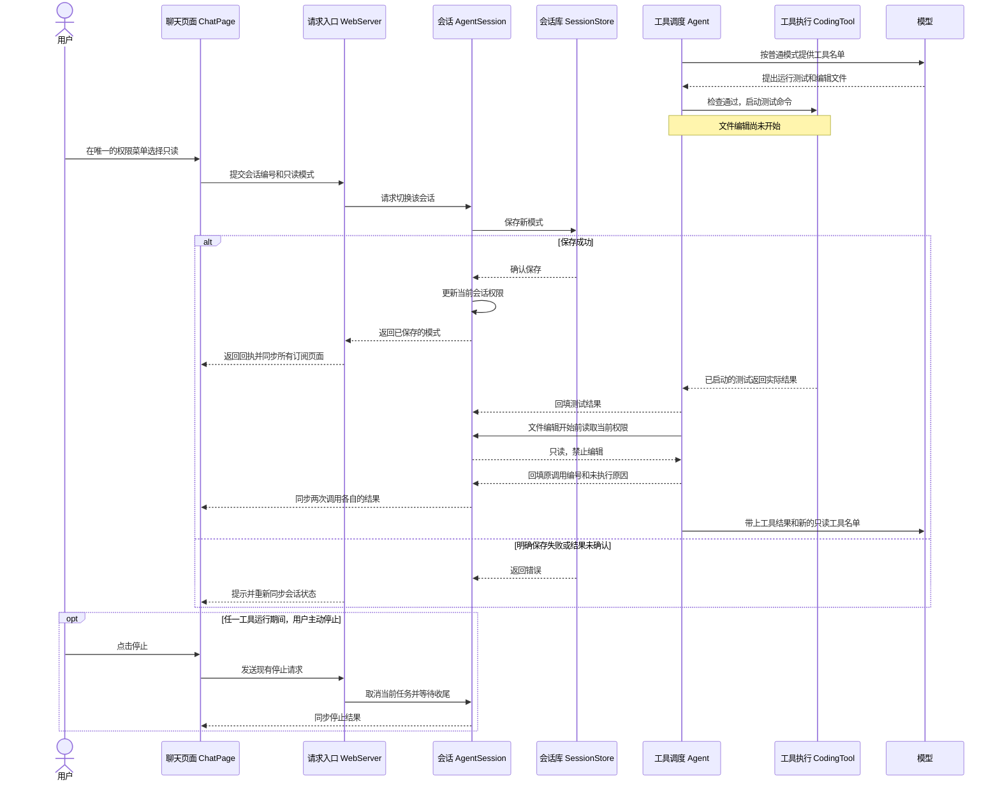
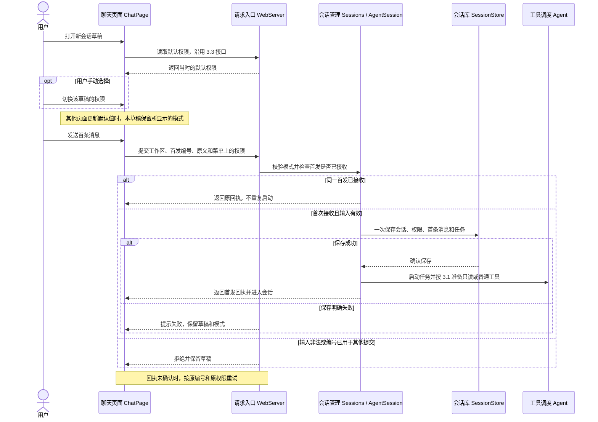
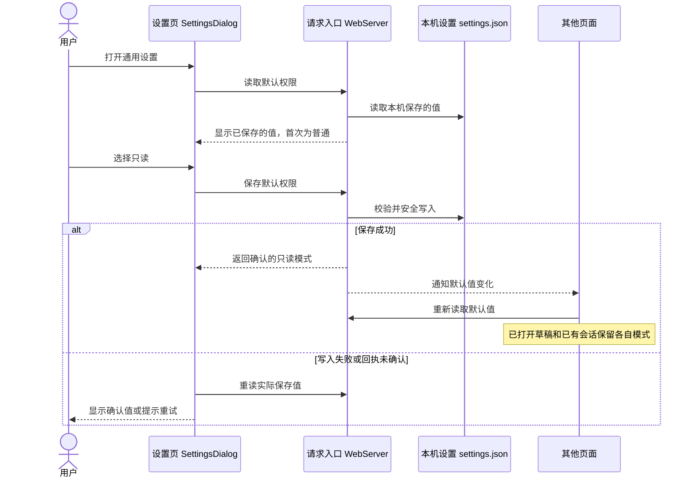

# 里程碑 2 Feature 2 权限管理技术设计

状态为已通过。用户已确认整份技术设计。

## 1. 总结

用户可以在聊天输入区通过一个菜单选择「普通」或「只读」。普通沿用现有工具和执行方式。只读只开放读取文件、搜索文件内容、查找文件和列出目录四种工具。每个正式会话独立保存权限，同一会话的多个页面同步。任务运行时也可以切换，保存后尚未开始的工具按新模式检查，已经开始的工具继续运行。通用设置可修改新会话默认权限，初始为普通。打开新会话草稿时填入当时的默认值，用户可在首发前单独切换，首发始终使用菜单显示的权限。

会话模块负责提供当前工具名单和执行规则。工具调度在执行前核对最新权限，把未执行的原因与原工具调用一起回填给模型。正式会话权限由 SQLite 保存，通用默认值由本机设置文件保存。本期取消逐次审批。后续接入 Skill 和 MCP 时，相关能力调用须经过同样的执行检查。

## 2. 系统变化说明

**Before**　会话接收消息时准备一套工具，供该任务的每次模型请求和工具调用使用。输入区没有权限菜单。通用设置已有语言设置及本机保存方式。 [会话准备工具](../../../packages/coding-agent/src/agent-session.ts#L118) · [通用设置](../../../web/src/components/SettingsDialog.tsx#L139)

**After**　会话在每次模型请求前准备可用工具名单，在每次工具执行前根据最新会话权限检查。新会话首发保存菜单里的权限。通用设置提供未来草稿及直接创建会话的初始模式。

## 3. 系统设计

### 3.1 切换会话权限并应用到工具调用

用户在任务运行中把会话从普通切到只读。后端保存并同步新权限，按调用的开始时间判断该用哪个模式。



#### 聊天页面与工具展示

**职责**　`ChatPage` 用一个菜单显示当前会话模式。`AssistantMessage` 展示工具是否实际执行。

**接口（新增 1 项，修改 1 项）**

- 【新增】权限菜单选择回调。向服务端提交会话编号和模式。等待确认时沿用最后已确认的模式，失败时显示提示并重新同步。切换成功后，从对应会话的更新或快照确认菜单值。
- 【修改】工具结果展示。收到权限拦截结果时，显示「未执行」和原因。普通执行失败和用户主动停止保留各自的状态。

**数据（新增 0 项，修改 0 项）**

- 【沿用】订阅标识用于定位正在打开的会话。页面消费会话模块提供的 `ConversationSnapshot`、`ConversationUpdate` 和 `ConversationMessage`。重连从完整快照恢复。

#### 请求入口 WebServer

**职责**　把授权通过的权限变更请求交给指定会话，经现有订阅通道同步结果。

**接口（新增 1 项，修改 1 项）**

- 【新增】`PUT /api/sessions/:sessionId/permission`（HTTP）。校验路径中的会话编号和请求体中的 `permissionMode`，保存成功后返回该会话的 `permissionMode`。会话不存在、输入非法或保存失败时返回错误。当前任务运行中也接受切换请求。
- 【修改】会话 WebSocket 订阅。快照包含当前权限，增量带会话权限变更，刷新和断线恢复沿用原有序号规则。

**数据（新增 0 项，修改 0 项）**

- 【沿用】请求复用会话编号。请求与响应中的 `permissionMode` 使用会话模块定义的值。

#### 会话 AgentSession 与会话库 SessionStore

**职责**　会话持有当前权限。会话库按会话保存模式。每次模型请求准备时，用当前权限同时生成工具声明和系统提示里的工具说明。

**接口（新增 1 项，修改 2 项）**

- 【新增】`AgentSession.selectPermissionMode(mode)`（模块调用）。先保存，再更新内存权限并发布变更。明确回滚时保留原模式。存储提交结果不明且无法读回时，拒绝该会话尚未开始的工具调用，按会话库现有提示重启后核对。已开始的调用继续收尾。
- 【修改】`SessionStore.save()`（模块调用）。写入会话权限，可单独保存，也可与首发数据一起提交。
- 【修改】`SessionStore.loadSession()`（模块调用）。恢复已有权限。功能上线前未存权限的会话按普通恢复。发现已存值无效时报告读取失败。

**数据（新增 2 项，修改 3 项）**

- 【新增】`PermissionMode`。由会话模块定义，取值为 `normal` 和 `read-only`，页面、服务端和工具规则共用。

  构造示例

  ```typescript
  const permissionMode: PermissionMode = 'read-only'
  ```

- 【新增】会话权限记录。由 `SessionStore` 持有，按会话编号保存当前模式。拟用独立的 `session_permissions` 表，让旧会话库可直接补建。
- 【修改】`ConversationSnapshot` 与 `ConversationUpdate`。快照提供 `permissionMode`，增量提供该模式变更及序号。页面用于同步同一会话。
- 【修改】`ConversationMessage` 的工具结果标记。保存 `permission_denied`，并沿用原助手消息编号及内容位置。聊天页在历史回看时也能显示结果。存储状态不明导致结果无法写入时，沿用现有任务保存失败提示。

#### 工具调度 Agent 与工具实现 CodingTool

**职责**　Agent 管执行顺序和结果配对。会话提供工具规则，Agent 在实际调用点应用。只读使用 `read`、`grep`、`find`、`ls`。普通也可以使用 `ls`，并保有现有工具。

**接口（新增 2 项，修改 1 项）**

- 【新增】`AgentRunInput.beforeToolCall`（同步执行前回调）。会话用同一份工具名单判断当前模式是否允许这个调用。参数校验和权限检查都在实际操作前完成。最后一次权限检查到交给执行器之间没有异步等待。串行、并行调用均在各自开始前经过该检查。被拦截的调用不进入实际执行，也不标记成已开始。Agent 用原调用编号回填失败结果，正常情况下再发下一轮请求。
- 【修改】`AgentRunInput.prepareContext`（模型请求准备回调）。每次模型请求用当前模式生成工具声明和提示词。上下文压缩或其他异步准备结束后，发出请求前用同一模式核对最终名单与容量。已发出的请求继续收取，返回的工具仍要过执行前检查。

##### 【新增】`ls`（本地工具）

**用途**　供模型查看一个目录的直接子项。普通和只读模式均可调用。

**主要流程**　接收可选的 `path` 和 `limit`。`path` 省略或为空字符串时使用会话工作目录，其他路径沿用项目的相对路径、绝对路径和 `~` 规则。`limit` 默认 500，接受有限数字，向下取整，最小按 1 处理。

工具直接读取目录。路径不存在、目标不是目录或目录无法读取时返回对应错误。列表包含隐藏项，按名称忽略大小写排序。每行一个名称，目录和指向目录的符号链接末尾加 `/`，无法取得状态的条目跳过。没有可列出的条目时返回空目录提示。

按条数限制收集列表，仍有条目未检查时提示上限，并建议用两倍的 `limit` 再试。列表正文按 UTF-8 字节计，最多 50 KiB，保留能放下的完整行，截断提示追加在正文之后。任务中止时沿用现有工具中止流程。

**数据（新增 0 项，修改 0 项）**

- 【沿用】`ToolResultMessage`。继续用 `toolCallId` 对应模型原调用。权限拦截返回 `isError: true` 和明确原因。网页的「未执行」显示来自会话模块持久化的结果标记。

### 3.2 创建会话并使用首发权限

用户打开新会话草稿，沿用显示的默认模式或手动修改，然后发送首条消息。保存成功后进入会话，首轮即使用保存的权限。



#### 聊天页面 ChatPage

**职责**　保存草稿正在使用的权限。创建新的草稿时取最新默认值。打开已有草稿时恢复其权限，用户可以继续切换。

**接口（新增 0 项，修改 1 项）**

- 【修改】首发回调。随首发原文、工作区和临时编号提交菜单所示模式。等待确认期间重试使用同一请求。明确失败时保留草稿和权限。

**数据（新增 1 项，修改 0 项）**

- 【新增】草稿权限。随现有未发送草稿在本标签页保存，供刷新恢复。首发受理后清除，下一份草稿重新初始化。读取新草稿默认值失败时提示重试。草稿已确认的模式仍可使用。

#### 请求入口 WebServer

**职责**　从首发请求取得要保存的模式，沿用现有的工作区、模型和临时编号校验。

**接口（新增 0 项，修改 2 项）**

- 【修改】`POST /api/sessions/start`（HTTP）。页面发送明确模式，服务端检查它属于两种合法值之一。旧调用方省略时，使用新建时的已保存默认值。已接收的重试先核对原请求，再返回原回执。
- 【修改】`POST /api/sessions`（HTTP）。直接创建空会话时读取当时的默认模式，和会话一起保存。

**数据（新增 0 项，修改 1 项）**

- 【修改】`StartSessionRequest` 增加 `permissionMode`。正式页面始终传入，兼容旧调用方省略。现有模型字段继续随请求提交。

#### 会话管理 Sessions、AgentSession 与 SessionStore

**职责**　确定新会话初始权限，并保证正式会话与首发同时保存成功。重试识别最初的提交内容。

**接口（新增 0 项，修改 3 项）**

- 【修改】`Sessions.start()`。按现有首发编号去重，在内存和存储中核对首次提交的权限字段。相同请求返回原回执。复用编号且权限不同的请求被拒绝。
- 【修改】`Sessions.create()`。直接建会话时，将解析出的默认模式一并持久化。旧会话走 §3.1 的恢复规则。
- 【修改】`AgentSession.submit()`。首发时将会话、权限、用户原文和任务作为同一次写入提交。成功后才调度 Agent。已有会话的消息沿用服务端保存的会话权限。

**数据（新增 0 项，修改 1 项）**

- 【修改】`StoredRun`。首发任务内部保存原请求显式提交的权限，供原编号重试核对。当前会话权限使用 §3.1 的会话权限记录，两者各自保存。

### 3.3 保存新会话的默认权限

用户在「通用设置 → 权限」选择默认值。服务端确认保存后，其他页面重新读取，之后打开的新草稿使用新默认值。



#### 设置页 SettingsDialog

**职责**　在现有通用设置中增加「权限」下拉，说明「选择新会话的默认权限模式」。菜单选项为普通和只读，按现有中英文界面展示。

**接口（新增 1 项，修改 0 项）**

- 【新增】默认权限选择回调。选择后发起保存，保存中避免重复提交，收到后端确认后更新。失败或回执丢失时重读，仍无法确认时显示重试提示。

**数据（新增 0 项，修改 0 项）**

- 【沿用】选项使用会话模块定义的 `PermissionMode`，当前默认值来自服务端。

#### 请求入口 WebServer 与本机设置文件

**职责**　读取和保存供新会话使用的默认模式，借现有 WebSocket 通知其他页面重新读取。

**接口（新增 2 项，修改 1 项）**

- 【新增】`GET /api/settings/permission`（HTTP）。返回已保存的 `defaultPermissionMode`，首次未配置时返回普通。设置读取失败则返回错误。
- 【新增】`PUT /api/settings/permission`（HTTP）。校验并仅写入请求中的 `defaultPermissionMode`，复用现有设置文件的锁及安全写入。保存成功后返回同一字段的确认值，并发布刷新通知。
- 【修改】全局 WebSocket 通知。增加默认权限变更通知。接收端重读默认值，供设置页和下一份新草稿使用。已打开草稿仍使用 §3.2 已确定的权限。

**数据（新增 1 项，修改 0 项）**

- 【新增】默认权限设置。服务端持有，在现有本机设置文件保存，供通用设置和新会话初始化读取。

  构造示例

  ```typescript
  const permissionSettings = { defaultPermissionMode: 'read-only' } as const
  ```

## 4. 技术决策

- **【功能决策｜聊天页面与会话】提供普通和只读。** 只读工具与 Pi 的 SDK 示例一致。普通包含原有工具及 `ls`。 [Pi 只读工具](../../../pi/packages/coding-agent/src/core/tools/index.ts#L204)
- **【功能决策｜工具实现】`ls` 沿用 Pi 的目录列表行为。** 参数、直接子项、排序、目录标记和截断按 Pi 对齐。路径解析复用本项目现有文件工具规则，网页沿用工具结果展示。 [Pi 目录工具](../../../pi/packages/coding-agent/src/core/tools/ls.ts#L53) · [项目路径规则](../../../packages/coding-agent/src/local-tools.ts#L24)
- **【功能决策｜会话与工具调度】权限从尚未开始的调用生效。** 采用 Pi 的工具名单、执行前拦截和结果配对，按 DSH 的时机为每次新调用读取会话当前权限。Pi 的并行路径先准备整批调用，本项目在各自实际开始前核对，以覆盖同批中仍在等待的调用。 [Pi 并行调度](../../../pi/packages/agent/src/agent-loop.ts#L596) · [Pi 结果配对](../../../pi/packages/agent/src/agent-loop.ts#L940) · [DSH 每次调用的策略](../../../deepseek-harness/packages/sandbox/sandbox-policy/src/index.ts#L196)
- **【功能决策｜聊天页面与通用设置】会话权限与新会话默认值独立。** DSH 创建空白会话时保存权限。本项目沿用首发才创建正式会话的方式，在打开草稿时先取得默认值。首发按菜单显示的值保存，免去默认值在别页更新时重新发送的步骤。 [DSH 初始化权限](../../../deepseek-harness/packages/interaction/permission-presets/src/index.ts#L429) · [DSH 通用设置](../../../deepseek-harness/packages/client/ui-permission-presets/README.zh.md#L38)

## 5. 风险与边界

### 5.1 已启动的命令仍可能写文件

- **案例**　普通模式启动测试命令后，用户切到只读。测试可能继续写入自己的缓存。
- **解决方案**　保持已开始的调用继续运行。用户要停止时使用现有「停止」入口。验收同时检查测试实际完成和后续写入被拦截。

### 5.2 权限保存结果不明

- **案例**　权限切换提交异常，服务无法确认这次更改是否写入。直接继续执行可能用错模式。
- **解决方案**　有确定回滚结果时继续用原模式。无法确认保存时拒绝启动该会话的新工具调用，提示重新同步或按会话库提示重启核对。已开始的调用继续收尾，结果无法保存时沿用现有保存失败提示。

### 5.3 只读仍可读取本机可访问的路径

- **案例**　模型通过读取工具查询工作区外的路径。现有路径规则允许绝对路径和用户目录。查找工具缺少本机依赖时，也可能在服务私有临时目录准备搜索程序。
- **解决方案**　将只读解释为可用工具的限制。读取沿用现有路径边界，应用自身仍保存会话与必要缓存。真正的目录访问隔离需要单独设计。 [现有路径规则](../../../packages/coding-agent/src/local-tools.ts#L24) · [搜索依赖准备](../../../packages/coding-agent/src/tool-runtime.ts#L123)

## 6. 验收标准

验收覆盖只读工具实际可用、普通工具保留现有能力、运行中切换和调用结果配对，以及草稿、正式会话和通用默认值各自的保存与恢复。后端的受控模型测试用于确定调用顺序和真实文件效果。浏览器验证页面的发送、显示和跨页面同步。真实模型通过单独的用例验收。 [权限管理验收标准](./feature2-权限管理验收标准.md)

## 7. 文件变更

### 聊天页面与工具展示

| 文件 | 类型 | 用途 | 变更 |
| --- | --- | --- | --- |
| `web/src/pages/ChatPage.tsx`、`web/src/chat/drafts.ts` | 修改 | 草稿与会话权限 | 输入区显示权限并提交，草稿与未确认首发可恢复 |
| `web/src/chat/client.ts`、`web/src/chat/state.ts` | 修改 | 请求与状态同步 | 接入权限保存、默认值读取和会话订阅 |
| `web/src/components/AssistantMessage.tsx`、`web/src/components/AssistantMessage.browser.test.tsx` | 修改 | 工具结果 | 展示未执行及原因，验证与停止、执行失败的区别 |
| `web/src/pages/ChatPage.browser.test.tsx`、`web/tests/e2e/sessions.spec.ts` | 修改 | 聊天行为验收 | 覆盖首发菜单、草稿和会话权限同步 |
| `web/tests/e2e/permissions.live.spec.ts` | 新增 | 真实模型验收 | 从正式网页入口验证模型使用只读工具并返回实际内容 |

### 设置页 SettingsDialog

| 文件 | 类型 | 用途 | 变更 |
| --- | --- | --- | --- |
| `web/src/components/SettingsDialog.tsx`、`web/src/components/SettingsDialog.browser.test.tsx` | 修改 | 通用默认权限 | 增加权限下拉并覆盖保存与失败反馈 |
| `web/src/i18n/en.ts`、`web/src/i18n/zh-CN.ts`、`web/src/styles.css` | 修改 | 权限文案与布局 | 增加模式、结果和设置文案，沿用现有样式 |

### 请求入口 WebServer

| 文件 | 类型 | 用途 | 变更 |
| --- | --- | --- | --- |
| `packages/server/src/webserver/index.ts`、`packages/server/src/webserver/protocol.ts` | 修改 | 网页请求与同步 | 接收会话权限和默认值，扩展首发及通知 |
| `packages/server/test/webserver.test.ts` | 修改 | 实际接口验收 | 通过 HTTP 和订阅验证权限归属、首发和保存异常 |

### 会话管理与会话库

| 文件 | 类型 | 用途 | 变更 |
| --- | --- | --- | --- |
| `packages/coding-agent/src/agent-session.ts`、`packages/coding-agent/src/sessions.ts`、`packages/coding-agent/src/system-prompt.ts` | 修改 | 会话权限和工具名单 | 保存与恢复模式，随模型请求准备当前工具说明 |
| `packages/coding-agent/src/types.ts`、`packages/coding-agent/src/index.ts`、`packages/coding-agent/src/session-store.ts` | 修改 | 数据与保存 | 会话权限、首发原请求和拦截结果进入已有保存流程 |
| `packages/coding-agent/test/agent-session.test.ts`、`packages/coding-agent/test/session-store.test.ts` | 修改 | 会话行为验收 | 覆盖工具名单、权限恢复及旧数据兼容 |

### 工具调度与实现

| 文件 | 类型 | 用途 | 变更 |
| --- | --- | --- | --- |
| `packages/agent/src/agent.ts`、`packages/agent/src/types.ts`、`packages/agent/test/execution.test.ts` | 修改 | 执行与回填 | 各调用启动前检查，拦截时返回配对结果 |
| `packages/coding-agent/src/tools.ts`、`packages/coding-agent/src/local-tools.ts`、`packages/coding-agent/test/tool-execution.test.ts` | 修改 | 工具名单与目录读取 | 共享模式规则并接入 `ls`，验证实际目录结果 |

### 其他

| 文件 | 类型 | 用途 | 变更 |
| --- | --- | --- | --- |
| `planning/里程碑2/README.md` | 修改 | 规划入口 | 更新权限范围、验收目标和文档链接 |
| `planning/里程碑2/feature2/feature2-设计讨论记录.md`、`planning/里程碑2/feature2/feature2-权限管理技术设计.md`、`planning/里程碑2/feature2/feature2-权限管理验收标准.md` | 新增 | 设计与验收 | 记录已确认的行为、方案与验收场景 |
