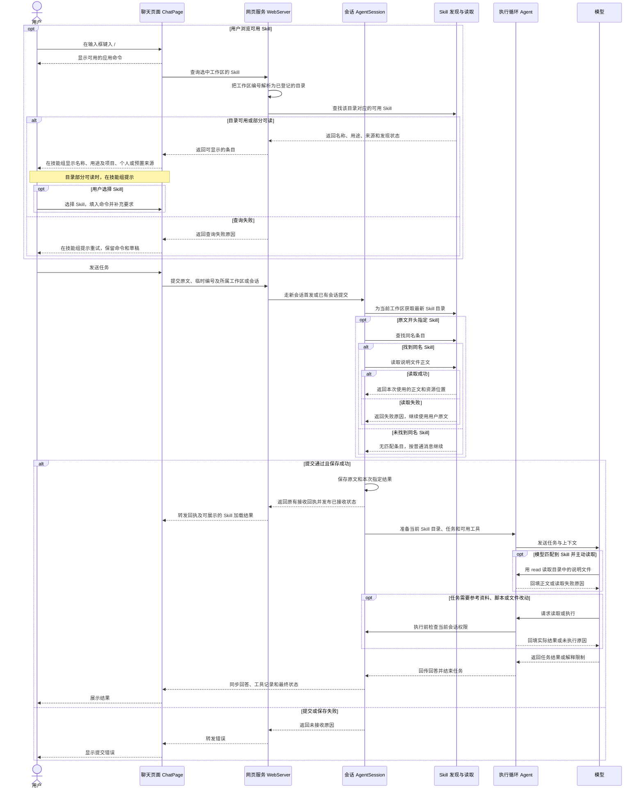
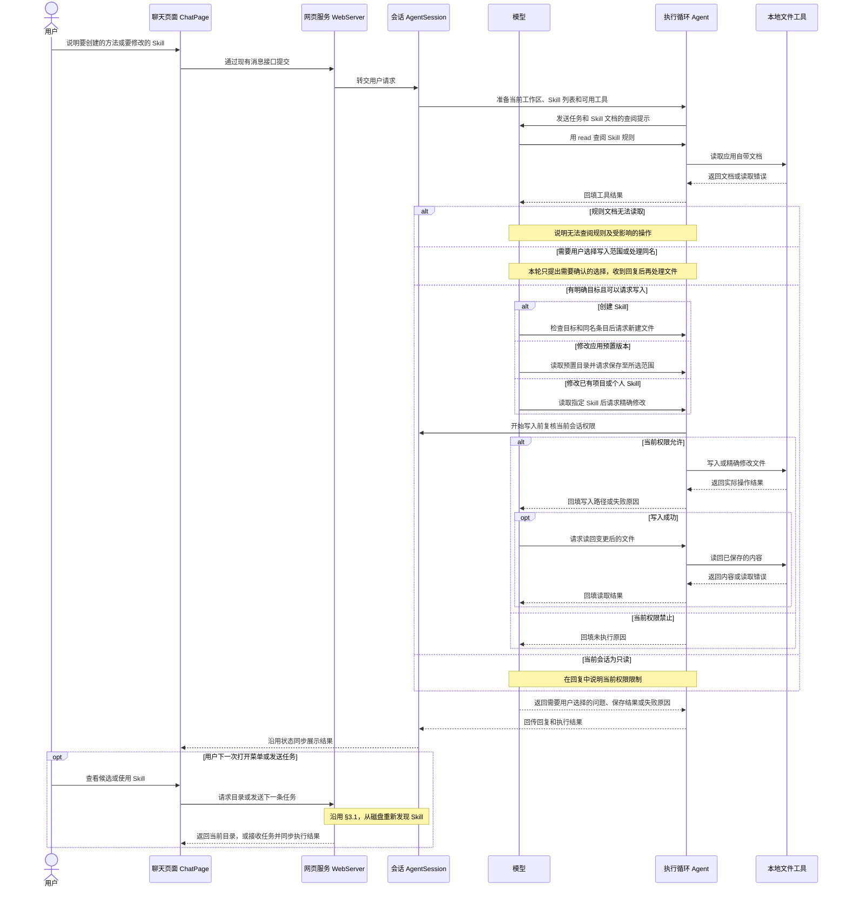

# 里程碑 2 Feature 3 Skill 技术设计

状态为已通过。用户确认了当前整稿。

## 1. 总结

**需求理解**　用户可以查看当前工作区能用的 Skill 及用途，通过 `/skill:名称` 明确指定，也可以描述任务，让 Agent 根据用途选用。Agent 按需读取说明和配套资料，运行脚本与修改文件遵守会话权限。用户可以让 Agent 创建或修改 Skill，选择项目或个人保存范围，并在后续任务使用。指定未知名称时保持原文。已发现的 Skill 读取失败时，网页说明原因，任务按原文继续。 [里程碑需求](../README.md#第三步skill-的发现读取使用与创建)

**技术方案**　后端从磁盘发现 Skill，网页菜单与模型目录共用发现规则。模型自动使用时调用现有 `read`。用户明确指定时，会话读取正文并随消息保存当次版本。创建和修改使用现有文件工具。系统提示词指引模型按需查阅 SI 自带的 Skill 规则文档。

首批提供 `skill-creator`、`agents-md` 和 `grill-me`，复用同一套发现、加载和聊天流程。 [首批 Skill](#首批-skill)

## 2. 系统变化说明

**Before**　系统提示词已有工具说明、应用文档入口和项目说明。模型可以读写本机文件，网页 `/` 菜单支持 `/compact`。 [现有提示词](../../../packages/coding-agent/src/system-prompt.ts#L18) · [现有命令菜单](../../../web/src/components/MessageInput.tsx#L91)

**After**　输入 `/` 后先显示「命令」，再显示「技能」。用户可在新会话首发前浏览 Skill，查看其名称、用途及「项目」「个人」「预置」来源。提交时会话发现当前 Skill，准备摘要或按显式指定附上正文。创建或修改落盘后，下一次打开菜单或发任务时重新发现。应用规则通过现有文档入口按需读取。

## 3. 系统设计

### 3.1 发现并使用已有 Skill

用户可在输入框浏览 Skill 后指定使用，也可直接描述任务，让 Agent 按任务选用。同样的发现规则供网页菜单和模型使用。



#### 聊天页面 ChatPage 与输入框 MessageInput

**职责**　使用已有的 `/` 菜单，按「命令」「技能」的顺序分组。已有会话的 `/compact` 来自现有应用命令入口。Skill 从所选工作区的查询结果取名称、用途和来源，行右侧显示「项目」「个人」或「预置」，用途过长时截断。技能正在加载或查询失败时，命令组仍可操作。确认 `/compact` 直接提交压缩请求，确认 Skill 在草稿中填入可编辑的蓝色 `/skill:名称` 和空格，等用户补充要求并发送。切换工作区时丢弃上个工作区迟到的目录结果。

**接口新增 0 项，修改 2 项。**

- 【修改】`MessageInput` 输入接口接入工作区对应的 Skill 候选，支持选择和键盘补全。继续保护输入法选字。键盘和鼠标采用相同的确认规则，命令立即提交，Skill 仅改变草稿。
- 【修改】`MessageList` 读取服务端保存的指定结果。保留用户原文，在消息旁显示已加载的 Skill 或已找到但读取失败的原因。未知名称按普通消息展示。Agent 自己读取 Skill 时，沿用现有读取工具记录。

**数据新增 0 项，修改 0 项。**

- 【沿用】工作区编号。新会话用草稿当前所选工作区，已有会话用该会话绑定的工作区。
- 【新增，归属 Skill 发现】Skill 目录条目。页面使用名称、用途和选中版本的 `source` 渲染候选及标签。同名采用项目版本时显示「项目」。
- 【新增，归属会话】指定结果。页面只使用名称、来源和状态来显示当次结果。

#### 网页服务 WebServer

**职责**　通过现有网页授权接收目录查询，复用已登记工作区的目录校验。草稿可按工作区查询，首次发送时照旧创建正式会话。

**接口新增 1 项，修改 1 项。**

- 【新增】`GET /api/workspaces/:workspaceId/skills`（HTTP）。将有效工作区编号解析为服务端路径，查询并返回该工作区可用的 Skill 摘要和发现状态。工作区失效时返回原因。局部读取失败时返回其余可用条目，并说明目录查询不完整。
- 【修改】会话消息同步（WebSocket）。已接收消息和历史快照同时带回该消息的 Skill 指定结果。首发及后续发送的 HTTP 请求和接收回执沿用现有格式。

**数据新增 1 项，修改 0 项。**

- 【新增】网页 Skill 列表响应。携带名称、用途、来源、是否仅限用户调用，以及本次查询是否完整。正文和本机路径由服务端在准备模型输入时使用。

#### Skill 发现与读取

**职责**　按已确认的目录顺序和递归规则生成 Skill 列表，保留名称、用途、来源和位置。用户显式指定已发现的 Skill 时读取正文与资源位置。打开 `/` 菜单和接收新任务时重新获取目录，正在执行的任务使用开始时得到的列表。

**接口新增 2 项，修改 0 项。**

- 【新增】`discoverSkills`（模块调用）。根据工作目录、个人目录和应用预置目录发现 Skill，返回目录与发现情况。跳过格式无效的条目并保留诊断。读不到单个目录时仍返回已找到的可用 Skill。
- 【新增】`loadSkill`（模块调用）。会话交给它目录中的同名条目，它重新读取该条目指向的说明文件，返回正文与资源目录。文件被移走、不可读或格式已无效时返回原因。限定可读文件类型和大小，避免发现或加载把目录、设备文件或异常大的文件当作普通 Skill。

**数据新增 1 项，修改 0 项。**

- 【新增】`SkillSummary`。发现模块准备名称、说明、来源及文件位置。模型可用的条目进入后端提示词。标明 `disable-model-invocation: true` 的条目从模型的 Skill 目录中省略，在网页菜单仍可查看和手动调用。普通文件读取继续遵守现有路径和权限规则。

构造示例

```typescript
const skill: SkillSummary = {
  name: 'review-changes',
  description: '复核项目改动并列出有证据的问题。',
  source: 'project-si',
  path: '/workspace/example/.si/skills/review-changes/SKILL.md',
  disableModelInvocation: false,
}
```

#### 会话 AgentSession 与历史 SessionStore

**职责**　服务端解释消息开头的 `/skill:名称`。找到并读取成功时，为消息保存实际使用的正文快照，网页继续展示提交原文。历史重开和后续模型请求使用原来的快照。Skill 文件日后被编辑时，下一次新调用读取新版。未知名称直接按普通消息保存和发送。找到但读取失败时保存失败原因并按原文继续，网页说明读取错误。工作区或模型不可用、保存失败、重复提交和中止沿用原有提交规则。

**接口新增 0 项，修改 2 项。**

- 【修改】`AgentSession.submit()`。校验请求，为本任务获取目录并处理显式调用。文件读取结束后再次确认会话可用及提交状态，再保存原文与加载结果并确认接收。重试仍按原文和原提交编号核对，成功接收过的任务直接复用原回执。
- 【修改】`buildSystemPrompt()`（模块调用）。每次请求模型时，会话按最新权限提供工具，并在模型有 `read` 时把可自动调用的 Skill 摘要加入系统提示词。

**数据新增 1 项，修改 1 项。**

- 【新增】`SkillInvocation`。会话只为命中 Skill 条目的显式指定保存名称、来源和结果。成功时保存正文和资源目录供历史转换使用，读取失败时保存可展示的原因。
- 【修改】`ConversationMessage`。用户原文继续是 `message.content`，同一条记录保存可选的 `SkillInvocation`。`SessionStore` 继续写入现有消息记录，读取旧记录时该值可缺省。同步给网页时从指定结果提取名称、来源、状态和失败原因。

构造示例

```typescript
const invocation: SkillInvocation = {
  status: 'loaded',
  name: 'review-changes',
  source: 'project-si',
  directory: '/workspace/example/.si/skills/review-changes',
  body: '查看改动和对应测试，再列出可核对的问题。',
}
```

#### 上下文准备与压缩

**职责**　用本次保存的 Skill 正文和用户要求构造模型看到的消息。正文参与容量估算、历史回放和压缩，超过可用容量时按现有规则压缩或返回失败。手动压缩摘要模型继续按原规则整理历史数据。

**接口新增 0 项，修改 2 项。**

- 【修改】`buildModelHistory()`。将显式调用成功的记录转换为带 Skill 正文及资源位置的用户消息。失败记录及普通消息按原文进入模型上下文。
- 【修改】`prepareCompaction()`。通过相同的消息转换计量近期内容的大小，并构造供摘要使用的历史，保留原有工具调用与结果配对。

**数据新增 0 项，修改 0 项。** 使用会话保存的 `SkillInvocation`，产出既有的 `ModelMessage`。

#### 执行循环 Agent

**职责**　沿用模型调用、工具执行、结果回填和停止流程。模型主动读取 Skill 说明与参考材料都用现有 `read`。脚本和文件改动执行前按最新会话权限检查。只读会话中，Skill 可以指导检查和分析，写入与执行请求按现有权限结果返回。用户在任务启动后中止时，仍用原来的停止入口，由会话同步实际运行状态。

**接口与数据均沿用。** 执行循环继续接收模型上下文、工具声明和执行前检查规则，并将结果与原工具调用配对。


### 3.2 创建或修改 Skill 后继续使用

用户用普通聊天要求 Agent 创建或修改 Skill，Agent 保存并核对磁盘上的文件，后续任务通过 §3.1 找到并使用更新后的 Skill。



#### 聊天页面 ChatPage 与网页服务 WebServer

**职责**　沿用聊天提交、工具记录和状态同步。用户可在消息里说明 Skill 的用途、修改要求和新建范围。需要补充选择时，Agent 在聊天中提问，用户通过下一条消息回答。查看和再次使用走 §3.1 的菜单与消息入口。

**接口新增 0 项，修改 0 项。** 沿用普通消息提交、工具结果同步和 §3.1 的 Skill 列表查询。

**数据新增 0 项，修改 0 项。** 输入是现有用户消息，页面使用会话返回的文件工具记录和回复呈现结果。

#### 会话 AgentSession

**职责**　系统提示词指引模型在创建或修改 Skill，或用户询问 SI 的 Skill 规则时，使用现有 `read` 查阅应用自带的 `docs/skills.md`。完整的文件格式、保存范围、同名处理和验证方法由该文件维护。目录中没有 Skill 时，这条入口仍适用。项目 Skill 写入当前工作区的 `.si/skills/<名称>/SKILL.md`，个人 Skill 写入 `~/.si/skills/<名称>/SKILL.md`。用户已给出范围或具体路径时按其要求处理。范围不明确时，通过聊天请用户选择。

用户未指明新建路径且发现已有同名 Skill 时，先说明现有 Skill 的来源和路径，请用户选择修改已有 Skill 或换名新建。用户明确要求修改时，按指定路径定位，或按 §3.1 的同名规则定位当前会话实际使用的文件。如果磁盘上有多份同名 Skill，发现时沿用 DSH 的项目优先规则。

修改应用预置版本时，在用户选定的项目或个人目录保存同名副本，并保留配套文件和许可证。目标已有文件时沿用同名处理规则。下次发现时按普通项目或个人 Skill 采用副本，应用内的预置文件保持原样。

**接口新增 0 项，修改沿用 §3.1。** 【修改】`buildSystemPrompt()` 在已有文档提示段 `<docs>` 中注明适用任务和 `docs/skills.md` 的绝对路径。路径从 SI 应用文档根目录取得。有 `read` 的会话可以查阅，包括只读会话。文档描述如何用现有工具创建 `SKILL.md`、编辑已有文件和按需添加参考资料或脚本。配套文件从 Skill 所在目录按相对路径定位。

**数据新增 0 项，修改 0 项。** 沿用 WebServer 提供的应用文档根目录和 §3.1 的 Skill 目录条目。Skill 正文和配套文件由本机文件系统持有。

#### 执行循环 Agent 与本地文件工具

**职责**　用现有文件工具创建、修改和核对。创建前检查目标文件是否已经存在，修改前读取原文。只有实际写入并核对过的文件才作为已保存结果交付。写入或读回失败时说明哪些文件已确认、哪些需要检查。只读时说明当前权限限制。用户中止后已完成的文件写入保留，未开始的操作按现有中止流程处理。

**接口新增 0 项，修改 0 项。** 沿用 `read` 查看和核对文件、`write` 创建文件、`edit` 对已有文件做精确修改。会话权限继续按工具实际开始时检查，工具结果按原调用配对。

**数据新增 0 项，修改 0 项。** 文件工具继续记录实际写入路径。新建 `SKILL.md` 使用 Pi 的目录式格式。

构造示例

```markdown
---
name: review-changes
description: 复核代码改动，并为每个问题给出文件位置和证据。
---

# 复核改动

先查看改动和相关测试，再列出可核对的问题。每条写明文件位置和触发条件。
```

#### Skill 发现与读取

**职责**　下一次打开菜单或发送任务时使用 §3.1 的扫描规则。发现时校验名称和用途，使用时读取本次版本。已加载的旧消息仍对应当时使用的内容。

**接口新增 0 项，修改 0 项。** 沿用 §3.1 的 `discoverSkills` 和 `loadSkill`。

**数据新增 0 项，修改 0 项。** 网页和会话继续使用 §3.1 的 `SkillSummary` 获取新版本的名称、用途和位置。

## 4. 技术决策

### 【功能决策｜工作区与 Skill 发现】自动发现项目 Skill，同名时项目优先

查找顺序为当前工作区 `.si/skills/`，从工作区向上各级的 `.agents/skills/`，个人 `~/.si/skills/`，个人 `~/.agents/skills/`，最后是 SI 应用预置目录 `resources/skills/`。向上查找包含最近 Git 根，无 Git 根时查到文件系统根。个人目录只按个人来源处理。同名取最先发现的有效条目。各目录内递归发现 `SKILL.md`，命中后停止下探。`.si/skills/` 支持直属 `.md`，`.agents/skills/` 支持子目录里的 `.md`，均需有效的 Skill 描述。按真实路径去重并避免目录链接循环。项目采用 DSH 的自动扫描方式和 Pi 的目录与递归规则。 [Pi 递归](../../../pi/packages/coding-agent/src/core/package-manager.ts#L410) · [Pi 向上查找](../../../pi/packages/coding-agent/src/core/package-manager.ts#L507) · [DSH 标准模式](../../../deepseek-harness/packages/bundle/web-app/presets/standard.patch.yml#L40) · [DSH 同名处理](../../../deepseek-harness/packages/skill/skill/src/index.ts#L572)

说明文件开头的名称和描述采用 YAML，建议沿用 Pi 的 `yaml` 解析库，以支持多行描述及常见 YAML 写法。当前 Coding Agent 包缺少此直接依赖，版本在实施时核对。 [Pi 说明头解析](../../../pi/packages/coding-agent/src/utils/frontmatter.ts#L29)

### 【功能决策｜会话与聊天页面】采用 Pi 的使用方式和 SI 的刷新时机

模型按摘要匹配后使用 `read`。显式指定用消息开头的 `/skill:名称`，服务端在模型调用前展开正文和后续要求。未知名称按原文发送，命中后读取失败时提示并按原文继续。打开菜单或发送新任务时重扫。当前任务沿用开始时的目录，新任务读取当时的版本。网页按工作区查询，使新会话首发前也能浏览。 [Pi 摘要](../../../pi/packages/coding-agent/src/core/skills.ts#L358) · [Pi 显式调用](../../../pi/packages/coding-agent/src/core/agent-session.ts#L2312) · [DSH 网页候选](../../../deepseek-harness/packages/client/ui-skill/src/client/index.ts#L167)

### 【功能决策｜聊天页面与目录】同一菜单分组，Skill 显示三种来源

DSH 的 `/compact` 由应用代码注册处理器，文件系统 Skill 从单独的 Skill 目录发现。SI 沿用这两类来源。命令组取现有内置命令，提交 `/compact` 时进入现有压缩分支。技能组取 `.si/skills/`、`.agents/skills/` 及对应个人目录的发现结果，提交 `/skill:名称` 时加载说明并交给模型。 [DSH 命令注册](../../../deepseek-harness/packages/compaction/command-compact/src/index.ts#L97) · [DSH 文件系统发现](../../../deepseek-harness/packages/skill/skill-filesystem/src/index.ts#L251) · [SI 压缩分支](../../../packages/coding-agent/src/agent-session.ts#L150)

技能行按服务端选中的条目显示来源。工作区及其祖先搜索范围中发现的版本显示「项目」。用户主目录的版本显示「个人」，应用提供的版本显示「预置」。菜单和消息加载结果都按实际采用的版本标注。

### 【功能决策｜会话与文件工具】由用户选项目或个人保存范围

明确范围或路径时按用户要求处理。范围不明确时在聊天中询问。用户没有指定新建路径且命中同名条目时，说明来源和路径，由用户选择修改或换名。已存在的多份同名文件按优先级发现。修改用 `read` 和 `edit`，新建用 `write`，写入后读回核对。 [Pi 两种范围](../../../pi/packages/coding-agent/docs/skills.md#choose-where-it-loads) · [SI 文件工具](../../../packages/coding-agent/src/local-tools.ts#L148)

### 【工程决策｜会话与系统提示词】按需查阅 SI Skill 规则

按 Pi 的顺序组织现有 `<docs>` 文档段。先限定查阅时机，再列文档位置和主题，最后说明动手前要读什么。独立文档维护目录、文件格式、创建和修改规则、权限及验证方法。可用 Skill 摘要继续供模型按任务匹配。 [Pi 文档提示](../../../pi/packages/coding-agent/src/core/system-prompt.ts#L162) · [SI 文档提示](../../../packages/coding-agent/src/system-prompt.ts#L33)

系统提示词文案。`{{siRoot}}` 在组装时替换为 SI 应用目录的绝对路径。

```text
<docs>
SI 文档（用户询问 SI 本身，或要求创建、修改 Skill 时查阅）
- 主文档 `{{siRoot}}/README.md`。
- 补充文档位于 `{{siRoot}}/docs/`。
- 从 SI 应用目录定位文档。文档里的相对链接以该文档所在目录为起点。
- 启动、模型配置、工作区、网页工具、中止和对话压缩见主文档。页面操作和开发校验见 `{{siRoot}}/web/README.md`。Skill 规则见 `{{siRoot}}/docs/skills.md`。
- 创建或修改 Skill 前，先用 read 完整阅读 Skill 规则文档，并查阅其中与本次任务有关的引用。
</docs>
```

### 首批 Skill

- `skill-creator` 引导用户创建或修改 Skill。创建前读取 SI 自有的 `docs/skills.md`，按 §3.2 选择项目或个人范围，使用 SI 的 `.si/skills/` 路径。详情由规则文档维护。
- `agents-md` 为当前工作区所属的仓库编写或更新根目录的 `AGENTS.md`。工作区在 Git 仓库的子目录时使用该仓库根目录，无 Git 仓库时使用工作区根目录。先读已有说明、项目文档和命令定义，再按该仓库实际情况编辑并核对文件。 [项目说明加载](../../../packages/coding-agent/src/project-context.ts#L78)
- `grill-me` 使用 Matt Pocock 的早期独立版。模型先查代码能回答的问题，每轮请用户决定一个问题并给出建议。保留原版及许可证。 [原版](https://raw.githubusercontent.com/mattpocock/skills/62f43a18177be6ec82da242e59ffbc490a4c22ea/skills/productivity/grill-me/SKILL.md) · [许可证](https://raw.githubusercontent.com/mattpocock/skills/62f43a18177be6ec82da242e59ffbc490a4c22ea/LICENSE)

三个目录随 SI 应用分发，放在独立的 `resources/skills/`。由现有应用路径定位，使用同一套发现和加载逻辑。即便用 SI 自己作为工作区，应用资源也仍采用预置优先级。 [DSH 预置目录](../../../deepseek-harness/packages/skill/skill-filesystem/src/index.ts#L267) · [现有应用目录定位](../../../packages/server/src/webserver/index.ts#L64)

## 5. 风险与边界

### 5.1 项目 Skill 会影响模型接下来的操作

- **案例**　模型读取工作区自带的 Skill，接着尝试运行其中的脚本或写入文件。
- **解决方案**　工具开始前复核会话权限。只读可以读说明与配套文件，脚本和写入按现有规则拦截。普通模式使用现有本机工具权限。发现本身只扫描并读取文件。

### 5.2 菜单候选在提交前被编辑或移除

- **案例**　用户选择 Skill 后，另一项操作编辑、重命名或删除文件。
- **解决方案**　提交时重扫，未知名称按普通消息继续，命中后读取出错才提示原因。成功时保存本次正文，历史重开仍对应当时的版本。

### 5.3 文件写进磁盘后仍可能无法发现或使用

- **案例**　新文件的位置或描述不符合发现规则，或它要求使用当前会话不可用的工具。
- **解决方案**　读回核对文件。下一次查目录并实际执行任务，依据工具记录和可检查结果验收。失败和中止后依实际发生的文件操作说明结果。

## 6. 验收标准

覆盖发现规则、网页分组及来源标签、两种调用、历史快照、应用规则按需读取、范围选择、同名及权限。用正式网页和真实模型核对首批 Skill 的结果，包括新建 Skill 在后续任务生效、更新当前仓库的项目说明，以及按轮次讨论设计问题。 [Feature 3 验收标准](feature3-Skill验收标准.md)

## 7. 文件变更

以下为拟变更位置。测试文件随所属模块归组。

### 聊天页面与输入框

| 文件 | 类型 | 用途 | 变更 |
| --- | --- | --- | --- |
| `web/src/pages/ChatPage.tsx`、`web/src/components/MessageInput.tsx` | 修改 | 浏览与指定 | 从仅有 `/compact` 到支持按工作区查看和选择 Skill |
| `web/src/components/MessageList.tsx`、`web/src/chat/client.ts`、`web/src/chat/state.ts`、`web/src/i18n/{en,zh}.ts` | 修改 | 查询与展示 | 从普通消息扩展到目录查询、加载状态及中英文提示 |
| `web/src/components/MessageInput.browser.test.tsx`、`web/src/pages/ChatPage.first-send.test.tsx` | 修改 | 网页校验 | 覆盖候选选择、首发和工作区切换 |

### 网页服务 WebServer

| 文件 | 类型 | 用途 | 变更 |
| --- | --- | --- | --- |
| `packages/server/src/webserver/index.ts`、`packages/server/src/webserver/protocol.ts` | 修改 | 查询与会话同步 | 增加工作区 Skill 摘要，随消息同步显式加载结果 |
| `packages/server/test/webserver.test.ts` | 修改 | 服务入口校验 | 覆盖查询、首发、重试和历史恢复 |

### Skill 发现与读取

| 文件 | 类型 | 用途 | 变更 |
| --- | --- | --- | --- |
| `packages/coding-agent/src/skills.ts`、`packages/coding-agent/test/skills.test.ts` | 新增 | 发现与读取 | 支持扫描本地 Skill，校验递归、文件格式和同名优先级 |
| `packages/coding-agent/src/index.ts` | 修改 | 工作区查询 | 向网页服务提供 Skill 发现能力 |
| `packages/coding-agent/package.json`、`package-lock.json` | 修改 | 说明格式兼容 | 为 Skill 文件头声明 YAML 解析依赖 |

### 会话 AgentSession 与历史 SessionStore

| 文件 | 类型 | 用途 | 变更 |
| --- | --- | --- | --- |
| `packages/coding-agent/src/{agent-session,types,system-prompt}.ts` | 修改 | 任务接收与上下文 | 从保存用户原文扩展到记录加载结果，并按需提供目录和规则入口 |
| `packages/coding-agent/test/{agent-session,session-store}.test.ts` | 修改 | 会话校验 | 覆盖显式加载、目录刷新和已保存版本回放 |

### 上下文准备与压缩

| 文件 | 类型 | 用途 | 变更 |
| --- | --- | --- | --- |
| `packages/coding-agent/src/compaction.ts`、`packages/coding-agent/test/compaction.test.ts` | 修改 | 回放与压缩 | 将显式加载的正文纳入模型输入、容量和摘要 |

### 其他

| 文件 | 类型 | 用途 | 变更 |
| --- | --- | --- | --- |
| `docs/skills.md` | 新增 | SI Skill 规则 | 供用户和模型按需查阅格式、目录、调用、创建和预置副本规则 |
| `resources/skills/` | 新增 | 应用资源 | 随应用提供 `skill-creator`、`agents-md` 和 `grill-me` |
| `docs/prompts/systemPrompt.md` | 修改 | 系统提示词说明 | 从现有文档入口扩展到按主题指引查阅 Skill 规则，与运行时文案一致 |
| `web/tests/e2e/skills.live.spec.ts` | 新增 | 真实任务验收 | 从网页验证实际任务使用已有及新建或修改后的 Skill |
| `planning/里程碑2/feature3/feature3-Skill技术设计.md`、`feature3-Skill验收标准.md`、`feature3-设计讨论记录.md` | 新增 | 设计与验收 | 保存经确认的流程和验收范围 |
| `planning/里程碑2/README.md`、`planning/设计妥协记录.md` | 修改 | 规划索引与设计边界 | 增加 Skill 文档入口和目录刷新时机 |
