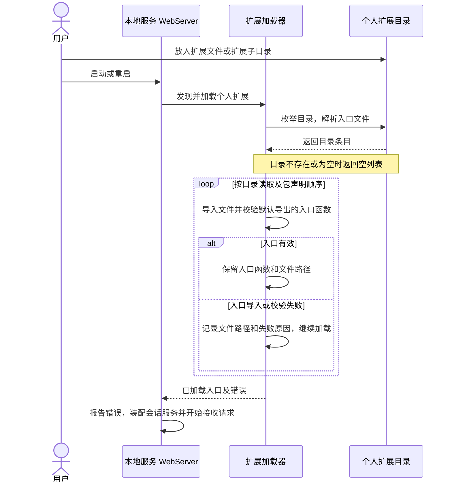
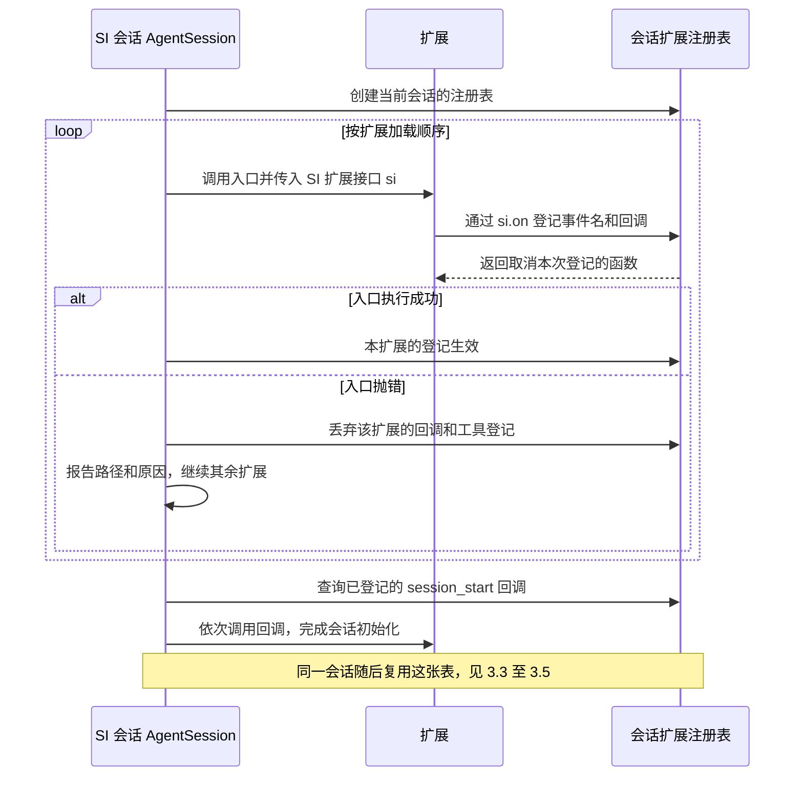
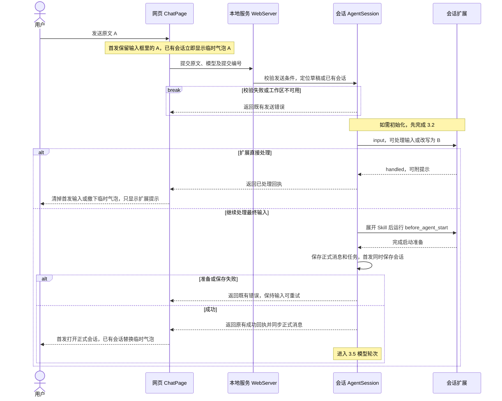
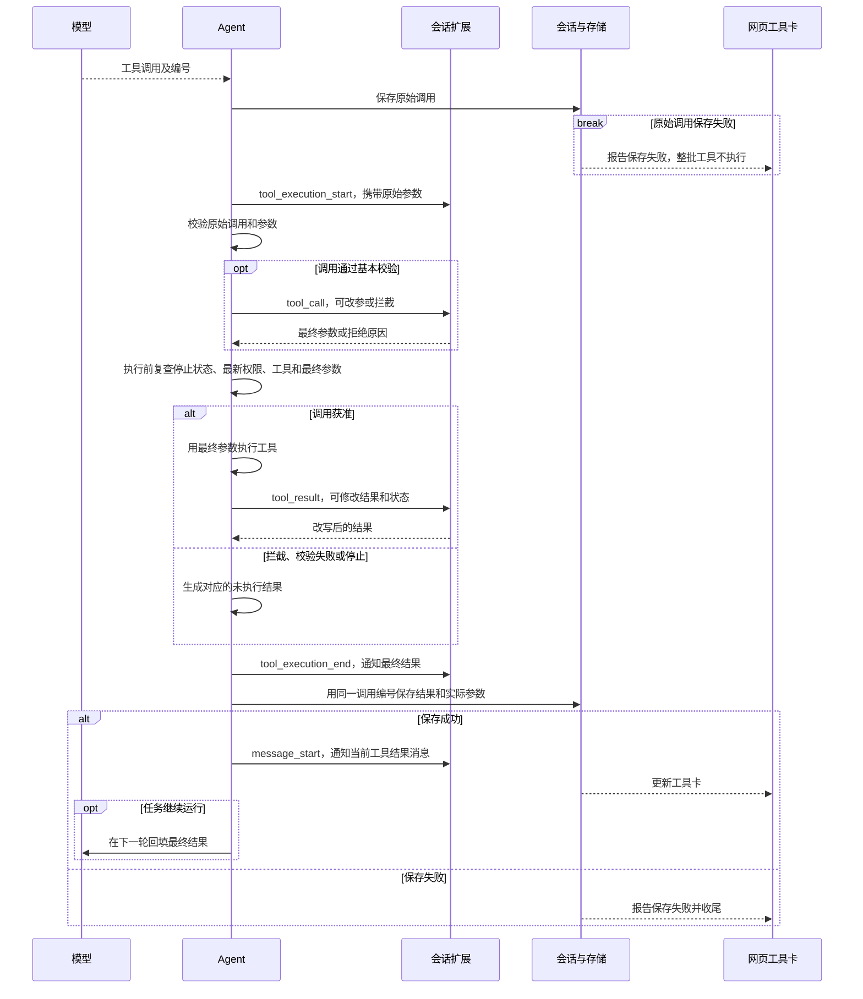
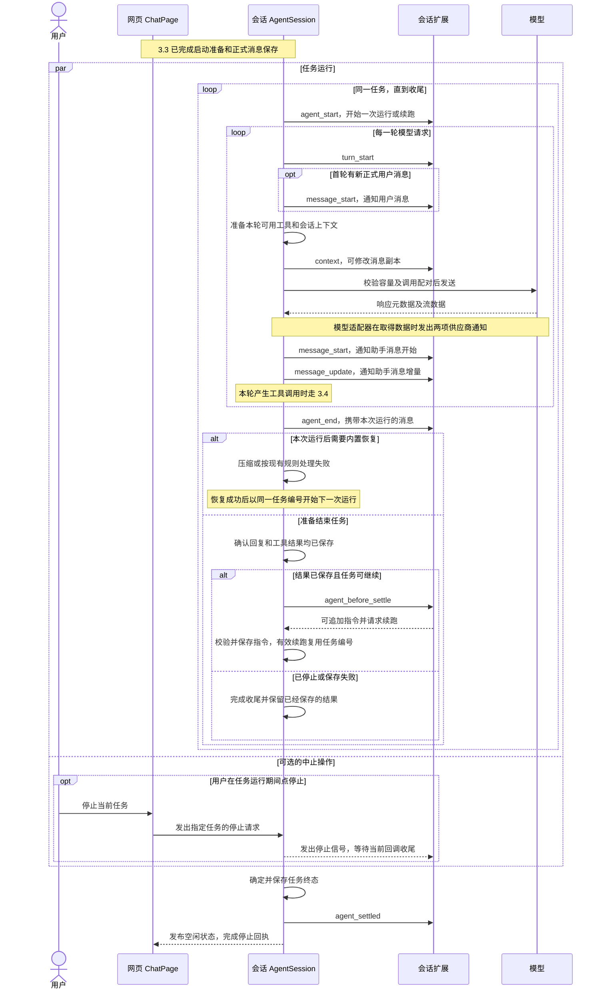

# 里程碑 2 Feature 4 Hook 机制与文件保护技术设计

**状态**　2026-11-17 确认按本设计实施。

## 1. 总结

SI 增加 22 个 Hook，让个人扩展在会话、模型请求和工具执行的指定时点运行。新增的 11 个观察型 Hook 复用现有流程及模型适配器取得的数据。首版从本机个人目录发现扩展，放入或移出文件后重启生效。主验收通过网页发起真实模型任务，加载原版 `protected-paths.ts`，证明它拦截对测试用 `.env` 的 `edit`，同时允许编辑普通 `README.md`。MCP 服务登记、`mcp_servers_change` 和真实连接随 Feature 5 交付。 [本期 Hook 与触发时机](./feature4-设计讨论记录.md#feature4-supported-hooks) · [里程碑规划](../README.md#第四步hook-机制与文件保护扩展验证)

服务启动时读取扩展入口。每个会话单独运行入口，通过 SI 的 `si.on()` 登记回调。`AgentSession` 管理会话、输入和任务状态，`Agent` 在模型与工具循环的相应位置调用回调。网页沿用现有的发送体验和会话更新通道，显示最终用户消息、实际工具参数和最终结果。

## 2. 系统变化

**当前**　服务启动时装配内置工具和模型服务。网页首发成功会收到正式会话回执，已有会话用提交编号把临时气泡替换成正式气泡。Agent 保存原始工具调用、检查权限、执行工具并保存结果。收尾时保存最后一条回复和任务终态。 [服务装配](../../../packages/server/src/webserver/index.ts#L171) · [SI 首发](../../../web/src/pages/ChatPage.tsx#L208) · [工具执行](../../../packages/agent/src/agent.ts#L62) · [当前任务收尾](../../../packages/coding-agent/src/agent-session.ts#L381)

**交付后**　扩展可在业务继续前处理输入、调整当轮上下文、改写或拦截工具调用，也可以在已有结果保存后请求续跑。正常发送复用原来的成功回执，在启动 Hook 完成并保存后返回。`input` 直接处理输入时返回「已处理」。任务终态确定并完成收尾回调后，网页收到空闲状态。

## 3. 系统设计

### 3.1 发现并加载个人扩展

用户将扩展放入 `~/.agent-learning/extensions/` 后启动服务。服务扫描一次目录，得到按加载顺序排列的扩展入口。



**本地服务 `WebServer`** 在启动时调用加载器，将成功加载的入口交给会话工厂。文件移出目录后，下一次启动时随新的扫描结果停用。

- **接口（新增 0，修改 1）** 【修改】`WebServer.start()`。现有启动入口增加个人扩展扫描和单项错误报告。
- **数据（新增 0，修改 0）** 沿用本机数据目录 `~/.agent-learning/`。扩展来源固定为其中的 `extensions/`。

**扩展加载器** 识别入口并导入模块。目录自身有有效包声明或 `index` 入口时作为一个扩展包处理。其余情况发现直属 `.ts`、`.js` 文件及一级子目录的包入口。包内的 `package.json` 可用 Pi 的 `pi.extensions` 声明入口，优先于 `index.ts`、`index.js`。跳过隐藏项、`node_modules` 和匹配目录忽略规则的条目，按实际路径去重。

- **接口（新增 1，修改 0）** 【新增】加载个人目录。读取目录并导入每个入口，返回成功项和可定位的失败原因。读取目录失败时向启动方返回原因，由启动方报告。
- **数据（新增 1，修改 0）** 【新增】扩展入口集合。每项包含来源路径和导入得到的入口函数，作用域为本次服务进程。导入会执行文件顶层代码，扩展以本地服务进程权限运行。

### 3.2 为会话注册 Hook

SI 新建草稿或首次恢复会话运行实例时，调用 3.1 加载的入口，为该会话建立回调表。



**会话扩展注册表** 持有当前会话的 Hook、扩展工具和来源。文件的入口函数可重用，每个会话调用入口一次。扩展在入口函数内声明的变量随该会话的回调保留。模块顶层变量可随进程内的模块实例共享。

- **接口（新增 3，修改 0）** 【新增】`si.on(event, handler)` 登记本期 22 个事件之一和同步或异步的回调。SI 触发时传入事件数据和会话上下文。登记未知事件或非函数回调时抛错。【新增】`si.registerTool()` 注册或更新当前扩展自己的工具，保留内置工具名和其他扩展已注册的名称。【新增】会话内触发事件。按扩展加载顺序、扩展内登记顺序等待回调，事件执行期间沿用开始时取得的回调列表。
- **数据（新增 2，修改 0）** 【新增】按事件组织的会话回调表，记录扩展来源、函数和注册顺序。【新增】会话扩展工具集合，明确工具定义、执行函数和所属扩展。两者随会话释放。

**会话协调 `Sessions` / `AgentSession`** 确保同一会话的首次初始化只进行一次，提交和关闭都可等待这次初始化。`session_start` 在所有已成功登记的扩展可用后触发，关闭流程见 3.5。

- **接口（新增 1，修改 0）** 【新增】会话扩展初始化。新草稿及新恢复实例共同使用，之后的发送沿用已初始化实例。
- **数据（新增 0，修改 0）** 使用 3.1 的入口集合和本节的会话注册表。

<a id="feature4-hook-contracts"></a>

#### 回调上下文与 22 个事件接口

扩展通过 `si.on(name, (event, ctx) => …)` 登记回调。`event` 是这次发生的事，每个事件的 `type` 等于其名称。`ctx` 是 SI 提供的会话信息，22 个事件使用同一份接口。回调可同步返回或返回 Promise，SI 等待它结束后处理结果。字段名参考 Pi，消息、模型、压缩记录和统一流事件使用 SI 的现有类型。 [Pi 事件与上下文定义](../../../pi/packages/coding-agent/src/core/extensions/types.ts#L346) · [SI 模型类型](../../../packages/model/src/types.ts) · [SI 会话类型](../../../packages/coding-agent/src/types.ts)

| 公共 `ctx` 字段 | 含义 |
| --- | --- |
| `sessionId: string` | 本次回调所属的会话编号，首发准备期间使用该会话的草稿编号。 |
| `cwd: string` | 此会话当前已校验的工作区路径。 |
| `model: ModelInfo \| undefined`、`thinkingLevel: ReasoningEffort \| undefined` | 当前操作使用的模型与推理强度。尚未选定时为空。模型切换通知使用保存后的值。 |
| `signal: AbortSignal \| undefined` | 当前初始化、提交、任务或压缩操作的信号。提交从进入准备阶段起就有信号，任务启动后沿用该信号。任务收尾通知可以读到已中止的信号。选择变更和 `session_shutdown` 这类独立通知没有操作信号。 |
| `hasUI: boolean`、`ui.notify(message, level?)` | `hasUI` 表示本次回调有提示交付渠道。提示级别为 `info`、`warning`、`error`，默认 `info`。`input` 回调的提示可随「已处理」回执交付，已连接的正式会话可通过现有 WebSocket 交付临时提示。没有渠道时忽略提示。提示不进入对话历史。 |

`ctx` 中的数据为只读。`event` 也作为只读数据提供，允许直接改入参的两处是 `context.messages` 和 `tool_call.input`。这些可改字段按回调提供独立副本。观察事件的返回值统一记为 `void`，SI 忽略它。可改变流程或数据的回调可以返回 `undefined` 保留当前结果，其中 `context` 和 `tool_call` 仍会接收有效的原地改动。

| Hook | `event` 字段（均另含 `type`） | 回调返回值及作用 |
| --- | --- | --- |
| `session_start` | `reason: 'new' \| 'resume'`，分别表示新草稿会话和恢复已有会话。 | `void` |
| `input` | `text: string` 为当前文本，`source: 'rpc'` 将 SI 网页通过 HTTP 提交归入 Pi 的 RPC 来源。 | `{ action: 'continue' }` 保留文本，`{ action: 'transform', text: string }` 将新文本交给下一回调，`{ action: 'handled' }` 停止输入链并回「已处理」。 |
| `before_agent_start` | `messageType: 'user'`、`prompt: string` 为展开 Skill 后准备发给模型的文本，`systemPrompt: string` 为当前生效的系统提示。 | `{ systemPrompt?: string, message?: ExtensionMessage }`。替换完整系统提示，后续回调读取替换后的值。各回调提供的额外指令按顺序随正式提交保存。 |
| `turn_start` | `turnIndex: number` 从每次 `Agent.run()` 或 `Agent.continue()` 的 0 开始，`timestamp: number` 为轮次开始的 Unix 毫秒。 | `void` |
| `context` | `messages: ModelMessage[]` 为本轮会话消息的副本。系统提示由 `before_agent_start` 控制。 | `{ messages?: ModelMessage[] }`。返回列表优先，也可直接编辑 `event.messages`。有效改动传给下一回调，只应用于本轮请求。 |
| `tool_call` | `toolCallId: string`、`toolName: string`、`input: Record<string, unknown>`。首个回调读取经基础校验的原始参数，之后读取最新有效参数。 | `{ block?: boolean, reason?: string }`。直接修改 `event.input` 可改参，`block: true` 立即停止该调用的回调链并记录拒绝原因。 |
| `tool_result` | `toolCallId: string`、`toolName: string`、`input: Record<string, unknown>` 为实际参数，`content: ToolResultMessage['content']`、`isError: boolean` 为当前结果。 | `{ content?: ToolResultMessage['content'], isError?: boolean }`。返回项逐字段替换，后续回调读取变更。实际操作记录仍由 SI 保存。 |
| `tool_execution_end` | `toolCallId: string`、`toolName: string`、`result: ToolResultMessage`、`isError: boolean`。结果已包含有效的改写、拒绝原因或中止原因。 | `void` |
| `agent_before_settle` | `outcome: 'completed' \| 'aborted' \| 'error'` 为当前结果，`entries: ExtensionMessageEntry[]`、`continue: boolean` 为当前建议，`context: { llmMessages: ModelMessage[], canContinue: boolean }` 为有效上下文预览及续跑资格。流程跳过已中止或无法继续的任务。 | `{ entries?: ExtensionMessageEntry[], continue?: boolean }`，默认空列表及 `false`。提供某字段时替换其当前值，后续回调读取替换后的建议和重新计算的上下文预览。合法追加指令随任务保存，续跑还要求 `continue: true`、上下文有效且任务未中止。 |
| `agent_settled` | `aborted: boolean` 表示最终任务是否中止。 | `void` |
| `session_shutdown` | `reason: 'quit'` 表示关闭本地服务。 | `void` |
| `agent_start` | 仅 `type`。 | `void` |
| `agent_end` | `messages: ModelMessage[]` 为这次 `run()` 或 `continue()` 新增的消息快照。 | `void` |
| `message_start` | `message: ModelMessage` 为开始处理的正式用户消息、助手消息或工具结果快照。 | `void` |
| `message_update` | `message: AssistantMessage`、`assistantMessageEvent: ModelEvent`。仅正文、思考和工具调用相关的流事件进入此通知。 | `void` |
| `tool_execution_start` | `toolCallId: string`、`toolName: string`、`args: Record<string, unknown>`，参数为开始准备时的原始值。 | `void` |
| `session_compact` | `compactionEntry: CompactionRecord` 为已保存的成功记录，`reason: 'manual' \| 'threshold' \| 'overflow'` 表示触发原因，`fromExtension: false`，`willRetry: boolean` 指这次压缩原本是否用于溢出重试。 | `void` |
| `session_compact_failed` | `reason`、`fromExtension`、`willRetry` 同上，`aborted: boolean` 区分失败和中止，非中止失败时可提供 `errorMessage?: string`。 | `void` |
| `model_select` | `model: ModelInfo`、`previousModel: ModelInfo \| undefined`、`source: 'set'`。 | `void` |
| `thinking_level_select` | `level: ReasoningEffort \| undefined`、`previousLevel: ReasoningEffort \| undefined`，无推理强度设置的模型用 `undefined`。 | `void` |
| `provider_stream_event` | `provider: string`、`api: string`、`model: string` 为本次请求的供应商、协议和模型标识，`data: unknown` 为已解析的数据块。 | `void` |
| `after_provider_response` | `status: number` 为 HTTP 状态码，`headers: Record<string, string>` 为响应头快照。 | `void` |

`ExtensionMessage` 是给模型的附加指令，包含 `customType: string`、`content: string | TextContent[]`、`display: false` 和可选 `details`，沿用本期追加指令的保存规则。续跑的 `ExtensionMessageEntry` 在相同字段上再带 `type: 'custom_message'`。压缩记录的 `trigger: 'auto'` 在通知中对应 `reason: 'threshold'`。

<a id="feature4-hook-errors"></a>

#### 回调报错后的处理

SI 将同步抛错、Promise 拒绝和无法应用的改写统一记录到本地服务日志。记录扩展文件路径、事件名、错误原因和会话编号，有任务编号或工具调用编号时也一并记录。入口加载及会话登记失败仍按 3.1 和 3.2 处理。 [Pi 续跑及错误处理](../../../pi/packages/coding-agent/src/core/extensions/runner.ts#L1043) · [Pi 工具回调](../../../pi/packages/coding-agent/src/core/extensions/runner.ts#L1197) · [Pi 上下文回调](../../../pi/packages/coding-agent/src/core/extensions/runner.ts#L1312)

- **观察事件** 记录错误并调用下一回调，业务继续使用原始数据。`session_shutdown` 某个回调失败后继续其他回调及会话清理。
- **`input`、`before_agent_start`、`context`、`tool_result`、`agent_before_settle`** 丢弃失败回调的返回值和对事件副本的改动，把上一个有效状态交给下一回调。SI 先校验改写字段的类型和形状。`context` 的候选消息还需通过容量和工具配对校验，`agent_before_settle` 的候选指令需能构成有效的上下文预览。任务仍按现有流程检查最终续跑条件及保存结果。
- **`tool_call`** 回调报错或返回非法结果时拦截该次调用并停止这条回调链。最终参数校验失败也拒绝执行。使用同一调用编号交付失败结果，并按 3.4 发出 `tool_execution_end`。缺少自定义拒绝原因时使用 SI 的默认拒绝说明。
- **中止** 收到中止信号后等待当前回调返回，开始保存、执行工具、发送模型请求或续跑前再检查信号。已收到信号的操作走既有中止流程。回调因该信号结束时按中止处理，收尾通知继续执行。

### 3.3 接收用户输入并确认启动

用户从首发草稿或已有会话发送普通聊天消息。SI 维持发送条件和输入框行为，并将扩展处理结果交回网页。



**会话协调 `Sessions` / `AgentSession`** 对输入做权限、模型等现有校验。重复请求先用提交编号、原文和原提交选项判断是否属于同一次发送。命中待处理请求时等待其完成，命中完成回执时复用结果。`input` 改写后，最终文本用于 Skill 解析、正式消息和模型输入。

- **接口（新增 0，修改 2）** 【修改】`Sessions.start()`。用草稿编号定位同一个内存实例，首次正式发送成功后把同一实例加入会话列表。【修改】`AgentSession.submit()`。增加 `input` 和 `before_agent_start`，返回正式成功或「已处理」结果。已处理路径结束于扩展，正式路径把启动准备放在成功保存和回执前。单个 `before_agent_start` 回调报错时按 Pi 报告错误并继续处理后续回调。
- **数据（新增 1，修改 1）** 【新增】内存草稿，以草稿编号关联会话和本次服务生命周期内的回执。【修改】任务的原始提交记录保留 A 供重试校验。改写时区分 A 与正式消息 B，让存储恢复能校验两者的关系。旧任务仍可按已有原文读取。

**本地服务 `WebServer`** 沿用 HTTP 发送入口和会话 WebSocket。正式成功分支保留现有回执结构。

- **接口（新增 0，修改 2）** 【修改】`POST /api/sessions/start`。接受可选草稿编号，直接处理时返回草稿编号和扩展提示。【修改】`POST /api/messages`。直接处理时返回提交编号和扩展提示。两处复用现有错误响应。
- **数据（新增 0，修改 2）** 【修改】首发请求可带已有草稿编号。【修改】提交结果增加 `handled` 分支，关联原提交编号。正式分支沿用现有用户消息编号和序号。

构造示例为草稿里的一次「已处理」结果。

```ts
{
  kind: 'handled',
  clientMessageId: '09153e4b-0ff1-4a5a-81cd-2eec276237f0',
  draftSessionId: '661fd1e9-ed38-4a95-8f55-3a5552d60126',
  notices: [{ level: 'info', message: 'pong' }],
}
```

**网页 `ChatPage`** 通过提交编号应用结果，保护等待期间用户后来输入的草稿。已有会话用最终消息替换临时气泡。首发成功后直接进入正式会话，侧栏出现该会话。首发被扩展处理后仍停留在原草稿。

- **接口（新增 0，修改 2）** 【修改】网页的 `startSession()` 和 `submitMessage()`。识别两种成功结果，对应一次发送。现有重试继续使用原提交编号。
- **数据（新增 0，修改 1）** 【修改】待提交状态。首发可携带服务端草稿编号，已有会话的临时气泡在正式消息或 `handled` 到达时结束。

### 3.4 拦截工具并交付最终结果

模型提出工具调用时，Agent 保存原始调用，再用扩展处理后的参数决定是否实际执行。执行成功、失败和拦截都沿用原调用编号。



**Agent 工具执行** 在调用进入执行准备时，将原始参数经 `tool_execution_start` 交给扩展观察。使用独立的参数对象供 `tool_call` 改写，保留模型的原始调用。后面的回调读取前面的修改。拦截或执行前回调报错时结束该调用的回调链。等待后再检查取消状态、最新权限和重新校验后的参数。对已执行的工具，成功和失败都可经过 `tool_result`。某个结果回调报错时报告错误并保留已得到的结果，随后继续其他回调。已进入调度且能按编号配对的调用使用最终结果发出结束通知。后续尚未进入调度的调用沿用既有停止处理。

- **接口（新增 3，修改 1）** 【新增】工具准备通知，提供原始调用编号、工具名和原始参数。【修改】`beforeToolCall` 可等待并返回执行前决定。【新增】执行后结果回调，提供实际参数和工具原始输出。【新增】工具结束通知，提供调用编号和最终结果。拦截与执行前取消直接进入结束通知。
- **数据（新增 0，修改 1）** 【修改】工具执行事件可携带实际参数。调用编号、工具名和关联位置保留。被拦截时以原因说明未执行。

**会话协调与存储** 保留既有工具检查点。实际参数和最终结果随同一个调用编号记录。结果交给现有模型适配器前，内容中保留实际操作或拒绝原因以及扩展变更的最终状态，适用于通过文本接收工具结果的供应商。工具结果保存失败时沿用当前任务错误流程，真实文件效果按已发生的操作保留。

- **接口（新增 0，修改 1）** 【修改】工具检查点保存。沿用原消息及结果的关联规则，同时存储实际参数。
- **数据（新增 0，修改 1）** 【修改】工具记录增加可选的实际参数。新旧记录均用调用编号及原位置做配对。

构造示例体现相同调用编号的两组参数。

```ts
{
  toolCallId: 'edit-1',
  toolName: 'edit',
  originalArguments: { path: 'README.md', edits: [{ oldText: '草稿', newText: '正式' }] },
  actualArguments: { path: 'docs/README.md', edits: [{ oldText: '草稿', newText: '正式' }] },
}
```

**网页工具卡** 通过原调用位置配对，在工具真正开始执行后采用服务端给出的实际参数。工具准备通知由扩展消费。历史记录缺少实际参数时以原调用展示。

- **接口（新增 0，修改 1）** 【修改】工具卡参数与结果展示，采用服务端发布的参数、状态和拒绝原因。
- **数据（新增 0，修改 0）** 使用本节的工具记录及现有会话快照。

### 3.5 模型轮次和任务收尾

正式用户消息与任务保存后，Agent 执行一轮或多轮。每次准备结束整个任务时，SI 先保存已有结果，再由扩展决定是否续跑。



**Agent 模型循环** 一次 `Agent.run()` 或 `Agent.continue()` 对应一对 `agent_start` 和 `agent_end`，结束通知携带这一段新增的消息。每轮触发 `turn_start`，并为 `context` 准备可独立修改的会话消息副本。进入消息流程时发出 `message_start`，助手消息的正文、思考或工具调用等流事件可通过 `message_update` 观察。发送前检查改写后上下文的容量与工具调用配对。连接重试复用同一份请求，作为同一轮处理。

- **接口（新增 5，修改 1）** 【新增】运行开始、运行结束、轮次开始、消息开始、消息更新通知。【修改】模型输入准备，应用本轮 `context` 输出并取得与本轮工具声明对应的执行集合。
- **数据（新增 0，修改 0）** 复用模型上下文与 3.2 的会话工具集合。下一轮使用最新可用工具及权限。

**会话协调 `AgentSession`** 保留原任务编号和停止信号。先保存已生成回复，再以已保存上下文触发 `agent_before_settle`。合法的续跑请求沿用原任务。每次续跑结束后重新判断是否收尾。发现中止信号时停止续跑。`agent_settled` 在任务终态和保存结果确定后触发，完成后才发布空闲。压缩成功、失败或中止分别按已有终态通知，模型和推理强度分别比较已保存的新旧选择后通知。

- **接口（新增 0，修改 5）** 【修改】任务运行及收尾。加入运行、模型轮次回调、续跑检查与最终通知，按请求透传本会话的供应商观察回调。【修改】`compact()`。按已有压缩终态通知扩展。【修改】`selectModel()`。保存后分别检查模型和推理强度的变化。【修改】`abort(runId)`。沿用按任务中止，等待相关回调退出后才确认。【修改】`close()`。等待会话清理并触发一次关闭回调。
- **数据（新增 1，修改 0）** 【新增】扩展追加的指令记录，随所属任务保存，之后可进入模型上下文。网页的用户气泡仍对应用户正式消息。停止、成功和失败继续通过原任务状态对网页同步。

**模型适配器** 在现有接入点转发供应商数据。通用 Pi 适配器使用供应商流回调，独立 DeepSeek 适配器使用已解析的数据块。`after_provider_response` 仅在适配器拿到 HTTP 状态码和响应头时触发，当前 Google 路径只提供流数据通知。回调按当前请求的流顺序观察已有数据，错误由扩展调度记录，模型请求与输出沿用现有处理。供应商数据通知只在本会话有相应订阅时进入扩展调度，逐块等待意味着较慢的回调会影响流的消费速度。

- **接口（新增 0，修改 1）** 【修改】模型流调用。接收由当前会话传入的 `provider_stream_event` 和 `after_provider_response` 回调。
- **数据（新增 2，修改 0）** 【新增】供应商流通知，包含供应商、协议、模型及已解析的数据块。【新增】HTTP 响应通知，包含状态码和响应头。两项均随请求消费。

<a id="feature4-close-pending-submit"></a>

#### 首发还在准备时关闭服务

服务开始关闭时停止接收新提交，并通知正式会话及尚未转正的草稿。会话先标记关闭，向进行中的初始化、提交准备和任务发出中止信号，再等待它们结束。首发卡在 `before_agent_start` 时，回调退出后，提交路径重新检查关闭状态，走现有的关闭错误处理。此时会话仍是草稿，无正式消息、任务或成功回执，也不会发起模型请求。

会话关闭等待内部的提交准备 Promise（现有 `submitting.settled`），包括任务尚未建立的阶段。外层首发请求在失败后也会等待会话关闭，因此关闭流程等待内部准备，外层请求在清理后结束。同一会话的多次关闭共享同一次清理。初始化及在途操作清理完后，已初始化的扩展收到一次 `session_shutdown`。服务等待会话清理完成后再关闭存储。 [SI 提交准备](../../../packages/coding-agent/src/agent-session.ts#L115) · [SI 首发与关闭](../../../packages/coding-agent/src/sessions.ts#L86) · [SI 服务关闭](../../../packages/server/src/webserver/index.ts#L647) · [验收 34](./feature4-Hook触发验收标准.md#case-34)

## 4. 技术决策

### 【功能决策｜扩展目录】采用 Pi 的个人目录发现

个人目录覆盖本地服务下所有工作区。沿用 Pi 同层目录读取顺序、包内声明顺序，每个扩展内部按登记顺序执行。已有 Pi 包声明沿用其字段名，SI 自有扩展代码示例统一使用 `si.on()`。项目级扩展需要独立的信任与加载流程，延后处理。 [Pi 个人目录扫描](../../../pi/packages/coding-agent/src/core/package-manager.ts#L632) · [Pi 事件分发顺序](../../../pi/packages/coding-agent/docs/extensions.md#pionevent-handler) · [Pi 项目信任](../../../pi/packages/coding-agent/src/core/resource-loader.ts#L533)

### 【工程决策｜扩展运行】SI 管理自己的接口和会话状态

参考 Pi 的入口函数和会话注册过程，由 SI 负责登记和调度本期 22 个 Hook。模块导入与会话注册分开。原版 `protected-paths.ts` 的默认导出已在当前 Node v24.16.0 上通过导入检查，拟优先使用现有 Node 的模块加载能力。Pi 的加载器还提供 `jiti` 转译和运行时别名，第三方扩展依赖这些能力时需单独验证。 [Pi 入口与加载器](../../../pi/packages/coding-agent/src/core/extensions/loader.ts#L571) · [Pi 会话初始化](../../../pi/packages/coding-agent/src/core/extensions/loader.ts#L625)

### 【功能决策｜发送交互】保留 SI 的回执和输入框行为

启动准备结束后确认启动，沿用 Pi 的时点。SI 的正式回执同时要求消息和任务已经保存。已有会话的正式消息按提交编号接替临时气泡，和 DSH 的气泡接替机制一致。扩展直接处理输入时，网页只有扩展提示。 [Pi 启动回执](../../../pi/packages/coding-agent/src/core/agent-session.ts#L1950) · [DSH 气泡接替](../../../deepseek-harness/packages/client/ui-chat/src/client/chat/ChatView.tsx#L180) · [SI 气泡配对](../../../web/src/chat/state.ts#L340)

### 【工程决策｜工具执行】保留内置名称并记录实际参数

只读权限按既有内置工具名识别，扩展使用自己的工具名。工具参数可改写，SI 留下模型原始调用和实际参数，用相同调用编号关联。拦截前后的权限及停止检查保持原有安全边界，最终工具结果可以被扩展改写，包括成功或失败状态。 [Feature 2 权限设计](../feature2/feature2-权限管理技术设计.md) · [Pi 工具执行前检查](../../../pi/packages/agent/src/agent-loop.ts#L718) · [Pi 工具结果改写](../../../pi/packages/agent/src/agent-loop.ts#L877)

## 5. 风险与边界

### 文件能够导入，仍可能在某个会话初始化失败

- **案例** 扩展入口登记第一个回调后抛错，部分登记会让会话行为难以判断。
- **解决方案** 单个扩展的会话登记在入口成功后生效。入口失败报告路径和原因，清掉该扩展的待生效登记。回调持有的会话状态随该会话销毁。

### 两个独立扩展的顺序由文件系统给出

- **案例** 路径检查先运行，后运行的改参把目标换成受保护文件。
- **解决方案** 有明确先后依赖时，把两个入口放入同一扩展包，由包声明安排改参和保护的顺序。主验收单独启用文件保护扩展。

### 等待 Hook 时，首发确认和停止确认可能变慢

- **案例** `before_agent_start` 等待较久时，首发的原文仍在输入框。正在运行的扩展忽略停止信号时，停止确认或服务关闭要等它返回。
- **解决方案** 复用首发的等待、超时和同编号重试流程。任务停止将信号传给现有回调，等待返回再确认，避免启动尚未开始的工具。 [SI 提交等待约定](../../设计妥协记录.md#提交尚未确认时暂不可中止)

### 工具已经产生文件效果，结果可能保存失败

- **案例** `edit` 已经完成，持久化工具结果时磁盘写入失败。
- **解决方案** 保留工具检查点及既有保存失败反馈。工具结果未确认时，网页展示失败状态，任务按既有流程收尾。工具执行前的原始调用保存失败时整批工具保持未执行。

## 6. 验收标准

34 个案例中，22 个与 Hook 一一对应，检查回调顺序、次数及结果。另外 12 个覆盖目录启停、加载失败、会话隔离、权限复查、任务中止及首发准备期间关闭服务等跨流程行为。主验收从真实网页入口调用真实模型，核对调用编号、拒绝结果和工作区文件，并记录移出扩展重启后的结果。 [Hook 触发及补充验收标准](./feature4-Hook触发验收标准.md)

## 7. 拟变更文件

### 扩展发现与会话注册

| 文件 | 类型 | 用途 | 变更 |
| --- | --- | --- | --- |
| `packages/coding-agent/src/extensions/loader.ts` | 新增 | 个人扩展发现 | 枚举入口、校验导出并汇总单项加载错误。 |
| `packages/coding-agent/src/extensions/runtime.ts` | 新增 | 会话扩展注册与调度 | 提供 SI 的扩展接口，管理每个会话的回调和扩展工具。 |
| `packages/coding-agent/src/index.ts` | 修改 | 会话与服务接入 | 暴露服务装配所需的扩展加载接口。 |
| `packages/coding-agent/test/extensions.test.ts` | 新增 | 发现与注册验收 | 覆盖目录顺序、单项加载失败、会话隔离和登记回滚。 |

### 本地服务和会话协调

| 文件 | 类型 | 用途 | 变更 |
| --- | --- | --- | --- |
| `packages/server/src/webserver/index.ts` | 修改 | 本地服务装配、提交 | 启动时装配扩展，转发直接处理和正式提交回执。 |
| `packages/server/src/webserver/protocol.ts` | 修改 | 浏览器协议 | 表达草稿编号、已处理结果和实际工具参数。 |
| `packages/coding-agent/src/sessions.ts` | 修改 | 会话实例与草稿 | 保留内存草稿，初始化、提升和关闭相应会话。 |
| `packages/coding-agent/src/agent-session.ts` | 修改 | 会话输入和收尾 | 衔接启动、续跑和终态通知，按同一调用编号记录参数和结果。 |
| `packages/coding-agent/src/types.ts`、`packages/coding-agent/src/session-store.ts` | 修改 | 会话数据与存储 | 区分发送原文与正式消息，保存实际工具参数并兼容旧记录。 |
| `packages/coding-agent/src/compaction.ts` | 修改 | 历史上下文 | 让已保存的扩展指令按消息顺序进入有效上下文。 |
| `packages/coding-agent/test/agent-session.test.ts`、`packages/server/test/webserver.test.ts` | 修改 | 提交与任务验收 | 覆盖输入、启动回执、续跑、停止收尾及首发准备期间关闭服务。 |

### Agent 模型和工具循环

| 文件 | 类型 | 用途 | 变更 |
| --- | --- | --- | --- |
| `packages/agent/src/agent.ts`、`packages/agent/src/types.ts` | 修改 | 模型和工具循环 | 等待各轮及工具回调，用最终参数执行并交付改写后的结果。 |
| `packages/agent/test/execution.test.ts` | 修改 | Agent 执行验收 | 验证轮次、工具回调及终态结果的实际顺序。 |

### 模型适配器

| 文件 | 类型 | 用途 | 变更 |
| --- | --- | --- | --- |
| `packages/model/src/types.ts`、`packages/model/src/pi-stream.ts`、`packages/model/src/deepseek.ts`、`packages/model/src/model-failure.ts` | 修改 | 供应商数据观察 | 经现有适配器转发已解析流数据和可用的 HTTP 响应元数据。 |
| `packages/model/test/model-stream.test.ts` | 修改 | 供应商通知验收 | 核对两条路径的数据与触发时点。 |

### 网页发送与工具卡

| 文件 | 类型 | 用途 | 变更 |
| --- | --- | --- | --- |
| `web/src/chat/client.ts`、`web/src/chat/state.ts`、`web/src/pages/ChatPage.tsx` | 修改 | 网页发送与状态同步 | 接收两种提交结果，保护草稿和临时气泡的配对。 |
| `web/src/components/AssistantMessage.tsx` | 修改 | 工具卡 | 通过原调用位置展示实际参数与最终结果。 |
| `web/tests/e2e/sessions.spec.ts` | 修改 | 网页首发验收 | 验证「已处理」后保留草稿及已有首发行为。 |
| `web/tests/e2e/extensions.live.spec.ts` | 新增 | 文件保护真模验收 | 通过正式网页入口核对启用和停用后的实际文件结果。 |

### 其他

| 文件 | 类型 | 用途 | 变更 |
| --- | --- | --- | --- |
| [Hook 触发验收标准](./feature4-Hook触发验收标准.md) | 新增 | 交付验收 | 定义每个 Hook 的触发证据和补充流程案例。 |
