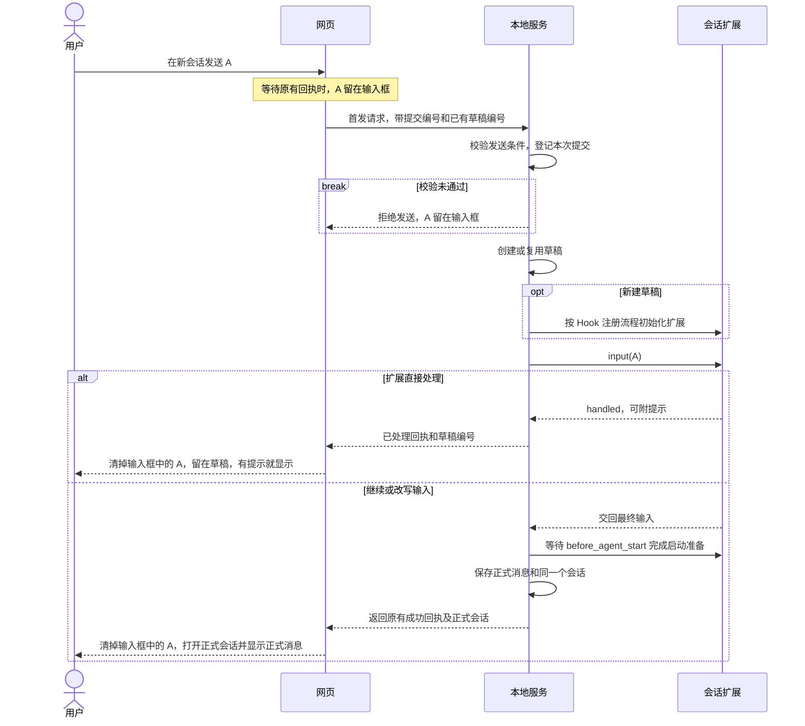
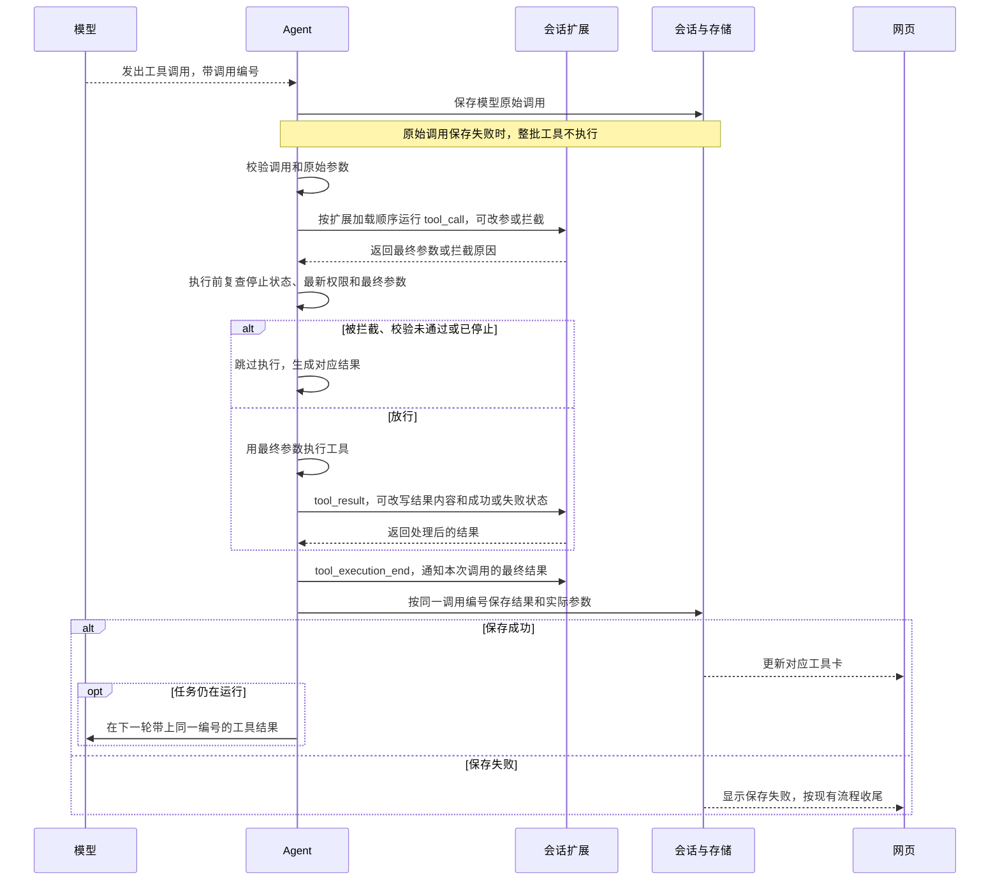
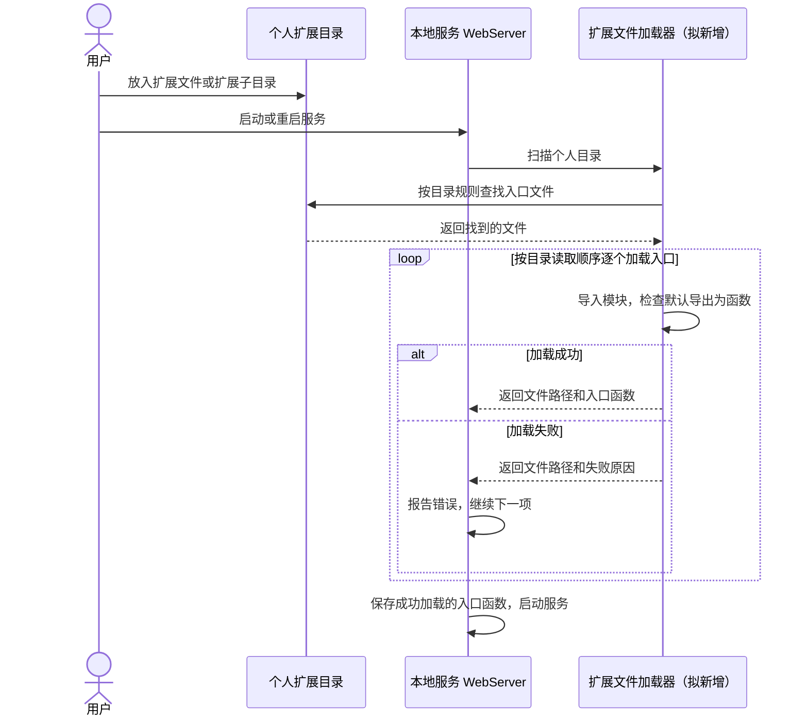
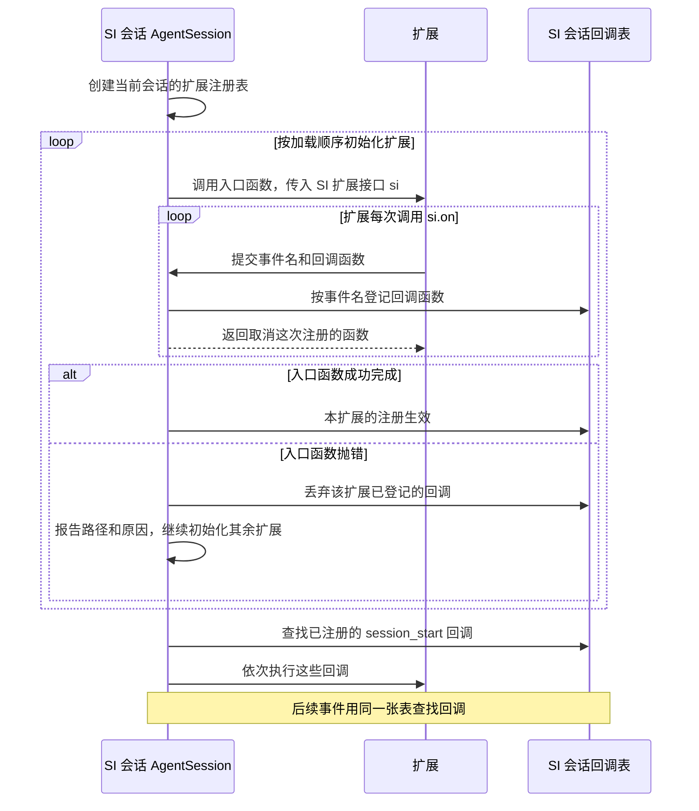
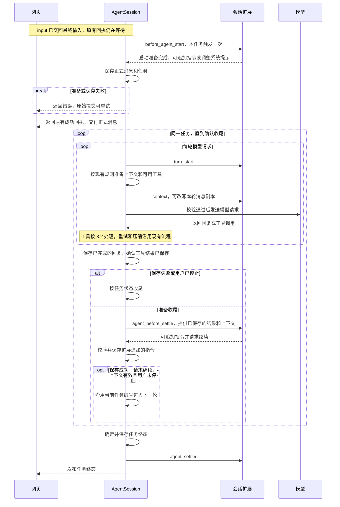

# 里程碑 2 Feature 4 Hook 机制设计讨论

[技术设计评审稿](./feature4-Hook机制与文件保护技术设计.md) · [Hook 触发验收标准](./feature4-Hook触发验收标准.md)

## 已确认的需求

将 Pi 自带的 `protected-paths.ts` 放入个人扩展目录，通过通用入口加载。以网页发起的真实模型任务验证 `edit` 对测试用 `.env` 的写入被拦截，拒绝原因与原调用对应，普通 `README.md` 确实修改。将扩展移出个人目录并重启，再试对测试用 `.env` 的编辑，确认拦截消失。 [里程碑规划](../README.md#第四步hook-机制与文件保护扩展验证)

首版筛选 Pi 的经典 Hook，优先覆盖后续接入 MCP 可复用的通用事件。MCP 服务登记、`mcp_servers_change` 和真实服务连接纳入 Feature 5。 [MCP 规划](../README.md#第五步mcp-客户端与真实服务接入)

## 已确认的决策

### 【功能决策｜Hook 范围】本期支持 22 个 Hook

在原定 11 个 Hook 的基础上，加入 9 个基于现有运行时点的通知和 2 个供应商数据通知。新增 11 个 Hook 的回调只用于观察，复用 SI 已有的运行、存储与模型适配能力。22 个 Hook 均有一项对应的触发案例，核对次数、顺序和可观察结果。其中 5 个通用事件也被 Pi 的 MCP 扩展使用。 [Hook 触发验收标准](./feature4-Hook触发验收标准.md) · [Pi 事件顺序](../../../pi/packages/coding-agent/docs/extensions.md#understand-the-lifecycle) · [Pi MCP 订阅](../../../pi/packages/coding-agent/src/extensions/mcp/index.ts#L1115)

| Hook 名称 | 触发时机 |
| --- | --- |
| `session_start` | 新建会话或恢复会话运行实例时，扩展注册完成后、该会话处理输入前。 |
| `input` | 普通聊天提交通过 SI 现有发送条件校验后、展开 Skill 或保存正式消息前。 |
| `before_agent_start` | `input` 交回最终输入后，每项新任务触发一次。回调结束并保存正式消息及任务后，服务端返回原有成功回执。 |
| `turn_start` | 每轮 Agent 工作开始、准备该轮模型请求前。 |
| `context` | 每轮模型请求发送前，服务端已准备好本轮会话消息的副本时。连接重试复用本轮请求。 |
| `tool_call` | 模型提出的工具调用通过基本校验后、实际执行前，可改参或拦截。 |
| `tool_result` | 实际执行过的工具返回后、最终结果发布前，可改写内容和成功或失败状态。 |
| `tool_execution_end` | 一次工具调用的结果确定后，包括成功、失败、被拦截和中止。 |
| `agent_before_settle` | 已有回复和工具结果保存、内置恢复完成后，任务准备收尾且仍可请求续跑时。已中止的任务跳过。 |
| `agent_settled` | 任务终态确定、收尾保存处理完成后，服务端对网页发布空闲前。 |
| `session_shutdown` | 会话运行实例销毁前。服务关闭时等该会话的在途初始化、提交准备和任务收尾后触发。 |
| `agent_start` | 一次 `Agent.run()` 或 `Agent.continue()` 开始、进入这一段的第一轮之前。 |
| `agent_end` | 一次 `Agent.run()` 或 `Agent.continue()` 结束时，携带这一段产生的消息。会话可随后自动压缩或续跑。 |
| `message_start` | 正式用户消息、助手消息或工具结果开始进入消息流程时，每条消息触发一次。 |
| `message_update` | 助手消息流式更新时，携带当前消息快照和对应的流事件。 |
| `tool_execution_start` | 模型的工具调用进入执行准备阶段时，先于 `tool_call`。之后被拦截的调用也能收到这项通知。 |
| `session_compact` | 手动、阈值或溢出压缩成功，摘要保存并进入有效上下文后。 |
| `session_compact_failed` | 压缩失败或被中止的结果确定后。无需压缩而跳过时沿用既有跳过处理。 |
| `model_select` | 已有会话的模型实际切换，并成功保存选择后。 |
| `thinking_level_select` | 已有会话的推理强度实际变更，并成功保存选择后。 |
| `provider_stream_event` | 供应商的流数据块解析后、转换为 SI 统一流事件前，按流顺序通知。 |
| `after_provider_response` | 适配器能够取得 HTTP 状态码和响应头时，在接收响应后、消费响应流前触发。当前 Google 路径缺少此事件所需的响应元数据。 |

`tool_execution_start` 使用调用准备时的原始参数。网页工具卡仍在工具真正开始执行时更新。供应商事件在模型适配器处转发当前请求已经拿到的数据，使用发起请求的会话扩展运行环境。 [Pi 工具准备](../../../pi/packages/agent/src/agent-loop.ts#L551) · [SI 工具开始](../../../packages/agent/src/agent.ts#L77) · [Pi 供应商事件](../../../pi/packages/coding-agent/docs/extensions.md#after_provider_response) · [SI Pi 适配器](../../../packages/model/src/pi-stream.ts#L102) · [SI DeepSeek 适配器](../../../packages/model/src/deepseek.ts#L119)

技术方案明确这 22 个 Hook 的事件字段、公共上下文和返回值。普通回调报错后保留上一个有效状态并继续，`tool_call` 报错时拦截该次调用。首发尚在准备时关闭服务，先发出中止信号，等回调收尾后再完成关闭。 [回调接口](./feature4-Hook机制与文件保护技术设计.md#feature4-hook-contracts) · [错误处理](./feature4-Hook机制与文件保护技术设计.md#feature4-hook-errors) · [验收 34](./feature4-Hook触发验收标准.md#case-34)

### 【功能决策｜本地服务与扩展】扫描个人扩展目录

本地服务启动时扫描 `~/.agent-learning/extensions/`。用户把文件放入个人扩展目录后重启启用，移出目录后重启停用。该目录的扩展适用于这台 SI 服务下的所有工作区。首版取消此前草案里的 `settings.json.extensions` 清单，项目级扩展和项目信任留待后续设计。 [Pi 扩展目录](../../../pi/packages/coding-agent/docs/extensions.md#extension-locations) · [Pi 项目信任](../../../pi/packages/coding-agent/src/core/resource-loader.ts#L533)

### 【功能决策｜服务启动】扩展加载失败时报告错误并继续启动

沿用 Pi。启动时，如果扫描到的某个扩展入口加载失败，报告该文件路径和失败原因，跳过该项并继续加载其他扩展。服务照常启动，只有成功加载的扩展生效。修复文件后重启。 [Pi 加载错误处理](../../../pi/packages/coding-agent/src/core/extensions/loader.ts#L703) · [Pi 错误展示](../../../pi/packages/coding-agent/src/modes/interactive/interactive-mode.ts#L2060)

### 【功能决策｜聊天输入与会话记录】保留 SI 发送交互，正式气泡显示最终输入

首发等待回执时，原文 A 留在输入框。正式消息保存成功后，网页清掉本次提交的 A，打开正式会话并显示正式消息。已有会话按发送时清空输入框并显示临时气泡 A，随后按同一个提交编号用正式气泡接替。`input` Hook 把 A 改写成 B 时，正式消息、模型输入和重新打开的历史均使用 B。原始提交 A 用于重试校验。 [SI 首发回执](../../../web/src/pages/ChatPage.tsx#L208) · [SI 气泡替换](../../../web/src/chat/state.ts#L340) · [DSH 气泡替换](../../../deepseek-harness/packages/client/ui-chat/src/client/chat/ChatView.tsx#L180) · [现有重复提交校验](../../../packages/coding-agent/src/agent-session.ts#L217)

### 【功能决策｜聊天输入】直接处理输入后只显示扩展提示

沿用 Pi。`input` Hook 返回 `handled` 后，服务端结束本次提交并返回「已处理」回执。首发清掉输入框里的本次提交，已有会话撤下本次提交的临时气泡。网页只显示扩展主动提供的提示。输入和提示均不写入聊天历史，本次提交不启动模型。例如扩展处理 `ping` 后，网页只提示 `pong`。 [Pi 直接处理输入](../../../pi/packages/coding-agent/src/core/agent-session.ts#L2215) · [Pi 示例](../../../pi/packages/coding-agent/examples/extensions/input-transform.ts#L31)

### 【功能决策｜任务收尾】每次准备收尾时由扩展判断是否续跑

沿用 Pi。模型和工具执行及自动恢复完成后，先保存已完成的回复及工具结果，再触发 `agent_before_settle`。扩展报错、用户停止或扩展决定结束时，已保存的这一轮仍可回看。扩展可追加指令并返回 `continue: true`。服务端确认上下文可继续后，在原任务内续跑。续跑后重复这一流程。用户中止会阻止续跑，任务实际结束后发出 `agent_settled`。 [Pi 消息保存](../../../pi/packages/coding-agent/src/core/agent-session.ts#L1213) · [Pi 任务收尾循环](../../../pi/packages/coding-agent/src/core/agent-session.ts#L1981) · [Pi 续跑校验](../../../pi/packages/coding-agent/src/core/agent-session.ts#L2100)

### 【功能决策｜动态工具注册】首版保留内置工具名

扩展用自己的工具名注册。服务端拒绝与内置工具同名的注册，保证只读模式白名单中的 `read`、`grep`、`find`、`ls` 仍对应实际的内置实现。Pi 允许同名覆盖，SI 首版按已确认的权限规则保留这些名称对应的内置实现。 [Pi 同名覆盖](../../../pi/packages/coding-agent/docs/extensions.md#overriding-built-in-tools) · [SI 权限设计](../feature2/feature2-设计讨论记录.md#已确认的功能范围) · [SI 权限检查](../../../packages/coding-agent/src/agent-session.ts#L503)

### 【功能决策｜工具调用与网页展示】保留原始调用并记录实际参数

模型发出参数 A，`tool_call` Hook 将其改成 B 时，服务端保留模型的原始调用，用同一个调用编号记录实际执行的参数 B 和对应结果。网页工具卡显示 B，回填给模型的结果也说明实际执行了什么。例如原调用请求编辑 `README.md`，实际编辑 `docs/README.md`，网页和回填结果使用实际文件路径。 [Pi 参数处理](../../../pi/packages/agent/src/agent-loop.ts#L735) · [DSH 改参提案](../../../deepseek-harness/.agents/notes/proposed/feature/2026-06-30-pre-tool-input-rewrite.zh.md#提案) · [SI 工具结果关联](../../../packages/coding-agent/src/agent-session.ts#L608)

### 【功能决策｜工具调用】按扩展加载顺序执行回调

沿用 Pi。扩展之间按加载顺序执行，同一扩展内的回调按注册顺序执行。个人目录的加载顺序由目录读取结果决定。对一次 `tool_call`，后续回调读取前面的改参结果。任一回调拦截时，结束这次调用的回调链并跳过工具执行。文件保护要检查最终路径时，保护扩展必须在改参扩展之后运行。 [Pi 回调顺序](../../../pi/packages/coding-agent/docs/extensions.md#pionevent-handler) · [Pi 逐项执行与拦截](../../../pi/packages/coding-agent/src/core/extensions/runner.ts#L1256)

### 【功能决策｜工具结果】扩展可以改写最终的成功或失败状态

沿用 Pi。工具执行结束后，`tool_result` 回调可以改写结果内容和 `isError`。`tool_execution_end`、网页工具卡和交给模型的工具结果使用扩展处理后的结果和状态。服务端按已确认的规则记录模型原始调用、实际执行参数及对应编号。 [Pi 结果改写](../../../pi/packages/agent/src/agent-loop.ts#L877) · [Pi 结果发布](../../../pi/packages/agent/src/agent-loop.ts#L929)

### 【工程决策｜任务中止】等正在执行的 Hook 回调收尾后确认停止

沿用 Pi。用户中止任务时，服务端向正在运行的回调提供停止信号，等待该回调结束。回调结束后检查停止状态，已经中止时跳过尚未开始的工具执行。服务端完成任务收尾后确认停止，网页以该确认结果为准。忽略停止信号的回调会延迟确认。 [Pi 停止信号](../../../pi/packages/coding-agent/docs/extensions.md#ctxsignal) · [Pi 工具执行前检查](../../../pi/packages/agent/src/agent-loop.ts#L738) · [SI 停止接口](../../../packages/coding-agent/src/agent-session.ts#L728)

### 【工程决策｜并行会话】每个会话单独运行扩展入口

沿用 Pi。服务可复用扩展文件导出的入口函数，每个会话初始化时单独运行一次。各会话独立维护回调、动态注册工具和入口函数内的状态。例如入口函数内初始化为 0 的计数器在两个会话各自计数。复用扩展模块时，写在入口函数外的变量可跨会话共享。 [Pi 入口加载](../../../pi/packages/coding-agent/src/core/extensions/loader.ts#L571) · [Pi 扩展初始化](../../../pi/packages/coding-agent/src/core/extensions/loader.ts#L625)

### 【功能决策｜新会话】首条正式消息出现前，草稿会话保存在内存

沿用 Pi 的会话保存时机。同一个草稿复用服务端内存中的会话及扩展状态。若首条输入由扩展直接处理，网页收到「已处理」回执后停留在草稿，只显示扩展提示。首条正式聊天消息保存成功后，同一个会话加入侧栏，会话里的扩展状态随之延续。 [Pi 直接处理输入](../../../pi/packages/coding-agent/src/core/agent-session.ts#L2215) · [Pi 会话保存时机](../../../pi/packages/coding-agent/src/core/session-manager.ts#L1168) · [SI 首发保存](../../../packages/coding-agent/src/agent-session.ts#L230)

### 【功能决策｜聊天输入】沿用 SI 的发送条件

网页沿用现有发送条件，服务端通过现有模型校验后才触发 `input`。扩展直接处理时返回「已处理」回执，本次提交结束于扩展回调，不发起模型请求。 [SI 网页发送条件](../../../web/src/pages/ChatPage.tsx#L460) · [SI 服务端提交校验](../../../packages/coding-agent/src/agent-session.ts#L115)

### 【功能决策｜任务启动】启动准备及保存成功后返回原有回执

参考 Pi 的启动时机。SI 等 `before_agent_start` 完成，再保存正式消息和任务并返回原有成功回执。该回执承担 `started` 的含义。相同提交编号重试复用原来的等待或回执。`input` 直接处理时仍返回「已处理」。首发期间遇到较慢的 Hook，A 会在输入框多等一会儿。 [Pi 启动准备](../../../pi/packages/coding-agent/src/core/agent-session.ts#L1950) · [Pi `started` 时机](../../../pi/packages/coding-agent/src/core/agent-session.ts#L2208) · [SI 正式消息保存入口](../../../packages/coding-agent/src/agent-session.ts#L194)

## 已确认的流程与接口

### 3.1 草稿首发

用户发送首条输入时，服务端创建或复用内存草稿。扩展在该会话初始化时完成注册，同一个草稿的后续发送复用这份会话及扩展状态。

| 模块 | 接口和数据 |
| --- | --- |
| 网页 `ChatPage` | 首发时把 A 留在输入框，直到收到原有成功回执或「已处理」。正式会话打开后直接展示最终用户消息。收到「已处理」则清掉 A 并记住草稿编号。 |
| 服务端发送接口 | 首发沿用 `POST /api/sessions/start`，增加可选草稿编号和「已处理」分支。启动准备及保存成功后返回原有回执。同一提交编号重试复用原来的处理或结果。 |
| 会话 `Sessions` / `AgentSession` | 在内存保存草稿会话及扩展状态。启动准备完成并保存第一条正式消息后，将同一会话加入侧栏。保存失败时沿用报错和重试流程。服务重启会清空未保存的草稿及回执。 |

网页按本次提交更新输入框，保护用户等待时新输入的草稿内容。首发校验、准备或保存明确失败时保留 A。连接中断或回执超时的重试沿用同一提交编号。已有会话按现有逻辑显示和替换临时气泡。 [SI 首发处理](../../../web/src/pages/ChatPage.tsx#L223) · [SI 首发入口](../../../packages/server/src/webserver/index.ts#L333) · [SI 会话创建](../../../packages/coding-agent/src/sessions.ts#L58)

输入改写时，首发重试用原文 A 校验，正式用户消息用 B 恢复。现有存储读取还会用同一字段检查这两处文本，接入改写时需更新这项校验，旧会话仍可正常读取。 [提交重试校验](../../../packages/coding-agent/src/agent-session.ts#L217) · [历史读取校验](../../../packages/coding-agent/src/session-store.ts#L252)

### 3.2 工具拦截与结果回填

模型发出工具调用后，Agent 先保存原始调用，再让扩展检查或改写参数。`protected-paths.ts` 拦下 `edit(.env)` 时，文件保持原样。网页工具卡和模型按原调用编号收到拒绝原因。 [Pi 文件保护扩展](../../../pi/packages/coding-agent/examples/extensions/protected-paths.ts#L13)

| 模块 | 接口和数据 |
| --- | --- |
| `Agent` | 将现有执行前回调改为可等待，增加执行后改写和结束通知。`tool_call` 报错时拦下这次调用。`tool_result` 回调报错时记录错误，保留已得到的结果并继续处理后续回调。 |
| `AgentSession` | 用同一调用编号关联原始调用、实际参数和最终结果。用户点停止时，向正在执行的回调发送停止信号，等回调收尾，再按任务终态确认。 |
| 网页工具卡 | 调用开始执行后显示服务端给出的实际参数，结束后显示最终结果。调用被拦截时显示未执行及原因。沿用会话更新通道。 |

例如 `edit-1` 的路径从 `README.md` 改成 `docs/README.md` 后，历史保留原始调用，工具卡和回填给模型的结果都用实际路径。 [SI 工具保存与回填](../../../packages/agent/src/agent.ts#L63) · [SI 工具卡](../../../web/src/components/AssistantMessage.tsx#L49) · [Pi 结果回调](../../../pi/packages/coding-agent/src/core/extensions/runner.ts#L1197)

## 待确认的流程与接口

### 服务如何发现并加载扩展

用户把扩展放进 `~/.agent-learning/extensions/`。`WebServer` 启动时扫描一次，逐个导入发现的入口文件并取得默认导出的函数。目录不存在或为空时，服务以空的扩展集合启动。 [Pi 个人目录扫描](../../../pi/packages/coding-agent/src/core/package-manager.ts#L632) · [Pi 扩展入口](../../../pi/packages/coding-agent/src/core/extensions/loader.ts#L571)

`WebServer.start()` 调用加载器并报告错误。加载器负责查找入口、导入文件和校验默认导出。成功结果是服务进程内的有序入口集合，后续由 `AgentSession` 用来初始化扩展。导入会执行模块顶层代码，个人目录内发现的扩展以本地服务进程权限运行。 [SI 装配入口](../../../packages/server/src/webserver/index.ts#L171) · [Pi 单项失败处理](../../../pi/packages/coding-agent/src/core/extensions/loader.ts#L703)

#### 个人目录的入口规则（拟沿用 Pi）

- 个人扩展目录下的 `.ts` 或 `.js` 文件可以直接作为入口。例如 `~/.agent-learning/extensions/protected-paths.ts`。
- 一级子目录可用 `package.json` 的 `pi.extensions` 声明现有 Pi 扩展包的入口，有有效声明时采用声明顺序。否则优先用 `index.ts`，再尝试 `index.js`。扫描范围为当前目录和一级子目录，更深的入口可以由扩展包声明。
- Pi 也会先检查个人扩展目录自身有没有包声明或 `index` 入口，找到后把整个目录当成一个扩展包。散放多个独立扩展时，直接放各自的文件或子目录。 [Pi 目录规则](../../../pi/packages/coding-agent/docs/extensions.md#extension-locations) · [Pi 扫描实现](../../../pi/packages/coding-agent/src/core/package-manager.ts#L602)

#### 自动发现后的加载顺序（已确认）

SI 沿用 Pi，按文件系统返回的目录条目顺序加载，同一个扩展包内按包声明的入口顺序加载。文件名数字前缀无法保证独立扩展的先后。需要固定改参与保护的先后时，可以通过同一扩展包的入口声明安排顺序。 [Pi 扫描顺序](../../../pi/packages/coding-agent/src/core/package-manager.ts#L647) · [Pi 扩展包入口顺序](../../../pi/packages/coding-agent/src/core/package-manager.ts#L602)

### 扩展如何注册 Hook

SI 新建草稿或首次恢复会话的运行实例时，为该会话创建扩展回调表。`AgentSession` 按加载顺序运行每个入口函数，传入 SI 扩展接口 `si`。扩展通过 `si.on(事件名, 回调函数)` 注册，SI 按事件名和登记顺序保存回调。注册和后续调用都在 SI 进程内完成。接口形状与初始化时机参考 Pi。 [Pi `on()` 参考源码](../../../pi/packages/coding-agent/src/core/extensions/loader.ts#L279) · [Pi 初始化参考源码](../../../pi/packages/coding-agent/src/core/extensions/loader.ts#L625) · [SI 恢复会话](../../../packages/coding-agent/src/sessions.ts#L129)

例如 `si.on("tool_call", checkPath)` 把文件检查函数登记到当前 SI 会话里。后续模型发出工具调用时，SI 的 Agent 取出该函数并传入工具参数。另一个会话重新调用同一入口，所以函数内部状态各自独立。验收时直接加载原版 `protected-paths.ts`，扩展由入口的第一个参数接收 SI 接口。 [文件保护扩展](../../../pi/packages/coding-agent/examples/extensions/protected-paths.ts#L10) · [Pi 回调分发参考源码](../../../pi/packages/coding-agent/src/core/extensions/runner.ts#L1256)

#### 有效的 Hook 注册

`si.on()` 接收本期 22 个事件之一和一个可调用的函数。回调可同步或异步，触发时接收事件数据 `event` 和会话环境 `ctx`。只观察事件时可以直接返回。需要改写、拦截或请求续跑时，使用对应事件的约定。例如 `tool_call` 返回 `{ block: true, reason: "目标路径受保护" }`。 [Pi 回调类型](../../../pi/packages/coding-agent/src/core/extensions/types.ts#L1631) · [Pi 工具拦截结果](../../../pi/packages/coding-agent/src/core/extensions/types.ts#L1475)

首版拟在注册时拒绝未知事件或非函数的回调，并报告扩展路径、事件名和原因。注册错误使入口退出时，丢弃该扩展本次登记的回调。文件可以加载成功且只注册工具，或者只监听部分事件。遗漏某个 `si.on()` 调用，就没有该事件的回调可执行。确认文件保护实际生效还要验证 `tool_call` 的触发和拦截结果。

### 3.3 模型请求与任务收尾

`input` 交回最终输入后，服务端运行启动 Hook，保存正式消息及任务，再通过原有回执确认启动。一次任务可包含多轮模型请求。每次到收尾点时，保存已完成的回复和工具结果后再问扩展是否续跑。

| 模块 | 拟议接口和数据 |
| --- | --- |
| `AgentSession` | `before_agent_start` 可调整本任务的系统提示和追加扩展指令。`agent_before_settle` 读取已保存的结果，可追加扩展指令和请求续跑。回复保存失败时走现有保存失败流程。收尾 Hook 的回调报错时报告错误，已有回复和工具结果可回看。用户在回调中停止时等待回调退出，然后收尾。 |
| `Agent` | 每轮先发出 `turn_start`，并在发送前用 `context` 处理本轮会话消息副本、校验容量及工具调用配对。连接重试复用本轮请求。 |
| 会话工具注册 | 扩展可在会话内注册或更新自己名下的工具。下一轮按最新权限整理名单，工具真正执行前复查。后续 MCP 工具复用同一个入口。 |
| 会话关闭 | 服务关闭时，等待在途初始化、提交准备及任务收尾后触发 `session_shutdown`，由扩展释放会话资源。 |

纯文字的最后一轮目前在 SI 的 `finish()` 里与任务终态一起保存。接入收尾 Hook 时，前移这条回复的保存并保留原有保存失败处理。已经通过工具检查点保存的结果继续复用。 [SI 任务收尾](../../../packages/coding-agent/src/agent-session.ts#L381) · [SI 工具检查点](../../../packages/coding-agent/src/agent-session.ts#L585) · [Pi 收尾通知](../../../pi/packages/coding-agent/src/core/agent-session.ts#L1141)

## Pi Hook 调研

参考本地 Pi 1.5.2，提交 `9b88b94e2`。从公开的 `ExtensionAPI.on()` 重载逐项核对，共 41 个事件。下表的 SI 现状来自当前源码，接入点表示已有相应动作或数据。每个事件的实际兼容性仍需验收。 [Pi 公开类型](../../../pi/packages/coding-agent/src/core/extensions/types.ts#L1638) · [Pi 事件顺序](../../../pi/packages/coding-agent/docs/extensions.md#understand-the-lifecycle)

| 场景 | Pi 公开事件和行为 | SI 当前入口与缺口 |
| --- | --- | --- |
| 项目信任和扩展资源（2） | `project_trust` 在加载项目资源前决定是否信任。`resources_discover` 在会话启动后补充 Skill、提示词模板和主题路径。 | Feature 4 首版只扫描个人扩展目录。项目级扩展和信任流程留待后续。Feature 3 的项目 Skill 规则见其设计记录。 [Feature 3 设计讨论](../feature3/feature3-设计讨论记录.md#已确认的发现规则) |
| 会话生命周期与分支（7） | `session_start`、`session_shutdown` 在运行时创建或销毁时通知。`session_info_changed` 通知会话更名。`session_before_switch`、`session_before_fork` 可取消新建或切换、分叉或克隆。`session_before_tree` 可取消会话树跳转或提供摘要，`session_tree` 通知跳转完成。 | `Sessions` 已创建、从数据库恢复、缓存并关闭会话。Pi 切换会主动替换运行时，网页切换正在查看的会话可以保留其他会话运行。更名、会话树、分叉和扩展热重载需要对应产品动作。 [Pi 会话替换](../../../pi/packages/coding-agent/src/core/agent-session-runtime.ts#L134) · [SI 会话运行时](../../../packages/coding-agent/src/sessions.ts#L125) |
| 上下文压缩（3） | `session_before_compact` 可取消或提交自定义摘要及保留位置。`session_compact`、`session_compact_failed` 通知成功或失败。 | 已有手动、自动、溢出重试三种压缩入口。接入需处理扩展提供的摘要和保留位置，并与现有长度检查、恢复及停止流程衔接。 [Pi 压缩事件](../../../pi/packages/coding-agent/docs/extensions.md#session_before_compact--session_compact) · [SI 压缩](../../../packages/coding-agent/src/agent-session.ts#L280) |
| 用户输入与模型上下文（4） | `input` 可处理或改写文字和图片。`before_agent_start` 可追加消息并改提示词或工具列表。`context` 在每次请求前改写会话消息，`context_with_system` 可改写包含系统指令和工具声明的完整请求上下文。 | 已有提交回执、命令 `/compact`、提示词组装和每次请求的上下文准备。拦截或改写输入需要处理原文保存、回执重试和命令顺序。请求级改写需要处理工具调用与结果配对，以及常规任务和压缩摘要各自的模型调用。 [SI 提交与接收](../../../packages/coding-agent/src/agent-session.ts#L113) · [SI 模型上下文准备](../../../packages/agent/src/agent.ts#L39) |
| 任务、轮次和消息（9） | `agent_start`、`agent_end` 通知单次运行开始与结束。`agent_before_settle` 可以在整项任务即将结束时追加条目和请求继续，`agent_settled` 通知任务已收尾。`turn_start`、`turn_end` 对应每次模型请求和该轮工具调用，`turn_end` 也可追加条目或请求下一次模型调用。`message_start`、`message_update`、`message_end` 通知消息生命周期，`message_end` 可替换最终消息并保留消息角色。 | 已有 Agent 多轮、模型流、工具结果保存、溢出重试和任务收尾。正式兼容需要增加可等待的改写位置，处理扩展条目、后续模型请求和中止边界。当前会话存储是按会话与任务归属的 SQLite 记录。 [Pi 收尾事件](../../../pi/packages/coding-agent/docs/extensions.md#agent_start--agent_end--agent_settled) · [SI 重试](../../../packages/coding-agent/src/agent-session.ts#L542) · [SI 存储](../../../packages/coding-agent/src/session-store.ts#L42) |
| 模型发起的工具（5） | `tool_call` 可改写调用参数、阻止调用并请求提前结束。`tool_result` 可改写内容、详情、结构化数据、错误标志和用量。`tool_execution_start`、`tool_execution_update`、`tool_execution_end` 通知开始、增量进度和最终结果。Pi 被拦截的调用会有结束事件，跳过工具执行及 `tool_result`。 | 已有执行前权限检查、并行和串行调度、调用编号配对与落盘。现有 `tool_start` 在权限放行后通知，`tool_result` 用于发布最终结果，Pi 同名 Hook 是执行结束后、最终结果发布前的可改写位置。完整对齐还要处理增量进度、嵌套工具和提前结束。 [Pi 工具事件](../../../pi/packages/coding-agent/docs/extensions.md#tool-call-events) · [SI 工具调度](../../../packages/agent/src/agent.ts#L71) |
| 模型选择和传输（7） | `model_select`、`thinking_level_select` 通知选择变化。`before_provider_headers`、`before_provider_request` 可改写请求头和请求体，`after_provider_response`、`provider_stream_event` 观察响应和原始的结构化流事件。`cache_warming_decision` 可以改变空闲时是否发送维持缓存的请求。 | 已有模型和推理强度选择。模型请求分为 `pi-ai` 与独立 DeepSeek 适配，分别核对真实发送和流读取位置。Pi 自身也按适配器能力提供传输事件。空闲缓存预热是新功能，可能产生额外模型费用。 [SI 模型选择](../../../packages/coding-agent/src/agent-session.ts#L82) · [SI 通用模型适配](../../../packages/model/src/pi-stream.ts#L94) · [SI DeepSeek 适配](../../../packages/model/src/deepseek.ts#L104) · [Pi 传输回调](../../../pi/packages/ai/src/types.ts#L178) |
| 扩展直接与用户对话（2） | `ui_prompt_start`、`ui_prompt_end` 通知扩展开始或结束等待用户填写、确认或选择。 | 网页目前有任务状态和停止操作。扩展问答需要实际的网页交互、等待状态和取消处理，和里程碑第九步的人机协同有关。 [Pi 界面事件](../../../pi/packages/coding-agent/docs/extensions.md#ui_prompt_start--ui_prompt_end) · [里程碑规划](../README.md#第九步人机协同) |
| 用户直接执行终端命令（1） | `user_bash` 拦截用户在 Pi 中输入的 `!` 或 `!!` 命令。可以换执行方式或提供替代结果。 | 当前 Coding Agent 有模型调用的 `bash` 工具。用户直接执行命令需要另有网页入口和权限约定。 [Pi 用户命令](../../../pi/packages/coding-agent/docs/extensions.md#user_bash) · [SI 工具定义](../../../packages/coding-agent/src/tools.ts) |
| MCP 变更（1） | `mcp_servers_change` 通知已登记服务发生变化，监听方可负责连接。 | 服务登记、变更事件及连接器随 Feature 5 设计。 [Pi MCP 事件](../../../pi/packages/coding-agent/docs/extensions.md#mcp_servers_change) · [里程碑规划](../README.md#第五步mcp-客户端与真实服务接入) |

### 本项目需要确认的兼容边界

- 工具 Hook 完整行为包括改参和回写结果。需具体核对异步回调结束后权限或中止状态已变化、最后实际执行的参数经过检查、工具拒绝原因和调用 ID 对应。Pi 按扩展加载顺序、同一扩展内按注册顺序运行，遇到拦截立即结束这个调用，`tool_call` 报错也会拦截执行。 [Pi 回调分发](../../../pi/packages/coding-agent/src/core/extensions/runner.ts#L1256) · [Feature 2 权限约定](../feature2/feature2-设计讨论记录.md#31-切换会话权限并应用到工具调用)
- 兼容事件的扩展仍可能依赖 `ctx`，例如读取会话、检查中止、写扩展记录或触发后续任务。Pi 另外公开了注册命令、自定义工具、模型供应商、终端主题、快捷键及自定义渲染等能力。Pi 自己的 RPC 模式也保留对话框等交互，但不运行自定义终端组件。 [Pi 扩展接口](../../../pi/packages/coding-agent/src/core/extensions/types.ts#L1715) · [Pi 运行模式](../../../pi/packages/coding-agent/docs/extensions.md#mode-behavior)
- `ExtensionRunner` 依赖 Pi 的 `SessionManager`、`ModelRegistry`，并绑定会话、工具和模型操作。直接复用需要对接这些数据和动作。DSH 的本地设计提案选择通过自身的扩展点提供兼容接口，并记录改参、会话树和模型传输的缺口，可参考其如何描述兼容范围。 [Pi Runner](../../../pi/packages/coding-agent/src/core/extensions/runner.ts#L402) · [DSH 桥接提案](../../../deepseek-harness/.agents/notes/proposed/feature/2026-10-03-pi-extensions-bridge.zh.md)
- SI 能让会话并行。每个会话调用一次扩展工厂，可以分开工厂函数里的状态。Pi 的加载器可缓存工厂函数，扩展文件顶层变量仍可能共享。若要求原样加载第三方 Pi 扩展，需要核对其共享状态在并行时是否安全。 [Pi 扩展加载与初始化](../../../pi/packages/coding-agent/src/core/extensions/loader.ts#L571)

- 扩展需要能在会话中动态注册和更新工具，并让下次模型请求和实际执行读取同一份有效工具列表。可用本地测试扩展在 `session_start` 注册一个工具，在任务中改写参数或结果，并验证中止及会话销毁。Feature 5 再将远端工具接入这条路径。SI 现有执行前回调是同步的，工具也在任务开始时传入，需具体设计如何在异步等待后重新检查权限、中止信号与工具是否仍可用。 [Pi 注册工具](../../../pi/packages/coding-agent/src/extensions/mcp/index.ts#L419) · [SI 回调与工具输入](../../../packages/agent/src/types.ts#L8)
