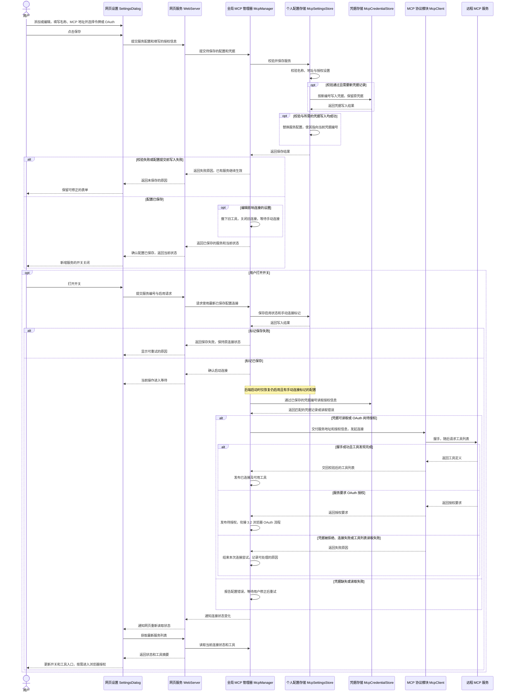
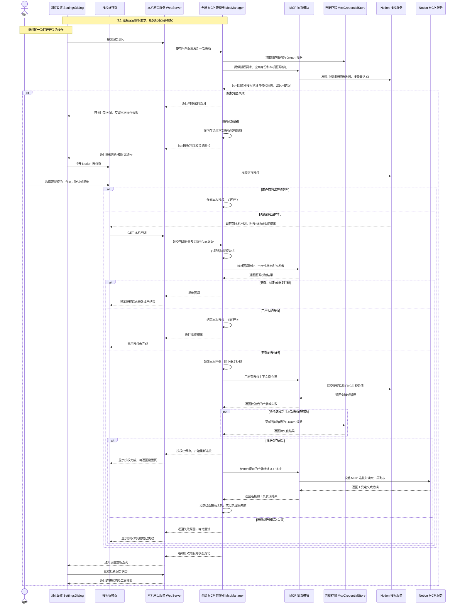
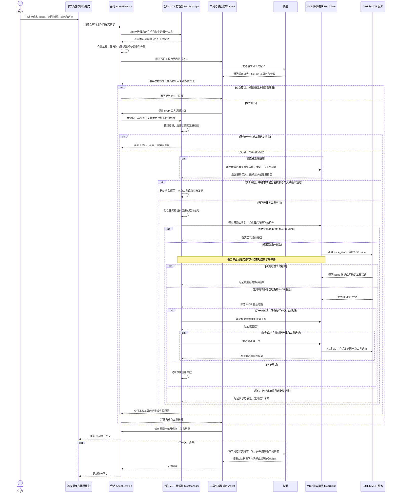
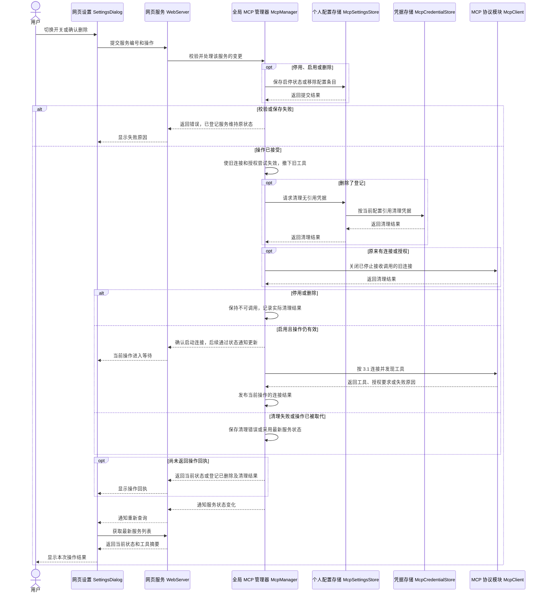

# 里程碑 2 Feature 5 MCP 客户端技术设计

**状态**　已按设计讨论中确认的方案实现，验证结果见[验收记录](./feature5-MCP客户端验收记录.md)。

## 1. 总结

用户在网页设置添加个人级远程 MCP 服务，保存后通过卡片右上角的开关发起连接。首版支持 Streamable HTTP、访问令牌和浏览器 OAuth。所有会话共用服务登记与连接，按会话权限使用远端工具。GitHub 验收连接和指定 Issue 的读取，Notion 验收浏览器授权和指定页面的读取。

独立 MCP 包处理协议。Coding Agent 的 `McpManager` 管理连接、目录及执行绑定，`McpSettingsStore` 保存服务配置。Credentials 单独保存令牌和 OAuth 状态。网页服务装配共享管理器并传递状态，Agent 沿用现有工具循环、权限检查、Hook 和结果记录。

## 2. 系统变化

**当前**　网页设置管理模型和网页工具的凭据。会话每轮把本地和个人扩展工具提供给模型，按原调用编号保存结果。 [SI 网页设置](../../../web/src/components/SettingsDialog.tsx#L58) · [SI 工具循环](../../../packages/coding-agent/src/agent-session.ts#L633)

**完成后**　设置卡片右上角使用 shadcn/ui 开关，右下角使用三点菜单，菜单包含编辑和删除。已就绪的工具通过 `direct` 进入获准的会话。后端重启时恢复已启用且发起过连接的服务。

## 3. 系统设计

启停意图和启动恢复条件写入配置文件，连接状态和工具目录由后端维护。网页以服务端的最新结果控制开关，连接状态通过开关呈现。

- 新增服务或保存会影响连接的修改后，开关关闭。只改名称时沿用已有连接。用户打开开关后，SI 检查凭据并查询工具，查询成功才显示开启。
- 需要用户同意 OAuth 时，从同一次开启操作准备并打开授权页。浏览器拦截时提供临时授权链接，授权成功后自动继续连接。连接或授权失败后，用户可再次打开开关重试。
- 已连接的服务意外断开时，后台立即发起共享恢复。暂时性故障最多追加两次重试。恢复期间开关保持开启，等待中的新工具调用共用恢复结果。重试耗尽或需要重新授权时，开关关闭并撤下工具。
- 用户主动关闭时撤下工具并取消等待中的连接、授权或恢复。之后由用户打开开关发起新连接。

下文的连接和授权步骤由开关串起，启停接口仍由服务端执行，网页通过状态通知刷新卡片。

### 3.1 保存并启动 MCP 服务

用户在网页设置添加或编辑远程服务。添加完成后，用户打开开关，SI 才发起远端握手并获取工具。



#### 网页设置 `SettingsDialog`

**职责**　提供保存、开关和三点菜单。网页打开设置、恢复连接或收到状态变更通知时，重新读取服务端列表。

**接口（新增 0 项，修改 1 项）**

- 【修改】`SettingsDialog`（设置界面）增加 MCP 板块。添加和编辑复用表单，服务端返回保存结果后更新列表。新服务的开关关闭，用户打开开关后才提交连接请求。回执丢失时先重读列表，核对是否已保存。编辑界面只显示凭据是否已配置，提交成功后清空凭据输入框。

**数据（新增 0 项，修改 0 项）**

- 【新增】`McpServerView`（归属 `WebServer`）供设置页显示状态、待授权操作和可用工具。

#### 网页服务 `WebServer`

**职责**　启动时装配一个全局 `McpManager`，由管理器加载已保存的服务，并在后台恢复符合条件的连接。网页启动无需等待远端连接完成。接收已授权网页的设置操作，向各页面提供真实状态。服务校验、登记及连接的管理交给 Coding Agent 的 MCP 接入层。

**接口（新增 5 项，修改 0 项）**

- 【新增】`POST /api/mcp/servers`（HTTP）将提交的名称、地址及授权参数交给应用层校验、保存和登记。重名或校验错误时返回可修正原因。保存成功后返回停用的条目。
- 【新增】`PUT /api/mcp/servers/:id`（HTTP）按服务编号编辑已保存条目。地址、授权方式或凭据改变时，保存成功后先撤下旧工具并结束旧连接，等用户再次打开开关。仅修改名称时保留连接，并按新名称更新工具目录。配置提交前失败时原配置仍有效。回执丢失或提交结果无法确认时，网页重新查询列表。
- 【新增】`PUT /api/mcp/servers/:id/enabled`（HTTP）按服务编号启用或停用当前配置。启用会在后台发起连接，网页随后读取状态。重复请求共用当前连接尝试。
- 【新增】`GET /api/mcp/servers`（HTTP）读取管理器的当前服务列表，生成网页可见的服务状态。网页可以用它核对保存结果，也可以在重新连上后端后恢复状态。
- 【新增】`mcp_settings_changed`（WebSocket 通知）告知各页面服务状态有更新，页面收到后重新发起查询。状态通知与保存回执先后不定，页面以最新查询结果为准。

**数据（新增 3 项，修改 0 项）**

- 【新增】`SaveMcpServerRequest` 用于添加或编辑，提交名称、地址和授权方式。选择访问令牌时填写对应服务的令牌，选择 OAuth 时先保存要使用的授权方式。编辑时可保留仍与当前地址和授权设置匹配的凭据。地址、授权方式或 OAuth 应用身份改变后，按新配置使用对应的凭据。
- 【新增】`McpServerView` 返回已保存的启停标记、当前连接状态、工具摘要及是否已保存访问凭据。OAuth 仅保存应用配置时仍显示未授权。凭据编号、令牌和 OAuth 密钥只供后端使用。
- 【新增】`mcp_settings_changed` 通知只携带事件类型。

**`McpServerView` 构造示例**

```typescript
const savedGitHub: McpServerView = {
  id: 'mcp-001',
  name: 'github',
  url: 'https://api.githubcopilot.com/mcp/x/issues/readonly',
  enabled: false,
  authMode: 'token',
  hasCredential: true,
  status: 'disabled',
  tools: [],
}

const connectedGitHub: McpServerView = {
  ...savedGitHub,
  enabled: true,
  status: 'connected',
  tools: [{ name: 'mcp__github__issue_read' }],
}
```

#### 个人配置存储 `McpSettingsStore`（拟新增）

**职责**　位于 Coding Agent 的 MCP 接入层，保存 `~/.agent-learning/mcp.json`，并协调配置和凭据两次写入。文件权限、加锁和原子替换沿用现有文件操作。

**接口（新增 3 项，修改 0 项）**

- 【新增】`listServers` 在后端启动时读取个人服务登记及手动连接标记。
- 【新增】`setEnabled` 在配置锁内一起更新启停和手动连接标记。只有配置持久化后才启动连接或撤下工具。

##### 【新增】`saveServer`（模块间调用）

**用途**　供管理器一次提交添加或编辑，保证连接使用同一次保存的服务配置和凭据。

**主要流程**　取得配置文件锁后，读取最新配置，校验名称、URL、重名和授权字段。新增服务或改变地址、授权方式、手填令牌或 OAuth 应用配置时，清除手动连接标记，并分配新的凭据编号，请 Credentials 先写入对应记录。更换地址后的令牌方式需要用户重新填写。OAuth 可以先保存尚未授权的记录，改地址或应用配置后需重新授权。仅改名称时沿用原凭据编号和手动连接标记。

用原子替换写入配置文件。替换成功时新配置和其凭据一同生效。写入中断时，重启后按配置文件里已经保存的编号选择凭据。替换前失败保留旧配置、旧凭据和当前连接。替换后，清理失败不回滚已保存配置。在启动或下次保存时，持配置锁重试清理未被引用的凭据。锁释放失败时按文件替换结果确认是否已提交，避免因清理报错把成功写入当作未保存。进程中断留下的文件锁沿用 SI 的人工恢复规则。

**数据（新增 1 项，修改 0 项）**

- 【新增】`StoredMcpServer` 保存稳定服务编号、名称、地址、启停设置、手动连接标记 `connectRequested`、授权方式、可选的 OAuth Client ID 和当前凭据编号。标记缺失时按尚未手动连接处理。OAuth 授权结果和刷新令牌更新沿用当前凭据编号及标记。连接状态和工具列表仅保存在管理器内存。

**`StoredMcpServer` 构造示例**

```typescript
const github: StoredMcpServer = {
  id: 'mcp-001',
  name: 'github',
  url: 'https://api.githubcopilot.com/mcp/x/issues/readonly',
  enabled: false,
  connectRequested: false,
  authMode: 'token',
  credentialRef: 'credential-001',
}
```

#### 凭据存储 `McpCredentialStore`（拟新增）

**职责**　位于独立 Credentials 包，负责 `~/.agent-learning/mcp-auth.json` 的读取和写入。文件只允许本机所有者读写，复用现有文件安全检查、加锁与原子替换。Coding Agent 决定当前服务用哪条记录。

**接口（新增 3 项，修改 0 项）**

- 【新增】`create` 为新凭据编号写入一条记录，并保留原凭据和其他服务的记录。
- 【新增】`load` 按编号读取，核对记录所属的服务、URL 和授权方式。缺失、损坏或不匹配时返回错误。
- 【新增】`prune` 根据配置文件当前引用的编号清理闲置记录。配置存储持有配置锁时调用，防止误删尚在保存流程中的凭据。OAuth 的后续写入只能更新已存在且绑定匹配的记录，避免迟到的回调重新创建被清理的凭据。

**数据（新增 1 项，修改 0 项）**

- 【新增】`StoredMcpCredential` 以凭据编号区分同一服务先后保存的记录，绑定服务编号、URL 与授权方式。记录保存手填访问令牌，或 OAuth 应用密钥、登记信息及授权令牌。OAuth 尚未授权时也有一条记录，供该服务完成授权后更新。

**`StoredMcpCredential` 构造示例**

```typescript
const githubCredential: StoredMcpCredential = {
  id: 'credential-001',
  serverId: 'mcp-001',
  url: 'https://api.githubcopilot.com/mcp/x/issues/readonly',
  authMode: 'token',
  accessToken: 'example-token',
}
```

#### 全局 MCP 管理器 `McpManager`（拟新增）

**职责**　位于 Coding Agent 的 MCP 接入层，持有已登记服务及其连接状态。用户发起连接后，把最新配置和凭据交给独立 MCP 模块。协议模块返回工具定义后，管理器发布已连接。连接失败时管理器释放客户端，并发布可处理的原因。

**接口（新增 5 项，修改 0 项）**

- 【新增】`saveServer` 串行接收网页提交，调用配置存储，在提交成功后发布登记变更。新增条目从停用开始。编辑影响连接的设置时立即撤下旧工具并结束旧连接，等待用户发起连接。只改名称时用同一连接重新登记工具名称。旧工具定义绑定原服务编号，避免同名工具被重新登记后执行到其他服务。
- 【新增】`setEnabled` 响应用户打开开关。先持久化当前配置的启用状态和手动连接标记，再调用 `McpClient` 建立连接并读取工具列表。连接失败时回到停用。过程中配置变化时丢弃旧尝试的状态和工具。
- 【新增】`start` 在后端启动时读取 `mcp.json`，仅在后台恢复已启用且有手动连接标记的服务。工具发现成功后发布可用工具。恢复失败或需要交互授权时回到停用。后端关闭、服务停用或连接配置变更时取消对应尝试，丢弃过期结果。
- 【新增】`listServers` 提供有效配置与运行状态，供 `WebServer` 生成服务状态。
- 【新增】`subscribe` 通知 `WebServer` 重新发布状态变更。

**数据（新增 1 项，修改 0 项）**

- 【新增】`McpServerRuntime` 持有当前客户端、应用连接状态和当前工具目录。MCP 服务返回的诊断经处理后才进入网页状态。
- 【新增】`StoredMcpServer`（归属 `McpSettingsStore`）供管理器使用当前配置和对应凭据建立连接。换地址或更新授权设置后，旧连接和旧授权尝试的结果只属于原配置。

#### MCP 协议模块 `packages/mcp/`（拟新增）

**职责**　通过远程 Streamable HTTP 与 MCP 服务交换协议消息，处理握手、工具查询、请求超时和取消。连接所需的地址与认证信息由调用方提供。

**接口（新增 3 项，修改 0 项）**

- 【新增】`McpClient.connect` 处理 MCP 握手，返回远端能力，或报告需要 OAuth 及其他连接错误。
- 【新增】`McpClient.listTools` 按协议查询工具并校验返回的定义，交给管理器登记。
- 【新增】`McpClient.close` 结束传输并清理仍在等待的协议请求。

**数据（新增 1 项，修改 0 项）**

- 【新增】MCP 工具定义包含远端工具名称、描述和参数结构。Coding Agent 接入层据此生成 SI 工具及网页摘要。

### 3.2 在浏览器授权并继续连接 Notion

用户在 §3.1 打开开关。如果 Notion 要求授权，同一次操作打开浏览器授权页。用户选择工作区并同意。SI 保存令牌后继续连接，工具发现成功时原设置页的开关才显示开启。



#### 网页设置 `SettingsDialog`

**职责**　响应开关发起的连接进入浏览器授权。设置页以服务端工具发现结果更新开关。

**接口（新增 1 项，修改 0 项）**

- 【新增】授权操作（页面回调）向后端发起授权，在新标签页打开返回的 URL，并隔离授权页对原设置标签页的访问。浏览器拦截自动打开时，在原设置页提供可点击的授权链接。用户在设置页选择取消时提交当前尝试编号。仅关闭 Notion 标签页时，后端在等待超时后结束本次操作，开关回到关闭。

**数据（新增 0 项，修改 0 项）**

- 【新增】`McpOAuthStartView`（归属 WebServer）供发起授权的页面打开链接和取消当前尝试。授权结果沿用 §3.1 的查询与通知。

#### 本机网页服务 `WebServer`

**职责**　发起和取消授权沿用已有网页认证。浏览器回调使用后端实际监听的 `127.0.0.1` 地址，例如 `http://127.0.0.1:3000/api/mcp/oauth/callback`。开发环境也回到后端端口。Pi 命令行按授权临时开本机监听，SI 复用已经运行的本机网页服务，保留同样的浏览器回环行为。

**接口（新增 3 项，修改 0 项）**

- 【新增】`POST /api/mcp/servers/:id/oauth`（HTTP）接收已认证设置页的操作，将服务编号和本机回调地址交给管理器。重复点击返回同一有效尝试。准备成功后只向发起页面返回授权链接和尝试编号，并禁止缓存。
- 【新增】`DELETE /api/mcp/servers/:id/oauth/:attemptId`（HTTP）接收已认证设置页的取消请求，只取消匹配的当前尝试。凭据已经提交时，网页查询实际授权结果。

##### 【新增】`GET /api/mcp/oauth/callback`（HTTP）

**用途**　接收授权服务通过浏览器送回的本次授权结果。

**主要流程**　现有网页入口会拒绝跨站请求，网页登录 Cookie 也使用 `SameSite=Strict`。回调在这两项检查前单独分流，仅允许后端实际监听的本机 Host 和已分配的确切 GET 回调路径，包括必要的签发者专属路径。回调凭本次短期有效的 `state` 和授权上下文完成验证。重复参数或同时带有授权码和拒绝结果的回调直接拒绝。其他 HTTP 和 WebSocket 入口沿用现有检查。回调携带的授权码、错误详情和校验参数只交给后端处理，响应使用固定结果文案、禁止缓存和 Referrer，日志不记录回调查询串。授权成功页在凭据写入后返回，原设置页负责显示最终连接状态。

**数据（新增 1 项，修改 0 项）**

- 【新增】`McpOAuthStartView` 包含尝试编号和用于打开 Notion 的授权 URL。授权 URL 只从发起接口返回，普通状态查询与 WebSocket 通知继续复用 §3.1 的数据。

#### 全局 MCP 管理器 `McpManager`

**职责**　协调同一服务的一次授权尝试，把临时授权与当前服务编号、凭据编号和连接尝试绑定。连接状态和可用工具仍统一向所有会话发布。

**接口（新增 3 项，修改 0 项）**

- 【新增】`startOAuth` 从当前待授权连接取得授权要求，调用协议模块准备授权链接。准备和等待期间合并同一服务的重复请求。回调等待上限采用 Pi 的 5 分钟。前端重新加载可查询服务状态，从设置重新打开仍有效的授权。
- 【新增】`finishOAuth` 在处理前匹配回调地址、签发者和当前尝试并一次领取回调。回调有效时调用协议模块换令牌。提交前再次核对当前服务仍启用、凭据编号和尝试仍匹配。最终校验与凭据写入同配置变更和取消串行，远端请求在锁外执行。保存成功后复用 §3.1 的连接与工具发现。发现失败时保留已保存凭据，用户可再次打开开关。凭据写入失败时重新发起授权，原授权码已用过。
- 【新增】`cancelOAuth` 响应显式取消、超时、连接相关配置被替换、停用、删除或后端关闭。取消后释放临时数据并中止等待，迟到结果无法发布。重启后符合恢复条件的服务重新连接。如果仍需要授权，开关回到关闭，等待用户再次打开。

**数据（新增 1 项，修改 0 项）**

- 【新增】`PendingMcpOAuth` 保存在后端内存，记录尝试编号、服务与凭据编号、协议模块返回的授权上下文、到期时间及处理状态。每条服务最多一项，取消、完成或到期后释放。浏览器回传的 `state` 用于关联本次授权，PKCE 校验值只留在后端，供换令牌时证明请求出自原客户端。

**`PendingMcpOAuth` 中的回调关联数据构造示例**

```typescript
const notionSignIn = {
  id: 'attempt-001',
  serverId: 'mcp-002',
  credentialRef: 'credential-002',
  expiresAt: '2026-11-18T06:55:00Z',
  status: 'awaiting_callback',
  authorization: {
    issuer: 'https://mcp.notion.com',
    resource: 'https://mcp.notion.com/mcp',
    redirectUri: 'http://127.0.0.1:3000/api/mcp/oauth/callback',
    state: 'example-state',
    codeVerifier: 'example-verifier',
  },
}
```

#### MCP 协议模块 `packages/mcp/`

**职责**　按 Pi 的两段式接口准备授权和兑换令牌，处理发现、客户端身份选择、PKCE 与令牌刷新。应用层提供回调地址和凭据读写接口。

**接口（新增 2 项，修改 0 项）**

- 【新增】`startMcpSignIn` 根据远端授权要求发现资源和签发者，核对 HTTPS 端点并限制凭据用途。按已确认的顺序使用预配置应用 ID、兼容的已有登记、SI 公开身份文件或动态登记。登记及令牌绑定签发者与资源。该接口生成一次性 `state` 和 PKCE S256 参数，返回授权链接、实际回调地址和后端校验信息。DCR 登记成功后可通过调用方存储复用。预配置的应用 ID 必须接受实际回调地址，身份文件也要声明对应回调。
- 【新增】`completeMcpSignIn` 检查授权请求和回调的 `state`、回调地址及签发者。Notion 声明会返回 `iss`，回调必须和发现的签发者一致。其他服务未声明支持 `iss` 时，为各授权服务使用独立回调路径并核对到达路径。换令牌仅使用本次授权确认的签发者、客户端身份、回调地址和资源，配合原 PKCE 校验值。后端网络请求有独立超时。
- 【沿用】`McpClient.connect`（§3.1 新增）复用现有令牌。令牌过期或被拒绝时，对同一凭据合并刷新。刷新成功用新令牌重试连接。刷新令牌失效或服务要求新增权限时，再由设置提示用户授权。刷新遭遇网络故障时报告连接失败，用户可直接重连。

**数据（新增 1 项，修改 0 项）**

- 【新增】`McpSignInRedirect` 由协议模块产生，包含浏览器授权地址、准确回调地址和本次协议上下文，由管理器用于核对和兑换。公开身份文件不适用时，Notion 可按已确认的顺序进入 DCR 分支。Notion 的公开身份文件和动态登记两条路径都已完成真实授权及工具调用。

#### 凭据存储 `McpCredentialStore`

**职责**　沿用 §3.1 的凭据编号和文件锁，在 `mcp-auth.json` 更新已有记录。用户授权成功后，服务配置文件无需改写。

**接口（新增 1 项，修改 0 项）**

- 【新增】`updateOAuth` 在凭据文件锁内确认记录存在且归属、模式和 URL 匹配，原子更新 OAuth 登记或令牌。应用接入层注入对当前编号的读写能力和同一凭据的刷新互斥。令牌更新保留同一登记的有效信息，仅在服务返回新刷新令牌时替换旧值。

**数据（新增 0 项，修改 0 项）**

- 【沿用】`StoredMcpCredential`（归属 Credentials）保存 OAuth 应用身份、签发者与资源、登记回调地址、访问令牌、刷新令牌和到期信息。临时校验值与授权码随当前授权尝试在内存结束。

### 3.3 Agent 调用 MCP 工具读取 GitHub Issue

GitHub 在 §3.1 完成连接和工具发现后，用户在普通权限的会话中请求读取指定 Issue。模型在当轮工具列表中看到 GitHub 的工具，Agent 调用远端，按原调用编号回填结果，模型据此答复标题、状态和链接。



#### 聊天页面与 `WebServer`

**职责**　沿用聊天消息和工具卡，用户可核对实际调用及其结果。设置中的连接状态仍由 §3.1 的接口提供。

**接口（新增 0 项，修改 0 项）**

- 【沿用】现有消息提交和会话订阅。按工具卡已有的失败显示呈现 MCP 错误，包含服务不可用或远端结果未知的原因。

**数据（新增 0 项，修改 0 项）**

- 【沿用】`ConversationMessage`（归属 Coding Agent）携带结果与原调用位置，刷新页面后仍能核对。

#### 会话与工具适配 `AgentSession`

**职责**　从共享管理器取得当前可用工具，把 MCP 定义和结果适配成 SI 的工具格式。会话继续负责权限、Hook 和历史记录。Pi 在 Coding Agent 把 MCP 工具包装为 Agent 工具，执行时再取当前连接。SI 用已确认的全局管理器处理连接。

**接口（新增 0 项，修改 2 项）**

- 【修改】会话每轮工具配置在现有本地及扩展工具之外，加入已连接服务的工具及正在后台恢复的服务上次发布的工具。沿用 Pi 的 `mcp__<服务名>__<工具名>` 命名和冲突消解，并校验与现有工具的重名。发生重名时保留已有工具，冲突的 MCP 定义不进入当轮列表。只读模式仍只提供 `read`、`grep`、`find`、`ls`。远端服务给出的只读提示无权扩大 SI 的只读权限。声明经过现有模型容量检查。
- 【修改】会话的工具准备与结果适配。沿用执行前 Hook，校验实际发送的参数，并提供本会话最新权限检查。结果优先按 MCP 内容块转换，只有结构化数据时转换为 JSON 文本。过大输出遵守现有工具结果限额，截断时明确告知模型。远端明确错误、取消和结果未知走现有失败通道。MCP 结果仍交给 `tool_result` Hook。MCP 原始失败和未知结果的语义保留到会话记录和下一轮模型请求，扩展可补充结果说明。

**数据（新增 0 项，修改 0 项）**

- 【沿用】`CodingTool` 承载模型可见的名称、描述、参数定义和执行入口。执行入口绑定管理器提供的真实工具。凭据和连接能力只留在后端。

#### 全局 MCP 管理器 `McpManager`

**职责**　发布服务的工具目录，调用时复查工具归属和当前连接。意外断开时立即发起后台恢复，并在恢复期间保留当前配置的工具定义。停用、删除、修改连接配置或手动替换连接时，撤下旧工具并结束旧连接等待。一个会话停止任务时，只取消该任务的调用及等待。

**接口（新增 2 项，修改 0 项）**

- 【新增】`listToolsForAgent` 返回已连接服务的工具，以及同一配置意外掉线且正在恢复的工具，由会话按权限选用。工具目录只存在后端内存。首次连接、重启恢复或编辑连接配置后仍需等工具发现成功才发布目录。需要用户重新授权时撤下服务的工具。
- 【新增】`callTool` 接收当轮绑定、实际参数、本次任务信号及会话权限检查。确认服务仍启用且工具绑定有效。旧工具列表中的调用不会转到同名的新服务或替换后的 URL。

  当前服务意外断开后，管理器立即发起共享重连。新调用等待同一次恢复，并在发送前核对最新工具和权限。恢复失败时本次调用按原编号回填错误。重试耗尽或需要重新授权时撤下工具，等待用户再次拨动开关。用户停止任务时结束该任务的等待，共享重连继续为其他会话服务。

  真正发送前复查任务、权限、服务及连接，按最新工具定义验证实际参数。工具已移除或参数无效时回填失败。若服务被停用、删除、编辑连接配置或手动替换连接，之前等待恢复的调用失效。

  协议模块确认远端拒绝了已过期的 MCP 会话时，管理器为同一份服务配置建立或复用正在恢复的新连接，重新发现工具。每次调用最多重试一次，重发前复查任务仍在运行、服务配置仍有效、当前权限允许且该工具仍可用，参数必须符合新连接返回的定义。使用原模型调用编号回填一次，重试使用新的 MCP 请求编号。其他已发出且未确认结果的调用回填「远端结果未知」，自动恢复连接也不会重发这些调用。迟到响应不能替换已回填的结果。

**数据（新增 1 项，修改 0 项）**

- 【新增】`McpToolBinding` 关联稳定服务编号、当前连接配置和管理器发布的工具定义。意外掉线后的后台恢复可在这份配置下更换底层连接。管理器核对绑定仍有效，再向当前连接发送原工具名。

#### MCP 协议模块 `packages/mcp/`

**职责**　通过现有连接发送 `tools/call`，管理传输请求编号、响应匹配和中止。会话调用编号仍由 Agent 使用。

**接口（新增 1 项，修改 0 项）**

- 【新增】`McpClient.callTool` 接收远端工具名、参数、取消信号与发送前检查。取得授权头后，在发出请求前完成最后检查。调用返回通过协议校验的工具结果或可处理的失败。沿用 Pi，当使用有会话的 Streamable HTTP 协议，携带有效格式的 `MCP-Session-Id` 的请求收到协议规定的 HTTP 404 时，报告 MCP 会话过期。工具内部返回的资源未找到错误走普通失败通道。请求发出后超时、断线或取消时，释放本地等待，有协议支持时发送取消通知。调用结果未确认时不自动重发。

**数据（新增 1 项，修改 0 项）**

- 【新增】`CallToolResult` 保存校验过的远端内容与错误状态，交给 Coding Agent 转换。下面是 GitHub 单条 Issue 读取的参数构造示例。正式验收使用指定真实 Issue，字段以实际工具定义为准。

```typescript
const issueReadArguments = {
  method: 'get',
  owner: 'example-org',
  repo: 'example-repo',
  issue_number: 42,
}
```

#### 工具与模型循环 `Agent`

**职责**　沿用正常工具循环，用同一轮的可执行工具处理模型返回的调用。通过原编号记录失败或成功并继续生成。

**接口（新增 0 项，修改 0 项）**

- 【沿用】`Agent.run` 的工具集合、执行前检查、结果改写和保存接口。MCP 错误沿用当前失败通道，网页和下一轮模型收到与原调用配对的结果。任务被用户取消后停止发起下一次模型请求。

**数据（新增 0 项，修改 0 项）**

- 【沿用】`ToolCall`、`ToolResultMessage`（归属模型包）。Agent 用模型发出的调用编号配对工具结果，MCP 协议请求编号留在协议层。

### 3.4 从设置启用、停用或删除服务

用户从设置对一个服务操作，后端修改这条服务的全局状态，并通知各页面刷新。同一个后端中的所有会话在发出调用时遵守最新状态。



#### 网页设置 `SettingsDialog`

**职责**　对已保存服务提供启停开关与三点菜单。菜单只提供编辑和删除。删除前确认服务名及本机凭据的清理。开关以服务端状态显示操作结果。

**接口（新增 0 项，修改 0 项）**

- 【沿用】`SettingsDialog`（§3.1 修改）在提交启停或删除后重新查询登记和连接状态。删除回执指出清理失败时，在设置显示相应说明。

**数据（新增 0 项，修改 0 项）**

- 【沿用】`McpServerView`（归属 WebServer）供界面显示启停状态、连接状态及清理失败原因。

#### 网页服务 `WebServer`

**职责**　把经认证的设置操作转交给共享管理器。配置提交和后续连接清理分别反馈，网页和其他已打开页面沿用现有通知重新查询。

**接口（新增 3 项，修改 0 项）**

- 【新增】`PUT /api/mcp/servers/:id/enabled` 保存启停目标。相同目标的重复请求返回当前状态，避免重复建连。
- 【新增】`POST /api/mcp/servers/:id/reconnect` 兼容早期客户端的重连接口。网页使用启停开关。
- 【新增】`DELETE /api/mcp/servers/:id` 移除该服务的个人登记。重复删除已不存在的同一编号视为已删除，同名的新登记使用新的服务编号。

**数据（新增 1 项，修改 0 项）**

- 【沿用】`McpServerView`（§3.1 新增）在本节使用已保存的启停状态，并用连接结果控制开关。清理错误只返回脱敏说明。
- 【新增】删除回执表示服务登记已移除，附带需要向用户展示的脱敏清理错误。列表依据已提交的配置移除服务。

#### 全局 MCP 管理器 `McpManager`

**职责**　沿用 DSH 的顺序，先让旧实例失去发布与发送权限，再处理异步清理。Pi 用同样的先保存再启停顺序，SI 的状态对整个后端生效。

**接口（新增 3 项，修改 0 项）**

- 【新增】`setEnabled` 提交启停配置后立即更新内存登记。停用撤下工具、取消等待中的授权，并使新请求无法发往旧客户端。仍在等待远端结果的调用按 §3.3 回填。启用后等旧连接完成清理，复查最新状态，再按 §3.1 发起连接。连接失败时回到停用，等待用户再次打开开关。
- 【新增】`reconnectServer` 保留登记和凭据，使旧连接的调用入口失效，完成清理后并入同一套连接流程。等待期间如果服务被停用、删除或编辑了影响连接的字段，旧重连不会发布结果。清理超时或失败时报告原因，保持工具撤下，确认本地资源已释放后才建立替换连接。
- 【新增】`removeServer` 在配置删除提交后移除登记并撤下所有会话的工具，取消授权和本地等待，清理旧连接。已提交的删除在清理失败时仍生效，错误随删除回执反馈。删除操作的作用范围是 SI 的该服务登记与本机凭据。

**数据（新增 0 项，修改 0 项）**

- 【沿用】`McpServerRuntime`（§3.1 新增）记录当前连接、清理结果和共享的连接尝试。保存与切换状态串行，网络连接与关闭在锁外等待。迟到回调先核对当前登记和尝试，避免覆盖后续操作。正在执行的旧请求按 §3.3 收尾。

#### 配置与凭据存储

**职责**　`McpSettingsStore` 提交配置变更，`McpCredentialStore` 清理配置已不再引用的凭据。停用和重连继续使用原来的凭据编号。

**接口（新增 2 项，修改 0 项）**

- 【新增】`McpSettingsStore.setEnabled` 持配置文件锁一起更新启停标记和手动连接标记。只有配置提交后管理器才切换可用状态。启用和重连继续按本节发起连接，启动恢复资格由 §3.1 的手动连接标记决定。
- 【新增】`McpSettingsStore.removeServer` 持配置文件锁移除登记，提交后触发无引用凭据清理。清理失败时由启动或下一次保存重新尝试，已删除的凭据编号不能被连接或授权流程再采用。
- 【沿用】`McpCredentialStore.prune`（§3.1 新增）。凭据写入与清理都持凭据文件锁。清理期间原授权尝试不能为已删除服务创建凭据。

**数据（新增 0 项，修改 0 项）**

- 【沿用】`StoredMcpServer` 和 `StoredMcpCredential`。删除后的凭据清理以成功提交的配置引用为准。

#### MCP 协议模块 `packages/mcp/`

**职责**　沿用已设计的连接、发现与关闭能力。服务登记、启停与删除由调用方管理。

**接口（新增 0 项，修改 0 项）**

- 【沿用】`McpClient.connect`、`listTools` 和 `close`（§3.1 新增）。关闭释放本地请求和传输资源，调用方根据结果决定是否能启用替换连接。

**数据（新增 0 项，修改 0 项）**

- 【沿用】协议层连接状态和工具定义。

## 4. 技术决策

### 【功能决策｜全局管理、网页设置】个人服务由共享后端管理

Pi 随会话建连和关闭。SI 参考 DeepSeek Harness，在会话外装配共享管理器，统一处理登记和启停。设置故障或停用会影响使用同一服务的所有会话，单个任务停止只取消它自己的请求。网页用 `mcp_settings_changed` 重新查询状态。扩展使用现有工具 Hook，扩展登记及 `mcp_servers_change` 转入后续评估。 [Pi 会话生命周期](../../../pi/packages/coding-agent/src/extensions/mcp/index.ts#L1115) · [DSH 共享装配](../../../deepseek-harness/packages/bundle/web-app/cordis.patch.yml#L149) · [后续待办](../../设计妥协记录.md#milestone-2-feature-5-mcp)

### 【工程决策｜MCP、Coding Agent、Credentials】协议和本机存储分工

参考 Pi 独立 MCP 包和 Coding Agent 的接入职责。SI 的 Credentials 包独立存在，复用文件权限检查、锁和原子替换。服务配置在 `~/.agent-learning/mcp.json`。手填访问令牌、OAuth 应用密钥、登记和令牌在 `~/.agent-learning/mcp-auth.json`。涉及新凭据时，先写新编号，再原子切换配置引用。 [Pi MCP 包](../../../pi/packages/mcp/README.md) · [Pi OAuth 存储接口](../../../pi/packages/mcp/src/oauth/provider.ts#L21) · [Pi 应用侧凭据](../../../pi/packages/coding-agent/src/extensions/mcp/oauth.ts#L65) · [SI 文件替换](../../../packages/credentials/src/credential-file.ts#L104)

### 【功能决策｜网页设置、MCP 协议】首版远程传输和 OAuth 身份

首版使用远程 Streamable HTTP，支持访问令牌及浏览器 OAuth。OAuth 优先使用用户配置的应用 ID，其次复用已匹配签发者、资源及回调的登记。需要新身份时，先用适用的 SI 公开 HTTPS 身份文件（CIMD），再用服务支持的动态登记（DCR）。SI 使用现有本机网页服务接收回调。SI 默认使用生产公网上的身份文件，Notion 已分别验证公开身份和动态登记流程。 [SI 公开身份文件](https://si-mcp-identity.vercel.app/oauth/client.json) [Pi 身份选择](../../../pi/packages/mcp/src/oauth/flow.ts#L377) · [Pi 回调接口](../../../pi/packages/mcp/src/oauth/sign-in.ts#L185) · [MCP 客户端登记规范](https://modelcontextprotocol.io/specification/2026-07-28/basic/authorization/client-registration) · [Notion 官方接入](https://github.com/makenotion/notion-cookbook/blob/main/docs/mcp-client-integration.md) · [Notion 授权元数据](https://mcp.notion.com/.well-known/oauth-authorization-server)

协议连接和错误识别以双方使用的协议版本为准。带会话编号的 Streamable HTTP 服务按该版本的会话过期规则恢复。无协议会话编号的版本沿用普通连接和工具错误处理。 [MCP 会话管理](https://modelcontextprotocol.io/specification/2025-11-25/basic/transports#session-management) · [2026-07-28 协议变更](https://blog.modelcontextprotocol.io/posts/2026-07-28/)

### 【工程决策｜会话、MCP 管理器】直接声明工具并在后台恢复

采用 Pi 的 `direct`。连接时发现工具，后续模型请求从内存取定义。确认掉线后立即尝试恢复，恢复期间保留工具入口。暂时性故障最多再试两次，新调用等待同一次恢复，耗尽后撤下工具。工具失败按原编号回填，模型可以继续决策。明确的 MCP 会话过期可恢复后重试原调用一次。已发出但无确认结果的调用保留「远端结果未知」。停用、换配置或任务停止时阻止尚未发出的请求。 [Pi 工具提供](../../../pi/packages/coding-agent/docs/mcp.md#control-tool-exposure) · [Pi 工具适配](../../../pi/packages/coding-agent/src/extensions/mcp/tools.ts#L249) · [Pi 断线恢复](../../../pi/packages/coding-agent/src/extensions/mcp/runtime.ts#L422) · [Pi 会话过期重试](../../../pi/packages/coding-agent/src/extensions/mcp/runtime.ts#L276)

### 【功能决策｜全局管理、会话】重启恢复遵守手动连接

后端仅恢复已启用、且当前配置已手动打开开关的服务。网页和聊天可在此期间正常使用。后台工具发现未完成时，该服务的工具尚未加入模型请求。仅改名保留标记，修改连接或授权设置时清除标记。 [Pi 启动连接](../../../pi/packages/coding-agent/src/extensions/mcp/index.ts#L1115) · [SI 后端入口](../../../packages/server/src/webserver/index.ts#L193)

## 5. 风险与边界

### 两份文件只有一份写入成功

- **案例**　新令牌已写入，配置文件替换失败，也可能在两个步骤之间退出。
- **解决方案**　配置文件的凭据编号决定生效版本。替换前保留原引用，替换后使用新记录。清理失败保留已提交结果，后续持锁清理无引用记录。

### 回调迟到或配置已变更

- **案例**　用户在 Notion 授权页停留期间，SI 已取消本次授权或换了服务 URL。
- **解决方案**　按一次性状态、签发者、回调地址及当前配置验证，提交令牌前复查尝试和凭据编号。回调入口限定本机地址及对应的 GET 路径，其他接口继续使用现有浏览器认证。

### 发送过的工具请求失去响应

- **案例**　共享连接断开，SI 无法判断远端是否完成了写操作。
- **解决方案**　按原编号记录「远端结果未知」。恢复连接供新调用使用。只有协议确认旧 MCP 会话过期时，才按 §3.3 重试一次。

### 两家服务同时启用超过模型容量

- **案例**　`direct` 将 GitHub 和 Notion 工具定义加入每轮模型请求，工具参数结构可能推高输入长度。
- **解决方案**　沿用现有容量校验，显示明确失败原因。记录真实工具定义占用，达到需要时评估 Pi 的按需工具发现。 [SI 请求容量检查](../../../packages/coding-agent/src/agent-session.ts#L658) · [后续待办](../../设计妥协记录.md#首版使用-direct-提供工具)

## 6. 验收标准

见[独立验收标准](./feature5-MCP客户端验收标准.md)。受控用例验证保存与连接分离、启动恢复、OAuth、全局启停、权限、掉线和结果回填。真实用例通过网页入口连接 GitHub，读取指定 Issue 并核对标题、状态和链接。Notion 用真实浏览器授权后读取指定页面，核对标题和链接。受控和真实用例的实际结果见[验收记录](./feature5-MCP客户端验收记录.md)。

## 7. 文件变更

路径为拟议分工，实施时按实际包导出与调用位置核对。

### MCP 协议模块

| 文件 | 类型 | 用途 | 变更 |
| --- | --- | --- | --- |
| `packages/mcp/package.json`、`packages/mcp/tsconfig.json`、`packages/mcp/src/index.ts` | 新增 | 独立工作区与协议入口 | 提供 Streamable HTTP 客户端和 OAuth 接口 |
| `packages/mcp/src/client.ts`、`packages/mcp/src/streamable-http.ts` | 新增 | 远端协议交互 | 建连、工具发现、调用、过期识别和取消 |
| `packages/mcp/src/oauth.ts` | 新增 | OAuth 协议 | 发现、身份选择、授权码兑换和刷新 |
| `packages/mcp/test/client.test.ts`、`packages/mcp/test/oauth.test.ts` | 新增 | 协议测试 | 核对请求匹配、授权和协议错误 |

### MCP 管理与会话

| 文件 | 类型 | 用途 | 变更 |
| --- | --- | --- | --- |
| `packages/coding-agent/src/mcp/settings.ts` | 新增 | 个人服务登记 | 配置提交、凭据编号切换及启动恢复标记 |
| `packages/coding-agent/src/mcp/manager.ts`、`packages/coding-agent/src/mcp/oauth.ts` | 新增 | 共享连接和授权尝试 | 启停、目录、重连、授权等待和提交 |
| `packages/coding-agent/src/mcp/tools.ts` | 新增 | 工具适配 | 将远端定义和结果接入现有工具链 |
| `packages/coding-agent/src/agent-session.ts`、`packages/coding-agent/src/index.ts` | 修改 | 会话工具和装配入口 | 现有本地与扩展工具 → 并入全局 MCP 工具，沿用任务和结果记录 |
| `packages/coding-agent/test/mcp.test.ts` | 新增 | 管理器与会话验证 | 核对存储失败、全局启停、调用及恢复 |

### Credentials

| 文件 | 类型 | 用途 | 变更 |
| --- | --- | --- | --- |
| `packages/credentials/src/mcp-credentials.ts`、`packages/credentials/test/mcp-credentials.test.ts` | 新增 | MCP 凭据及测试 | 保护本机凭据，按编号读写并清理无引用记录 |
| `packages/credentials/src/index.ts` | 修改 | 包装配入口 | 现有凭据入口 → 提供 MCP 凭据存储 |

### 网页服务

| 文件 | 类型 | 用途 | 变更 |
| --- | --- | --- | --- |
| `packages/server/src/webserver/index.ts`、`packages/server/src/webserver/protocol.ts` | 修改 | 后端装配和网页协议 | 增加共享 MCP 管理、状态查询与通知 |
| `packages/server/src/webserver/mcp.ts` | 新增 | MCP 设置 HTTP 与 OAuth 回调 | 验证设置请求和本机回调，报告真实状态 |
| `packages/server/test/mcp.test.ts` | 新增 | 后端入口测试 | 覆盖启动恢复、设置变更通知和 OAuth 回调认证边界 |

### 网页设置

| 文件 | 类型 | 用途 | 变更 |
| --- | --- | --- | --- |
| `web/src/components/SettingsDialog.tsx`、`web/src/chat/client.ts`、`web/src/pages/ChatPage.tsx` | 修改 | 设置操作和同步 | 现有设置 → 增加 MCP 设置与状态刷新 |
| `web/src/i18n/zh-CN.ts`、`web/src/i18n/en.ts` | 修改 | 设置文案 | 增加表单、状态及错误提示 |
| `web/src/components/SettingsDialog.browser.test.tsx` | 修改 | 设置组件测试 | 增加保存、手动连接、授权和状态显示场景 |
| `web/tests/e2e/mcp.live.spec.ts` | 新增 | 真实服务验收 | GitHub 连接和 Issue 读取、Notion 授权及页面读取 |

### 其他

| 文件 | 类型 | 用途 | 变更 |
| --- | --- | --- | --- |
| `package.json`、`package-lock.json`、`packages/coding-agent/package.json` | 修改 | 依赖与构建顺序 | 增加协议工作区及 Coding Agent 的依赖，纳入校验 |
| `scripts/dev-server.mjs` | 修改 | 开发服务监视 | 将新增协议包纳入现有开发监视 |
| `feature5-MCP客户端技术设计.md`、`feature5-MCP客户端验收标准.md` | 新增 | 设计与验收 | 固化首版范围、状态变化和验证方法 |
| `feature5-设计讨论记录.md`、`../README.md`、`../../设计妥协记录.md` | 修改 | 决策、里程碑与待办 | 同步确认结果及后续评估 |
| `../feature4/feature4-设计讨论记录.md`、`../feature4/feature4-Hook机制与文件保护技术设计.md` | 修改 | 前置 Hook 范围 | 同步 MCP 首版的扩展边界 |
