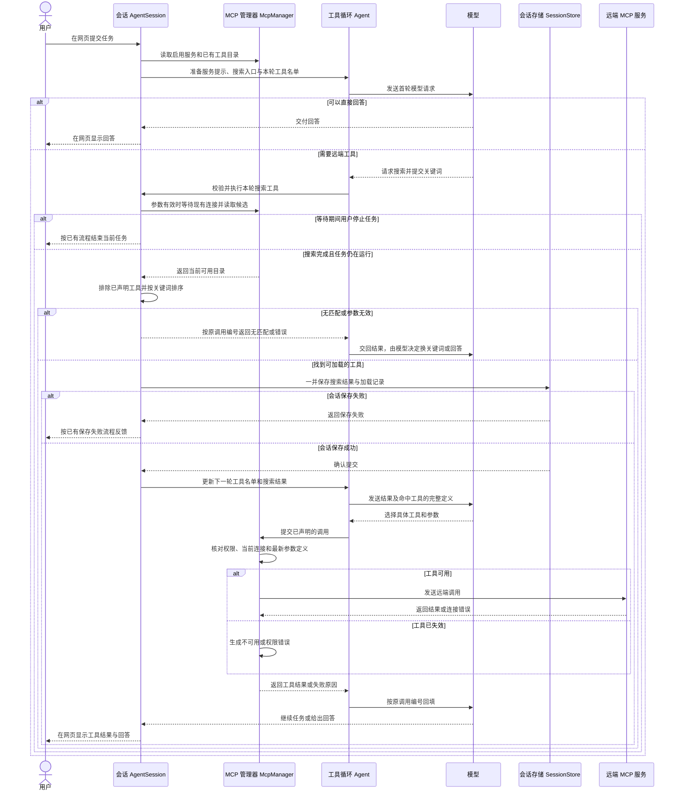
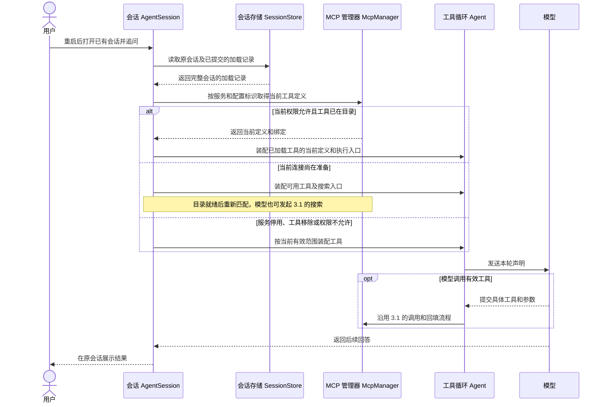
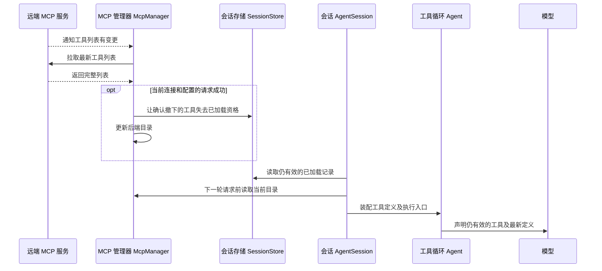

# 里程碑 2 Feature 5 MCP 工具渐进式披露技术设计

**状态**　已实现，实际结果见[验收标准的执行说明](./feature5-MCP工具渐进式披露验收标准.md#执行说明)。

## 1. 总结

**需求理解**　用户在网页启用多个 MCP 服务后，普通聊天和工具任务的首轮请求应省去尚未加载的远端工具定义。模型需要某项远端能力时，自行搜索可用工具，拿到参数定义后调用。后续对同一事项的追问可以继续使用已经加载的工具。服务不可用、会话权限变化和任务取消继续由 SI 的现有权限及运行机制处理。

**技术方案**　采用 Pi 终端的 `deferred` 行为。MCP 管理器保留完整的本机工具目录。会话在系统提示里提供简短的服务目录，在模型工具名单里提供 `tool_search` 和已经加载的工具。搜索在后端按 Pi 的关键词规则排序，默认最多选 8 项。成功加载的工具按会话保存，后续请求从当前目录取完整定义和执行入口。

## 2. 系统变化说明

**Before**　普通会话的每次模型请求都带上当前可用的 MCP 工具定义，系统提示还会列出每个工具的名字和短提示。GitHub 与 Notion 同开的一次真实验收中，SI 估算工具定义合计占 61,405 tokens，包含内置工具。[现有请求组装](../../../packages/coding-agent/src/agent-session.ts#L204) · [验收记录](./feature5-MCP客户端验收记录.md#真实服务验证)

**After**　新会话首轮带内置和获准的扩展工具。存在启用且当前权限允许使用的 MCP 服务时，再带简短的服务提示和 `tool_search`。模型可以直接回答。若它查找工具，SI 只给下一次请求加入命中项的完整定义。后续消息沿用同一会话已经加载且当前有效的工具。

## 3. 系统设计

### 3.1 首次搜索、加载和调用 MCP 工具

用户在新会话提出普通问题或远端任务，模型按需要从首轮请求发起工具搜索，随后直接调用具体的 MCP 工具。



#### 会话与工具搜索 AgentSession

**职责**　决定每轮模型可以看见和执行的工具。在普通模式下提供 `tool_search`。搜索逻辑在 Coding Agent 内使用本机目录排序，远端工具的调用继续使用已有执行入口。

**接口（新增 1 项，修改 1 项）**

##### 【新增】`tool_search`（模型工具）

**用途**　让模型按任务要求发现尚未声明的工具。

**主要流程**　接收非空 `query` 及可选的正整数 `limit`，省略时默认 8。等待搜索范围内已启动的连接准备后，取当前权限允许且本轮尚未声明的工具。按 Pi 的排序取匹配项。返回命中名称和描述首行，通过现有工具执行结果的内部明细携带待提交的加载标识。无匹配时可换关键词。参数无效、提交前中止、执行被拦截或最终工具结果失败时，本次搜索的新增加载为零。有效结果确认保存后，会话更新已加载集合。

- 【修改】每轮工具装配由 `availableTools` 与 `configure` 承担。仅在搜索入口实际提供时，系统提示列出服务名、入口和可用的一行简介。结构化工具名单含原有工具、搜索入口及当前有效的已加载 MCP 工具。普通模式提供 MCP 搜索和调用，计划与只读模式沿用权限限制。内置搜索入口按现有扩展保留名规则保护。执行名单与声明在请求前一起定稿。

**数据（新增 1 项，修改 0 项）**

- 【新增】搜索输入。模型提交关键词及可选的本次结果数量。排序的候选目录来自 MCP 管理器，响应的每项为模型调用名和一行说明。

构造示例

```typescript
const toolSearchInput = { query: 'github read issue' }
```

#### MCP 管理器 McpManager

**职责**　提供查找工具所需的服务和目录状态，并向当前连接提交真正的 MCP 调用。

**接口（新增 1 项，修改 0 项）**

- 【新增】服务发现视图（模块间调用）。给会话提供启用服务的名称、可用简介和已有连接准备状态。会话可在实际搜索时等待已有连接，用户停止仅结束本次等待。授权等待由设置页处理。
- 【沿用】`listToolsForAgent` 返回已有工具及绑定。连接首次完成工具发现后目录才可用于搜索。同配置正在后台恢复时保留已有目录。
- 【沿用】`callTool` 在发送前按当前目录复查工具及参数，见 §3.3。发现掉线时沿用已实现的后台恢复。明确的 MCP 会话过期沿用已有的单次重试规则。

**数据（新增 1 项，修改 0 项）**

- 【新增】服务发现视图由管理器维护。配置启用后即可提供服务名。握手返回 `initialize.instructions` 时，取首行作为远端提供的简介。渲染时按服务数据处理，按照 Pi 的每条简介 250 字符和整段 4,096 字符限制裁剪。完整目录留在后端。
- 【沿用】`McpToolBinding` 提供当前工具定义和有效绑定。搜索读取名称、描述、参数字段及说明、服务元数据。实际声明与执行以每轮取得的当前绑定为准。

#### 工具循环 Agent 与模型适配

**职责**　使用同一次模型请求的执行名单匹配调用，按原编号保存和回填工具结果。模型适配器发送当前工具的名称、描述和参数规则。

**接口（新增 0 项，修改 0 项）**

- 【沿用】`resolveTools`、工具结果检查点与模型请求入口。搜索激活的目标从下一轮开始可调用。模型在同一批顺带调用此前未声明的工具时，现有工具查找会拒绝该调用。

**数据（新增 0 项，修改 0 项）**

- 【沿用】`ModelContext.tools` 和 `ToolResultMessage`。搜索结果正文和真实工具结果都沿用原调用编号。完整参数定义通过结构化工具声明发送。

#### 会话存储 SessionStore

**职责**　在现有工具结果事务里提交搜索命中的加载记录。提交失败走已有会话保存失败流程。

**接口（新增 0 项，修改 1 项）**

- 【修改】`save` 的工具结果写入。检查点将搜索的有效加载项与对应的成功工具结果在同一个 SQLite 事务提交。多次成功搜索对同一会话去重累加。提交成功后，会话才应用这次选择。

**数据（新增 1 项，修改 0 项）**

- 【新增】会话 MCP 工具加载记录。由会话存储持有，关联会话、原搜索结果、服务及连接配置的稳定标识、远端原始工具名。会话据此恢复加载意图，实际定义重新从目录取得。连接配置标识使用后端已有的不透明引用，加载记录仅用于内部装配。

构造示例

```typescript
const savedMcpToolLoad = {
  sessionId: 'session-001',
  searchResultMessageId: 'message-004',
  serverId: 'server-001',
  credentialRef: 'config-001',
  remoteToolName: 'issue_read',
}
```

### 3.2 后续消息与重启恢复已加载工具

用户继续已有会话，SI 用保存的加载记录和当前可用目录装配工具，最新权限与连接状态决定调用能否发出。



#### 会话与工具搜索 AgentSession

**职责**　跨用户消息复用成功加载的记录。开启请求前匹配当前权限与目录，压缩只改变发给模型的历史消息。

**接口（新增 0 项，修改 0 项）**

- 【沿用】§3.1 的每轮工具装配。服务停用时移出调用名单。同一配置重新启用后，只恢复当前目录仍提供且加载资格有效的工具。配置被替换时，旧记录无法匹配新的配置标识。后台等待中的恢复记录随下一轮重新匹配。

**数据（新增 0 项，修改 0 项）**

- 【沿用】§3.1 的已加载记录只归属原会话。历史里的搜索文本和旧工具结果继续作为对话历史使用。

#### 会话存储 SessionStore

**职责**　恢复同一会话已提交的工具加载状态。

**接口（新增 1 项，修改 0 项）**

- 【新增】`listMcpToolLoads` 读取该会话当前有效的加载记录。会话在装配本轮工具时读取，已打开的会话也能得到同步撤下后的结果。没有加载记录的旧会话按空集合恢复。

**数据（新增 0 项，修改 0 项）**

- 【沿用】§3.1 的会话加载记录。记录独立于上下文压缩的历史切片。

### 3.3 远端工具更新与发送前复查



#### MCP 管理器 McpManager

- **刷新目录**　收到 `notifications/tools/list_changed` 后拉取完整的 `tools/list`。每条连接同一时间只跑一次列表请求。刷新期间再次收到通知，将这些通知合并成一次后续刷新。只有当前连接及当前配置下的成功响应可以更新目录。刷新失败时保留上一次成功的目录。有些服务不发通知，SI 仍会在连接或重连时拉取。下一轮模型请求从更新后的目录读取名称、描述和参数定义。已加载工具只改了定义时，可以继续直接调用。
- **暂时掉线**　沿用 SI 的后台重连，保留已加载记录。重连成功后按返回的新目录重新匹配。刷新失败和暂时掉线都不触发撤下处理。
- **发送前复查**　模型可能已经拿着旧定义填好了参数。沿用 `callTool` 的发送前检查，从当前目录核对工具仍在、参数仍有效，并复查权限与绑定。工具已撤下或参数不符合新定义时，拦下请求，按原调用编号回填失败，模型下一轮可以据此重选工具或修正参数。已经发往远端的调用沿用原结果处理，目录刷新不会触发重发。

#### 会话存储 SessionStore

- **确认撤下**　首次发现、重连或收到通知后的刷新成功时，`reconcileMcpToolLoads` 用完整列表核对该服务及配置下已加载的工具。将目录中缺失的工具从各会话的有效加载记录移除，保留原搜索与调用历史。这一步覆盖未打开的会话和后端重启后的首次发现。已打开的会话也用更新后的有效记录装配工具。该工具以后同名上架，重新搜索后才会重新加载。
- **服务端接入**　由 WebServer 接上已有的 SessionStore。McpManager 只在接受当前连接的成功目录时提交核对，再发布新目录。[SI 会话存储与 MCP 管理器启动](../../../packages/server/src/webserver/index.ts#L244-L281)

## 4. 技术决策

### 【功能决策｜会话与工具搜索】采用 Pi 的 deferred 搜索与下一轮调用

沿用 Pi 本地关键词排序。精确工具名优先，其次比较关键词覆盖和 BM25 文本相关性。搜索材料包括工具名、描述、参数字段及其说明、服务元数据。每次搜索默认最多 8 项，支持模型显式传入正整数。命中加入下一轮工具声明，模型直接使用对应工具参数。首次发现通常增加一次模型请求。Pi 终端默认的 MCP 开放方式是 `codemode`，本功能采用 Pi 提供的 `deferred` 分支。[Pi 工具开放方式](https://github.com/earendil-works/pi/blob/9b88b94e2c48086f38002d551dc8e0343923505e/packages/coding-agent/docs/mcp.md#control-tool-exposure) · [Pi 搜索规则](https://github.com/earendil-works/pi/blob/9b88b94e2c48086f38002d551dc8e0343923505e/packages/coding-agent/src/extensions/tool-search/tool.ts#L127-L259) · [Pi 搜索与加载](https://github.com/earendil-works/pi/blob/9b88b94e2c48086f38002d551dc8e0343923505e/packages/coding-agent/src/extensions/tool-search/tool.ts#L291-L346)

### 【工程决策｜会话与模型适配】借用服务级提示，沿用 SI 结构化工具字段

Pi 的提示词给出服务名、使用方式和可选一行简介。它的历史可以记录结构化工具增减，部分模型适配器可以按对话位置声明工具。SI 复用已有 `ModelContext.tools`，每轮提交当前声明，系统提示正文只承载服务级信息。连接完成前可提供服务名。首次搜索沿用 Pi 的等待时机，等待已启动的连接准备并支持停止任务。SI 使用现有的共享后台重连。[Pi 服务提示](https://github.com/earendil-works/pi/blob/9b88b94e2c48086f38002d551dc8e0343923505e/packages/coding-agent/src/extensions/mcp/index.ts#L156-L221) · [Pi 搜索前等待](https://github.com/earendil-works/pi/blob/9b88b94e2c48086f38002d551dc8e0343923505e/packages/coding-agent/src/extensions/mcp/index.ts#L1177-L1209) · [SI 请求结构](../../../packages/model/src/types.ts#L140)

### 【工程决策｜会话存储与 MCP 管理器】在 SI 线性会话中保存加载记录

Pi 从当前分支恢复加载状态，压缩前的记录也参与恢复。SI 用 SQLite 按会话保存线性消息，在成功工具结果的事务中写入私有加载记录。恢复时先核对稳定服务和配置标识，再用实时目录解析工具。Pi 会在新一轮对话开始时清掉仍未注册的待恢复项。SI 在目录准备期间继续保留有效的加载记录，目录到位后再匹配。[Pi 会话恢复](https://github.com/earendil-works/pi/blob/9b88b94e2c48086f38002d551dc8e0343923505e/packages/coding-agent/src/core/agent-session.ts#L1900-L1944) · [Pi 新任务的恢复边界](https://github.com/earendil-works/pi/blob/9b88b94e2c48086f38002d551dc8e0343923505e/packages/coding-agent/src/core/agent-session.ts#L1978-L1982) · [SI 会话存储事务](../../../packages/coding-agent/src/session-store.ts)

### 【工程决策｜MCP 管理器】沿用 Pi 的目录变更处理，补齐 SI 的并发与发送边界

Pi 收到通知后刷新工具列表并重新注册定义。它把临时断开记录为连接状态，把服务明确撤下的工具标为隐藏。SI 沿用这两个行为，并用 SQLite 让撤下结果对未打开的会话和后端重启也生效。Pi 每条通知直接发起刷新，SI 串行处理同一连接的刷新，避免先发出的请求晚到并覆盖新目录。Pi 执行前检查服务和工具是否可用，SI 继续沿用自身已有的发送前参数校验，按当时的最新定义复查。[Pi 通知与刷新](https://github.com/earendil-works/pi/blob/9b88b94e2c48086f38002d551dc8e0343923505e/packages/coding-agent/src/extensions/mcp/runtime.ts#L382-L388) · [Pi 断线与目录更新](https://github.com/earendil-works/pi/blob/9b88b94e2c48086f38002d551dc8e0343923505e/packages/coding-agent/src/extensions/mcp/runtime.ts#L422-L442) · [Pi 工具可用性与撤下](https://github.com/earendil-works/pi/blob/9b88b94e2c48086f38002d551dc8e0343923505e/packages/coding-agent/src/extensions/mcp/index.ts#L427-L453) · [Pi 远端执行](https://github.com/earendil-works/pi/blob/9b88b94e2c48086f38002d551dc8e0343923505e/packages/coding-agent/src/extensions/mcp/tools.ts#L275-L285) · [SI 发送前复查](../../../packages/coding-agent/src/mcp/manager.ts#L306-L316)

## 5. 风险与边界

### 长会话反复搜索后，加载的定义可能仍然很多

- **案例**　同一会话陆续加载多个服务的工具，后续请求携带已加载集合，仍可能触发模型容量限制。
- **解决方案**　按 Pi 保留加载状态，沿用 SI 现有容量检查和压缩。验收分别记录首轮、命中后和多次搜索后的工具开销。累计规则若需改变，再基于实测评审。

### 关键词和远端工具描述不一致

- **案例**　模型用中文查询只提供英文说明的目录，首次搜索可能没有匹配。
- **解决方案**　搜索结果明确反馈无匹配，模型可用服务名与更具体的操作词换一次查询。用 GitHub 和 Notion 的中文任务验证模型能否自行构造有效查询。

### 模型已经拿到工具定义，远端目录随后更新

- **案例**　GitHub 服务更新了读 Issue 工具的必填项，模型仍按本轮拿到的旧定义填写参数。用户关闭服务、替换连接或取消任务时也可能有尚未发出的调用。
- **解决方案**　按 §3.3 在实际发送前复查最新定义、权限和绑定。已经发出且结果未知的调用保留原失败语义。

### 首次搜索可能等候正在恢复的服务

- **案例**　重启后立即发起 MCP 任务，慢服务可能拖延第一次搜索返回。
- **解决方案**　只在实际搜索时等待已启动的连接，沿用管理器自身的超时与恢复边界。任务停止时结束本次等待。验收记录首个远端结果耗时。

## 6. 验收标准

独立[验收标准](./feature5-MCP工具渐进式披露验收标准.md)覆盖首轮请求、Pi 搜索规则、下一轮调用、跨消息与重启恢复、权限及连接回归。目录变更案例核对通知刷新、同连接串行、工具撤下后重新搜索和发送前复查。受控测试检查实际发出的工具声明和调用编号。真实验收使用既有 GitHub Issue 与 Notion 页面任务，从用户原始请求到真实远端结果跑完全程，并记录同配置的输入用量与额外模型往返。

## 7. 文件变更

实现文件和测试按所属模块列出。

### 会话与工具搜索 AgentSession

| 文件 | 类型 | 用途 | 变更 |
| --- | --- | --- | --- |
| `packages/coding-agent/src/agent-session.ts` | 修改 | 每轮工具与会话加载 | 全量声明变为按搜索结果声明，检查点提交加载记录 |
| `packages/coding-agent/src/system-prompt.ts` | 修改 | 模型提示 | 逐项 MCP 工具提示变为有范围限制的服务提示 |
| `packages/coding-agent/src/mcp/tool-search.ts` | 新增 | MCP 工具检索 | 提供 Pi 式关键词排序、搜索参数和结果 |
| `packages/coding-agent/test/mcp-tool-search.test.ts` | 新增 | 搜索规则验收 | 覆盖排序、限量、无匹配与参数错误 |
| `packages/coding-agent/test/agent-session.test.ts` | 修改 | 会话集成验收 | 改为搜索后调用，覆盖声明边界、权限和加载状态 |
| `packages/coding-agent/test/agent-compaction.test.ts` | 修改 | 压缩边界验收 | 核对搜索消息被压缩后仍可使用已加载工具 |

### MCP 管理器 McpManager

| 文件 | 类型 | 用途 | 变更 |
| --- | --- | --- | --- |
| `packages/coding-agent/src/mcp/manager.ts` | 修改 | 服务发现和现有连接 | 暴露服务简介和连接准备状态，串行刷新并发布当前工具目录 |
| `packages/coding-agent/src/mcp/tools.ts` | 修改 | MCP 声明与执行适配 | 从遍历全目录包装工具改为按本轮选定的绑定包装 |
| `packages/mcp/src/client.ts` | 修改 | 协议握手及通知 | 向管理器提供握手取得的服务简介，转发工具列表变更通知 |
| `packages/coding-agent/test/mcp-manager.test.ts` | 修改 | 目录刷新验收 | 覆盖同连接串行、旧响应丢弃及最新参数校验 |

### 会话存储 SessionStore

| 文件 | 类型 | 用途 | 变更 |
| --- | --- | --- | --- |
| `packages/coding-agent/src/session-store.ts` | 修改 | SQLite 会话存储 | 保存和恢复已加载记录，成功的目录刷新可移除确认撤下的加载资格 |
| `packages/coding-agent/test/session-store.test.ts` | 修改 | 持久化验收 | 增加旧库兼容、事务失败、会话隔离及撤下后的恢复校验 |
| `packages/server/src/webserver/index.ts` | 修改 | 接入工具撤下的持久化 | 把已有会话存储接入成功目录的核对流程 |
| `packages/server/test/webserver.test.ts` | 修改 | 后端重启验收 | 核对原会话用重新发现的定义恢复已加载工具 |

### 其他

| 文件 | 类型 | 用途 | 变更 |
| --- | --- | --- | --- |
| `web/tests/e2e/mcp.spec.ts`、`web/tests/e2e/mcp-test-utils.ts` | 修改 | 网页受控端到端验收 | 首轮直接暴露工具改为核对搜索、披露与实际调用 |
| `web/tests/e2e/mcp.live.spec.ts` | 修改 | GitHub 和 Notion 真实验收 | 从报出工具名改为自然任务，记录发现过程和输入用量 |
| [本技术设计](./feature5-MCP工具渐进式披露技术设计.md)、[验收标准](./feature5-MCP工具渐进式披露验收标准.md) | 新增 | 功能评审与验收 | 记录按需声明的设计和可重复的验收场景 |
