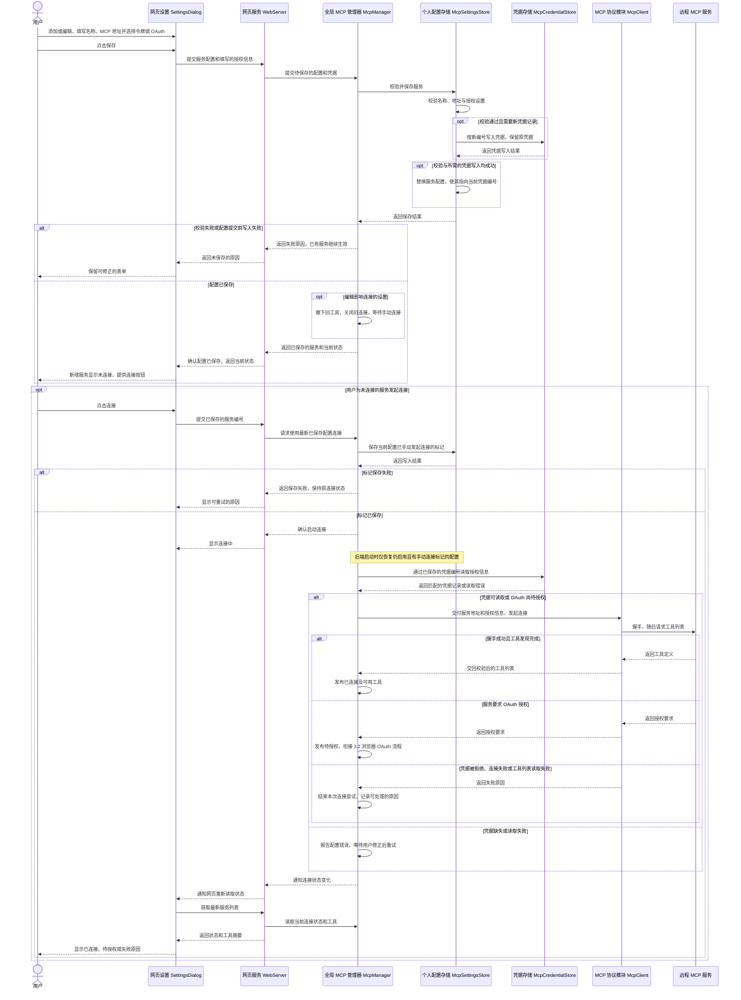
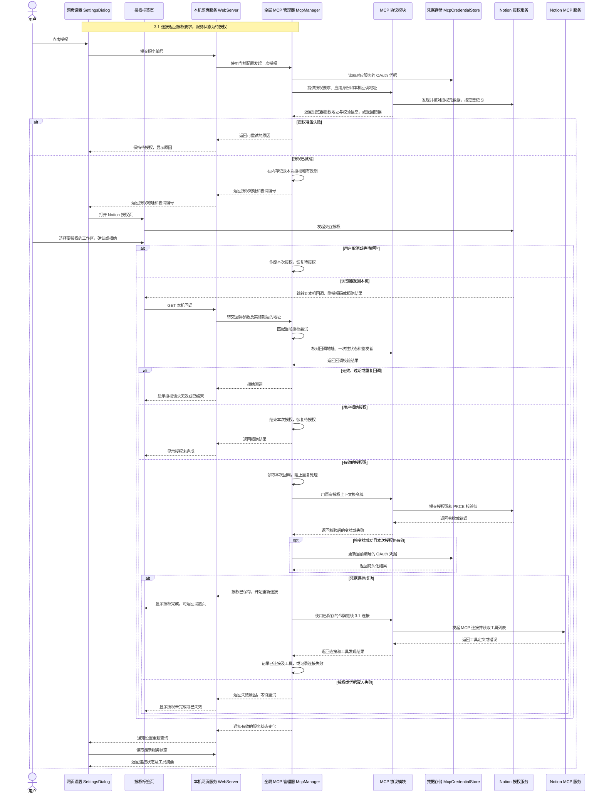
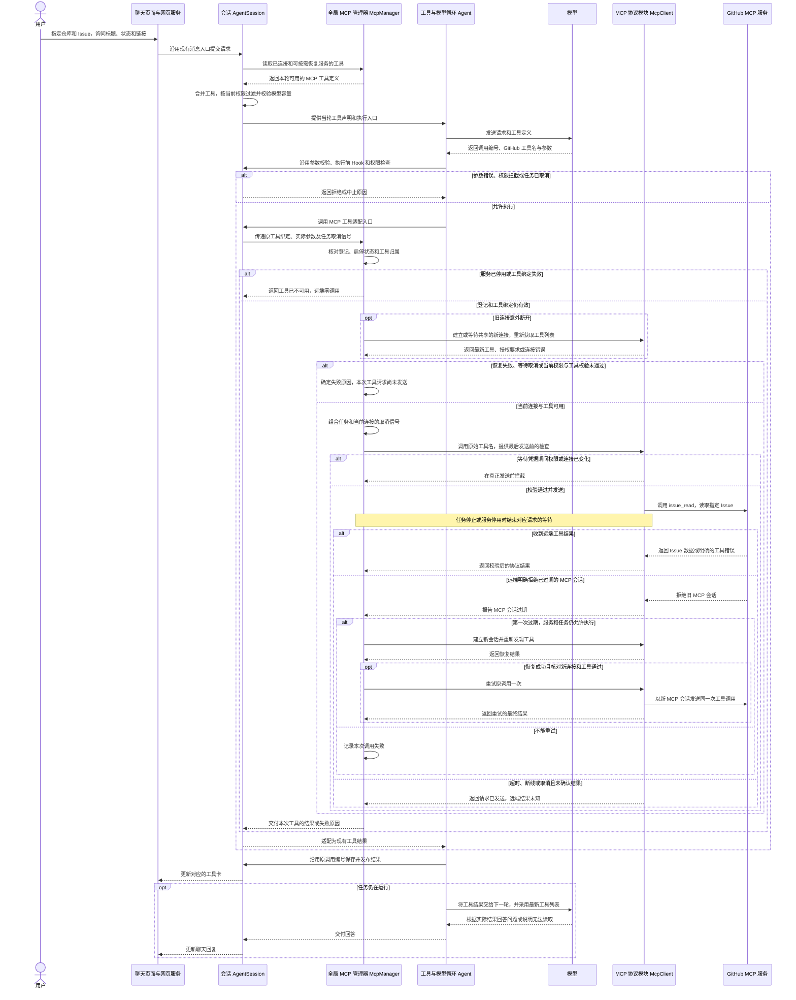
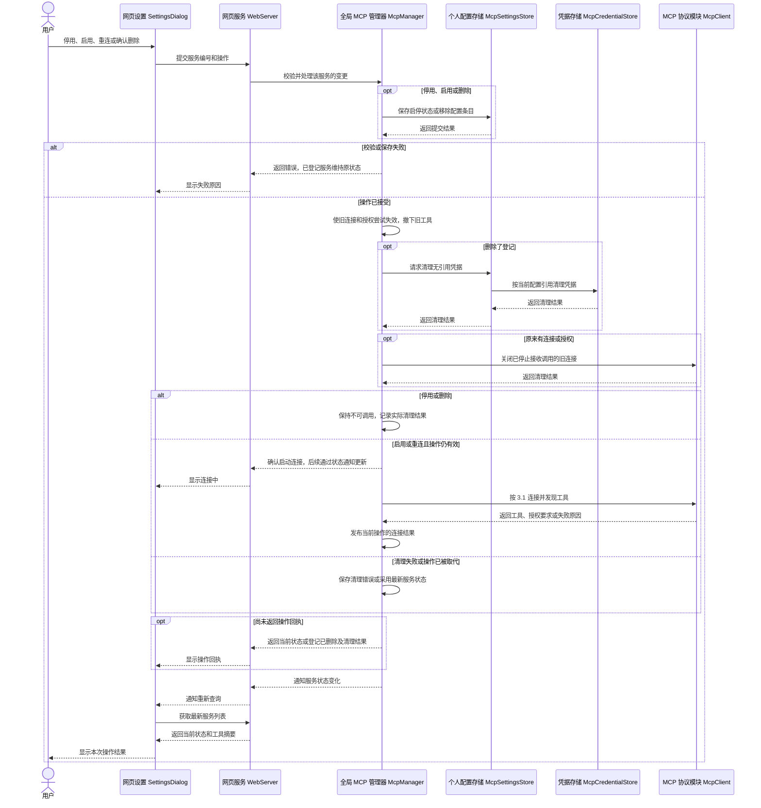

# 里程碑 2 Feature 5 MCP 客户端设计讨论

[技术设计稿](./feature5-MCP客户端技术设计.md) · [验收标准](./feature5-MCP客户端验收标准.md)

本页保留首版的讨论。后续确认的开关、三点菜单和后台重试见[当前设计](./feature5-MCP客户端技术设计.md#3-系统设计)。

## 已确认的需求

使用 GitHub 官方 MCP 作为首个真实服务，验证连接成功和读取 Issue 两个场景。[里程碑规划](../README.md#第五步mcp-客户端与真实服务接入) · [GitHub 官方 MCP](https://github.com/github/github-mcp-server#remote-github-mcp-server)

- 成功连接 GitHub 官方 MCP。验收时核对实际握手、GitHub 返回的工具列表及页面的连接状态。
- 从 SI 网页让 Agent 通过 MCP 读取指定 GitHub Issue，对照工具记录和 GitHub 原页面核对标题、状态和链接。
- 使用 Notion 官方 MCP 做 OAuth 实战验收。从 SI 设置发起浏览器授权，再让 Agent 读取一条指定测试页面，核对页面标题和链接。实际授权及工具调用待验证。[Notion 客户端接入教程](https://github.com/makenotion/notion-cookbook/blob/main/docs/mcp-client-integration.md) · [Notion 授权元数据](https://mcp.notion.com/.well-known/oauth-authorization-server)

## 已确认的关键决策

### 【功能决策｜网页设置、服务端】配置入口与归属

在现有「设置」内新增「MCP」，用户在网页添加服务并查看连接状态、工具列表或失败原因。配置归本机个人，各工作区可引用同一份配置。服务端报告真实连接状态，凭据沿用现有本机凭据存储方式，查询设置时只返回是否已配置。

用户已确认可以添加和编辑服务。新增服务先保存，保存后显示「未连接」。用户再点击「连接」，由 SI 开始真实连接。

Pi 从本机个人文件和受信任的项目文件加载 MCP 配置，交互会话用 `/mcp` 查看状态。DeepSeek Harness 的管理器接收 Settings 配置，并把运行状态提供给客户端。SI 已有设置弹窗和由服务端保存的凭据，适合在现有入口完成配置与查看状态。[Pi 配置读取](../../../pi/packages/coding-agent/src/extensions/mcp/config.ts#L137) · [DSH MCP 管理器](../../../deepseek-harness/packages/mcp/mcp-manager/src/index.ts#L194) · [SI 设置弹窗](../../../web/src/components/SettingsDialog.tsx#L58)

### 【功能决策｜网页设置、MCP 客户端】首版连接与授权方式

首版的传输范围为远程 Streamable HTTP。同一种远程连接支持 OAuth 浏览器授权和手动填写访问令牌。[MCP 授权规范](https://modelcontextprotocol.io/specification/2026-07-28/basic/authorization) · [GitHub 官方接入说明](https://github.com/github/github-mcp-server#remote-github-mcp-server)

### 【功能决策｜网页设置、MCP 客户端】OAuth 客户端身份

首版采用 Pi 的三种方式和默认顺序。SI 优先用已配置的应用 ID，再复用已有登记。如果两者都没有，授权服务支持公开身份文件且文件覆盖本次回调地址时，用 SI 自己的 HTTPS 客户端身份文件（CIMD）。身份文件用不上且服务允许自动登记时，通过动态客户端登记（DCR）取得应用 ID 并保存，供后续使用。首次授权仍由用户在服务的授权页完成。SI 的公开身份文件发布位置待定。[Pi 身份选择实现](../../../pi/packages/mcp/src/oauth/flow.ts#L377) · [Pi 身份文件适用条件](../../../pi/packages/mcp/src/oauth/client-settings.ts#L119) · [MCP 客户端登记规范](https://modelcontextprotocol.io/specification/2026-07-28/basic/authorization/client-registration)

GitHub 远程 MCP 的 OAuth 要求提前登记 GitHub App 或 OAuth App。已读取 Notion 的公开授权元数据，确认它同时声明支持 CIMD 和 DCR。[GitHub 客户端接入指南](https://github.com/github/github-mcp-server/blob/main/docs/host-integration.md) · [Notion 授权元数据](https://mcp.notion.com/.well-known/oauth-authorization-server)

### 【功能决策｜网页设置、会话、MCP 客户端】个人服务全局启停

同一个 SI 后端统一管理设置中的 MCP 服务，所有会话共享服务登记和启停状态。设置停用某个服务后，后端拦截所有会话尚未发出的调用，即使模型已经拿到旧工具列表。下一次模型请求移除这些工具。只读模式沿用已确认的四个本地工具。[Feature 2 权限约定](../feature2/feature2-设计讨论记录.md#31-切换会话权限并应用到工具调用)

DeepSeek Harness（`e8f7b93a34`）最贴合这次描述的全局行为。Web 应用在会话外装配一个 MCP 管理器，每个启用的服务条目由管理器运行一个客户端。Pi 的交互启停更新当前会话实例。OpenCode 的 MCP 服务按工作位置管理，符合条件的连接可在位置之间复用。[DSH Web 装配](../../../deepseek-harness/packages/bundle/web-app/cordis.patch.yml#L149) · [Pi 启停实现](../../../pi/packages/coding-agent/src/extensions/mcp/index.ts#L739) · [OpenCode 位置装配](../../../opencode/packages/core/src/mcp/index.ts#L1129) · [OpenCode 连接复用](../../../opencode/packages/core/src/mcp/pool.ts#L30)

SI 的首次连接由用户点击「连接」发起。沿用 DSH 的状态和清理规则。握手及工具发现完成后才报告已连接。停用保留条目，关闭连接并撤下已注册工具。再启用时重新连接。配置连续变化时，旧连接的迟到结果失去发布资格，完成旧连接清理后才可连接最新配置。状态由后端汇总，设置可以观察连接、停用或清理失败的实际结果。[DSH 连接和工具同步](../../../deepseek-harness/packages/mcp/mcp-client/src/connection.ts#L320) · [DSH 管理器](../../../deepseek-harness/packages/mcp/mcp-manager/src/index.ts#L422) · [DSH 停用测试](../../../deepseek-harness/packages/mcp/mcp-manager/tests/manager.spec.ts#L238) · [DSH 连续修改测试](../../../deepseek-harness/packages/mcp/mcp-manager/tests/manager.spec.ts#L850)

SI 为每项已启用的个人服务统一持有一个 MCP 客户端实例。在调用真正发出前，复查全局启停状态及当前会话权限。停用时关闭连接并结束对在途调用的等待。已发出且未确认结果的调用保留原调用编号，标记为远端结果未知。[DSH 关闭连接](../../../deepseek-harness/packages/mcp/mcp-client/src/generation.ts#L90) · [SI 调用前权限检查](../../../packages/coding-agent/src/agent-session.ts#L696)

### 【功能决策｜网页服务、MCP 管理器】后端启动时恢复连接

后端启动时读取个人 `mcp.json`。只有仍启用、且用户曾为当前连接配置手动点击「连接」的服务会在后台重连。只保存过或修改过连接设置的服务等待用户点击「连接」。已停用的服务在启动时跳过。每次重启重新建立连接和获取工具列表，成功后才显示「已连接」。Pi 在会话启动时连接已启用的服务。SI 将恢复连接的触发点放在共享后端启动时，并保留首次手动连接的条件。[Pi 启动连接](../../../pi/packages/coding-agent/src/extensions/mcp/index.ts#L1115) · [SI 后端启动入口](../../../packages/server/src/webserver/index.ts#L193)

### 【功能决策｜MCP 管理器、会话】普通掉线后按需恢复

已连接的服务意外掉线时，设置显示「已断开」，管理器保留上次取得的工具定义。模型下一次选中该服务的工具时，SI 先重连并重新获取工具列表，再决定能否发出这次调用。同一服务的并发调用共享这次重连，设置中也可以手动点「重连」。Pi 在连接断开后保留工具入口，并在下一次调用时重新建立连接。SI 将同样的恢复操作放在全局管理器，由所有会话共用。[Pi 断线处理](../../../pi/packages/coding-agent/src/extensions/mcp/runtime.ts#L422) · [Pi 按需连接](../../../pi/packages/coding-agent/src/extensions/mcp/runtime.ts#L239) · [Pi 工具执行入口](../../../pi/packages/coding-agent/src/extensions/mcp/index.ts#L419)

### 【工程决策｜会话、MCP 客户端】首版直接向模型提供外部工具

首版用 Pi 的 `direct` 模式，把已发现且当前会话获准调用的 MCP 工具同内置工具一起交给模型，复用 SI 现有的调用链路。工具定义会随每轮模型请求发送，定义过多时可能使请求超出模型容量。[Pi 工具开放方式](../../../pi/packages/coding-agent/docs/mcp.md#control-tool-exposure) · [SI 工具声明](../../../packages/coding-agent/src/agent-session.ts#L184) · [SI 模型容量检查](../../../packages/coding-agent/src/agent-session.ts#L658)

GitHub 官方提供只读 Issues 工具集，可用服务地址限定验收所需的工具范围。Notion 官方列出搜索读取、页面、数据库等多类工具。实际授权后返回的工具定义大小，以及两家同时启用对模型输入容量的影响待验收。[GitHub 远程工具集](https://github.com/github/github-mcp-server/blob/main/docs/remote-server.md#remote-mcp-toolsets) · [Notion 支持的工具](https://developers.notion.com/guides/mcp/mcp-supported-tools)

### 【工程决策｜MCP 协议、Coding Agent】引入独立 MCP 模块

Pi 的独立包 `packages/mcp/` 实现传输、握手、工具发现与调用、请求超时和取消，以及 OAuth 发现、应用登记、令牌交换和续期。它通过调用方提供的存储接口读写 OAuth 状态。Pi 在 Coding Agent 接入层读取 `mcp.json`，保管 `mcp-auth.json`，决定会话何时连接服务，并把远端工具适配成 Agent 工具。扩展接口接收代码中的服务登记，接入层负责实际连接。[Pi MCP 包](../../../pi/packages/mcp/README.md#usage) · [Pi OAuth 存储接口](../../../pi/packages/mcp/src/oauth/provider.ts#L21) · [Pi MCP 接入](../../../pi/packages/coding-agent/src/extensions/mcp/index.ts#L2) · [Pi 服务登记](../../../pi/packages/coding-agent/src/core/mcp-servers.ts#L1) · [Pi 凭据文件](../../../pi/packages/coding-agent/src/extensions/mcp/oauth.ts#L65) · [Pi 工具适配](../../../pi/packages/coding-agent/src/extensions/mcp/tools.ts#L249)

SI 按同样的边界设计。独立工作区 `packages/mcp/` 负责首版的远程 Streamable HTTP、MCP 请求及 OAuth 协议，接收调用方提供的连接参数与凭据存储接口，返回 MCP 协议数据。拟由 `packages/coding-agent/src/mcp/` 承担应用接入，其中 `McpManager` 管理已登记服务及全局连接，`McpSettingsStore` 保存本机服务配置并协调凭据写入，工具适配把远端工具接入 SI 现有执行流程。会话模块按当前权限选取和执行工具，并把结果记回原调用。`WebServer` 装配一个共享管理器，处理网页 HTTP、OAuth 回调的转交和 WebSocket 状态同步。[SI 工作区配置](../../../package.json#L9) · [SI 会话装配](../../../packages/server/src/webserver/index.ts#L175) · [SI 会话工具入口](../../../packages/coding-agent/src/agent-session.ts#L633)

Pi 在会话启动和结束时管理那次会话的连接。SI 采用已确认的全局管理，所有会话使用同一套服务启停状态。销毁会话实例时，取消该会话对应的调用。MCP 客户端由全局管理器按服务状态清理。[Pi 会话启动](../../../pi/packages/coding-agent/src/extensions/mcp/index.ts#L1115) · [Pi 会话关闭](../../../pi/packages/coding-agent/src/extensions/mcp/index.ts#L1253) · [DSH 全局装配](../../../deepseek-harness/packages/bundle/web-app/cordis.patch.yml#L149)

首版的传输范围、配置归属和工具提供方式已纳入[设计妥协与后续待办](../../设计妥协记录.md#milestone-2-feature-5-mcp)。

### 【工程决策｜Coding Agent、Credentials】分开保存服务配置与凭据

Pi 的 MCP 接入层按服务管理 OAuth 状态，使用模型凭据也在用的 `FileAuthStorageBackend` 读写独立的 `mcp-auth.json`。协议包通过注入的接口读写 OAuth 状态。SI 已把本机凭据文件的保护和读写放在独立包中，模型与网页服务都使用该包。[Pi MCP 凭据存储](../../../pi/packages/coding-agent/src/extensions/mcp/oauth.ts#L65) · [Pi 文件存储](../../../pi/packages/coding-agent/src/core/auth-storage.ts#L61) · [Pi OAuth 存储接口](../../../pi/packages/mcp/src/oauth/provider.ts#L21) · [SI 模型调用](../../../packages/model/src/pi-stream.ts#L42) · [SI 网页签名密钥](../../../packages/server/src/webserver/index.ts#L196)

SI 保留独立 `packages/credentials/`。Coding Agent 的 MCP 接入层管理 `~/.agent-learning/mcp.json` 中的服务名称、URL、启停状态、授权方式和用户填写的 OAuth Client ID，并决定当前连接应读取哪条凭据。Credentials 复用现有文件保护、加锁和原子替换，把手填访问令牌、OAuth 应用密钥、动态登记信息及授权令牌保存在 `~/.agent-learning/mcp-auth.json`。独立 MCP 协议包通过接入层提供的接口读写 OAuth 状态。网页仍提供一次「保存」操作。[SI 凭据文件读写](../../../packages/credentials/src/credential-file.ts#L34)

## 流程与模块对齐

### 3.1 保存并手动连接 MCP 服务（已确认）

用户在网页设置添加或编辑远程服务。添加完成后，用户点击「连接」，SI 才发起远端握手并获取工具。



#### 网页设置 `SettingsDialog`

**职责**　提供添加、编辑和连接入口，分别显示保存结果和连接状态。网页打开设置、恢复连接或收到状态变更通知时，重新读取服务端列表。

**接口（新增 0 项，修改 1 项）**

- 【修改】`SettingsDialog`（设置界面）增加 MCP 板块。添加和编辑复用表单，服务端返回保存结果后更新列表。新服务在列表显示「未连接」，点击「连接」才提交连接请求。回执丢失时先重读列表，核对是否已保存。编辑界面只显示凭据是否已配置，提交成功后清空凭据输入框。

**数据（新增 0 项，修改 0 项）**

- 【新增】`McpServerView`（归属 `WebServer`）供设置页显示状态、待授权操作和可用工具。

#### 网页服务 `WebServer`

**职责**　启动时装配一个全局 `McpManager`，由管理器加载已保存的服务，并在后台恢复符合条件的连接。网页启动无需等待远端连接完成。接收已授权网页的设置操作，向各页面提供真实状态。服务校验、登记及连接的管理交给 Coding Agent 的 MCP 接入层。

**接口（新增 5 项，修改 0 项）**

- 【新增】`POST /api/mcp/servers`（HTTP）将提交的名称、地址及授权参数交给应用层校验、保存和登记。重名或校验错误时返回可修正原因。保存成功后返回「未连接」的条目。
- 【新增】`PUT /api/mcp/servers/:id`（HTTP）按服务编号编辑已保存条目。地址、授权方式或凭据改变时，保存成功后先撤下旧工具并结束旧连接，等用户再次点击「连接」。仅修改名称时保留连接，并按新名称更新工具目录。配置提交前失败时原配置仍有效。回执丢失或提交结果无法确认时，网页重新查询列表。
- 【新增】`POST /api/mcp/servers/:id/connect`（HTTP）按服务编号请求连接当前已保存的配置。管理器保存手动连接标记后在后台发起连接，网页随后读取状态。重复点击共用本次正在进行的连接尝试。
- 【新增】`GET /api/mcp/servers`（HTTP）读取管理器的当前服务列表，生成网页可见的服务状态。网页可以用它核对保存结果，也可以在重新连上后端后恢复状态。
- 【新增】`mcp_settings_changed`（WebSocket 通知）告知各页面服务状态有更新，页面收到后重新发起查询。状态通知与保存回执先后不定，页面以最新查询结果为准。

**数据（新增 3 项，修改 0 项）**

- 【新增】`SaveMcpServerRequest` 用于添加或编辑，提交名称、地址和授权方式。选择访问令牌时填写对应服务的令牌，选择 OAuth 时先保存要使用的授权方式。编辑时可保留仍与当前地址和授权设置匹配的凭据。地址、授权方式或 OAuth 应用身份改变后，按新配置使用对应的凭据。
- 【新增】`McpServerView` 返回已保存的启停标记、当前连接状态、工具摘要及是否已保存访问凭据。OAuth 仅保存应用配置时仍显示未授权。凭据编号、令牌和 OAuth 密钥只供后端使用。
- 【新增】`mcp_settings_changed` 通知只携带事件类型。

**`McpServerView` 构造示例**

```typescript
const savedGitHub: McpServerView = {
  id: 'mcp-001',
  name: 'github',
  url: 'https://api.githubcopilot.com/mcp/x/issues/readonly',
  enabled: true,
  authMode: 'token',
  hasCredential: true,
  status: 'not_connected',
  tools: [],
}

const connectedGitHub: McpServerView = {
  ...savedGitHub,
  status: 'connected',
  tools: ['issue_read'],
}
```

#### 个人配置存储 `McpSettingsStore`（拟新增）

**职责**　位于 Coding Agent 的 MCP 接入层，保存 `~/.agent-learning/mcp.json`，并协调配置和凭据两次写入。文件权限、加锁和原子替换沿用现有文件操作。[SI 设置写入](../../../packages/server/src/settings-file.ts#L18)

**接口（新增 3 项，修改 0 项）**

- 【新增】`listServers` 在后端启动时读取个人服务登记及手动连接标记。
- 【新增】`markConnectRequested` 在配置锁内确认目标服务仍启用且配置仍匹配，再写入当前配置的手动连接标记。重复写入同一标记时保留原状态。标记写入失败时返回错误，等待用户重试。

##### 【新增】`saveServer`（模块间调用）

**用途**　供管理器一次提交添加或编辑，保证连接使用同一次保存的服务配置和凭据。

**主要流程**　取得配置文件锁后，读取最新配置，校验名称、URL、重名和授权字段。新增服务或改变地址、授权方式、手填令牌或 OAuth 应用配置时，清除手动连接标记，并分配新的凭据编号，请 Credentials 先写入对应记录。更换地址后的令牌方式需要用户重新填写。OAuth 可以先保存尚未授权的记录，改地址或应用配置后需重新授权。仅改名称时沿用原凭据编号和手动连接标记。

用原子替换写入配置文件。替换成功时新配置和其凭据一同生效。写入中断时，重启后按配置文件里已经保存的编号选择凭据。替换前失败保留旧配置、旧凭据和当前连接。替换后，清理失败不回滚已保存配置。在启动或下次保存时，持配置锁重试清理未被引用的凭据。锁释放失败时按文件替换结果确认是否已提交，避免因清理报错把成功写入当作未保存。进程中断留下的文件锁沿用 SI 的人工恢复规则。[SI 文件锁与替换](../../../packages/credentials/src/credential-file.ts#L61)

**数据（新增 1 项，修改 0 项）**

- 【新增】`StoredMcpServer` 保存稳定服务编号、名称、地址、启停设置、手动连接标记 `connectRequested`、授权方式、可选的 OAuth Client ID 和当前凭据编号。标记缺失时按尚未手动连接处理。OAuth 授权结果和刷新令牌更新沿用当前凭据编号及标记。连接状态和工具列表仅保存在管理器内存。

**`StoredMcpServer` 构造示例**

```typescript
const github: StoredMcpServer = {
  id: 'mcp-001',
  name: 'github',
  url: 'https://api.githubcopilot.com/mcp/x/issues/readonly',
  enabled: true,
  connectRequested: false,
  authMode: 'token',
  credentialRef: 'credential-001',
}
```

#### 凭据存储 `McpCredentialStore`（拟新增）

**职责**　位于独立 Credentials 包，负责 `~/.agent-learning/mcp-auth.json` 的读取和写入。文件只允许本机所有者读写，复用现有文件安全检查、加锁与原子替换。Coding Agent 决定当前服务用哪条记录。[SI 凭据文件](../../../packages/credentials/src/credential-file.ts#L34)

**接口（新增 3 项，修改 0 项）**

- 【新增】`create` 为新凭据编号写入一条记录，并保留原凭据和其他服务的记录。
- 【新增】`load` 按编号读取，核对记录所属的服务、URL 和授权方式。缺失、损坏或不匹配时返回错误。
- 【新增】`prune` 根据配置文件当前引用的编号清理闲置记录。配置存储持有配置锁时调用，防止误删尚在保存流程中的凭据。OAuth 的后续写入只能更新已存在且绑定匹配的记录，避免迟到的回调重新创建被清理的凭据。

**数据（新增 1 项，修改 0 项）**

- 【新增】`StoredMcpCredential` 以凭据编号区分同一服务先后保存的记录，绑定服务编号、URL 与授权方式。记录保存手填访问令牌，或 OAuth 应用密钥、登记信息及授权令牌。OAuth 尚未授权时也有一条记录，供该服务完成授权后更新。

**`StoredMcpCredential` 构造示例**

```typescript
const githubCredential: StoredMcpCredential = {
  id: 'credential-001',
  serverId: 'mcp-001',
  url: 'https://api.githubcopilot.com/mcp/x/issues/readonly',
  authMode: 'token',
  accessToken: 'example-token',
}
```

#### 全局 MCP 管理器 `McpManager`（拟新增）

**职责**　位于 Coding Agent 的 MCP 接入层，持有已登记服务及其连接状态。用户发起连接后，把最新配置和凭据交给独立 MCP 模块。协议模块返回工具定义后，管理器发布已连接。连接失败时管理器释放客户端，并发布可处理的原因。

**接口（新增 5 项，修改 0 项）**

- 【新增】`saveServerSettings` 串行接收网页提交，调用配置存储，在提交成功后发布登记变更。新增时发布「未连接」。编辑影响连接的设置时立即撤下旧工具并结束旧连接，等待用户发起连接。只改名称时用同一连接重新登记工具名称。旧工具定义绑定原服务编号，避免同名工具被重新登记后执行到其他服务。
- 【新增】`startServer` 响应用户点击「连接」。先持久化当前配置的手动连接标记，再调用 `McpClient` 建立连接并读取工具列表。标记表示用户已发起连接，连接失败或进入待授权时仍保留。过程中配置发生变化时，丢弃旧尝试的状态和工具。
- 【新增】`initialize` 在后端启动时读取 `mcp.json`。停用项保持「已停用」，未手动发起过连接的启用项保持「未连接」，同时满足两项条件的服务进入「连接中」，后台复用连接与工具发现流程。工具列表成功返回后才发布「已连接」和可用工具。OAuth 需要用户授权时发布「待授权」，按 §3.2 等待用户操作。连接失败时发布原因。后端关闭、服务停用或连接配置变更时，取消对应尝试并丢弃过期结果。
- 【新增】`listServers` 提供有效配置与运行状态，供 `WebServer` 生成服务状态。
- 【新增】`onServerChanged` 通知 `WebServer` 重新发布状态变更。

**数据（新增 1 项，修改 0 项）**

- 【新增】`McpServerRuntime` 持有当前客户端、应用连接状态和当前工具目录。MCP 服务返回的诊断经处理后才进入网页状态。
- 【新增】`StoredMcpServer`（归属 `McpSettingsStore`）供管理器使用当前配置和对应凭据建立连接。换地址或更新授权设置后，旧连接和旧授权尝试的结果只属于原配置。

#### MCP 协议模块 `packages/mcp/`（拟新增）

**职责**　通过远程 Streamable HTTP 与 MCP 服务交换协议消息，处理握手、工具查询、请求超时和取消。连接所需的地址与认证信息由调用方提供。

**接口（新增 3 项，修改 0 项）**

- 【新增】`McpClient.connect` 处理 MCP 握手，返回远端能力，或报告需要 OAuth 及其他连接错误。
- 【新增】`McpClient.listTools` 按协议查询工具并校验返回的定义，交给管理器登记。
- 【新增】`McpClient.close` 结束传输并清理仍在等待的协议请求。

**数据（新增 1 项，修改 0 项）**

- 【新增】MCP 工具定义包含远端工具名称、描述和参数结构。Coding Agent 接入层据此生成 SI 工具及网页摘要。

**参考依据**　Pi 的命令行把添加配置和检查连接分为两个动作，并单独存放 OAuth 凭据。SI 的网页表单可以一次提交配置和手填令牌，由配置文件记录本次保存使用的凭据编号。连接仍由用户另行发起，采用 DSH 的全局管理和连接就绪规则。[Pi 添加配置](../../../pi/packages/coding-agent/src/extensions/mcp/cli.ts#L448) · [Pi OAuth 凭据存储](../../../pi/packages/coding-agent/docs/mcp.md#authenticate-with-oauth) · [DSH 连接就绪](../../../deepseek-harness/packages/mcp/mcp-client/src/connection.ts#L320) · [SI 文件写入](../../../packages/credentials/src/credential-file.ts#L104) · [SI 设置通知](../../../packages/server/src/webserver/index.ts#L565)

**验收证据**　现有网页工具设置的服务端测试与 Chromium 组件测试此前各复跑通过 1 项。凭据包已有原子替换失败、并发写入和密钥脱敏测试。MCP 待新增验收覆盖两份文件分别写入失败、写完凭据但尚未切换配置时重启、切换配置后清理失败、旧地址的授权结果迟到等情形。新增服务保存后远端应收到零次连接请求，手动连接后才核对握手和工具查询。另验证连接失败、待授权和 GitHub 真实连接。[凭据测试](../../../packages/credentials/test/credentials.test.ts#L338) · [WebServer 测试](../../../packages/server/test/webserver.test.ts#L1096) · [浏览器组件测试](../../../web/src/components/SettingsDialog.browser.test.tsx#L91)

**启动恢复待验收**　从实际后端启动入口验证，仅尝试重连当前配置已手动点过「连接」且仍启用的服务。只保存、修改连接配置后未重新点击、已停用的服务均为零次。仅改名的服务仍可恢复。工具列表返回前保持「连接中」。凭据失效或需要重新授权时显示实际结果，并核对授权页仍由用户主动打开。

### 3.2 在浏览器授权并继续连接 Notion（已确认）

用户在 §3.1 点击「连接」，Notion 要求授权时，设置显示「待授权」。用户点击「授权」，在 Notion 页面选择工作区并同意。SI 收到回调并成功保存令牌后，继续完成这次连接。工具发现成功时，原设置页才显示「已连接」。



#### 网页设置 `SettingsDialog`

**职责**　从待授权状态进入浏览器授权。设置页根据后端状态显示「授权中」「连接中」及最终结果。

**接口（新增 1 项，修改 0 项）**

- 【新增】授权操作（页面回调）向后端发起授权，在新标签页打开返回的 URL，并隔离授权页对原设置标签页的访问。浏览器拦截自动打开时，在原设置页提供可点击的授权链接。用户在设置页选择取消时提交当前尝试编号。仅关闭 Notion 标签页时，后端在等待超时后恢复「待授权」。

**数据（新增 0 项，修改 0 项）**

- 【新增】`McpOAuthStartView`（归属 WebServer）供发起授权的页面打开链接和取消当前尝试。授权结果沿用 §3.1 的查询与通知。

#### 本机网页服务 `WebServer`

**职责**　发起和取消授权沿用已有网页认证。浏览器回调使用后端实际监听的 `127.0.0.1` 地址，例如 `http://127.0.0.1:3000/api/mcp/oauth/callback`。开发环境也回到后端端口。Pi 命令行按授权临时开本机监听，SI 复用已经运行的本机网页服务，保留同样的浏览器回环行为。[Pi 本机监听](../../../pi/packages/mcp/src/oauth/loopback.ts#L36) · [Pi 两段式登录接口](../../../pi/packages/mcp/src/oauth/sign-in.ts#L24) · [SI 本机监听](../../../packages/server/src/webserver/index.ts#L227)

**接口（新增 3 项，修改 0 项）**

- 【新增】`POST /api/mcp/servers/:id/oauth`（HTTP）接收已认证设置页的操作，将服务编号和本机回调地址交给管理器。重复点击返回同一有效尝试。准备成功后只向发起页面返回授权链接和尝试编号，并禁止缓存。
- 【新增】`DELETE /api/mcp/servers/:id/oauth/:attemptId`（HTTP）接收已认证设置页的取消请求，只取消匹配的当前尝试。凭据已经提交时，网页查询实际授权结果。

##### 【新增】`GET /api/mcp/oauth/callback`（HTTP）

**用途**　接收授权服务通过浏览器送回的本次授权结果。

**主要流程**　现有网页入口会拒绝跨站请求，网页登录 Cookie 也使用 `SameSite=Strict`。回调在这两项检查前单独分流，仅允许后端实际监听的本机 Host 和已分配的确切 GET 回调路径，包括必要的签发者专属路径。回调凭本次短期有效的 `state` 和授权上下文完成验证。重复参数或同时带有授权码和拒绝结果的回调直接拒绝。其他 HTTP 和 WebSocket 入口沿用现有检查。回调携带的授权码、错误详情和校验参数只交给后端处理，响应使用固定结果文案、禁止缓存和 Referrer，日志不记录回调查询串。授权成功页在凭据写入后返回，原设置页负责显示最终连接状态。[SI 网页来源检查](../../../packages/server/src/webserver/browser-auth.ts#L15) · [SI Cookie](../../../packages/server/src/webserver/browser-auth.ts#L39) · [SI HTTP 入口](../../../packages/server/src/webserver/index.ts#L259)

**数据（新增 1 项，修改 0 项）**

- 【新增】`McpOAuthStartView` 包含尝试编号和用于打开 Notion 的授权 URL。授权 URL 只从发起接口返回，普通状态查询与 WebSocket 通知继续复用 §3.1 的数据。

#### 全局 MCP 管理器 `McpManager`

**职责**　协调同一服务的一次授权尝试，把临时授权与当前服务编号、凭据编号和连接尝试绑定。连接状态和可用工具仍统一向所有会话发布。

**接口（新增 3 项，修改 0 项）**

- 【新增】`startOAuth` 从当前待授权连接取得授权要求，调用协议模块准备授权链接。准备和等待期间合并同一服务的重复请求。回调等待上限采用 Pi 的 5 分钟。前端重新加载可查询服务状态，从设置重新打开仍有效的授权。
- 【新增】`finishOAuth` 在处理前匹配回调地址、签发者和当前尝试并一次领取回调。回调有效时调用协议模块换令牌。提交前再次核对当前服务仍启用、凭据编号和尝试仍匹配。最终校验与凭据写入同配置变更和取消串行，远端请求在锁外执行。保存成功后复用 §3.1 的连接与工具发现。发现失败时保留已保存凭据，用户可直接重连。凭据写入失败时重新发起授权，原授权码已用过。
- 【新增】`cancelOAuth` 响应显式取消、超时、连接相关配置被替换、停用、删除或后端关闭。取消后释放临时数据并中止等待，迟到结果无法发布。重启后符合恢复条件的服务重新连接，如果仍需要授权，设置会再次显示「待授权」。[Pi 回调超时](../../../pi/packages/mcp/src/oauth/callback.ts#L83) · [Pi 取消等待](../../../pi/packages/mcp/src/oauth/loopback.ts#L73)

**数据（新增 1 项，修改 0 项）**

- 【新增】`PendingMcpOAuth` 保存在后端内存，记录尝试编号、服务与凭据编号、协议模块返回的授权上下文、到期时间及处理状态。每条服务最多一项，取消、完成或到期后释放。浏览器回传的 `state` 用于关联本次授权，PKCE 校验值只留在后端，供换令牌时证明请求出自原客户端。

**`PendingMcpOAuth` 中的回调关联数据构造示例**

```typescript
const notionSignIn = {
  id: 'attempt-001',
  serverId: 'mcp-002',
  credentialRef: 'credential-002',
  expiresAt: '2026-11-18T06:55:00Z',
  status: 'awaiting_callback',
  authorization: {
    issuer: 'https://mcp.notion.com',
    resource: 'https://mcp.notion.com/mcp',
    redirectUri: 'http://127.0.0.1:3000/api/mcp/oauth/callback',
    state: 'example-state',
    codeVerifier: 'example-verifier',
  },
}
```

#### MCP 协议模块 `packages/mcp/`

**职责**　按 Pi 的两段式接口准备授权和兑换令牌，处理发现、客户端身份选择、PKCE 与令牌刷新。应用层提供回调地址和凭据读写接口。[Pi 发起授权](../../../pi/packages/mcp/src/oauth/sign-in.ts#L76) · [Pi 完成授权](../../../pi/packages/mcp/src/oauth/sign-in.ts#L185)

**接口（新增 2 项，修改 0 项）**

- 【新增】`startMcpSignIn` 根据远端授权要求发现资源和签发者，核对 HTTPS 端点并限制凭据用途。按已确认的顺序使用预配置应用 ID、兼容的已有登记、SI 公开身份文件或动态登记。登记及令牌绑定签发者与资源。该接口生成一次性 `state` 和 PKCE S256 参数，返回授权链接、实际回调地址和后端校验信息。DCR 登记成功后可通过调用方存储复用。预配置的应用 ID 必须接受实际回调地址，身份文件也要声明对应回调。[Pi 客户端选择](../../../pi/packages/mcp/src/oauth/flow.ts#L377) · [Pi 身份文件](../../../pi/packages/mcp/src/oauth/client-settings.ts#L119)
- 【新增】`completeMcpSignIn` 检查授权请求和回调的 `state`、回调地址及签发者。Notion 声明会返回 `iss`，回调必须和发现的签发者一致。其他服务未声明支持 `iss` 时，为各授权服务使用独立回调路径并核对到达路径。换令牌仅使用本次授权确认的签发者、客户端身份、回调地址和资源，配合原 PKCE 校验值。后端网络请求有独立超时。[Pi 回调签发者校验](../../../pi/packages/mcp/src/oauth/flow.ts#L420) · [RFC 9700 回调签发者校验](https://www.rfc-editor.org/rfc/rfc9700.html#section-4.4.2)
- 【沿用】`McpClient.connect`（§3.1 新增）复用现有令牌。令牌过期或被拒绝时，对同一凭据合并刷新。刷新成功用新令牌重试连接。刷新令牌失效或服务要求新增权限时，再由设置提示用户授权。刷新遭遇网络故障时报告连接失败，用户可直接重连。[Pi 令牌刷新](../../../pi/packages/mcp/src/oauth/auth-provider.ts#L48)

**数据（新增 1 项，修改 0 项）**

- 【新增】`McpSignInRedirect` 由协议模块产生，包含浏览器授权地址、准确回调地址和本次协议上下文，由管理器用于核对和兑换。公开身份文件尚未就绪时，Notion 可按已确认的顺序进入 DCR 分支。Notion 声明支持公开客户端、CIMD、DCR、S256 和回调签发者校验。具体回调地址能否完成登记和真实授权仍待验收。[Notion 客户端接入教程](https://github.com/makenotion/notion-cookbook/blob/main/docs/mcp-client-integration.md) · [Notion 授权元数据](https://mcp.notion.com/.well-known/oauth-authorization-server)

#### 凭据存储 `McpCredentialStore`

**职责**　沿用 §3.1 的凭据编号和文件锁，在 `mcp-auth.json` 更新已有记录。用户授权成功后，服务配置文件无需改写。

**接口（新增 1 项，修改 0 项）**

- 【新增】`updateOAuth` 在凭据文件锁内确认记录存在且归属、模式和 URL 匹配，原子更新 OAuth 登记或令牌。应用接入层注入对当前编号的读写能力和同一凭据的刷新互斥。令牌更新保留同一登记的有效信息，仅在服务返回新刷新令牌时替换旧值。

**数据（新增 0 项，修改 0 项）**

- 【沿用】`StoredMcpCredential`（归属 Credentials）保存 OAuth 应用身份、签发者与资源、登记回调地址、访问令牌、刷新令牌和到期信息。临时校验值与授权码随当前授权尝试在内存结束。

**验收证据**　已实际看到 Notion MCP 对未授权请求返回 `401` 和授权元数据地址，并核对官方公开元数据。Pi 的登录与本机回调 33 项参考测试通过，SI 的 HTTP、WebSocket 和开发来源检查 2 项通过。Pi 的额外协议测试缺少参考仓库依赖 `cross-spawn`，未运行到测试体。[Notion 资源元数据](https://mcp.notion.com/.well-known/oauth-protected-resource/mcp) · [Pi 登录测试](../../../pi/packages/mcp/test/sign-in.test.ts#L77) · [Pi 回调测试](../../../pi/packages/mcp/test/loopback.test.ts#L60) · [SI 来源限制测试](../../../packages/server/test/webserver.test.ts#L359)

**待验收**　用可控授权服务验证正确回调只兑换一次并保存，错误 `state`、签发者或回调路径均不进入换令牌步骤。验证拒绝、超时、停用或改地址时撤销等待，迟到回调无法更新凭据或恢复工具。验证写入失败、令牌刷新和授权成功但工具发现失败，并确认新增回调入口后普通 API 的网页认证仍有效。最后用真实 Notion 工作区从设置走完整授权，核对工具发现与 Agent 读取测试页面的标题和链接。

### 3.3 Agent 调用 MCP 工具读取 GitHub Issue（已确认）

GitHub 在 §3.1 完成连接和工具发现后，用户在普通权限的会话中请求读取指定 Issue。模型在当轮工具列表中看到 GitHub 的工具，Agent 调用远端，按原调用编号回填结果，模型据此答复标题、状态和链接。



#### 聊天页面与 `WebServer`

**职责**　沿用聊天消息和工具卡，用户可核对实际调用及其结果。设置中的连接状态仍由 §3.1 的接口提供。

**接口（新增 0 项，修改 0 项）**

- 【沿用】现有消息提交和会话订阅。按工具卡已有的失败显示呈现 MCP 错误，包含服务不可用或远端结果未知的原因。

**数据（新增 0 项，修改 0 项）**

- 【沿用】`ConversationMessage`（归属 Coding Agent）携带结果与原调用位置，刷新页面后仍能核对。

#### 会话与工具适配 `AgentSession`

**职责**　从共享管理器取得当前可用工具，把 MCP 定义和结果适配成 SI 的工具格式。会话继续负责权限、Hook 和历史记录。Pi 在 Coding Agent 把 MCP 工具包装为 Agent 工具，执行时再取当前连接。SI 用已确认的全局管理器处理连接。[Pi 工具适配](../../../pi/packages/coding-agent/src/extensions/mcp/tools.ts#L249) · [Pi 执行时取连接](../../../pi/packages/coding-agent/src/extensions/mcp/index.ts#L427)

**接口（新增 0 项，修改 2 项）**

- 【修改】会话每轮工具配置在现有本地及扩展工具之外，加入已连接服务的工具及可按需恢复服务上次发布的工具。沿用 Pi 的 `mcp__<服务名>__<工具名>` 命名和冲突消解，并校验与现有工具的重名。发生重名时保留已有工具，冲突的 MCP 定义不进入当轮列表。只读模式仍只提供 `read`、`grep`、`find`、`ls`。远端服务给出的只读提示无权扩大 SI 的只读权限。声明经过现有模型容量检查。[Pi 工具名称](../../../pi/packages/mcp/src/naming.ts#L20) · [SI 每轮工具配置](../../../packages/coding-agent/src/agent-session.ts#L633)
- 【修改】会话的工具准备与结果适配。沿用执行前 Hook，校验实际发送的参数，并提供本会话最新权限检查。结果优先按 MCP 内容块转换，只有结构化数据时转换为 JSON 文本。过大输出遵守现有工具结果限额，截断时明确告知模型。远端明确错误、取消和结果未知走现有失败通道。MCP 结果仍交给 `tool_result` Hook。草案保留 MCP 原始失败和未知结果的语义，即使扩展试图把结果改为成功。现有本地工具规则沿用。[Pi MCP 结果转换](../../../pi/packages/coding-agent/src/extensions/mcp/tools.ts#L217) · [SI 工具 Hook](../../../packages/coding-agent/src/extensions/dispatch.ts#L63) · [SI 工具输出限额](../../../packages/coding-agent/src/tool-runtime.ts#L8)

**数据（新增 0 项，修改 0 项）**

- 【沿用】`CodingTool` 承载模型可见的名称、描述、参数定义和执行入口。执行入口绑定管理器提供的真实工具。凭据和连接能力只留在后端。

#### 全局 MCP 管理器 `McpManager`

**职责**　发布服务的工具目录，调用时复查工具归属和当前连接。意外断开时保留当前配置的工具定义供按需重连。停用、删除、修改连接配置或手动替换连接时，撤下旧工具并结束旧连接等待。一个会话停止任务时，只取消该任务的调用及等待。[DSH 任务与连接取消信号](../../../deepseek-harness/packages/mcp/mcp-client/src/tools.ts#L154) · [SI 会话任务生命周期](../../../packages/coding-agent/src/agent-session.ts#L616)

**接口（新增 2 项，修改 0 项）**

- 【新增】`listToolsForAgent` 返回已连接服务的工具，以及同一配置意外掉线后可触发恢复的工具，由会话按权限选用。工具目录只存在后端内存。首次连接、重启恢复或编辑连接配置后仍需等工具发现成功才发布目录。需要用户重新授权时撤下服务的工具。
- 【新增】`callTool` 接收当轮绑定、实际参数、本次任务信号及会话权限检查。确认服务仍启用且工具绑定有效。旧工具列表中的调用不会转到同名的新服务或替换后的 URL。

  若当前服务已意外断开，新调用触发或等待同一配置的共享重连。设置在恢复期间显示「连接中」，工具列表刷新成功后恢复「已连接」。恢复失败时，本次调用按原编号回填错误，设置显示原因。同一配置仍可按需恢复时，后续新调用可以再尝试。需要用户授权时进入「待授权」，本次调用回填授权要求。用户停止任务时结束该任务的等待，共享重连继续为其他会话服务。

  真正发送前复查任务、权限、服务及连接，按最新工具定义验证实际参数。工具已移除或参数无效时回填失败。若服务被停用、删除、编辑连接配置或手动替换连接，之前等待恢复的调用失效。

  协议模块确认远端拒绝了已过期的 MCP 会话时，管理器为同一份服务配置建立或复用正在恢复的新连接，重新发现工具。每次调用最多重试一次，重发前复查任务仍在运行、服务配置仍有效、当前权限允许且该工具仍可用，参数必须符合新连接返回的定义。使用原模型调用编号回填一次，重试使用新的 MCP 请求编号。其他已发出且未确认结果的调用回填「远端结果未知」，自动恢复连接也不会重发这些调用。迟到响应不能替换已回填的结果。[Pi 过期恢复](../../../pi/packages/coding-agent/src/extensions/mcp/runtime.ts#L276) · [Pi 并发过期测试](../../../pi/packages/coding-agent/test/mcp-extension.test.ts#L517)

**数据（新增 1 项，修改 0 项）**

- 【新增】`McpToolBinding` 关联稳定服务编号、当前连接配置和管理器发布的工具定义。意外掉线后的按需恢复可在这份配置下更换底层连接。管理器核对绑定仍有效，再向当前连接发送原工具名。

#### MCP 协议模块 `packages/mcp/`

**职责**　通过现有连接发送 `tools/call`，管理传输请求编号、响应匹配和中止。会话调用编号仍由 Agent 使用。[Pi 工具请求](../../../pi/packages/mcp/src/client.ts#L378) · [Pi 发送前中止检查](../../../pi/packages/mcp/src/transports/streamable-http.ts#L345)

**接口（新增 1 项，修改 0 项）**

- 【新增】`McpClient.callTool` 接收远端工具名、参数、取消信号与发送前检查。取得授权头后，在发出请求前完成最后检查。调用返回通过协议校验的工具结果或可处理的失败。沿用 Pi，当使用有会话的 Streamable HTTP 协议，携带有效格式的 `MCP-Session-Id` 的请求收到协议规定的 HTTP 404 时，报告 MCP 会话过期。工具内部返回的资源未找到错误走普通失败通道。请求发出后超时、断线或取消时，释放本地等待，有协议支持时发送取消通知。调用结果未确认时不自动重发。[Pi HTTP 响应检查](../../../pi/packages/mcp/src/transports/streamable-http.ts#L396) · [MCP 会话管理](https://modelcontextprotocol.io/specification/2025-11-25/basic/transports#session-management)

**数据（新增 1 项，修改 0 项）**

- 【新增】`CallToolResult` 保存校验过的远端内容与错误状态，交给 Coding Agent 转换。下面是 GitHub 单条 Issue 读取的参数构造示例。正式验收使用指定真实 Issue，字段以实际工具定义为准。[GitHub MCP 的 issue_read 定义](https://github.com/github/github-mcp-server/blob/main/pkg/github/issues.go#L726)

```typescript
const issueReadArguments = {
  method: 'get',
  owner: 'example-org',
  repo: 'example-repo',
  issue_number: 42,
}
```

#### 工具与模型循环 `Agent`

**职责**　沿用正常工具循环，用同一轮的可执行工具处理模型返回的调用。通过原编号记录失败或成功并继续生成。

**接口（新增 0 项，修改 0 项）**

- 【沿用】`Agent.run` 的工具集合、执行前检查、结果改写和保存接口。MCP 错误沿用当前失败通道，网页和下一轮模型收到与原调用配对的结果。任务被用户取消后停止发起下一次模型请求。[SI 工具执行与回填](../../../packages/agent/src/agent.ts#L107)

**数据（新增 0 项，修改 0 项）**

- 【沿用】`ToolCall`、`ToolResultMessage`（归属模型包）。Agent 用模型发出的调用编号配对工具结果，MCP 协议请求编号留在协议层。

**验收证据**　现有 Agent 执行测试 2 项、Coding Agent 的结果配对、取消和权限刷新测试 6 项通过，包含等待 Hook 期间更改权限和停止任务。GitHub 工具定义已对照官方源码。[Agent 执行测试](../../../packages/agent/test/execution.test.ts#L26) · [会话回填测试](../../../packages/coding-agent/test/agent-session.test.ts#L397) · [权限刷新测试](../../../packages/coding-agent/test/agent-compaction.test.ts#L265) · [Hook 中止与权限测试](../../../packages/coding-agent/test/extensions.test.ts#L172)

**待验收**　用受控模型和 MCP 服务核对参数与原编号，覆盖只读模式、等待执行时停用、连接替换后命中旧工具名、远端错误、结果 Hook 改写及发送后取消。核对会话过期共用恢复连接、每个原调用最多重试一次，且恢复期间停用时远端收不到重试。已发出但无结果时核对工具卡记录的远端结果未知，任务继续时还要核对下一轮模型收到该结果。真实 GitHub 验收从网页发起读取，核对实际 MCP 工具调用、工具结果和最终回复的标题、状态、链接三项。

**普通掉线待验收**　以已连接服务为起点，中断连接后确认设置显示「已断开」且尚未重连。随后由两个会话调用该服务，核对只建立一条恢复连接，每个新调用在重新获取和校验工具后各发出一次。验证已发出的旧调用保持原失败或未知结果，并覆盖恢复后工具被移除、恢复期间停用或换地址、单个会话取消等待、恢复失败及需要授权。[Pi 掉线恢复测试](../../../pi/packages/coding-agent/test/mcp-extension.test.ts#L587)

### 3.4 从设置停用、启用、重连或删除服务（已确认）

用户从设置对一个服务操作，后端修改这条服务的全局状态，并通知各页面刷新。同一个后端中的所有会话在发出调用时遵守最新状态。



#### 网页设置 `SettingsDialog`

**职责**　对已保存服务提供启停、重连和删除入口。停用的条目显示「启用」，启用后自动连接。已启用的服务可重连，重连会替换当前连接。删除前确认服务名及本机凭据的清理。页面以服务端状态显示操作结果。[SI 设置更新与删除](../../../web/src/components/SettingsDialog.tsx#L103)

**接口（新增 0 项，修改 0 项）**

- 【沿用】`SettingsDialog`（§3.1 修改）增加这四个动作，提交后重新查询登记和连接状态。删除回执指出清理失败时，在设置显示相应说明。

**数据（新增 0 项，修改 0 项）**

- 【沿用】`McpServerView`（归属 WebServer）供界面显示启停状态、连接状态及清理失败原因。

#### 网页服务 `WebServer`

**职责**　把经认证的设置操作转交给共享管理器。配置提交和后续连接清理分别反馈，网页和其他已打开页面沿用现有通知重新查询。[SI 状态通知](../../../packages/server/src/webserver/index.ts#L602)

**接口（新增 3 项，修改 0 项）**

- 【新增】`PUT /api/mcp/servers/:id/enabled` 保存启停目标。相同目标的重复请求返回当前状态，避免重复建连。
- 【新增】`POST /api/mcp/servers/:id/reconnect` 替换启用服务的连接。服务处于停用状态时提示先启用。重连请求正在处理时合并重复操作。
- 【新增】`DELETE /api/mcp/servers/:id` 移除该服务的个人登记。重复删除已不存在的同一编号视为已删除，同名的新登记使用新的服务编号。

**数据（新增 1 项，修改 0 项）**

- 【沿用】`McpServerView`（§3.1 新增）在本节使用已保存的启停状态，供设置区分「已停用」和「启用但连接失败」。清理错误只返回脱敏说明。
- 【新增】删除回执表示服务登记已移除，附带需要向用户展示的脱敏清理错误。列表依据已提交的配置移除服务。

#### 全局 MCP 管理器 `McpManager`

**职责**　沿用 DSH 的顺序，先让旧实例失去发布与发送权限，再处理异步清理。Pi 用同样的先保存再启停顺序，SI 的状态对整个后端生效。[DSH 状态更新与清理](../../../deepseek-harness/packages/mcp/mcp-manager/src/index.ts#L423) · [Pi 启停顺序](../../../pi/packages/coding-agent/src/extensions/mcp/index.ts#L739)

**接口（新增 3 项，修改 0 项）**

- 【新增】`setEnabled` 提交启停配置后立即更新内存登记。停用撤下工具、取消等待中的授权，并使新请求无法发往旧客户端。仍在等待远端结果的调用按 §3.3 回填。启用后等旧连接完成清理，复查最新状态，再按 §3.1 发起连接。启用保存成功但连接失败时，状态显示失败，设置可重连。
- 【新增】`reconnectServer` 保留登记和凭据，使旧连接的调用入口失效，完成清理后并入同一套连接流程。等待期间如果服务被停用、删除或编辑了影响连接的字段，旧重连不会发布结果。清理超时或失败时报告原因，保持工具撤下，确认本地资源已释放后才建立替换连接。
- 【新增】`removeServer` 在配置删除提交后移除登记并撤下所有会话的工具，取消授权和本地等待，清理旧连接。已提交的删除在清理失败时仍生效，错误随删除回执反馈。删除操作的作用范围是 SI 的该服务登记与本机凭据。

**数据（新增 0 项，修改 0 项）**

- 【沿用】`McpServerRuntime`（§3.1 新增）记录当前连接、清理结果和共享的连接尝试。保存与切换状态串行，网络连接与关闭在锁外等待。迟到回调先核对当前登记和尝试，避免覆盖后续操作。正在执行的旧请求按 §3.3 收尾。

#### 配置与凭据存储

**职责**　`McpSettingsStore` 提交配置变更，`McpCredentialStore` 清理配置已不再引用的凭据。停用和重连继续使用原来的凭据编号。

**接口（新增 2 项，修改 0 项）**

- 【新增】`McpSettingsStore.setEnabled` 持配置文件锁更新启停标记，保留当前配置的手动连接标记。只有配置提交后管理器才切换可用状态。启用和重连继续按本节发起连接，启动恢复资格由 §3.1 的手动连接标记决定。
- 【新增】`McpSettingsStore.removeServer` 持配置文件锁移除登记，提交后触发无引用凭据清理。清理失败时由启动或下一次保存重新尝试，已删除的凭据编号不能被连接或授权流程再采用。
- 【沿用】`McpCredentialStore.prune`（§3.1 新增）。凭据写入与清理都持凭据文件锁。清理期间原授权尝试不能为已删除服务创建凭据。

**数据（新增 0 项，修改 0 项）**

- 【沿用】`StoredMcpServer` 和 `StoredMcpCredential`。删除后的凭据清理以成功提交的配置引用为准。

#### MCP 协议模块 `packages/mcp/`

**职责**　沿用已设计的连接、发现与关闭能力。服务登记、启停与删除由调用方管理。

**接口（新增 0 项，修改 0 项）**

- 【沿用】`McpClient.connect`、`listTools` 和 `close`（§3.1 新增）。关闭释放本地请求和传输资源，调用方根据结果决定是否能启用替换连接。

**数据（新增 0 项，修改 0 项）**

- 【沿用】协议层连接状态和工具定义。

**验收证据**　SI 现有设置的凭据删除和无密钥变更通知共 2 项测试复跑通过。DSH 的停用及连续更新测试已核对源码，作为启停设计参考。[SI 凭据管理测试](../../../packages/server/test/webserver.test.ts#L266) · [SI 设置通知测试](../../../packages/server/test/webserver.test.ts#L1096) · [DSH 启停测试](../../../deepseek-harness/packages/mcp/mcp-manager/tests/manager.spec.ts#L238) · [DSH 连续更新测试](../../../deepseek-harness/packages/mcp/mcp-manager/tests/manager.spec.ts#L850)

**待验收**　两个会话共用一个服务，两边在停用后均无法发出新调用。停用保留凭据，启用后重新查到工具。重连中途停用时，旧的完成结果无法恢复工具。删除后重启不再出现该服务，凭据已清理或等待重试清理。另验证写入失败保留登记，以及停用或删除发生在 OAuth 等待、在途工具请求和过期恢复时的收尾。

## 首版扩展范围

### 【功能决策｜扩展、全局 MCP 管理器】服务登记入口与变更事件

Pi 的扩展可以用 `registerMcpServer` 在当前会话临时登记服务。会话运行期间登记变化时触发 `mcp_servers_change`，Pi 的 MCP 接入层接收事件并处理连接。扩展加载时登记的服务在会话启动时读取。个人配置中的同名服务优先。[Pi 扩展登记](../../../pi/packages/coding-agent/src/core/extensions/types.ts#L1930) · [Pi 事件发出](../../../pi/packages/coding-agent/src/core/extensions/runner.ts#L463) · [Pi 事件处理](../../../pi/packages/coding-agent/src/extensions/mcp/index.ts#L1217)

SI 的扩展按会话初始化。若直接把会话中的 `registerMcpServer` 接到共享管理器，打开一个会话就可能为所有会话添加服务。要支持扩展登记全局服务，可参考 DeepSeek Harness 的做法，让后端插件持有登记，插件卸载时撤下工具并关闭连接。SI 现有扩展入口的生命周期需要为此扩展，并明确与网页登记的同名处理。[SI 会话扩展初始化](../../../packages/coding-agent/src/agent-session.ts#L80) · [DSH 插件登记](../../../deepseek-harness/packages/mcp/mcp-manager/src/index.ts#L279)

首版由网页设置登记和修改全局服务，`McpManager` 直接处理连接、启停和工具目录。网页通过 `mcp_settings_changed` 刷新设置，Agent 在每轮请求和实际调用时读取当前状态。扩展登记接口与 `mcp_servers_change` 纳入后续评估。[Feature 5 规划](../README.md#第五步mcp-客户端与真实服务接入) · [SI 扩展接口](../../../packages/coding-agent/src/extensions/runtime.ts#L76)

如果以后有扩展维护一份外部工具的变更日志，停用 GitHub 后，它可以订阅已保存的登记变化，记录服务名称、操作和时间。该日志是独立于连接管理的结果，届时再按实际消费需求设计事件。
