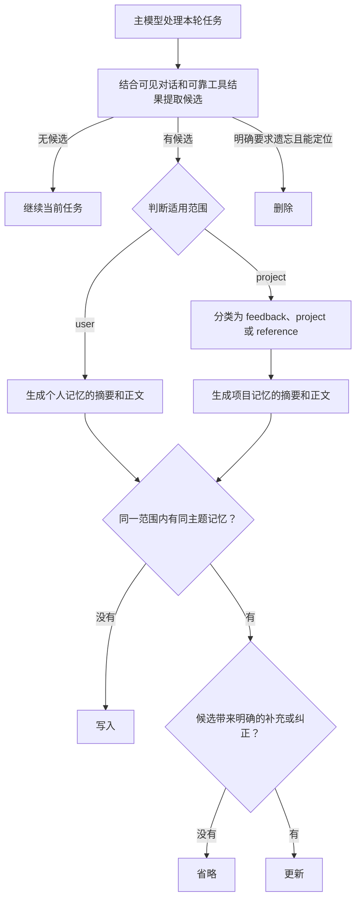
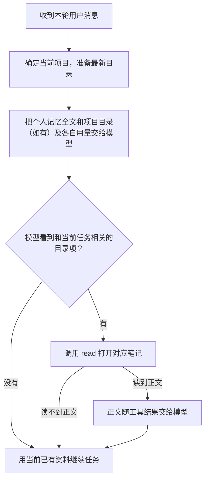

# Feature 6 · Memory 初版方法

## Memory 写入

### 流程图



### 算法逻辑

#### 什么内容应该纳入记忆

主模型在处理任务时边做边记，从当前可见的用户消息、模型回复和可靠工具结果中提取候选。用户可以用一句简短的回复确认前文，两段对话一起支持写入。成功写入后，程序记录写入会话和时间。

同一轮可以提炼出多条候选，每条独立检查下面几项。

- **内容说得清楚吗？** 能从可见对话的含义确定具体的偏好、做法、事实或资料入口。有明确的长期保存意图时优先处理。模型的猜测、尚未确认的方案和单纯复述都缺少充分依据。
- **以后还用得上吗？** 能说出它在未来哪类任务里有用。一次性指令和当下的任务进度留在原对话里。
- **适用范围能确定吗？** 能判断它是跨项目的个人记忆，还是当前项目的记忆。
- **适合长期保存吗？** 尚未确认的猜测、凭据和可从项目直接查到的事实排除。

通过后，为候选写一句摘要，正文保留结论、适用条件和消息给出的原因。候选是否已经被记过，在四种操作的判断里再检查。

#### 怎么区分 `user` 和 `project`

- **`user`** 用于跨项目仍然适用的个人协作信息，集中在一份有内容上限的 `USER.md` 中。
- **`project`** 用于当前项目的事实、做法和资料。比如「这个项目的集成测试要连真实数据库」。如果只知道一条偏好在当前项目适用，就按项目记忆处理。项目记忆按主题分开，摘要用于目录，正文保留细节。

项目记忆按本机 Git 仓库归属。从会话所选工作区向上找到最近的 Git 仓库。同一仓库的主目录、普通子目录和 worktree 共用一套项目记忆。独立克隆和 Git 子模块各自有自己的记忆。Git 仓库之外的文件夹沿用 SI 的工作区范围。只适用于某个子目录、分支或环境的记忆，在正文里写清适用条件。

#### 个人记忆的内容

换一个项目，仍能帮助模型配合用户的信息才放进 `USER.md`。

- **沟通偏好**。用户习惯的语言、讲解顺序和详细程度。
- **协作约定**。跨项目仍适用的工作方式，例如重要取舍逐项对齐，方案确认后再实现。
- **长期背景**。由用户明确提供、会影响协作的角色或熟悉程度。保留和协作有关的部分。

正文按真实主题分节，一主题一小段。首版建议限 1,375 个 Unicode 字符，标题和换行计入。设置中的用户摘要直接展示和编辑会话使用的同一份 Markdown 正文。以下为构造示例。 [Hermes 的用户信息分类](../../../hermes/tools/memory_tool.py#L384)

```md
## 解释技术设计
先说用户会看到什么，再用具体例子说明流程。步骤多时用流程图。

## 确认方案
遇到重要取舍时逐项对齐，确认方案后再开始实现。
```

#### 项目记忆怎么分类和表达

- **`feedback`** 回答「在这个项目里应该怎么做」。保存用户给出的约定、纠正或确认，写清规则、适用条件，以及用户说明的原因。
- **`project`** 回答「这个项目发生了什么，或为什么这样决定」。保存项目事实、决定、原因和时间约束。本轮给出明确期限时，记录到期时间。
- **`reference`** 回答「要查这类信息时去哪里」。保存资料位置和用途。位置以本轮能确认的信息为准。

三类共用同一个 JSON 结构。`scope` 是适用范围，`type` 是项目记忆的内容分类。`summary` 是一句话摘要，`content` 是提炼后的正文，`sources` 记录实际写入会话和时间，`updatedAt` 是记忆更新时间。有明确有效期的 `project` 条目带 `expiresAt`。下面是三种类型的构造示例。

```json
[
  {
    "scope": "project",
    "type": "feedback",
    "summary": "集成测试要连真实测试数据库",
    "content": "为本项目补集成测试时连接真实测试数据库，以便验证数据库迁移。",
    "sources": [
      { "type": "session_write", "sessionId": "example-session", "savedAt": "2026-11-19T02:00:05.000Z" }
    ],
    "updatedAt": "2026-11-19T10:00:05+08:00"
  },
  {
    "scope": "project",
    "type": "project",
    "summary": "发布冻结到 11 月 20 日 18:00",
    "content": "发布冻结期间暂缓上线，等冻结结束再安排发布。",
    "sources": [
      { "type": "session_write", "sessionId": "example-session", "savedAt": "2026-11-19T03:00:05.000Z" }
    ],
    "updatedAt": "2026-11-19T11:00:05+08:00",
    "expiresAt": "2026-11-20T18:00:00+08:00"
  },
  {
    "scope": "project",
    "type": "reference",
    "summary": "接口延迟去请求延迟看板查",
    "content": "排查线上接口变慢时，在监控平台打开「请求延迟」看板。",
    "sources": [
      { "type": "session_write", "sessionId": "example-session", "savedAt": "2026-11-19T04:00:05.000Z" }
    ],
    "updatedAt": "2026-11-19T12:00:05+08:00"
  }
]
```

#### 项目记忆保存到 Markdown 的例子

沿用 Claude Code 的文件分工。一份 `MEMORY.md` 给模型看目录，每条记忆各有一份 Markdown 文件。SI 从笔记的标题、文件位置和简述生成目录行。笔记上方的 `---` 区块用 YAML 记录条目信息，下面是提炼后的正文。项目归属由文件所在的记忆目录确定。 [Claude Code 的目录格式](../../../claude-code/restored-src/src/memdir/memdir.ts#L219) · [Claude Code 的笔记格式](../../../claude-code/restored-src/src/memdir/memoryTypes.ts#L261)

以下为构造示例。用户先约定集成测试连接真实测试数据库以验证迁移，随后补充「运行前先确认迁移已完成」。工具更新同一条笔记，版本变为 `2`。

**目录 `MEMORY.md`**

```md
- [集成测试环境](integration-testing.md) — 集成测试使用真实测试数据库，运行前确认迁移已完成
```

**笔记 `integration-testing.md`**

```md
---
entryId: integration-testing
revision: 2
type: feedback
title: 集成测试环境
summary: 集成测试使用真实测试数据库，运行前确认迁移已完成
updatedAt: "2026-11-19T10:10:05+08:00"
sources:
  - type: session_write
    sessionId: example-testing-session
    savedAt: "2026-11-19T02:00:05.000Z"
  - type: session_write
    sessionId: example-testing-session
    savedAt: "2026-11-19T02:10:05.000Z"
---

补集成测试时连接真实测试数据库。

**原因**　用实际的数据库验证迁移能否生效。

**怎么用**　运行测试前确认迁移已经完成。
```

模型先看到目录中的那一行。遇到集成测试任务，再打开对应笔记获取原因和适用做法。用户问出处时，模型可以按条目查询写入会话，并用返回的对话片段核对原话。对于有明确期限的 `project` 类笔记，文件头还记录 `expiresAt`。

#### 什么时候遗忘

- **期限是否已到？** 准备项目目录时，存储把当前时间已达到 `expiresAt` 的 `project` 条目排除。允许写入时同时删除这篇笔记，只读或计划模式保留文件。读取时再核对一次期限。比如发布冻结结束后，下一次访问项目记忆时自动跳过这条事实。
- **用户要忘掉哪条？** 按用户的明确要求定位范围和条目。目标含糊时保留，直到能确定目标。已经明确要忘掉的内容，本轮跳过使用和再次提取。

#### 四种操作怎么判断

删除针对已有条目。判断一个新候选时，先在同一适用范围找同主题记忆，再比较它们的结论和适用条件。

##### 删除 · `delete`

- 用户明确要求忘掉已有条目。
- 能确定要删的条目及其适用范围。
- 两项都满足时，直接删除条目。项目条目的对应摘要也从目录中移除。

##### 写入 · `write`

- 已从当前可见对话提取出符合纳入标准的候选。
- 同一适用范围里找不到同主题的有效记忆。
- 满足时新建一条。个人新增超限时，进入下面的归并判断。

##### 省略

- 已经提取出候选，并找到了同一适用范围的同主题记忆。
- 满足以下任一条件时省略。
  - 旧条目已经覆盖候选的含义。候选只是换了措辞、重复确认，或只复述了旧条目的一部分。
  - 同主题的说法存在冲突，本轮没有足够依据判断哪个结论应该生效。
- 省略时保留已有条目，结束对这个候选的处理。

##### 更新 · `update`

- 已经提取出候选，并找到了同一适用范围的同主题记忆。
- 候选含有旧条目没有的有效补充，或用户明确纠正了旧结论。
- 部分重叠时，只把新增信息合进去。明确纠正时替换旧结论。两条说法适用条件不同时，在旧条目里分别写清条件，并保留支持更新后正文的来源。

例如，已有记忆是「本项目的集成测试使用真实测试数据库」。用户再次说「集成测试要连真实测试数据库」，提取后判为**省略**。如果用户补充「测试前先验证迁移是否跑完」，提取后判为**更新**，把新增前置条件并入原条目。

##### 个人新增超限时的归并

- **旧条目能精简或归并吗？** 用当前的个人条目判断。精简时保留有效信息。归并时把重叠的旧条目整理进同主题条目，保留各自的适用条件和原文出处。只有内容已完整保留的旧条目才能在这次归并里删除。
- **归并后放得下吗？** 把精简、归并和待新增的条目一起提交。以修改后的整份文档为准检查容量。校验全部通过时一起保存，任一项失败时整份原文保留。
- **还能留住所有有效信息吗？** 如果找不到可整理的旧条目，或整理后仍放不下，省略这次新增。

##### 项目写入超限时的判断

- 每个项目最多 200 条有效记忆，目录最多 24 KB，单篇笔记最多 4 KB。写入和更新前检查改完后的目录和笔记，按 UTF-8 字节计算大小，单篇包含文件头和正文。
- 到期条目按遗忘规则处理。同主题的补充可以更新原笔记。目录或单篇太长时，精简相关简述或正文，并保留有效信息和来源。
- 以拟保存值减上限计算各项需要腾出的数量。仍超限时保留旧笔记，原因和超出量留在工具回执中，继续当前任务。

## Memory 召回

### 流程图



### 算法逻辑

- **个人记忆全文和项目目录一起提供。** 新会话首次调用模型时，附上个人记忆全文和当前项目的 `MEMORY.md`（如有），并分别标明个人正文字符用量和项目完整目录的条数、字节用量。
- **已有会话在压缩后重读个人记忆。** 已有会话沿用上次读取的版本。会话完成上下文压缩后，为后续模型请求重新读取个人记忆全文。其他会话里保存的更正和删除随这次读取生效。
- **每条新消息刷新当前项目的目录。** 从会话所选的工作区确定当前项目，只取该项目的目录。本轮多次调用模型时沿用本轮的目录。三个项目各有仓库时，在其中一个的工作区发消息只带该仓库的目录。三个子目录同属一个仓库时，用这个仓库的共享目录。
- **目录提供线索。** 一行对应一条记忆，包含标题、正文链接和一句简述。目录最多 **200 条、24 KB**，按 UTF-8 的 24,000 字节计算。模型空间不足时保留能容纳的完整目录行。
- **模型根据任务判断要读什么。** 一条笔记可能帮助完成当前任务时，模型才根据目录链接调用 `read`，打开当前项目的对应 `.md` 文件。比如用户要补集成测试，模型在目录里看到「集成测试环境」，就打开这篇笔记确认测试数据库和迁移要求。
- **打开后才看到细节。** 正文随 `read` 的工具结果进入模型上下文。目录为空、没有相关条目或正文无法读取时，模型用当前已有的信息继续处理任务。

渐进式披露参考 [Claude Code 官方文档](https://code.claude.com/docs/en/memory#how-it-works)。
