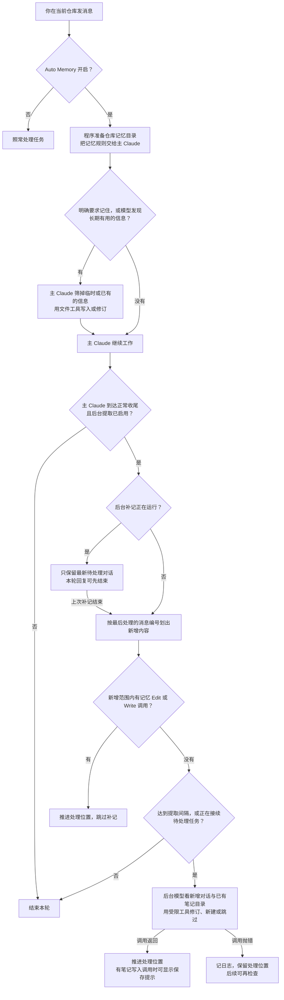
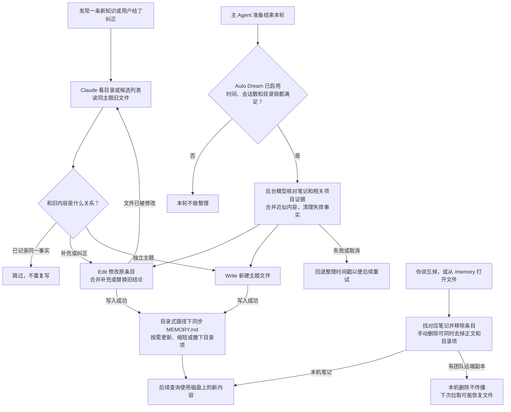
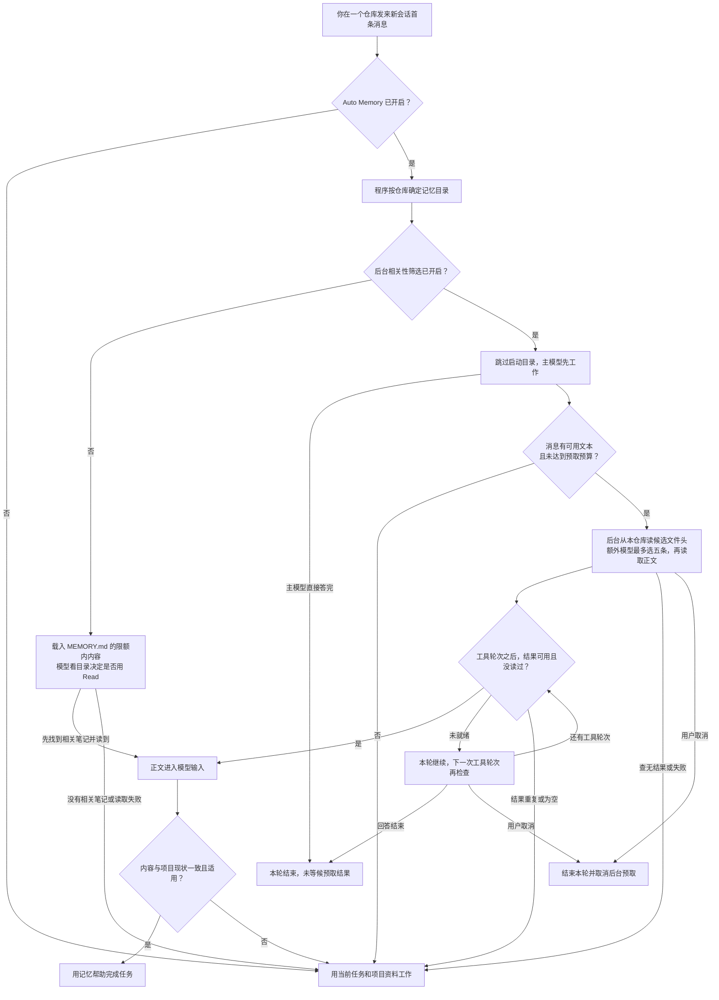
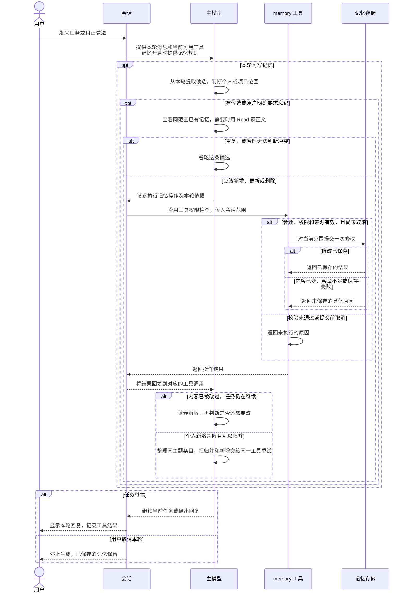
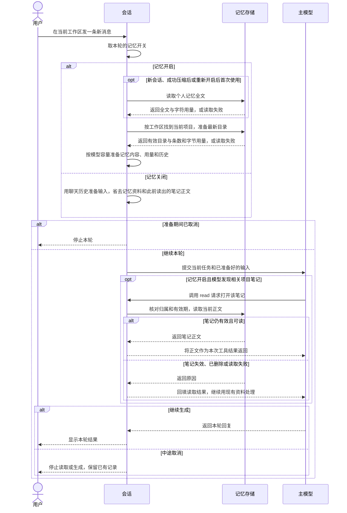
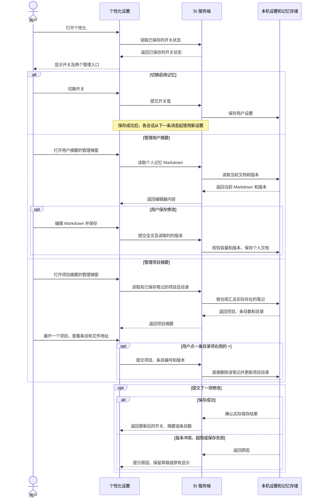

# 里程碑 2 Feature 6 长期 Memory 设计讨论

2026-11-23 确认将出处改为服务端自动记录写入会话和时间。主模型结合可见对话判断长期价值。查证时按记忆条目回看有权限的来源会话。下文保留当时的讨论和早期接口示例，现行行为见 [长期 Memory 技术设计](./feature6-长期Memory技术设计.md) 与 [Memory 提示词](./feature6-Memory提示词.md)。

## 已确认的需求

一次编程任务里值得保留的信息，能在之后的新会话中按任务找回，帮助完成实际工作。用户可编辑个人记忆全文，查看已保存记忆的项目和条目目录，并删除项目条目。项目笔记的本机地址可从目录取得，正文、来源和适用范围可在笔记文件里查看。项目专属信息按项目隔离，适合跨项目复用的信息可以在其他项目的相关任务中使用。验收覆盖网页上的真实任务、项目隔离、纠正和删除。会话历史和压缩继续用于接续原会话。本期以 Claude Code 的 Auto Memory 为主要功能参考。 [里程碑规划](../README.md#第六步长期-memory)

## 已确认的关键决策

### 【功能决策｜会话、Memory】主模型在本轮处理过程中写入记忆

**用户已确认（2026-11-20）。** 首版由主模型边做边记。提取范围是本轮用户消息、模型回复和工具结果。之前的对话只用于理解本轮，例如弄清用户确认的方案。信息在这一轮明确后，主模型即可判断并写入。后台补记留到后续评估。该决定作为后续技术设计的写入前提。 [SI 方法文档](./feature6-Memory方法设计.md#memory-写入) · [Claude Code 主模型保存规则](../../../claude-code/restored-src/src/memdir/memdir.ts#L236) · [Claude Code 后台补记入口](../../../claude-code/restored-src/src/query/stopHooks.ts#L136)

### 【功能决策｜工作区、会话、Memory】同一 Git 仓库的工作目录共用项目记忆

**用户已确认（2026-11-20，选择 B）。** 参考 Claude Code，项目记忆归属于会话工作区所在的本机 Git 仓库。会话向上找到最近的仓库。属于同一仓库的主目录、普通子目录和 worktree 共用一份 `MEMORY.md` 目录和对应笔记，独立克隆和 Git 子模块各自保存。位于 Git 仓库之外的文件夹按 SI 工作区保存。只适用于某个子目录、分支或环境的记忆，在正文写明适用条件。写入、查重和召回共用这套归属规则。 [SI 方法文档](./feature6-Memory方法设计.md#怎么区分-user-和-project) · [Claude Code 记忆目录](../../../claude-code/restored-src/src/memdir/paths.ts#L198) · [Claude Code worktree 归属](../../../claude-code/restored-src/src/utils/git.ts#L111)

### 【功能决策｜会话、Memory】新会话直接带上个人记忆全文

**用户已确认（2026-11-20）。** 新会话首次请求模型时，直接提供有内容上限的个人记忆全文。模型从第一轮就可以使用跨项目偏好。个人记忆全文占用一部分模型输入空间。该决定作为后续技术设计的个人记忆首次召回规则。 [SI 召回方法](./feature6-Memory方法设计.md#memory-召回) · [Claude Code 个人指令加载参考](../../../claude-code/restored-src/src/utils/claudemd.ts#L825)

### 【功能决策｜Memory、设置】个人记忆只收跨项目的协作信息

**用户已确认。** `USER.md` 收录沟通偏好、协作约定，以及用户明确提供且会影响协作的长期背景。正文按实际主题用 Markdown 分节，一主题一小段。个性化设置中的用户摘要展示并编辑会话所用的同一份正文。当前项目里的反馈按项目归属保存。 [个人记忆内容和样例](./feature6-Memory方法设计.md#个人记忆的内容) · [Hermes 的用户信息分类](../../../hermes/tools/memory_tool.py#L384)

### 【功能决策｜Memory 工具、记忆存储】个人和项目共用工具，个人新增超限时整批提交

**用户已确认（选择 B）。** `write`、`update`、`delete` 分别对应 Hermes 的 `add`、`patch`、`remove`。两个范围平时各按一条修改提交。个人新增超限时，主模型根据最新条目把同主题归并和新增放进同一次调用。整批可保存才提交，无法在保留有效信息的前提下腾出空间时，跳过新增。项目笔记仍逐条修改。 [Hermes 的操作定义](../../../hermes/tools/memory_tool.py#L409) · [Hermes 的超限反馈](../../../hermes/tools/memory_tool_store.py#L327) · [工具接口与结果](#memory-工具与记忆存储)

**用户已确认参考 Hermes 的工具提示规范。** 系统提示给出记忆判断规则，工具声明说明请求怎么填，工具回执按实际结果给出下一步。个人新增超限时，回执说明差多少字符，带上最新条目。保存完成或已有相同内容时，回执提示结束这条记忆的处理。 [回执装载稿](./feature6-Memory提示词.md#工具回执)

### 【功能决策｜Memory 工具、记忆存储】项目目录和笔记保存前检查容量

**用户已确认。** 每个项目最多 200 条有效记忆，完整 `MEMORY.md` 最多 24 KB，单篇笔记最多 4 KB。大小用 UTF-8 字节计，分别为 24,000 和 4,000。存储按修改后的目录和笔记检查。到期笔记按现有规则清理，仍有效的旧笔记保留。容量不足时，工具返回具体原因，会话继续当前任务。 [保存与检查规则](./feature6-长期Memory技术设计.md#31-在任务中写入记忆) · [工具回执](./feature6-Memory提示词.md#工具回执)

Hermes 在每个 profile 下用 `MEMORY.md` 直接保存 Agent 笔记正文，用 `§` 分隔条目。会话开始时整份带入系统提示，并附上用量。SI 的项目目录参考 Claude Code，用标题、简述和链接指向单独的笔记。项目容量检查参考 Hermes，用提交后的内容算用量，超限时保留原文并返回原因。 [Hermes 读写格式](../../../hermes/tools/memory_tool_store.py#L701) · [Hermes 系统提示](../../../hermes/agent/system_prompt.py#L535) · [Hermes 超限回执](../../../hermes/tools/memory_tool_store.py#L327)

**用户已确认附带记忆用量。** 新会话第一次调用模型时，随 `USER.md` 正文提供已用字符和上限，随项目 `MEMORY.md` 目录提供有效条数和目录字节数的已用量与上限。内容刷新时用量一起刷新。写入检查以最终拟保存的内容为准，回执列出超出的项目及需要腾出的数量。 [Hermes 用量提示](../../../hermes/tools/memory_tool_store.py#L675) · [SI 装载模板](./feature6-Memory提示词.md#5-会话附入的资料)

### 【功能决策｜会话、Memory】个人记忆在新会话和会话压缩后重新读取

**用户确认参考 Claude Code（2026-11-20）。** SI 在新会话第一次请求模型前读取最新的个人记忆。已经打开的会话沿用手头的版本，直到完成上下文压缩，再为后续模型请求重新读取。因此，在一个会话里更新或删除个人偏好后，另一个已打开的会话可能暂时还拿到旧版本。Claude Code 的参考是跨项目的个人指令文件，会话会缓存其内容，主会话压缩后清掉缓存。SI 将这个刷新时机用于自己的个人记忆文档。 [SI 召回方法](./feature6-Memory方法设计.md#memory-召回) · [Claude Code 会话上下文缓存](../../../claude-code/restored-src/src/context.ts#L155) · [Claude Code 压缩后的刷新](../../../claude-code/restored-src/src/services/compact/postCompactCleanup.ts#L51)

### 【功能决策｜会话、Memory】项目目录随每条新消息刷新，与个人记忆一起提供

**用户已确认（选择 B）。** 项目记忆目录沿用 Skill 的装载时机。每条新消息到来时，`AgentSession` 为本轮准备当前项目的最新 `MEMORY.md`，本轮后续模型调用沿用这份目录。会话把个人记忆全文和当前项目的目录放在同一份模型输入里。个人全文在新会话和压缩后重读，项目笔记正文按任务需要打开。 [SI 召回方法](./feature6-Memory方法设计.md#memory-召回) · [SI Skill 的发现时机](../../../packages/coding-agent/src/agent-session.ts#L396) · [SI Skill 目录的装载](../../../packages/coding-agent/src/system-prompt.ts#L62)

### 【功能决策｜设置、Memory】关闭记忆时暂停记录和召回，仍可管理已有记忆

**用户已确认（选择 A）。** 一个开关同时控制个人记忆和项目记忆。关闭设置保存后，所有会话从下一条消息起暂停自动写入和召回。会话停止向模型提供个人记忆全文、项目目录和此前读过的项目笔记正文。已写进聊天的话继续保留。用户仍可编辑个人摘要、查看项目目录和删除项目笔记。重新开启后，可以继续记录和使用保留的记忆。自动记录与召回共用开关的做法参考 Claude Code 的 Auto Memory。 [Claude Code 自动记录规则](../../../claude-code/restored-src/src/memdir/memdir.ts#L419) · [Claude Code 自动记忆目录加载](../../../claude-code/restored-src/src/utils/claudemd.ts#L979) · [Claude Code 官方开关说明](https://code.claude.com/docs/en/memory#enable-or-disable-auto-memory)

### 【功能决策｜设置、Memory】记忆默认开启

**用户已确认（2026-11-20，选择 A）。** 首次使用 SI 或升级后尚未设置过记忆时，默认开启，第一轮任务即可自动积累记忆。用户可以随时在设置里关闭。保存过的选择优先于默认值。这个默认值沿用 Claude Code 的本地会话。 [Claude Code 默认值源码](../../../claude-code/restored-src/src/memdir/paths.ts#L50) · [Claude Code 官方开关说明](https://code.claude.com/docs/en/memory#enable-or-disable-auto-memory)

## 1. Claude Code 什么时候记

1. **工作中，处理任务的 Claude 可以直接记。** Claude Code 在构造系统提示时检查 Auto Memory 开关。开启后，程序准备当前仓库的记忆目录，把保存、更新、查阅和忘记的规则交给模型。你明确说「记住」时，规则要求它在这一轮尝试保存。你纠正了做法、确认了一项不容易从项目里看出来的做法，或说出了后续有用的项目决定时，模型也可以自行保存。就算你说了「记住」，可从代码、Git、项目说明直接查到的内容和临时进度仍要筛掉。是否值得记由模型在执行任务时判断。默认记忆目录有文件写权限的特殊放行，写入本身仍经文件工具和权限检查。 [开关与准备目录](../../../claude-code/restored-src/src/memdir/memdir.ts#L419) · [保存和忘记指令](../../../claude-code/restored-src/src/memdir/memdir.ts#L236) · [排除条件](../../../claude-code/restored-src/src/memdir/memoryTypes.ts#L184) · [默认目录写权限](../../../claude-code/restored-src/src/utils/permissions/filesystem.ts#L1565)
2. **一轮回答准备收尾时，可以后台补记。** 这里的一轮指从你发消息到 Claude 准备结束本轮回复，期间可以多次请求模型和执行工具。主 Agent 到达正常的收尾处理后，若当前构建和会话打开后台提取，Claude Code 才启动它。主模型的 API 错误走失败处理。后台提取也跳过子 Agent、`--bare` 和远程模式。 [模型循环收尾](../../../claude-code/restored-src/src/query.ts#L1258) · [启动后台提取](../../../claude-code/restored-src/src/query/stopHooks.ts#L133) · [额外开关](../../../claude-code/restored-src/src/memdir/paths.ts#L69) · [会话条件](../../../claude-code/restored-src/src/services/extractMemories/extractMemories.ts#L527)
3. **后台补记只处理上次检查之后的内容。** 程序用最后处理的消息编号划界，压缩使编号消失时，计数退回当前模型仍能看到的消息。它先查看该范围里是否出现过指向记忆目录的 `Edit` 或 `Write` 调用。只要找到调用，就推进处理位置并跳过补记。这一步查的是调用记录，因此一次失败的写入也可能让它跳过。否则达到配置的轮次间隔时，程序把候选笔记的文件名和描述、当前对话及处理范围交给后台模型。后台模型可以查阅，修改仅限记忆目录内的 `Edit` 或 `Write`。如果已经在补记，程序只保留最新的一次待处理对话，等当前任务结束再接着处理。后台调用返回时推进位置，即使没有写新笔记。调用抛错时保留位置，后续有机会再处理。 [消息范围和写入判断](../../../claude-code/restored-src/src/services/extractMemories/extractMemories.ts#L82) · [抽取与推进位置](../../../claude-code/restored-src/src/services/extractMemories/extractMemories.ts#L329) · [后台提示](../../../claude-code/restored-src/src/services/extractMemories/prompts.ts#L27) · [后台工具权限](../../../claude-code/restored-src/src/services/extractMemories/extractMemories.ts#L166) · [失败与后续任务](../../../claude-code/restored-src/src/services/extractMemories/extractMemories.ts#L497)

一轮任务中，主 Claude 和后台提取都可以参与写入。达到条件的后台整理从同一个收尾入口启动，见第 2 节。



## 2. 一条记忆怎样更新、合并和删除

1. **内容按主题存，目录只负责指路。** 一个主题文件用 Markdown 保存，顶部有 `name`、`description`、`type`。反馈类和项目类正文还会说明原因和适用场景。平时先写正文，再把简述和链接同步到 `MEMORY.md`。两者是两次文件操作。如果后一步失败，目录可能暂时没有展示新笔记。若启用了后文的后台筛选路径，源码指示写主题文件，并且省略维护启动目录这一步。日期日志只出现在快照的特定助手模式分支。工作原始记录在会话日志里，单会话压缩摘要也另存于该会话自己的 `session-memory/summary.md`。 [写入分支](../../../claude-code/restored-src/src/memdir/memdir.ts#L199) · [主题文件格式](../../../claude-code/restored-src/src/memdir/memoryTypes.ts#L258) · [日期日志分支](../../../claude-code/restored-src/src/memdir/memdir.ts#L318) · [会话摘要路径](../../../claude-code/restored-src/src/utils/permissions/filesystem.ts#L257)
2. **更新和合并靠模型理解内容，文件工具负责实际改动。** Claude 先从目录或文件列表里找同主题笔记，再读原文。重复内容可以跳过，补充信息合到旧笔记，新的纠正替换过时结论，独立话题才新建。以用户说「先跑受影响的测试」为例，若已有测试习惯笔记，模型应修改原笔记，并根据变化更新简述。编辑已有内容时，`Edit` 检查先前是否读取过、目标文字是否匹配。若读取后有人改过且内容变了，工具会拒绝，Claude 需重新读取。这里查到的是模型按提示判断相似性、再调用通用文件工具的流程。文件名、修改时间和描述用于列候选，后台找回的相关性筛选也走模型请求。 [去重和更新指令](../../../claude-code/restored-src/src/memdir/memdir.ts#L219) · [编辑校验](../../../claude-code/restored-src/src/tools/FileEditTool/FileEditTool.ts#L275) · [执行前再核对](../../../claude-code/restored-src/src/tools/FileEditTool/FileEditTool.ts#L442) · [候选列表](../../../claude-code/restored-src/src/memdir/memoryScan.ts#L35)
3. **Auto Dream 是另一条会合并笔记的路径。** 它同样在主 Agent 收尾时被检查。启用后，默认距上次整理至少 **24 小时**，当前工作目录的日志中至少有 **5 个其他会话**在上次整理后被更新，并且能拿到当前记忆目录的整理锁。扫描有 **10 分钟**节流，阈值可以由配置覆盖。这些是 2.1.88 的默认条件。条件满足后，后台模型先读现有目录和笔记，再按需查近期日志、当前代码或旧会话片段，把新信息合到旧主题，修正矛盾，删去笔记里失效的事实，移除目录中过时或被替代的链接。用 `Edit` 或 `Write` 直接改文件。整理失败或用户取消会回退整理时间戳，已发生的文件改动不由这条回退路径撤销。 [启用与触发](../../../claude-code/restored-src/src/services/autoDream/autoDream.ts#L54) · [整理步骤](../../../claude-code/restored-src/src/services/autoDream/consolidationPrompt.ts#L26) · [执行与异常](../../../claude-code/restored-src/src/services/autoDream/autoDream.ts#L210) · [锁和时间戳](../../../claude-code/restored-src/src/services/autoDream/consolidationLock.ts#L38) · [取消入口](../../../claude-code/restored-src/src/tasks/DreamTask/DreamTask.ts#L132)
4. **可以删除，删除范围要看做了什么。** 你可以在 `/memory` 打开目录，删除主题文件和它在 `MEMORY.md` 的链接。你也可以说「忘掉这条」，提示要求主 Claude 找到并移除对应条目，实际操作受当前工具和权限约束。只删链接时，正文还在磁盘上，扫描主题文件的路径仍可能找到它。后台补记和 Auto Dream 只能清掉文件中的文字或目录项，它们共用的权限规则禁止删除文件的 shell 命令。删掉文件也只影响后续从磁盘读取，已经读进旧会话的副本和原始对话有自己的历史记录。团队同步路径另有一条边界：本机删文件不会推送远端删除，下次拉取可把文件恢复到本地。 [忘记指令](../../../claude-code/restored-src/src/memdir/memdir.ts#L243) · [打开编辑器](../../../claude-code/restored-src/src/commands/memory/memory.tsx#L21) · [后台工具限制](../../../claude-code/restored-src/src/services/extractMemories/prompts.ts#L29) · [读入消息副本](../../../claude-code/restored-src/src/utils/messages.ts#L3708) · [团队文件同步语义](../../../claude-code/restored-src/src/services/teamMemorySync/index.ts#L14)



## 3. 项目和个人怎么区分

**主题类型回答「写的是什么」。目录回答「哪些会话能用」。** 主会话的 Auto Memory 默认按 Git 仓库确定目录。同一仓库的子目录与 worktree 共用，非 Git 目录按项目根退回。四种类型默认都落在这一套目录，`type: user` 不会把文件送进一个跨项目的个人记忆库。目录可通过设置改位置。现行官方文档也描述了指定共用项目目录名的做法，这属于显式配置。 [目录计算](../../../claude-code/restored-src/src/memdir/paths.ts#L198) · [类型定义](../../../claude-code/restored-src/src/memdir/memoryTypes.ts#L113) · [现行目录覆盖选项](https://code.claude.com/docs/en/memory#storage-location)

| 类型 | 什么信息会放这里 | 例子 |
| --- | --- | --- |
| `user` | 用户角色、熟悉程度、协作偏好 | 用户熟悉后端，讲前端时从他熟悉的工作入手 |
| `feedback` | 用户纠正过的做法，或确认以后还要沿用的做法 | 集成测试优先验证实际数据库行为 |
| `project` | 代码和 Git 看不出的项目目的、决定、负责人或时间约束 | 本次改造的原因，以及什么时候应改变原方案 |
| `reference` | 去哪里找当前信息 | 某类问题在哪个工单看板追踪 |

常见的项目和个人范围出现在几套不同的文件上。

| 你希望谁能用 | Claude Code 里的位置 | 谁维护 |
| --- | --- | --- |
| 当前仓库的后续主会话 | `~/.claude/projects/<project>/memory/` | Claude 自动积累，你也可编辑 |
| 你在其他项目也希望 Claude 遵循的长期指令 | `~/.claude/CLAUDE.md` | 你维护，或明确让 Claude 更新 |
| 当前项目所有贡献者都该遵循的约定 | 项目 `CLAUDE.md`、`.claude/CLAUDE.md` 或 `.claude/rules/` | 随项目维护，可进版本库 |
| 只适用于你在这个项目的做法 | 项目 `CLAUDE.local.md` | 个人维护，通常不提交 |
| 某个自定义子 Agent 的学习 | `memory: user` 用 `~/.claude/agent-memory/<agent>/` 跨项目。`project` 和 `local` 分别用项目 `.claude/agent-memory/` 和 `.claude/agent-memory-local/` | 指定的子 Agent 维护，主会话有独立目录 |
| 有资格使用团队记忆的成员 | 本地仓库记忆目录下的 `team/`，由仓库关联的团队服务同步 | 团队范围的自动记忆，受构建和功能开关控制 |

项目和个人指令会按适用位置读取。Auto Memory 是另外一组文件。团队路径开启时，提示明确要求 `user` 始终私有，`feedback` 默认私有，只有明确的团队约定才共享。`project` 倾向共享，`reference` 通常也可共享，仍要由模型按内容决定。团队同步按仓库和组织范围工作。源码中的 `/remember` 审查技能只在内部环境注册，负责提议哪些记忆要搬到项目指令、个人项目指令或团队记忆，或哪些该清理，提示要求先由用户批准。主会话的普通保存不会按类型自动升级到这些位置。 [指令加载](../../../claude-code/restored-src/src/utils/claudemd.ts#L1) · [子 Agent 的三种范围](../../../claude-code/restored-src/src/tools/AgentTool/agentMemory.ts#L46) · [团队目录开关](../../../claude-code/restored-src/src/memdir/teamMemPaths.ts#L66) · [团队范围判断](../../../claude-code/restored-src/src/memdir/memoryTypes.ts#L37) · [团队同步](../../../claude-code/restored-src/src/services/teamMemorySync/index.ts#L1) · [内部审查技能](../../../claude-code/restored-src/src/skills/bundled/remember.ts#L4)

## 4. 下次怎么找回并使用

上一轮使用同一个本机 Qwen 分词器计量。从 Claude Code 2.1.88 源码生成的常规 Auto Memory 系统规则约 **2,665 tokens**，四类记忆的说明与例子约占 **1,537 tokens**。SI 该轮精简把字段和回执集中放入工具描述，将长例子留在文档，系统规则从 **1,478** 降到 **608 tokens**，工具描述从 **164** 增至 **250 tokens**。固定文字合计从 **1,642** 降到 **858 tokens**，减少 **784 tokens（47.7%）**。这组数字对应当时的装载稿，目录、笔记正文、来源数据和工具参数结构随实际请求计算。 [Claude Code 主提示词](../../../claude-code/restored-src/src/memdir/memdir.ts#L199) · [SI 装载稿](./feature6-Memory提示词.md)

1. **启动新会话时，程序先确定当前仓库。** 常规路径将该仓库的 `MEMORY.md` 与项目、个人指令一起交给主 Claude。官方说明为 **200 行或 25 KB**。本地 2.1.88 的裁剪函数实际用 JavaScript 字符串长度检查第二个阈值。用 200 行中文目录复现时，约 58.7 KB 的 UTF-8 内容原样保留。主 Claude 看到相关目录项或收到明确的回想请求后，用 `Read` 打开笔记。读取结果进对话，下一次模型调用就能用它。过时事实按当前项目核对，无相关记忆时继续处理任务。在快照的过去上下文搜索开关开启时，提示还允许先搜该目录的主题笔记，再按窄关键词查旧会话日志。 [官方说明](https://code.claude.com/docs/en/memory#how-it-works) · [本地裁剪逻辑](../../../claude-code/restored-src/src/memdir/memdir.ts#L57) · [读取入口](../../../claude-code/restored-src/src/utils/claudemd.ts#L979) · [访问和核对规则](../../../claude-code/restored-src/src/memdir/memoryTypes.ts#L216) · [旧记录搜索](../../../claude-code/restored-src/src/memdir/memdir.ts#L375)
2. **另一条受开关控制的路径，会按这条消息提前搜笔记。** 开启时，程序跳过启动时加载记忆目录文件。收到具备条件的消息后，主模型立即开始，后台同时扫描当前记忆目录的主题文件头，取最近修改的最多 200 份，把本次请求、文件名和描述交给一次额外的模型请求。无空白分词的输入，例如只有一句无空格中文，在快照中会跳过这次预取。后台最多将五条正文作为附带提示，每篇最多 200 行或 4 KB，另有会话累计预算。找不到、失败或已经读过时不送入重复内容。主循环只在工具执行后的追加消息阶段取就绪结果。就绪则交给后续模型请求，未就绪则下一个工具轮次再查，直接答完或取消时本轮可能用不上。 [索引切换](../../../claude-code/restored-src/src/utils/claudemd.ts#L1136) · [预取的触发和取消](../../../claude-code/restored-src/src/utils/attachments.ts#L2361) · [文件头扫描](../../../claude-code/restored-src/src/memdir/memoryScan.ts#L21) · [模型筛选](../../../claude-code/restored-src/src/memdir/findRelevantMemories.ts#L77) · [读取正文限制](../../../claude-code/restored-src/src/utils/attachments.ts#L2279) · [工具轮次追加](../../../claude-code/restored-src/src/query.ts#L1592)
3. **压缩改变的是当前会话的内容。** 主会话压缩后的清理会清掉指令和记忆文件的缓存，下次构造上下文时可重新从磁盘读目录。预取路径根据仍在消息里的记忆附件去重和计量，压缩移掉旧附件后，后续可再次挑中同一篇笔记。磁盘里长期记忆仍由前面的写入路径维护。 [压缩后的缓存清理](../../../claude-code/restored-src/src/services/compact/postCompactCleanup.ts#L31) · [预取查重和预算](../../../claude-code/restored-src/src/utils/attachments.ts#L279)



本地内部机制取自公开 npm 包还原的 2.1.88 源码，常规用户路径与现行官方文档交叉核对。本机 CLI 为 2.1.326。本次属于静态源码核对，未运行真实模型，后台提取、Auto Dream、团队同步和预取开关在本机账号上的实际启用情况待验证。 [源码来源](../../../claude-code/README.md) · [官方记忆说明](https://code.claude.com/docs/en/memory)

## SI 流程与模块评审

三个流程均已确认，已整理为[技术设计稿](./feature6-长期Memory技术设计.md)和[验收标准](./feature6-长期Memory验收标准.md)。技术设计稿待整体批准。

| 流程 | 要确认的结果 | 状态 |
| --- | --- | --- |
| 3.1 在任务中写入记忆 | 主模型做判断，工具保存改动并返回结果 | 已确认 |
| 3.2 在任务中找回记忆 | 会话一起提供个人记忆和当前项目目录，模型按需读项目正文 | 已确认 |
| 3.3 在个性化设置里管理记忆 | 一个开关、个人 Markdown 编辑、项目目录和单条删除 | 已确认 |

### 3.1 在任务中写入记忆

**用户已确认。** 首版由主模型边做边记。只读和计划模式都停用 `memory` 写入工具。本轮主模型答完后，记忆写入随本轮结束，后台补记留到后续评估。

你发出任务后，主模型判断本轮有没有值得留下的信息。以「这个项目的集成测试以后都连真实测试数据库」为例，若现有项目资料还没有这条约定，模型提炼成一条 `feedback`，由 `memory` 工具保存。你在同项目的新会话里发来测试任务时，模型可以从项目目录找到这条笔记。具体筛选规则见[写入方法](./feature6-Memory方法设计.md#memory-写入)。



#### 会话 `AgentSession` 与工具循环 `Agent`

会话确认开关和现有工具权限，提供当前工作区和本轮来源。模型在同一轮内可边处理任务边调工具。只读和计划模式沿用现有写入限制。模型已经结束回复时，本轮工具循环随之结束，因此提取范围是这一轮**当时已经出现**的消息、回复和结果。 [SI 模型输入准备](../../../packages/coding-agent/src/agent-session.ts#L879) · [SI 工具权限](../../../packages/coding-agent/src/agent-session.ts#L219) · [SI 工具循环](../../../packages/agent/src/agent.ts#L75) · [Pi 的工具循环](../../../pi/packages/agent/src/agent-loop.ts#L251)

**接口（新增 0，修改 1）**

- 【修改】`prepareContext`（会话内部回调）。准备模型请求时，按记忆设置提供规则和工具，沿用会话对此时权限的检查。模型工具调用、对应结果和取消处理继续走已有 `Agent.run`。

**数据（新增 0，修改 0）**

- 【沿用】会话记录 `ConversationMessage`。会话用现有消息编号和时间定位本轮原文，把可引用的本轮消息编号交给模型，工具据此核验来源。此前消息只用于理解本轮。 [会话消息](../../../packages/coding-agent/src/types.ts#L25)

#### `memory` 工具与记忆存储

**工具操作与项目笔记存储格式已确认。** 模型通过 `memory` 写入、更新或删除，更新和删除用条目编号与已读版本定位。项目的 `MEMORY.md` 每条只提供标题、链接和简述，独立笔记用 YAML 文件头保存条目信息，正文用 Markdown。工具核验请求后，由存储提交改动，实际结果沿现有工具循环交回模型。 [项目笔记示例](./feature6-Memory方法设计.md#项目记忆保存到-markdown-的例子) · [SI 现有工具入口](../../../packages/coding-agent/src/tools.ts#L111) · [Pi 的工具执行](../../../pi/packages/agent/src/agent-loop.ts#L518)

Hermes 用一个 `memory` 工具接收 `add`、`patch` 和 `remove`。它以 `old_text` 定位旧条目，匹配多个不同条目时返回错误。同一份文档支持用 `operations` 一次提交多项修改，按最终大小校验容量。实际保存时先加锁再读盘，成功后返回完成状态和用量。 [Hermes 工具参数](../../../hermes/tools/memory_tool.py#L373) · [Hermes 条目定位](../../../hermes/tools/memory_tool_store.py#L98) · [Hermes 写入](../../../hermes/tools/memory_tool_store.py#L353) · [Hermes 批量操作](../../../hermes/tools/memory_tool_store.py#L568) · [Hermes 成功结果](../../../hermes/tools/memory_tool_store.py#L660)

SI 通过 `scope` 选择个人或项目。项目笔记按仓库分别存文件，由程序根据已保存的笔记刷新目录。个人记忆保存在单份有上限的文档。用条目编号和已读版本定位修改，避免按文字猜目标。 [Claude Code 项目笔记与目录](../../../claude-code/restored-src/src/memdir/memdir.ts#L219)

**接口（新增 2，修改 0）**

- 【新增】`memory`（模型工具）。**用途**是让主模型提交已经判断好的记忆修改。**主要流程**是校验参数和适用范围，从会话取得当前项目，并核对写入开关、权限、来源和取消状态。引入新内容时只接受本轮已经出现的来源编号，由会话填入实际位置和时间。更新和删除用已读的条目编号与版本定位。工具收到存储的结果后，按原工具调用编号交回主模型。通常按实际结果回答用户的明确记忆请求，容量失败通过工具回执说明并继续任务。
- 【新增】保存记忆操作（工具到记忆存储的内部调用）。同一范围的修改依次处理。存储先读当前内容，验证所有目标版本，再按改完后的内容检查容量。项目写入和更新按预计生成的目录和单篇笔记检查。校验通过且任务尚未取消时，个人记忆一次替换整份文件，项目记忆创建、替换或移除对应的主题笔记。准备召回目录时，从实际保存的笔记生成或刷新 `MEMORY.md`。提交成功后取消任务，已保存的结果继续保留。

**数据（新增 3，修改 0）**

- 【新增】记忆操作。单条传入 `operation` 与 `scope`。`scope` 选 `user` 或 `project`，会话根据工作区确定具体仓库。个人新增超限后，保留 `scope: user`，用 `operations` 代替单条 `operation`，提交待新增项和用于腾出空间的旧条目修改。只整理旧内容的 `update` 可省去本轮来源编号。归并时用 `mergeFromEntryIds` 指定被并入的旧条目。批内的 `delete` 和被并入的条目一一对应，并带各自版本。存储将这些条目的来源一起保留到更新后的条目。省略时模型直接继续当前任务。
- 【新增】记忆条目。项目笔记以 YAML 文件头保存标题、简述、类别、来源、更新时间、条目编号和版本，下面保存 Markdown 正文。个人文档随各条目提供 `entryId` 和 `revision`，项目笔记用 `read` 打开后才看到这两个值。另一会话已更新或用户从设置删除的条目，按提交时的实际状态和版本校验。 [字段分类](./feature6-Memory方法设计.md#项目记忆怎么分类和表达) · [目录与笔记文件示例](./feature6-Memory方法设计.md#项目记忆保存到-markdown-的例子)
- 【新增】记忆操作结果。保存成功时返回 `saved` 或 `deleted`，并给出条目编号。保存的条目同时返回新版本。若已有条目的内容与适用条件一致，重复新增返回 `unchanged` 和既有条目标识。整批成功返回 `saved` 和各项结果。失败沿用 `isError` 标记和工具结果回填。冲突用 `version_conflict`，提供发生冲突的最新条目。容量不足用 `capacity_exceeded`，说明触及的限制、用量和超出量。个人单条新增超限时，同时提供当前条目的编号、版本和内容。最终无法保存时保留原文件，原因通过工具结果交回，当前任务继续。 [回执装载稿](./feature6-Memory提示词.md#工具回执)

| 模型的判断 | 写入操作携带的信息 |
| --- | --- |
| `write` 新增一条 | 标题、简述、正文和本轮来源编号。项目记忆带 `type`，在 `feedback`、`project`、`reference` 中选一个。有明确时效的 `project` 条目可带 `expiresAt`。 |
| `update` 补充或纠正 | `entryId`、`expectedRevision`、需要改动的字段和本轮来源编号。工具保留未提交的字段，存储计算新版本。 |
| `delete` 忘掉一条 | `entryId` 和 `expectedRevision`。工具按编号删除，正文不随请求提交。 |

下面是项目记忆的构造示例。第一次记下集成测试约定，之后有明确补充时更新同一条。`sourceMessageIds` 是会话交给模型的本轮消息编号。打开笔记后获取 `entryId` 和 `revision`，把读到的版本作为 `expectedRevision` 提交。

```json
{
  "operation": "write",
  "scope": "project",
  "type": "feedback",
  "title": "集成测试环境",
  "summary": "集成测试使用真实测试数据库",
  "content": "补集成测试时连接真实测试数据库。\n\n**原因**　用实际的数据库验证迁移能否生效。",
  "sourceMessageIds": ["example-message-1"]
}
```

```json
{
  "operation": "update",
  "scope": "project",
  "entryId": "integration-testing",
  "expectedRevision": 1,
  "changes": {
    "summary": "集成测试使用真实测试数据库，运行前确认迁移已完成",
    "content": "补集成测试时连接真实测试数据库。\n\n**原因**　用实际的数据库验证迁移能否生效。\n\n**怎么用**　运行测试前确认迁移已经完成。"
  },
  "sourceMessageIds": ["example-message-2"]
}
```

更新成功后的工具结果构造示例。

```json
{
  "status": "saved",
  "entryId": "integration-testing",
  "revision": 2
}
```

个人新增超限的构造示例。`design-explanation` 和 `explain-in-order` 两条都在讲解释技术设计的顺序。模型把仍有效的做法整理到前一条，再删掉后一条，和新的协作约定一起提交。

```json
{
  "scope": "user",
  "operations": [
    {
      "operation": "update",
      "entryId": "design-explanation",
      "expectedRevision": 2,
      "changes": { "content": "解释技术设计时，先说用户能看到的结果，再举例说明流程。" },
      "mergeFromEntryIds": ["explain-in-order"]
    },
    { "operation": "delete", "entryId": "explain-in-order", "expectedRevision": 1 },
    {
      "operation": "write",
      "title": "重要取舍",
      "summary": "重要取舍逐项确认",
      "content": "遇到重要取舍时逐项对齐。",
      "sourceMessageIds": ["example-message-3"]
    }
  ]
}
```

### 3.2 在任务中找回记忆

**用户已确认。** 用户发出一条消息后，会话按已保存的设置准备记忆资料。开启时让模型按需找回相关记忆，关闭时照常使用聊天历史处理任务。 [筛选及查阅规则](./feature6-Memory方法设计.md#memory-召回)



#### 会话如何确定当前项目

从会话绑定的工作区出发，向上找到最近的 Git 仓库，然后按已确认的仓库归属规则定位一份项目目录。同一仓库的主目录和 worktree 共用，非 Git 工作区按该工作区归属。每轮装载的项目目录来自这个范围。工具临时在其他目录执行任务时，会话仍按绑定的工作区取记忆。 [SI 会话与工作区绑定](../../../packages/coding-agent/src/sessions.ts#L149) · [处理消息时取得工作区目录](../../../packages/coding-agent/src/agent-session.ts#L366) · [Claude Code 查找最近仓库的参考](../../../claude-code/restored-src/src/utils/git.ts#L27)

- **A、B、C 各自有仓库。** 在 B 的工作区发任务时，会话提供个人记忆全文和 B 的 `MEMORY.md`，项目正文仍由模型按需读取。打开三个仓库共同的上级文件夹时，按这个上级工作区自身的范围取目录。
- **A、B、C 属于同一个仓库。** 会话提供这一个仓库的共享目录。只适用于 B 的约定作为这个仓库的一条笔记，写清适用的子目录，模型根据任务决定是否打开。

#### 会话 `AgentSession`

会话在每条新消息到来时取已保存的开关。本轮多次请求模型时沿用这个选择及同一份项目目录。新会话、成功压缩后，或关闭再开启后的首次使用，读取个人全文。关闭时停用自动记忆。已经写进聊天消息和已有会话摘要的文字仍属于原对话。 [SI 模型输入准备](../../../packages/coding-agent/src/agent-session.ts#L879) · [SI 会话工作区](../../../packages/coding-agent/src/sessions.ts#L149)

**接口（新增 0，修改 2）**

- 【修改，沿用 3.1 同一项】`prepareContext`（准备模型输入）。按本轮设置准备个人全文、项目目录和聊天历史。单份资料读不到时，使用其余可用资料。关闭时跳过记忆读取，将关闭状态传给历史输入的组装步骤。准备期间取消时，沿用会话中止处理。
- 【修改】`finalizeContext`（模型调用前的最后装配）。沿用现有顺序重新确认系统提示和可用工具，再把准备好的个人全文、项目目录和各自的用量附入最终请求。先为任务和原有资料留出空间，再尝试放入完整的个人记忆，最后按完整行放入项目目录。最终容量校验包含记忆规则、工具、用量和实际附入的文字。 [SI 最后的输入装配](../../../packages/coding-agent/src/agent-session.ts#L920)

**数据（新增 1，修改 0）**

- 【新增】本轮记忆资料。会话记住本轮的开关和当前项目目录，按已确认的时点更新所持有的个人全文。资料随请求提供给模型；普通聊天历史由会话记录独立保存。

#### 历史与压缩

关闭后，会话组装发给模型的历史时，根据工具记录的实际路径识别之前读过的记忆笔记。历史里的 `memory` 参数和回执也可能携带原文，随模型输入一起处理。原聊天和工具记录仍可查看，工具调用与结果按原编号配对。 [SI 工具文件操作记录](../../../packages/coding-agent/src/agent-session.ts#L1137) · [SI 历史和工具结果](../../../packages/coding-agent/src/compaction.ts#L69)

**接口（新增 0，修改 2）**

- 【修改】`buildModelHistory`（组装发给主模型的历史）。关闭时，对已读记忆和 `memory` 工具结果保留调用编号和一条省略记忆内容的提示，历史里的 `memory` 调用参数置为空对象。
- 【修改】`prepareCompaction`（准备压缩摘要的输入）。关闭时采用同样的历史处理。以往已经生成的聊天摘要仍参与会话接续。 [SI 压缩模型请求](../../../packages/coding-agent/src/agent-session.ts#L690)

**数据（新增 0，修改 0）**

- 【沿用】历史工具结果和实际读到的文件路径。会话用既有记录识别发给模型的笔记正文，原始数据继续归会话存储。

#### 记忆存储与 `read` 工具

记忆存储提供个人全文，按当前仓库已保存的笔记准备 `MEMORY.md`。用完整目录行附入模型请求，最多 200 条且不超过 24 KB，实际条数还受本轮模型空间限制。到期条目从可提供的目录里排除，在允许修改的任务里直接清除。只读和计划模式使用当轮在内存中准备的有效目录，文件保持原样。模型选出相关条目后沿用 `read` 获取正文及工具结果。 [SI 现有读取工具](../../../packages/coding-agent/src/local-tools.ts#L125)

**接口（新增 2，修改 1）**

- 【新增】读取个人记忆全文（会话到记忆存储）。返回完整个人记忆与该版本的字符用量，或读取失败。
- 【新增】准备项目目录（会话到记忆存储）。返回当前项目的有效条目目录，以及完整目录的条数和字节用量，供本轮判断读哪篇笔记。
- 【修改】`read`（模型工具）。读取保存在记忆库内的笔记时，检查本轮记忆开关、所属项目和有效期。笔记找不到、到期或读取失败时沿用工具结果返回原因。

**数据（新增 1，修改 0）**

- 【新增】项目记忆目录 `MEMORY.md`。由该项目的记忆条目生成，把标题、链接和简述提供给模型。模型需要细节时再打开这个链接对应的笔记。 [同一条记忆的目录行与完整笔记](./feature6-Memory方法设计.md#项目记忆保存到-markdown-的例子)

### 3.3 在个性化设置里管理记忆

**用户已确认（2026-11-21）。** 用户从设置左侧打开「个性化」。主区域标题用「SI 记忆」，下方是「启用记忆」「用户摘要」「项目摘要」三行。沿用 SI 现有的导航、开关和弹窗样式。

```text
个性化          SI 记忆
               启用记忆       [开关]
               用户摘要       [管理]
               项目摘要       [管理]
```

「用户摘要」的管理弹窗显示会话会提供给模型的个人记忆 Markdown，可直接编辑全文并保存。「项目摘要」的管理弹窗列出有已保存笔记的项目。打开一个项目，就像翻开目录，能看到一共有多少条。每条展示 `MEMORY.md` 里的标题、简述及指向笔记的本机地址，右侧的「×」直接删除这一条。想看正文时，到对应地址打开文件。项目管理弹窗以目录为止。



#### 网页设置 `SettingsDialog`

两个「管理」按钮分别打开一个弹窗。个人摘要打开即可编辑 Markdown。项目摘要按项目显示可折叠的目录和条数。目录项提供可复制的本机笔记路径。删除成功后移除目录项、更新条数。删掉最后一条时，该项目从这份列表移除。两个管理入口在关闭自动记忆时仍可用。 [SI 设置导航](../../../web/src/components/SettingsDialog.tsx#L43) · [SI 现有开关](../../../web/src/components/McpSettings.tsx#L301)

**接口（新增 0，修改 1）**

- 【修改】`SettingsDialog`（网页设置入口）。进入此页读取开关，点「管理」再读取对应资料。网页按服务端确认更新开关和条目。读取失败时显示错误并允许重试。个人文档保存失败时保留编辑内容，删除失败时保留条目。

**数据（新增 1，修改 0）**

- 【新增】个性化管理视图。用户弹窗持有 Markdown 文本、编辑稿和整份文档的版本。项目弹窗持有项目列表以及各项目的目录项。页面上的每条目录项只显示标题、简述、笔记地址和删除按钮。

#### 服务端 `WebServer` 与记忆存储

用户摘要查询读取个人记忆当前保存的 Markdown，和会话使用同一份文档。编辑器显示模型收到的个人记忆正文，条目编号和版本由工具和存储维护。手动保存按整份文档校验版本和上限，避免把另一会话刚写入的条目覆盖掉。存储保留未改动条目的编号和来源，维护改动后的条目。已打开的会话按 3.2 的约定重读个人文档。

项目摘要从实际保存的项目记忆取数据。不同工作区若属于同一 Git 仓库，合并成一个项目。展开后显示与完整 `MEMORY.md` 一致的条目及顺序，召回时的模型容量上限只用于模型输入。服务端从已有项目范围和条目编号确定文件，网页提供的笔记地址用于查阅。执行删除时复用 3.1 的版本检查和存储提交，成功后刷新该项目目录。 [SI 全局设置写入](../../../packages/server/src/webserver/index.ts#L700) · [项目目录与笔记例子](./feature6-Memory方法设计.md#项目记忆保存到-markdown-的例子)

**接口（新增 6，修改 0）**

- 【新增】`GET /api/settings/memory`（读取开关）。返回本机已保存的设置。
- 【新增】`PUT /api/settings/memory`（保存开关）。保存后返回生效的设置。
- 【新增】`GET /api/memory/user`（读取用户摘要）。返回当前个人记忆正文的 Markdown 和文档版本。
- 【新增】`PUT /api/memory/user`（保存用户摘要）。提交 Markdown 全文和读取时的文档版本。保存成功后返回正文和新版本，冲突或超限时保留磁盘内容和用户的编辑稿。
- 【新增】`GET /api/memory/projects`（读取项目摘要）。列出有记忆的项目，返回每组目录项和条数。每条带已有条目编号和版本供删除。
- 【新增】`DELETE /api/memory/projects/:projectId/entries/:entryId`（删除项目笔记）。用已保存的项目范围、条目编号和版本定位并删除一条。返回该项目更新后的目录和条数，目录为空时从列表移除该组。

**数据（新增 2，修改 0）**

- 【新增】记忆设置 `memoryEnabled`。保存在本机用户设置中，未配置时默认开启。会话和设置共用这个值。
- 【新增】个人文档版本。记录编辑器取得的整份个人文档版本。模型工具或用户保存改动后更新版本，个人条目仍使用 3.1 的条目编号和版本。
