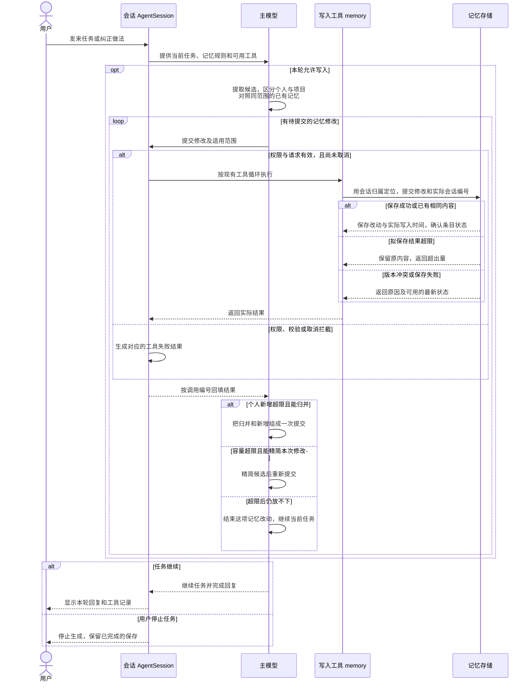
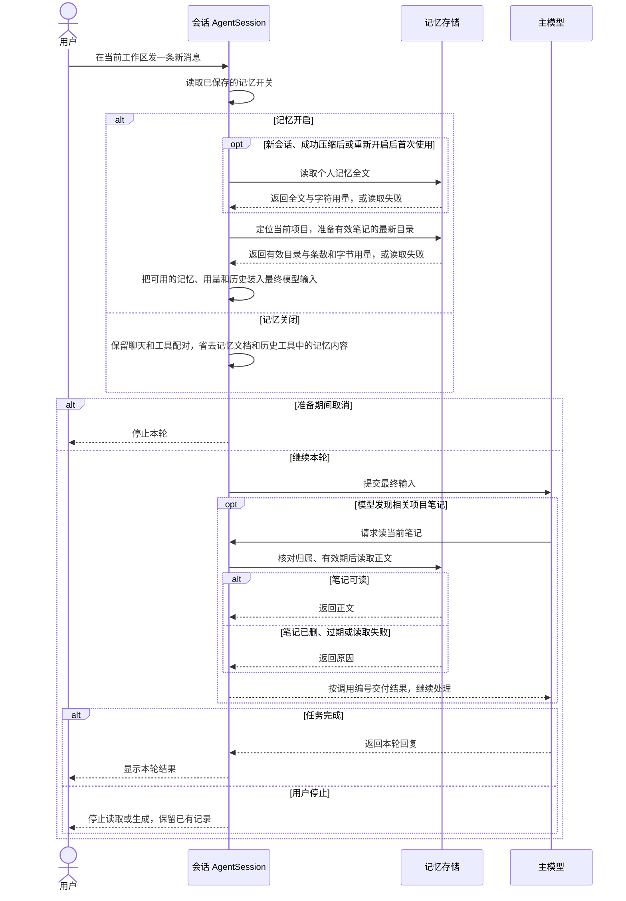
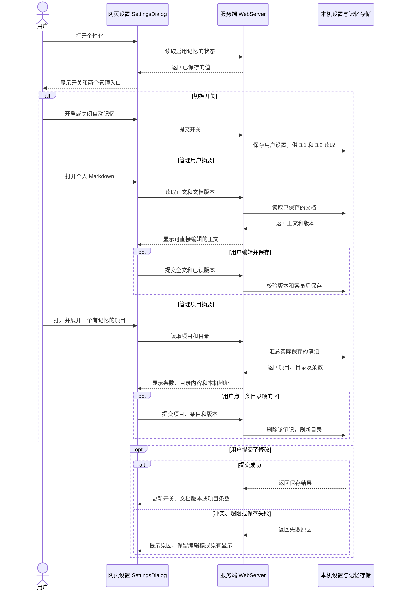

# 里程碑 2 Feature 6 长期 Memory 技术设计

**状态**　2026-11-23 按已确认的三个流程在独立分支实现。 [设计讨论](./feature6-设计讨论记录.md#si-流程与模块评审) · [验收记录](./feature6-长期Memory验收记录.md)

## 1. 总结

用户在任务里给过的长期偏好、项目约定和资料入口，能在后续会话中找到并用上。首版由主模型边做边记，默认开启。一个开关同时控制个人和项目的自动记录与召回，保存后从各会话的下一条消息起生效。用户可在「设置 → 个性化」直接编辑个人 Markdown，查看有记忆的项目目录并删除单条笔记。项目笔记的本机地址可复制，正文、适用条件、实际写入会话与时间保存在笔记文件中。

会话按工作区定位本机 Git 仓库。模型先收到 `USER.md` 正文、当前项目的 `MEMORY.md` 目录和两份资料的用量。单篇项目笔记按需用 `read` 打开。主模型通过 `memory` 新增、更新或删除记忆，程序在落盘前检查改完后的容量。超限原因留在工具结果中，本轮任务继续。 [写入与召回方法](./feature6-Memory方法设计.md) · [模型提示词与工具回执](./feature6-Memory提示词.md)

## 2. 系统变化

**当前**　网页把消息交给绑定工作区的会话。会话发现 Skill，并在每次主模型请求前准备项目说明、工具和聊天历史。模型使用工具后，结果按调用编号保存并交给后续请求。当前的长期资料来自用户保存的项目说明、Skill 和聊天记录。

**交付后**　会话在此基础上提供个人记忆和项目目录。模型可以在同一轮里主动读笔记，通过同一个工具修改个人或项目记忆，再继续用户原来的任务。个性化设置直接管理记忆文件和开关。继续已有会话时，聊天与压缩摘要仍用于接续。 [会话输入入口](../../../packages/coding-agent/src/agent-session.ts#L879) · [Agent 工具循环](../../../packages/agent/src/agent.ts#L74)

## 3. 系统设计

### 3.1 在任务中写入记忆

用户发出任务或纠正做法后，主模型从当前可见对话中判断哪些信息有足够依据、可长期复用，并在完成回复前尝试保存。一次提交可依据前文和本次确认的组合。



#### 会话 `AgentSession` 与工具循环 `Agent`

会话决定本轮是否向模型提供写工具，并把当前工作区、实际会话编号和取消信号交给它。只读与计划模式仍可召回记忆，写工具从声明和执行处停用。主模型完成回复后，本轮写入结束。模型结合可见的用户表达、确认与可靠的工具结果判断长期价值。

**接口（新增 0，修改 1）**

- 【修改】`prepareContext`（会话准备输入）。用户发消息时读取记忆开关，整轮沿用。在 §3.2 的最终装配中按本轮开关和工具权限决定提供哪些规则和工具。现有 `Agent.run` 继续负责执行、取消和结果回填，会话保存记录。

**数据（新增 0，修改 0）**

- 【沿用】`ConversationMessage`（实际会话记录）。核对记忆出处时，读取已保存的会话消息与发送时间。 [会话消息](../../../packages/coding-agent/src/types.ts#L25)

#### `memory` 工具与记忆存储

`memory` 工具按 `scope` 修改个人或项目记忆，通常一次改一条。模型判断是否值得记、与旧条目是否同主题。重复或暂时无法判定冲突时，省略这条候选。文件路径、项目归属、写入会话和时间由程序确定。 [四种操作判断](./feature6-Memory方法设计.md#四种操作怎么判断)

**接口（新增 2，修改 0）**

- 【新增】`memory`（模型工具）。**用途**是提交 `write`、`update` 或 `delete`。**主要流程**是校验操作与范围，在更新和删除时按条目编号及已读版本定位。个人新增超限时，模型可用同一个工具把同主题归并和新增一起提交。提交前核对本轮开关、权限和取消状态。成功新增或更新时，将程序提供的会话编号和写入时间保存在条目中。容量失败只在工具回执说明原因，会话随后继续当前任务。
- 【新增】提交记忆改动（工具到存储）。同一范围的修改依次处理，提交前重读最新文件并核对目标版本。个人归并按修改后的全文检查，整批校验通过且尚未取消时一次替换 `USER.md`。项目新增或更新先由存储算出修改后有效笔记的数量、完整目录大小和待保存笔记大小，三项符合限额才保存笔记。目录从已保存的笔记生成。删除直接移除目标文件。校验失败保留原有有效记忆。提交后取消任务时，已提交的改动保留。

**数据（新增 4，修改 0）**

- 【新增】记忆操作。包含个人或项目范围、操作与对应字段。项目新增时带类别 `feedback`、`project` 或 `reference`。有明确期限的项目事实可带 `expiresAt`。更新只提交要改的字段。删除只携带目标和版本。个人新增超限后，可将既有操作放入 `scope: user` 的 `operations` 数组。归并时保留已有条目的来源。下面是项目写入的构造示例。

```json
{
  "operation": "write",
  "scope": "project",
  "type": "feedback",
  "title": "集成测试环境",
  "summary": "集成测试使用真实测试数据库",
  "content": "补集成测试时连接真实测试数据库，以验证迁移。"
}
```

- 【新增】记忆条目。`USER.md` 正文按主题记录跨项目的沟通偏好、协作约定，以及用户明确提供且会影响协作的长期背景。每条记忆有稳定编号和版本。项目笔记的 YAML 文件头记录类别、标题、简述、版本、更新时间和来源，下面是正文。项目目录从保存的笔记生成。 [个人记忆正文构造示例](./feature6-Memory方法设计.md#个人记忆的内容) · [目录和完整笔记构造示例](./feature6-Memory方法设计.md#项目记忆保存到-markdown-的例子)
- 【新增】写入出处。`sources` 里的 `session_write` 记录实际 `sessionId` 和 `savedAt`。原有 `messageRef` 类型记录仍可读取，手动改写个人正文时仍记录 `user_edit`。重复且无实质改动的提交沿用原版本。
- 【新增】记忆操作结果。单条保存回 `saved`、编号和新版本，删除回 `deleted` 和编号。完全重复的新增回 `unchanged`。整批成功回 `saved` 和各项结果。失败沿用工具的 `isError` 标记，`version_conflict` 返回冲突条目的最新状态。`capacity_exceeded` 按拟保存量减上限给出需要腾出的数量。个人用正文字数计算，单条新增超限时同时返回最新条目。项目对有效条数、目录字节数和单篇字节数分别计算，回执列出实际超出的各项。仍无法保存时结束这次记忆操作，继续当前任务。 [回执装载稿](./feature6-Memory提示词.md#工具回执)

### 3.2 在任务中找回记忆

用户发来一条新消息后，会话按本轮的设置装配记忆。需要项目细节时，模型通过现有读取工具打开一篇笔记。



#### 会话 `AgentSession`、历史组装与压缩

目录按新用户消息刷新一次，同一条消息带来的后续模型调用沿用本轮目录。每次调用模型前，会话仍重新装配历史和工具。个人记忆首次加载后使用会话中的那一版，新会话、压缩成功后和关闭再开启后的首次使用读取最新版。两条消息之间连续关闭再开启，也会重读个人记忆。工具打开笔记时读取磁盘当前正文。

**接口（新增 0，修改 3，另沿用 3.1 的一项修改）**

- 【修改，归属 3.1】`prepareContext`（会话准备输入）。读取本轮开关和项目目录，按上述时点准备个人全文。资料读不到时，使用其余资料继续。取消时停止准备。
- 【修改】`finalizeContext`（模型调用前的最后装配）。先按原流程确认系统提示和工具，再将个人全文及项目目录各自连同用量附到同一请求，一起检查容量。优先保留任务、项目说明和聊天历史。剩余空间足够时附上完整个人记忆，项目目录取能容纳的完整行。 [最终输入装配](../../../packages/coding-agent/src/agent-session.ts#L920)
- 【修改】`buildModelHistory`（装配主模型的历史）。关闭时，在发给模型的历史中用简短说明替换此前读到的记忆正文、`memory` 回执和 `memory_source` 会话摘录。这两个工具的历史参数置为空对象。工具名、调用编号和结果仍配对。用工具实际读取的路径识别 `read` 的记忆结果。网页的原聊天和工具记录照常保留。 [历史组装](../../../packages/coding-agent/src/compaction.ts)
- 【修改】`prepareCompaction`（准备压缩摘要输入）。关闭时应用同样的历史处理。原对话普通消息及此前已经生成的会话摘要照常用于接续。压缩单独请求摘要模型，因此也需要应用开关。 [压缩模型入口](../../../packages/coding-agent/src/agent-session.ts#L690)

**数据（新增 1，修改 0）**

- 【新增】本轮记忆资料。会话持有开关、当前项目和当轮目录。个人全文和对应的用量按既定时点更新。项目目录及其用量一起按用户消息更新。模型输入中的用量提示显示已用值和上限，项目用量按完整有效目录计算。原始对话继续留在会话存储。

#### 记忆存储与读取工具 `read`

从会话绑定的目录向上找最近的本机 Git 仓库，主目录、普通子目录和 worktree 共享同一份。独立克隆和 Git 子模块各自保存，仓库外的目录按 SI 工作区划分。工具临时执行到其他目录时仍按会话绑定的范围取记忆。项目目录只含有效条目，带明确期限的项目事实到期后，在允许修改的普通任务中直接删除。只读和计划模式在本轮目录中省去到期项，磁盘文件继续保留。

**接口（新增 2，修改 1）**

- 【新增】读取个人全文（会话到存储）。返回整份个人记忆正文、该版本的字符用量和定位条目所需的编号、版本。
- 【新增】准备项目目录（会话到存储）。根据当前有效笔记生成 `MEMORY.md`，返回完整目录的条数和字节用量。本机目录文件路径作为相对链接的基准。装配在 **200 条、24 KB（24,000 UTF-8 字节）** 内提供完整目录行，还受当前模型输入的剩余空间限制。已删除或到期条目从目录移除。
- 【修改】`read`（模型工具）。读取由 SI 管理的项目记忆时，检查本轮记忆开关、实际文件和当前项目归属、有效期。文件不存在或读取失败时，按现有方式回填工具结果。

**数据（新增 1，修改 0）**

- 【新增】项目目录 `MEMORY.md`。一条有效笔记对应一行标题、正文链接和简述。模型按目录和当前任务选择读取，正文只在工具结果返回后进入模型输入。

#### 核对写入出处 `memory_source`

用户问记忆的出处时，模型先定位记忆条目，再通过 `memory_source` 提交范围与条目编号。服务端从该条目取实际保存的写入会话和时间，核对该会话与当前会话属于同一项目，再读保存前的普通对话。个人记忆正文可跨项目使用，查阅原会话沿用项目隔离。

工具按写入时间从近到远返回分页入口，每页最多六条普通对话，每条最多 750 个 UTF-16 代码单元。旧格式按原消息编号定位，返回保存过的消息时间。来源会话已删除、超出项目范围，或片段不足时，结果说明当前可查到的证据。历史片段供核对事实和引用原话，当前请求及权限决定本轮操作。开关开启时，只读与计划模式也可以查出处。 [只读回查工具](../../../packages/coding-agent/src/memory-source-tool.ts)

### 3.3 在个性化设置里管理记忆

用户进入「设置 → 个性化」，从同一页控制开关、编辑个人记忆，或浏览带有已保存记忆的项目。管理面板的保存由服务端直接完成。



#### 网页设置 `SettingsDialog`

左侧增加「个性化」，右侧「SI 记忆」下显示「启用记忆」「用户摘要」「项目摘要」三行。两个「管理」分别打开弹窗。用户摘要直接编辑会话所用的个人记忆正文。项目摘要只展示实际有笔记的项目，可展开看完整目录和条数。点击「×」直接删除一条，送达成功回执后更新条数，删到零时移除项目。详情可通过复制本机地址打开笔记查阅。自动记忆关闭期间，这两个管理入口仍可用。 [已确认的页面草图](./feature6-设计讨论记录.md#33-在个性化设置里管理记忆)

**接口（新增 0，修改 1）**

- 【修改】`SettingsDialog`（设置入口）。进入个性化时取开关，打开弹窗时取对应资料。读失败可重试。写失败保留已确认的开关、原有条目或用户的编辑稿，等待继续处理。

**数据（新增 1，修改 0）**

- 【新增】个性化视图。网页保留已确认的开关、编辑稿及已读文档版本、项目目录及条目版本。列表仅展示标题、简述、可复制的本机笔记地址与删除按钮。

#### 服务端 `WebServer` 与记忆存储

服务端沿用现有设置保存路径，成功回执表示文件已提交。个人全文保存与工具单条写入共用版本核对，每次变更更新个人文档的版本。项目列表按已保存记忆的范围汇总，只列有有效目录项的项目。同一仓库的多个工作区合在一组。网页展示完整 `MEMORY.md` 的目录行，模型按 3.2 的限额取其中一部分。删除只接受存储既有的项目和条目编号，网页上的本机地址供查阅。

**接口（新增 6，修改 0）**

- 【新增】`GET /api/settings/memory`（查询开关）。返回用户设置的实际状态，未配置时为开。
- 【新增】`PUT /api/settings/memory`（切换开关）。保存并返回新状态，标记已有会话在下一次使用记忆时重读个人全文。正在运行的任务沿用本轮的开关和资料。
- 【新增】`GET /api/memory/user`（打开用户摘要）。返回个人 Markdown 正文与整份文档的版本。
- 【新增】`PUT /api/memory/user`（保存用户摘要）。校验全文上限及已读版本后保存。失败时返回原因，磁盘旧内容和网页草稿保留。
- 【新增】`GET /api/memory/projects`（打开项目摘要）。返回项目组、完整目录、条数、本机笔记地址，以及删除所需的编号和版本。
- 【新增】`DELETE /api/memory/projects/:projectId/entries/:entryId`（删除笔记）。核对目标和版本，返回删除结果及更新后的目录。条目已消失时返回实际目录供面板刷新。

**数据（新增 2，修改 0）**

- 【新增】记忆设置 `memoryEnabled`。由本机用户设置文件持有。会话和网页共用该值。
- 【新增】个人文档版本。一次全文保存对应一个版本。自动写入与手动保存使用同一版本序列，个人条目继续使用 3.1 的条目编号和版本。

## 4. 技术决策

### 【功能决策｜会话、记忆工具】主模型在处理任务时记忆

保留当前 ReAct 的工具调用、失败和取消路径。采用 Hermes 的单一修改工具、提交前重读和明确保存结果。SI 用条目编号和版本定位，通常一次改一条。个人新增超限时参考 Hermes 将归并和新增一次保存，避免旧记忆已经被删除、新记忆却没有存进去。项目笔记各有文件，首版逐条处理。漏记留待今后评估后台补记。Auto Dream 待定时任务具备后再评估，首版按项目访问时机处理明确到期的信息。 [Pi 的工具回填](../../../pi/packages/agent/src/agent-loop.ts#L251) · [Hermes 超限处理](../../../hermes/tools/memory_tool_store.py#L327) · [Claude Code 后台入口](../../../claude-code/restored-src/src/query/stopHooks.ts#L133) · [后续评估](../../设计妥协记录.md#milestone-2-feature-6-memory)

### 【功能决策｜工作区、记忆存储】按本机 Git 仓库保存项目记忆

写入、查重、召回和管理共用同一套项目归属。沿用 Claude Code 的主题笔记加目录。SI 根据实际笔记生成目录，减少笔记已保存、目录未同步造成的漏查。个人记忆独立保存并可跨项目使用。 [Claude Code 仓库范围](../../../claude-code/restored-src/src/memdir/paths.ts#L198) · [Claude Code 目录与笔记](../../../claude-code/restored-src/src/memdir/memdir.ts#L219)

### 【功能决策｜会话、设置】目录像 Skill 一样刷新，正文逐步提供

每条用户消息准备当前项目的最新目录及用量。个人全文和对应的用量沿用会话版本，在新会话、成功压缩或重新开启后的首次使用时重读。模型根据目录决定是否打开笔记。一个默认开启的开关控制两种记忆，关闭后下一条消息停止附带记忆资料。个性化设置中个人摘要编辑 Markdown，项目摘要提供目录、文件地址和单条删除。 [SI 的 Skill 装载](../../../packages/coding-agent/src/agent-session.ts#L396) · [Claude Code 目录限额](../../../claude-code/restored-src/src/memdir/memdir.ts#L34) · [Hermes 的用量提示](../../../hermes/tools/memory_tool_store.py#L675)

### 【工程取值｜记忆存储】个人 Markdown 初始上限与文件组织

整稿建议将个人 Markdown 正文上限设为 **1,375 个 Unicode 字符**，参考 Hermes 的默认个人记忆容量。用户编辑与工具写入共用该上限。文件组织拟采用本机应用数据目录下的一份 `memory/USER.md` 和每个项目的 `memory/projects/<projectId>/`。项目目录保存项目标识与显示名称，面板按实际有笔记的目录列出项目。个人文档的 YAML 文件头保存文档版本和条目元数据，正文按 Markdown 二级标题划分条目。标题前的独立内容作为一条，没有二级标题时全文作为一条。原样保留的条目沿用编号和来源，手动新增或改写的条目记录为用户编辑。会话与设置使用同一份正文。 [Hermes 个人记忆默认容量](../../../hermes/tools/memory_tool_store.py#L188)

### 【工程取值｜记忆存储】项目目录与单篇笔记限额

每个项目最多保存 **200 条有效笔记**，`MEMORY.md` 最多 **24,000 UTF-8 字节**，单篇笔记最多 **4,000 UTF-8 字节**，包括文件头和正文。存储参考 Hermes，在提交前检查改完后的结果。两类项目文件的分工参考 Claude Code，目录保存每篇的入口，笔记保存正文。目录达到条数上限时，能放进现有主题的补充仍可更新。遇到目录或单篇大小超限时，模型可尝试精简相关摘要或正文，保留有效信息和来源。仍放不下时，工具按实际原因结束这次记忆操作，主任务继续。 [Claude Code 的目录与笔记](../../../claude-code/restored-src/src/memdir/memdir.ts#L219) · [Hermes 的保存前检查](../../../hermes/tools/memory_tool_store.py#L624)

## 5. 风险与边界

### 风险 1　用户和模型同时改一份记忆

- **案例**　用户打开个人摘要编辑时，另一会话刚保存了新偏好。如果用户的全文直接写盘，新偏好会被覆盖。
- **解决方案**　全文保存校验文档版本，工具核对所有被更新或删除的条目版本。读取当前文件、校验与提交在同一范围内串行完成。个人归并中任何一条冲突时，整批保留原文。网页遇到冲突时保留编辑草稿，最新内容供用户重新核对。

### 风险 2　旧会话里已经出现过旧笔记

- **案例**　模型之前读过一条记忆，用户后来删除文件或者关闭开关。旧回复可能已经提到笔记中的内容。
- **解决方案**　删除作用于持久记忆和后续目录。关闭后，主模型和摘要模型的请求均按 §3.2 省去历史工具调用携带的记忆内容，保留调用编号配对。已经进入普通聊天或既有摘要的文字仍随对话接续。

### 风险 3　记忆可能挤占当前任务空间

- **案例**　用户选择容量较小的模型。有长聊天、项目说明和许多目录项时，模型输入可能放不下全部记忆。
- **解决方案**　先保留任务本身所需的输入并沿用现有容量检查。个人全文不足以完整放入时本次跳过，项目目录保留能放下的整行。管理弹窗仍从磁盘显示完整目录。

## 6. 验收标准

验收覆盖写入、召回和设置管理。受控测试核对本轮来源、项目归属、权限和开关、到期行为、内容与用量刷新、三项项目限额、个人整批归并和失败后继续任务。真实模型验收从网页发起两次任务，核对磁盘笔记、实际模型输入和工具结果。 [独立验收标准和当前执行状态](./feature6-长期Memory验收标准.md)

## 7. 拟变更文件

### 会话、工具与记忆存储

| 文件 | 类型 | 用途 | 变更 |
| --- | --- | --- | --- |
| `packages/coding-agent/src/agent-session.ts` | 修改 | 会话准备模型输入与工具 | 在现有装配里加上本轮开关、个人全文、项目目录、用量及写工具限制。 |
| `packages/coding-agent/src/compaction.ts` | 修改 | 组装主模型历史与压缩输入 | 关闭记忆时省去历史工具调用携带的记忆内容，保留调用关系。 |
| `packages/coding-agent/src/tools.ts` | 修改 | 交付给模型的工具 | 接入记忆修改工具，约束对 SI 管理的项目笔记的读取。 |
| `packages/coding-agent/src/index.ts` | 修改 | 服务端装配所需的记忆存储入口 | 让服务端能为设置界面和会话使用同一个记忆存储。 |
| `packages/coding-agent/src/memory-store.ts` | 新增 | 本机 Markdown 记忆 | 按仓库和个人范围保存、校验版本及容量、提供资料和用量、处理到期笔记。 |
| `packages/coding-agent/src/memory-tool.ts` | 新增 | 模型修改记忆的入口 | 校验单条操作和个人归并批次的版本、来源及范围，返回实际存储结果。 |
| `packages/coding-agent/test/memory*.test.ts` | 新增 | 记忆存取与模型输入覆盖 | 验证范围、版本、容量、过期、开关及模型输入。 |

### 服务端与网页设置

| 文件 | 类型 | 用途 | 变更 |
| --- | --- | --- | --- |
| `packages/server/src/webserver/index.ts`、`packages/server/src/webserver/protocol.ts` | 修改 | 会话依赖装配和网页接口 | 把本机记忆设置及存储交给会话，提供设置管理和删除的接口契约。 |
| `packages/server/test/webserver.test.ts` | 修改 | 服务端状态验收 | 核对开关持久化、个人全文保存、项目目录及单条删除。 |
| `web/src/components/SettingsDialog.tsx`、`web/src/chat/client.ts`、`web/src/i18n/` | 修改 | 设置入口、请求及文案 | 加入「个性化」与三项操作所需的请求和中英文文案。 |
| `web/src/components/MemorySettings.tsx` | 新增 | 个性化记忆界面 | 展示开关、个人 Markdown 管理和可折叠的项目目录。 |
| `web/src/pages/ChatPage.browser.test.tsx` | 修改 | 设置交互覆盖 | 从实际设置入口检查管理弹窗、成功回执和错误保留。 |

### 其他

| 文件 | 类型 | 用途 | 变更 |
| --- | --- | --- | --- |
| `feature6-长期Memory技术设计.md` | 新增 | 整体评审 | 汇总记忆如何保存、找回和管理。 |
| `feature6-长期Memory验收标准.md` | 新增 | 验收条件 | 记录受控测试与真实任务的可检查结果。 |
| `feature6-Memory提示词.md` | 新增 | 模型如何处理记忆 | 提供按会话权限装载的查阅、记录和工具说明。 |
